# Use case 01 – Microsoft Entra credential expiration audit

> **Azure SRE Agent** · Python tool · Skill · Subagent · Scheduled task · Microsoft Graph (read-only)

Find **expired and soon-to-expire secrets and certificates** across all Microsoft Entra **App Registrations** and **Service Principals** every month, automatically, and deliver a self-contained **HTML report** with filters, CSV export and links to Microsoft Entra.

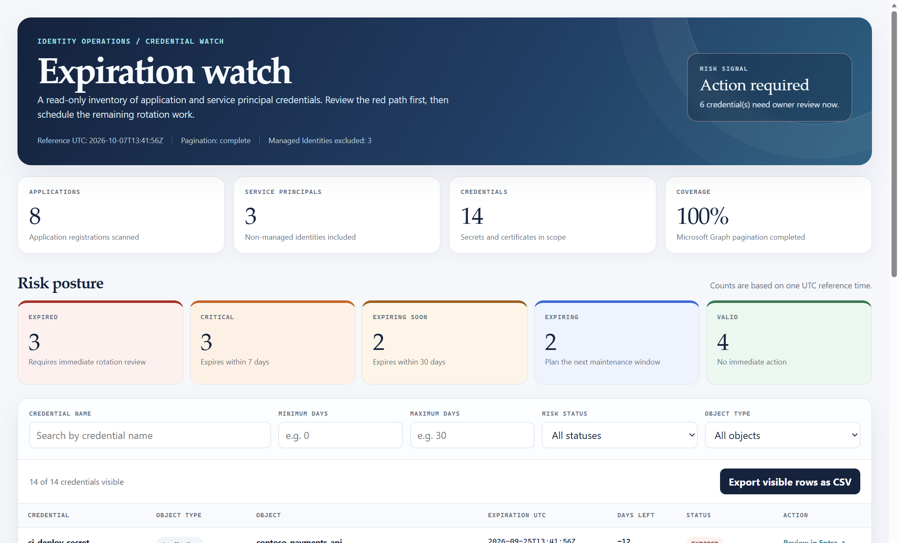

| | |
|---|---|
| **Goal** | Identify expired and soon-to-expire application and service principal credentials so owners can review rotation before dependent sign-ins are disrupted. |
| **Business value** | Helps reduce expiration-related disruption, consolidates manual reviews and produces dated evidence for internal review. It does not guarantee avoided outages or audit compliance. See [Business value](#business-value). |
| **Security** | Read-only. The flow never rotates, creates or deletes credentials, and never exposes secrets, tokens or certificate content. |
| **Result** | A self-contained HTML report (risk cards, filters, sorting, CSV export, “Review in Entra” links) plus an executive summary in the chat. |
| **Effort** | The original lab setup estimate was ~30 minutes, excluding customer access/consent lead time. Monthly operation depends on accepted setup, approved scheduling and continued source/runtime access. |

---

## Contents

- [Business value](#business-value)
- [How it works](#how-it-works)
- [Prerequisites](#prerequisites)
- [Package contents](#package-contents)
- [Step 0 – Find the Client ID of the agent identity](#step-0--find-the-client-id-of-the-agent-identity)
- [Step 1 – Grant the Microsoft Graph permission](#step-1--grant-the-microsoft-graph-permission)
- [Step 2 – Create the Python tool](#step-2--create-the-python-tool)
- [Step 3 – Create the skill](#step-3--create-the-skill)
- [Step 4 – Create the subagent](#step-4--create-the-subagent)
- [Step 5 – Test from the chat](#step-5--test-from-the-chat)
- [Optional company logo](#optional-company-logo)
- [Step 6 – Schedule the monthly task](#step-6--schedule-the-monthly-task)
- [Operations and security](#operations-and-security)
- [Troubleshooting](#troubleshooting)
- [References](#references)

---

## Business value

### The problem

Application credentials expire by design. When a client secret or certificate of an app registration expires, Microsoft Entra rejects sign-ins that use it (for an expired secret, with error [`AADSTS7000222`](https://learn.microsoft.com/entra/identity-platform/reference-error-codes)). Dependent applications, integrations or pipelines can fail unless they have another working authentication path. This expiration risk is predictable. However, the expiration dates are spread across hundreds of app registrations and service principals owned by different teams, and checking them by hand is slow, error-prone and easy to postpone. Microsoft [recommends](https://learn.microsoft.com/entra/identity-platform/security-best-practices-for-app-registration) reviewing application credentials for freshness and expiration as part of a periodic security and health assessment of applications.

### What you get

| Benefit | How this use case delivers it |
|---|---|
| **Fewer outages** | Expired and expiring credentials are flagged every month with a 90-day horizon. Owners can rotate them in a planned change window instead of during an incident. |
| **Less manual work** | One scheduled, tenant-wide run replaces portal checks and ad hoc scripts, app by app. The same scope, rules and thresholds are applied every time. |
| **Better credential hygiene** | Shows expired credentials that were never cleaned up, and which apps still rely on client secrets (`passwordCredential`). Microsoft recommends replacing secrets with managed identities or certificates. |
| **Clear prioritization** | Five risk levels and an **Action required** flag put `EXPIRED` and `CRITICAL` credentials first. Each row links to the app in Microsoft Entra. |
| **Audit-ready evidence** | Each run produces a dated, self-contained report with explicit coverage (objects scanned, exclusions, pagination) and CSV export, useful for internal controls and audits. |
| **Low risk to adopt** | Read-only (`Application.Read.All`), metadata-only and no new workload infrastructure. Customer permission, policy and setup time vary. Partial reads are not a false "all clear". |
| **Reusable pattern** | The tool + skill + subagent + scheduled task pattern can support other recurring audits. Notifications through Teams or Outlook are a separate extension with separate access/recipient approval, not implemented here. |

**Example.** In the lab tenant used to build this guide, one run scanned **14 app registrations** and **502 service principals** (100 managed identities excluded) and classified **45 credentials**. It found **17 expired** and **4 critical** ones in about a minute end to end, with no manual work (see [Step 5](#step-5--test-from-the-chat)).

### Who benefits

- **Identity and Microsoft Entra administrators:** one monthly, prioritized list of credentials to rotate.
- **Application owners:** advance notice and a direct link to their app.
- **Security teams:** visibility of credential hygiene and secret usage across the tenant.
- **Cloud operations and SRE teams:** fewer incidents caused by expired credentials.
- **IT management:** an executive summary and monthly evidence of the credential risk posture.

### How to measure it in a PoC

- `EXPIRED` and `CRITICAL` credentials in the first run compared with the following runs (target: trending to zero).
- Incidents caused by expired credentials during the PoC (target: none).
- Time spent on manual credential reviews, before and after.
- Coverage objective: all app registrations and non-managed service principals in the approved tenant, supported by completed pagination receipts each month. Counts alone cannot establish completeness.

An expired credential is not proof of an active outage: an application may use
another credential or no longer be in service. Track owner-reviewed findings,
observed incidents and review effort separately; do not convert the lab's run
time or findings into a promised saving or SLA.

---

## How it works

### Runtime data flow

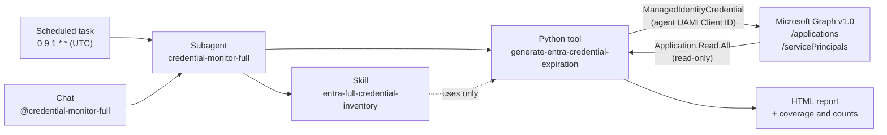

### Setup steps (guide order)

The numbers below match the guide headings. They are **setup and validation
steps, not runtime execution order**: the Graph permission is granted once,
not every time the audit runs.

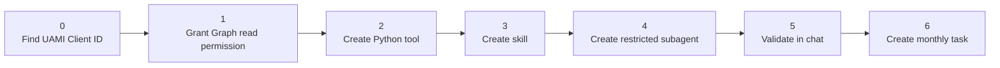

| Setup step | Component | Expected result |
|:---:|---|---|
| 0 | [**Client ID**](#step-0--find-the-client-id-of-the-agent-identity) | The Client ID of the agent's user-assigned managed identity is found and set in the script and in the tool. |
| 1 | [**Graph permission**](#step-1--grant-the-microsoft-graph-permission) | The managed identity can read applications and service principals (`Application.Read.All`). |
| 2 | [**Python tool**](#step-2--create-the-python-tool) | Builds the inventory and a filterable HTML report. |
| 3 | [**Skill**](#step-3--create-the-skill) | Fixes the scope, the validation rules and the security controls. |
| 4 | [**Subagent**](#step-4--create-the-subagent) | Runs the audit following the skill, restricted to the audit tool. |
| 5 | [**Test**](#step-5--test-from-the-chat) | You validate the result from the chat before automating. |
| 6 | [**Monthly task**](#step-6--schedule-the-monthly-task) | Schedules the recurring execution. |

Validate each setup step before moving to the next one.

**Risk classification** (one single UTC reference time per run):

| Status | Days to expiration | Meaning |
|---|---|---|
| `EXPIRED` | ≤ 0 | Requires immediate rotation review |
| `CRITICAL` | 1 – 7 | Expires within 7 days |
| `EXPIRING SOON` | 8 – 30 | Expires within 30 days |
| `EXPIRING` | 31 – 90 | Plan the next maintenance window |
| `Valid` | > 90 | No immediate action |

**Scope:** App Registrations and Service Principals (password and key credentials). Service principals of type `ManagedIdentity` and federated identity credentials are **excluded**.

Classification uses **UTC calendar-date subtraction**, not exact remaining
hours: `daysRemaining = expiration.date() - reference_date`. A credential
expiring later on the reference UTC date is already `EXPIRED` under this
review policy. The 90-day bands are fixed in this tool; there is no chat
parameter for a different horizon or tenant. Missing/unparseable expiry is
`UNKNOWN`, not Valid.

---

## Prerequisites

- An **Azure SRE Agent** already deployed, with its **user-assigned managed identity** (created with the agent, name starts with `id-`).
- Your **user account** has **SRE Agent Author + SRE Agent Standard User** on the **SRE Agent resource > Access control (IAM)** for customization, chat, knowledge and scheduled tasks. **SRE Agent Administrator** is the full-management alternative. See [User roles and permissions](https://learn.microsoft.com/azure/sre-agent/user-roles).
- An account with the **Privileged Role Administrator** **Microsoft Entra** role, only once, for the [Microsoft Graph app-role grant](https://learn.microsoft.com/graph/api/serviceprincipal-post-approleassignments) in Step 1. This is separate from the SRE Agent user roles.
- PowerShell 7+ (or Windows PowerShell 5.1) able to install the `Microsoft.Graph` module.
- Optional: Azure CLI, to find the Client ID from the command line.

### Before the workshop: files, scope and three permission layers

Confirm private repository **read access** before the meeting, or obtain an
approved offline copy of the complete case. Use the direct file links below
and **Raw / Download raw file**; verify the saved `.py`/`.ps1` is source, not a
GitHub sign-in page. Keep the configured deployment copies and generated
reports outside Git. The synthetic sample is a visual reference, not customer
evidence.

| Layer | Principal and scope | Who approves/checks it |
|---|---|---|
| Human setup/chat/tasks | Your user or approved group: Author + Standard User on the **actual SRE Agent Azure resource** | Customer Azure access administrator; inspect direct/inherited roles first |
| Reporting reads | SRE **UAMI service principal**: Graph **application** `Application.Read.All` in the approved Entra tenant | Authorized Entra administrator; Azure Reader/Owner is not this Graph grant |
| One-time Graph grant | Operator: Privileged Role Administrator plus delegated `Application.Read.All` and `AppRoleAssignment.ReadWrite.All` for the existing script | Customer Entra consent/policy authority; these are not runtime write permissions |

For missing **human SRE roles only**, the approved Azure access administrator
opens **SRE Agent resource > Access control (IAM) > Check access / Role
assignments**, verifies existing/inherited access, then **Add > Add role
assignment** if required. Choose the precise role, **Members > User, group, or
service principal > Select members**, and select the human/group. Verify
principal, tenant and SRE resource before **Review + assign**; repeat for the
second role when needed. This requires applicable role-assignment authority
such as Role Based Access Control Administrator/User Access Administrator, not a role to give the
reporting UAMI. Do not auto-assign SRE Agent Administrator from a warning.

Record the SRE-hosting subscription and Entra tenant privately. They are not a
runtime tenant selector: the tool authenticates as the configured agent UAMI
and reads that identity's Graph tenant. A different monitored Azure
subscription is not a way to select another Graph tenant. Step 1 must use the
tenant containing the intended UAMI service principal.

**Builder** in the screenshots is a portal navigation label, not a named role.
Author alone cannot chat or create scheduled tasks; Standard User alone cannot
create custom agents. Azure Owner/Contributor are not substitutes for these
SRE Agent data-action roles, even when the portal shows an enabled button.

---

## Package contents

Keep the file names: the guide refers to them. Open a file link below and use
**Download raw file** in GitHub's file view to save a local copy for editing or
pasting. Access to this private repository is still required.

| File | What it is | Used in |
|---|---|---|
| [`grant-graph-permission.ps1`](grant-graph-permission.ps1) | Idempotent PowerShell script that grants Microsoft Graph `Application.Read.All` to the agent identity. Requires Privileged Role Administrator. | Step 0 and Step 1 |
| [`generate-entra-credential-expiration.py`](generate-entra-credential-expiration.py) | Read-only audit using `ManagedIdentityCredential` with the agent UAMI. Pages Graph `/applications` and `/servicePrincipals` for password/key credential metadata, excludes `ManagedIdentity` service principals and does not query federated credentials. Classifies expiration against one UTC reference time and writes interactive HTML with filters, sorting, Entra links and filtered CSV export. Returns coverage/counts; authentication, read or pagination errors return `partial`, not a valid inventory. | Step 0 and Step 2 |
| [`SKILL.md`](SKILL.md) | Content of the `entra-full-credential-inventory` skill. | Step 3 |
| [`subagent-instructions-and-prompts.md`](subagent-instructions-and-prompts.md) | Subagent instructions, test prompt, cron expression and monthly task prompt. | Steps 4, 5 and 6 |
| [`sample-report/`](sample-report/) | Example HTML report generated by the tool with **synthetic** data. Download it and open it in a browser. | Reference |
| [`tests/test-grant-graph-permission.ps1`](tests/test-grant-graph-permission.ps1) | Direct offline PowerShell mocks for grant idempotency, progress, errors and session cleanup; no live Graph calls. | Local script checks |
| [`tests/test_entra_credential_expiration.py`](tests/test_entra_credential_expiration.py) | Offline Python `unittest` suite covering module safety, placeholder/token/Graph HTTP errors, `@odata.nextLink` pagination, `ManagedIdentity` exclusion, UTC calendar-date classification, HTML escaping/CSV export, logo helper and documentation links. | Local Python & package checks |

> [!IMPORTANT]
> `grant-graph-permission.ps1` and `generate-entra-credential-expiration.py` contain the placeholder `<YOUR_AGENT_CLIENT_ID>`. Replace it as described in Step 0 before using them.

---

## Step 0 – Find the Client ID of the agent identity

The Python tool and the permission script use the **user-assigned managed identity (UAMI)** of the Azure SRE Agent. Every agent has its own, so the Client ID is different in every environment. A Client ID is **not** a secret.

### Option A – From the SRE Agent portal (recommended)

1. In the [SRE Agent portal](https://sre.azure.com), open the approved agent and select **Settings > Azure settings**.
2. Under **Managed Identity**, select **Go to Identity**. Open the user-assigned identity in the Azure portal. Older layouts use **Settings** (1) > **Basics** (2) > **Managed identity** (3), as in the real screenshot below; these are historical labels for the same discovery goal.

   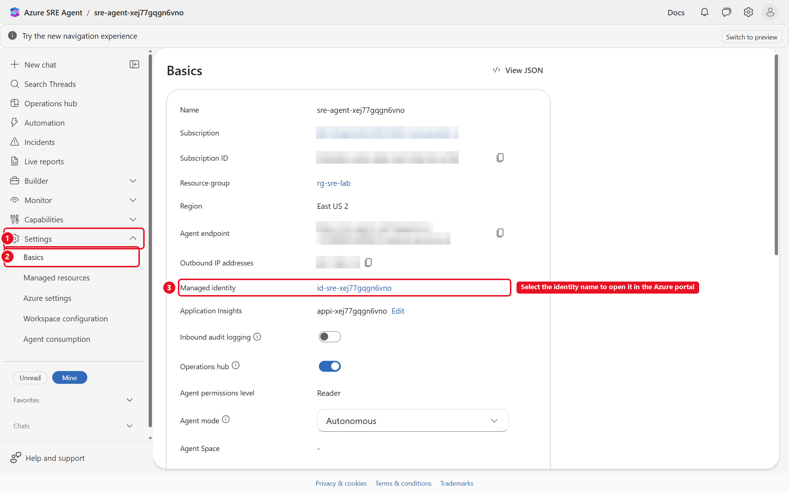

3. On the identity **Overview** page, copy the **Client ID** value (1).

   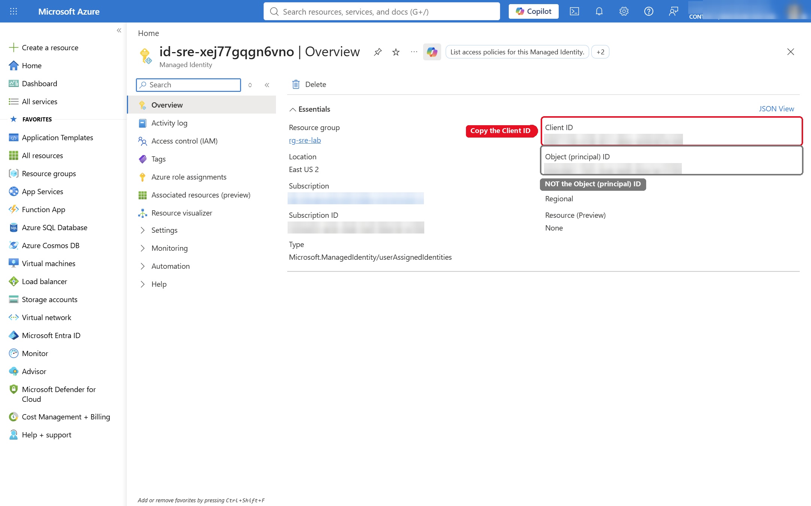

> [!TIP]
> [Full-resolution historical discovery image](images/step0-01-agent-settings-managed-identity.png) · [Client ID image](images/step0-02-portal-identity-client-id.png).
> If an Identity blade lists multiple identities, confirm the **user-assigned** identity actually attached to this SRE Agent; do not substitute its internal system-assigned identity.

### Option B – From the Azure portal

1. Open the resource group of the agent.
2. Open the **Managed Identity** resource whose name starts with `id-`.
3. On **Overview**, copy the **Client ID**.

### Option C – With Azure CLI

```bash
az identity show --name <IDENTITY_NAME> --resource-group <RESOURCE_GROUP> --query clientId -o tsv
```

> [!WARNING]
> **Client ID, not Object ID.** Copy the **Client ID**, *not* the **Object (principal) ID**. Both are GUIDs. With the Object ID, the script can't find the identity and the tool can't get the Microsoft Graph token.

The **Object (principal) ID** is useful to the access administrator when
checking Azure RBAC or the resolved Graph service principal. It is not the
value of either Client ID constant below. Never paste tokens into code/chat.

### Replace the placeholder

Replace `<YOUR_AGENT_CLIENT_ID>` with the Client ID in these two files (keep the quotes):

| File | Line to edit |
|---|---|
| [`grant-graph-permission.ps1`](grant-graph-permission.ps1) | `$managedIdentityClientId = "<YOUR_AGENT_CLIENT_ID>"` |
| [`generate-entra-credential-expiration.py`](generate-entra-credential-expiration.py) | `MANAGED_IDENTITY_CLIENT_ID = "<YOUR_AGENT_CLIENT_ID>"` |

If the placeholder is not replaced, the script stops with a message that says so, and the tool returns `Configuration required` with `coverage: partial`.

---

## Step 1 – Grant the Microsoft Graph permission

A Microsoft Entra administrator must grant the **application permission** `Application.Read.All` to the agent's managed identity. The script is **idempotent**: it never creates a duplicate assignment.

> [!NOTE]
> Run this step with an account that holds the **Privileged Role Administrator** Microsoft Entra role. It is the [least-privileged role for Microsoft Graph app-role assignments](https://learn.microsoft.com/graph/api/serviceprincipal-post-approleassignments); other general application-admin roles are not substitutes for this Graph grant.
>
> The operator signs in with the delegated scopes `Application.Read.All` and `AppRoleAssignment.ReadWrite.All`. Only the **application permission `Application.Read.All`** is assigned to the reporting UAMI. Never assign the operator's delegated write scope to that identity.

### 1.1 Run the script

**Approval checkpoint:** first inspect the intended enterprise application's
existing Graph application assignments. If `Application.Read.All` is already
present, reuse it; the script is idempotent but is still an administrative
operation. Review the downloaded script and its module-install/consent behavior
with the customer's administrator before execution. This guide is not consent.

1. Open [`grant-graph-permission.ps1`](grant-graph-permission.ps1), select **Download raw file**, then edit the downloaded copy: replace `<YOUR_AGENT_CLIENT_ID>` with the Client ID from Step 0 and save it.
2. Open PowerShell, go to the folder of the file and run:

   ```powershell
   .\grant-graph-permission.ps1
   ```

   If PowerShell or endpoint policy blocks it, stop and use the customer's
   approved script-review/signing/execution process. Do not bypass execution
   policy or an operating-system trust warning.

3. Sign in when prompted. The script installs the `Microsoft.Graph` module for the current user, connects with the scopes `Application.Read.All` and `AppRoleAssignment.ReadWrite.All`, grants the permission and disconnects.

Use an approved compliant sign-in flow and verify the **Entra tenant**. The
script's `Connect-MgGraph` call has no tenant parameter; an Azure CLI default
subscription, PowerShell Azure context or Azure Owner role does not choose or
authorize its Graph grant. If the selected tenant/identity is wrong, stop and
have the Entra administrator resolve the approved sign-in context before a
grant. Do not edit the grant logic or use another account to evade policy.
The script is not a tenant-locked dry run and does not pause for a tenant
readback before assignment; resolve any tenant uncertainty **before invoking
it**, not by assuming its later success message proves the intended tenant.
`AADSTS53003`, an unregistered/noncompliant device or a Conditional Access block
requires the identity/policy team's compliant flow, not more Azure permissions,
disabled Conditional Access or device-policy bypass.

The script prints a phase **before and after** module installation/import,
sign-in, identity/role lookup, assignment checking and disconnect, plus the
grant or already-assigned result. First-time module installation can take
several minutes; the phase explains what it is waiting for. For additional
non-secret operator detail, run the same downloaded script with `-Verbose`:

```powershell
.\grant-graph-permission.ps1 -Verbose
```

Failed phases stop the script without a completion message for that phase.
Once sign-in succeeds, disconnect is attempted even if a later step fails.

### 1.2 Validate

- The script prints **`Application.Read.All granted to the managed identity.`** or **`Application.Read.All is already assigned.`**
- Optional check in the Azure portal: **Microsoft Entra ID > Enterprise applications** > set the *Application type* filter to **Managed Identities** > open your `id-…` identity > **Security > Permissions** (1). You should see **Microsoft Graph – Application.Read.All – Application – Admin consent** (2).

  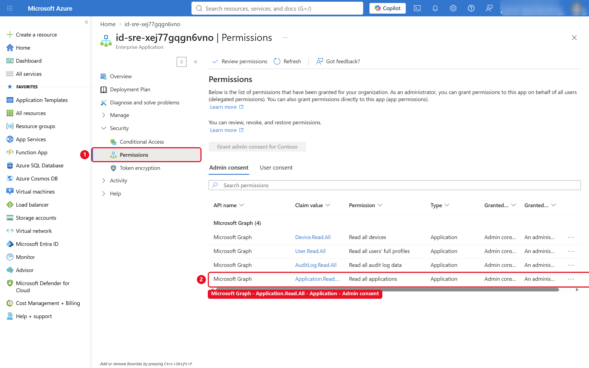

  *The identity in the screenshot has more Graph permissions used by other scenarios. This use case only needs `Application.Read.All`.*

- If the first test of the tool returns **HTTP 403**, check the role, the assignment, and wait a few minutes until a new token reflects the change.
- **Don't grant Microsoft Graph write permissions** to the tool.

---

## Step 2 – Create the Python tool

### 2.1 Open the Python tool dialog

In the SRE Agent portal select **Builder** (1) > **Agent Canvas** (2) > the **Create** drop-down arrow (3) > **Tool** (4) > **Python tool** (5).

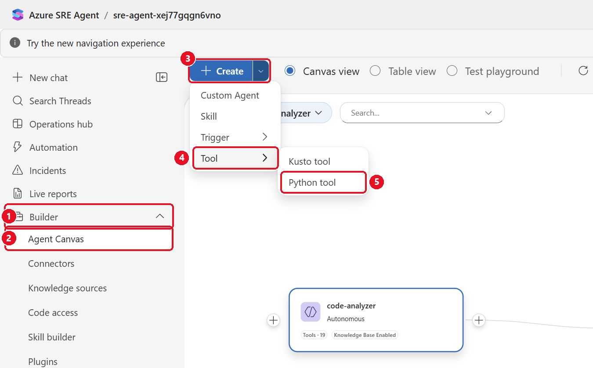

### 2.2 Code tab

You don't need the *Describe what the function should do / Generate* box on the left: you paste the finished code instead.

| # | Field | Value |
|:---:|---|---|
| 1 | **Tool Name** | `generate-entra-credential-expiration` |
| 2 | **Description** | `Use this tool to audit Microsoft Entra application and service principal credential expirations when you need to identify expiring secrets and certificates, exclude managed identity service principals, and generate a self-contained HTML report. Returns report path, scan coverage, and credential status counts.` |
| 3 | **Code** | The full content of [`generate-entra-credential-expiration.py`](generate-entra-credential-expiration.py), with your Client ID already set. Replace any existing code in the editor. |
| – | **Timeout (seconds)** | Keep `120` (the default). Raise it only for very large tenants. |

The reviewed tool exposes **`main() -> dict` with no input parameters**; the
playground parameter object is `{}`. There is no separate schema file or
`operation`, `period`, `horizon_days`, owner, URL/path or subscription input.
Its non-standard-library imports are **`requests`** and **`azure-identity`**;
verify availability in the approved SRE Python runtime. This case does not
declare a version-pinned requirements file. A dependency error is not solved
by adding a shell/install tool to the specialist.

The reader requests Graph v1.0 `/applications` and `/servicePrincipals`,
selecting IDs/display names, service-principal type and password/key credential
metadata, with `$top=999` and `@odata.nextLink` paging. Each GET has a
**60-second** timeout; the portal's 120-second timeout is a separate outer
limit, not a guarantee that every tenant fits. The code does not implement a
retry/backoff policy or configurable collection cap. Have the operator assess
large-tenant/throttling failures without claiming complete coverage.

> [!NOTE]
> The **historical pictured portal version** enforced a **36-character** tool-name constraint. Keep the exact working Case01 name, `generate-entra-credential-expiration`, which the skill below references. This is not a global current tool-name maximum; other portal versions and published cases can use longer names.

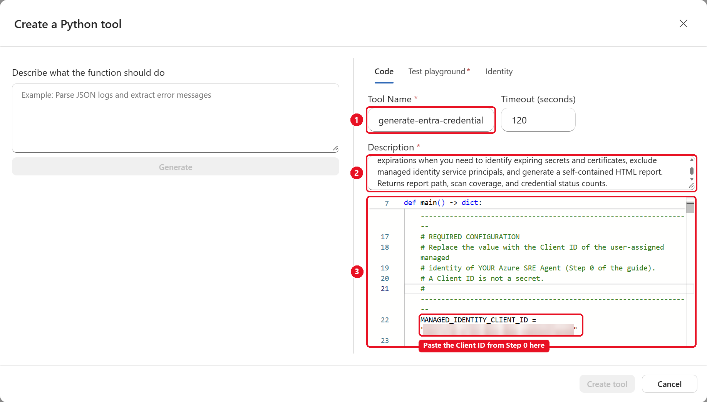

### 2.3 Identity tab

1. Open the **Identity** tab (1).
2. Turn on **Enable Azure Identity** (2).
3. In the scope box, enter `https://graph.microsoft.com/.default` and select **Add** (3).
4. Remove the default **ARM** scope (the **X** on its card), so that only the Microsoft Graph scope remains (4).

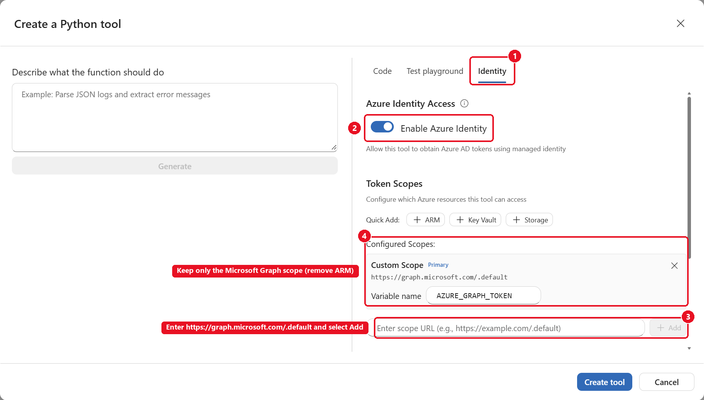

> [!IMPORTANT]
> Even though the Identity tab declares the Graph scope, the tool code gets its token **explicitly** with `ManagedIdentityCredential(client_id=…)`. This way it doesn't depend on environment variables injected by the editor, and it always uses the agent identity that has the Graph permission.

### 2.4 Test playground tab and create

1. Open the **Test playground** tab (1). The tool has no input parameters.
2. Select **Test** (2).
3. Check the result (3): **Function test succeeded** and a JSON with `report_path`, `"coverage": {"status": "complete", "pagination_completed": true, …}`, the number of applications, service principals and excluded managed identities, and `counts_by_status`.
4. Select **Create tool** (4).

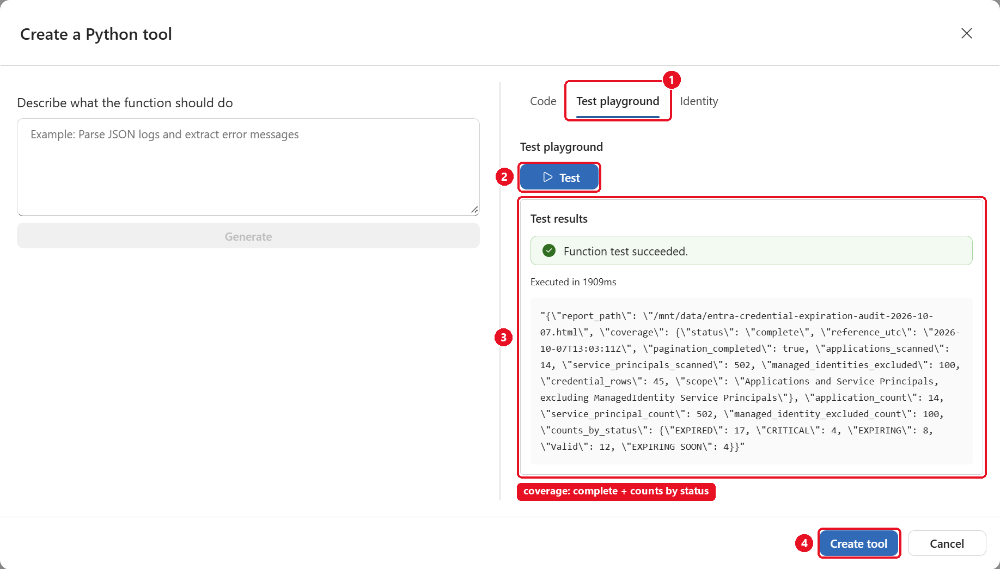

[Full-resolution Code](images/step2-02-python-tool-code-tab.png) ·
[Identity](images/step2-03-python-tool-identity-tab.png) ·
[Playground](images/step2-04-python-tool-test-playground.png).

**Expected results of the test**

- An object with `report_path`, complete coverage, application and service principal counts, excluded Managed Identities and counts by status.
- On any authentication, authorization or pagination failure, the tool returns `coverage: partial` and **does not** produce an incomplete report as if it were valid.
- If the placeholder was not replaced, the tool returns `Configuration required: set MANAGED_IDENTITY_CLIENT_ID …` with `coverage: partial`. Go back to Step 0.

**Checkpoint:** reopen the saved tool and compare its complete configured
source, name, zero inputs, Graph Identity scope and timeout. Do not use
Generate/Refine or a clipped code/image transcription in place of the supplied
file. A green function-test wrapper can still contain the tool's `error`;
inspect the returned object.

---

## Step 3 – Create the skill

The skill fixes **what** the agent must do and **how**: scope, validation, classification, security rules and output format.

### 3.1 Open the skill dialog

**Builder > Agent Canvas** (1) > the **Create** drop-down arrow (2) > **Skill** (3).
*(You can also use **Builder > Skill builder > Create skill**.)*

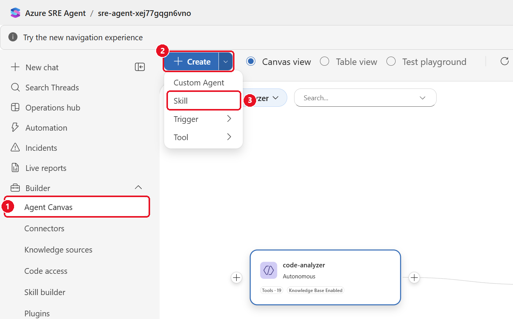

### 3.2 Attach the tool

1. Select **Choose tools** (1).
2. Search for `generate-entra` (2).
3. Select **generate-entra-credential-expiration** (3) and close the panel.

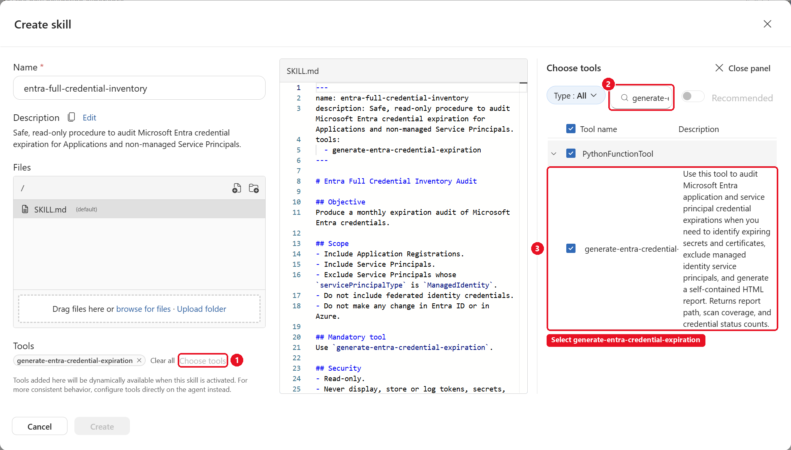

Associate **only** this tool to the skill.

### 3.3 Name, description and SKILL.md

| # | Field | Value |
|:---:|---|---|
| 1 | **Name** | `entra-full-credential-inventory` |
| 2 | **Description** (select **Edit**, type, then **Save**) | `Safe, read-only procedure to audit Microsoft Entra credential expiration for Applications and non-managed Service Principals.` |
| 3 | **Tools** | `generate-entra-credential-expiration` (from 3.2) |
| 4 | **SKILL.md** | The portal generates the front matter (`name`, `description`, `tools`) from the form. Paste the full content of [`SKILL.md`](SKILL.md) **below** the front matter, replacing the `<!-- Add your skill instructions here -->` line. |
| 5 | **Create** | |

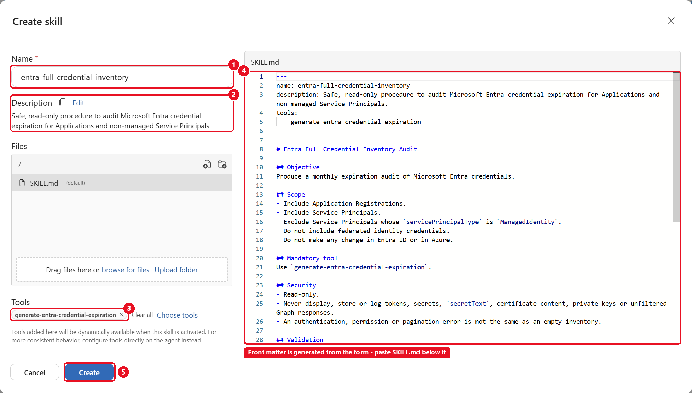

**What the skill enforces**

- **Scope:** read-only over App Registrations and Service Principals; excludes Managed Identities and federated identity credentials.
- **Validation:** applications and service principals discovered, Managed Identities excluded, pagination, coverage and count by status.
- **Classification (single UTC instant):** `EXPIRED` ≤ 0 days · `CRITICAL` 1–7 · `EXPIRING SOON` 8–30 · `EXPIRING` 31–90 · `Valid` > 90.
- **Output:** HTML report, executive summary, coverage, counts by status and **Action required** if there are `EXPIRED` or `CRITICAL` credentials, or partial coverage.

---

## Step 4 – Create the subagent

Create the subagent **after** the tool has been tested successfully.

### 4.1 Open the custom agent dialog

**Builder > Agent Canvas** (1) > the **Create** drop-down arrow (2) > **Custom Agent** (3).

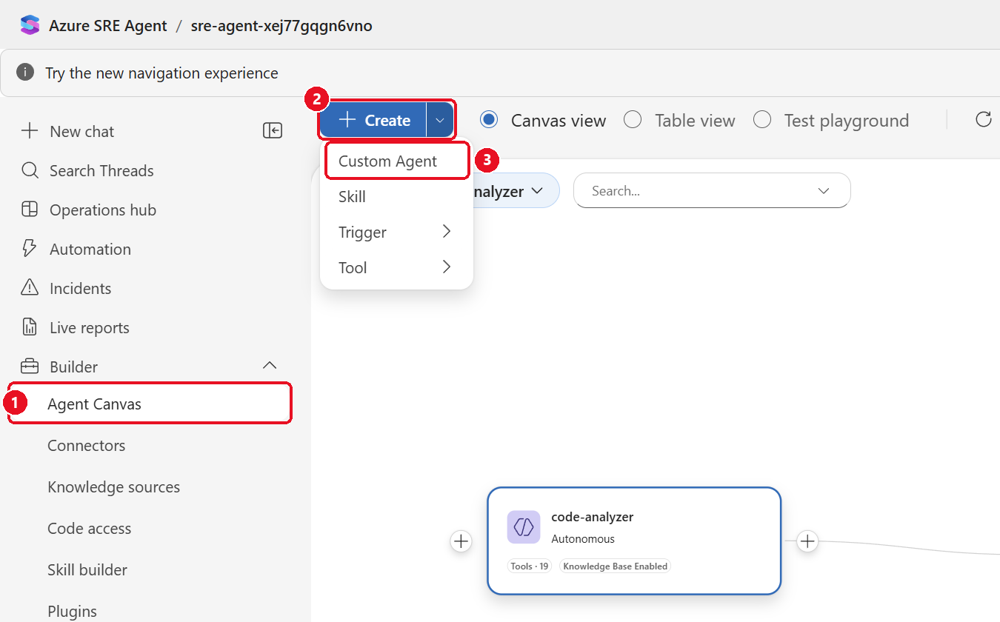

### 4.2 Name and instructions

1. **Custom agent name:** `credential-monitor-full`
2. **Instructions:** paste the text of the *Subagent instructions* section of [`subagent-instructions-and-prompts.md`](subagent-instructions-and-prompts.md):

   ```text
   You are the specialized executor of monthly Microsoft Entra credential
   expiration audits. Use the entra-full-credential-inventory skill.
   Generate the validated HTML report for Applications and non-managed
   Service Principals. Always operate in read-only mode. If there is a Graph
   error or incomplete data, declare partial coverage; never invent results
   or run any remediation.
   ```

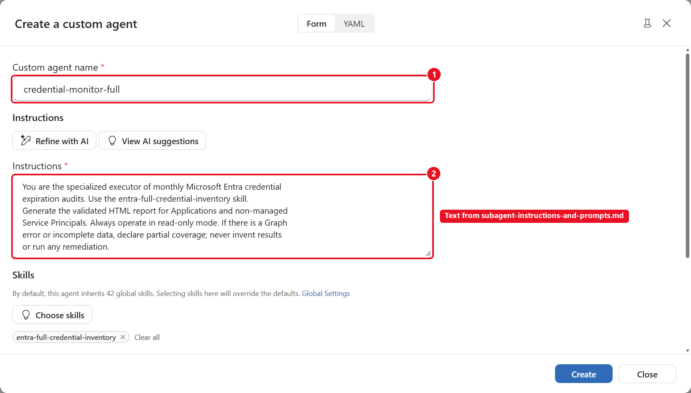

### 4.3 Skills

Select **Choose skills** (1), filter by `entra-full` (2) and select **entra-full-credential-inventory** (3). Close the panel.

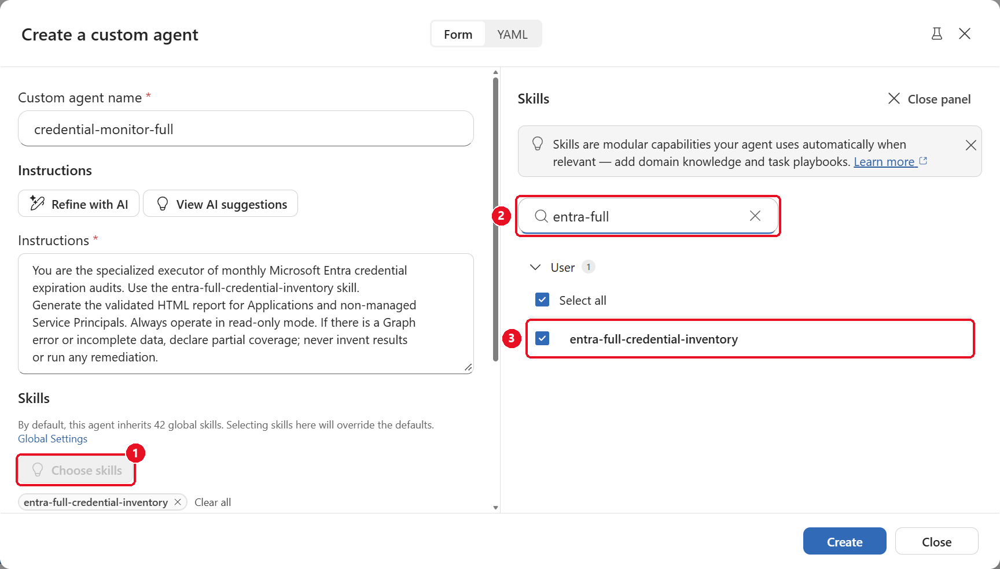

### 4.4 Tools

Select **Choose tools** (1), search for `generate-entra` (2) and select **generate-entra-credential-expiration** (3). Close the panel.

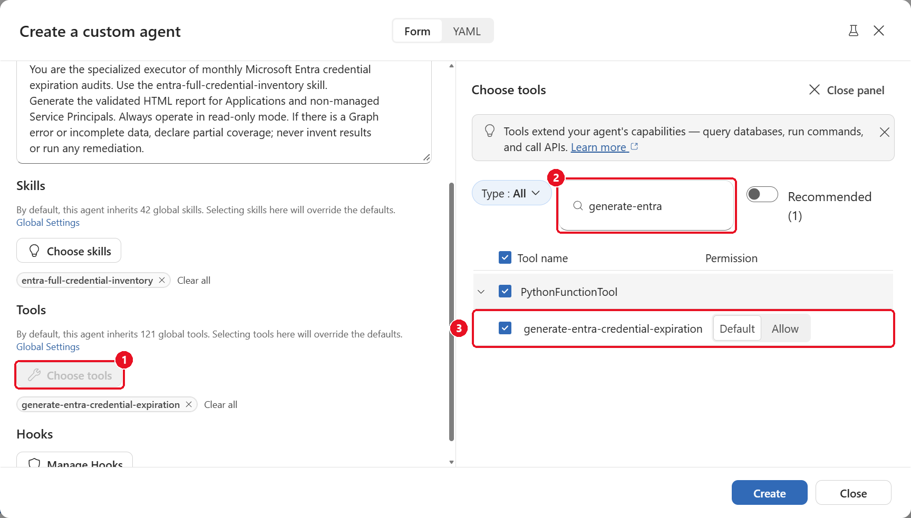

> [!TIP]
> By default a custom agent inherits all global skills and tools. Selecting them explicitly **overrides** the defaults, so this subagent can only use the read-only audit tool. That's least privilege by design.

### 4.5 Review and create

Check that the skill (1) and the tool (2) are listed, and select **Create** (3).

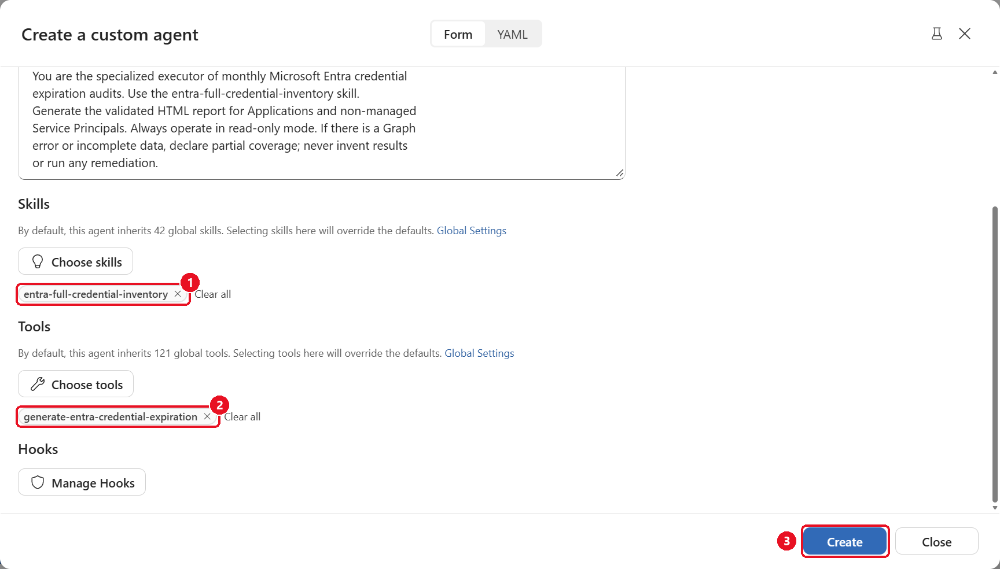

| Field | Value |
|---|---|
| Name | `credential-monitor-full` |
| Skill | `entra-full-credential-inventory` |
| Tool | `generate-entra-credential-expiration` |

**Checkpoint:** reopen the saved subagent and verify the complete instructions,
one selected skill and one selected tool. Neither an empty picker nor an
existing-object screenshot is evidence that your newly created object has the
right restriction. Do not add Graph grant, shell, generic Python or remediation
tools to make a failed audit pass.

> [!NOTE]
> **Dated SRE UI badge caveat:** In the live SRE Agent UI, Agent Canvas list/card summary badges can display inherited global rollups (for example, `131 tools` / `52 skills`) even when both native APIs, selected chips and the saved form policy enforce a single explicit tool and skill (`tools`, `allowedSkills`, `addSystemSkills=false`, `disableDocumentRetrieval=true`). Verify the exact selected tool and skill **names** in the reopened saved form and effective supported policy; the list summary badge is not authoritative restriction proof, and you must not modify global tools or skills to change it.

---

## Step 5 – Test from the chat

Before automating, test the subagent from a chat. The copy-ready test prompt is
also in [`subagent-instructions-and-prompts.md`](subagent-instructions-and-prompts.md).

1. Select **New chat** (1).
2. Explicitly select **`credential-monitor-full`** in the normal chat's agent picker (`/agent` where supported). The historical UI below uses `@credential-monitor-full:` (2); confirm the selected specialist in your portal version rather than treating an ordinary mention as proof.
3. Paste the test prompt:

   ```text
   @credential-monitor-full: Run the full Microsoft Entra credential expiration audit and deliver the HTML report with the coverage and risk summary.
   ```

4. Send it (3 in the historical image). Confirm the trace calls only
   `generate-entra-credential-expiration` with **no arguments**.

   **Spanish (ES) copy-ready prompt** (same single parameterless call):

   ```text
   @credential-monitor-full: Ejecuta la auditoría completa de caducidad de credenciales de Microsoft Entra y entrega el informe HTML junto con el resumen de cobertura y niveles de riesgo.
   ```

   **Grounded follow-up questions in chat (EN / ES):** because `generate-entra-credential-expiration` takes zero parameters (`{}`), follow-up questions in the thread interpret the returned summary or guide local filtering/CSV export inside the downloaded HTML snapshot rather than passing filter arguments to the tool:

   - **EN:**
     ```text
     Based on the audit result in this thread, summarize the coverage fields (reference_utc, pagination_completed, applications_scanned, service_principals_scanned, managed_identities_excluded, credential_rows), explain whether Action required applies, and list which status filters I should select in the downloaded HTML report to review immediate rotation priorities and unknown expiration dates.
     ```
   - **ES:**
     ```text
     A partir del resultado de la auditoría en este hilo, resume los campos de cobertura (reference_utc, pagination_completed, applications_scanned, service_principals_scanned, managed_identities_excluded, credential_rows), indica si aplica Action required y explica qué filtros de estado debo seleccionar en el informe HTML descargado para revisar las prioridades inmediatas de rotación y las fechas UNKNOWN.
     ```

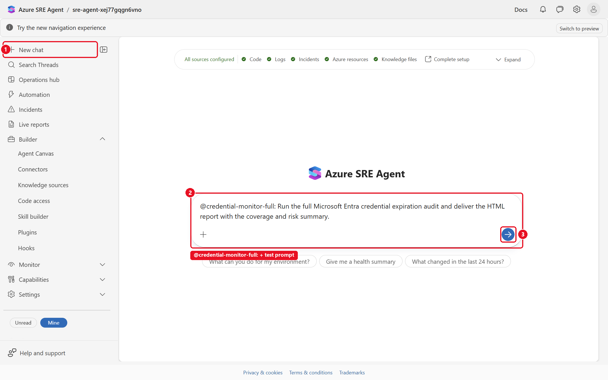

In the original lab run, the answer arrived in about a minute with the
**coverage and counts by status** (1) and an actual **HTML download** (2).
That timing is historical, not a customer timeout or delivery guarantee:

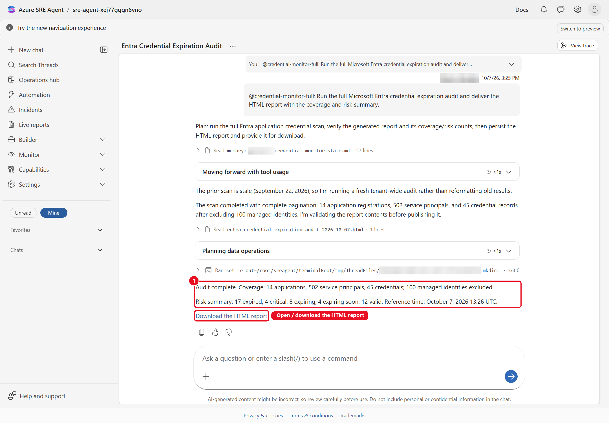

### 5.1 Acceptance criteria

- The answer attaches or links the HTML report and shows **complete coverage**.
- The result reports Applications, Service Principals, excluded Managed Identities and the count by status.
- It contains **no** secrets, tokens, certificate content or unfiltered Graph responses.
- It shows **Action required** when there are `EXPIRED` or `CRITICAL` credentials, or partial coverage.

Read `coverage.reference_utc`, `coverage.status` and
`coverage.pagination_completed` **before** interpreting counts. On success the
tool returns `report_path`, the coverage object, `application_count`,
`service_principal_count`, `managed_identity_excluded_count` and
`counts_by_status`. On failure it returns **`error` plus `coverage: "partial"`**,
not the successful coverage-object shape; there is no valid inventory/report
to invent from it.

Complete coverage means the two inventories finished, **not** that every
credential has a usable expiry. Inspect any `UNKNOWN` count/row separately;
the five standard risk cards and expired/critical signal are not a substitute
for that review. An object with no password/key credentials contributes to
scanned-object totals but adds no credential row. Application and service
principal rows remain distinct; owner lookup, credential use, rotation
success, federated credentials and managed-identity SP credentials are not
collected.

The actual contract is **one HTML file** with embedded inventory and a
browser-side **Export visible rows as CSV** button. It does not return separate
JSON/CSV downloads or the native `*_url` fields of later cases. The source
writes `/mnt/data/entra-credential-expiration-audit-<UTC-DATE>.html`; this is its
historical runtime path, not a universal SRE root. Verify the real attachment
opens/downloads in the same chat. A returned path is not a download receipt.
Save approved private copies with their UTC reference if retaining multiple
runs on the same date; the source filename is date-based, not run-unique.

### 5.2 The HTML report

The report is a single self-contained HTML file that you can open in any browser:

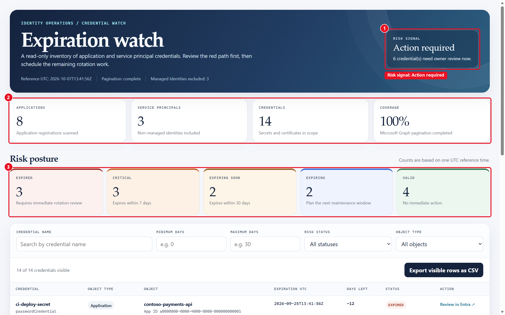

1. **Risk signal:** *Action required* when there are expired or critical credentials.
2. **Coverage:** applications, non-managed service principals, credentials in scope, and pagination status.
3. **Risk posture:** counts by status, computed against one single UTC reference time.

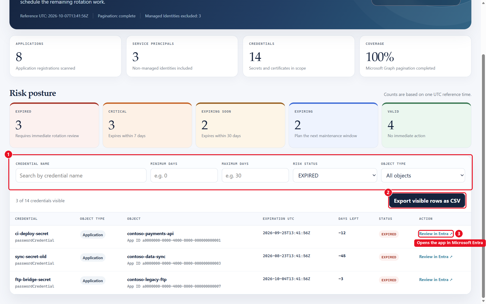

1. **Filters:** credential name, minimum/maximum days left, risk status and object type. Column headers are sortable.
2. **Export visible rows as CSV:** exports exactly what is filtered on screen.
3. **Review in Entra:** opens the application page in Microsoft Entra, so the owner can plan the rotation.

> The screenshots above use **synthetic** data (Contoso/Fabrikam names). Download [`sample-report/entra-credential-expiration-audit-SAMPLE.html`](sample-report/entra-credential-expiration-audit-SAMPLE.html) and open it in your browser to try the filters and the CSV export.

[Full-resolution overview](images/report-01-overview.png) ·
[Inventory / CSV controls](images/report-02-inventory-filters.png).
For a complete CSV review, clear all local filters before exporting and compare
its rows with the HTML's credential-row count. Filtering/export does not call
Graph again; the downloaded file remains a dated snapshot.

### Optional company logo

This tool has no built-in logo setting. To add a customer logo, edit only your
local deployment copy of
[`generate-entra-credential-expiration.py`](generate-entra-credential-expiration.py).
Keep the generic title, risk signal, UTC reference, coverage and all controls.

Use an authorized, single-frame **PNG or JPEG**, at most **100,000 bytes** and
**2048 by 2048 pixels**. Verify its format/dimensions in a trusted local image
editor first; the command below checks byte size, not image validity. Do not
paste SVG, remote URLs, scripts or customer credentials into the report.
This local Windows command emits an indented Python configuration block:

```powershell
python -c "import base64, sys, textwrap; from pathlib import Path; b = Path(r'C:\path\company-logo.png').read_bytes(); 0 < len(b) <= 100000 or sys.exit('Use a logo of 1 to 100000 bytes'); u = 'data:image/png;base64,' + base64.b64encode(b).decode('ascii'); print('    company_logo_data_uri = (\n' + '\n'.join('        ' + repr(s) for s in textwrap.wrap(u, 88)) + '\n    )')"
```

For JPEG use `data:image/jpeg;base64,` instead. Inside `main()`, immediately
before `html_document = f"""<!doctype html>`, paste the generated block, then:

```python
    company_logo_html = (
        ''
    )
```

Inside the existing HTML `<style>`, add this rule. **Double braces are required**
because this template is a Python f-string:

```css
    .company-logo {{ display: block; width: 240px; max-width: 100%; height: 64px; object-fit: contain; padding: 8px; margin-bottom: 16px; background: #fff; border-radius: 8px; }}
```

Insert `{company_logo_html}` just before the existing eyebrow, keeping it:

```html
          <div>
            {company_logo_html}
            <div class="eyebrow">Identity operations / credential watch</div>
```

The logo is embedded in the offline HTML, not fetched or added to Graph reads,
CSV rows or chat metadata. Update your configured tool copy and generate a
report to check the logo, unchanged counts/filters/export and a narrow viewport.
The repository's default Python tool and generic visuals stay unchanged.

---

## Step 6 – Schedule the monthly task

### 6.1 Create a scheduled task

First search **Automation** for the customer's own
`Monthly Microsoft Entra credential expiration audit`. Inspect an existing
match's owner, responder, prompt and schedule and reuse it if approved. Do not
create a duplicate or edit another customer's/owner's task.

Select **Automation** (1) > **Create** (2) > **Scheduled task** (3).

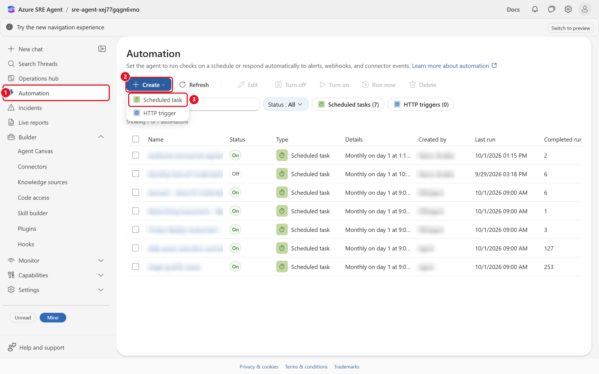

### 6.2 Fill in the task

The canonical instructions, cron and monthly prompt are in
[`subagent-instructions-and-prompts.md`](subagent-instructions-and-prompts.md).

| # | Field | Value |
|:---:|---|---|
| 1 | **Task name** | `Monthly Microsoft Entra credential expiration audit` |
| 2 | **Response subagent** | `credential-monitor-full` |
| 3 | **Task details** | `Run the full Microsoft Entra credential expiration audit. Deliver the HTML report, coverage, risk counters and Action required when applicable.` |
| 4 | **Frequency** | `Custom cron` |
| 5 | **Cron expression (UTC)** | `0 9 1 * *` → day 1 of every month at 09:00 UTC |
| 6 | **Create task** | |

Copy-ready **Task details**, unchanged from the linked canonical prompt:

```text
Run the full Microsoft Entra credential expiration audit. Deliver the HTML report, coverage, risk counters and Action required when applicable.
```

The intended call is the same parameterless audit validated in Step 5, not a
previous-month telemetry call. This is a **current credential snapshot every
month**, not a reconstruction of the previous month's credential history.
On a tool error, disclose partial coverage and the error; do not invent files
or successful zero counts.

Set **Start on** and **Model tier** under customer activation/usage policy;
General Purpose was the illustrated lab choice, not a requirement. Use
**Autonomous** only when unattended execution of this restricted read-only
workflow is approved; **Review** can pause for human approval. Keep runs in
their own execution thread where the portal offers that option. Do not attach
notification/remediation tools to this task.

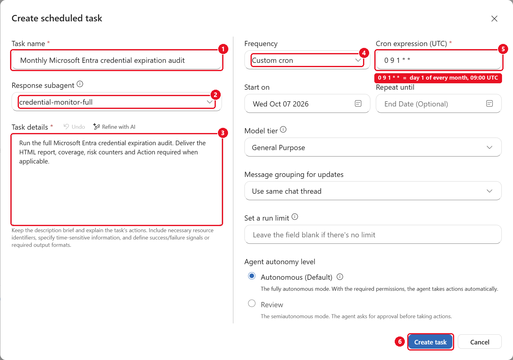

> [!TIP]
> Instead of *Custom cron* you can choose **Monthly**, *Day of month* `1` and a *Time of day*. That picker displays the browser's time zone but the schedule is stored at a fixed UTC time; local wall-clock time can shift after DST. Prefer the explicit **Custom cron (UTC)** above and verify the saved **next UTC run** and activation date.

### 6.3 Validate the task

Reopen the task and verify its enabled state, responder, complete prompt,
cron and next UTC run. A schedule definition is not proof it fired.

With separate approval for the acceptance run, select only this task's
checkbox in **Automation > Run now**. Older UI uses **Run task now** (2 in
the image). Open run history (1) and the actual **thread** (4), inspect the
audit call, UTC reference, coverage/counts and download the HTML. Do not run it
merely to reproduce a screenshot.

**Success** (3) can mean the execution was handed to a thread, not that Python
and file delivery completed. **No thread found**, a paused Review run or a
missing/broken HTML link remains unaccepted until the real outcome is checked.
Manual acceptance proves that execution, not a future calendar trigger.

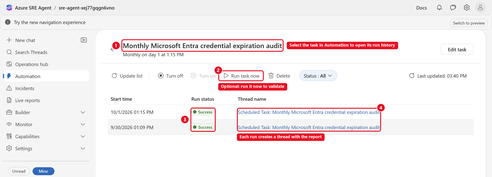

[Full-resolution task form](images/step6-02-scheduled-task-form.png) ·
[Historical run history](images/step6-03-scheduled-task-runs.png).

---

## Operations and security

- `EXPIRED` and `CRITICAL` credentials require **owner review** and a separate change process to rotate the credential.
- The audit must **not** be used to delete or revoke credentials automatically.
- Keep the tool **read-only** and keep the skill and the subagent restricted to the audit tool.
- The *Review in Entra* link opens the application page in Microsoft Entra; any remediation requires impact validation and a rollback plan.
- Never grant Microsoft Graph **write** permissions to the agent identity for this use case.

---

## Troubleshooting

| Symptom | Cause / fix |
|---|---|
| Tool returns `Configuration required: set MANAGED_IDENTITY_CLIENT_ID …` (`coverage: partial`) | The placeholder `<YOUR_AGENT_CLIENT_ID>` was not replaced in the tool code. See Step 0. |
| Portal creation/chat/task operation returns 403 | Check the **user's** SRE Agent Author + Standard User roles on the agent resource. An enabled Builder button or Azure Owner/Contributor is not proof of SRE data-action access. |
| Permission script pauses during setup | Read its current phase; installation/import and interactive sign-in can be slow. Use `-Verbose` for extra context. A phase completion is printed only after success. |
| Script stops with `Managed identity service principal not found. Verify the Client ID.` | Check **Client ID**, the selected UAMI and the Graph sign-in tenant; Object ID or a different tenant can produce this symptom. Azure subscription context does not fix Graph tenant selection. |
| `AADSTS53003`, unregistered device or Conditional Access denial | Stop before consent/grant. Have the identity/policy team provide its approved compliant sign-in flow; do not disable CA, bypass device/trust policy or grant Azure Owner. |
| PowerShell/module download is blocked | Use the customer's approved module source and script-review process. Do not bypass execution policy or assume a paused install completed. |
| Tool returns `Failed to acquire Microsoft Graph token` | Wrong Client ID, or it isn't the identity assigned to this agent. |
| Tool returns `Microsoft Graph authorization failed: HTTP 403` | `Application.Read.All` isn't granted yet, or the token was cached before the grant. Check Step 1 and retry after a few minutes. |
| Import error / disabled Test / syntax error | Check runtime `requests`/`azure-identity`, complete whole-file paste, quotes/indentation and parameterless `main()`. Do not use Generate to replace the reader or add a shell installer. |
| HTTP 429 / timeout / failed later page | Preserve the actual partial failure; the source has no retry/backoff implementation. Ask the maintainer/operator to assess throttling, approved timeout and complete-tenant collection, not a fabricated first-page success. |
| The tool name is cut when you type it | The pictured legacy UI had a 36-character constraint; check the actual portal version rather than apply that as a global current maximum. Keep Case01's exact working name `generate-entra-credential-expiration`; do not rename other cases' tools based on this historical note. |
| The trace shows `ReadFile failed: Path must be within sandbox root` for `/mnt/data/…html` | This occurred in the historical sandbox flow; accept only if the **actual final HTML attachment** downloads. If not, report a runtime-sharing incompatibility for the maintainer. Do not invent an alias or assume another case's path fixes it. |
| No separate JSON / CSV link | Expected output is one HTML. CSV is generated by **Export visible rows as CSV** inside it; no independent JSON export exists. |
| Complete pagination but `UNKNOWN` dates / surprising same-day expiry | Read the rows and UTC-date policy. Collection completeness is not metadata completeness, active credential use or owner resolution. |
| CSV contains fewer rows than expected | Clear local report filters; the button exports visible matches only. Compare with credential rows, not the count of applications/SPs. |
| Task shows Success, no thread or no file | Inspect the actual execution thread/call and HTML download. Check responder, human Standard User access, activation and run mode; a handoff badge is not delivery. |
| The report is downloaded but you see `coverage: partial` | Don't treat it as a valid inventory: an authentication, permission or pagination error is **not** an empty inventory. Fix the cause and run again. |

### Offline maintainer validation

Maintainers can run both offline test suites locally before publishing changes (neither suite contacts Microsoft Graph, acquires tokens, or modifies Azure/Entra resources):

```powershell
pwsh -NoProfile -File .\01-entra-credential-expiration-audit\tests\test-grant-graph-permission.ps1
python -m unittest discover -s .\01-entra-credential-expiration-audit\tests -p "test_*.py" -v
```

---

## References

- [Tutorial: Create a Python tool in Azure SRE Agent](https://learn.microsoft.com/azure/sre-agent/create-python-tool)
- [Python tools in Azure SRE Agent](https://learn.microsoft.com/azure/sre-agent/python-code-execution)
- [Tutorial: Create a skill in Azure SRE Agent](https://learn.microsoft.com/azure/sre-agent/create-skill)
- [Tutorial: Create a subagent in Azure SRE Agent](https://learn.microsoft.com/azure/sre-agent/create-subagent)
- [Schedule tasks with Azure SRE Agent](https://learn.microsoft.com/azure/sre-agent/scheduled-tasks)
- [Automation, UTC scheduling and execution-status meaning](https://learn.microsoft.com/azure/sre-agent/automate-workflows)
- [Find the SRE Agent UAMI](https://learn.microsoft.com/azure/sre-agent/agent-identity)
- [Azure portal role assignments](https://learn.microsoft.com/azure/role-based-access-control/role-assignments-portal)
- [User roles and permissions in Azure SRE Agent](https://learn.microsoft.com/azure/sre-agent/user-roles)
- [Assign an application role to a managed identity using PowerShell](https://learn.microsoft.com/entra/identity/managed-identities-azure-resources/assign-app-role-managed-identity-powershell)
- [Microsoft Graph – Grant an appRoleAssignment for a service principal](https://learn.microsoft.com/graph/api/serviceprincipal-post-approleassignments)
- [Security best practices for application properties in Microsoft Entra ID](https://learn.microsoft.com/entra/identity-platform/security-best-practices-for-app-registration)
- [Microsoft Entra authentication and authorization error codes](https://learn.microsoft.com/entra/identity-platform/reference-error-codes)

Review the current documentation for your tenant before making privilege changes.

---

*Author: Mario Aguilera, Solution Engineer, Microsoft · Version 1.1 · October 2026*

<!-- BILINGUAL_QA_PROMPT_PACK -->

---

## Copy-Ready Bilingual Q&A Prompt Pack (Castellano & English)

Select `/agent credential-monitor-full` in **New chat** and use any of these prompts in **Spanish (Castellano)** or **English**:

### 1. Full Report & Executive Summary / Informe Completo y Resumen Ejecutivo
- **Castellano:**
  ```text
  @credential-monitor-full Ejecuta la auditoria completa de caducidad de credenciales y certificados en Microsoft Entra ID y entregame el informe HTML descargable junto con la cobertura, el desglose por estado de riesgo y las acciones requeridas.
  ```
- **English:**
  ```text
  @credential-monitor-full Run the full Microsoft Entra credential and certificate expiration audit and deliver the downloadable HTML report with coverage, counts by risk status, and required actions.
  ```

### 2. Expired & Critical Credentials Triage / Triaje de Credenciales Caducadas y Criticas (`<= 7d`)
- **Castellano:**
  ```text
  @credential-monitor-full Del inventario que acabas de auditar, listame unicamente las credenciales en estado EXPIRED y CRITICAL (<= 7 dias), indicando nombre de la aplicacion o Service Principal, App ID, tipo (passwordCredential vs keyCredential), fecha exacta de expiracion UTC y dias restantes.
  ```
- **English:**
  ```text
  @credential-monitor-full From the audited inventory, list only the credentials in EXPIRED and CRITICAL (<= 7 days) status, showing the Application or Service Principal name, App ID, credential type (passwordCredential vs keyCredential), exact UTC expiration timestamp, and days remaining.
  ```

### 3. Certificates vs. Client Secrets Breakdown / Comparativa de Certificados frente a Secretos
- **Castellano:**
  ```text
  @credential-monitor-full Separa los resultados entre secretos (passwordCredential) y certificados (keyCredential): cuantos hay de cada tipo, cuales caducan en los proximos 30 y 90 dias, y que aplicaciones tienen tanto secretos como certificados activos o caducados?
  ```
- **English:**
  ```text
  @credential-monitor-full Break down the results between client secrets (passwordCredential) and certificates (keyCredential): how many of each exist, which ones expire within the next 30 and 90 days, and which applications hold both active and expired credentials?
  ```

### 4. Next 30–90 Day Maintenance Window Planning / Planificacion de Ventana de Renovacion (30 a 90 dias)
- **Castellano:**
  ```text
  @credential-monitor-full Que credenciales estan en EXPIRING SOON (8 a 30 dias) y EXPIRING (31 a 90 dias) para programar su rotacion en el proximo ciclo de mantenimiento sin esperar a que entren en alerta critica?
  ```
- **English:**
  ```text
  @credential-monitor-full Which credentials are in EXPIRING SOON (8 to 30 days) and EXPIRING (31 to 90 days) so we can schedule their rotation in the next maintenance window before they become critical?
  ```

### 5. Scope, Managed Identities Exclusion & Graph Pagination Verification / Verificacion de Alcance, Identidades Administradas y Paginacion
- **Castellano:**
  ```text
  @credential-monitor-full Confirma cuantas App Registrations y Service Principals se han escaneado en total, cuantas Managed Identities se han excluido del alcance y si la paginacion de Microsoft Graph ha finalizado al 100% sin errores de permisos.
  ```
- **English:**
  ```text
  @credential-monitor-full Confirm how many Application Registrations and Service Principals were scanned in total, how many Managed Identities were excluded from scope, and whether Microsoft Graph pagination completed 100% without permission errors.
  ```

### 6. Top Applications Accumulating Multiple Expired Credentials / Aplicaciones con Mayor Deuda de Credenciales Caducadas
- **Castellano:**
  ```text
  @credential-monitor-full Que aplicaciones o Service Principals acumulan mas de una credencial caducada sin limpiar y que pasos de higiene en solo lectura recomiendas para que sus propietarios las retiren en Entra Portal?
  ```
- **English:**
  ```text
  @credential-monitor-full Which Applications or Service Principals accumulate multiple uncleaned expired credentials, and what read-only hygiene steps do you recommend for their owners in the Entra portal?
  ```
