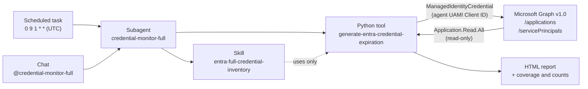

# Use case 01 – Microsoft Entra credential expiration audit

> **Azure SRE Agent** · Python tool · Skill · Subagent · Scheduled task · Microsoft Graph (read-only)

Find **expired and soon-to-expire secrets and certificates** across all Microsoft Entra **App Registrations** and **Service Principals** every month, automatically, and deliver a self-contained **HTML report** with filters, CSV export and links to Microsoft Entra.


| | |
|---|---|
| **Goal** | Identify application and service principal credentials that are expired or about to expire, before they cause an outage. |
| **Business value** | Avoids outages caused by expired app secrets and certificates, replaces manual reviews and provides audit-ready evidence every month. See [Business value](#business-value). |
| **Security** | Read-only. The flow never rotates, creates or deletes credentials, and never exposes secrets, tokens or certificate content. |
| **Result** | A self-contained HTML report (risk cards, filters, sorting, CSV export, “Review in Entra” links) plus an executive summary in the chat. |
| **Effort** | ~30 minutes, one time. Then it runs on its own every month. |

---

## Contents

- [Business value](#business-value)
- [How it works](#how-it-works)
- [Prerequisites](#prerequisites)
- [Package contents](#package-contents)
- [Step 0 – Find the Client ID of the agent identity](#step-0--find-the-client-id-of-the-agent-identity)
- [Step 1 – Grant the Microsoft Graph permission](#step-1--grant-the-microsoft-graph-permission)
- [Step 2 – Create the Python tool](#step-2--create-the-python-tool)
- [Step 3 – Create the skill](#step-3--create-the-skill)
- [Step 4 – Create the subagent](#step-4--create-the-subagent)
- [Step 5 – Test from the chat](#step-5--test-from-the-chat)
- [Step 6 – Schedule the monthly task](#step-6--schedule-the-monthly-task)
- [Operations and security](#operations-and-security)
- [Troubleshooting](#troubleshooting)
- [References](#references)

---

## Business value

### The problem

Application credentials expire by design. When a client secret or certificate of an app registration expires, every application, integration or pipeline that signs in with it stops working: Microsoft Entra rejects the sign-in (for an expired secret, with error [`AADSTS7000222`](https://learn.microsoft.com/entra/identity-platform/reference-error-codes)). These outages are predictable. However, the expiration dates are spread across hundreds of app registrations and service principals owned by different teams, and checking them by hand is slow, error-prone and easy to postpone. Microsoft [recommends](https://learn.microsoft.com/entra/identity-platform/security-best-practices-for-app-registration) reviewing application credentials for freshness and expiration as part of a periodic security and health assessment of applications.

### What you get

| Benefit | How this use case delivers it |
|---|---|
| **Fewer outages** | Expired and expiring credentials are flagged every month with a 90-day horizon. Owners can rotate them in a planned change window instead of during an incident. |
| **Less manual work** | One scheduled, tenant-wide run replaces portal checks and ad hoc scripts, app by app. The same scope, rules and thresholds are applied every time. |
| **Better credential hygiene** | Shows expired credentials that were never cleaned up, and which apps still rely on client secrets (`passwordCredential`). Microsoft recommends replacing secrets with managed identities or certificates. |
| **Clear prioritization** | Five risk levels and an **Action required** flag put `EXPIRED` and `CRITICAL` credentials first. Each row links to the app in Microsoft Entra. |
| **Audit-ready evidence** | Each run produces a dated, self-contained report with explicit coverage (objects scanned, exclusions, pagination) and CSV export, useful for internal controls and audits. |
| **Low risk to adopt** | Read-only (`Application.Read.All`), least privilege, no secrets exposed and no infrastructure to deploy. Setup takes about 30 minutes. Partial data is reported as partial, never as a false "all clear". |
| **Reusable pattern** | The tool + skill + subagent + scheduled task pattern works for other recurring audits, and it can be extended to notify owners through Teams or Outlook. |

**Example.** In the lab tenant used to build this guide, one run scanned **14 app registrations** and **502 service principals** (100 managed identities excluded) and classified **45 credentials**. It found **17 expired** and **4 critical** ones in about a minute end to end, with no manual work (see [Step 5](#step-5--test-from-the-chat)).

### Who benefits

- **Identity and Microsoft Entra administrators:** one monthly, prioritized list of credentials to rotate.
- **Application owners:** advance notice and a direct link to their app.
- **Security teams:** visibility of credential hygiene and secret usage across the tenant.
- **Cloud operations and SRE teams:** fewer incidents caused by expired credentials.
- **IT management:** an executive summary and monthly evidence of the credential risk posture.

### How to measure it in a PoC

- `EXPIRED` and `CRITICAL` credentials in the first run compared with the following runs (target: trending to zero).
- Incidents caused by expired credentials during the PoC (target: none).
- Time spent on manual credential reviews, before and after.
- Coverage: 100% of app registrations and non-managed service principals reviewed every month.

---

## How it works



| Order | Component | Expected result |
|:---:|---|---|
| 0 | **Client ID** | The Client ID of the agent's user-assigned managed identity is found and set in the script and in the tool. |
| 1 | **Graph permission** | The managed identity can read applications and service principals (`Application.Read.All`). |
| 2 | **Python tool** | Builds the inventory and a filterable HTML report. |
| 3 | **Skill** | Fixes the scope, the validation rules and the security controls. |
| 4 | **Subagent** | Runs the audit following the skill, restricted to the audit tool. |
| 5 | **Test** | You validate the result from the chat before automating. |
| 6 | **Monthly task** | Schedules the recurring execution. |

Each step depends on the previous one being validated.

**Risk classification** (one single UTC reference time per run):

| Status | Days to expiration | Meaning |
|---|---|---|
| `EXPIRED` | ≤ 0 | Requires immediate rotation review |
| `CRITICAL` | 1 – 7 | Expires within 7 days |
| `EXPIRING SOON` | 8 – 30 | Expires within 30 days |
| `EXPIRING` | 31 – 90 | Plan the next maintenance window |
| `Valid` | > 90 | No immediate action |

**Scope:** App Registrations and Service Principals (password and key credentials). Service principals of type `ManagedIdentity` and federated identity credentials are **excluded**.

---

## Prerequisites

- An **Azure SRE Agent** already deployed, with its **user-assigned managed identity** (created with the agent, name starts with `id-`).
- **Builder** permissions on the agent in the [SRE Agent portal](https://sre.azure.com) (to create tools, skills, subagents and scheduled tasks).
- An account with the **Privileged Role Administrator** Microsoft Entra role, only once, to grant the Graph permission (Step 1).
- PowerShell 7+ (or Windows PowerShell 5.1) able to install the `Microsoft.Graph` module.
- Optional: Azure CLI, to find the Client ID from the command line.

---

## Package contents

Keep the file names: the guide refers to them.

| File | What it is | Used in |
|---|---|---|
| [`grant-graph-permission.ps1`](grant-graph-permission.ps1) | Idempotent PowerShell script that grants Microsoft Graph `Application.Read.All` to the agent identity. Requires Privileged Role Administrator. | Step 0 and Step 1 |
| [`generate-entra-credential-expiration.py`](generate-entra-credential-expiration.py) | Full code of the Python tool. | Step 0 and Step 2 |
| [`SKILL.md`](SKILL.md) | Content of the `entra-full-credential-inventory` skill. | Step 3 |
| [`subagent-instructions-and-prompts.md`](subagent-instructions-and-prompts.md) | Subagent instructions, test prompt, cron expression and monthly task prompt. | Steps 4, 5 and 6 |
| [`sample-report/`](sample-report/) | Example HTML report generated by the tool with **synthetic** data. Download it and open it in a browser. | Reference |

> [!IMPORTANT]
> `grant-graph-permission.ps1` and `generate-entra-credential-expiration.py` contain the placeholder `<YOUR_AGENT_CLIENT_ID>`. Replace it as described in Step 0 before using them.

---

## Step 0 – Find the Client ID of the agent identity

The Python tool and the permission script use the **user-assigned managed identity (UAMI)** of the Azure SRE Agent. Every agent has its own, so the Client ID is different in every environment. A Client ID is **not** a secret.

### Option A – From the SRE Agent portal (recommended)

1. In the [SRE Agent portal](https://sre.azure.com), open your agent and select **Settings** (1) > **Basics** (2).
2. The **Managed identity** field (3) shows the identity name (`id-sre-…`). Select it: the identity opens in the Azure portal.

   

3. On the identity **Overview** page, copy the **Client ID** value (1).

   

> [!TIP]
> Alternatively, **Settings > Azure settings > Go to Identity** opens the agent's *Identity* blade in the Azure portal, where you can open the user-assigned identity.

### Option B – From the Azure portal

1. Open the resource group of the agent.
2. Open the **Managed Identity** resource whose name starts with `id-`.
3. On **Overview**, copy the **Client ID**.

### Option C – With Azure CLI

```bash
az identity show --name <IDENTITY_NAME> --resource-group <RESOURCE_GROUP> --query clientId -o tsv
```

> [!WARNING]
> **Client ID, not Object ID.** Copy the **Client ID**, *not* the **Object (principal) ID**. Both are GUIDs. With the Object ID, the script can't find the identity and the tool can't get the Microsoft Graph token.

### Replace the placeholder

Replace `<YOUR_AGENT_CLIENT_ID>` with the Client ID in these two files (keep the quotes):

| File | Line to edit |
|---|---|
| `grant-graph-permission.ps1` | `$managedIdentityClientId = "<YOUR_AGENT_CLIENT_ID>"` |
| `generate-entra-credential-expiration.py` | `MANAGED_IDENTITY_CLIENT_ID = "<YOUR_AGENT_CLIENT_ID>"` |

If the placeholder is not replaced, the script stops with a message that says so, and the tool returns `Configuration required` with `coverage: partial`.

---

## Step 1 – Grant the Microsoft Graph permission

A Microsoft Entra administrator must grant the **application permission** `Application.Read.All` to the agent's managed identity. The script is **idempotent**: it never creates a duplicate assignment.

> [!NOTE]
> Run this step with an account that holds the **Privileged Role Administrator** role. For app role assignments on Microsoft Graph this role is the recommended one, and it can be required even if the account already has other application administration roles.

### 1.1 Run the script

1. Open [`grant-graph-permission.ps1`](grant-graph-permission.ps1) in a text editor, replace `<YOUR_AGENT_CLIENT_ID>` with the Client ID from Step 0 and save it.
2. Open PowerShell, go to the folder of the file and run:

   ```powershell
   .\grant-graph-permission.ps1
   ```

   If PowerShell blocks the downloaded script, run `Unblock-File .\grant-graph-permission.ps1` first (or `Set-ExecutionPolicy -Scope Process Bypass`).

3. Sign in when prompted. The script installs the `Microsoft.Graph` module for the current user, connects with the scopes `Application.Read.All` and `AppRoleAssignment.ReadWrite.All`, grants the permission and disconnects.

### 1.2 Validate

- The script prints **`Application.Read.All granted to the managed identity.`** or **`Application.Read.All is already assigned.`**
- Optional check in the Azure portal: **Microsoft Entra ID > Enterprise applications** > set the *Application type* filter to **Managed Identities** > open your `id-…` identity > **Security > Permissions** (1). You should see **Microsoft Graph – Application.Read.All – Application – Admin consent** (2).

  

  *The identity in the screenshot has more Graph permissions used by other scenarios. This use case only needs `Application.Read.All`.*

- If the first test of the tool returns **HTTP 403**, check the role, the assignment, and wait a few minutes until a new token reflects the change.
- **Don't grant Microsoft Graph write permissions** to the tool.

---

## Step 2 – Create the Python tool

### 2.1 Open the Python tool dialog

In the SRE Agent portal select **Builder** (1) > **Agent Canvas** (2) > the **Create** drop-down arrow (3) > **Tool** (4) > **Python tool** (5).


### 2.2 Code tab

You don't need the *Describe what the function should do / Generate* box on the left: you paste the finished code instead.

| # | Field | Value |
|:---:|---|---|
| 1 | **Tool Name** | `generate-entra-credential-expiration` |
| 2 | **Description** | `Use this tool to audit Microsoft Entra application and service principal credential expirations when you need to identify expiring secrets and certificates, exclude managed identity service principals, and generate a self-contained HTML report. Returns report path, scan coverage, and credential status counts.` |
| 3 | **Code** | The full content of [`generate-entra-credential-expiration.py`](generate-entra-credential-expiration.py), with your Client ID already set. Replace any existing code in the editor. |
| – | **Timeout (seconds)** | Keep `120` (the default). Raise it only for very large tenants. |

> [!NOTE]
> The portal limits tool names to **36 characters**, so the tool is called `generate-entra-credential-expiration`. The skill below references this exact name.


### 2.3 Identity tab

1. Open the **Identity** tab (1).
2. Turn on **Enable Azure Identity** (2).
3. In the scope box, enter `https://graph.microsoft.com/.default` and select **Add** (3).
4. Remove the default **ARM** scope (the **X** on its card), so that only the Microsoft Graph scope remains (4).


> [!IMPORTANT]
> Even though the Identity tab declares the Graph scope, the tool code gets its token **explicitly** with `ManagedIdentityCredential(client_id=…)`. This way it doesn't depend on environment variables injected by the editor, and it always uses the agent identity that has the Graph permission.

### 2.4 Test playground tab and create

1. Open the **Test playground** tab (1). The tool has no input parameters.
2. Select **Test** (2).
3. Check the result (3): **Function test succeeded** and a JSON with `report_path`, `"coverage": {"status": "complete", "pagination_completed": true, …}`, the number of applications, service principals and excluded managed identities, and `counts_by_status`.
4. Select **Create tool** (4).


**Expected results of the test**

- An object with `report_path`, complete coverage, application and service principal counts, excluded Managed Identities and counts by status.
- On any authentication, authorization or pagination failure, the tool returns `coverage: partial` and **does not** produce an incomplete report as if it were valid.
- If the placeholder was not replaced, the tool returns `Configuration required: set MANAGED_IDENTITY_CLIENT_ID …` with `coverage: partial`. Go back to Step 0.

---

## Step 3 – Create the skill

The skill fixes **what** the agent must do and **how**: scope, validation, classification, security rules and output format.

### 3.1 Open the skill dialog

**Builder > Agent Canvas** (1) > the **Create** drop-down arrow (2) > **Skill** (3).
*(You can also use **Builder > Skill builder > Create skill**.)*


### 3.2 Attach the tool

1. Select **Choose tools** (1).
2. Search for `generate-entra` (2).
3. Select **generate-entra-credential-expiration** (3) and close the panel.


Associate **only** this tool to the skill.

### 3.3 Name, description and SKILL.md

| # | Field | Value |
|:---:|---|---|
| 1 | **Name** | `entra-full-credential-inventory` |
| 2 | **Description** (select **Edit**, type, then **Save**) | `Safe, read-only procedure to audit Microsoft Entra credential expiration for Applications and non-managed Service Principals.` |
| 3 | **Tools** | `generate-entra-credential-expiration` (from 3.2) |
| 4 | **SKILL.md** | The portal generates the front matter (`name`, `description`, `tools`) from the form. Paste the full content of [`SKILL.md`](SKILL.md) **below** the front matter, replacing the `<!-- Add your skill instructions here -->` line. |
| 5 | **Create** | |


**What the skill enforces**

- **Scope:** read-only over App Registrations and Service Principals; excludes Managed Identities and federated identity credentials.
- **Validation:** applications and service principals discovered, Managed Identities excluded, pagination, coverage and count by status.
- **Classification (single UTC instant):** `EXPIRED` ≤ 0 days · `CRITICAL` 1–7 · `EXPIRING SOON` 8–30 · `EXPIRING` 31–90 · `Valid` > 90.
- **Output:** HTML report, executive summary, coverage, counts by status and **Action required** if there are `EXPIRED` or `CRITICAL` credentials, or partial coverage.

---

## Step 4 – Create the subagent

Create the subagent **after** the tool has been tested successfully.

### 4.1 Open the custom agent dialog

**Builder > Agent Canvas** (1) > the **Create** drop-down arrow (2) > **Custom Agent** (3).


### 4.2 Name and instructions

1. **Custom agent name:** `credential-monitor-full`
2. **Instructions:** paste the text of the *Subagent instructions* section of [`subagent-instructions-and-prompts.md`](subagent-instructions-and-prompts.md):

   ```text
   You are the specialized executor of monthly Microsoft Entra credential
   expiration audits. Use the entra-full-credential-inventory skill.
   Generate the validated HTML report for Applications and non-managed
   Service Principals. Always operate in read-only mode. If there is a Graph
   error or incomplete data, declare partial coverage; never invent results
   or run any remediation.
   ```


### 4.3 Skills

Select **Choose skills** (1), filter by `entra-full` (2) and select **entra-full-credential-inventory** (3). Close the panel.


### 4.4 Tools

Select **Choose tools** (1), search for `generate-entra` (2) and select **generate-entra-credential-expiration** (3). Close the panel.


> [!TIP]
> By default a custom agent inherits all global skills and tools. Selecting them explicitly **overrides** the defaults, so this subagent can only use the read-only audit tool. That's least privilege by design.

### 4.5 Review and create

Check that the skill (1) and the tool (2) are listed, and select **Create** (3).


| Field | Value |
|---|---|
| Name | `credential-monitor-full` |
| Skill | `entra-full-credential-inventory` |
| Tool | `generate-entra-credential-expiration` |

---

## Step 5 – Test from the chat

Before automating, test the subagent from a chat.

1. Select **New chat** (1).
2. Type the test prompt, starting with `@credential-monitor-full:` to address the subagent (2):

   ```text
   @credential-monitor-full: Run the full Microsoft Entra credential expiration audit and deliver the HTML report with the coverage and risk summary.
   ```

3. Send it (3).


After about a minute the subagent answers with the **coverage and the counts by status** (1) and a link to **download the HTML report** (2):


### 5.1 Acceptance criteria

- The answer attaches or links the HTML report and shows **complete coverage**.
- The result reports Applications, Service Principals, excluded Managed Identities and the count by status.
- It contains **no** secrets, tokens, certificate content or unfiltered Graph responses.
- It shows **Action required** when there are `EXPIRED` or `CRITICAL` credentials, or partial coverage.

### 5.2 The HTML report

The report is a single self-contained HTML file that you can open in any browser:


1. **Risk signal:** *Action required* when there are expired or critical credentials.
2. **Coverage:** applications, non-managed service principals, credentials in scope, and pagination status.
3. **Risk posture:** counts by status, computed against one single UTC reference time.


1. **Filters:** credential name, minimum/maximum days left, risk status and object type. Column headers are sortable.
2. **Export visible rows as CSV:** exports exactly what is filtered on screen.
3. **Review in Entra:** opens the application page in Microsoft Entra, so the owner can plan the rotation.

> The screenshots above use **synthetic** data (Contoso/Fabrikam names). Download [`sample-report/entra-credential-expiration-audit-SAMPLE.html`](sample-report/entra-credential-expiration-audit-SAMPLE.html) and open it in your browser to try the filters and the CSV export.

---

## Step 6 – Schedule the monthly task

### 6.1 Create a scheduled task

Select **Automation** (1) > **Create** (2) > **Scheduled task** (3).


### 6.2 Fill in the task

| # | Field | Value |
|:---:|---|---|
| 1 | **Task name** | `Monthly Microsoft Entra credential expiration audit` |
| 2 | **Response subagent** | `credential-monitor-full` |
| 3 | **Task details** | `Run the full Microsoft Entra credential expiration audit. Deliver the HTML report, coverage, risk counters and Action required when applicable.` |
| 4 | **Frequency** | `Custom cron` |
| 5 | **Cron expression (UTC)** | `0 9 1 * *` → day 1 of every month at 09:00 UTC |
| 6 | **Create task** | |

Leave the other fields with their defaults (*Start on* today, *Model tier* General Purpose, *Agent autonomy level* Autonomous; the tool is read-only).


> [!TIP]
> Instead of *Custom cron* you can choose **Monthly**, *Day of month* `1` and a *Time of day*. That time is shown in your browser's time zone, while the cron expression is always UTC.

### 6.3 Validate the task

Select the task in the **Automation** list to open its run history (1). Use **Run task now** (2) to validate it right away. Each run shows its **Run status** (3) and a link to the **thread** with the summary and the HTML report (4).


---

## Operations and security

- `EXPIRED` and `CRITICAL` credentials require **owner review** and a separate change process to rotate the credential.
- The audit must **not** be used to delete or revoke credentials automatically.
- Keep the tool **read-only** and keep the skill and the subagent restricted to the audit tool.
- The *Review in Entra* link opens the application page in Microsoft Entra; any remediation requires impact validation and a rollback plan.
- Never grant Microsoft Graph **write** permissions to the agent identity for this use case.

---

## Troubleshooting

| Symptom | Cause / fix |
|---|---|
| Tool returns `Configuration required: set MANAGED_IDENTITY_CLIENT_ID …` (`coverage: partial`) | The placeholder `<YOUR_AGENT_CLIENT_ID>` was not replaced in the tool code. See Step 0. |
| Script stops with `Managed identity service principal not found. Verify the Client ID.` | You used the **Object (principal) ID** or a wrong value. Use the **Client ID**. |
| Tool returns `Failed to acquire Microsoft Graph token` | Wrong Client ID, or it isn't the identity assigned to this agent. |
| Tool returns `Microsoft Graph authorization failed: HTTP 403` | `Application.Read.All` isn't granted yet, or the token was cached before the grant. Check Step 1 and retry after a few minutes. |
| The tool name is cut when you type it | The portal limits tool names to 36 characters. Use `generate-entra-credential-expiration`. |
| The trace shows `ReadFile failed: Path must be within sandbox root` for `/mnt/data/…html` | Expected. The tool writes the report in its own sandbox. The agent then copies it to the thread files and publishes the download link. |
| The report is downloaded but you see `coverage: partial` | Don't treat it as a valid inventory: an authentication, permission or pagination error is **not** an empty inventory. Fix the cause and run again. |

---

## References

- [Tutorial: Create a Python tool in Azure SRE Agent](https://learn.microsoft.com/azure/sre-agent/create-python-tool)
- [Python tools in Azure SRE Agent](https://learn.microsoft.com/azure/sre-agent/python-code-execution)
- [Tutorial: Create a skill in Azure SRE Agent](https://learn.microsoft.com/azure/sre-agent/create-skill)
- [Tutorial: Create a subagent in Azure SRE Agent](https://learn.microsoft.com/azure/sre-agent/create-subagent)
- [Schedule tasks with Azure SRE Agent](https://learn.microsoft.com/azure/sre-agent/scheduled-tasks)
- [Assign an application role to a managed identity using PowerShell](https://learn.microsoft.com/entra/identity/managed-identities-azure-resources/assign-app-role-managed-identity-powershell)
- [Microsoft Graph – Grant an appRoleAssignment for a service principal](https://learn.microsoft.com/graph/api/serviceprincipal-post-approleassignments)
- [Security best practices for application properties in Microsoft Entra ID](https://learn.microsoft.com/entra/identity-platform/security-best-practices-for-app-registration)
- [Microsoft Entra authentication and authorization error codes](https://learn.microsoft.com/entra/identity-platform/reference-error-codes)

Review the current documentation for your tenant before making privilege changes.

---

*Author: Mario Aguilera, Solution Engineer, Microsoft · Version 1.1 · October 2026*
