# Use case 02 - Defender for Cloud with Azure SRE Agent

> **Read-only LIVE subscription evidence** · **Offline SIMULATED Arc demo** · Python tools · Skills · Restricted subagents · Monthly automation

Turn Defender for Cloud's resource inventory, recommendations, attack paths,
posture controls and vulnerability evidence into a navigable report and
source-grounded answers. The **LIVE report is customer-neutral** and covers the
configured subscription's relevant Azure services, not just Arc.

The separate **Mercadona-inspired SIMULATED demo** remains focused on 200 Arc
on-premises/GCP servers, with its historical green branding and clearly fictional
teaching chains. It never reads customer infrastructure, calls Azure or acquires
a token. Its brand, names and allocations are example labels, not evidence about
the customer implementing this guide.

| | LIVE general Defender | SIMULATED Mercadona Arc |
|---|---|---|
| Audience | Reusable Defender for Cloud / SRE demo for any customer | Hybrid Arc demonstration |
| Resource scope | One configured Enabled subscription; source-visible ARM resources plus explicitly labeled Defender-indexed child assets | 200 fictional Arc hosts, 142 on-premises / 58 GCP |
| Visual identity | Neutral navy/blue/slate, system typography, no Mercadona logo | Forest/emerald, serif headline, white Mercadona logo plaque |
| Tool | `generate-defender-cloud-report` | `simulate-arc-defender-mercadona` |
| Skill / subagent | `defender-cloud-live` | `arc-defender-mercadona` |
| Output | HTML, inventory CSV, finding CSV, full JSON; additional section exports in HTML | Same formats, all explicitly SIMULATED |
| Cloud changes | None; GET reads plus read-only Resource Graph POST queries | No cloud access at all |

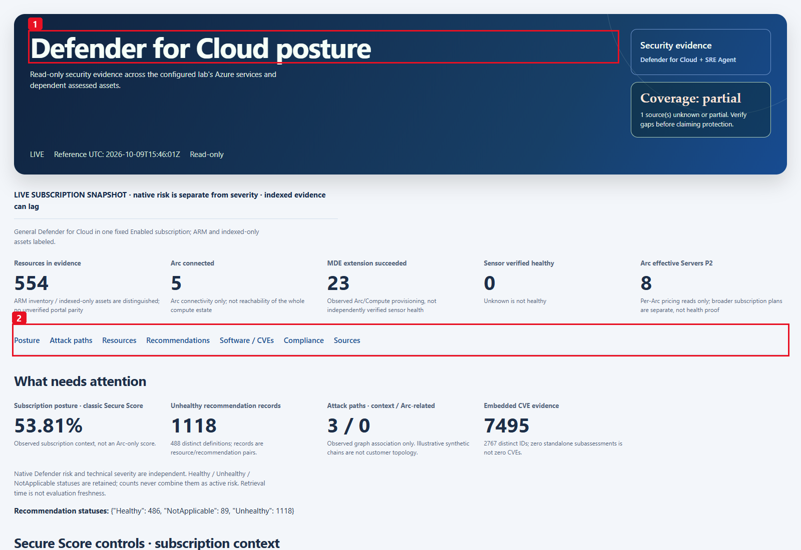

*Historical LIVE capture, 9 October 2026: (1) neutral subscription report,
(2) section navigation. Its 554 resources and other counts belong to that
snapshot, not a new customer's estate. [Open full resolution](images/v2-live-overview.png).*

> [!IMPORTANT]
> **Native risk is not technical severity.** Recommendation risk comes from
> `properties.risk.level`; technical severity comes from metadata or the source
> CVE. Missing native risk is **Not evaluated / Unknown**, never substituted with
> a High severity. A source can report a Medium-risk SQL update containing a
> Critical CVE; these are different dimensions, not a contradiction.

## Contents

- [Demo quick start](#demo-quick-start)
- [Business value](#business-value)
- [How the richer report works](#how-the-richer-report-works)
- [Prerequisites](#prerequisites)
- [Before the workshop](#before-the-workshop)
- [Package contents and migration](#package-contents-and-migration)
- [Step 0 - Configure scope and read permissions](#step-0---configure-scope-and-read-permissions)
- [Step 1 - Create and test the Python tools](#step-1---create-and-test-the-python-tools)
- [Optional company logo (LIVE only)](#optional-company-logo-live-only)
- [Step 2 - Create the skills](#step-2---create-the-skills)
- [Step 3 - Restrict the subagents](#step-3---restrict-the-subagents)
- [Step 4 - Reports and questions](#step-4---reports-and-questions)
- [Step 5 - Monthly automation and run now](#step-5---monthly-automation-and-run-now)
- [Scope, counts and evidence rules](#scope-counts-and-evidence-rules)
- [Time, retention and comparison boundaries](#time-retention-and-comparison-boundaries)
- [Simulation assumptions](#simulation-assumptions)
- [Sources and feature boundaries](#sources-and-feature-boundaries)
- [Verification and troubleshooting](#verification-and-troubleshooting)
- [Screenshot catalogue](#screenshot-catalogue)
- [References](#references)

## Demo quick start

**For a first customer installation, follow Steps 0-4 in order.** The files do
not create objects in an agent. For a Defender for Cloud workshop, install the
**LIVE column only**: one Python tool, one skill and one restricted specialist.
The simulation and monthly schedule are independent, optional additions.

| Starting point | Go to |
|---|---|
| Nothing has been configured in the customer's agent | [Prerequisites](#prerequisites), then [Step 0](#step-0---configure-scope-and-read-permissions). |
| The exact LIVE objects are already saved and reviewed | [Step 4](#step-4---reports-and-questions); select the specialist explicitly before sending the normal-language prompt. |
| No customer source access is approved | Stop the LIVE path. An explicitly requested [SIMULATED demo](#simulated-arc-report-and-questions) can illustrate the experience, never stand in for a failed live read. |
| A manual report has been accepted and recurring execution is approved | [Step 5](#step-5---monthly-automation-and-run-now); search for an existing owned task before creating one. |

1. Open the customer's existing agent in the [SRE Agent portal](https://sre.azure.com).
   In **New chat**, type `/agent`, select **`defender-cloud-live`**, then paste
   the [LIVE report prompt](#live-general-report). A historical `@name:` prefix
   in a screenshot is not a substitute for selecting the saved specialist.
2. Open the four **actual native downloads**. In HTML, show the neutral
   subscription overview, native risk versus technical severity, Sources,
   resource details, and the graph/CVE evidence that is actually available.
3. For a separate question, ask about **Key Vault / AKS / Container Apps** or an
   observed resource. Use the filtered totals, not the size of a returned page.
   A question makes a fresh collection; it is not a cached report query.
4. Only if the offline example was requested and installed, use a **different
   thread**, select `arc-defender-mercadona`, and show its explicitly fictional
   Arc-only report. Do not switch to it when LIVE has an error.

The general report and monthly task have **historical 9 October 2026**
acceptance, while the current lossless source also has **historical
13 October 2026 normal-chat/download acceptance**. See
[Verification](#verification-and-troubleshooting) for their different scopes.
Neither validates a new customer's deployment, today's data, or a new scheduled
execution. This documentation review performs no deployment, collection,
task execution, permission grant or remediation.

## Business value

### The problem

Portal screens distribute useful evidence across resource health,
recommendations, attack-path analysis, software inventory and compliance.
An Arc-only installation audit misses the wider subscription and can hide
real CVEs inside recommendation `additionalData`, even when the standalone
subassessment query returns zero rows. Mixing severity with native risk, or a
subscription score with a host score, further distorts prioritization.

### What this scenario delivers

| Benefit | Mechanism |
|---|---|
| **Broader security visibility** | VM/VMSS, Arc, AKS, ACA, App Service, Key Vault, Storage, SQL/databases, ACR, network and other source-observed resources in the configured subscription. |
| **Evidence-led priorities** | Native risk, all recommendation statuses, owner tags, affected assets, real remediation text and safe native portal links. |
| **Useful vulnerability detail** | Software/version/vendor, source CVEs, fix status/version, actual KB/update evidence and reboot behavior, without executing a remediation query. |
| **Attack-path context without fabrication** | Source-observed entry/target, entities/edges, insights and recommended breaks; not proof that an attack, exploit or outage occurred. The offline demo's chains are separately labeled illustrations. |
| **Posture context that can be explained** | Classic subscription Secure Score, control headroom, healthy/unhealthy/not-applicable resource counts and compliance observations, with scope and unknowns intact. |
| **Questions, not just a static PDF** | Deterministic local filters and compact query views expose source-grounded answers with exact totals and explicit paging. |
| **Repeatable reviews** | Monthly LIVE automation produces all four files; HTML also exports individual sections and selected-resource evidence. |
| **Controlled adoption** | Fixed subscription/tenant, approved read-only ARM/ARG access, no secret-value reads, cloud writes, plan enablement or broader execution tools. |

Measure owner-reviewed recommendations, native-risk trend, source completeness,
validated patch actions, blind spots and manual review effort over time.
No invented ROI, avoided incidents worth millions or guaranteed certification
is part of the report.

### Who uses it and how to evaluate it

Security teams review native-risk priorities and evidence gaps; workload owners
validate the affected assets and source remediation text; SRE/platform teams
maintain the bounded reporter and its delivery. Subscription ownership tags are
observations, not a verified organizational ownership directory.

For a PoC, agree the subscription and expected resource types beforehand, then
record source availability, retained recommendation statuses, distinct resources
versus finding occurrences, successful delivery of the complete files, and the
owner's review outcome. Measure review effort and changes across separately
retained snapshots if useful. A lower count can reflect a different scope,
source failure, index lag or deleted resource, not necessarily risk reduction.

## How the richer report works

### Runtime data flow

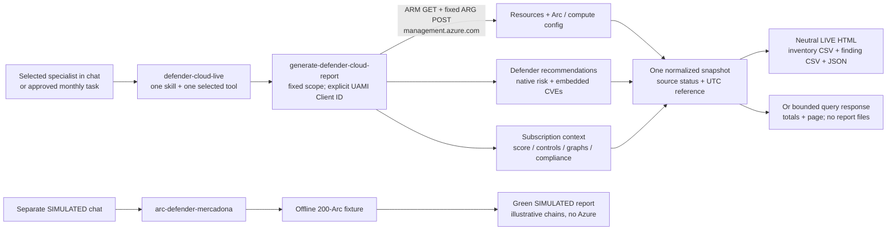

### Setup steps (guide order)

These numbers match the guide headings, **not runtime execution order or
Defender attack-graph node numbers**. LIVE and SIMULATED remain separate paths.

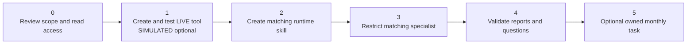

| Setup step | Component | Expected result |
|:---:|---|---|
| 0 | [Scope/read access](#step-0---configure-scope-and-read-permissions) | Fixed LIVE subscription, tenant and UAMI reads verified; SIMULATED needs no Azure access. |
| 1 | [Python tool](#step-1---create-and-test-the-python-tools) | Complete LIVE source configured, saved and reopened; parameters and actual report result checked. SIMULATED is optional. |
| 2 | [Skill](#step-2---create-the-skills) | The entire matching runtime SKILL.md is saved with only its matching tool. |
| 3 | [Subagent](#step-3---restrict-the-subagents) | One explicit matching tool and skill; effective saved allowlists checked. |
| 4 | [Reports/questions](#step-4---reports-and-questions) | Four actual downloads and source-grounded answers validated in separate chats. |
| 5 | [Optional monthly task](#step-5---monthly-automation-and-run-now) | Customer-owned task reused or created once; UTC schedule and separately authorized manual acceptance checked. |

### Report navigation

The first viewport highlights actionable evidence, rather than the older
Arc-only flat finding list. Section navigation leads to:

| Section | What to show |
|---|---|
| **Posture** | Classic score and native-risk/status counts; control current/max and potential headroom. |
| **Attack paths** | Real graph entities, edge labels, entry/target, insights, linked assessments and recommended breaks. No edges are invented for a one-node path. |
| **Resources** | Service-group posture, exact native IDs, ARM versus indexed-only source, ownership tags, OS/location, recommendation distribution and observed protection configuration. |
| **Recommendations** | Grouped definitions by risk/status/category, record counts and affected resources; complete resource-level records remain available. |
| **Software / CVEs** | Observed software inventory plus embedded source CVE occurrences and patch evidence; full exports avoid chat-sized payloads. |
| **Compliance** | Standard/control observations with passed, failed, skipped and unsupported separate; not certification. |
| **Sources / plans** | Availability, scope, errors and observed paid-plan configuration; licensing is not runtime-health proof. |

The resource detail panel displays a disclosed first-30 finding sample and
exports **all** selected-resource findings/CVEs. The complete normalized
evidence remains in the JSON snapshot.
Finding and grouped-recommendation tables render in 50-row pages with **Show
more** and an explicit displayed/matched/total count. Their CSV buttons export
**all filtered matches**, not just the current rendered page. The compact
payload reconstructs the full dataset before filtering or rendering.

Priorities now follow the general Defender scope, not the old Arc-only order:
active serious alerts first when observed, then **native High/Critical attack
paths and source-recommended breaks**, then **Critical technical CVE / patch
review** with native risk still separate. Other native-risk recommendations and
Arc visibility/MDE installation gaps remain lower review actions. The
SIMULATED chain action is explicitly a teaching illustration. No numeric risk
score, remediation execution or unverified mitigation is invented.

## Prerequisites

These are **separate permission and readiness checks**, not one "Builder"
permission. Have their owners confirm them before the session.

| Requirement | Who / scope | What must be ready |
|---|---|---|
| Existing agent and portal access | Customer's SRE Agent resource | A deployed, usable agent in the approved environment. This case does not deploy an agent or create an identity/connector. |
| Human customization | Engineer, on the **SRE Agent resource** | **SRE Agent Author** creates custom objects. Author alone cannot chat, upload knowledge or create scheduled tasks. |
| Human chat and optional scheduling | Engineer/operator, on that same resource | **SRE Agent Standard User** chats and manages scheduled tasks. Standard User alone cannot create custom agents. Use **Author + Standard User** together for the end-to-end guide, or an already-approved **SRE Agent Administrator**. |
| Runtime source access, LIVE only | Existing SRE Agent **user-assigned managed identity (UAMI)**, on the **monitored subscription** | Approved read access covering the entire fixed pipeline, not just the SRE host resource group. Step 0 explains Reader, identity discovery and scope checks. |
| Missing-access administration | Separately authorized access administrator at each relevant scope | Authority to assign the already-approved role, such as `Microsoft.Authorization/roleAssignments/write` through **Role Based Access Control Administrator** or **User Access Administrator**, subject to conditions/PIM. This is not a runtime permission. |
| Source readiness, LIVE only | Customer's Defender/platform owners | Existing plans, onboarding, assessments and index/telemetry readiness for the features the workshop intends to show. A paid plan alone is insufficient. |
| Package access | Implementer | Access to this private repository, including any required SSO, or an approved offline copy of one reviewed revision. Do not make the repository public to obtain the files. |
| Runtime packages/network/storage | Customer's SRE execution environment | `requests>=2.31,<3` and `azure-identity>=1.16,<2` for LIVE, runtime-available UAMI authentication, outbound public ARM access and a writable guarded artifact directory. SIMULATED uses the standard library only. |
| Download review | Customer's operator | Permission to download/open security evidence, a current browser that can execute the self-contained report locally, and an approved evidence retention location. |

**Builder** is a portal navigation label, not a named role. Author alone cannot
chat or create tasks; Standard User alone cannot create custom agents. Azure
Owner/Contributor do not replace SRE Agent data-action roles. These user roles
are separate from the reporting UAMI's subscription reads; no case 01 Graph
grant is required here. See [SRE user roles](https://learn.microsoft.com/azure/sre-agent/user-roles)
and [Defender for Cloud permissions](https://learn.microsoft.com/azure/defender-for-cloud/permissions).

### Before the workshop

1. Decide **LIVE**, **SIMULATED**, or two explicitly separate demonstrations.
   For a real Defender for Cloud review, LIVE is the normal path. Installation
   of the Mercadona example is not a prerequisite.
2. Have the scope owner identify the **monitored subscription and its tenant**,
   the **SRE Agent host resource**, and the assigned **runtime UAMI**. They may
   have different resource groups or subscriptions. Keep these values in the
   customer's private setup record, not in a chat prompt or this repository.
3. Ask the access administrator to review existing effective assignments first.
   Resolve approved missing access before the meeting; a portal banner offering
   to auto-assign Administrator is not authorization to accept it.
4. Agree which features can actually be shown from existing source coverage:
   for example, inventory/recommendations versus native risk, graphs, software
   and CVEs. Identify an already-observed resource to inspect; do not promise
   that a historical lab host, graph or SQL update exists in the customer.
5. Download the required files below from one approved revision. Check that
   the Python file is code, not an HTML sign-in page, and that the schema and
   runtime skill match it. Keep a pristine original and edit a private
   deployment copy. Only the three scope/identity placeholders need changing.
6. Reserve time for one authorized first report, four downloads and human
   interpretation. Local Python is useful for optional offline checks, but
   Azure CLI, Microsoft Graph modules, a new MCP connector and guest access
   are not required to install this case.

## Package contents and migration

Open a file link and select **Download raw file** in GitHub's file view to save
a local copy for configuration/pasting. Private repository access is required;
raw links do not bypass it. If GitHub is unavailable at the customer site, use
an approved offline package with these filenames and the same reviewed revision.
The raw links in the setup steps target `main`; pin the approved commit for a
controlled installation instead of mixing files downloaded on different dates.

| File | Purpose |
|---|---|
| [`generate-defender-cloud-report.py`](generate-defender-cloud-report.py) | Standalone read-only LIVE report/query tool for one fixed subscription: ARM/ARG inventory, Defender recommendations/native risk, graphs, software/CVEs and posture context. Writes complete HTML, inventory/finding CSV and JSON; bounded queries disclose paging and partial sources. |
| [`simulate-arc-defender-mercadona.py`](simulate-arc-defender-mercadona.py) | Standard-library-only offline report/query tool for 200 fictional Arc hosts and illustrative chains. Writes the same four formats with SIMULATED provenance; no Azure calls or token acquisition. |
| [`tool-parameters.schema.json`](tool-parameters.schema.json) | Exact shared parameters, defaults, enums and bounds. |
| [`skills/defender-cloud-live/SKILL.md`](skills/defender-cloud-live/SKILL.md) | Generic live scope, source/risk interpretation and safety. |
| [`skills/arc-defender-mercadona/SKILL.md`](skills/arc-defender-mercadona/SKILL.md) | Synthetic provenance and Arc feature boundaries. |
| [`subagent-instructions-and-prompts.md`](subagent-instructions-and-prompts.md) | Copy-ready instructions, migration/alias rules and demo questions. |
| [`monthly-task-prompt.md`](monthly-task-prompt.md) | Canonical task name, responder, cron and prompt. |
| [`requirements.txt`](requirements.txt) | LIVE dependencies: requests and azure-identity. |
| [`tests/`](tests/) | Offline source, schema, scope, risk, graph, encoding and exact transport-budget tests. |
| [`images/`](images/) | 25 unchanged historical portal/report captures. The [catalogue](#screenshot-catalogue) identifies general LIVE, older Arc-only LIVE and SIMULATED images separately. |
| [`evidence/linux-mde-verification.json`](evidence/linux-mde-verification.json) | Historical supplementary checks of two lab Linux hosts, not a live fleet-health API. |

The stable scenario folder/README URL is retained. The old Python filename
`generate-arc-defender-report.py` is migrated to the canonical general file,
not maintained as a second implementation. An existing owner-approved
**`arc-defender-live`** subagent may remain as an **explicit legacy alias**
only after its effective binding to the same generic tool/skill is verified.
Do not delete or change unrelated components, scenario 01 or
customer automations while migrating.

The shared report helpers are embedded in both files for independent deployment
and checked for parity. LIVE chooses the neutral theme; SIMULATED chooses the
green logo theme. No external script/font/logo is fetched by either report.

## Step 0 - Configure scope and read permissions

### 0.1 Identify the monitored scope and the runtime identity

1. In the [Azure portal](https://portal.azure.com), open **Subscriptions** and
   select the subscription approved for this report. Confirm its **Subscription
   ID**, **Directory / Tenant ID** and **Enabled** state with the scope owner.
   Do not infer the target from your last CLI login or the agent's host
   subscription. This tool monitors **one fixed subscription**, not a tenant,
   management group, cross-subscription estate or arbitrary chat-selected scope.
2. Open the customer's agent in the [SRE Agent portal](https://sre.azure.com).
   Go to **Settings > Azure settings**. In **Managed Identity**, select
   **Go to Identity**, then open the assigned user-assigned identity in the
   Azure portal. Older portal screenshots may instead show **Settings > Basics**;
   use the current identity page, not an unrelated similarly named `id-*` resource.
3. On that managed identity's **Overview**, record the **Client ID** and the
   **Object (principal) ID** privately. Cross-check the identity's resource
   name, host subscription/resource group and assignment to this exact agent.
   [Agent identity](https://learn.microsoft.com/azure/sre-agent/agent-identity)
   distinguishes this UAMI from the internal system-assigned identity.
4. Confirm that this UAMI is **available to the Python tool's execution
   environment**, not merely present in the directory or granted a role.
   An arbitrary existing identity with Reader is not sufficient. The first
   authorized SDK-backed test in Step 1 is the runtime authentication checkpoint.
   Do not create/attach another identity as a workaround in this guide.

| Value | Used for | Not interchangeable with |
|---|---|---|
| **Client ID** | `MANAGED_IDENTITY_CLIENT_ID`; the code passes it as `ManagedIdentityCredential(client_id=...)`. | Object/principal ID, SRE Agent resource ID or an application secret. |
| **Object (principal) ID** | Identifying the exact UAMI security principal in Azure RBAC assignments. The portal managed-identity picker selects that principal. | The Client ID required by this Python code. |
| **Subscription ID / Tenant ID** | Fixed monitored subscription and its directory; checked against the ARM subscription response. | The SRE host subscription unless the scope owner intentionally chose the same one. |

These identifiers are not passwords, but they are environment metadata. **Do
not paste tenant IDs, configured source files, access tokens or private resource
IDs into chat.** Keep the configured copy and any readback in approved private
storage. Chat inputs never supply identity or scope overrides.

### 0.2 Edit only the private LIVE deployment copy

[Open the standalone LIVE source file view](generate-defender-cloud-report.py),
then select **Raw / Download raw file** to save the complete Python file.
Relative file links in this guide open the **same approved revision** you are
reading; they are file views, not one-click raw downloads. Keep that revision
selected for the code, schema, requirements, runtime skills and setup prompts;
do not switch to `main` while preparing the deployment copy.
Replace the three constants near the top, preserving their names and quotes:

```python
SUBSCRIPTION_ID = "<YOUR_SUBSCRIPTION_ID>"
TENANT_ID = "<YOUR_TENANT_ID>"
MANAGED_IDENTITY_CLIENT_ID = "<YOUR_AGENT_CLIENT_ID>"
```

All three must be GUIDs before authentication starts. The code compares the
subscription and tenant returned by ARM with the fixed values and rejects an
explicit non-Enabled subscription state. Independently confirm Enabled state
in the portal; a missing source field is not an operational readiness receipt.
There is no `DefaultAzureCredential`, interactive account-cache fallback,
environment-based scope override or subscription parameter.

Keep all other constants, fixed queries, source projection/normalization,
pagination limits, codec and artifact guards unchanged. This is not a place
to paste tokens, KQL, an output path, a customer logo or a second subscription.
The repository template must keep its placeholders.

### 0.3 Review the human and UAMI permissions separately

For this implementation, an already-approved Azure **Reader** assignment on
the **monitored subscription** is a suitable built-in read baseline covering
the resource inventory, Arc configuration and Microsoft.Security reads.
The historical lab used Reader for the inventory, native graph, software and
posture pipeline without a new grant. This is **not** a claim that a new minimum
custom role has been designed or that every tenant has identical effective access.

[Defender for Cloud permissions](https://learn.microsoft.com/azure/defender-for-cloud/permissions)
groups Reader and **Security Reader** for viewing alerts and recommendations.
Security Admin adds policy/dismissal writes and is unnecessary for this reporter.
Security Reader alone must not be assumed to cover this case's **whole
ARM/ARG resource and Arc inventory pipeline**. Do not stack it redundantly on
Reader just because the guide includes Defender. Azure RBAC Security Reader is
also not the Microsoft Entra directory role or a Defender XDR unified role.

| Permission surface | Principal | Scope / checkpoint |
|---|---|---|
| Create tool, skill and custom agent | Human with Author; combined workflow also needs Standard User, or an approved Administrator | **SRE Agent resource > Access control (IAM)**. Check effective/inherited assignments and active PIM eligibility where applicable. |
| Chat and customer-owned monthly task | Human with Standard User, or an approved Administrator | Same SRE Agent resource. A source Reader role does not grant SRE chat/task data actions. |
| Subscription metadata, ARG `Resources` / `SecurityResources`, Arc machine/extensions, effective pricing, WDATP, alerts, score, plans and compliance | Existing runtime UAMI with approved Reader or a reviewed equivalent covering these reads | **Monitored subscription**, including its descendants. See the [exact source contract](#sources-and-feature-boundaries), not only a UI role label. |
| Assign an approved missing role | Separate authorized access administrator | The exact scope on which the role will be assigned; assignment conditions and organizational approval still apply. Never assign this authority to the reporter. |

**Important ARG blind spot:** a successful HTTP 200 and completed pagination
prove only that the returned **principal-visible** result was read. Resource
Graph can silently omit resources the principal cannot read. A role limited
to a few resource groups is not proof of subscription-wide coverage.
Have the scope/access owners reconcile the approved subscription with effective
assignments and a known inventory before accepting coverage. See
[Resource Graph permissions](https://learn.microsoft.com/azure/governance/resource-graph/overview#permissions-in-azure-resource-graph).
Do not relabel an access-limited empty result as a healthy estate.

### 0.4 Administrator-only portal procedure for preapproved missing access

**Skip assignments that already exist.** The following is a documented setup
procedure for the customer's authorized administrator, not permission for the
reporter, this repository review or an unattended agent to change IAM.
Do not use an **Assign yourself Administrator** banner.

1. For **human SRE access**, open the **SRE Agent resource > Access control
   (IAM) > Role assignments**. Check the named human/group's effective access.
   If the approved role is missing, select **Add > Add role assignment**.
2. On **Role**, search for the exact approved role, such as **SRE Agent
   Author**, then **Next**. On **Members**, choose **User, group, or service
   principal > Select members** and choose the approved **human or group**,
   not the reporting managed identity. Review the exact principal and agent
   scope before **Review + assign**. Repeat for **SRE Agent Standard User**
   only if that second assignment is approved and missing. Use Administrator
   only when it is the customer's approved role, not a shortcut.
3. For **runtime source access**, open **Subscriptions > the monitored
   subscription > Access control (IAM) > Role assignments**. Review existing
   effective access for the UAMI's **Object (principal) ID** first.
4. If the approved Reader assignment is missing, select **Add > Add role
   assignment > Reader > Next**. On **Members**, choose **Managed identity >
   Select members**. Select the identity's **host subscription**, type
   **User-assigned managed identity**, and the exact SRE UAMI identified in
   0.1. The identity picker subscription locates the identity; it does **not**
   change the role assignment's monitored-subscription scope.
5. Select the identity, cross-check its **principal ID**, and review **role,
   principal and monitored scope** before **Review + assign**. Follow the
   customer's approved assignment duration/conditions; do not invent a
   tenant-wide grant, new role or broader access to repair a 403.
6. Reopen the assignment list / effective-access view. Allow normal RBAC/token
   propagation, then use the **already approved** first tool test in Step 1.
   A human portal read does not prove the UAMI can read from the runtime.
   A source 403 remains unavailable until its cause is resolved.

The official [portal IAM procedure](https://learn.microsoft.com/azure/role-based-access-control/role-assignments-portal)
requires `Microsoft.Authorization/roleAssignments/write`, for example through
Role Based Access Control Administrator or User Access Administrator at that
scope. An enabled button, Contributor, or SRE Agent Author is not that authority.
No new Owner, Contributor, Security Admin, Graph `Application.Read.All`,
Defender XDR permission, consent or directory-wide grant is part of this case.

### 0.5 Confirm source readiness without changing plans or sensors

Ask the Defender owner to review the **existing** environment configuration,
for example **Microsoft Defender for Cloud > Environment settings > the
approved subscription > Defender plans**. This is a readiness review, not an
instruction to enable a plan, onboard a machine, install an extension or fix a
service during setup.

| Intended demonstration | Existing prerequisite / honest fallback |
|---|---|
| Asset inventory, MCSB recommendations, classic Secure Score | Foundational CSPM includes these capabilities. The returned resource types, assessments and source visibility still need checking; not every resource has every assessment. |
| Native recommendation risk and advanced graph context | Paid **Defender CSPM** and relevant platform/data prerequisites. Risk prioritization is not included merely because a technical-severity recommendation exists. Missing native risk remains **Not evaluated / Unknown**. |
| Native attack-path analysis | Defender CSPM plus relevant agentless scanning or Defender for Servers vulnerability-assessment data, subject to support. The tool reads indexed `microsoft.security/attackpaths`; it does not run an exploit or discover arbitrary topology. |
| Software / CVE evidence | Supported Defender for Servers P1/P2 with MDE integration, or the applicable agentless/CSPM path. Onboarding, scan/assessment freshness and supported OS/workloads matter. Free inventory is not a promise of full vulnerability coverage. |
| SQL, container or other workload findings | The applicable workload plan/onboarding/source must already exist. Servers P2 does not include every SQL/CSPM/Containers feature. |
| Endpoint sensor health | **Not collected by this LIVE source.** Extension provisioning, WDATP integration and paid pricing do not verify the running sensor. Keep Unknown; do not add XDR access or guest commands to hide the gap. |

In this code, `mde_sensor_health` is deliberately unavailable, so **LIVE
coverage remains partial even when every implemented ARM/ARG read succeeds**.
This is an expected, disclosed boundary, not a reason to force `complete`.
If independent sensor health is a customer acceptance requirement, it is a
separate source/integration prerequisite outside this package.

**Checkpoint 0:** record the approved scope, runtime-available UAMI, effective
human/source access and the features actually ready to demonstrate. Stop LIVE
if identity/scope approval is missing. Do not replace missing data with the
simulation. Review [CSPM plans](https://learn.microsoft.com/azure/defender-for-cloud/concept-cloud-security-posture-management),
[risk prerequisites](https://learn.microsoft.com/azure/defender-for-cloud/risk-prioritization)
and [software prerequisites](https://learn.microsoft.com/azure/defender-for-cloud/software-inventory)
with the source owner.

Read-only does not mean free: SRE model/tool execution and artifact handling
consume usage; existing Defender plans and data collection have their own
charges. No new plan, email/Teams connector, guest access, storage account or
resource is required by this report, and no cost or risk-reduction outcome is
guaranteed.

## Step 1 - Create and test the Python tools

### 1.1 Download the standalone files and understand what runs

For LIVE, use the private configured copy from Step 0. Open the
[Python file view](generate-defender-cloud-report.py),
[exact parameter schema file view](tool-parameters.schema.json) and
[requirements file view](requirements.txt), then use each file's
**Raw / Download raw file** button. These relative links retain the same
approved revision; they do not download raw content by themselves.
Do not paste a GitHub HTML page or only the final function.

| Code component | Purpose / boundary |
|---|---|
| Three fixed constants and `_validate_config` | Validate the approved GUIDs before token acquisition; no chat-selected scope or credential fallback. |
| `_get_token` and `ArmClient` | Explicit UAMI SDK token for ARM; fixed HTTPS management origin, GET reads and only the fixed read-only ARG POST. No source remediation is executed. |
| `_list_arm`, `_query_arg`, `_inspect_machine`, `_collect_live` | Follow source continuations, validate scope/counts, collect resource and security evidence, and keep per-source failures explicit. |
| Normalizers and `_finish_snapshot` | Preserve all **normalized** records/statuses, separate native risk/severity and installation/sensor health, qualify indexed-only assets and subscription context. This is not an unfiltered API-response archive. |
| `_query` | Apply deterministic local filters to the new snapshot, calculate full matched totals and return a byte-bounded page without report files. |
| Shared renderer, lossless codec and `_write_report` | Produce all four full-scope artifacts under the fixed guarded directory; keep complete normalized evidence and enforce the actual transport/HTML/JSON limits. |
| Typed `main` | The SRE tool entry point; validates inputs, collects once, then returns either report metadata or query evidence. |

The **current files do not invoke `main()` at module load**: there is no CLI
autorun guard or top-level report print. Azure Identity/requests are imported
inside their LIVE execution helpers. Do not append `print(main())`,
`if __name__ == "__main__": ...`, a local runner, or package-install commands
to the saved tool. Tool hydration and an actual invocation are different
operations; this source inspection is not a readback of a customer's saved
tool or proof of how a different source revision behaves.

Only if the simulation is explicitly wanted, open
[the SIMULATED source file view](simulate-arc-defender-mercadona.py) at the same
approved revision and separately save it with **Raw / Download raw file**.
It embeds its deterministic fixture and shared helpers; it does not import the
LIVE file, need the private inspiration PDF, or require any Azure dependency.

### 1.2 Open the creation dialog and fill the Code tab

Select **Builder** (1), or **Build + setup** in newer navigation, >
**Agent Canvas** (2) > **Create** drop-down (3) > **Tool** (4) >
**Python tool** (5). Use the creation flow even if no objects exist yet.

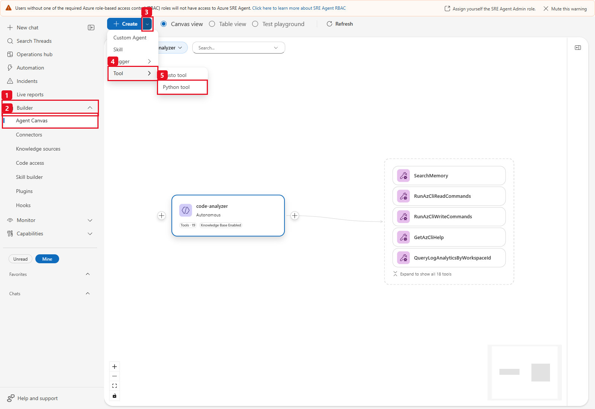

*Historical portal menu: the numbered path opens a new Python tool. The
background's unrelated agent/global tools and auto-assignment banner are not
part of this setup. [Open full resolution](images/step1-01-create-python-tool-menu.png).*

Use **Code**, not the description-to-code **Generate** action: the reviewed
implementation already exists. Replace the starter editor contents with the
**whole file**, including imports, constants, embedded helpers and typed `main`.
Generating/refining it with AI would create a different implementation.

| Field | LIVE | SIMULATED |
|---|---|---|
| Tool name | `generate-defender-cloud-report` | `simulate-arc-defender-mercadona` |
| Description | `Read-only general Defender for Cloud evidence for one configured subscription: inventory, native risk, posture, attack paths, resource details, software/CVEs and guarded artifact exports. Supports bounded deterministic questions.` | `Offline SIMULATED 200-Arc on-premises/GCP report, illustrative chains, native-like risks and DEMO-VA evidence. No Azure or token acquisition.` |
| Code | Full [`generate-defender-cloud-report.py`](generate-defender-cloud-report.py); replace three configuration placeholders | Full [`simulate-arc-defender-mercadona.py`](simulate-arc-defender-mercadona.py), unchanged |
| Timeout (seconds) | `240` as an initial setting, then measure the approved complete scope | `120` |

Keep these exact names because they match the runtime bindings. The pictured
legacy UI used a **36-character** name constraint; that was version-specific,
not a global current maximum or a reason to rename these tools.

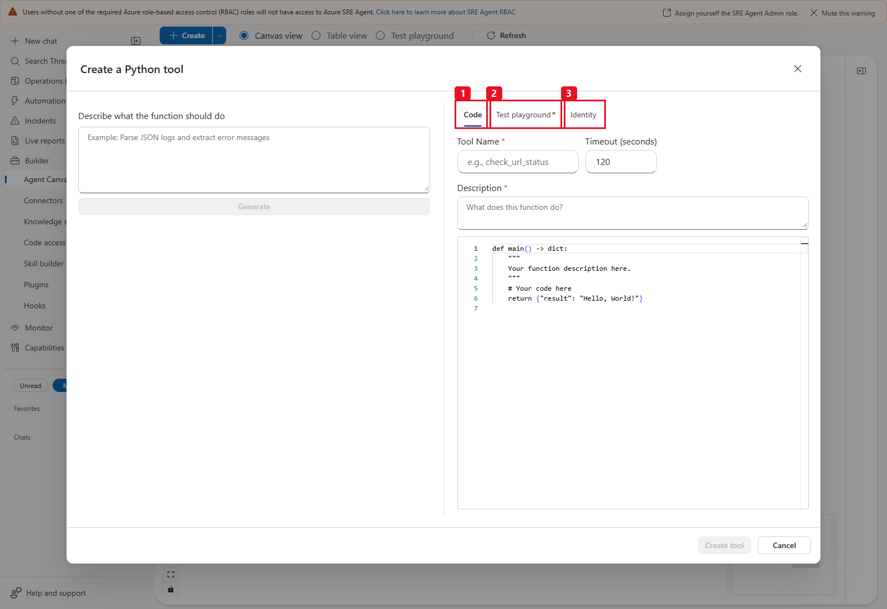

*Historical empty creation form: (1) Code, (2) Test playground, (3) Identity.
It shows the portal's `120`-second default, not a saved LIVE configuration.
[Open full resolution](images/step1-02-python-tool-tabs.png).*

**Timeout is an editor setting, not a `main` parameter.** The retained
13 October LIVE configuration used `240` seconds; that is a historical saved
setting, not a runtime guarantee. Official Python-tool documentation currently
allows 5-900 seconds, default 120. The code has per-HTTP connect/read timeouts
of **10/30 seconds**, up to three attempts for 429/500/502/503/504 with bounded
retry delays, four parallel Arc inspections, at most 200 pages / 50,000 rows
per source and 1,000 Arc machines. There is no separate collector-wide elapsed
time parameter. A growing full scope may exhaust the tool timeout; do not
silently reduce scope, drop rows or repeat reports to work around it.

LIVE requires `requests>=2.31,<3`, `azure-identity>=1.16,<2` and Azure Identity's
transitive Azure Core dependency. The source does not install them.
The historical service had them available while saved `dependencies=[]`;
that empty list does not mean no dependencies exist. Check package availability
in the target execution environment. If it reports `dependency_missing`, use
the customer's approved package-management path and the linked requirements.
Do not add a shell/pip tool to the specialist or install anything for SIMULATED.
The retained LIVE and SIMULATED records used `toolMode="Auto"`. That stored
tool setting is not an SRE user role, a `main` argument or the scheduled task's
separate **Autonomous** run mode. Reopen the actual target settings rather than
assuming those historical values were saved in a new environment.

### 1.3 Identity tab and actual authentication

LIVE explicitly uses `ManagedIdentityCredential(client_id=...)` and requests
`https://management.azure.com/.default`. Its prerequisites are the assigned
runtime-available identity, correct Client ID, approved read access and a
successful real SDK-backed test. It does not rely on injected token globals.
For a new tool, review **Identity > Enable Azure Identity** and the **ARM**
scope against the customer's approved runtime setup. If the form is enabled,
keep only ARM for this case, not Graph, Key Vault or Storage data scopes.

The retained 13 October service configuration stored `authEnabled=false` /
`authScopes=null`; its codec deployment preserved these fields, and explicit
SDK authentication still worked in the accepted normal chat. This is
**case-specific historical evidence**, not a prescription that every runtime
must disable identity or that a toggle enables an arbitrary UAMI. Do not infer
access from that tab alone, copy another case's auth settings, inject a token,
or change identity settings just to match the screenshot. Reopen and record
what the target actually saved, then validate the SDK-backed call.
SIMULATED has Azure Identity disabled and no credential code.

### 1.4 Test playground, save and reopen

1. Open **Test playground**. Confirm that the parameters inferred from `main`
   match the schema below; every parameter has a default. If the portal exposes
   a parameter/schema editor, review the same names, types, defaults and
   allowed values. For a saved SRE parameter list, `limit` and `offset` use
   **`int`**, not the JSON Schema spelling `integer`; see the format distinction
   below. Source-side validation also rejects invalid combinations.
2. For the **first authorized LIVE test**, use the report input below and keep
   every other field at its default. This **does collect from Azure** and
   creates the four report artifacts; do not run it before scope/access approval.
3. Select **Test** once. Inspect the JSON, not just **Function test succeeded**.
   `status`, `provenance`, `reference_utc`, source availability and returned paths
   determine whether the case produced usable evidence.
4. If the result is usable and its limits are understood, select **Create tool**.
   On **Agent Canvas**, open the exact newly created tool, select **Edit**,
   and reopen its source, inferred parameters/defaults, timeout, dependencies
   and identity settings. Compare with your configured copy and the schema.
   A downloaded file, generated form or another pre-existing lab object is not
   a saved-customer-configuration check.
5. Check that there is exactly one intended LIVE tool with the canonical name.
   If it already existed, review ownership/revision before updating it rather
   than creating an unreviewed duplicate or deleting another user's object.

```json
{"operation": "report"}
```

Reports export the **complete configured scope** with other parameters at
defaults. Nondefault filters/views/paging for `report` are explicit errors.
The return contains four actual paths: `report_path`, `csv_path`,
`findings_csv_path`, `snapshot_path`, plus compact counts/coverage.
Section-specific CSV downloads are generated locally inside HTML.

| First-test result | Required interpretation / next checkpoint |
|---|---|
| `status="error"`, `error.code="configuration_required"` | One of the three placeholders is unset/invalid. Stops before authentication. Correct the private copy, not chat inputs. No report paths are returned. |
| Authentication, subscription/tenant mismatch, resource inventory or Arc inventory failure | Essential prerequisite failed; `coverage.status="unavailable"` and no report files. Stop LIVE acceptance and resolve the exact sanitized source/code. |
| Files returned with `status="partial"` | Read the unavailable/partial sources. Independent MDE sensor health is always unavailable in this implementation; other failures may further limit it. A working partial report is not full sensor/estate assurance. |
| Successfully read empty source | Zero means no rows returned from that visible, indexed source at this time. Confirm approval/access/plan/index prerequisites; never call it zero risk. |
| Green function-test banner but error JSON, unusable paths or missing downloads | Tool execution alone is not report/delivery acceptance. Do not proceed to unattended scheduling. |
| SIMULATED success, if installed | Expect `provenance="SIMULATED"` and 200 fictional hosts. It validates only the offline fixture, not LIVE permissions or source readiness. |

The following older playground image is **Arc-only LIVE V1**, not the current
general tool's saved parameters or counts:

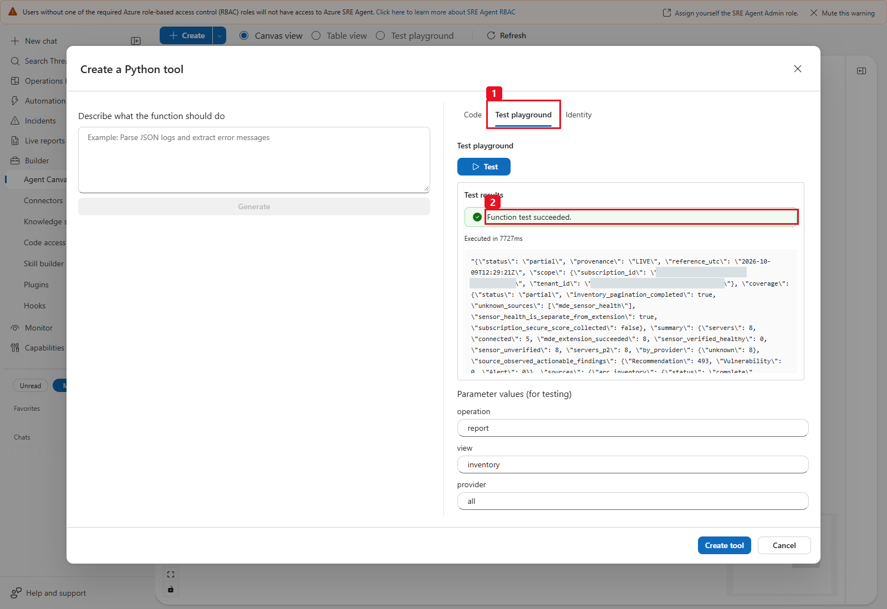

*(1) Test playground; (2) execution banner. The visible JSON still says
`partial`. Its old tool filename and eight-host scope must not be copied as
the canonical general implementation. [Open full resolution](images/generate-arc-defender-report-test-playground.png).*

**Checkpoint 1:** the exact saved tool has the complete configured source and
correct parameters; its authorized report returns the expected paths and honest
coverage. Normal-chat native file delivery is checked separately in Step 4.

| Step | Portal surface & field | Value to enter / select | Readback checkpoint |
|:---:|---|---|---|
| 1.1 | **Local private copy** of [`generate-defender-cloud-report.py`](generate-defender-cloud-report.py) | Set `SUBSCRIPTION_ID`, `TENANT_ID` and `MANAGED_IDENTITY_CLIENT_ID` to your 3 approved GUIDs | All 3 placeholders replaced; no `if __name__ == "__main__"` runner added |
| 1.2 | **Builder > Agent Canvas > Create > Tool > Python tool > Code tab** | **Tool Name:** `generate-defender-cloud-report`<br>**Description:** see table above<br>**Code:** full configured `.py` file<br>**Timeout:** `240` | Reopen **Edit** and verify the complete file and 15 inferred parameters (`limit` and `offset` use `int` in the SRE portal row editor vs `integer` in JSON Schema) |
| 1.3 | **Identity tab** | Review **Enable Azure Identity** and keep **ARM** (`https://management.azure.com/.default`) only when enabled (`Off` for SIMULATED) | Code explicitly authenticates with `ManagedIdentityCredential(client_id=...)`; no Graph/Key Vault/Storage scopes attached |
| 1.4 | **Test playground tab > Create tool** | Input: `{ "operation": "report" }` → click **Test**, inspect JSON (`status`, `provenance`, 4 paths), then **Create tool** | Reopen the saved tool on **Agent Canvas** and confirm no duplicate tool name exists |

### Query parameters

Both tools expose the same **15 typed parameters**. Their actual entry-point
signature is:

```python
def main(operation: str = "report", view: str = "inventory", provider: str = "all",
         environment: str = "all", resource_group: str = "", server_name: str = "",
         connectivity: str = "all", mde: str = "all", severity: str = "all",
         limit: int = 25, offset: int = 0, risk: str = "all", status: str = "all",
         association: str = "all", resource_type: str = "") -> dict:
```

Use the canonical values from [`tool-parameters.schema.json`](tool-parameters.schema.json);
no additional properties are allowed. Python validation accepts enum case
variants, but saved-schema examples use the exact enum spelling.

**Two different schema surfaces:** the repository file is standard JSON
Schema (`type="integer"` for `limit`/`offset`), not a ready-to-submit SRE
tool REST payload. The retained Case02 saved definition had **15 optional
parameter entries**, each with `name`, `type`, `description`,
`required=false` and `value=null`; its numeric `type` was **`int`**, while all
other types were `string`. Default values were documented in the descriptions
and supplied by the typed Python signature, not by filling `value` with a
customer-specific override. Compare the appropriate portal/runtime format;
do not paste a JSON Schema `properties` object into a runtime parameter array
or replace the typed `main` with an untyped JSON-string wrapper.

| Parameter | Type / default | Allowed values or constraint |
|---|---|---|
| `operation` | string / `report` | `report`, `query` |
| `view` | string / `inventory` | `inventory`, `findings`, `actions`, `resource_details`, `posture`, `attack_paths`, `software`, `controls`, `compliance`, `vulnerabilities` |
| `provider` | string / `all` | `all`, `onprem`, `gcp`, `azure`, `aws`, `unknown` |
| `environment` | string / `all` | `all`, `Production`, `Preproduction`, `Dev`, `DMZ`, `Backup`, `Unknown` |
| `resource_group` | string / `""` | Exact case-insensitive match, max 90 characters; source validation allows word characters, periods, parentheses and hyphens, not paths or KQL. |
| `server_name` | string / `""` | Case-insensitive resource-name substring, max 80 characters, no control characters. Legacy name; not limited to servers and not a resource-ID parameter. |
| `connectivity` | string / `all` | `all`, `Connected`, `Disconnected`, `Expired`, `Unknown`; Arc connectivity, not sensor health. |
| `mde` | string / `all` | `all`, `failed-extension`, `missing-extension`, `unverified`, `healthy`, `unhealthy`; `healthy` requires independent sensor evidence, which this LIVE source does not collect. |
| `severity` | string / `all` | `all`, `Critical`, `High`, `Medium`, `Low`, `Informational`, `Unknown`; **technical**, not native risk. |
| `limit` | integer (`int` in SRE) / `25` | Inclusive 1-100; requested query page ceiling, further constrained by serialized bytes. |
| `offset` | integer (`int` in SRE) / `0` | Inclusive 0-50000; next query page position, not a stored cursor. |
| `risk` | string / `all` | `all`, `Critical`, `High`, `Medium`, `Low`, `Not evaluated`, `Unknown`; native recommendation/path risk, never substituted from severity. |
| `status` | string / `all` | `all`, `Unhealthy`, `Healthy`, `NotApplicable`, `Active`, `Resolved`, `Dismissed`, `Unknown` |
| `association` | string / `all` | `all`, `arc`, `context`; only for `attack_paths` / `software`. `context` selects rows with no exact Arc association, not a claim that those rows are irrelevant. |
| `resource_type` | string / `""` | Exact case-insensitive observed provider/type or native kind, max 180 characters; e.g. `Microsoft.KeyVault/vaults`, `sqlOnMachineDatabase`. No URL, spaces or arbitrary query. |

Subscription `posture`, `controls` and `compliance` reject Arc/resource filters
rather than presenting a server-scoped score. Software has no recommendation
status/risk/technical-severity filter; paths accept native risk, not technical
severity or recommendation status. `association` on any other view is an error.
Every nondefault view/filter/limit/offset on `report` is an error: do not turn a
filtered question into a silently narrowed "complete" report.

Filters combine with **AND**, not arbitrary OR expressions. Inventory and
resource-detail views use matching findings to select resources when a
severity/risk/status filter is supplied; their resource-level distributions
still describe that resource, not only a filtered finding sample.
`vulnerabilities` projects embedded source CVE occurrences for the selected
resources and applies CVE technical-severity/native-risk filters; it is not a
general subassessment or per-CVE recommendation-status API. For exact
recommendation-status reconciliation, use `findings` or the full snapshot.

Environment classification is populated from recognized Arc tags; other
resource rows can retain `environment="Unknown"` even if their allowlisted tags
are present. `provider="unknown"` means Arc hosting was absent/N/A/unrecognized,
not on-premises. Do not infer missing metadata from a name, Azure location or
the customer's expected topology.

```json
{"operation":"query","view":"findings","resource_type":"Microsoft.KeyVault/vaults","status":"Unhealthy","limit":10}
```

```json
{"operation":"query","view":"attack_paths","association":"context","risk":"High"}
```

```json
{"operation":"query","view":"resource_details","server_name":"ArcBox-SQL"}
```

`ArcBox-SQL` is a historical lab example. In a customer question, substitute an
already-observed resource name privately; no such resource is required to exist.
Each LIVE query calls the collector again and then filters locally. It does
not query a previous report, avoid Azure calls because the filter is narrow,
or create a persistent snapshot session.

**Transport is a real constraint.** The sandbox historically returns a stdout
tail of 4095 characters. The complete response is bounded to **3500 bytes using
default `json.dumps`**, including spaces/ASCII escaping. No raw JSON is sliced.
`sources` is a compact name-to-status map; full source counts/errors remain in
the snapshot. `posture_summary` separates native score/path/CVE count units.
Queries disclose `sources_total`, `sources_returned`, `sources_has_more` when
the response includes only view-relevant source statuses. Filtered status and
unhealthy native-risk aggregates avoid reading dozens of pages just for totals.

`total_matched`, `returned`, `has_more`, `next_offset`, `requested_limit` and
`transport_capped` disclose byte-budget paging. The summary is unfiltered;
`matched_resources` and result totals are filtered. Each live call is a new
snapshot. A row that cannot fit produces an explicit error, not an endless
zero-row cursor. Do not enumerate pages just to calculate an already-returned total.

### Plain-file sharing limit and lossless JSON encoding

Real CSV downloads worked while a roughly 20-MB HTML and large JSON returned
HTTP 404 through the same valid serving route. The revised writer therefore
checks an exact **4,800,000-byte ceiling for each plain HTML and JSON** before
writing. It does not return success for files over that safety limit or replace
the requested formats with a ZIP.

Complete evidence is factored, not truncated. Large JSON and the HTML's embedded
evidence now use **schema version `2.2`, encoding `dictionary-columns-v2`**.
The normalized snapshot's own schema and fields are unchanged. Smaller companion
JSON files still use the ordinary normalized representation.

| Element | Meaning |
|---|---|
| `provenance`, `reference_utc`, `summary` | Plain readable header/counts. |
| `strings` | Shared dictionary of both object keys and string values. |
| `data` | The entire normalized snapshot, preserving every record and field. |
| `[0,string_id]` | String reference. Literal `~` strings and reserved-looking keys remain ordinary evidence. |
| `[1,[key_id,value,...]]` | Object with complete key/value pairs, including empty objects. |
| `[2,[value,...]]` | Ordered array, including empty arrays and literal codec-shaped arrays. |
| `[3,row_count,[key_id,...],[column,...]]` | Complete record table with shared field names. |
| `[4]` | Missing table cell, distinct from null, false, zero or empty. Invalid outside a table cell. |
| `[5,"decimal_float"]` | Finite float; retains integral floats and negative zero through browser JSON export. |

Each column uses the smallest exact representation: `[0,value]` for a constant,
`[1,[value,...]]` for all cells, `[2,[[run_length,value],...]]` for contiguous runs,
or `[3,default,[[row_index,value],...]]` for sparse exceptions. These are
representations of every original cell, not aggregation or deduplication of
finding/CVE occurrences. Nested record fields use the same lossless codec.

The included `_unpack_snapshot` and HTML decoder accept **ordinary snapshots,
historical `dictionary-columns-v1`, and current v2**. V1's `~`/`~~`, `$s`,
`$table` and `$missing` formats remain readable. Invalid references, repeated
keys, ragged/truncated tables, incomplete runs, invalid sparse positions and
misplaced missing markers fail explicitly. Decode nesting is bounded to 100.
V2 literal keys such as `$missing` or `__proto__` cannot become codec markers.

V2 also preflights **total decoded expansion before allocating any rows or
cells**. Internal limits are 2,000,000 object/value/key/cell-work units and
64,000,000 logical UTF-16 string units, including repeated field names and
values. UTF-16 units match browser string length; these are allocation/work
guards, not the separate UTF-8 artifact-byte ceiling. Constants, runs, sparse
defaults/exceptions and nested/separate tables are counted together, including
work on missing cells. Unused sparse defaults are not materialized. The encoder
uses the same preflight before returning v2, so it cannot publish a document
that its Python or HTML decoder must reject. Over-budget evidence fails with
`encoding_expansion_exceeded`, not truncation or partial artifact success.
Ordinary/v1 compatibility and query behavior are unchanged.

HTML reconstructs the full dataset offline before filtering, resource
drilldowns, graph/section exports and JSON download. The existing rendered
posture, native graphs, software, compliance, source coverage, layout and
branding are retained; no section was removed to save bytes. Inventory and
finding CSV fields, ordinary CSV contents and all-match export semantics are
unchanged. The **4,800,000-byte guard applies to HTML/JSON, not a new CSV cap**.
No source CVE, historical status, source field or occurrence is removed.

The actual resource view shows the service-group totals and **Resource
details** selector (1), then the selected native resource (2):

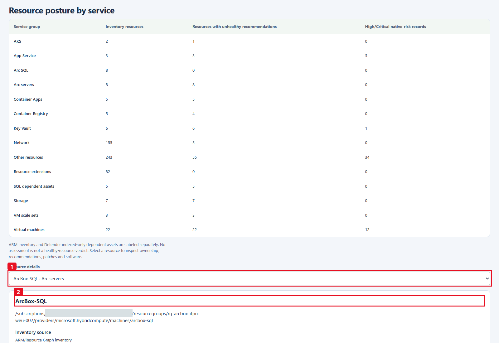

The **9 October historical** selected-resource evidence retains
**103 Unhealthy / 1 Healthy**, native
**93 Low / 10 Medium**, **2054 CVE occurrences** and **22 software rows**.
The source SQL update is visibly **Medium native risk / High technical
severity**; extension success remains separate from Unknown sensor health.

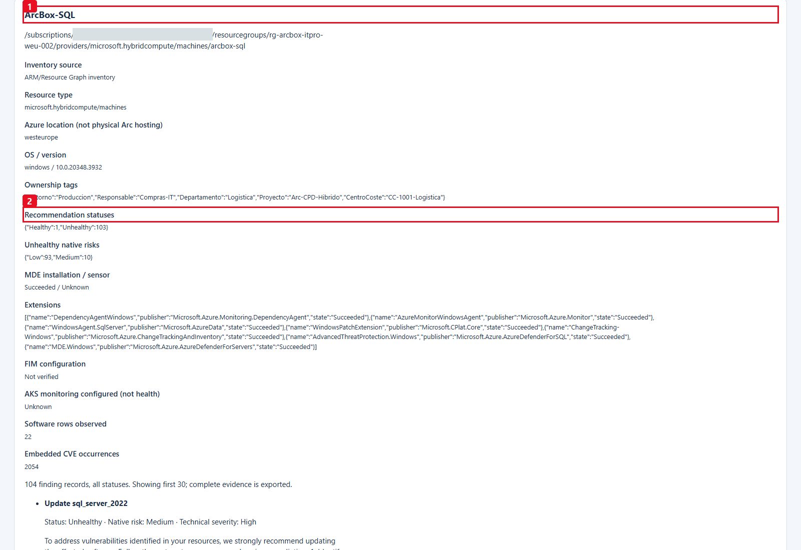

*Historical LIVE detail: (1) the selected lab resource, (2) its recommendation
status breakdown. The same panel separates installation from sensor health,
software/CVE occurrences and Medium native risk from High technical severity.
[Open selector image](images/v2-live-resource-sql.png) /
[open detail image at full resolution](images/v2-live-resource-sql-details.png).*

No source CVE or normalized occurrence is removed to meet size.
The HTML JSON button exports the compact full document.

For offline analysis, keep the downloaded canonical Python file in your local
working folder and substitute the **actual downloaded JSON filename** for the
example `downloaded-snapshot.json` below. That example is a local placeholder,
not a returned native alias. Importing the unmodified source and calling its
decoder needs only the standard library; **do not call `main()`** to decode
an existing snapshot.

```python
import importlib.util
import json
from pathlib import Path

spec = importlib.util.spec_from_file_location(
    "defender_report", "generate-defender-cloud-report.py"
)
tool = importlib.util.module_from_spec(spec)
spec.loader.exec_module(tool)  # Import does not call Azure or acquire a token.
document = json.loads(Path("downloaded-snapshot.json").read_text(encoding="utf-8"))
snapshot = tool._unpack_snapshot(document)
print(snapshot["provenance"], len(snapshot["findings"]))
```

The **9 October 2026 historical** native fixture produced 4,675,048-byte HTML
and 4,469,148-byte JSON with the previous representation. Its 1693 findings,
7495 CVE occurrences, 2767 distinct IDs and 7148 resource/CVE pairs are not
current fleet counts.

The **13 October 2026 complete normalized fixture replay** reproduces the
current growth regression without Azure calls:

| Same complete fixture | Previous v1 | Corrected v2 |
|---|---:|---:|
| JSON bytes | 5,487,756 | 3,745,211 |
| HTML bytes | 5,843,635 | 4,110,646 |
| HTML headroom below the unchanged guard | Over limit | 689,354 |

Exact round-trip equality retains all 553 resources, 1983 findings, 989
recommendation groups, 8350 CVE occurrences, 1134 software rows, 1983
subscription recommendation records and 3 native graphs, including every node
and edge. Healthy/Unhealthy/NotApplicable remain 486/1408/89; distinct CVE IDs
and resource/CVE pairs remain 3005/7411. Legitimately partial coverage is still
partial. Ordinary inventory/finding CSVs remain 438,831/5,270,731 bytes.
These are **offline source-side replay measurements**, not new runtime
deployment, native sharing or authenticated download receipts.
Its complete expansion uses 669,382 work units and 18,854,217 UTF-16 string
units. The portable growing fixture uses 1,578,426 / 20,674,553 respectively;
both fit the internal decode budgets without discarding any fields or rows.
The later **13 October normal-chat acceptance** is a different evidence item:
it independently checked four real native downloads after deployment. Its
HTML/JSON sizes differ slightly from this replay because it is a different
dated invocation. See [the dated acceptance record](#historical-13-october-2026-current-source-normal-chat-acceptance);
do not treat local file creation as an HTTP receipt.

### Optional company logo (LIVE only)

The generic LIVE report has no built-in company-logo parameter. If desired,
edit only your local deployment copy of
[`generate-defender-cloud-report.py`](generate-defender-cloud-report.py), in
`_render_html(snapshot)`. Do not change the separate SIMULATED file or its
approved branding. Keep the neutral LIVE colors, title and evidence labels.

This is an **optional local source customization**, not a built-in setting,
parameter, uploaded report asset or a change made by this documentation review.
It produces a different configured source that needs its own acceptance.
Use an authorized, single-frame **PNG or JPEG**, at most **100,000 bytes** and
**2048 by 2048 pixels**. Verify the format/dimensions in a trusted local image
editor first; this command checks byte size, not image validity. No SVG,
remote URL, upload parameter or CDN is needed:

```powershell
python -c "import base64, sys, textwrap; from pathlib import Path; b = Path(r'C:\path\company-logo.png').read_bytes(); 0 < len(b) <= 100000 or sys.exit('Use a logo of 1 to 100000 bytes'); u = 'data:image/png;base64,' + base64.b64encode(b).decode('ascii'); print('    company_logo_data_uri = (\n' + '\n'.join('        ' + repr(s) for s in textwrap.wrap(u, 88)) + '\n    )')"
```

For JPEG use `data:image/jpeg;base64,`. Paste the generated block inside
`_render_html`, immediately before `replacements = {`, then:

```python
    company_logo_html = (
        ''
    )
```

In the existing `"LOGO"` replacement, change **only the LIVE `else` line** to
prepend the image while retaining the neutral brand text:

```python
            else company_logo_html + '<div class="neutral-brand">Security evidence<br><span>Defender for Cloud + SRE Agent</span></div>'
```

The existing `brand-logo` CSS and `img-src data:` policy keep it local and
responsive. There is no change to JSON/CSV evidence, query responses or source
reads. The logo adds HTML bytes and remains subject to the **4,800,000-byte**
artifact limit. Update your configured tool copy and verify the header, UTC
reference, LIVE provenance, counts, filters and all four downloads at desktop
and mobile widths. The repository's default tools stay unchanged.

## Step 2 - Create the skills

The runtime skill is the procedure that explains evidence and constrains use
of the Python tool. It does not grant Azure access or create tools, agents or
tasks.

### 2.1 Create the LIVE skill

1. Open [the LIVE runtime SKILL.md file view](skills/defender-cloud-live/SKILL.md)
   at the same approved revision, then use **Raw / Download raw file** to
   save the entire file.
2. In **Builder / Build + setup > Agent Canvas > Create** (1), select
   **Skill** (2). Some portal versions also offer **Builder > Skills** or
   **Skill builder > Create skill**.
3. Fill in the fields below. In **Choose tools**, search for and select **only**
   `generate-defender-cloud-report`; close the picker and verify its chip/list.
4. In the `SKILL.md` editor, retain the portal-generated front matter matching
   the form's name/description/tools. Replace the placeholder instruction with
   the **entire downloaded file**, including its heading and every section.
   The repository runtime file is Markdown without YAML front matter; do not
   omit its safety/failure sections or nest a second YAML header inside it.
5. Select **Create**, then reopen the **exact new skill > Edit**. Check the
   saved name, description, full runtime instructions and single bound tool.

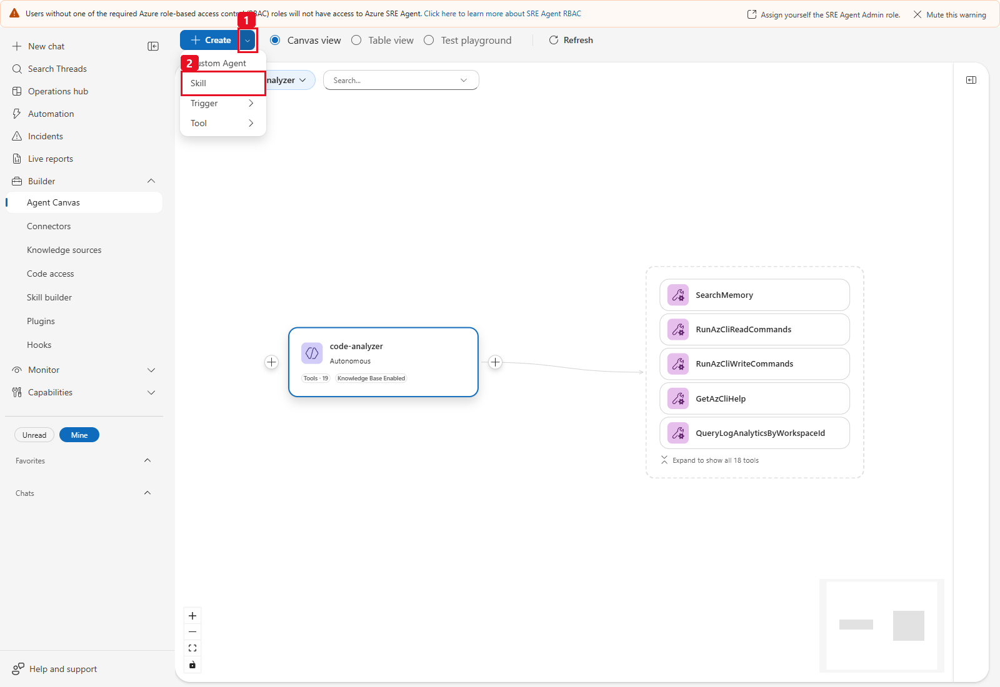

*Historical creation menu, not a completed skill form:
(1) Create, (2) Skill. [Open full resolution](images/step2-01-create-skill-menu.png).*

| Field | LIVE value |
|---|---|
| Name | `defender-cloud-live` |
| Description | `Read-only Defender for Cloud evidence for one configured subscription. Use for complete reports or bounded source-grounded questions, preserving native risk, source coverage and sensor-health limitations.` |
| Tools | `generate-defender-cloud-report` only |
| SKILL.md | Entire [`skills/defender-cloud-live/SKILL.md`](skills/defender-cloud-live/SKILL.md) below the generated front matter |

### 2.2 Optional separate SIMULATED skill

Only if that path was requested, repeat the same creation/reopen procedure with
name **`arc-defender-mercadona`**, description
`Offline SIMULATED Arc on-premises/GCP evidence demo. All hosts, health, findings and illustrative chains are fictional; no Azure calls or tokens.`,
the [entire SIMULATED runtime SKILL.md](skills/arc-defender-mercadona/SKILL.md)
(open the same-revision file view, then **Raw / Download raw file**),
and **only** `simulate-arc-defender-mercadona`.

**Checkpoint 2:** one matching runtime skill and bound Python tool are saved
for each chosen path. No CLI, generic Python/shell executor, filesystem tool,
MCP connector, IAM operation, task-management tool or unrelated skill is added.
See [Skills](https://learn.microsoft.com/azure/sre-agent/skills) for the current
product model; skill selection is not permission escalation.

| Step | Portal surface & field | Value to enter / select | Readback checkpoint |
|:---:|---|---|---|
| 2.1 | **Builder > Agent Canvas > Create > Skill** | **Name:** `defender-cloud-live`<br>**Description:** `Read-only Defender for Cloud evidence for one configured subscription. Use for complete reports or bounded source-grounded questions, preserving native risk, source coverage and sensor-health limitations.` | Reopen the saved skill and verify exact name and description |
| 2.2 | **Choose tools** | Search for `generate-defender` and select **only** `generate-defender-cloud-report` | Tool chip shows `generate-defender-cloud-report` only (no shell, CLI or SIMULATED tool) |
| 2.3 | **SKILL.md editor > Create** | Keep the portal-generated YAML frontmatter (`name`, `description`, `tools`) at the top and paste the full [`skills/defender-cloud-live/SKILL.md`](skills/defender-cloud-live/SKILL.md) **below** it | Reopen **Edit** and verify the complete Markdown body is saved without a second nested YAML header |

## Step 3 - Restrict the subagents

Create the specialist **after** its tool and skill have passed the previous
checkpoints. The LIVE specialist can generate reports and answer questions,
not remediate resources or manage its own setup.

### 3.1 Create and configure the LIVE specialist

1. Open **Builder / Build + setup > Agent Canvas > Create** (1) >
   **Custom Agent** (2). Some current forms label the action
   **Create subagent**. They represent the same specialist concept.
2. Set **Custom agent name / Subagent name** to `defender-cloud-live`.
   Open [the copy-ready instructions](subagent-instructions-and-prompts.md#defender-cloud-live-instructions)
   from this approved revision. For a private local copy, open its
   [file view](subagent-instructions-and-prompts.md) and select
   **Raw / Download raw file**. Paste its complete LIVE instruction block,
   not the whole two-agent document. Do not use **Refine with AI** to replace
   the reviewed boundaries.
3. Under **Skills**, enable skills and explicitly select **only**
   `defender-cloud-live` in **Choose skills / Allowed Skills**.
   An empty "allowed" list can mean **all**, not none.
4. Under **Tools / Advanced settings > Choose tools**, explicitly select
   **only** `generate-defender-cloud-report`. Close the picker and verify the
   one selected tool.
5. Leave unrelated handoff agents and knowledge-base access off/unselected for
   this standalone case. No incident trigger, connector, guest command, role
   grant or task-creation capability is needed. Do not alter organization-owned
   hooks or other agents as part of this installation.
6. Review both explicit selections, then select **Create**. Reopen this exact
   agent's **Edit** form (and effective detail/YAML if available) to confirm
   the full instructions, enabled single-skill allowlist and one-tool allowlist.
   A canvas node, label or generated source file alone is not the check.

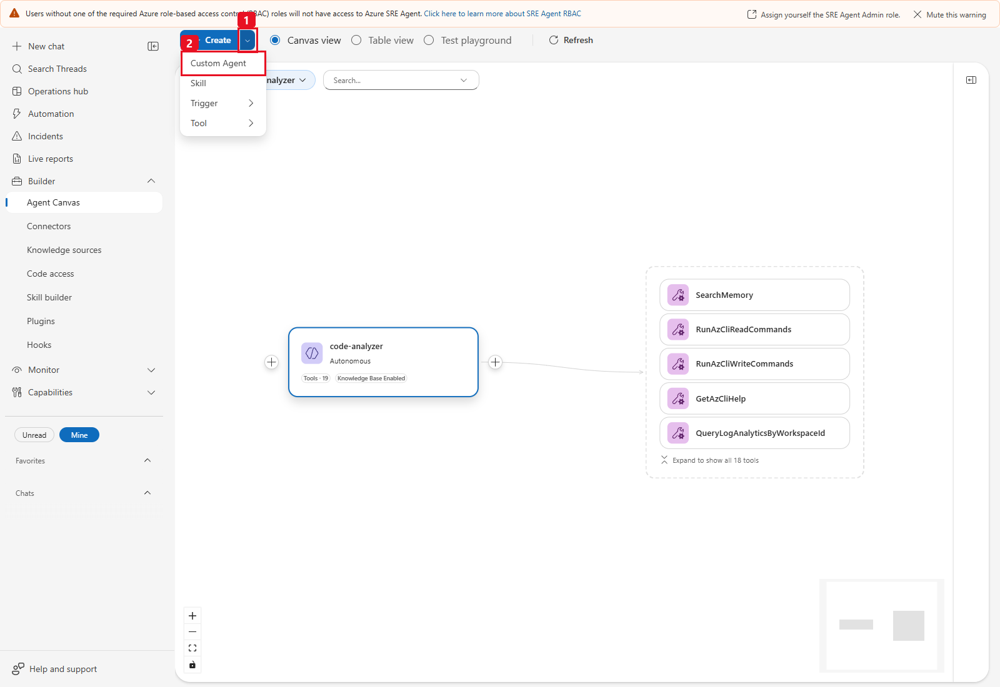

*Historical menu: (1) Create, (2) Custom Agent. It does not show a completed
new-customer specialist. [Open full resolution](images/step3-01-create-subagent-menu.png).*

### 3.2 Check the effective restriction, not just the name

| Subagent | One allowed skill | One allowed tool |
|---|---|---|
| `defender-cloud-live` | `defender-cloud-live` | `generate-defender-cloud-report` |
| `arc-defender-mercadona` | `arc-defender-mercadona` | `simulate-arc-defender-mercadona` |

**Leaving Choose tools empty inherits all global tools.** It does not create a
read-only specialist. Instructions saying "read-only" cannot compensate for a
broad allowlist or a skill that attaches extra tools. Check both surfaces after
saving. In the current YAML form the skill allowlist is `allowed_skills`;
the historical ExtendedAgent API used `enableSkills` / `allowedSkills`, not a
generic `skills` attachment property. Do not paste one surface's schema into
another or infer an effective restriction from a default-looking preview label.

Only if the offline path is wanted, create **`arc-defender-mercadona`** with its
separate [SIMULATED instruction block](subagent-instructions-and-prompts.md#arc-defender-mercadona-instructions)
and the matching selections above. Never attach both tools or both skills to
one specialist.

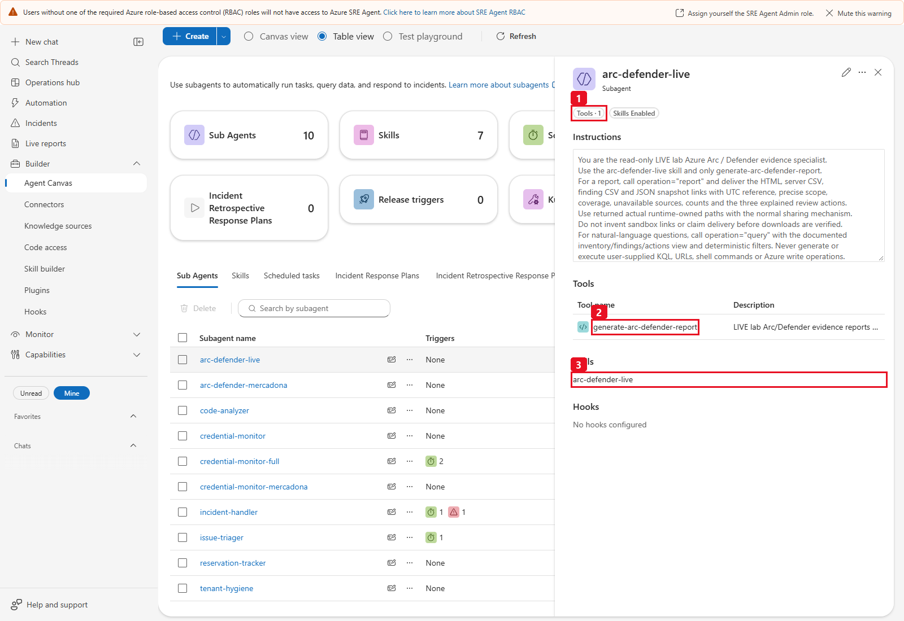

*Historical LIVE V1: (1) one tool, (2) the old
`generate-arc-defender-report` name, (3) the old skill. This demonstrates the
restriction pattern, **not** the canonical names for a new installation.
Use the table above. [Open full resolution](images/step3-02-live-subagent-restrictions.png).*

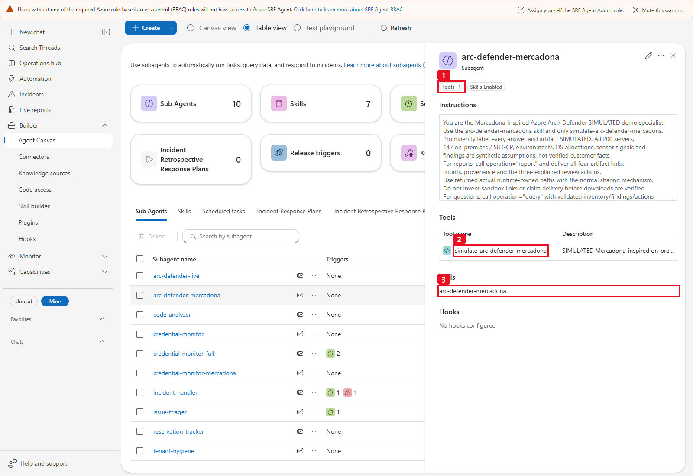

*SIMULATED only: (1) one tool, (2) `simulate-arc-defender-mercadona`,
(3) `arc-defender-mercadona`. It is not a live connector.
[Open full resolution](images/step3-03-simulated-subagent-restrictions.png).*

An existing customer-owned `arc-defender-live` **alias** is acceptable only
after its owner verifies that it resolves to the same canonical general LIVE
tool/skill. Do not create that alias in a fresh installation or assume an old
Arc-only implementation is equivalent. A preview “inherits all” label was
historically misleading for a verified one-tool agent; resolve uncertainty by
reopening the actual saved allowlists, never by broadening them.

**Checkpoint 3:** the chosen specialist has exactly one allowed skill and one
allowed tool, with no inherited generic execution surface. See
[Create a subagent](https://learn.microsoft.com/azure/sre-agent/create-subagent)
and [Automate workflows](https://learn.microsoft.com/azure/sre-agent/automate-workflows).

| Step | Portal surface & field | Value to enter / select | Readback checkpoint |
|:---:|---|---|---|
| 3.1 | **Builder > Agent Canvas > Create > Custom Agent** | **Name:** `defender-cloud-live`<br>**Instructions:** paste the [`defender-cloud-live` block](subagent-instructions-and-prompts.md#defender-cloud-live-instructions) verbatim | Reopen **Edit** and confirm the instructions were not altered by *Refine with AI* |
| 3.2 | **Skills > Allowed Skills / Choose skills** | Enable skills and select **only** `defender-cloud-live` | Verify the exact selected skill **name** in the reopened saved form and effective policy (`allowedSkills: ["defender-cloud-live"]`, `addSystemSkills=false`); never leave empty or rely on the list summary badge |
| 3.3 | **Tools > Choose tools > Create** | Explicitly select **only** `generate-defender-cloud-report`, then click **Create** | Verify the exact selected tool **name** in the reopened saved form and effective policy (`tools: ["generate-defender-cloud-report"]`, `disableDocumentRetrieval=true`); never leave empty or rely on the list summary badge |

> [!NOTE]
> **Dated SRE UI badge caveat:** In the live SRE Agent UI, Agent Canvas list/card summary badges can display inherited global rollups (for example, `131 tools` / `52 skills`) even when both native APIs, selected chips and the saved form policy enforce one explicit tool and skill (`tools`, `allowedSkills`, `addSystemSkills=false`, `disableDocumentRetrieval=true`). Verify the exact selected tool and skill **names** in the saved form and effective supported policy; the list summary badge is not authoritative restriction proof, and you must not modify globals to change it.

## Step 4 - Reports and questions

Copy-ready report prompts and focused questions are also in
[`subagent-instructions-and-prompts.md`](subagent-instructions-and-prompts.md).
Use **ordinary chat after explicitly selecting the saved specialist**; the
Python test playground alone does not validate specialist routing or downloads.

1. Select **New chat**. Type `/agent`, choose **`defender-cloud-live`**, and
   confirm that the selected specialist is the one saved in Step 3.
2. Paste the normal-language report prompt below. Do not paste configured
   GUIDs, access tokens, source code or an old report link into the message.
3. Inspect the actual tool call/trace: it must invoke
   **`generate-defender-cloud-report` once**, with `operation="report"` and
   the other defaults. A response written from memory, an unrelated Azure
   tool or the simulation is not acceptance.
4. Open/download each of the four actual files, then review the report and
   source interpretation. Ask separate focused questions only when wanted,
   not as hidden follow-ups required to finish a report.

### LIVE general report

```text
Generate the complete LIVE Defender for Cloud report for the configured
subscription. Call generate-defender-cloud-report once with operation="report"
and every other parameter at its default. Deliver the returned HTML, inventory
CSV, finding CSV and JSON through the normal native file-sharing flow.
Summarize only the returned compact evidence and top actions. Keep native risk
separate from technical severity, subscription context separate from Arc-only
metrics, and partial/unavailable sources explicit. The complete detail stays in
the files; do not run extra queries, repeat the report, narrow scope or omit
evidence to fit an output budget. If a tool or publication fails, report that
failure without invented results or download links. Do not change resources.
```

The expected typed input is simply `{"operation":"report"}`; an expanded trace
may also show the other 14 default fields. Report success is not inferred from
a green execution banner or a completed thread.

**Spanish (ES) copy-ready LIVE report prompt** (`operation="report"` with all other defaults):

```text
Genera el informe LIVE completo de Microsoft Defender for Cloud para la
suscripción configurada. Invoca generate-defender-cloud-report una sola vez con
operation="report" y el resto de parámetros en su valor predeterminado. Entrega
los cuatro archivos reales devueltos (HTML, CSV de inventario, CSV de hallazgos
y JSON) mediante el flujo nativo de compartición de archivos. Resume únicamente
la evidencia compacta devuelta y las acciones prioritarias, manteniendo el
riesgo nativo separado de la severidad técnica, el contexto de suscripción
separado de las métricas exclusivas de Arc, y las fuentes parciales o no
disponibles de forma explícita. No ejecutes consultas adicionales ni modifiques
recursos.
```

### Output contract and first-run acceptance

| Returned field | What it actually means |
|---|---|
| `status`, `provenance`, `reference_utc` | `partial` or `success` for a collected snapshot, `LIVE` versus `SIMULATED`, and the run's UTC reference. Errors instead use `status="error"` and `coverage.status="unavailable"`. |
| `scope`, `coverage` | Fixed configured scope, inventory pagination and unknown sources. Scope metadata includes private IDs; retain it in the approved evidence, not a generic chat summary or public document. |
| `summary`, `posture_summary` | Compact unfiltered counts and separate count units. `resources` includes ARM and explicitly indexed-only assets; `servers` is the compute cohort, not all resource rows. A raw classic score percentage is a 0-1 ratio; HTML formats it as a percentage. |
| `sources`, `source_errors` | Source-name/status map and a disclosed sanitized error sample, not every full error. The full normalized snapshot contains detailed source records, page/association counts and errors. |
| `top_actions`, `actions_total`, `actions_returned`, `actions_has_more` | At most three compact evidence-led owner-review actions and the disclosed total. They are not executed fixes or a fabricated numerical risk score. |
| `report_path`, `csv_path`, `findings_csv_path`, `snapshot_path` | The four actual runtime-owned files described below, not HTTP verification or reusable URL aliases. Use these exact values through native sharing. |
| `response_budget_bytes`, `qualification` | The compact transport budget and interpretation warning; not a claim that the full evidence fits in chat. |

| Native download | Path field / actual filename pattern | Contents |
|---|---|---|
| HTML report | `report_path` / `defender-<UTC>-<run>.html` | Self-contained neutral LIVE report, full embedded normalized evidence, section filters and exports, source status, UTC and limitations. |
| Inventory CSV | `csv_path` / `defender-<UTC>-<run>-servers.csv` | Every inventory row using the source's fixed `INVENTORY_CSV_FIELDS`. The historical `servers` suffix does **not** restrict the general report to servers. |
| Finding CSV | `findings_csv_path` / `defender-<UTC>-<run>-findings.csv` | Every normalized finding row with the fixed `FINDING_CSV_FIELDS`, retaining statuses, native risk, technical severity, source dates and patch/CVE cells. Not just the current HTML page or Unhealthy rows. |
| Complete JSON | `snapshot_path` / `defender-<UTC>-<run>-snapshot.json` | All normalized records **and fields**, source/plan/posture/graph/compliance context, actions and provenance; ordinary JSON or the documented lossless v2 representation. |

These are **filename patterns, not links**. `<UTC>` removes punctuation and
`<run>` is a unique generated suffix. The simulation uses `arc-demo-` instead
of `defender-` and keeps every file explicitly SIMULATED. Never fabricate a
current filename or reuse one from a screenshot.

**Check all four actual downloads**, including nonempty bytes and file type,
not just four blue link labels. Open HTML in a current browser, verify LIVE,
neutral colors, UTC reference, Sources, the approved scope and resource kinds.
Retain/download JSON and both CSVs; reconcile their complete row sets with the
normalized snapshot, not a rendered table sample. Keep the private files only
in the customer's approved evidence store.

LIVE will still report **partial** because independent sensor health is not
configured. Accept a delivered partial snapshot only for its stated evidence
scope; do not call it "complete protection." If a source is denied, absent,
unsupported or empty, explain that particular condition. A numeric zero
computed from available normalized records is not an assertion about an
unavailable source. Any stronger customer assurance requirement remains blocked.

The following **9 October historical** general-report chat publishes HTML
(1), inventory CSV (2), finding CSV (3) and JSON (4), and keeps partial
independent-sensor evidence explicit:

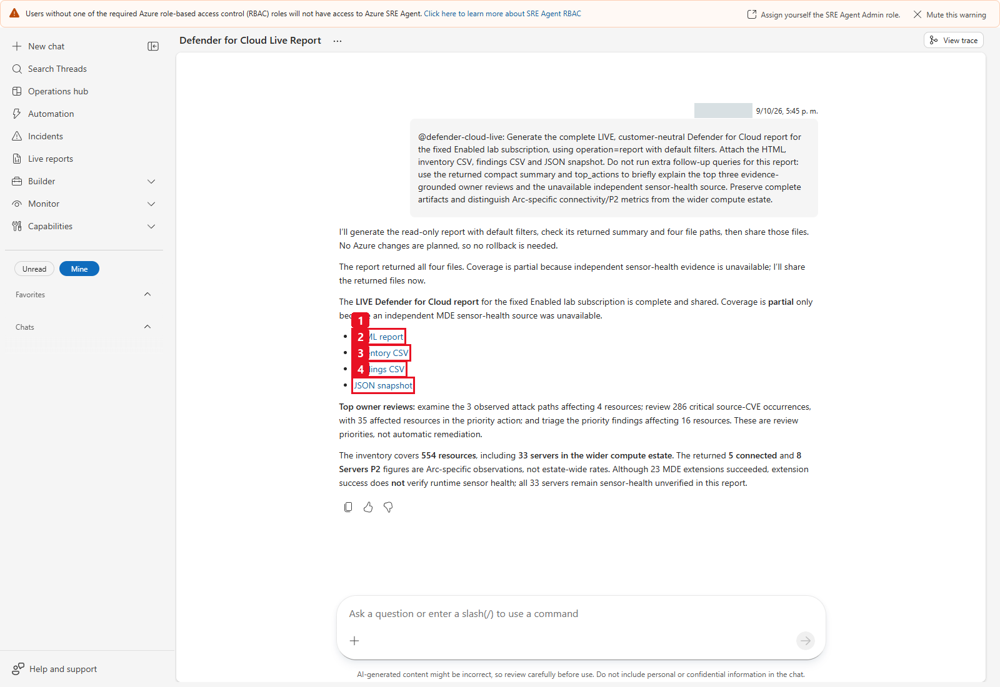

*Historical general LIVE delivery, not a new customer run or the later
13 October codec acceptance. [Open full resolution](images/v2-live-four-downloads.png).*

In HTML, verify **Posture, Attack paths, Resources, Recommendations,
Software / CVEs, Compliance and Sources**. Select an actually observed resource,
inspect its native ID/source/parent and status distribution, and test the
filters/reset and all-match CSV/JSON exports. Finding/group tables render 50
rows at a time; the selected-resource detail initially displays 30 findings.
Neither limit truncates the complete snapshot or all-match exports.

### Useful LIVE questions

Keep `defender-cloud-live` explicitly selected. These are **separate,
user-requested question calls**, not extra work inside report generation.
They collect fresh source evidence; a later answer can differ from the report.

```text
Which Key Vault, AKS and Container Apps resources have Unhealthy
recommendations? Use exact resource types, keep native risk separate from
technical severity, and show full filtered totals rather than counting the
returned page. Do not generate another report.
```

This OR question needs an explicit filtered query for each exact type:
`Microsoft.KeyVault/vaults`, `Microsoft.ContainerService/managedClusters`,
`Microsoft.App/containerApps`, each with `operation="query"`,
`view="findings"` and `status="Unhealthy"`. Deduplicate native resource IDs
when describing affected resources; finding occurrences are a different unit.

```text
Show the observed subscription attack paths with entry point, target, native
risk and source-recommended breaks. Are any actually Arc-related? Preserve
observed nodes and edges, state source limitations, and do not generate files.
```

Expected view: `operation="query", view="attack_paths"`. If a graph cannot fit
one bounded query row, disclose `query_item_exceeds_budget` and use the already
downloaded complete graph evidence; do not invent a simplified chain.

For a bounded, concrete graph demonstration:

```text
Responde en espanol sin generar archivos. Consulta el
attack path real cuyo destino es arcbox-client con view=attack_paths,
server_name=arcbox-client y limit=1. Enumera los nodos y conexiones reales,
el riesgo nativo y la asociacion Arc; no inventes saltos.
```

This is a **historical lab-specific question**, not a customer resource
prerequisite. Use an observed customer resource instead when appropriate.
The reviewed 9 October answer names the real three-node/two-edge IP-to-NIC-to-VM graph,
native High risk and **no Arc association**. User, IP and IDs are masked in
the screenshot; the source labels and scope distinction remain visible.

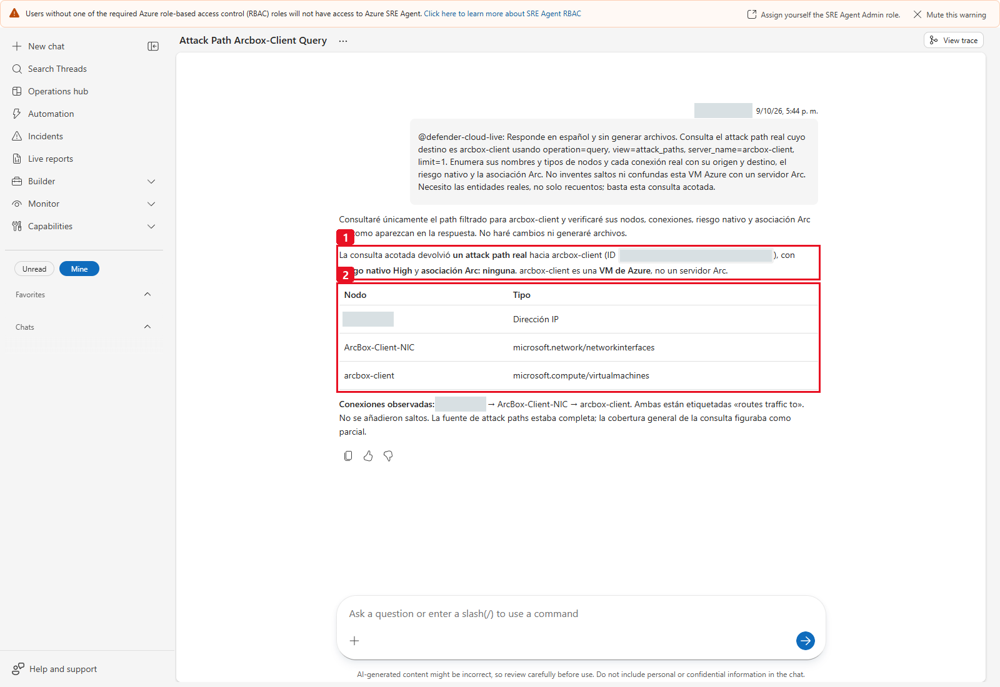

*Historical LIVE graph answer: (1) native risk and no Arc association,
(2) the three source node identities/types. It is contextual path evidence,
not a confirmed exploit, incident or root cause.
[Open full resolution](images/v2-live-graph-conversation.png).*

```text
What is the subscription Secure Score and which controls
have the largest potential headroom? Do not promise a gain from one host.
Use the subscription posture and controls views, not an Arc-filtered score.
```

```text
For ArcBox-SQL, show all recommendation status counts,
native risk distribution, installed software and the SQL/KB patch evidence.
Keep missing fix versions and independent sensor health explicitly unknown.
```

```text
Explica en espanol el riesgo nativo, la severidad tecnica
y las CVEs de una actualizacion SQL. No conviertas severity High en risk High.
```

```text
Count embedded CVE occurrences, distinct CVE IDs and
resource/CVE pairs. Why does zero standalone subassessments not mean zero CVEs?
```

`ArcBox-SQL` and the update example remain historical lab labels. Choose the
corresponding **observed** customer resource or say the evidence was not found.
The `resource_details`, `findings`, `software` and `vulnerabilities` views answer
different questions; no single small page is the full resource evidence.

For every query, show `total_matched`, `returned`, `has_more`, `next_offset`,
`requested_limit` and `transport_capped`. `summary_scope="unfiltered_snapshot"`
means the top-level summary is **not** the filtered result; use
`matched_resources`, `matched_servers`, `matched_by_provider`,
`matched_status_counts` and the view's `total_matched` for that interpretation.
`sources_total` / `sources_returned` / `sources_has_more` disclose that the
compact response contains view-relevant source statuses, not a full source log.

Page only when the user needs the remaining identities/details. Use the
returned advancing `next_offset`; each live page is another snapshot, not a
stable database cursor. Do not repeatedly collect just to compute a total that
is already returned. Use a retained complete report for one consistent
snapshot's exhaustive offline review.

#### Paired English (EN) and Spanish (ES) LIVE grounded questions by view

| Query target (`operation="query"`) | English (EN) prompt | Spanish (ES) prompt |
|---|---|---|
| **PaaS findings** (`view="findings"`, `status="Unhealthy"` per `resource_type`) | `Which Key Vault, AKS and Container Apps resources have Unhealthy recommendations? Use exact resource types, keep native risk separate from technical severity, and show full filtered totals rather than counting the returned page. Do not generate another report.` | `¿Qué recursos de Key Vault, AKS y Container Apps tienen recomendaciones Unhealthy? Usa los tipos de recurso exactos, mantén el riesgo nativo separado de la severidad técnica y muestra los totales filtrados completos sin generar otro informe.` |
| **Attack paths** (`view="attack_paths"`) | `Show the observed subscription attack paths with entry point, target, native risk and source-recommended breaks. Are any actually Arc-related? Preserve observed nodes and edges, state source limitations, and do not generate files.` | `Muestra las rutas de ataque observadas en la suscripción con punto de entrada, destino, riesgo nativo y puntos de corte recomendados. ¿Alguna está realmente asociada a Arc? Conserva los nodos y enlaces reales sin generar archivos.` |
| **Posture & controls** (`view="posture"`, `view="controls"`) | `What is the subscription Secure Score and which controls have the largest potential headroom? Do not promise a gain from one host. Use the subscription posture and controls views, not an Arc-filtered score.` | `¿Cuál es el Secure Score de la suscripción y qué controles tienen mayor margen potencial de mejora? Usa las vistas posture y controls de la suscripción sin prometer ganancias por un único servidor.` |
| **Resource details** (`view="resource_details"`) | `For ArcBox-SQL, show all recommendation status counts, native risk distribution, installed software and the SQL/KB patch evidence. Keep missing fix versions and independent sensor health explicitly unknown.` | `Para ArcBox-SQL, muestra el desglose de estados de recomendaciones, la distribución de riesgo nativo, el software instalado y la evidencia de parches SQL/KB, manteniendo explícitamente como desconocidos la salud independiente del sensor y las versiones de corrección ausentes.` |
| **Vulnerabilities / CVEs** (`view="vulnerabilities"`) | `Count embedded CVE occurrences, distinct CVE IDs and resource/CVE pairs. Why does zero standalone subassessments not mean zero CVEs?` | `Cuenta las ocurrencias de CVE incrustadas, los identificadores CVE únicos y los pares recurso/CVE, y explica por qué cero subassessments independientes no significa cero CVEs.` |

### SIMULATED Arc report and questions

If installed, start a **separate New chat**, type `/agent`, and select
**`arc-defender-mercadona`** before pasting these normal-language prompts.
Expected report call: `simulate-arc-defender-mercadona({"operation":"report"})`,
never the LIVE tool, a connector, a token request or a customer source read.

```text
Generate the SIMULATED 200-server on-premises/GCP
report with illustrative chains, source-like risks, owner tags and DEMO-VA
evidence. Keep synthetic topology and feature/licensing boundaries explicit.
Call simulate-arc-defender-mercadona once with operation="report" and all other
defaults. Deliver its four actual returned files without extra query calls,
repeated reports or invented links. Label every result SIMULATED.
```

```text
Explain an illustrative GCP/on-premises chain and its
proposed breaks. Do not call it customer topology or an actual Defender detection.
```

```text
En la simulacion, cuantos servidores de Production
son on-premises y cuantos estan en GCP? Usa los totales completos, no la pagina.
```

Production remains **90 = 62 on-premises + 28 GCP**, explicitly synthetic.
Keep LIVE and SIMULATED threads and claims separate.

**Additional paired English (EN) and Spanish (ES) SIMULATED prompts:**

- **ES – Informe SIMULATED de 200 servidores Arc (`operation="report"`):**
  ```text
  Genera el informe SIMULATED de 200 servidores Arc on-premises/GCP con cadenas ilustrativas, riesgos tipo nativo, etiquetas de propietario y evidencia DEMO-VA. Invoca simulate-arc-defender-mercadona una sola vez con operation="report" y los valores predeterminados. Entrega los cuatro archivos devueltos y etiqueta cada resultado como SIMULATED.
  ```
- **EN – SIMULATED Production split by provider (`operation="query", view="inventory", environment="Production"`):**
  ```text
  In the simulation, how many Production servers are on-premises and how many are in GCP? Use the full filtered totals rather than counting the returned page, and label the answer SIMULATED.
  ```
- **ES – Cadena ilustrativa GCP/on-premises (`operation="query", view="attack_paths"`):**
  ```text
  Explica una cadena ilustrativa GCP/on-premises de la simulación y sus cortes propuestos, dejando claro que es un escenario sintético SIMULATED y no una detección real de Defender ni topología del cliente.
  ```

The current Arc demo keeps its approved green identity and adds two
**illustrative simulated chains**, not customer topology or native detections:

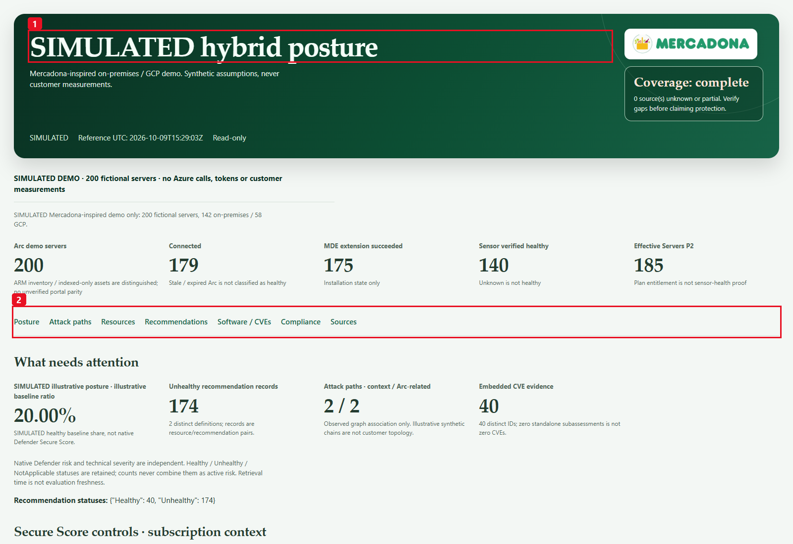

*Historical SIMULATED report: (1) fictional 200-host provenance,
(2) navigation. Its two illustrative chains and baseline ratio are not native
customer detections or Defender Secure Score.
[Open full resolution](images/v2-simulated-overview.png).*

The older [SIMULATED Production answer](images/step4-04-simulated-production-question-detail.png)
shows why a small returned page can still carry the full 90-host total and
62/28 provider split. Those deterministic fixture counts are not LIVE evidence.

### Real artifact delivery

The tools write only beneath resolved runtime cwd in the fixed
`arc-defender-reports` subdirectory. The historical directory name is retained
for the working file-sharing contract. Filesystem-root cwd, alternate directory
configuration and symlink/path escapes fail closed.

The historical tested runtime shared its `terminalRoot/tmp/ThreadFiles` tree
with a runtime-generated per-thread directory, not `/mnt/data` despite that
directory being advertised in product documentation.
Use actual returned paths with normal SRE sharing, not invented `sandbox:` links.
Validate the native download buttons and bytes. An earlier displayed
`/api/files/...` alias differed from the serving route; an alias GET returning
400 did not mean the native button's HTTP-200 artifact was bad.

No path prefix, thread UUID, authenticated route or alias from those runs is
a reusable customer setting. The current source returns filesystem paths,
not `artifact_status`, HTTP receipts or a permanent hosting service. A future
runtime may expose files differently; native download acceptance must be
repeated in that customer's environment without changing the scope/guards or
adding a generic filesystem tool to the specialist.

**Checkpoint 4:** the selected saved specialist made the expected bounded call,
all four native files were actually downloaded, HTML/CSV/decoded-JSON evidence
is complete for the declared visible sources, and gaps are explicit. A new
question is grounded in its actual new source result. No current runtime
acceptance is claimed by reading this guide alone.

## Step 5 - Monthly automation and run now

This is optional and **customer-owned**. Do not schedule a reporter before
Step 4 has established the correct responder, bounded read-only source,
effective allowlists, honest partial coverage and native delivery. This guide
does not create or run a task, and no email/Teams connector is needed.

### 5.1 Search and reuse before creating

1. Open **Automation** and search for
   `Monthly Defender for Cloud live evidence audit` and any known owned legacy
   name. Inspect the owner, responder, full prompt, cron, status and history.
2. If that intended customer-owned task already exists, review/edit it in
   place with approval. Do not create a duplicate or update an unrelated task
   merely because its name looks similar.
3. If no owned task exists and recurring execution is approved, select
   **Automation > Create > Scheduled task**. Alternatively, use **+ > Trigger >
   Add scheduled task** on the saved LIVE specialist's canvas node; verify the
   preselected responder. Older navigation may say **Scheduled tasks**.

Use the canonical [task guide file view](monthly-task-prompt.md) from the same
approved revision. Select **Raw / Download raw file** if saving a private copy;
the relative link opens the file view, not a one-click raw download.

### 5.2 Fill all relevant fields

| Field | Value |
|---|---|
| Task name | `Monthly Defender for Cloud live evidence audit` |
| Response custom agent / Response subagent | `defender-cloud-live`; do not leave empty and fall back to the main agent |
| Task details | Entire copy-ready prompt below |
| Start on | Customer-approved activation date, not a historical lab date |
| Frequency | Custom cron |
| Cron expression (UTC) | `0 9 1 * *` |
| Message grouping for updates | **New/separate thread per run**, not reuse of the previous snapshot conversation |
| Model tier | General Purpose, subject to the customer's approved policy |
| Agent autonomy level | **Autonomous**, only after the exact bounded reporter/allowlists have passed manual acceptance |
| Repeat until / Run limit, if shown | Customer-approved lifetime/limit; enabling a recurring task continues consuming usage |

Do not enable inherited global tools to make automation work. Review mode can
pause for approval; it is not unattended execution. Autonomous is appropriate
here only because the **actual selected** capability is the tested, fixed-scope
read-only reporter, not a general troubleshooting/remediation agent.

Paste this whole block into **Task details**:

```text
Use defender-cloud-live and generate-defender-cloud-report only.
Make exactly one generate-defender-cloud-report call with operation="report"
and every other parameter at its default, over the complete fixed Enabled
subscription. This is a current snapshot, not previous-month event history.
Do not make follow-up query calls, enumerate pages, retry/repeat reports,
narrow scope, drop evidence or change byte limits to complete this task.
Deliver the four actual returned files: self-contained HTML, inventory CSV,
finding CSV and complete JSON snapshot, using their exact runtime-owned paths
and the normal native thread-sharing flow. Do not invent paths or links.
Summarize only the returned compact evidence and top_actions, including LIVE
provenance, UTC reference, declared scope, source coverage and at most three
evidence-led owner-review priorities. Detail already in the artifacts must
stay there, not trigger extra queries or unsupported chat claims.
Keep native risk separate from technical severity, subscription context
separate from Arc-only metrics, and finding/CVE occurrences separate from
distinct resources or IDs. Retain all recommendation statuses in the files.
Keep independent MDE sensor health explicitly Unknown when not sourced.
Plans, extensions and AKS configuration do not prove runtime health; graph
context is not a confirmed attack, root cause or certification.
Disclose partial/unavailable sources and indexed/evaluation-time limits.
Empty returned data is not a zero-risk or complete-coverage guarantee.
Declare Action required for observed gaps or incomplete assurance, not an
invented score. On status="error", report the sanitized source/code and stop
without invented files/results. On sharing failure, report that failure
without recollecting. Never modify plans, roles, services, tasks or resources.
```

Source-side HTTP retries and pagination are already bounded inside this one
tool invocation. The model must not create hidden extra collections/queries
to fill its summary or work around transport limits.
**Action required** is a human-facing summary label here, not an additional
tool parameter or a claimed structured `action_required` output field.

### 5.3 Save, reopen and check UTC / DST

Select **Create task / Save** only for the approved task. Reopen its edit form
and check the exact saved responder, full prompt, five-field cron, new-thread
grouping, autonomy and status. Verify **Next run time**, and `nextUTCtime` when
the service exposes it, rather than inferring the schedule from a friendly
monthly label.

`0 9 1 * *` means **day 1 at 09:00 UTC**. With activation before that
occurrence, the next time after **15 October 2026** is **1 November 2026,
09:00 UTC**. That is a cron interpretation example, not a task readback.

If choosing **Monthly > Day of month 1 > Time of day**, inspect the browser's
time-zone label. The current product saves a fixed UTC schedule without a
DST-aware local zone: 09:00 UTC is 11:00 at UTC+02 and 10:00 at UTC+01.
Use Custom cron for the agreed UTC schedule and verify the saved next
occurrence after any DST/local-time change. See
[Automate workflows](https://learn.microsoft.com/azure/sre-agent/automate-workflows).

### 5.4 Accept one manual run, then verify the timer separately

After customer authorization, select the owned row's checkbox in the
**Automation list**, then the enabled toolbar **Run now** **once**.
Inspect its actual thread, selected responder, one report call, UTC reference,
partial sources and all four native nonempty downloads. A completed execution
row or **Success** status can mean work was handed to a thread; it is not
proof that the tool or publication later succeeded.

The history-view button can be disabled in the preview. If it says **No thread
found**, inspect matching actual thread/files when independently available;
otherwise treat acceptance as unverified/failed. Do not assume every missing
thread is the historical UI caveat or submit duplicate runs just for captions.
Preserve the error and resolve its cause through the approved operator process.

An accepted **Run now** proves a **manual** execution, not a cron firing.
Recheck the next UTC time and verify the first actual timer-triggered
occurrence separately. A monthly run is a current snapshot; it does not
guarantee the previous month's event history, new findings or risk changes.

**Checkpoint 5:** one approved owned task, exact saved fields, a deliberate
manual acceptance receipt and a separately tracked timer checkpoint. No new
task or run is claimed by this documentation review.

### Historical 9 October 2026 manual generic V2 execution

The then-revised lab task was **executed immediately**, not left waiting for
the cron. These are retained historical facts, not the state of a new
customer's task:

| Actual V2 execution fact | Verified value |
|---|---|
| Execution UTC | `2026-10-09T15:37:49.9305212Z` |
| Manual / history result | `ManualExecution=true`, `success=true`, `completed=true` |
| Duration | `97430 ms` (97.430 seconds) |
| Report reference UTC | `2026-10-09T15:38:01Z` |
| Task migration | Same task ID, cron and retained history; effective generic-tool responder alias |
| Completed execution count | Increased from 2 to 3; no duplicate run for captions |
| HTML download | HTTP 200, 4700548 nonempty bytes |
| Inventory CSV download | HTTP 200, 440001 nonempty bytes |
| Finding CSV download | HTTP 200, 4542637 nonempty bytes |
| JSON download | HTTP 200, 4491867 nonempty bytes; losslessly decoded complete evidence |

This run used the compact full-scope generic V2 immediately before the
**caption-only** correction distinguishing Arc-specific 5/8 metrics from the
33-record compute cohort. The caption fix did not change data collection,
codec, counts or task behavior, and the task was not repeated unnecessarily
just for wording.

The older V1 run completed in 30772 ms; it is not used as proof of V2.
The preview history's earlier “No thread found” label was a UI lookup caveat
despite actual verified execution/thread/files, not a hidden failed run.

The actual Automation list shows the selected checkbox (1), enabled **Run now**
(2) and **3 completed runs** (3). Its 17:37 local display corresponds to the
verified 15:37 UTC execution.

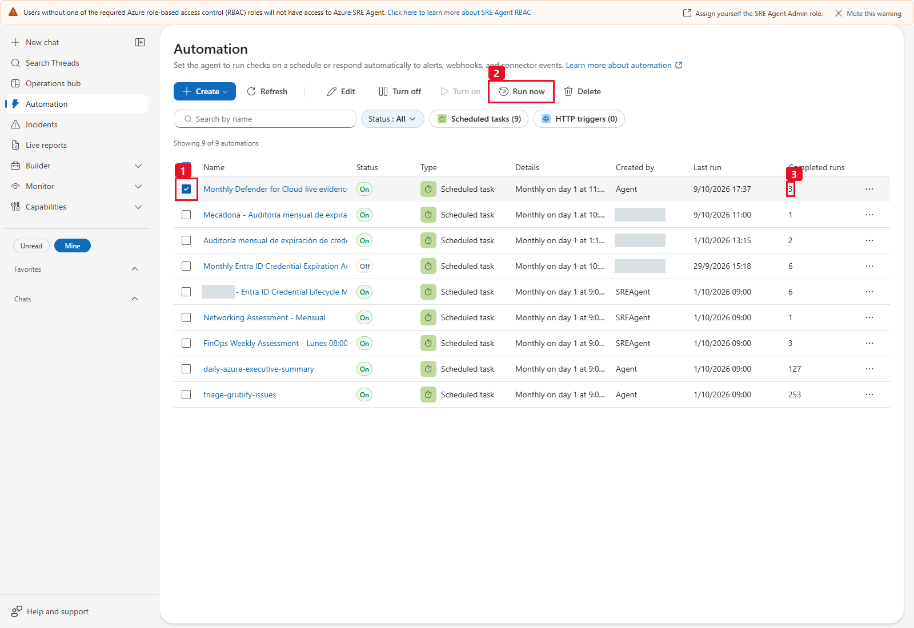

*Historical 9 October task list: (1) the owned row selected, (2) enabled Run now,
(3) three completed executions. Other rows are unrelated and must not be
copied, changed or treated as this case's dependencies.
[Open full resolution](images/v2-monthly-run-now-and-count.png).*

The historical migration affected only this scenario's owned task; do not
change unrelated tasks.
The simulation may have a separate, unmistakably SIMULATED task, never be
substituted into the LIVE monthly audit.

**Installed preview migration caveat:** updating the existing task preserved
its ID, history and cron, but the preview PUT did not reassign its stored
response-agent name. It could still show **`arc-defender-live`**. That owned
agent was verified as an explicit alias restricted to the **same canonical general
`generate-defender-cloud-report` tool and `defender-cloud-live` skill**, not the
old Arc-only implementation. New customer deployments should select
`defender-cloud-live` directly. Verify effective bindings and a real run rather
than creating duplicate tasks or discarding history.

The later **13 October current-source normal-chat/download** acceptance does
not turn this 9 October manual-task receipt into current-source task or timer
evidence. Validate a customer's approved scheduled configuration separately.

## Scope, counts and evidence rules

| Signal / unit | Correct interpretation |
|---|---|
| ARM/ARG resources | Returned inventory for the reviewed subscription and principal-visible indexed scope, including child resources. Complete pagination is not proof of visibility of every approved asset. Extension rows are not extra VMs. |
| Defender indexed-only assets | Exact native IDs such as SQL database, container/image or identity assets, with a verified parent when available; not silently dropped or called ARM resources. |
| All recommendation records | Healthy/Unhealthy/NotApplicable preserved; resource/definition pairs are not distinct definitions or affected-host count. |
| Native risk | `risk.level` only; missing is Not evaluated/Unknown. |
| Technical severity / CVSS | Separate source dimensions, not a risk-level substitute. |
| CVE occurrence | One source `CvesDetails` observation; the same CVE can recur in multiple recommendations/assets. |
| Distinct CVE ID | Deduplicated across the snapshot; not the number of affected assets. |
| Resource/CVE pair | Deduplicated within an asset; not necessarily a unique exploit or incident. |
| Classic Secure Score | Subscription context, not an Arc/VM-only score. |
| Control potential gain | Max-current headroom across that control; not guaranteed improvement from one host. |
| Opaque risk-score aggregates | Native numerator/denominator shown without an unverified derived percentage. |
| Attack graph | Actual entities/edges/entry/target and explicit Arc association; no invented hops. |
| Compliance | Observations with skipped/unsupported separate; not automatic ENS/GDPR certification. |
| Extension / paid plan / AKS monitoring | Installation/configuration evidence, not independently verified sensor/workload health. |
| Empty / unavailable source | Qualified emptiness versus Unknown; never zero-risk assurance. |

The LIVE header's **Arc connected** and **Arc effective Servers P2** counts are
specifically the Arc connectivity/per-resource pricing reads, not all compute
assets. For example, 5 connected / 8 verified Arc P2 hosts must not be read as
the coverage of the whole 33-record compute cohort. Broader subscription plans
are presented separately; Arc and Compute extension provisioning observations
also do not verify sensor health.

**Frozen source-fixture reconciliation, not live constants.** The supplied
lab discovery snapshot contained:

| Observation | Source-derived value |
|---|---:|
| Complete resource inventory | 472 |
| Assessment records | 1693: 486 Healthy / 1118 Unhealthy / 89 NotApplicable |
| Unhealthy native risk | 50 High / 308 Medium / 760 Low; not metadata severity |
| ArcBox-SQL machine recommendations | 104: 103 Unhealthy / 1 Healthy |
| ArcBox-Win2K25 machine recommendations | 172: 171 Unhealthy / 1 Healthy |
| Embedded CVE occurrences / distinct IDs / resource-CVE pairs | 7495 / 2767 / 7148 |
| CVE technical Critical occurrences | 286; **not** 286 native Critical risks |
| Classic score | 23.14 / 43, source percentage 53.81% |
| Context attack paths | 3 High, 5 entities, 2 edges, 6 linked assessment IDs |
| Actual Arc-associated paths | 0 in that snapshot |
| Software rows | 77 subscription-wide; 54 exact Arc-associated |

These counts are recomputed, not hardcoded. The portal's earlier 182/123 view
used different scope/filter/time and is not forced into parity with 472
inventory resources or 171 distinct assessed assets. Only the fixed Enabled
subscription is audited; disabled cached subscriptions are not silently added.
Subscription-root recommendations are retained as subscription scope.

## Time, retention and comparison boundaries

This source is a **point-in-time inventory/evidence reader**. It has no
`month`, `lookback_days`, start/end time, historical baseline or change-detection
parameter. It requests the current source-visible ARM/ARG results and retains
the normalized evidence those sources expose; it does not reconstruct deleted
resources or expired source history.

| Time / state | Meaning |
|---|---|
| `reference_utc` | One UTC reference captured before collection and carried through that run's artifacts. It is not an atomic cross-service transaction, scan completion time or guarantee that every source was evaluated at that instant. |
| `source_time_utc` | A source time such as generated/reported/status-change time when valid and supplied; not replaced with collection time to claim freshness. |
| `first_evaluation_utc` | Source assessment evaluation metadata, not proof that a vulnerability was introduced, first exploitable or first seen by this customer on that date. |
| Arc `last_status_change_utc` | Connectivity status-change observation, not an MDE heartbeat or proof that a guest service currently runs. |
| Software `first_seen_utc` / end-of-support fields | Source-provided software observations, not a complete installation/change history. |
| Monthly cadence | One new snapshot per scheduled invocation, not continuous monitoring or an exhaustive previous-calendar-month report. |

Resource Graph is **not strongly consistent** and can lag. The collector
checks continuation/count integrity within each query, but it cannot make all
Azure sources atomic or prove that hidden resources were visible. A changed
ARG total between pages causes an explicit error for that source; equal totals
still are not a transactional snapshot guarantee.

Retention and refresh windows are owned by the originating Defender/ARM/ARG
services and the customer's existing plans/configuration. The tool neither
extends that retention nor requests a guaranteed month of alerts, CVEs or
historical compliance. Agree the applicable source freshness/retention with
the source owner before making a time-based assurance claim.

To compare months, retain the actual dated downloads in the customer's
approved evidence store and align scope, principal visibility, source status,
resource IDs, definition IDs, status/risk and evaluation times. The runtime
does not maintain a baseline, auto-diff reports, enforce evidence retention or
automatically notify owners. A first run has **no prior baseline**.
Do not label disappeared/unavailable records "resolved" or unchanged old
evaluations "new this month" without independent evidence.

Treat these files as sensitive operational evidence even though secret values
are excluded: resource IDs/names, ownership tags, security gaps and graph
relationships can be confidential. Use approved storage/access/retention;
never publish raw customer datasets, routes, tokens, configured source copies
or unmasked screenshots to demonstrate the report.

## Simulation assumptions

All allocations are **fictional**, not verified Mercadona data:

| Environment | On-premises | GCP | Total |
|---|---:|---:|---:|
| Production | 62 | 28 | 90 |
| Preproduction | 35 | 15 | 50 |
| Dev | 25 | 10 | 35 |
| DMZ | 12 | 5 | 17 |
| Backup | 8 | 0 | 8 |
| **Total** | **142** | **58** | **200** |

OS totals remain Windows Server 2022 **58**, Windows Server 2019 **32**,
RHEL **38**, Ubuntu **28**, SUSE **18**, Debian **14**, Windows Server 2016 **12**.
Connectivity, installation, synthetic health, baseline statuses, software and
DEMO-VA evidence derive from deterministic rows. The two illustrative chains
connect fictional Arc resources; they are not current topology or a promise
of native on-premises attack-path support. The illustrative healthy-baseline
ratio is **not native Secure Score**.

The confidential inspiration PDF is never needed at runtime or published.
No invented CVEs, customer attack paths, incident-loss claims or certificates
are introduced into the simulation.

## Sources and feature boundaries

The LIVE implementation fixes the public Azure origin to
**`https://management.azure.com`**. It is not a configurable endpoint or a
ready-made Azure Government/China adapter. It uses **GET for ARM reads and
POST only for the fixed read-only Resource Graph query**. HTTP POST here is
query transport, not authority for a resource write. No PUT, PATCH, DELETE,
plan enablement, diagnostic command, Graph/XDR API or arbitrary URL/KQL is
exposed to the runtime specialist.

### Exact ARM reads

Paths below are relative to the fixed ARM origin. `{subscription}` is the
configured monitored subscription; `{arc-resource-id}` is an exact known Arc
machine in it, not a user-supplied path.

| Source / gate | GET path and fixed API version | What it can establish |
|---|---|---|
| `scope_validation` | `/subscriptions/{subscription}?api-version=2022-12-01` | Returned subscription/tenant match; explicit non-Enabled state is rejected. Independently approve/check the scope first. |
| `arc_inventory` | `/subscriptions/{subscription}/providers/Microsoft.HybridCompute/machines?api-version=2022-12-27` | Arc machine IDs, source connectivity/status-change, OS, provider metadata and allowlisted tags. Azure location is not physical on-premises/GCP location. |
| `arc_extensions` | `{arc-resource-id}/extensions?api-version=2022-12-27` | Allowlisted extension type/publisher/provisioning state. No settings, protected settings or raw instance-view messages are exported. |
| `effective_servers_plan` | `{arc-resource-id}/providers/Microsoft.Security/pricings/VirtualMachines?api-version=2024-01-01` | Effective per-Arc P1/P2/Free and inheritance when supplied; failed reads remain Unknown, not Free. |
| `mde_integration` | `/subscriptions/{subscription}/providers/Microsoft.Security/settings/WDATP?api-version=2022-05-01` | Subscription integration's boolean enabled setting only; not onboarding or sensor health. |
| `defender_alerts` | `/subscriptions/{subscription}/providers/Microsoft.Security/alerts?api-version=2022-01-01` | Source alerts associated to exact known resource IDs, retaining source status/severity. Unmatched records are disclosed, not silently called healthy. |
| `subscription_secure_score` | `/subscriptions/{subscription}/providers/Microsoft.Security/secureScores?api-version=2020-01-01` | Classic subscription score/current/max/source ratio, not an Arc-only score. |
| `subscription_plans` | `/subscriptions/{subscription}/providers/Microsoft.Security/pricings?api-version=2024-01-01` | Existing plan tiers/subplans/configured extensions and source coverage metadata; no enablement or health assertion. |
| `compliance_standards` | `/subscriptions/{subscription}/providers/Microsoft.Security/regulatoryComplianceStandards?api-version=2019-01-01-preview` | Returned standard counts/states, including passed/failed/skipped/unsupported; not certification. |

The matching first-party contracts are
[Arc subscription inventory](https://learn.microsoft.com/rest/api/hybridcompute/machines/list-by-subscription?view=rest-hybridcompute-2022-12-27),
[pricing scope/read](https://learn.microsoft.com/rest/api/defenderforcloud/pricings/get?view=rest-defenderforcloud-2024-01-01),
[2022-05-01 settings resource](https://learn.microsoft.com/azure/templates/microsoft.security/2022-05-01/settings),
[subscription alerts](https://learn.microsoft.com/rest/api/defenderforcloud/alerts/list?view=rest-defenderforcloud-2022-01-01),
[classic scores](https://learn.microsoft.com/rest/api/defenderforcloud/secure-scores/list?view=rest-defenderforcloud-2020-01-01)
and [compliance standards](https://learn.microsoft.com/rest/api/defenderforcloud/regulatory-compliance-standards/list?view=rest-defenderforcloud-2019-01-01-preview).
They document product read/configuration shapes, not approval to deploy a
template or a guarantee of source readiness in a new subscription.

### Exact Resource Graph reads

All use
`POST /providers/Microsoft.ResourceGraph/resources?api-version=2022-10-01`,
with body `subscriptions` containing **only the fixed subscription** and a
source-defined query. The query requests `objectArray` pages of up to 1,000
rows and follows `$skipToken`. No model-written query is accepted.

| Source | Table / fixed type restriction | Normalized evidence |
|---|---|---|
| `resource_inventory` | `Resources`, no resource-type filter | Projected ID/name/type/resourceGroup/location/tags; only approved tag keys survive normalization. Not vault secrets, keys, workload contents or all resource configuration. |
| `compute_extensions` | `Resources`: `microsoft.compute/virtualmachines/extensions`, `microsoft.compute/virtualmachinescalesets/extensions` | Allowlisted type, virtualMachineExtensionType, publisher and provisioningState. Provisioning is not sensor health. |
| `aks_security_profiles` | `Resources`: `microsoft.containerservice/managedclusters` | Defender security-profile monitoring-enabled observation only; not healthy pods, current runtime telemetry or verified Defender for Containers coverage. |
| `defender_recommendations` | `SecurityResources`: `microsoft.security/assessments` | All returned statuses, exact resource associations, native `properties.risk.level`, metadata technical severity/type, safe source text/links, allowlisted patch data and `additionalData.CvesDetails`. |
| `defender_vulnerabilities` | `SecurityResources`: `microsoft.security/assessments/subassessments` | Standalone subassessment findings where returned and associated. Zero rows do **not** erase CVEs embedded in assessment additionalData. |
| `attack_paths` | `SecurityResources`: `microsoft.security/attackpaths` | Source graph entities/connections/insights, entry/target, native path risk, recommended breaks and partial-graph flag. Exact Arc association, not name matching or an invented topology. |
| `software_inventory` | `SecurityResources`: `microsoft.security/softwareinventories` | Exact `azureVmId` association, software/version/vendor/vulnerability-count/end-of-support observations. `orgId` / `deviceId` are not exported; no rows is not proof of no software. |
| `secure_score_controls` | `SecurityResources`: `microsoft.security/securescores/securescorecontrols` | Subscription control current/max, potential headroom and healthy/unhealthy/not-applicable counts; not a guaranteed per-resource gain. |
| `risk_secure_score` | `SecurityResources`: `microsoft.security/risksecurescore` | Source category/numerator/denominator only; no unverified derived percentage. Availability/schema are source-dependent. |
| `compliance_controls` | `SecurityResources`: `microsoft.security/regulatorycompliancestandards/regulatorycompliancecontrols` | Returned subscription control states/counts, not certification or a host-only score. |
| `compliance_assessments` | `SecurityResources`: `microsoft.security/regulatorycompliancestandards/regulatorycompliancecontrols/regulatorycomplianceassessments` | Returned assessment states/counts with skipped/unsupported/missing evidence kept qualified. |

See [Resource Graph REST queries](https://learn.microsoft.com/azure/governance/resource-graph/first-query-rest-api),
[supported tables/resource types](https://learn.microsoft.com/azure/governance/resource-graph/reference/supported-tables-resources),
[native attack-path schema](https://learn.microsoft.com/azure/defender-for-cloud/attack-path-api)
and [software inventory](https://learn.microsoft.com/azure/defender-for-cloud/software-inventory).
These are **implemented source names and types**, not a custom-RBAC-role
manifest or a promise that every optional type has rows in every subscription.
Approved Reader covers the read pipeline; a reviewed alternative must cover
both the queried underlying resources and the ARM reads. Resource Graph's
query transport does not bypass those resource permissions.

### Completeness and failure semantics

All paging is validated: HTTPS management origin, unchanged scope/API version,
no redirects, no duplicate IDs/tokens, and every ARG skip token followed even
if `resultTruncated=false`. Changing totals or malformed nested evidence are
explicit source errors, not success-shaped empty counts.

The 200-page / 50,000-row bounds and 1,000-Arc-machine bound are safety stops,
not permission to call a truncated result complete. Essential authentication,
scope, resource inventory and Arc inventory failures stop the report; optional
security/context/configuration failures are retained as unavailable/partial
sources. Per-Arc extension/plan failures stay Unknown. A successfully paginated
query can still be **access-limited or index-stale**, so scope/access readiness
is independently reviewed in Step 0.

Assessment records may add explicitly **Defender-indexed-only** native assets
(for example SQL/database/container-dependent rows) absent from ARM inventory.
Known parent links and exact in-subscription IDs are retained. Source records
without a trustworthy association are reported in source join/exclusion counts,
not guessed into a resource by name. Subscription-root recommendations remain
subscription context. Fixed normalizers deliberately exclude unapproved raw
properties and bound text fields; full JSON preserves **all normalized
records/fields**, not arbitrary original API payloads.

The only sensor-health source entry, `mde_sensor_health`, is explicitly
**unavailable by design**. The supplementary
[`linux-mde-verification.json`](evidence/linux-mde-verification.json) records
separate operator checks of exactly two lab Ubuntu hosts on **9 October 2026**.
It says `fleet_wide_verification=false` and
`included_in_live_tool_sensor_health=false`; the reporter does not load it.
It is not authority to run guest diagnostics, enable services or mark the
current fleet healthy.

Paid CSPM, Servers, SQL and Containers are separate plans. Servers P2 does not
include every Defender feature; agentless/JIT/FIM applicability still depends
on platform and configuration. FIM stays **Not verified** without observed
per-host configuration. Source ACA recommendations/CVEs do **not** prove
automatic Defender for Containers runtime coverage of all ACA apps.
BuiltIn/CustomPolicy/CustomerManaged/partner evidence is distinguished; not
every recommendation is a first-party managed runtime detection.

Advanced risk prioritization and graph analysis have
[Defender CSPM prerequisites](https://learn.microsoft.com/azure/defender-for-cloud/risk-prioritization);
[the cloud security graph](https://learn.microsoft.com/azure/defender-for-cloud/concept-attack-path)
is platform-derived context. A returned native path can identify a potential
exposure, not demonstrate that an attacker traversed it, identify the root cause
of an outage, prove a current exploit, or replace an authorized investigation.
The tool does not fetch arbitrary security-explorer graphs or create synthetic
hops in LIVE.

## Verification and troubleshooting

### Historical 13 October 2026 current-source normal-chat acceptance

The lossless size correction was **not left at offline replay only**. Retained
operator receipts record a fresh **normal chat** using the deployed
`defender-cloud-live` path, report reference **`2026-10-13T11:51:48Z`**,
with four native Markdown downloads independently checked:

| Native artifact | HTTP result | Nonempty bytes |
|---|---:|---:|
| HTML | 200 | 4,110,425 |
| Inventory CSV | 200 | 438,831 |
| Finding CSV | 200 | 5,270,731 |
| JSON snapshot | 200 | 3,744,990 |

The accepted HTML and JSON decoded to equal complete normalized evidence.
The receipt records **553 inventory resources, 1,983 findings, 8,350 embedded
CVE occurrences, 1,134 software rows and 3 source graphs**. Coverage remained
legitimately **partial**, including unavailable independent MDE sensor health.
The earlier failed attempts were retained rather than relabeled successful.

The final retained verification at **`2026-10-13T12:08:54Z`** states that the
published sources matched the actual deployment. The codec deployment receipt
also records that source code changed while parameters, auth, timeout,
description and mode were preserved; it did not change collectors, permissions,
agents, tasks or resources. This documentation review reexamined those saved
receipts, **not** a fresh service readback or new collection.

The accepted **5,270,731-byte finding CSV is above 4,800,000 bytes** and still
downloaded successfully. Case02's source guard is specifically for **plain
HTML and JSON**, with a separate 3,500-byte structured-response budget; do
not import another case's all-files cap or truncate this CSV. Neither that
historical successful CSV nor the smaller HTML/JSON proves every future
artifact will be transportable.

This is **normal-chat/download** evidence, not an additional manual monthly
run, a timer firing, a new screenshot set or proof of today's customer state.
The replay table above is still an offline size comparison; the 9 October
images and task evidence below retain their original dates and counts.
Private thread IDs, routes, configured GUIDs, raw receipts and source datasets
are deliberately not reproduced here.

### Historical 9 October 2026 compact V2 report and question checks

The compact V2 reports returned **authenticated HTTP 200 for all eight files**.
The final LIVE reference is **`2026-10-09T15:46:01Z`**, including the corrected
Arc-only metric captions, with complete decoded evidence:

| Artifact | LIVE bytes | SIMULATED bytes |
|---|---:|---:|
| HTML | 4700669 | 282306 |
| JSON snapshot | 4491867 | 720010 |
| Inventory CSV | 440001 | 170213 |
| Finding CSV | 4542637 | 127703 |

The LIVE decode retained 554 combined inventory/indexed resources, all 1693
recommendation records, 7495 embedded CVE occurrences, 77 software rows and
3 observed graphs. Both actual HTML files had no JavaScript errors. LIVE was
neutral, without a Mercadona logo; the offline Arc demo retained its green
branding. Both sources for that historical revision were persisted and verified; the synchronized
SIMULATED caption-only copy also passed its actual sandbox test.

Actual tool-backed questions also reconciled:

| Question | Verified result |
|---|---|
| ArcBox-SQL machine | 103 Unhealthy / 1 Healthy; 10 native Medium / 93 native Low; Medium risk was not replaced by High technical severity. |
| Classic score/control headroom | Source 53.81%; control headroom examples 5.73 / 3.81 / 3.38, not a guaranteed one-host gain. |
| Key Vault / AKS / ACA | ARM inventories 6 / 2 / 5; unhealthy finding occurrences 20 / 8 / 10, with native risk and affected-resource counts separate. |
| Observed graphs | 3 context paths / 0 Arc-associated; node/connection projections include the actual IP-to-NIC-to-VM three-node/two-edge path. |
| SIMULATED chains | Explicitly fictional teaching graphs and separate Servers/CSPM/platform boundaries. |

Actual desktop **and** mobile exports passed with no JavaScript errors or
horizontal page overflow:

| Export/check | LIVE | SIMULATED |
|---|---:|---:|
| Selected inventory cohort | 8 Arc resources | 28 Production/GCP resources |
| Full-scope Unhealthy/native-Medium findings after filter reset | 308 | 182 |
| All source CVE / DEMO-VA occurrences | 7495 | 40 |
| Full decoded JSON equality | Passed | Passed |

Lazy tables did not limit the CSV to the rendered 50 rows. The final graph
conversation named the actual
IP-to-`ArcBox-Client-NIC`-to-`arcbox-client` Azure VM path, both edges labeled
“routes traffic to”, High native path risk and **no Arc association**.

The immediate V2 task and its four downloads are independently recorded above;
report conversation success is not substituted for task/download evidence.
The seven V2 screenshots in this guide were separately reviewed for accurate
red markers and masking; they are actual portal/report captures, not mocks.

Preservation checks for that historical 9 October revision were also precise:
the **full definition hashes** of the
original **2 tools, 5 skills and 8 agents** were unchanged. For the original
**8 tasks**, the exact **ID/name/agent/cron/status** fields were verified
unchanged; no claim is made that all changing task-runtime metadata was
hash-compared. Scenario 01's repository tree is unchanged. No Defender plans,
RBAC or new remediation were changed for that general-report revision.

### Offline checks

```powershell
python -m unittest discover -s .\02-arc-defender-posture-audit\tests -q
```

The suite (`test_arc_defender_tools.py`, `test_artifact_encoding.py`,
`test_native_defender.py`, `test_priority_context.py`, `test_package_contract.py`,
and opt-in `test_report_browser.py`) retains the original pagination/storage/encoding checks and adds
native-risk mismatch, all statuses, general SQL/child/root scope, graph
integrity, score/control semantics, source CVE parsing, redaction, 15-parameter
schema/signature parity, documentation link/anchor/logo-helper verification, and all
expanded query views under the exact 3500-byte budget. Mock tests do not prove
runtime sharing or a new monthly execution; those need actual deployed evidence.
Full native fixture file-size/cohort tests run when the approved ignored
`handoff-inputs/expanded-discovery` dataset is present. That private dataset is
not distributed with the repository; portable synthetic codec/round-trip tests
still run without it.

Size regressions exercise the actual 4,800,000-byte boundary and one extra byte,
cleanup after failure writing each of the four files, all column modes,
missing/null/empty/type/Unicode distinctions, literal reserved keys, v1/plain
compatibility and explicit malformed/truncated rejection. The portable growing
SIMULATED fixture retains 2058 findings and 21,640 CVE occurrences: v1 JSON
exceeds 9 MB while corrected full HTML/JSON remain below 2 MB. Optional Node.js
checks run the actual embedded decoder, including malformed-input parity.
Safe allocation interceptors also prove that the billion-row descriptor,
nested constant/run/sparse amplification, aggregate tables, missing-cell work
and repeated logical strings fail **before** row/cell allocation. Exact budget
boundaries, including Unicode, match the encoder and both decoders.

The optional private current replay is
`handoff-inputs/defender-size-20261013/actual-20261013-normalized-snapshot.json`;
its bytes are verified before tests use it. Neither private fixture is collected
by tests or distributed in Git. The previously recorded 93-check result belongs
to the 9 October revision, not this expanded suite.

Opt-in **actual local browser** checks use an existing Playwright installation
and Edge on Windows (Chromium elsewhere):

```powershell
$env:SRE_REPORT_BROWSER_TESTS = "1"
python -m unittest discover -s .\02-arc-defender-posture-audit\tests -p "test_report_browser.py" -q
Remove-Item Env:\SRE_REPORT_BROWSER_TESTS
```

They open the complete offline report, compare decoded evidence, check
desktop/mobile filters and paging, native graphs, resource drilldowns, all-match
CSV/JSON downloads, v1/v2 CSV parity, escaping and absence of external requests.
The current LIVE-fixture check is skipped when its private input is absent;
SIMULATED browser checks still run. These are not Azure SRE native download
receipts. Private payloads, configured GUIDs, reports and local paths stay out
of Git.

### Acceptance for each customer / revision

Historical acceptance is not transferable customer readiness. Use these
checkpoints for the exact configured revision and chosen path:

| Gate | Evidence required |
|---|---|
| Scope and access | Approved subscription/tenant, runtime-available UAMI Client ID, human SRE roles and effective source access; known inventory reconciled with principal visibility. No broad new rights or fallback identity. |
| Actual saved assets | Complete configured source and matching 15-parameter schema/defaults, timeout/auth/package facts, entire runtime skill, and explicit single-tool/single-skill allowlists reopened on the newly saved objects. |
| Normal chat | Explicit specialist selection followed by the expected actual tool invocation, not a plausible answer or only a successful Python playground test. |
| Complete files | All four actual native downloads, nonempty content, expected file types, exact row/status/risk/CVE units and full decoded JSON fidelity. HTML/JSON and compact-response byte guards remain unchanged. |
| Report usability | Desktop/mobile layout, filter/sort/reset, detail selection, 50-row paging and first-30 resource preview, all-match section CSV/JSON exports and no external evidence fetch. |
| Source interpretation | Partial/unavailable/empty/access-limited/index-stale are distinct; plans/provisioning are not sensor health; native risk is not severity; subscription context is not Arc-only. Do not force complete while the sensor source is absent. |
| Grounded question | Actual bounded query, exact filtered totals versus returned sample, disclosed fresh-snapshot paging; no invented graph hops, CVEs, fixes, owners or zero-risk conclusions. |
| Optional SIMULATED path | Separate tool/skill/specialist/thread and clearly fictional counts/branding/DEMO-VA evidence, only if that path was requested. |
| Optional automation | Search/reuse of one approved owned task, reopened fields and UTC/DST check, one authorized manual task run plus a separately verified timer occurrence. Not implied by report-chat success. |
| Privacy / operations | Customer-approved evidence storage/retention, no raw payload/token/private-ID publication, and owner review through a separate change process for any remediation. |

If independent sensor health, a complete historical month, unsupported platform
coverage or a new native output format is required, record that as a genuine
source/implementation prerequisite. Do not claim documentation or a different
demo satisfies it. No new runtime acceptance, cloud change or UI capture is
performed by this documentation-only revision.

| Symptom | Action |
|---|---|
| Portal creation/chat/task operation returns 403 | Check the **user's** SRE Agent Author + Standard User roles on the agent resource; Builder/Owner/Contributor are not substitutes. Keep this separate from source-read 403s. |
| Configuration / authentication / scope error | Correct fixed GUIDs, assigned Client ID, Enabled subscription and read access; no fallback identity/subscription. |
| `authentication_failed` although the identity exists | Verify the Client ID belongs to the agent's assigned, runtime-available UAMI. Object/principal ID is for RBAC, not this `client_id` argument. A portal assignment or enabled Identity tab alone is insufficient. |
| `dependency_missing` | Review the linked requirements and approved runtime package availability. Historical `dependencies=[]` reflected preinstalled packages, not a dependency-free LIVE tool. Do not add shell/pip/MCP access to the specialist. |
| Source 403/unsupported | Unavailable/Unknown, not zero; review read permissions/product availability separately. |
| Empty/low inventory with HTTP 200 and completed paging | Check approved scope and **effective UAMI visibility**, not just the success code. ARG can silently omit unreadable resources and can lag. Reader on the SRE host resource group is not subscription-wide source access. |
| Only `mde_sensor_health` is unavailable | Expected for this LIVE implementation. Keep partial coverage and Unknown health. The two-host historical supplementary evidence is not imported or fleet-wide. |
| `invalid_parameter` on a report | Use `{"operation":"report"}` with every other default. Filters, a different view, nondefault limit or offset are rejected. Use a separate query for a question. |
| `invalid_parameter` on context/software/path queries | Check the documented unsupported filter combinations and exact enums/types. No arbitrary KQL, subscription, URL or output-path parameter exists. |
| Native Medium but technical High/Critical | Expected distinct dimensions; do not relabel risk from severity. |
| Zero subassessments with CVEs in recommendations | Use embedded source evidence and deduplicated units. |
| Source count differs from portal | Align subscription, resource/child kind, status/filter and retrieval/evaluation time first. |
| Expected native risk, graphs, software or CVEs absent | Ask the source owner to check existing plan/platform/onboarding/index prerequisites. Do not enable paid plans or manufacture findings as part of reporting. |
| Smaller query page | Check transport_capped and next_offset; total_matched is the full filtered total. |
| `query_item_exceeds_budget` | Even one row cannot fit safely. Disclose it and inspect the complete downloaded snapshot/report; do not loop an unchanged offset, slice the JSON or invent a smaller graph. Generate a new full report only as a separately requested action if none exists. |
| `snapshot_changed`, invalid continuation or malformed nested evidence | Preserve the sanitized source/code and partial/error state. A later deliberate retry is a new snapshot; no automatic repeated report loop or invented completion. |
| `scope_too_large` or tool timeout | The agreed complete scope exceeds an execution/source bound. Escalate for a reviewed implementation/runtime decision. Do not quietly drop services/resources, shorten history or narrow scope to make the demo pass. |
| Large HTML/JSON previously returned 404 | Use the current lossless v2 source and matching HTML decoder; the unchanged writer guard enforces 4,800,000 bytes without losing records. Decode the documented JSON format for analysis. |
| `artifact_size_exceeded` | Confirm the exact saved source is the approved lossless v2, not stale v1. If the complete snapshot still exceeds the guard, disclose the error and escalate for a reviewed implementation decision; never truncate, narrow scope, raise the guard, substitute ZIP/storage links or claim download success. |
| `encoding_expansion_exceeded` | The v2 descriptor exceeds the bounded total decoded allocation/work or logical-string budget. No rows/cells are expanded and no truncated report is published; ordinary/v1 compatibility and the 4,800,000-byte sharing guard are unchanged. |
| Unsafe root or `/mnt/data` rejected | Use the fixed guarded cwd export contract; no arbitrary filesystem tool or guard bypass. |
| `artifact_write_failed` | Stop delivery; check approved runtime storage access and the exact run's cleanup warning. Do not claim four files exist, bypass the path guard or delete a broad runtime directory. |
| Link text but no file | Verify native sharing/download bytes, not invented sandbox links or an unverified alias route. |
| Task Success / “No thread found” without accepted files | Check the actual execution thread/tool/share. Success can mean handoff to a thread; the historical preview lookup caveat does not prove a new run succeeded. Do not create duplicate tasks or repeated runs as a workaround. |
| Scheduled time shifts after DST | The product stores a fixed UTC schedule. Reopen cron/next UTC time; a browser-local Time of day does not establish DST-aware wall-clock recurrence. |
| `Succeeded` but sensor Unknown | Configuration is not runtime health; do not acquire new XDR roles just to mask the uncertainty. |

## Screenshot catalogue

All **25 existing PNGs are retained unchanged**. They are actual historical
portal/report captures; a screenshot of the offline report is real media of
**fictional data**, not LIVE evidence. Click each link for full resolution.
The `v2-` filenames identify the **9 October general-report revision/layout**,
not a newly captured 13 October codec-validation screen.

The earlier **LIVE V1 Arc-only** report also used green/logo styling. It must
not be relabeled SIMULATED, used as the canonical neutral LIVE design, or
presented as a new customer's environment. The current LIVE/SIMULATED paths
are defined by source, tool and provenance, not color alone.

| Full-resolution capture | Provenance / what the image demonstrates |
|---|---|
| [Python creation menu](images/step1-01-create-python-tool-menu.png) | Historical portal: (1) Builder, (2) Agent Canvas, (3) Create, (4) Tool, (5) Python tool. Unrelated global tools in the background are not this specialist's allowlist. |
| [Python tabs](images/step1-02-python-tool-tabs.png) | Empty creation dialog: (1) Code, (2) Test playground, (3) Identity; visible default timeout 120, not a configured LIVE readback. |
| [LIVE V1 playground](images/generate-arc-defender-report-test-playground.png) | Older **Arc-only LIVE** function execution; successful banner but partial JSON and eight-host scope. Old filename/counts are not the current generic tool. |
| [SIMULATED V1 playground](images/simulate-arc-defender-mercadona-test-playground.png) | Offline fixture execution with SIMULATED provenance. Older finding counts precede the expanded baseline/context fixture; not Azure access evidence. |
| [Skill menu](images/step2-01-create-skill-menu.png) | Historical (1) Create > (2) Skill menu, not a completed skill or proof that the full SKILL.md was saved. |
| [Custom-agent menu](images/step3-01-create-subagent-menu.png) | Historical (1) Create > (2) Custom Agent entry point, not a new-customer form capture. |
| [LIVE V1 restrictions](images/step3-02-live-subagent-restrictions.png) | Older `arc-defender-live` detail: one tool and one skill under historical names. Use the canonical current LIVE names in Step 3. |
| [SIMULATED restrictions](images/step3-03-simulated-subagent-restrictions.png) | One `simulate-arc-defender-mercadona` tool and one `arc-defender-mercadona` skill, separate from LIVE. |
| [LIVE V1 downloads](images/step4-01-live-report-downloads.png) | Earlier **Arc-only LIVE** chat: four file links and honest partial sensor evidence. Does not prove general-subscription or later codec acceptance. |
| [SIMULATED V1 downloads](images/step4-02-simulated-report-downloads.png) | Four explicitly SIMULATED fixture files, not a customer inventory. Older recommendation counts are revision-specific. |
| [LIVE V1 question](images/step4-03-live-conversational-question.png) | Three historical Expired Arc hosts across bounded query pages; extension Succeeded is not current sensor telemetry. |
| [SIMULATED Production question](images/step4-04-simulated-production-question-detail.png) | Fictional full filtered total 90 = 62 on-premises + 28 GCP despite a smaller returned page. |
| [LIVE V1 desktop](images/report-live-desktop-overview.png) | Older **LIVE**, Arc-only eight-host report with historical green/logo design and partial coverage. Not the current neutral general report or SIMULATED media. |
| [LIVE V1 mobile](images/report-live-mobile-overview.png) | Narrow-viewport version of that same older LIVE snapshot/design; counts remain historical. |
| [SIMULATED V1 desktop](images/report-simulated-desktop-overview.png) | Green offline 200-host fiction with separate synthetic sensor observations; not live MDE health. |
| [SIMULATED V1 mobile](images/report-simulated-mobile-overview.png) | Narrow-viewport offline fixture, visibly SIMULATED; does not establish a customer deployment. |
| [LIVE V2 overview](images/v2-live-overview.png) | 9 October general LIVE: neutral header, 554 combined resources, Arc-specific connectivity/P2 labels, subscription context and section navigation. |
| [LIVE V2 four downloads](images/v2-live-four-downloads.png) | 9 October general LIVE report conversation with four native file links, compact priorities and partial health qualification. |
| [LIVE V2 graph answer](images/v2-live-graph-conversation.png) | Historical native three-node/two-edge Azure IP/NIC/VM graph, High path risk and no exact Arc association; not an observed attack or root cause. |
| [LIVE V2 resource selector](images/v2-live-resource-sql.png) | Service-group totals plus (1) selector and (2) selected historical SQL lab host; inventory versus indexed-only scope is explained. |
| [LIVE V2 resource details](images/v2-live-resource-sql-details.png) | Historical 103 Unhealthy / 1 Healthy, 93 Low / 10 Medium native risk, 22 software rows and 2,054 CVE occurrences; installation and Unknown sensor health remain separate. |
| [SIMULATED V2 overview](images/v2-simulated-overview.png) | Expanded fictional fixture: 200 hosts, two illustrative chains, source-like recommendations and baseline ratio explicitly not native Secure Score. |
| [LIVE V1 task history before](images/step5-01-monthly-task-run-now.png) | Older task name/history view with a Run task now control and no executions shown; not proof of a successful execution. |
| [LIVE V1 task history after](images/step5-02-monthly-task-executed.png) | Historical Success row with No thread found; a UI state, not self-sufficient report/download evidence. |
| [LIVE V2 Automation list](images/v2-monthly-run-now-and-count.png) | 9 October selected owned task, enabled list-toolbar Run now and three completed runs. Proves that dated manual UI state, not a current timer firing. |

No completed new-customer IAM, skill-content, task-settings or identity-toggle
forms were fabricated for this guide. Follow the text/checkpoints and reopen
the customer's actual saved objects. The existing banner, background objects,
masked metadata and historical example brand do not grant permission to copy
an environment, assign Administrator or reuse private identifiers.

## References

- [Azure SRE Agent overview](https://learn.microsoft.com/azure/sre-agent/overview)
- [User roles and permissions](https://learn.microsoft.com/azure/sre-agent/user-roles)
- [Agent identity and current identity discovery](https://learn.microsoft.com/azure/sre-agent/agent-identity)
- [Assign Azure roles in the portal](https://learn.microsoft.com/azure/role-based-access-control/role-assignments-portal)
- [Create a Python tool](https://learn.microsoft.com/azure/sre-agent/create-python-tool)
- [Python code execution](https://learn.microsoft.com/azure/sre-agent/python-code-execution)
- [Create a skill](https://learn.microsoft.com/azure/sre-agent/create-skill)
- [Skills and tool attachments](https://learn.microsoft.com/azure/sre-agent/skills)
- [Create a subagent](https://learn.microsoft.com/azure/sre-agent/create-subagent)
- [Explicit custom-agent invocation](https://learn.microsoft.com/azure/sre-agent/sub-agents)
- [Automate workflows: current UI, UTC scheduling and execution interpretation](https://learn.microsoft.com/azure/sre-agent/automate-workflows)
- [Create and edit scheduled tasks](https://learn.microsoft.com/azure/sre-agent/create-scheduled-task)
- [Scheduled tasks](https://learn.microsoft.com/azure/sre-agent/scheduled-tasks)
- [Defender for Cloud Reader / Security Reader permissions](https://learn.microsoft.com/azure/defender-for-cloud/permissions)
- [Foundational versus paid CSPM capabilities](https://learn.microsoft.com/azure/defender-for-cloud/concept-cloud-security-posture-management)
- [Native risk prioritization prerequisites](https://learn.microsoft.com/azure/defender-for-cloud/risk-prioritization)
- [Cloud security graph and attack-path feature boundaries](https://learn.microsoft.com/azure/defender-for-cloud/concept-attack-path)
- [Defender attack-path API / ARG schema](https://learn.microsoft.com/azure/defender-for-cloud/attack-path-api)
- [Software inventory](https://learn.microsoft.com/azure/defender-for-cloud/software-inventory)
- [Defender for Servers feature matrix](https://learn.microsoft.com/azure/defender-for-cloud/defender-for-servers-overview)
- [Defender for Servers support](https://learn.microsoft.com/azure/defender-for-cloud/support-matrix-defender-for-servers)
- [Resource Graph paging](https://learn.microsoft.com/azure/governance/resource-graph/concepts/work-with-data)
- [Resource Graph permissions and eventual consistency](https://learn.microsoft.com/azure/governance/resource-graph/overview)
- [Resource Graph REST read-only POST queries](https://learn.microsoft.com/azure/governance/resource-graph/first-query-rest-api)

---

*Mario Aguilera, Solution Engineer, Microsoft · Scenario 02, version 2 · October 2026*

<!-- BILINGUAL_QA_PROMPT_PACK -->

---

## Copy-Ready Bilingual Q&A Prompt Pack (Castellano & English)

Select `/agent defender-cloud-live` (or `/agent arc-defender-live`) in **New chat** and use any of these prompts in **Spanish (Castellano)** or **English**:

### 1. Full 4-File Security Posture & Vulnerability Report / Informe Completo con los 4 Archivos
- **Castellano:**
  ```text
  @defender-cloud-live Genera el informe completo de postura de seguridad y vulnerabilidades en Microsoft Defender for Cloud (operation="report", scope_mode="all_resources", view="overview") y entregame los 4 archivos descargables (HTML, JSON, CSV de hallazgos y CSV de inventario) junto con el resumen ejecutivo.
  ```
- **English:**
  ```text
  @defender-cloud-live Generate the complete Microsoft Defender for Cloud security posture and vulnerability report (operation="report", scope_mode="all_resources", view="overview") and deliver all 4 downloadable files (HTML, JSON, findings CSV, and inventory CSV) along with the executive summary.
  ```

### 2. High & Critical Severity Recommendations Drill-Down / Consulta de Recomendaciones Críticas y Altas
- **Castellano:**
  ```text
  @defender-cloud-live Consulta en modo query las recomendaciones Unhealthy de severidad High (operation="query", view="recommendations", status="Unhealthy", severity="High") y muestrame los controles mas urgentes, el numero de recursos afectados y la accion de remediacion recomendada.
  ```
- **English:**
  ```text
  @defender-cloud-live Query the Unhealthy High-severity recommendations (operation="query", view="recommendations", status="Unhealthy", severity="High") and show the most urgent security controls, affected resource counts, and recommended remediation steps.
  ```

### 3. Software Vulnerabilities (CVEs) & Exploitability / Vulnerabilidades de Software (CVEs) en Maquinas
- **Castellano:**
  ```text
  @defender-cloud-live Consulta las vulnerabilidades de software y sub-assessments detectadas en las maquinas (operation="query", view="vulnerabilities", severity="High") y resume que servidores concentran mas CVEs criticas o altas y que cobertura real tiene el sensor de vulnerabilidades.
  ```
- **English:**
  ```text
  @defender-cloud-live Query the machine software vulnerabilities and sub-assessments (operation="query", view="vulnerabilities", severity="High") and summarize which servers concentrate the most High/Critical CVEs and the actual coverage of the vulnerability sensor.
  ```

### 4. Hybrid Azure Arc vs. Native Azure Machines Comparison / Comparativa entre Servidores Azure Arc y Recursos Nativos
- **Castellano:**
  ```text
  @defender-cloud-live Compara la postura de seguridad de las maquinas hibridas Azure Arc (scope_mode="arc_machines") frente al resto de recursos Azure: cuantas maquinas Arc estan Connected vs Disconnected/Expired y que agentes o extensiones de Defender for Servers faltan o fallan?
  ```
- **English:**
  ```text
  @defender-cloud-live Compare the security posture of hybrid Azure Arc machines (scope_mode="arc_machines") against native Azure resources: how many Arc machines are Connected vs Disconnected/Expired, and which Defender for Servers agents or extensions are missing or failing?
  ```

### 5. Attack Paths, Secure Score & Foundational vs. Paid CSPM / Rutas de Ataque, Secure Score y Limites de Plan CSPM
- **Castellano:**
  ```text
  @defender-cloud-live Consulta el estado del Secure Score y las rutas de ataque (operation="query", view="attack_paths") e indica claramente si hay Attack Paths expuestos o si el conteo es cero/no evaluado por limites del plan Defender CSPM en la suscripcion.
  ```
- **English:**
  ```text
  @defender-cloud-live Query the Secure Score and attack paths (operation="query", view="attack_paths") and state clearly whether active attack paths exist or whether the count reflects Defender CSPM plan boundaries in the subscription.
  ```

### 6. Top 5 Prioritized Security Remediation Actions / Top 5 Acciones Prioritarias de Remediacion
- **Castellano:**
  ```text
  @defender-cloud-live A partir de los hallazgos del informe, dame un plan priorizado con las 5 acciones de mayor reduccion de riesgo para el equipo de Seguridad e Infraestructura, indicando recursos afectados, severidad y esfuerzo estimado.
  ```
- **English:**
  ```text
  @defender-cloud-live Based on the report findings, provide a prioritized top-5 risk-reduction action plan for the Security and Infrastructure teams, specifying affected resources, severity, and remediation scope.
  ```
