# Use case 03 - Infrastructure operations with Azure SRE Agent

> Read-only real evidence | Azure Arc + Azure-native | Restricted subagent |
> Interactive monthly snapshot | Separately approved CPU demonstration

Turn CPU, memory, capacity, utilization, health and anomalous observations into
an explainable operational review. A single restricted subagent answers fresh,
scoped questions and produces a self-contained HTML report with complete
machine-readable evidence. It also retains Arc agent/OS metadata and native
extension configuration for a bounded, evidence-qualified administration review.
**Arc guest telemetry, control-plane configuration and Azure-native metrics
share one workflow, not one invented meaning.**

This case is infrastructure operations, not another security-posture audit.
There is no customer dataset, PDF input, branded simulation, fabricated uptime,
composite health score or automatic remediation.

**Validation boundary:** the added Arc administration reader, dated-baseline
comparisons and four-file delivery are **LIVE_VALIDATED for the dated lab run
on October 16, 2026 at 10:27:24 UTC**. That normal-chat report remains
**`partial`**, not a healthy or completely monitored estate. It validates
neither a customer's environment nor a new monthly timer/Run now execution.
The generic baseline stays empty; the lab's private review policy is not
customer policy. The October 10 outcomes/screenshots below remain historical
evidence of the earlier telemetry implementation. Reaccept the actual scope,
UAMI reads and all four downloads in each approved customer environment.

## Contents

- [Business value](#business-value)
- [Arc administration coverage](#arc-administration-coverage)
- [From the lab to your environment](#from-the-lab-to-your-environment)
- [Before the workshop](#before-the-workshop)
- [Demo quick start](#demo-quick-start)
- [Verified lab outcomes](#verified-lab-outcomes)
- [Setup steps (guide order)](#setup-steps-guide-order)
- [Sources and metric meaning](#sources-and-metric-meaning)
- [Package contents](#package-contents)
- [Step 0 - Fixed scope and read access](#step-0---fixed-scope-and-read-access)
- [Optional dated Arc review baselines](#optional-dated-arc-review-baselines)
- [Step 1 - Create and test the Python tool](#step-1---create-and-test-the-python-tool)
- [Scale, hard limits and Plan B](#scale-hard-limits-and-plan-b)
- [Optional company logo](#optional-company-logo)
- [Step 2 - Create the skill](#step-2---create-the-skill)
- [Step 3 - Restrict the subagent](#step-3---restrict-the-subagent)
- [Step 4 - Reports and fresh questions](#step-4---reports-and-fresh-questions)
- [Step 5 - Monthly task and run now](#step-5---monthly-task-and-run-now)
- [Step 6 - Real alert to subagent demonstration](#step-6---real-alert-to-subagent-demonstration)
- [Evidence and algorithm rules](#evidence-and-algorithm-rules)
- [Exports and transport limits](#exports-and-transport-limits)
- [Verification and troubleshooting](#verification-and-troubleshooting)
- [References](#references)

## Business value

### The operational problem

An Arc machine can be connected while guest monitoring is absent. A VM can expose
memory metric definitions yet return no measurements. A container's memory limit,
an App Service plan's utilization and Storage service availability cannot be
combined into a fictional host-health percentage. A monthly graph without its
source, units, sample counts and missing periods can conceal these differences.

| Customer need | What this case provides |
|---|---|
| Find pressure before blindly changing capacity | Source-qualified CPU mean/maxima, physical memory, logical-volume free space, provisioned disk utilization and applicable managed-service signals. |
| Demonstrate Arc's operational value | Real VM Insights/Heartbeat observations for Linux and Windows guests, including physical memory and per-volume capacity that control-plane connection cannot establish. |
| Demonstrate Azure-native value | VM/VMSS platform metrics; AKS node aggregates; ACA configured-limit percentages; App Service plan utilization; managed-service availability, latency and capacity. |
| Know what is not monitored | Visible Unknown / Not collected / Unsupported / Error states, exact-ID associations, missing bins and partial historical coverage. |
| Make an owner decision | Evidence-linked review queue using actual owner tags, with unassigned ownership explicit. No automatic restart, resize or instrumentation. |
| Explain an incident | Real native alert conditions and observed chronological annotations, separate from local statistical flags and separate from proof that SRE Agent ran. |
| Review capacity responsibly | Qualified low-demand review candidates that retain peaks, physical-memory evidence and coverage constraints; no invented savings or resizing recommendation. |
| Repeat the review | Monthly UTC calendar report, immediate run-now verification, reusable Spanish questions and complete offline exports. |
| Review Arc administration | Exact machine/extension IDs, agent and OS metadata, connection-change time, provisioning and distinct upgrade settings; dated administrator targets identify review differences without pretending to certify support. |

Measure owner-reviewed findings, monitoring gaps closed, investigation handoffs,
source completeness and review effort with actual records. This example does
not promise financial ROI, avoided outages, SLA compliance or a certified
healthy estate.

## Arc administration coverage

This is an extension of the existing Case03 engine, not a second tool or an
automatic maintenance agent. Distinguish the actual previous capability from
the new evidence and the remaining limits.

| Requirement | Already covered before this extension | Added in this revision | Limit / safe next decision |
|---|---|---|---|
| Find disconnected or expired servers | Current Arc `Disconnected` / `Expired` signals, native IDs, last status change, and separate workspace Heartbeat observations. | Connection-change time is also exposed with retained agent/OS metadata in resource questions, the inspector and resource CSV. | `Expired` is an Arc control-plane state, **not** an obsolete OS, an unsupported agent version or proof of guest downtime. Heartbeat has its own measurement window. |
| Detect an outdated agent or configuration | `agentVersion` was projected by ARG but not retained or assessed; no approved version/configuration baseline was evaluated. | Numeric agent comparison to an optional **dated, exact-scope administrator review target**, with provenance, expiry, source IDs and owner-review signals. | Default `ARC_ADMIN_BASELINES=[]` means Unknown. Below target is not unsupported, latest, safe to install or authorization to update. |
| Identify an obsolete OS | OS name/type inventory was available, not a source-qualified OS support assessment. | Retained exact OS type/SKU/native version makes an owner investigation possible. | OS lifecycle/support remains **Unknown**. Native `osVersion` can be a kernel/build string, not a distribution lifecycle version. No EOL date is guessed from names or version digits. |
| Review extensions | No native Arc-extension inventory reader. | One fixed ARG metadata query; native child IDs, publisher/type, configured and instance-view versions, provisioning and both upgrade settings; complete-page receipts, missingness and optional exact-scope requirements. | Permission-filtered inventory is not proof of absence. `Succeeded` or a monitoring-extension name is not sensor health. Settings, protected settings and status messages are excluded. |
| Generate operational reports | One complete HTML, resource CSV, signal CSV and lossless JSON, plus grounded questions and an owner queue. | The same four files retain administration evidence, separate assessments, extension rows and baseline provenance. HTML adds an Arc administration filter and details; `query/extensions` pages complete safe metadata rows. | Extension rows never increase VM/resource counts. Complete files retain the same byte limits; a large extension estate can exceed them. |
| Repeat routine administration | One monthly evidence review, on-demand reports and human handoffs already existed. | The same **single report call** includes current Arc administration evidence automatically; no extra task/query is needed. | This is monthly evidence/admin review, not automatic patching, extension install/update/uninstall, restart, credential/IAM change or guest commands. Existing task cadence and saved prompt need not change. |

**Two assessments, not a new composite health score.** `resource.assessment`
keeps the existing measurement/native operational review meaning and existing
`query/resources state=...` behavior. Merely leaving optional administration
policy unconfigured does **not** downgrade observed guest metrics, change
their counts or create an owner action. `arc_administration.assessment` and
extension-row `assessment` expose their own Unknown/review evidence. A real
native extension failure or a current approved-baseline difference can
legitimately add a review signal/action. Neither assessment certifies health.

## From the lab to your environment

Watching a successful lab report is not a deployment into your subscription.
Use a new, approved private configuration and accept its reads/files before
enabling recurrence. Never copy a lab subscription, workspace, identity,
resource ID, baseline or old permission grant into a customer environment.

| Component | What it is | What you create for this case |
|---|---|---|
| Azure SRE Agent | The existing Azure service hosting chat, tools, specialists and automation. It has its own resource, identity, permissions and cost. | Use an approved existing agent. This repository does not provision one. |
| Python tool | The executable read-only collector and report renderer. Its typed inputs control report/query behavior, not cloud scope or credentials. | `generate-infrastructure-operations-report`, using the **whole** configured Python file and all 16 schema inputs. |
| Runtime skill | Instructions telling the specialist which tool to use and how to interpret sources, missingness and files. It is not another Python program. | `infra-ops-live`, with this case's complete runtime `SKILL.md` and exactly one tool. |
| Custom agent / specialist / subagent | The chat responder using that skill and explicitly selected tool. Portal terminology can vary. | `infra-ops-live`; verify one skill and one tool, without inherited execution tools. |
| Scheduled task | An optional clock-triggered request to that same specialist. It is not a new permission boundary or an update job. | Reuse an approved matching task, or create one only after normal chat/download acceptance. |

If there is **no SRE Agent yet**, stop at this prerequisite. Ask the authorized
platform owner to follow [Create and set up Azure SRE Agent](https://learn.microsoft.com/azure/sre-agent/create-and-set-up)
and review [pricing and billing](https://learn.microsoft.com/azure/sre-agent/pricing-billing),
region/model/data-residency requirements and the exact provisioning/access
changes before creating it. Creation and onboarding can assign roles and
create monitoring resources; they are not read-only steps performed by this
case. Do not use the onboarding wizard's broader default Azure access or a
repository/log connector as a shortcut around the specific UAMI reads below.
Downloading/pasting this tool does not require granting its specialist a
generic execution connector or connecting this repository.

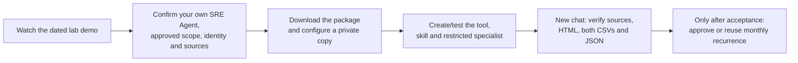

At each checkpoint below, **you should see** the named saved component or
actual result before proceeding. A green creation/Test/automation badge alone
does not prove source visibility, complete evidence or working downloads.

## Before the workshop

1. Arrange **private repository read access** or an approved offline copy of
   this complete case before the meeting. Open the direct links in
   [Package contents](#package-contents), then **Raw / Download raw file**.
   Verify source/JSON content, not an HTML sign-in page, and preserve folders.
2. Have an **existing SRE Agent** and an approved monitored subscription.
   Record the SRE-hosting subscription separately; it need not be the monitored
   subscription. Confirm compatible tenant/UAMI access, not a browser's cached
   subscription choice.
3. Bring the runtime UAMI **Client ID**, monitored subscription/tenant GUIDs and
   zero to five approved Log Analytics **workspace GUIDs**. Agree which existing
   sources/tables and historical retention should be available; inventory
   presence and Reader do not establish telemetry or complete visibility.
4. Arrange the human SRE roles and the customer's authorized source/access
   administrator. Review existing/inherited assignments first. Do not execute
   a grant, enable monitoring or start a stopped machine merely to follow this
   guide.
5. Choose the initial bounded read, output audience and optional cadence.
   Keep configured source, real reports and an optional authorized logo in
   private working storage outside Git.

**Checkpoint:** distinguish read-only reporting acceptance (Steps 0-4),
optional scheduling (Step 5), and a **new, separately authorized** operator
exercise (Step 6). The old lab's approvals and resource names are not current
customer consent.

## Demo quick start

This presentation sequence assumes Steps 0-4 have already been configured and
accepted. It is not a shortcut around source/access approval.

1. In a fresh chat, invoke **`@infra-ops-live`** and request the real report for
   `period=last_24h`, both hosting types. Open the actual HTML download.
2. Show Arc CPU, physical available memory and volume capacity. Explain why
   **Connected** is not guest health, and why empty Perf does not invalidate
   successful VM Insights.
3. Switch to Azure resources. Distinguish VM measurements from stopped/no-data
   VMs, ACA limits, plan/node aggregates and managed-service signals.
4. Ask one scoped source-grounded question, then inspect the owner review and
   coverage evidence. The downloaded report does not poll for newer data.
5. If monthly scheduling and a manual acceptance run are approved, use
   **Automation -> checkbox -> Run now** for that customer-owned task and
   verify the real thread and all four files. Otherwise keep reporting on demand.
6. Only for a separately requested exercise, after the user approves the **exact dedicated Arc host and Azure VM**
   and any required start/restore operation, use the separate operator CPU
   exercise. Prove native alert -> incident -> `infra-ops-live` -> recovery.
   A manual chat is not automatic-trigger proof.

The copy-ready questions and focused parameter examples are in
[`subagent-instructions-and-prompts.md`](subagent-instructions-and-prompts.md).


This is the actual final two-hour snapshot, collected on **October 10, 2026 at 11:54:41 UTC**.
Use the heading's measurement window (1), then the fleet register (2) to select
a resource and inspect its own source/units. The subscription identifier is
masked; the displayed observations are real lab evidence.

[Full-resolution dated overview](images/infra03-current-overview.png).

## Verified lab outcomes

### October 16 - Arc administration and normal chat

The existing `infra-ops-live` specialist was selected in a **normal fresh SRE
chat** and made one report call with `period=last_24h`, `hosting=arc`.
The actual report reference is **2026-10-16 10:27:24 UTC**; its measurement
window is **October 15 at 10:27:24 through October 16 at 10:27:24 UTC**.
Configuration/extension metadata and baseline validity are current at
collection, not a reconstruction of every configuration in that window.

| Acceptance check | Observed result / limitation |
|---|---|
| Saved restricted configuration | The existing tool, skill and specialist were saved and read back. The same 16 parameter defaults, 900-second timeout and one selected tool/skill remained; no execution tool was added. |
| Inventory and selected scope | **63 supported inventory resources** were read before local filtering. The selected **10 Arc resources consist of 8 machines and 2 connected Kubernetes clusters**, not ten servers. Child extension rows do not increase either resource or machine counts. |
| Native extensions | **32 safe extension metadata rows**, one complete ARG page. All 32 had native provisioning **`Succeeded`**; no extension failure is invented. This does not prove sensor/MDE health, upgrade availability, permission-complete visibility or approved extension-policy compliance. |
| Dated private lab review | Seven exact-platform private **lab** baselines produced eight `below_review_target` agent reviews against target `1.68`, sourced to the September 2026 official release-note section with known-issue cautions. This is not customer policy, unsupported-agent/OS certification, a safe-install claim or upgrade approval. Generic `ARC_ADMIN_BASELINES=[]` is unchanged. |
| Measurement coverage | Only **5 resources had metrics**, with **42 series and 6,120 observed bins across series**. The report remained **`partial`**, with **0 source errors**; historical gaps and missingness were retained. Successful metadata retrieval is not complete guest monitoring. |
| Normal file delivery | All four files from this same normal-chat report returned **HTTP 200**, decoded completely and stayed below 4,800,000 bytes. Their exact sizes are below. |
| Offline interaction with those actual files | At **1600 px, 390 px and 320 px**, no page overflow, JavaScript errors or external HTTP requests were observed. Complete JSON semantic parity and byte-exact resource CSV export were verified; the eight-machine filtered export retained all 32 child rows. This was local interaction with the accepted report, not recollection. |
| Preserved operational boundaries | The 12 existing tasks were unchanged. No monthly Run now/timer was exercised in this acceptance; no IAM broadening, server/guest action or automatic extension/agent update was performed. |

| Same-run native file | Actual downloaded bytes |
|---|---:|
| HTML | 386,766 |
| Complete JSON | 319,686 |
| Resource CSV | 56,285 |
| Signal CSV | 42,802 |

A **separate, explicitly requested SRE Python-test query**, not a hidden
follow-up in the report or a task, checked `query/extensions`: requested
`limit=5`, `total_matched=32`, `returned=1`, `has_more=true`, `next_offset=1`,
`transport_capped=true`, `extension_coverage.status=complete`. Its default-
serialized result was **2,610 bytes**, with empty stdout. A requested limit of
five does **not** promise five whole evidence rows within the 3,500-byte budget.
The complete report JSON/CSV retained all accepted rows.

The initial compact chat narration mislabeled the ten Arc **resources** as
machines; the normalized JSON and actual resource types correctly contained
eight machines and two clusters. Use those typed evidence counts, not that
wording, as the receipt. The runtime skill and copy-ready instructions now
explicitly prohibit that relabeling. Compact narrative is not exhaustive
evidence or proof of a perfect model trace.

### October 10 - earlier telemetry, monthly and incident evidence

The preceding telemetry implementation was exercised against **real lab sources on
October 10, 2026**. The scope contained 63 resources: **10 Arc resources**
(including two connected clusters, not ten guest servers) and **53 Azure-native
resources**. No customer PDF, synthetic dataset or simulated alert was deployed.

| Acceptance check | Observed result |
|---|---|
| Restricted deployment | The standalone tool, `infra-ops-live` skill and subagent were created and read back with one selected tool and one skill; execution tools were not inherited. |
| Current evidence | The final two-hour snapshot covered 09:54:41-11:54:41 UTC, all 63 resources, 253 series and 6,023 points. Missing/currently stopped sources remained qualified. |
| Monthly automation | The same monthly task, cron `0 9 1 * *`, was manually run at 11:54:38 UTC and finished at 11:55:29 UTC. It used one complete previous-month report call and displayed all four normal native downloads. |
| Complete month | September 1 through October 1 UTC; 269 series and **171,059 points** retained. `partial` describes evidence coverage, including limited native alert history, not a failed export. |
| Actual downloads | HTML, resource CSV, signal CSV and JSON all returned HTTP 200 for both final current and monthly runs. None exceeded 4,800,000 bytes. |
| Offline interactions | Actual HTML was checked at desktop 1440 px and mobile 390 px: hosting filters, resource drilldown, multi-resource traces and complete CSV/JSON exports; all decoded snapshot fields/points matched, without external requests, JavaScript errors or page overflow. |
| Linux path guard | The actual SRE Linux runtime rejected a symlink escape with `unsafe_artifact_directory`; no cloud read or report artifact was produced by that negative check. |

The final September downloads were **1,261,116 bytes HTML**, **1,200,185 bytes
JSON**, **61,456 bytes resource CSV** and **60,847 bytes signal CSV**. These
sizes belong to that dated run, not a guaranteed size for every estate/month.
Earlier failed size/sharing attempts remain in execution history; they are not
counted as successful monthly delivery. Codec 2.0 and the one-call/native-alias
contract solved those failures without narrowing the month or dropping sources.

### Automatic incidents, not manual chat invocations

| Flow | Measured operator exercise | Native alert and automatic investigation |
|---|---|---|
| Azure `vm-linux-01` | 11:05:29-11:13:29 UTC; 480 seconds; 479 host-CPU samples, mean **71.95%**, maximum **74.5%**; all created workers stopped. | 65% teaching rule fired at 11:10:30 UTC. The genuine SRE incident matched `infra03-cpu-demo-native-response`, invoked the restricted read-only investigation and reached **Complete**. |
| Arc `Arcbox-Ubuntu-02` | 11:31:19-11:39:19 UTC; 480 seconds; 479 samples, mean **14.01%**, maximum **25%**; target criterion passed; all created workers stopped. Its unchanged 0.3-core command quota is described below. | 10% teaching rule fired at 11:33:15 UTC. The genuine SRE incident matched `infra03-cpu-demo-arc-response` and reached **Complete**, with source-qualified guest CPU evidence rather than a host-wide saturation claim. |

Both investigations explicitly performed **no remediation** and did not claim a
proven CPU root cause. The restricted handler lacks external incident-posting
capability: its completed chat investigation is not proof of a ticket update.
Automatic invocation, source alert resolution, CPU recovery and VM power-state
restoration are separate facts. The native alert resolved, CPU returned to about
0.9%, and the approved VM was verified back in its original deallocated state.
Arc CPU returned to approximately its baseline; the stateful log-alert resolution
was separately verified as **Resolved at 11:56:54 UTC**, without manually forcing
the alert state or disabling its rule. `ArcBox-Client` was then verified back in
its original deallocated state at **11:59:42 UTC**. All ten explicitly named Arc
diagnostic Run Command resources were removed and their subsequent GETs
verified HTTP 404. Existing workloads, monitoring permissions, agent quotas and
extension configuration were not changed to force the result.

The Arc alert's user-facing `alertState` can remain **Acknowledged** while
`monitorCondition` is **Resolved**. Those are different source fields; the
report and investigation do not substitute one for the other.

Existing tools, skills and agents were hash-compared unchanged, and the nine
pre-existing tasks retained their stable configured fields. The one existing
incident-plan exception is the narrowly documented Grubify title exclusion
below; it must not be presented as an unchanged plan definition.

## Setup steps (guide order)

The numbers match the guide headings, **not runtime execution order**.
Steps 0-5 configure and validate read-only reporting. Step 6 is a **separate,
approval-gated operator demonstration**, not a dependency or operation of the
monthly task; the agent never runs the load script.

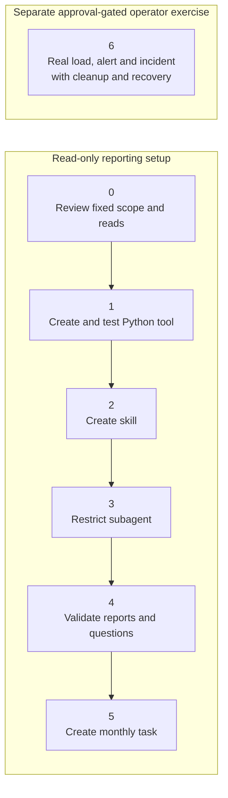

| Setup step | Component | Expected result |
|:---:|---|---|
| 0 | [Fixed scope/read access](#step-0---fixed-scope-and-read-access) | Subscription, tenant, UAMI and approved workspaces configured; actual reads verified. |
| 1 | [Python tool](#step-1---create-and-test-the-python-tool) | Complete source, typed parameters and actual report/query results checked. |
| 2 | [Skill](#step-2---create-the-skill) | Only the read-only report/query tool attached. |
| 3 | [Subagent](#step-3---restrict-the-subagent) | One explicit skill/tool; no execution or remediation tools inherited. |
| 4 | [Reports/questions](#step-4---reports-and-fresh-questions) | Actual downloads, source-qualified evidence and fresh scoped answers validated. |
| 5 | [Monthly task](#step-5---monthly-task-and-run-now) | One complete previous-month report call and immediate run-now acceptance. |
| 6 | [Separate operator demonstration](#step-6---real-alert-to-subagent-demonstration) | Exact targets/actions approved; real load, native alert, restricted incident handling, cleanup and recovery independently verified. |

## Sources and metric meaning

### Runtime data flow

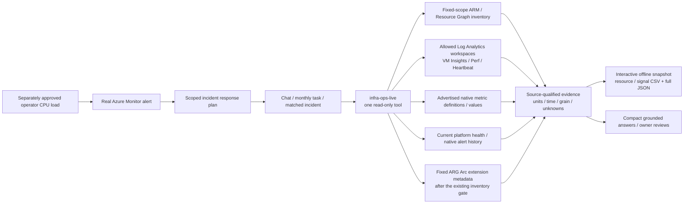

| Resource / source | Useful observations | Must not be inferred |
|---|---|---|
| Arc + `InsightsMetrics`, `Origin=vm.azm.ms` | `Processor/UtilizationPercentage`; `Memory/AvailableMB`; `memorySizeMB`-grounded available percentage; `LogicalDisk/FreeSpacePercentage`. | Connection/provisioning as guest health; missing guest RAM as zero. |
| Supported guest `Perf` counters | Total CPU, available/used physical memory, Windows commit and free space on a named volume. | Windows commit as physical RAM, or successful empty Perf as failure of another source. |
| `Heartbeat` | Last agent observation and age at the requested window end. | Application availability or separate VMs from agent/Computer rows sharing one `_ResourceId`. |
| ARG Arc machine metadata | Current connection, last status change, Connected Machine agent version and exact OS type/SKU/native version. | Historical configuration, OS support/EOL, or the agent's release date from its version number. |
| ARG Arc machine extensions | Native child/parent IDs, publisher/type, configured and instance-view version, provisioning, automatic platform upgrade and deployment-time minor selection. | Extension settings/secrets, sensor health, latest available release, all subscriptions or permission-complete absence. |
| Azure VM / VMSS | Advertised CPU, available memory, disk IOPS/bandwidth and VM availability metrics, when values actually exist. | Memory readiness from a definition alone; timestamp-only points as zero; scale-set aggregates as individual instance health. |
| AKS | Native CPU/RSS/disk percentages, cluster-aggregated unless metadata identifies a narrower scope. | Individual ARM VMs from the node/agent count, or a complete workload health audit. |
| Container Apps | CPU/memory relative to configured limits, nano-core/working-set usage, replicas and requests. | Host physical RAM, a fabricated capacity denominator, or maximum replicas as sample counts. |
| App Service | Per-app CPU time/working set and **serverfarm plan** CPU/memory percentages. | A plan-wide percentage as one app's memory, or CPU time as host CPU utilization. |
| Key Vault / Storage / ACR / supported databases | Only semantically applicable advertised availability, latency, request/capacity or database utilization metrics. | Host CPU/RAM for a managed service; capacity forecast, quota or SLA without evidence. |
| Resource Health | Current platform state, native reason/context and any returned recently-resolved annotation. | Reconstructed monthly guest health; deliberate deallocation as an unplanned outage. |
| Azure Monitor Alerts Management | Returned Fired/Resolved conditions and supplied native timestamps. | Complete lifetime history, a local flag as a native alert, or an alert row as proof that SRE handled it. |

The native adapter respects advertised units, aggregations and safe time grains.
Optional native dimensions remain aggregated by default; returned dimension
metadata is retained, required dimensions are requested explicitly. No
workload topology or dependency edges are invented.

## Package contents

Open a file link and select **Download raw file** in GitHub's file view to save
a local copy for configuration/pasting. Private repository access is required.

| File | Purpose |
|---|---|
| [`generate-infrastructure-operations-report.py`](generate-infrastructure-operations-report.py) | Standalone read-only report/query tool: fixed-scope ARM/ARG inventory, Arc machine/extension metadata and dated review baselines, approved-workspace guest telemetry, native metrics, platform health and alert evidence. Writes the same interactive HTML, resource/signal CSV and complete JSON. |
| [`tool-parameters.schema.json`](tool-parameters.schema.json) | Exact typed parameters, enums, defaults and bounds. |
| [`requirements.txt`](requirements.txt) | `requests`, `azure-identity` and Pillow for optional company-logo validation; other imports are standard library. |
| [`skills/infra-ops-live/SKILL.md`](skills/infra-ops-live/SKILL.md) | Source semantics, focused queries, incident procedure and safety. |
| [`subagent-instructions-and-prompts.md`](subagent-instructions-and-prompts.md) | Restricted instructions, Spanish questions and JSON calls. |
| [`monthly-task-prompt.md`](monthly-task-prompt.md) | Task name, responder, UTC cron, prompt and immediate acceptance gate. |
| [`controlled-cpu-load.py`](controlled-cpu-load.py) | **Operator-only** Linux host-confirmed CPU exercise: baseline/headroom checks, target <=82%, duty <=85%, sampled 85% stop ceiling, maximum 480 seconds/eight workers; never an agent tool. |
| [`tests/`](tests/) | Offline synthetic contract tests and optional ignored real-source shape replays. |
| [`tests/test_arc_administration.py`](tests/test_arc_administration.py) | Explicitly SIMULATED native envelopes, denials/partial pages, baseline/version boundaries, compatibility, cardinality/bytes and optional installed headless-Edge report checks; never a live collector invocation. |
| [`tests/test_package_contract.py`](tests/test_package_contract.py) | Offline package contract checks: zero-side-effect `__main__` tool hydration, 16-parameter schema parity, relative link/anchor/image resolution and bilingual EN/ES prompt coverage. |
| [`PRODUCT.md`](PRODUCT.md) | Scenario-local, confirmed product boundaries; no changes to earlier cases. |
| [`DESIGN.md`](DESIGN.md) | Finished operations-ledger visual contract, extracted tokens and responsive behavior. |
| [`images/`](images/) | Actual, reviewed and masked captures with red callouts. Historical UI examples are dated in their captions. |

Raw API handoffs are ignored, private validation inputs. They are not a
committed dataset, deployed fixture or sample report.

## Step 0 - Fixed scope and read access

### 0.1 Find the identity and prepare the private constants

In the existing agent, open **Settings > Azure settings > Managed Identity >
Go to Identity**. In the Azure portal open the attached **user-assigned**
identity, then copy **Client ID** from Overview for the code. Record **Object
(principal) ID** separately for the access administrator. Older **Settings >
Basics** screenshots are label variants, not a reason to choose another
identity. Do not use the internal system-assigned identity or your own user.

Configure the constants at the top of
[`generate-infrastructure-operations-report.py`](generate-infrastructure-operations-report.py)
before deployment:

```python
SUBSCRIPTION_ID = "<YOUR_SUBSCRIPTION_ID>"
TENANT_ID = "<YOUR_TENANT_ID>"
MANAGED_IDENTITY_CLIENT_ID = "<YOUR_AGENT_CLIENT_ID>"
LOG_WORKSPACE_IDS = ["<YOUR_APPROVED_ARC_WORKSPACE_GUID>"]
ARC_ADMIN_BASELINES = []
```

Use the identity's **Client ID**, not its Object/Principal ID. The code uses
`ManagedIdentityCredential(client_id=...)` explicitly; it does not fall back to a
cached CLI account or require an injected global credential. Subscription state
must be **Enabled** and its tenant must match. Add only specifically approved
workspace GUIDs; there is no automatic discovery of other subscriptions.

| Private constant | Actual default / required value |
|---|---|
| `SUBSCRIPTION_ID` | Placeholder; exact monitored subscription GUID, not automatically the SRE-hosting subscription |
| `TENANT_ID` | Placeholder; tenant returned for that Enabled subscription must match |
| `MANAGED_IDENTITY_CLIENT_ID` | Placeholder; Client ID of the UAMI actually attached to this SRE Agent |
| `LOG_WORKSPACE_IDS` | `[]`; zero to five **distinct workspace GUIDs**, not workspace ARM IDs or names. Empty means guest-log sources are unconfigured, not healthy |
| `ARC_ADMIN_BASELINES` | `[]`; leave empty until the source owner approves the exact dated review rules below. Native metadata reads still work; version/configuration policy is Unknown |
| `COMPANY_LOGO_DATA_URI` / `COMPANY_LOGO_ALT_TEXT` | `""` / `"Company logo"`; optional local deployment-copy branding only |

The configuration block above shows one intentionally unresolved workspace
placeholder. Replace it with an approved GUID, or retain `[]` when guest logs
are deliberately out of scope and disclose that limitation.

### 0.2 Verify runtime source rights and human roles separately

| Access | Required purpose |
|---|---|
| Runtime: **Reader** on the monitored subscription, or a verified approved equivalent | The tool first GETs subscription identity/state, POSTs fixed Resource Graph inventory and safe Arc-extension metadata queries, GETs per-resource metric definitions/values, and reads subscription-level Resource Health / Alerts Management lists. Verify existing visibility of `Microsoft.HybridCompute/machines` and their `machines/extensions` child resources; resource-only Reader is not proof that subscription-level reads are authorized. No new write role is required for this extension. |
| Runtime: approved **workspace-context** Log Analytics data reads | Fixed POST `/v1/workspaces/<GUID>/query` reads `InsightsMetrics`, supported `Perf` counters and `Heartbeat`. Check workspace query permission plus access to these tables; merely reading workspace metadata or querying one resource in the portal is insufficient. Existing/inherited Reader on the workspace/parent can already supply applicable reads; verify actual access before adding a role. |
| User: **SRE Agent Author** on the **SRE Agent resource > Access control (IAM)** | Customize the agent, create custom agents, author response plans and configure incident management. |
| User: **SRE Agent Standard User** on the same agent resource | Chat/run diagnostics, upload knowledge and create/manage scheduled tasks. Combine with Author for the full portal workflow. |

**SRE Agent Administrator** is the full-management alternative to **Author +
Standard User**. **Builder** is a portal navigation label, not a named role.
Author alone cannot chat/create tasks; Standard User alone cannot create custom
agents. Azure Owner/Contributor do not replace SRE Agent data-action roles, and
a visible button can still return 403. See [User roles and permissions](https://learn.microsoft.com/azure/sre-agent/user-roles).
These human roles are separate from the UAMI's read access above; this case
does not need case 01's Microsoft Graph grant.

**Resource Graph is read-only despite HTTP POST.** Its inventory is
permission-filtered and not strongly consistent: completed paging/HTTP 200
only completes the inventory the identity could see. It does not prove every
customer-approved resource was visible. Compare the approved scope and known
resources with the source owner; preserve any visibility uncertainty.
Likewise, an empty log result is not permission, instrumentation or retention
proof. Evaluate the actual fixed workspace/table access, `_ResourceId`
associations and expected history; do not claim this collector requests
permission-diagnostic headers or resource-context endpoints it does not use.

### 0.2.1 Exact additional Arc read contract

Both inventory and extension reads use **POST**
`https://management.azure.com/providers/Microsoft.ResourceGraph/resources?api-version=2022-10-01`,
with only the configured subscription and one of the two fixed query templates.
The extension query runs only when selected inventory contains an Arc **machine**,
not merely an Arc connected cluster. It is a metadata read, not a deployment.

| Read / normalized output | Fields and evidence boundary |
|---|---|
| `_inventory_query()` / each resource | Existing supported-type identity/tags/state projection, plus `properties.agentVersion`, `osType`, `osSku`, `osVersion` and `lastStatusChange`. `arc_agent_version`, `os_type`, `os_sku`, `os_version` and `arc_status_changed_utc` retain those facts. Native `osVersion` may describe a kernel or build, not a distribution lifecycle release. |
| `_arc_extension_query()` / top-level `extensions` | Only `id`, `name`, resource `type`, `location`, and a projected property bag containing `publisher`, extension `type`, `typeHandlerVersion`, `provisioningState`, `enableAutomaticUpgrade`, `autoUpgradeMinorVersion`, and `instanceView.typeHandlerVersion`. |
| `arc_extensions` source ledger | Read UTC, accepted pages, all subscription extension rows read, declared subscription total, selected matched rows, page/row/time bounds and sanitized failure. Selected rows join **exact native parent IDs**, never similar names. |
| `arc_baselines` and `arc_administration` | Administrator-owned policy/provenance and its temporal status, separate agent/extension review results, support Unknowns and source missingness. These are not additional cloud requests. |

The native property shapes are described in
[Machines - Get](https://learn.microsoft.com/rest/api/hybridcompute/machines/get?view=rest-hybridcompute-2025-01-13)
and [Machine Extensions - List](https://learn.microsoft.com/rest/api/hybridcompute/machine-extensions/list?view=rest-hybridcompute-2025-01-13).
Those pages qualify **field meanings**, not a claim that this collector calls
those GET endpoints. The implemented source is ARG, using the official
[Arc extension resource sample](https://learn.microsoft.com/azure/governance/resource-graph/samples/samples-by-category#azure-arc-enabled-servers).
ARG can omit properties or lag the control plane; absent values remain Unknown.
There is no per-machine/per-extension GET fan-out, version-catalog call, price
call, user URL, Advisor read, guest command or live log collection added here.

**Not read/exported:** extension `settings`, `protectedSettings`, protected
settings references, `forceUpdateTag`, status/error messages, stdout/stderr,
tokens, credentials, private guest configuration or arbitrary property bags.
`missing_fields` lists absent safe metadata. The configured
`type_handler_version` and returned `instance_view_version` remain separate;
only the latter is compared to an approved extension review version.

### 0.3 Customer administrator's IAM procedure, only if a grant is approved

1. On the **actual SRE Agent Azure resource**, open **Access control (IAM) >
   Check access / Role assignments**. Inspect direct/inherited human access.
   If needed, select **Add > Add role assignment**, choose **SRE Agent
   Author**, then **Members > User, group, or service principal > Select
   members** and choose the approved human/group. Verify resource and principal
   before **Review + assign**. Repeat for Standard User if required.
2. Separately open the approved **monitored subscription** or **workspace**
   scope for each runtime read assignment. Select the approved read role,
   **Members > Managed identity > Select members > User-assigned managed
   identity**. In the identity selector choose the **SRE-hosting subscription**,
   locate the exact attached UAMI and verify its **Object (principal) ID**.
   This selector's subscription is not the destination role scope.
3. Only the authorized customer administrator with applicable
   `Microsoft.Authorization/roleAssignments/write` authority, such as Role Based Access
   Control Administrator/User Access Administrator, selects **Review + assign**.
   Record the approved scope, role, principal and duration privately.
   Managed identities cannot activate eligible PIM roles; do not mistake an
   eligible assignment for active runtime access.
4. Verify the required reads after normal propagation, under that UAMI. Do not
   grant Owner/Contributor, self-assign Administrator from a warning, transfer
   the role to the wrong identity or broaden access because a source is empty.

No assignment is performed by these repository files. An existing
workspace's access mode/table policy remains a customer decision; do not
change it, a DCR or network policy from the reporting workflow.

For branding, use the existing [optional company-logo settings](#optional-company-logo).
Keep `COMPANY_LOGO_DATA_URI` empty for the default placeholder; no new runtime
parameter or alternative upload method is needed.

Probe actual managed-identity reads first. If workspace/table access is denied,
report that blind spot and obtain explicit permission for any change. Do not
enable AMA, a DCR, diagnostic settings, paid monitoring or a broader role from
the tool. Existing monitoring and usage can have costs; read-only is not a
promise that SRE runs or log queries are free.

| Step | Portal surface & field | Value to enter / select | Readback checkpoint |
|---|---|---|---|
| `0.1` | **SRE Agent > Settings > Azure settings > Managed Identity > Go to Identity > Overview** | Copy **Client ID** for code; record **Object (principal) ID** separately for IAM | Client ID is a GUID distinct from Object (principal) ID and is the attached user-assigned identity, never the user's browser login |
| `0.2` | Private copy of `generate-infrastructure-operations-report.py` top constants | Set `SUBSCRIPTION_ID`, `TENANT_ID`, `MANAGED_IDENTITY_CLIENT_ID`, `LOG_WORKSPACE_IDS` (`0..5` distinct GUIDs), and `ARC_ADMIN_BASELINES` (`[]` unless owner-approved) | All 5 constants are configured in the private deployment copy outside Git; subscription is `Enabled`, tenant matches, and total supported inventory across all 15 resource types is `<= 500` before local filters |
| `0.3` | **SRE Agent resource > Access control (IAM)** and monitored **Subscription / Log Analytics workspaces > IAM** | Human: **SRE Agent Author + SRE Agent Standard User** (or **Administrator**); UAMI principal: subscription **Reader** + approved workspace/table query read | Active (non-eligible PIM) assignments verified on the exact scopes; no Owner, Contributor, or write connector granted |

## Optional dated Arc review baselines

First deploy with **`ARC_ADMIN_BASELINES = []`** unless the environment's owner
has already supplied an approved rule. This does not disable metadata reads.
It means agent/configuration obsolescence has **not been assessed against
policy**, not that the machine is compliant, healthy, unsupported or failed.
Current native `Failed` / `Canceled` extension provisioning still produces an
owner review without inventing a required extension.

### Who supplies a rule, and what it means

The infrastructure owner chooses a **review target**, cites the applicable
policy or official reference, checks the exact platform and known issues,
and approves its short validity window. An authorized maintainer places that
rule in the **private deployment copy**, tests it, saves the tool and reads it
back. Do not commit customer policy/identifiers, let chat choose a target,
fetch a runtime-supplied URL or grant permissions to obtain a result.

The [Connected Machine release notes](https://learn.microsoft.com/azure/azure-arc/servers/agent-release-notes)
say versions released within the last year are supported. A lower numeric
version or a version that is not the latest is **not sufficient evidence of
being unsupported**. This reader does not fetch release dates/support catalogs;
`agent_support_status` and `os_support_status` stay **`unknown`**, even when an
approved review target is configured. A release can have platform-specific
known issues. Review those before proposing any separately approved change;
this case neither installs nor recommends blindly installing the newest agent.

### Rule fields and exact matching

| Field | Meaning / validation |
|---|---|
| `baseline_id` | Unique nonempty rule identifier, at most 256 plain characters. Use it to join signals to exported provenance. |
| `owner` | Nonempty approved policy-owner label, at most 256 characters; not a guessed resource owner or an identity the runtime will impersonate. |
| `reference` | Nonempty provenance text, at most 512 characters: an approved policy or official source, including the relevant release/platform context. Stored as text; **never fetched**. |
| `as_of_utc` / `valid_until_utc` | Explicit-offset ISO 8601 timestamps. Start is inclusive, expiry exclusive; positive validity is **at most 31 days**. A future or expired rule is retained but cannot make a drift conclusion. |
| `os_type`, `os_sku`, `os_version`, `location` | All four are required nonempty exact, case-insensitive selectors, each at most 256 characters. Copy their **observed normalized values**, not a friendly OS-name guess. Native `os_version` is opaque and may be a kernel/build string. There is no wildcard/pattern matching or cross-platform ranking. Missing source selectors cannot match. |
| `agent_review_version` | Optional numeric dotted target with 2-4 components of 1-6 digits. Numeric comparison pads trailing zero components: `1.9 < 1.10`, `1.10 == 1.10.0.0`. Suffixes, missing values and unrecognized source versions are non-comparable Unknown. |
| `required_extensions` | Optional list, default `[]`, at most 20 unique publisher/type requirements per rule. Each requires nonempty `publisher` and `type` strings, at most 256 characters. Do not invent mandatory monitoring extensions. |
| Requirement `review_version` | Optional target using the same numeric format; compared only with that exact publisher/type's **instance-view** version in the matched machine OS/location. Missing instance-view version stays Unknown; desired/configured version is not substituted. |
| Requirement `enable_automatic_upgrade` | Optional **boolean** expected value for `enableAutomaticUpgrade`, the platform automatic-upgrade setting. Missing native value is Unknown, never `false`. No setting is changed. |
| Requirement `auto_upgrade_minor_version` | Optional **boolean** expected deployment-time minor-version selection. It is a different setting; `true` does not itself promise ongoing upgrades after deployment. |
| `notes` | Optional explanatory text, at most 1,024 characters; use it for applicability, known issues and the fact that this is a review target, not installation approval. |

There are at most **50 rules**. Duplicate selector tuples, duplicate IDs,
duplicate publisher/type requirements, unknown keys, invalid booleans/versions
or overlong validity fail with `configuration_required` **before authentication**.
An empty list is valid. An unmatched, future or stale rule is not silently
replaced by another platform's rule or a hardcoded "latest" version.

### Illustrative configuration, not customer policy

The following is **SIMULATED / ILLUSTRATIVE ONLY**. `1.10`, the OS values and
publisher/type below are arithmetic/test examples, **not** a current release,
minimum supported version, required product or installation recommendation.
Do not paste this as customer policy. Use `[]` until the owner supplies the
actual exact selectors, source, dates and approved review requirements.

```python
ARC_ADMIN_BASELINES = [{
    "baseline_id": "illustrative-review-202610",
    "owner": "Illustrative policy owner",
    "reference": "SIMULATED approved review policy; no support assertion",
    "as_of_utc": "2026-10-01T00:00:00Z",
    "valid_until_utc": "2026-10-31T00:00:00Z",
    "os_type": "Linux",
    "os_sku": "Synthetic Linux 1",
    "os_version": "1.0",
    "location": "test-region",
    "agent_review_version": "1.10",
    "notes": "SIMULATED review target, not permission to install or update.",
    "required_extensions": [{
        "publisher": "Synthetic.Publisher",
        "type": "SyntheticMonitor",
        "review_version": "1.10",
        "enable_automatic_upgrade": True,
        "auto_upgrade_minor_version": False,
    }],
}]
```

**You should see:** the actual private baseline's owner/reference/validity in
the downloaded resource inspector and complete JSON. A source agent below its
current matched target has `agent_version_status=below_review_target`, not an
"unsupported" label. At expiry it becomes Unknown until the owner approves an
updated baseline; the monthly task never refreshes policy automatically.

`Succeeded`, a publisher/type match or an opted-in automatic-upgrade setting
does not prove sensor health, data ingestion, upgrade availability or successful
future rollout. Supporting publishers and staged rollouts differ. See
[automatic extension upgrade](https://learn.microsoft.com/azure/azure-arc/servers/manage-automatic-vm-extension-upgrade).
A required publisher/type not returned by a complete visible inventory is
qualified **not observed**, not "uninstalled" or "failed". A denied/partial
inventory or unidentifiable returned metadata prevents even that conclusion.

## Step 1 - Create and test the Python tool

1. Open the approved agent in [SRE Agent](https://sre.azure.com), then
   **Build + setup / Builder > Agent Canvas > Create > Tool > Python tool**.
   The dialog has **Code**, **Test playground** and **Identity** tabs.
2. On **Code**, set **Tool name** to
   **`generate-infrastructure-operations-report`** and **Description** to:

   ```text
   Collect read-only infrastructure evidence from the fixed approved Azure
   subscription and Log Analytics workspaces. Generate offline HTML, resource
   CSV, signal CSV and complete JSON, or answer bounded typed evidence queries.
   Preserve source status, UTC window, units, missing data and paging. No changes.
   ```

3. Paste the **entire privately configured**
   [`generate-infrastructure-operations-report.py`](generate-infrastructure-operations-report.py).
   Do not use **Generate / Refine** or paste only `main()`: its helpers,
   policy, renderer and lossless codec are part of the standalone file.
   Use the typed `main()` signature
   and [`tool-parameters.schema.json`](tool-parameters.schema.json); do not add
   arbitrary paths, KQL, URLs, token or subscription parameters.
4. Ensure the dependencies in [`requirements.txt`](requirements.txt) are
   available: **`requests>=2.31,<3`**, **`azure-identity>=1.16,<2`** and
   **`Pillow>=10.4,<13`** (Pillow is needed only for a configured logo).
   Dependency provisioning is an approved runtime setup activity, not a shell
   tool for the restricted subagent. Set a bounded tool
   timeout appropriate to the estate; the SRE preview maximum is 900 seconds.
   The fixed source/row/bin/page and plain-artifact limits remain enforced.
5. In **Identity**, do not copy Case01's Graph preset or another case's saved
   `authEnabled` metadata. This code explicitly requests
   `https://management.azure.com/.default` and
   `https://api.loganalytics.io/.default` through its fixed
   `ManagedIdentityCredential`. It does not consume a pasted/injected token.
   A verified saved Case03 Identity-tab setting is **not recorded** in this
   guide; validate/read back the actual target runtime's setting with the
   operator rather than claim a historical preset.
6. In **Test playground**, test a short, focused `query` first, then a real report.
   Confirm source status, units, missing values, exact counts and complete JSON.
   **Test runs the collector**, not just a syntax check: with a configured
   identity it makes the documented read requests and can incur normal
   SRE/query usage. Placeholders fail before authentication; 403/empty/partial
   evidence does not grant permission to change monitoring or IAM.
7. Select **Create tool** only after the approved test, then reopen it and
   read back complete code, **all 16 inputs**, types/defaults, timeout and
   actual Identity configuration. A syntax check alone
   does not verify access or file publication.

| Step | Portal surface & field | Value to enter / select | Readback checkpoint |
|---|---|---|---|
| `1.1` | **Builder > Agent Canvas > Create > Tool > Python tool > Code** (`Tool name` & `Description`) | Name: `generate-infrastructure-operations-report`; paste the read-only description | Saved tool name is exact; **Generate / Refine** was not used to rewrite the collector |
| `1.2` | **Code** editor & **Timeout** | Paste the **entire** privately configured `generate-infrastructure-operations-report.py` (`SUBSCRIPTION_ID`, `TENANT_ID`, `MANAGED_IDENTITY_CLIENT_ID`, `LOG_WORKSPACE_IDS`, `ARC_ADMIN_BASELINES`); set timeout `900` | Whole-file paste (including `REPORT_HTML` and Codec 2.0) and `900` second timeout persist on reopen; subscription has `<= 500` total resources across the 15 supported types before local filters |
| `1.3` | **Parameters** (16 rows matching `tool-parameters.schema.json`) | Configure all 16 inputs (`operation`..`offset`); select `int` in the SRE row editor for `limit` (`20`) and `offset` (`0`) while keeping `"integer"` in JSON Schema | Reopened tool lists all 16 typed parameters, exact enums, and defaults (`report`, `summary`, `all`, `auto`, `20`, `0`) |
| `1.4` | **Identity** tab & **Test playground** -> **Create tool** | Keep explicit `ManagedIdentityCredential(client_id=...)` in code; run the focused `query` and `report` test payloads, then click **Create tool** and reopen | Test returns structured JSON (`<= 3500` bytes) without `configuration_required` or `scope_too_large`; reopened tool matches the saved private file |

```json
{"operation":"query","view":"metrics","hosting":"arc","resource_name":"<ARC_RESOURCE_NAME>","period":"last_2h"}
```

```json
{"operation":"report","period":"last_24h"}
```

### Exact typed inputs and collection limits

The authoritative [schema](tool-parameters.schema.json) and `main()` agree:

| Input | Type / default | Allowed value / matching rule |
|---|---|---|
| `operation` | string / `report` | `report`, `query` |
| `view` | string / `summary` | `summary`, `resources`, `extensions`, `metrics`, `timeline`, `signals`, `actions`, `coverage` |
| `hosting` | string / `all` | `all`, `arc`, `azure` |
| `resource_group` | string / `""` | Case-insensitive exact local match; at most 90 characters |
| `resource_name` | string / `""` | Case-insensitive **substring**; at most 160 characters |
| `resource_id` | string / `""` | Exact case-insensitive local ARM ID in the fixed subscription; at most 2,048 characters; not a request URL |
| `resource_type` | string / `""` | Exact case-insensitive supported provider/type; at most 180 characters |
| `metric` | string / `all` | Exact normalized enum in the linked schema; supported names below |
| `state` | string / `all` | `all`, `review`, `unknown`, `observed`; observed is not a health certificate |
| `severity` | string / `all` | `all`, `critical`, `warning`, `info`; only signals/timeline/actions |
| `period` | string / `auto` | `auto`, `last_2h`, `last_24h`, `last_7d`, `last_30d`, `previous_month`, `custom` |
| `start_utc`, `end_utc` | strings / `""`, `""` | Custom only; explicit-offset ISO 8601, at most 40 characters each; positive past interval no longer than 31 days |
| `grain` | string / `auto` | `auto`, `PT5M`, `PT1H`; auto is five minutes up to 48 hours, hourly beyond |
| `limit` | `integer` (schema), `int` (Python) / `20` | 1..100 inclusive; requested query rows, possibly reduced by transport budget |
| `offset` | `integer` (schema), `int` (Python) / `0` | 0..50,000 inclusive; fresh-collection offset, not a stable stored cursor |

**Editor type mapping:** keep standard JSON Schema **`integer`** in the file.
In a row-based SRE parameter editor that uses Python/runtime type labels,
select **`int`** for `limit` and `offset`. Supply numeric JSON values such as
`20` and `0`, not quoted strings; do not rewrite the schema type to `int`.

Supported `metric` values, in addition to `all`:

```text
cpu_percent, memory_available_percent, memory_available_bytes,
memory_used_percent, memory_commit_percent, disk_free_percent,
disk_iops_percent, disk_bandwidth_percent, vm_availability, storage_used_bytes,
service_availability_percent, service_latency_ms, service_requests,
service_errors, node_cpu_percent, node_memory_percent, node_disk_percent,
app_cpu_time_seconds, app_memory_bytes, container_cpu_cores,
container_memory_bytes, container_cpu_percent, container_memory_percent,
container_replicas, plan_cpu_percent, plan_memory_percent, sql_cpu_percent,
sql_memory_percent, sql_storage_percent
```

Report mode rejects query-only `view`, `state`, `severity`, `limit` and `offset`
overrides; its default page values must remain `20 / 0`. Summary/coverage
queries reject `state`; native timeline rejects `metric` filters. Custom
timestamps with a non-custom period, booleans/floats for integers, arbitrary
KQL and unknown parameters are not accepted.
The `extensions` view also requires `metric=all` and `severity=all`; its `state`
filter uses each extension's own assessment. Resource `state` keeps the
existing measurement/native operational semantics, not the separate optional
administration assessment. There is no new runtime baseline/scope/URL input.

The fixed inventory cap is **500 supported resources before local filters**;
a resource-name query cannot bypass it. Other bounds are 100 source pages,
50,000 source rows, 800 time bins and 20,000,000 bytes per HTTP body. Requests
use 10-second connect / 150-second read timeouts, up to three attempts for
429/500/502/503/504, with bounded retry delays; Logs requests use `Prefer:
wait=120`. These are source bounds, separate from the configured SRE timeout.
Limits do not establish permission completeness or historical retention.

The added Arc-extension source has its own **5,000 subscription rows / 10 pages /
90-second cooperative read deadline**, whichever stops it first, with up to
three HTTP attempts per page. It checks the clock before requests/attempts and
during/after response reads; blocking I/O still has bounded connect/read
timeouts (at most 10/30 seconds for this source), not an instantaneous
cancellation guarantee. These limits do not change the older sources' budgets
or the whole SRE invocation timeout. A later failed/invalid/capped page retains
previous complete accepted pages and a **partial** receipt; a first denied read
is **error**, not empty-success. Declared/read/matched counts and missingness
remain explicit.

**Checkpoint:** inspect the actual JSON for `status=error` even when the
playground wrapper is green. Stop on source/configuration failure; do not
rename partial evidence or a first page as complete.

## Scale, hard limits and Plan B

### Is there a maximum number of Arc VMs per report?

**This implementation accepts at most 500 relevant inventory resources in one
fixed subscription, before any local filter.** This is a repository safety
bound (`MAX_RESOURCES`), **not an Azure Arc product, licensing, plan or
subscription maximum**, and not a promise that a 500-machine full-month report
will fit every other bound.

The count includes **all 15 supported resource types**:

| Inventory family | Counts toward the same 500-resource gate |
|---|---|
| Arc | `Microsoft.HybridCompute/machines` and `Microsoft.Kubernetes/connectedClusters`; a connected cluster is not an extra collection of ARM guest VMs |
| Azure compute | `Microsoft.Compute/virtualMachines`, `virtualMachineScaleSets`, `Microsoft.ContainerService/managedClusters` |
| Apps/plans | `Microsoft.App/containerApps`, `Microsoft.Web/sites`, `Microsoft.Web/serverfarms` |
| Managed services | Storage accounts, Key Vault vaults, container registries, SQL databases, PostgreSQL flexible servers, MySQL flexible servers and Redis |

For example, 400 Arc resources plus 150 supported Azure resources hit the
**550-resource inventory** gate even with `hosting=arc`. An estate of **more
than 800 Arc servers in the same subscription** also fails before telemetry
collection. Buying a different Arc plan, changing a logo, requesting `query`,
lowering `limit`, or asking for one VM does not remove that gate.

The actual order in
[`generate-infrastructure-operations-report.py`](generate-infrastructure-operations-report.py)
is:

```text
Validate fixed Enabled subscription/tenant
  -> _arg_inventory: fixed subscription-wide query over supported types
     -> reject inventory > 500; verify paging/counts
  -> _normalize_resources: independently reject > 500
  -> _resource_matches: apply hosting / resource group / name / ID / type
  -> collect selected resources' native metrics and guest-log sources
  -> apply remaining evidence/view filters and write/report or page/query
```

`_inventory_query()` has **no resource-group/tag/profile/hosting predicate**.
The exposed filters are not interpolated into it. `LOG_WORKSPACE_IDS` selects
log sources, not inventory machines. HTML filters run even later, after a
report exists. Do not restrict the UAMI's visibility to hide machines and then
call the smaller permission-filtered inventory the complete approved estate.

### Which bound failed?

| Bound in the published implementation | What it constrains / visible outcome |
|---|---|
| One fixed Enabled subscription and matching tenant | No cross-subscription runtime selector or automatic discovery. Configuration/auth/scope failure stops the collection. |
| **500** relevant inventory resources | Checked during ARG accumulation and normalization, **before local filters**. `source=inventory`, `code=scope_too_large`, `status=error`, `artifacts_created=false`; no partial inventory/report is accepted. |
| ARG pages of up to **1,000**, at most **100 pages** | Page size is not the supported estate size; the 500 guard can reject the first response. Declared counts/truncation/continuations are checked, but permission visibility still needs independent review. |
| Zero to **five distinct workspace GUIDs** | Each configured workspace is queried for the selected compute IDs. `[]` is valid configuration but produces `guest_logs=not_configured` when compute is selected. |
| Guest `Heartbeat`, `Perf`, `InsightsMetrics` queries | Fixed templates aggregate per resource/counter or dimension/time bin. Each uses `take 50001`; more than **50,000** returned aggregate rows is rejected as `invalid_log_result`. There is no implemented log-row pagination/partition profile to recover that result automatically. |
| ARM health/alert source lists | At most **100 pages / 50,000 rows** per list. Cap or broken continuation becomes a disclosed source error, not complete page-one evidence. |
| Arc extension metadata | One additional fixed ARG query over visible subscription extensions, only after the 500-resource gate and only when Arc machines are selected. At most **5,000 source rows / 10 pages / 90-second cooperative read deadline**, up to three attempts/page. Partial pages/denials remain explicit; no per-extension fan-out. Matched extensions are child evidence, not inventory machines. |
| Measurement window / grain | At most **31 days / 800 requested bins**. Auto uses five-minute bins through 48 hours, hourly beyond. Too-dense input fails as `window_too_dense` before source calls. Native traces also reject more than 800 points as `metric_bin_bound`. |
| Native metric dimensions | Required dimensions can request `top=1000`; **1,000 or more returned traces for a metric** is rejected as `metric_dimension_bound`, because reaching the top bound is not complete coverage. |
| HTTP/body/retry bounds | Per request: 10-second connect / 150-second read timeout; body at most **20,000,000 bytes**; at most three attempts for 429/500/502/503/504 with bounded delays. Four workers collect platform sources; workspace/table calls remain separate. |
| Whole invocation time | Customer-configured SRE tool timeout is separate from request timeouts. There is **no Case03 shared 240-second/300-attempt budget** like Case04. A runtime timeout can end the run without accepted artifacts; do not infer completion. |
| Query envelope | **3,500 default-serialized UTF-8 bytes**, requested `limit=1..100`, `offset=0..50000`. Whole rows can be reduced with exact paging; `query_row_too_large` means one row cannot fit. Smaller `limit` does not reduce upstream inventory or source rows. |
| Each complete plain artifact | **4,800,000 encoded bytes**, including embedded evidence/optional logo and the applicable CSV encoding. `artifact_size_exceeded` occurs before writing; no record/window is silently discarded. |

Local resource filters do not rewrite the fixed extension query either.
Its **subscription rows read** and **selected matched rows** can differ;
unselected parents still consume that source's bound. A small resource filter
is not an upstream extension-partition solution.

There is no separately declared safe maximum of **series or total points for
the entire estate**. A machine with several volumes/counters can contribute
many series; native dimensions and guest tags can increase cardinality. The
50,000-row **per workspace/table result**, 800-bin **per-window/trace** bounds,
complete artifact bytes and runtime time all matter. A resource inventory is
not one time series per VM, and the compact query's last-two-point sample is
not the amount of data collected.

Extension cardinality and nested resource-CSV bytes also matter independently
of resource count. A 500-resource inventory is not a guarantee that all
extensions, monthly traces or four complete files fit. The offline 5,000-row
extension boundary test deliberately exercises an oversized resource CSV and
requires `artifact_size_exceeded` **before any file is written**, rather than
discarding child rows. There is still no parameter-only path for more than
800 Arc servers in the same subscription.

Illustrative sizing only: **100 machines x four series x 720 hourly bins =
288,000 series-points** before source gaps, extra volumes, tags or other
sources. That is not a measured customer result, permission proof or capacity
guarantee; the actual grouped table responses can hit their own row bound
before exports are built.

### Supported decisions, not hidden workarounds

| Situation | What can actually be done now | What must not be claimed |
|---|---|---|
| Small estate; total relevant inventory <=500 | After approved access, start with a focused two-hour read, then accept the exact requested report/window and all files. Validate real source rows/time/bytes; do not assume "under 500" is sufficient. | A short successful test proves neither monthly fit nor all sensors/history. |
| Inventory fits, but detailed collection is expensive | An explicitly requested `hosting`, resource-group/name/ID/type filter is applied **after inventory but before per-resource metric reads and guest ID lists**. It can reduce that later work for a **new named subset**; the inventory still includes all relevant resources. | It does not fix `inventory/scope_too_large`, and a subset is not the full-estate monthly report. |
| Many Arc servers, including >800 in one subscription | Stop on `inventory/scope_too_large`; retain the sanitized error and requested scope. The frozen package has **no supported parameter-only solution**. Request a maintainer-reviewed upstream-scoping or larger-scale design. | No Arc license upgrade, ordinary RG filter, `hosting=arc`, tag filter or "just set the cap to 900" is an implemented fix. |
| Several **existing approved subscriptions**, each within the inventory bound | Separate fixed-scope deployments/reports may be accepted independently, with explicit tenant/UAMI/source rights and each subscription/window clearly labeled. Review their ordinary remaining limits separately. | They are not one combined report, not automatically configured profiles and not a solution for 800 Arc servers still in one subscription. Do not move customer resources for a demo. |
| Valid inventory; long interval / too many points | For an explicitly agreed long-window report use the supported **hourly `PT1H` / auto** grain, preserving the complete requested interval. A separate short diagnostic reduces points; it does not reduce inventory. | Do not replace a failed full month with a 24-hour report, remove peaks/source errors or call it the original month. Native grain still has to be advertised/accepted. |
| Large files despite a valid interval/grain | Preserve the failed complete-report request. Seek a validated lossless implementation/transport fix; inspect every artifact, not just HTML. | No silent split into Arc/Azure, truncated evidence, ZIP/Storage fallback or smaller query-page "fix". |
| Mixed Arc/native estate, missing Arc logs | Verify the approved workspace GUIDs, exact guest `_ResourceId`, permitted tables, ingestion and retention. Keep usable native metrics independent from unavailable guest data. | Removing workspace IDs is not a scale fix for required Arc CPU/memory, and Connected is not measured guest health. |
| Focused `metric=cpu_percent` question | Native metric selection can reduce applicable native metric-value requests; guest queries still read their fixed CPU/memory/disk templates, and the selected metric is filtered afterward. | A CPU-only question is not an upstream Arc inventory/log partition and does not avoid the 500 or per-table row guard. |

For a valid inventory, the initial diagnostic can be:

```json
{"operation":"query","view":"coverage","hosting":"arc","period":"last_2h","limit":5}
```

It still fails at the same inventory gate when the fixed relevant scope is
too large. If it succeeds, inspect `scope.inventory_resources` versus
`scope.selected_resources`, source receipts and `total_matched`; a five-row
page is not five machines or the whole ledger. Use the full JSON/report for
complete evidence when supported.

**Not implemented / separate approval required:** upstream RG/tag/explicit-ID
collection profiles, a hierarchical fleet summary, larger validated caps,
automatic workspace/time partitions, incremental persistence, alternative
external storage or a multi-subscription aggregate. A maintainer must review
the fixed ARG predicate and endpoint guard together, validate paging/counts,
resource-ID joins and guest-log predicates, source visibility, worst-case
series/points/rows, query and artifact byte limits, runtime/retry cost and
complete exports. Raising one constant or duplicating the same fixed query
does not establish that contract. No such code, deployment or IAM change is
made by this documentation.

### Recognize missing evidence before accepting a report

`status=partial` can accompany real files: source errors/partial receipts or
resources assessed Unknown cause it. Read **Evidence coverage**, resource
assessment and the full JSON `sources`/`series` before counts. A log source
with a successful but empty result is recorded **Not collected**, while an
explicit API partial error is rejected as `partial_log_query`. A native metric
definition without values is not measured zero.

For a denied source, preserve its code/HTTP status and ask the correct
workspace/subscription owner to check the approved UAMI read layer. For stale
telemetry, compare `last_sample_utc` and observed/missing bins with the
**requested window end**, not just today's clock: the ten-minute Heartbeat
recency rule is not historical uptime. A window below 80% CPU/physical-memory
bin coverage is a visibility review, not a health score. Older data outside
retention are unavailable; the approximately 30-day alert lookback can leave
the beginning of a previous calendar month unobserved. Do not repair
uncollected/denied/empty/stale/expired-history evidence with invented zeros,
an Arc connection state or shorter undisclosed periods.

## Optional company logo

The top-right header includes a restrained **`logo company`** placeholder.
The cropped header below is from the actual report generated at
**13:09:51 UTC on October 10, 2026**: the optional logo frame (1) stays separate
from the dated snapshot stamp (2).

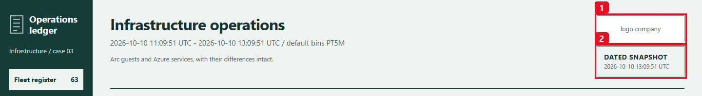

Configure these constants near the top of
[`generate-infrastructure-operations-report.py`](generate-infrastructure-operations-report.py)
to replace it without changing the report's colors, evidence or runtime parameters:

```python
COMPANY_LOGO_DATA_URI = ""  # Keep empty to display "logo company".
COMPANY_LOGO_ALT_TEXT = "Company logo"
```

Use an authorized, single-frame **PNG or JPEG** logo, at most **100,000 bytes**
and **2048 by 2048 pixels**. This local command generates the configuration
block for a PNG on Windows, with short quoted chunks that Python joins into
one data URI:

```powershell
python -c "import base64, sys, textwrap; from pathlib import Path; b = Path(r'C:\path\company-logo.png').read_bytes(); 0 < len(b) <= 100000 or sys.exit('Use a logo of 1 to 100000 bytes'); u = 'data:image/png;base64,' + base64.b64encode(b).decode('ascii'); print('COMPANY_LOGO_DATA_URI = (\n' + '\n'.join('    ' + repr(s) for s in textwrap.wrap(u, 88)) + '\n)')"
```

Replace the empty `COMPANY_LOGO_DATA_URI = ""` line in the Python tool editor
with the generated block, and set `COMPANY_LOGO_ALT_TEXT` to a descriptive name such
as `"Your company logo"`. For a JPEG, use `data:image/jpeg;base64,` instead.
There is no runtime filename/upload parameter, remote image fetch or CDN.
The image stays inside the offline HTML; JSON/CSV evidence and chat responses
do not carry logo bytes. The dated snapshot stamp remains visible beside or
below the frame, including on phones.

**Pillow is required only when a logo is configured**, to verify and decode the
bounded raster; it is listed in `requirements.txt`. Invalid nonempty data,
unsupported formats, mismatched MIME types, oversized images or missing
validation dependencies return explicit errors, not a broken image or silent
placeholder fallback. The existing 4,800,000-byte artifact limit includes the
embedded logo. After changing it, update the Python tool and generate a report
to verify the header and actual downloads.

## Step 2 - Create the skill

1. Open **Build + setup / Builder > Agent Canvas > Create > Skill**.
2. Name it **`infra-ops-live`**. Use a description such as
   `Read-only, source-qualified infrastructure reports and bounded questions
   for the fixed approved Arc/Azure scope. No execution or remediation.`
3. In **Choose tools**, search for and attach **only**
   `generate-infrastructure-operations-report`.
4. Open/download
   [`skills/infra-ops-live/SKILL.md`](skills/infra-ops-live/SKILL.md) and paste its
   **complete content** into the skill body. Preserve portal-generated
   name/description/tool front matter if present; replace only the body
   placeholder, not the reviewed instructions with generated prose.
5. Select **Create**, reopen the saved skill and verify its actual complete
   file and one attached tool.

The operator load script is not a skill asset or a tool. Preserve the skill's
distinctions between native alerts, local flags, current health, windowed
measurements and incomplete monitoring.
**You should see:** a saved skill named `infra-ops-live`, its full updated
instructions and exactly `generate-infrastructure-operations-report` attached.
A saved document alone is not evidence that the specialist selected it.

| Step | Portal surface & field | Value to enter / select | Readback checkpoint |
|---|---|---|---|
| `2.1` | **Builder > Agent Canvas > Create > Skill** (`Name` & `Description`) | Name: `infra-ops-live`; enter the read-only Arc/Azure description | Skill appears under **Skills** as `infra-ops-live` |
| `2.2` | **Choose tools** picker | Attach **only** `generate-infrastructure-operations-report` | Reopened skill shows exactly 1 attached tool (`generate-infrastructure-operations-report`) and never `controlled-cpu-load.py` or a shell tool |
| `2.3` | **Skill body (`SKILL.md`)** -> **Create** | Paste the complete body of [`skills/infra-ops-live/SKILL.md`](skills/infra-ops-live/SKILL.md) below the portal-generated YAML frontmatter | Reopened `SKILL.md` retains both the frontmatter and the full 18-rule interpretation contract intact |

## Step 3 - Restrict the subagent

1. Open **Agent Canvas > Create > Custom Agent** and set **Custom agent name**
   to **`infra-ops-live`**.
2. For **Instructions**, paste the complete **`infra-ops-live`: copy-ready
   instructions** block from
   [`subagent-instructions-and-prompts.md`](subagent-instructions-and-prompts.md),
   not the later demonstration questions.
3. In **Choose skills**, select **only `infra-ops-live`**. In **Choose tools**,
   select **only `generate-infrastructure-operations-report`**.
4. Review, select **Create**, then reopen the saved specialist and verify
   instructions plus both explicit selections.

Do not leave **Choose tools** empty: some portal versions then inherit all
global tools. Do not attach a shell, run-command, stress, write-capable connector
or default remediation toolbox. Read-only code and narrow tool selection are
both boundaries; a prompt alone is not a permission control.

**Checkpoint:** one specialist, one runtime skill, one read-only tool. No
operator CPU script, inherited shell or hidden remedial capability.

| Step | Portal surface & field | Value to enter / select | Readback checkpoint |
|---|---|---|---|
| `3.1` | **Builder > Agent Canvas > Create > Custom Agent** (`Custom agent name` & `Instructions`) | Name: `infra-ops-live`; paste the complete **`infra-ops-live`: copy-ready instructions** block from [`subagent-instructions-and-prompts.md`](subagent-instructions-and-prompts.md) | Reopened specialist preserves the full restricted instruction text without demonstration prompts mixed in |
| `3.2` | **Choose skills** picker | Explicitly select **only** `infra-ops-live` | Verify the exact selected skill **name** in the reopened saved form and effective policy (`allowedSkills: ["infra-ops-live"]`, `addSystemSkills=false`); never rely on the list summary badge |
| `3.3` | **Choose tools** picker -> **Create** | Explicitly select **only** `generate-infrastructure-operations-report` (never leave the picker empty) | Verify the exact selected tool **name** in the reopened saved form and effective policy (`tools: ["generate-infrastructure-operations-report"]`, `disableDocumentRetrieval=true`); never rely on the list summary badge |

> [!NOTE]
> **Dated SRE UI badge caveat:** In the live SRE Agent UI, Agent Canvas list/card summary badges can display inherited global rollups (for example, `131 tools` / `52 skills`) even when both native APIs, selected chips and the saved form policy enforce one explicit tool and skill (`tools`, `allowedSkills`, `addSystemSkills=false`, `disableDocumentRetrieval=true`). Verify the exact selected tool and skill **names** in the saved form and effective supported policy; the list summary badge is not authoritative restriction proof, and you must not modify globals to change it.

## Step 4 - Reports and fresh questions

Copy-ready prompts and scoped JSON examples are in
[`subagent-instructions-and-prompts.md`](subagent-instructions-and-prompts.md).

Open **New chat**, explicitly select **`infra-ops-live`** in the normal
agent picker (`/agent` where supported), then paste:

```text
Generate the real read-only infrastructure report for the last 24 hours,
covering both Arc and Azure. Use operation=report, period=last_24h,
hosting=all and other defaults once. Immediately deliver the actual HTML,
resource CSV, signal CSV and complete JSON. Show the UTC window and source
coverage before counts; distinguish guest physical memory, container limits,
platform health and missing evidence. Do not change or start anything.
```

Expected call:

```json
{"operation":"report","period":"last_24h","hosting":"all"}
```

For a separate grounded question, ask:

```text
For <ARC_RESOURCE_NAME>, show the observed CPU evidence for the last two
hours. Use query/metrics with hosting=arc and metric=cpu_percent. Explain
source, unit, aggregation, missing bins, exact matched total and next offset.
Do not claim connected means healthy or that a point sample is the full series.
```

```json
{"operation":"query","view":"metrics","hosting":"arc","resource_name":"<ARC_RESOURCE_NAME>","metric":"cpu_percent","period":"last_2h"}
```

The name filter is a substring; use the approved exact `resource_id` filter
when multiple names match. Never paste credentials, arbitrary URLs/KQL or a
filesystem destination into the chat.

For a separate Arc administration question after the normal report/download
check, select the same specialist in **New chat** and ask:

```text
For <ARC_MACHINE_RESOURCE_ID>, use query/resources and explain the native Arc
connection, last status change, observed agent version and exact OS metadata.
Keep Heartbeat and measurement assessment separate from administration policy.
Then, only as this explicit follow-up, use query/extensions with metric=all
and severity=all. State extension_coverage before totals; show native IDs,
publisher/type, configured versus instance-view version, provisioning and
both upgrade settings. Cite a current approved baseline if one exists;
otherwise say Unknown. Never infer unsupported OS/agent or sensor health,
and do not install, update, restart, uninstall or change access.
```

The corresponding extension call is:

```json
{"operation":"query","view":"extensions","hosting":"arc","resource_id":"<ARC_MACHINE_RESOURCE_ID>","metric":"all","severity":"all","period":"last_24h","limit":20}
```

Spanish (ES) copy-ready equivalents for the three normal-chat prompts above
(matching [`subagent-instructions-and-prompts.md`](subagent-instructions-and-prompts.md)):

- **24-hour full report (ES):**

```text
@infra-ops-live: Genera el informe real de infraestructura de las ultimas
24 horas para Arc y Azure. Entrega el HTML, CSV de recursos, CSV de senales y
JSON completo. Separa CPU, memoria fisica, limites de contenedor, salud de
plataforma, cobertura y anomalias; no conviertas lo desconocido en cero.
```

- **Two-hour Arc CPU & guest telemetry follow-up (ES):**

```text
@infra-ops-live: Para <ARC_RESOURCE_NAME>, usa query/metrics, hosting=arc y
period=last_2h. Explica media, maximo observado, ultimo dato y cobertura de CPU;
memoria disponible en bytes y porcentaje, y espacio libre por volumen.
Que viene de VM Insights, que viene de Heartbeat y que NO demuestra estar sano?
```

- **Arc administration & `query/extensions` follow-up (ES):**

```text
@infra-ops-live: Para <ARC_RESOURCE_NAME>, usa query/resources y explica la
conexion Arc, ultimo cambio de estado, version real del agente, OS type/SKU y
osVersion nativo. Separa el ultimo Heartbeat de esos datos de control actuales.
Despues, usa query/extensions, metric=all, severity=all y period=last_24h.
Muestra IDs, publisher/type, version configurada y de instance view,
provisioning y ambas opciones de upgrade. Explica extension_coverage, paginas y
campos ausentes. Ni el nombre ni Succeeded prueban salud del sensor; no cambies nada.
```

This explicitly requested follow-up is **not** another query hidden in the
monthly task. Each call collects a fresh snapshot. For one retained evidence
set, use the original HTML/JSON instead of mixing several fresh calls as if
they were one historical cursor.

Reports accept local hosting/resource filters and an explicit measurement
period. `period=auto` selects the **previous UTC calendar month** for reports
and **last 24 hours** for queries. Use `last_2h` or `last_24h` explicitly when
showing today's activity.

| Control / evidence | Demonstration |
|---|---|
| Resource filters and drilldown | Move between Arc and Azure without swapping to a synthetic deployment. |
| Arc administration filter | Select administration review/Unknown, agent below dated target, extension review or Disconnected/Expired; combine with hosting/type/owner filters. This does not relabel the existing measurement assessment. |
| Arc resource details | Read the agent/OS fields, connection-change time, separate Heartbeat clock, baseline owner/reference/validity and every safe extension row. A kernel/build string is not an OS support verdict. |
| Recorded time-series comparisons | Compare the same metric/unit/window and retain the guest/platform denominator distinction. |
| Signal evidence | Open source maxima, threshold/MAD criteria and exact affected resources; separate pressure from a monitoring gap. |
| Chronology | Follow returned native alert/health timestamps; no invented event or root-cause link. |
| Owner review | Show actual owner tags and concrete checks instead of a generic "optimize your infrastructure" paragraph. |
| Exports | Download all filtered matches, not just displayed rows; full normalized data stays in JSON. |

Fresh query calls collect new data. They do not mutate an older HTML file.
Respect the actual paging fields; returned rows and last-two-point samples are
not totals. Unsupported filter combinations fail explicitly.

### Read the dated Arc administration example

These two reviewed, masked captures come from the **October 16, 2026
10:27:24 UTC normal-chat report** described in
[Verified lab outcomes](#october-16---arc-administration-and-normal-chat).
They use lab names and a lab-only dated review target; they are not customer
configuration, a new deployment form or a monthly task execution.

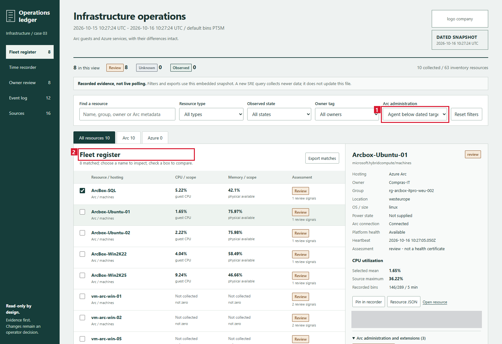

Choose **Arc administration -> Agent below dated target** (red **1**).
The fleet register (red **2**) shows the **eight matching machines** while the
scope still states **10 collected Arc resources / 63 inventory resources**.
The other two Arc resources are connected Kubernetes clusters, not additional
servers. This is filtering within one retained snapshot, not a narrower
recollection or a way around the pre-filter 500-resource gate. Some rows have
no collected runtime measurements; their review target does not supply them.

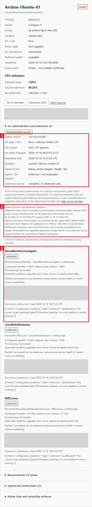

In the resource inspector, red **1** separates the observed agent/OS/native
kernel or build value, Arc status-change time and metadata-read UTC from
Heartbeat and metric observations above. It shows the dated target and
**Agent / OS support: Unknown / not evaluated**; a lower review version is not
an unsupported OS/agent conclusion.

Red **2** identifies the **lab baseline** owner, official reference, as-of,
expiry and release-known-issue cautions. It explicitly excludes customer
policy, support/EOL certification and upgrade permission. Keep the generic
baseline empty until the actual environment's owner approves a rule.
Red **3** shows a real native extension's publisher/type, configured versus
instance-view version, provisioning and the two distinct upgrade flags.
All 32 returned extensions had `Succeeded`; their configuration-policy
assessment can still be **Unknown** because no extension requirements were
approved. Neither that state nor a monitoring/MDE extension name proves
sensor health.

[Full-resolution Arc administration overview](images/infra03-arc-administration-overview.png) ·
[Full-resolution Arc administration details](images/infra03-arc-administration-details.png).

The following October 10 CPU/source screenshots remain **earlier-version**
examples; they are not receipts for the October 16 administration addition.


Pin `Arcbox-Ubuntu-02` and `vm-linux-01` in the register. Select the metric (1)
and recorded time range (2), optionally show source maxima, then inspect a bin
or export the **full** pinned traces (3). This final dated capture preserves
their different achieved CPU levels and missing bins; its Arc event was still
Fired at the 11:54:41 collection. The later resolution is a separate verified
event, not retroactively painted into this snapshot.

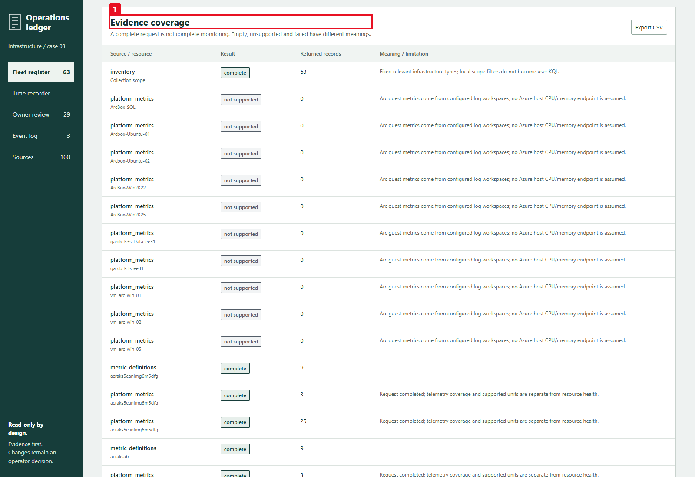

Read **Evidence coverage** (1) before deciding what is monitored. Arc platform
host metrics being unsupported is expected: its guest evidence comes from the
configured VM Insights/Heartbeat sources. An empty or unsupported source is
not a measured zero, and a completed source request is not a health certificate.

[Full-resolution CPU recorder](images/infra03-current-cpu-recorder.png) ·
[Source coverage ledger](images/infra03-current-source-coverage.png).

**Acceptance checkpoint:** confirm the trace used only the selected report/query
tool; match the report's UTC window and source ledger with its four returned
paths/downloads. Inspect JSON for complete normalized evidence, CSV row scope
and HTML filters/exports. Partial, denied, unsupported, unconfigured,
successful-empty and measured zero are distinct. If native aliases are returned,
render them unchanged; if a file cannot actually download, disclose delivery
failure separately from source coverage.

## Step 5 - Monthly task and run now

Monthly cadence is optional after accepted chat reporting. Search **Automation**
for an existing **customer-owned** matching task, inspect its owner, scope,
responder and full prompt, and reuse it if approved. Do not duplicate it or
alter another owner's schedule.

The updated collector includes current Arc administration evidence in the
**same report invocation**. It does not need another task, extra query or a
changed cron/prompt. The previous-month interval applies to measurements and
eligible event timestamps; inventory, agent/extension configuration and
baseline validity are evaluated **at collection**, not reconstructed for every
day of that month. This distinction should remain visible when presenting the
monthly report.

Use [`monthly-task-prompt.md`](monthly-task-prompt.md). In **Automation >
Create > Scheduled task**, or **Agent Canvas > Create > Trigger > Scheduled
tasks**, enter:

| Field | Value |
|---|---|
| Task name | `Monthly infrastructure operations review` |
| Response custom agent / subagent | `infra-ops-live` |
| Frequency | **Custom cron** |
| Cron expression (UTC) | `0 9 1 * *` |
| Evidence | One **previous complete UTC calendar month**, both Arc and Azure |
| Start on / model tier | Customer-approved activation date and usage policy; not a universal lab default |
| Agent autonomy | Autonomous only for an approved unattended restricted read-only task; Review can pause |
| Thread | A separate execution thread where offered; not a continuation that adds hidden queries |

Copy the **whole Task details** block from the linked file. Its complete
one-call/file/error contract is reproduced here:

```text
Use infra-ops-live and generate-infrastructure-operations-report only.
Make EXACTLY ONE tool call: operation="report", period="previous_month",
grain="auto", hosting="all", metric="all", other defaults. The fixed full scope
includes both Arc and Azure. Do not call operation="query", collect another
snapshot, page, retry with a different period or request a narrower report.
If status="error", stop with the sanitized source/code and no invented files.
Otherwise IMMEDIATELY show all four file downloads using the returned
report_url, resources_csv_url, signals_csv_url and snapshot_url when
sharing_mode="native_ui". These are relative native UI aliases derived from
the real guarded runtime paths; render them as Markdown links or normal file
widgets exactly as returned. Do not invent a host, prepend a thread ID, replace
them with sandbox URLs, or demand an unavailable HTTP-verification tool.
The unchanged report_path/resources_csv_path/signals_csv_path/snapshot_path
remain the real file paths. If sharing_mode="local_files_only", state that
native UI aliases are unavailable here and show the real paths only.
artifact_status="written" means files were written, not HTTP verified.
http_verified=false is not a sharing failure and must not suppress provided
native aliases. status="partial" means evidence coverage is partial; it is
not a file-publication failure.
After the four links, give at most one short paragraph using only the returned
window, summary counts and top_review_resources names/states. Do not query
again to explain CPU, causes, owners or partial coverage. Direct the reader to
the report's Evidence coverage/Owner review sections for detailed facts.
Keep the dated offline-snapshot qualification and any returned coverage status;
do not invent a reason, SLA, root cause, forecast, health score or savings.
Never turn an artifact-size failure into success by splitting Arc/Azure,
shortening the previous month or removing resources/series. Rerun the complete
requested scope after a validated lossless fix; preserve the failed history.
Never execute load, controlled-cpu-load.py, guest commands, resource writes,
start/stop/resize, remediation, instrumentation, permissions or other workflows.
```

This means day 1 at 09:00 UTC, not a local-time schedule that follows daylight
saving changes. The normal time picker can display browser-local time but saves
a fixed UTC schedule. Reopen the saved task and verify enabled state, responder,
complete prompt, activation date, **next UTC run** and customer model/run mode.

For a **separately approved manual acceptance run**, select only this task's checkbox in **Automation** and the enabled
toolbar **Run now**. Open the real execution thread and verify the Python
result, all four actual downloads, report interactions and one grounded
question. **Success** on the automation row is not proof of completed Python or
published files. A **No thread found** view also needs an explicit thread/file
check. Do not wait a month to discover that sharing failed.
Do not perform Run now merely by reading this guide. Manual acceptance verifies
that execution, not a future timer firing or complete historical retention.

The task makes **one full previous-month report call**, immediately displays its
four provided native links/widgets, and gives a compact summary from the return
envelope. It does not query newer 24-hour data to elaborate a monthly answer.
Any grounded follow-up question belongs in a separate, explicitly requested
chat; the HTML/JSON already contain the detailed measurements and limitations.

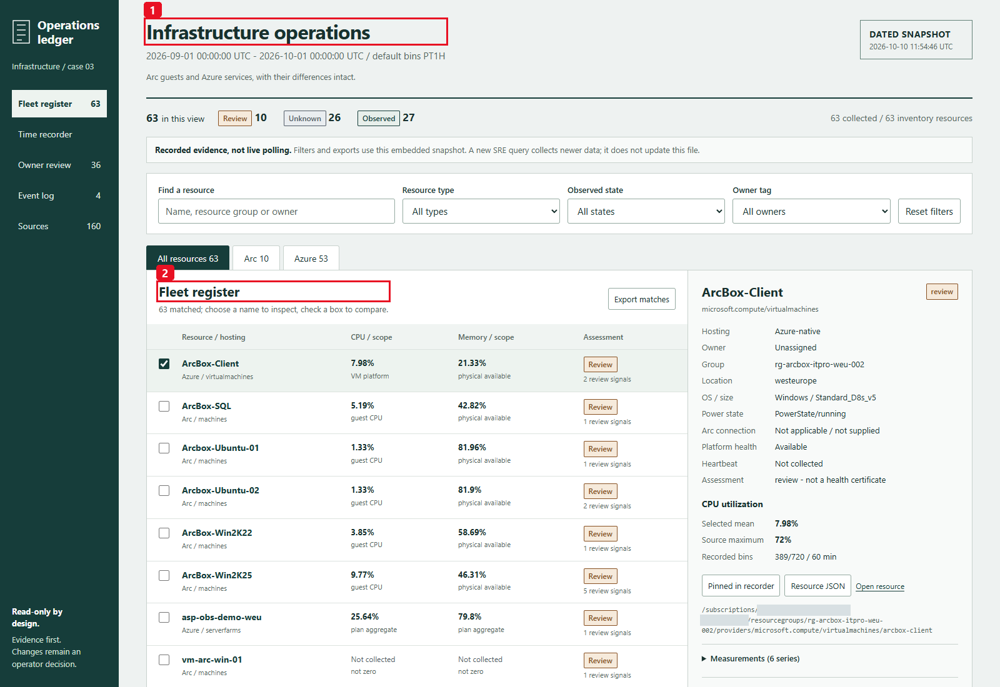

The final report was collected on October 10 at **11:54:46 UTC**, but its
measurement window (1) is **September 1-October 1 UTC**. The register (2) keeps
the full 63-resource scope, not just currently running or connected machines.
Current platform state and missing portions of that month remain qualified.

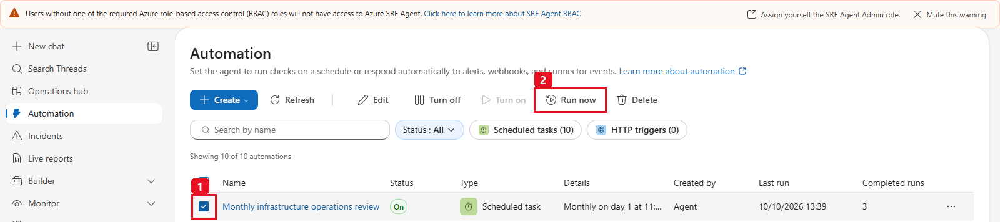

Select only the scenario's checkbox (1), then **Run now** (2). This cropped
actual UI example is from the earlier **11:39 UTC** run and shows three history
entries; unrelated tasks are excluded from the image. The final verified
11:54:38 execution is the **fourth** retained entry, not a replacement of the
earlier failures/retries.


This real native-widget example is from the **11:39:54 UTC** run after the
sharing-contract fix, before the final package-image/mobile corrections.
The final implementation independently delivered the same four formats in
**50.618 seconds** with HTTP 200 downloads; its exact final sizes and
source/coverage facts are recorded in [Verified lab outcomes](#verified-lab-outcomes).
The screenshot is not used as proof of the later source version.

[Full-resolution monthly window](images/infra03-monthly-overview.png) ·
[Run now controls](images/infra03-monthly-run-now.png) ·
[Four native downloads](images/infra03-monthly-four-downloads.png).

## Step 6 - Real alert to subagent demonstration

### Safety gate

**Historical, optional and operator-only.** The October 10 experiment and
temporary starts below are retained as dated evidence, not mandatory customer
implementation steps or reusable consent. Do not repeat them during ordinary
report setup, and do not treat a README, old plan or previous approval as
authorization for a new resource write, alert/response-plan edit or load run.

The user must confirm the **exact Arc resource ID/guest hostname and native VM
resource ID/guest hostname** before load. Record their OS, CPU count, current
telemetry, dedicated-lab purpose, original power state, approved duration,
independent stop channel and recovery plan.

If the native VM is deallocated, obtain separate approval for startup and
restoring its original power state. Do not substitute a running AKS/K3s node,
production machine or different cached subscription. The report, skill,
subagent and monthly task never generate load or start/stop a resource.

For this lab acceptance run, a **human explicitly approved** the Development
Arc host `Arcbox-Ubuntu-02` and the Azure Linux VM `vm-linux-01` in
`automatizaciones`, including temporary startup, restoration to the original
deallocated state and its small compute cost. The approved exercise is bounded
to eight minutes, with the script's 85% duty cap and sampled CPU stop ceiling.
This target-specific authorization does not approve other hosts, SQL, ADFS,
Kubernetes nodes, permission changes or instrumentation. Authorization alone is
not proof that load, automatic incident handling or recovery succeeded.

The Arc guests in this lab are nested under `ArcBox-Client`. Its deallocation
stopped guest observations; that temporal gap is expected missing evidence, not
a report defect. A human separately approved temporarily starting this parent
VM and restoring its original deallocated state. Starting the host may start
other nested guests, but the CPU exercise remains restricted to the approved
Ubuntu guest. Never infer permission to stress SQL, ADFS or another guest from
permission to start the hypervisor.

### Prepare two real alert sources

| Arc Linux/Windows guest | Azure-native VM |
|---|---|
| Use the real Arc workspace's VM Insights CPU and the exact `_ResourceId`. | Use the target VM's native `Percentage CPU` metric and its actual values. |
| A scheduled-query alert can evaluate actual `UtilizationPercentage` observations over a short window, with enough samples. | A metric alert evaluates observed CPU, not zero-filled empty bins. |
| Confirm ingestion and rule evaluation before applying load. | Confirm approved startup and telemetry before applying load. |

An operator can use this scoped Arc query in Azure Monitor, after replacing the
approved resource ID:

```kusto
InsightsMetrics
| where TimeGenerated > ago(5m)
| where Origin == "vm.azm.ms"
| where Namespace == "Processor" and Name == "UtilizationPercentage"
| where _ResourceId =~ "<APPROVED_ARC_RESOURCE_ID>"
| summarize CpuPercent = avg(Val), Samples = count() by _ResourceId
| where Samples >= 2
```

The two lab execution contexts have different reachable CPU budgets:

| Teaching flow | Operator target | Alert |
|---|---|---|
| Azure-native VM, ordinary observed command budget | 72% aggregate host CPU | 65% one-minute native `Percentage CPU` Average. |
| Arc governed Run Command context | 14% aggregate host CPU, close to its observed command budget | 10% five-minute VM Insights Average, evaluated every minute. |

The Arc context's actual `cpu.max="30000 100000"` grants **0.3 cores**.
On this two-vCPU guest that is about **15% of host CPU**, not 30% or 85% of the
host. The initial 72% Arc attempt averaged about 17% including baseline and did
not meet the 65% teaching-alert criterion. VM Insights and independent
`/proc/stat` agreed; this was a constrained command context, not a telemetry
conversion bug.

The revised Arc exercise demonstrates **pressure near the governed command
budget**, not host-wide 72% saturation. No agent quota is raised or disabled,
no systemd/SSH/root escape is used, and no CPU value is multiplied or relabeled.
An independently approved normal guest session could have a different reachable
target, but that higher Arc host-load path is not validated by this lab.
Both teaching thresholds are **not production SLOs or the report's local
three-bin/MAD policy**. Customer alert policies must follow their actual
workload/measurement requirements.

### Route the real incident

Use SRE Agent's connected Azure Monitor incident provider and an isolated
**incident response plan** mapped to **`infra-ops-live`** in **Review** mode.
Match the actual alert title prefix, target/service and severity supported by
the current portal. Verify ingress/routing in this deployment; do not assume
that a generic Action Group HTTP webhook has the correct token audience.

Inspect overlapping plans. Preserve unrelated existing plans/agents and do not
silently delete a default or another workload's handler. If isolation is not
possible without changing another workflow, stop and obtain its owner's decision.

The two lab plans are `infra03-cpu-demo-native-response` and
`infra03-cpu-demo-arc-response`, mapped to `infra-ops-live`, with Sev3 and the
corresponding `infra03-cpu-demo-native` / `infra03-cpu-demo-arc` title filter.
Their three-hour cooldown is an explicit lab setting.

The existing broad Grubify plan would also match these alerts. The parent
operator added only `titleNotContains=["infra03-cpu-demo"]`, preserving its
other configured fields. This was a narrowly scoped implementation decision
under autonomous execution, **not explicit human approval of that plan edit**.
Do not describe the old plan definition as unchanged, silently delete it, or
generalize the exclusion to other workloads.

### Operator-only bounded CPU command

Copy [`controlled-cpu-load.py`](controlled-cpu-load.py) to each **approved,
dedicated Linux** guest with an already installed Python 3. The exercise uses
actual Linux `/proc/stat`, `MemAvailable`, CPU affinity and cgroup v2
`cpu.max` along the visible hierarchy. It fails closed on other OSes, cgroup v1,
hidden/uninspectable quota hierarchies or invalid/missing counters. It only reads
governance; it never changes or bypasses it. Windows guest monitoring is supported by the report,
but a Windows load controller is not asserted as validated.

Read the exact guest's baseline first, without starting any load:

```text
python3 controlled-cpu-load.py --approved-host "<APPROVED_NATIVE_GUEST_HOSTNAME>" --workers 2 --target-cpu-percent 72 --baseline-only
python3 controlled-cpu-load.py --approved-host "<APPROVED_ARC_GUEST_HOSTNAME>" --workers 2 --target-cpu-percent 14 --baseline-only
```

Baseline CPU must be <=20%, with at least 256 MiB plus 64 MiB per selected
worker available. A target above the effective quota/affinity/worker budget is
rejected **before any workers start**, rather than silently producing a
successful-looking lower load. After the exact target/duration/start/restore approvals,
run one exercise at a time:

```text
python3 controlled-cpu-load.py --approved-host "<APPROVED_NATIVE_GUEST_HOSTNAME>" --workers 2 --duration-seconds 360 --target-cpu-percent 72 --acknowledge-risk
python3 controlled-cpu-load.py --approved-host "<APPROVED_ARC_GUEST_HOSTNAME>" --workers 2 --duration-seconds 360 --target-cpu-percent 14 --acknowledge-risk
```

The guest hostname must exactly match. Select workers from the actual approved
CPU count; the hard ceiling is eight workers and 480 seconds. The controller
targets at most 82%, limits each worker's duty cycle to 85%, samples aggregate
host CPU every second and aborts load if a sample exceeds 85% or the memory
reserve is lost. It prints actual baseline, sample, parent/worker PID and
cleanup records. An independent monotonic deadline and SIGINT/SIGTERM trap stop
all workers. These are a duty cap and **sampled** host stop ceiling, not a
guarantee about instantaneous CPU or unrelated processes. It has no cloud calls,
memory-pressure exercise, disk-filling workload, software install or automatic
resource cleanup.

The CPU hot loop checks its own monotonic boundary, with shared stop checks once
per bounded 0.1-second cycle rather than lock contention on every tiny work batch.
This efficiency fix does not remove a cgroup quota. A deadline-ended run must
record three consecutive host-CPU samples within its target tolerance
(target minus the larger of one percentage point or 5% of target); otherwise it
returns `unreachable_target`, even if PID cleanup succeeded. An intentionally
signaled stop can pass cleanup without claiming that the CPU target or alert
was achieved.

Before the higher-duty exercise, validate a short low-duty run and its SIGTERM
stop channel on the actual approved OS. The signal handler sets only a local
boolean; the normal loop/finalizer signals the multiprocessing Event after any
wait releases its lock. This avoids a signal-time reentrant Event-lock deadlock.
Do not rely on the guest run-command provisioning status alone: inspect stdout,
stderr, actual exit code and absence of the exact created PIDs.

Keep a separate terminal/stop channel. On Linux, stop **only the printed parent
PID**, never a process-name pattern:

```text
kill -TERM <LOAD_PARENT_PID>
```

Do not invoke the script from the SRE chat, report, skill, monthly task or
incident handler. Do not allocate memory to OOM, fill a disk or stop a workload
to make a demo more dramatic.

### What proves the scenario

1. Record the real baseline and exact target.
2. Apply the approved bounded load and capture actual elevated CPU samples.
3. Verify the **native Azure Monitor alert** fired for that resource.
4. Verify the **real SRE incident and response-plan mapping** invoked
   **`infra-ops-live`** without manually asking it to investigate.
5. Inspect the handler's actual read-only tool call, source-qualified findings,
   uncertainty and owner reviews.
6. Stop/expire load, verify worker cleanup and CPU recovery, then verify the
   native condition resolved. Restore the native VM's original power state only
   if that restoration was approved.
7. Generate a fresh report/query for the demonstration window and show the
   actual chronology. A manual report or replayed JSON is not automatic proof.

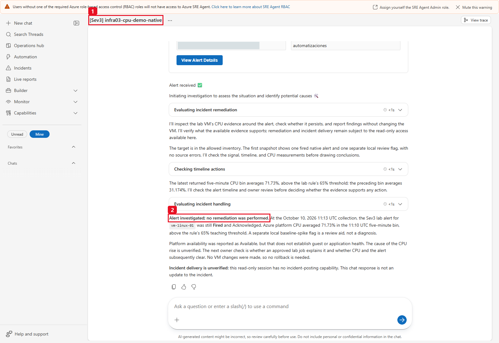

The native rule's real fire created this incident thread (1); its response plan
selected the infrastructure specialist. The completed response (2) cites actual
CPU above the 65% teaching threshold and states that **no remediation was
performed**. It also distinguishes a completed investigation from an external
incident update. Native alert resolution and restoration were verified later.

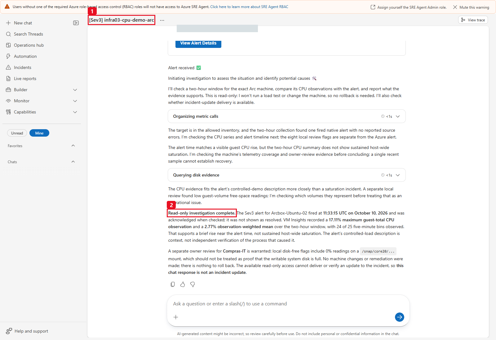

The Arc rule separately created this genuine automatic incident (1), and the
same specialist completed its source-qualified investigation (2). It does not
claim host-wide saturation or external ticket write-back. This historic
response predates the final package-image policy correction: its `/snap/...`
capacity flags were already qualified, and the final tool now represents the
canonical image pattern as informational instead of writable-volume pressure.
Arc auto-resolution and hypervisor restoration were independently verified
after this response.

## Evidence and algorithm rules

- **Arc administration:** native connection/provisioning and exact agent/OS/
  extension metadata are collection-time evidence. Only a current dated exact-
  platform administrator baseline can establish a review difference.
  Numeric version order is not release-date support, latest-version safety or
  OS EOL. Missing/non-comparable versions or upgrade settings remain Unknown.
  Configured versus instance-view versions and platform automatic-upgrade
  versus deployment-time minor selection remain distinct. No default required
  extension or customer policy is invented.
- **Separate assessments:** unset optional administration policy is visible
  in `arc_administration.assessment` and informational Unknown signals, but does
  not change existing measurement-state filters/counts or create owner actions.
  Native failures and qualified current-baseline differences can add reviews.
  `observed` and `Succeeded` remain observations, not health certification.
- **Mean:** guest log-record count-weighted mean; native mean of returned
  Average bins. Preserve the basis, count and partial-edge qualification.
- **Maximum:** source observation/Maximum aggregation. When only Average is
  present, expose *maximum bin mean* separately, not a raw peak or raw p95.
- **CPU peaks:** source maximum >=95% is informational evidence, not by itself
  sustained pressure, a root cause or a native alert.
- **Pressure:** at least three consecutive complete bins: CPU/IOPS/bandwidth
  >=85%; physical available memory <=10%; used/commit/limit memory >=90%; guest
  volume free <=15%; service availability <99%; VM availability <1.
- **Package images:** VM Insights mounts matching only the canonical
  `/snap/<package>/<numeric-revision>` pattern remain fully collected/exported
  but yield an informational package-image observation, not a writable-volume
  pressure/anomaly flag or capacity action. Mount writability is **Not verified**;
  the pattern is not a general assertion that every zero-free-space mount is
  read-only. `/`, unexpected paths and other genuine low-capacity volumes still
  use the normal rule.
- **Statistical flags:** one-sided median/MAD on bin means, at least 12 prior
  observations within 48 intervals, six scaled MADs and a 20-percentage-point
  minimum change. Not Azure's native anomaly detector.
- **Capacity reviews:** >=72 bins and >=90% bin coverage, CPU mean <10% and
  source maximum <25%, physical available memory mean >50% and minimum >30%.
  Missing source maxima/physical memory prevents an unjustified candidate.
- **Health/time:** current inventory, Arc connection and platform health are
  collection-time facts. Heartbeat is evaluated at the measurement window end.
  Alert API lookback is approximately 30 days and can omit a calendar month's
  beginning. Missing old history is not zero incidents.
- **Window coverage:** fewer than 80% observed bins in a requested CPU/physical
  memory window triggers a qualified visibility review. This is a data-coverage
  criterion, not a health score; lifecycle schedules and cadence can explain it.

These are transparent example review criteria. Change them only as a deliberate,
documented operator policy change with corresponding tests. No composite health
score, forecast, inferred quota, SLA certification, savings or automatic resize
is produced.

## Exports and transport limits

| Output | Contents |
|---|---|
| HTML | Offline interactive dated snapshot; embedded evidence, no external scripts/fonts/CDNs/tokens. |
| Resource CSV | Complete selected resource inventory, ownership, monitoring/health observations and tags; appended agent/OS/status-change/admin columns and a JSON-valued `arc_extensions` column with every accepted child row. Existing columns retain their order and meaning. |
| Signal CSV | Complete selected normalized signals, source/evidence IDs and review criteria. |
| JSON | Complete collected normalized inventory, time series, alerts/events, signals/actions, policy and source errors, plus safe `extensions`, dated `arc_baselines` provenance and separate administration assessments. |

The fixed destination is **`Path.cwd()/infrastructure-operations-reports`**,
resolved and guarded against symlinks/escape, not an arbitrary input or
`/mnt/data`. All four path keys remain complete at the root of the tool result.
Responses fit **3,500 default-serialized bytes**; paging discloses exact
matched/returned/more/offset and transport capping.
When cwd exactly matches the recognized SRE `ThreadFiles/<UUID>` runtime root,
the result also includes four relative native aliases: `report_url`,
`resources_csv_url`, `signals_csv_url` and `snapshot_url`. They reference the
actual guarded directory and filenames through `/api/files/tmp/ThreadFiles/...`;
no external host, credential, arbitrary root or second thread prefix is
invented. In another environment, `sharing_mode="local_files_only"` explicitly
omits native URLs. All four original root path fields stay complete.

`artifact_status="written"` reports file creation. `http_verified=false`
honestly says the Python tool did not fetch the SRE UI's download endpoint;
it does not justify suppressing its native aliases. A partial monitoring status
is separate from publication. The operator still verifies the actual HTTP/file
outcome for acceptance.
CSV exports retain provenance, snapshot collection time and the requested UTC
window/grain on every row. Trace CSV also carries native primary aggregation,
count semantics and observed/expected bins, including when exported separately.

Plain artifacts are checked against **4,800,000 bytes before writing**.
The `infra-ops-columnar` **2.0** codec covers the complete nested snapshot:
shared strings/keys, record tables, exact constants/runs/sparse columns, regular
UTC timestamp progressions and lossless IEEE-754 numeric columns with explicit
missing/null/integer/float markers. Base64 columns are data inside the plain
JSON, not a ZIP/archive or alternate storage destination. No bin, field, empty
sample, precision or source error is dropped.

`_unpack_snapshot()` reconstructs the normalized data; the HTML uses the same
decoder automatically and still accepts earlier codec 1.0 snapshots. Query
responses retain their ordinary structured JSON shape. A monthly failure must
not be relabeled successful by splitting Arc/Azure or narrowing the scope.
Only an explicitly requested different report may change scope/window/grain.

## Verification and troubleshooting

### Optional maintainer checks, not customer deployment

The following existing suite is for an authorized maintainer in a local/offline
development context; it is **not required to create the read-only SRE tool**.
It includes operator-controller tests, so do not run it as a customer cloud
acceptance exercise or from the SRE chat:

```text
python -m unittest discover -s 03-infrastructure-operations-health\tests -p "test_*.py" -q
```

Offline synthetic fixtures exercise schema, windows, exact-ID associations,
missing-vs-zero, weighting/maxima, rules, encoding, budget and safety. Optional
real-source replays read only ignored `handoff-inputs`; they make no Azure calls
and are not deployed datasets or LIVE validation.

The added Arc tests first reproduced the missing retained agent metadata,
extension reader and extension query view, then exercised the real
normalization/collector/export paths with **SIMULATED** native-shaped replies.
They cover empty/denied/invalid/later-failed pages, exact parent IDs, missing
versions/flags, numeric ordering, stale/future/exact-expiry baselines,
unsupported-OS Unknowns, old metric/Heartbeat assessment compatibility and
complete Python/browser round trips.

Measured boundary cases include **500 accepted resources / 501 and 801
rejected before local filters**, **5,000 extension rows over five ARG pages**
(not 5,000 VMs), and a synthetic September report with **100 resources,
400 extensions, 60 series and 43,200 retained points**. Its source-shaped
InsightsMetrics input is 28,800 rows, below the existing per-table 50,000 cap;
only 20 resources have those measurements, and the others are not relabeled
fully monitored. All four files, normal-default JSON serialization and complete
CSV/JSON/HTML evidence are checked. The legal but oversized 5,000-child CSV
case must fail the artifact guard without writing or dropping records.

When already installed, Playwright with headless Microsoft Edge also checks
the actual offline HTML at **1440 px and 390 px**, administration/search/reset
filters, resource/complete/CSV downloads, full decoder parity, no external
requests, escaped source strings and no page overflow. It is optional local
validation tooling, not a new report runtime dependency or an agent tool.
The latest local run for this extension (October 16, 2026 baseline receipt): **141 tests run; 131 passed, 10 pre-existing optional/private/platform skips; suite OK**. With the added
[`tests/test_package_contract.py`](tests/test_package_contract.py) package-contract
suite (zero-side-effect `__main__` tool hydration, 16-parameter schema parity,
relative link/anchor/image resolution and bilingual EN/ES prompt checks), the
current offline suite totals **145 tests run; 135 passed, 10 pre-existing optional/private/platform skips; suite OK**. These results are offline
implementation evidence, not customer access, task execution or native
download receipts.

| Observation | Interpretation / next check |
|---|---|
| `configuration_required` / `subscription_scope_mismatch` | Check the monitored Enabled subscription/tenant and attached UAMI **Client ID**, not Object ID, hosting-subscription assumption or cached CLI context. Never substitute another identity. |
| Portal creation/chat/task operation returns 403 | Verify the **user's** Author + Standard User roles on the SRE Agent resource. Builder/Owner/Contributor are not SRE data-action roles; do not broaden the reporting UAMI to fix portal access. |
| `dependency_missing` / syntax error / disabled Test | Check declared packages, complete standalone paste, indentation, all 16 input types/defaults and saved code. No generated replacement or shell/install capability in the specialist. |
| `invalid_parameter` / `unsupported_filter` / `invalid_window` | Use the exact schema and compatible view/state/severity/metric combination; custom dates require explicit offsets, a past positive interval and at most 31 days. |
| `window_too_dense` | The 800-bin bound is explicit. Use the contract's approved hourly grain for the agreed long window; do not secretly shorten a failed monthly report. |
| Resource Graph HTTP 200, but expected resources are missing | ARG filters by permissions and is not strongly consistent. Compare approved inventory/visibility with the source owner; completed pagination is not proof of estate-wide visibility. |
| `arc_extensions` is denied/partial, or a cap is reached | Keep the sanitized error and accepted complete pages. `query/extensions total_matched` counts collected selected rows only; inspect `extension_coverage` and the source ledger. Do not infer missing extensions or grant a broader role. |
| No extension rows with a complete ARG response | This is a valid empty visible inventory, not proof that every required extension is absent or sensors are healthy. Verify approved visibility; a denied/incomplete source must not be renamed empty-success. |
| Administration is Unknown while resource/metrics are Observed | Expected when optional policy is empty/unmatched/stale or metadata is missing. These are separate assessments; do not convert valid CPU/memory to Unknown merely to force a policy review, or call policy Unknown compliant. |
| Dated rule does not match, or `agent_version_status=unknown` | Compare exact observed OS type/SKU/native version/location and rule dates. Native OS version can be a kernel/build string. Missing/suffixed versions are non-comparable; do not parse OS names, broaden selectors or substitute another platform's target. |
| Agent is `below_review_target` | Owner review against the cited current baseline, not unsupported/latest/safe-to-install. Check platform release notes and known issues before any separately approved operator change. |
| Configured extension version exists but instance-view version is missing | Preserve both fields. Report comparison Unknown; do not claim the requested handler is the installed/sensor version. |
| Upgrade flag is absent or `false` | Absent is Unknown; explicit false is a native observation and only a policy difference if an applicable current baseline explicitly expects another boolean. Platform automatic upgrade differs from deployment-time minor selection. |
| Workspace query is empty despite expected history | Verify the UAMI's actual workspace/table rights, configured GUIDs, ingestion, retention and exact `_ResourceId`; HTTP 200/zero rows alone is not access or monitoring proof. |
| Perf returns no rows but VM Insights is populated | A valid source path. Do not declare Arc monitoring failed solely because Perf is empty. |
| Native VM has 200 responses with timestamp-only points | Zero observed measurements, not 0% CPU. Check approved power state and actual metric ingestion. |
| Memory definition exists but values are absent | Unknown physical memory. Definition availability is not measurement coverage. |
| Workspace query returns 403 / partial error | Explicit unavailable source; verify the identity/access mode with the owner. Never substitute zero. |
| One shared AKS resource ID has many Computer/agent rows | One resource association, not that many ARM VMs. |
| Resource Health lists a continuation | Follow validated pages; the first page is not a whole-subscription count. |
| No native alert history for early calendar-month dates | Source retention/lookback blind spot, not proof of no incidents. |
| `scope_too_large` / source page or row cap | Inventory exceeds the fixed bound before local resource filters, or a source is incomplete. Escalate the source/implementation limit; a smaller query page cannot prove complete collection. |
| Report size exceeds the limit | Preserve the failed requested scope/window and escalate for a validated lossless fix. A separately requested narrower report is different evidence, not successful delivery of the failed month. Never truncate, split Arc/Azure, drop series or ZIP. |
| Python succeeds but downloads return an error | Publication failed. Verify runtime-owned paths and actual sharing; do not invent links or broaden permissions/storage. |
| Automation shows Success / No thread found | Inspect the actual thread, tool result and all files; status alone does not prove the outcome. |
| Alert fires but the subagent does not run | Verify connected incident provider, exact plan filters, handler and overlaps. Do not treat a manual chat as routing proof. |

Read-only implementation acceptance requires actual report downloads,
source-qualified coverage/unknowns and grounded Q&A. If scheduling is selected,
accept its saved fields and separately approved manual execution. Only a
separately commissioned operator demonstration requires load -> alert ->
restricted-handler -> cleanup/recovery receipts. None of those optional writes
is necessary to implement reporting. Offline tests alone establish no new
customer cloud outcome.

### Acceptance evidence for the added Arc administration layer

Use the normal customer-approved read-only chat flow first. Keep captures and
reports private, mask tenant/subscription/principal/resource identifiers before
any approved publication, and label synthetic evidence permanently.

| Capture / receipt | What the first-time operator should verify | Dated lab receipt / remaining gate |
|---|---|---|
| Updated saved tool/schema | Complete configured source, same 16 defaults/types, new `extensions` view, exact UAMI and source scope. | Actual lab save/readback on October 16; the updated UAMI reader delivered the normal-chat report. Revalidate the approved customer target; repository files alone do not deploy it. |
| Restricted skill/specialist | Updated interpretation instructions; exactly the one skill/tool, without inherited execution tools. | Actual lab save/readback and normal selected-specialist report accepted. The count-label guard added to the repository is a guidance correction, not a new source collection or independently verified post-correction model response. |
| Current Arc administration inspector | Native agent/OS fields, source/read UTC, separate connection-change and Heartbeat clocks; real extension IDs/fields and source missingness. | The two masked October 16 captures above show the accepted 10:27:24 UTC snapshot. October 10 screenshots remain historical and do not establish this layer. |
| Optional private baseline | Approved exact selectors/owner/reference/as-of/expiry, honest review differences and explicit support Unknowns. Leave `[]` if no rule is approved. | Seven private lab-only rules yielded eight below-target agent reviews, not customer policy or support/upgrade approval. The generic example/tests remain SIMULATED; generic deployment default stays empty. |
| Four normal downloads and interaction | Actual HTML, both CSVs and complete JSON download; all accepted child rows retained, resource counts unchanged, filters/decoder checked. | Same-run HTTP 200 for all four files; JSON/CSV parity and offline desktop/mobile behavior accepted with explicit partial measurement coverage. This is not a complete monitored-estate claim. |
| Existing monthly task, only if commissioned | Saved cadence/responder/prompt unchanged where reused; one report call and current-at-collection administration facts clearly separated from the previous-month measurement interval. | Twelve existing tasks remained unchanged. No new monthly Run now/timer was executed for the October 16 administration acceptance; older monthly proof remains separately dated. |

Do not accept a maintainer's operator-identity ARG preflight as proof that the
SRE UAMI can read or deliver the same evidence. The lab claims above rely on
actual UAMI collection and normal file receipts, not that preflight. Keep the
new dated scope/coverage separate from old lab outcomes, private source
configuration and each customer's still-required acceptance.

## References

- [Azure SRE Agent overview](https://learn.microsoft.com/azure/sre-agent/overview)
- [Create and set up an SRE Agent: separate provisioning prerequisite](https://learn.microsoft.com/azure/sre-agent/create-and-set-up)
- [SRE Agent pricing and billing](https://learn.microsoft.com/azure/sre-agent/pricing-billing)
- [User roles and permissions](https://learn.microsoft.com/azure/sre-agent/user-roles)
- [Python tools](https://learn.microsoft.com/azure/sre-agent/python-code-execution)
- [Create a Python tool](https://learn.microsoft.com/azure/sre-agent/create-python-tool)
- [Find the reporting UAMI](https://learn.microsoft.com/azure/sre-agent/agent-identity)
- [Azure portal role assignments](https://learn.microsoft.com/azure/role-based-access-control/role-assignments-portal)
- [Skills](https://learn.microsoft.com/azure/sre-agent/skills)
- [Incident response plans](https://learn.microsoft.com/azure/sre-agent/incident-response-plan)
- [Automate workflows and run now](https://learn.microsoft.com/azure/sre-agent/automate-workflows)
- [VM platform metrics](https://learn.microsoft.com/azure/azure-monitor/reference/supported-metrics/microsoft-compute-virtualmachines-metrics)
- [InsightsMetrics schema](https://learn.microsoft.com/azure/azure-monitor/reference/tables/insightsmetrics)
- [VM Insights queries](https://learn.microsoft.com/azure/azure-monitor/reference/queries/insightsmetrics)
- [Perf schema](https://learn.microsoft.com/azure/azure-monitor/reference/tables/perf)
- [Heartbeat schema](https://learn.microsoft.com/azure/azure-monitor/reference/tables/heartbeat)
- [Connected Machine agent resource governance](https://learn.microsoft.com/azure/azure-arc/servers/agent-overview#agent-resource-governance)
- [Connected Machine agent release notes and support window](https://learn.microsoft.com/azure/azure-arc/servers/agent-release-notes)
- [Agent management and version review](https://learn.microsoft.com/azure/azure-arc/servers/manage-agent)
- [Arc native machine property definitions](https://learn.microsoft.com/rest/api/hybridcompute/machines/get?view=rest-hybridcompute-2025-01-13)
- [Arc native extension property definitions](https://learn.microsoft.com/rest/api/hybridcompute/machine-extensions/list?view=rest-hybridcompute-2025-01-13)
- [Official Resource Graph Arc-extension sample](https://learn.microsoft.com/azure/governance/resource-graph/samples/samples-by-category#azure-arc-enabled-servers)
- [Automatic Arc extension upgrade semantics](https://learn.microsoft.com/azure/azure-arc/servers/manage-automatic-vm-extension-upgrade)
- [Linux cgroup v2 CPU quota semantics](https://www.kernel.org/doc/html/latest/admin-guide/cgroup-v2.html#cpu)
- [Logs API request format and authentication](https://learn.microsoft.com/azure/azure-monitor/logs/api/request-format)
- [Workspace access modes and table permissions](https://learn.microsoft.com/azure/azure-monitor/logs/manage-access)
- [Resource Graph permissions and visibility](https://learn.microsoft.com/azure/governance/resource-graph/overview#permissions-in-azure-resource-graph)
- [Resource Graph read queries use POST](https://learn.microsoft.com/azure/governance/resource-graph/first-query-rest-api)
- [Partial-access behavior for resource-context log queries](https://learn.microsoft.com/azure/azure-monitor/logs/api/azure-resource-queries#partial-access) (a related API caveat, not a claim that this workspace-context collector uses that endpoint)
- [Metric definitions](https://learn.microsoft.com/rest/api/monitor/metric-definitions/list)
- [Metric values and aggregation](https://learn.microsoft.com/rest/api/monitor/metrics/list)
- [Current Resource Health availability](https://learn.microsoft.com/rest/api/resourcehealth/availability-statuses/list-by-subscription-id)
- [Alerts query lookback constraints](https://learn.microsoft.com/javascript/api/@azure/arm-alertsmanagement/alertsgetalloptionalparams)

<!-- BILINGUAL_QA_PROMPT_PACK -->

---

## Copy-Ready Bilingual Q&A Prompt Pack (Castellano & English)

Select `/agent infra-ops-live` in **New chat** and use any of these prompts in **Spanish (Castellano)** or **English**:

### 1. Full 24-Hour Infrastructure Operations Report (4 Files) / Informe Completo de Operaciones de 24h (4 Archivos)
- **Castellano:**
  ```text
  @infra-ops-live Genera el informe real de operaciones de infraestructura de las ultimas 24 horas para Arc y Azure (operation="report", period="last_24h", hosting="all", metric="all"). Entrega los 4 archivos descargables (HTML, CSV de recursos, CSV de senales y JSON completo) separando CPU, memoria fisica, disco, salud de plataforma y anomalias.
  ```
- **English:**
  ```text
  @infra-ops-live Generate the live 24-hour infrastructure operations report across Arc and Azure (operation="report", period="last_24h", hosting="all", metric="all"). Deliver all 4 downloadable files (HTML, resources CSV, signals CSV, and full JSON) separating CPU, physical memory, disk, platform health, and anomalies.
  ```

### 2. Azure Arc Agent Connectivity, Version & OS Lifecycle / Conectividad, Version del Agente Arc y Sistema Operativo
- **Castellano:**
  ```text
  @infra-ops-live Usa operation="query", view="resources", hosting="arc" para listar todos los servidores Azure Arc, diferenciando su estado de conexion (Connected vs Expired/Disconnected), version del agente Arc, OS SKU/version y ultimo Heartbeat recibido en Log Analytics.
  ```
- **English:**
  ```text
  @infra-ops-live Use operation="query", view="resources", hosting="arc" to list all Azure Arc servers, distinguishing connection state (Connected vs Expired/Disconnected), Arc agent version, OS SKU/version, and latest Heartbeat observed in Log Analytics.
  ```

### 3. Azure Arc Extension Hygiene & Failed Provisioning / Auditoria de Extensiones en Servidores Azure Arc
- **Castellano:**
  ```text
  @infra-ops-live Ejecuta operation="query", view="extensions", hosting="arc", period="last_24h" y dime que extensiones de maquinas Arc estan en estado Failed o Creating, mostrando su publisher/type, version configurada vs instanceView y si tienen activado enableAutomaticUpgrade.
  ```
- **English:**
  ```text
  @infra-ops-live Run operation="query", view="extensions", hosting="arc", period="last_24h" and report which Arc machine extensions are in Failed or Creating state, showing publisher/type, configured vs instanceView version, and enableAutomaticUpgrade settings.
  ```

### 4. CPU, Physical Memory & Disk Free Space Pressure / Presion de CPU, Memoria RAM Disponible y Espacio en Disco
- **Castellano:**
  ```text
  @infra-ops-live Consulta las metricas de los ultimos 7 dias (operation="query", view="metrics", period="last_7d", metric="all") e identifica que maquinas presentan mayor presion sostenida o picos de CPU, menor porcentaje de RAM disponible o volumenes de disco con poco espacio libre.
  ```
- **English:**
  ```text
  @infra-ops-live Query the last 7 days of telemetry (operation="query", view="metrics", period="last_7d", metric="all") and identify which machines show the highest sustained or peak CPU pressure, lowest available physical memory percentage, or low free disk space per volume.
  ```

### 5. Native Monitor Alerts vs. Local Statistical Anomaly Signals / Alertas Nativas frente a Anomalias Estadisticas
- **Castellano:**
  ```text
  @infra-ops-live Consulta operation="query", view="signals", period="last_24h" y luego view="actions" para priorizar las 3 intervenciones operativas mas urgentes, explicando cuales provienen de alertas nativas de Azure Monitor y cuales de desviacion estadistica (mediana/MAD) o umbral sostenido.
  ```
- **English:**
  ```text
  @infra-ops-live Run operation="query", view="signals", period="last_24h" followed by view="actions" to prioritize the top 3 operational interventions, explaining which ones originate from native Azure Monitor alerts versus sustained threshold or median/MAD statistical deviations.
  ```

### 6. AKS, Container Apps & App Service Plan Telemetry Comparison / Comparativa de Presion en AKS, Container Apps y App Service Plans
- **Castellano:**
  ```text
  @infra-ops-live Compara la cobertura y presion observada en AKS, Container Apps y App Service Plans, explicando la diferencia entre node_cpu_percent, container_cpu_percent y plan_cpu_percent y por que sus metricas de memoria no deben mezclarse con la RAM de una VM.
  ```
- **English:**
  ```text
  @infra-ops-live Compare the telemetry coverage and resource pressure across AKS, Container Apps, and App Service Plans, explaining the difference between node_cpu_percent, container_cpu_percent, and plan_cpu_percent and why their memory metrics differ from VM guest RAM.
  ```
