# Case 04 - AKS architecture, configuration and FinOps review

> **Azure SRE Agent** · Read-only Python tool · Runtime skill · Restricted specialist · Offline HTML, full JSON and CSV

Turn a fixed, approved AKS scope into a dated review of **best practices,
security, FinOps and optimization**. Start with the executive reading, follow a
namespace or workload into its evidence, inspect confirmed resource
relationships, and compare them with a clearly **undeployed Azure reference
proposal**. The report is in Spanish; this deployment guide is in English.


**The screenshots are evidence, not mockups.** Builder images show the real
Azure SRE Agent interface. Report captions distinguish an actual downloaded
file from a locally rendered, dated source replay. Customer branding is burned
over with **client NAME**; identifiers, private addresses and configured code
are masked only in the image, never removed from the original evidence.
See the [capture manifest](images/capture-manifest.json).

| What you get | What it does not claim |
|---|---|
| A local assessment indicator **beside coverage and check counts** | An official Azure WAF, WARA or Polaris grade; certification or cluster health |
| Cluster, namespace, workload and associated-resource drilldown | Workloads inferred from ARM `Running` or absent Kubernetes data |
| Observed architecture with exact IDs and join-field receipts | Verified traffic, effective authorization, actual mounts or invented dependencies |
| A conditional Microsoft reference design with official Azure icons | A customer architecture that has already been deployed |
| Actual billing currency, period, scope and complete billed-resource rows | Workload invoices, guaranteed savings or prices inferred from a CPU sample |
| Four native downloadable files from one complete report call | Remediation, Azure/IAM changes, a new AKS cluster or an automatic schedule |

> [!IMPORTANT]
> **Live baseline: PARTIAL_LIVE.** The approved existing LAB deployment
> delivered all four real files automatically. Its source reference is
> **2026-10-13T18:17:15Z**: all 19 configured Kubernetes GET sources returned
> HTTP 502, so dependent observations remain **No evaluado**, not healthy zero
> workloads. On **2026-10-14**, the authorized operator saved/read back the
> corrected two-scope, 12-input package. The fresh combined report with
> **2026-10-14T09:25:00Z / 09:26:26Z** per-cluster references passed the actual
> UI/export/print gate and all four native HTTP 200 downloads. Its first
> cluster still has 19 Kubernetes 502 blind spots; the second remains stopped.
> These older baseline/replay screenshots retain their original source dates.
> [Dated evidence and release state](#dated-evidence-and-release-state).

## Contents

- [Business value and workshop preparation](#business-value-and-workshop-preparation)
- [Start here - from the LAB demo to your environment](#start-here---from-the-lab-demo-to-your-environment)
- [How the pieces fit together](#how-the-pieces-fit-together)
- [Customer scope coverage and checklist limits](#customer-scope-coverage-and-checklist-limits)
- [Setup steps (guide order)](#setup-steps-guide-order)
- [Prerequisites](#prerequisites)
- [Files to download](#files-to-download)
- [Step 0 - Identify the reporting identity and approve scope](#step-0---identify-the-reporting-identity-and-approve-scope)
- [Step 1 - Configure the private standalone file](#step-1---configure-the-private-standalone-file)
- [Step 2 - Create the Python tool and verify its inputs](#step-2---create-the-python-tool-and-verify-its-inputs)
- [Step 3 - Create the runtime skill](#step-3---create-the-runtime-skill)
- [Step 4 - Create the restricted specialist](#step-4---create-the-restricted-specialist)
- [Step 5 - Run one report in normal chat and download its files](#step-5---run-one-report-in-normal-chat-and-download-its-files)
- [Step 6 - Read and explore the HTML report](#step-6---read-and-explore-the-html-report)
- [Step 7 - Keep reporting cadence optional](#step-7---keep-reporting-cadence-optional)
- [Troubleshooting](#troubleshooting)
- [Dated evidence and release state](#dated-evidence-and-release-state)
- [Technical boundaries and development](#technical-boundaries-and-development)
- [References and licensing](#references-and-licensing)

## Business value and workshop preparation

This review consolidates observed configuration, qualified findings, source
blind spots and actual billing context into a workpaper for platform,
application, security and FinOps owners. Measure owner-reviewed findings,
unanswered architecture questions, coverage and review effort with customer
records. A local pass indicator is not avoided incidents, guaranteed savings,
SLA compliance or an official Well-Architected assessment.

Before the meeting:

1. Confirm **private repository read access**, or obtain an approved offline
   copy of this complete case with its relative folders. Use the file links
   below and **Raw / Download raw file**; verify Python/JSON/Markdown rather
   than an HTML sign-in page.
2. Have an **existing SRE Agent**, its attached reporting UAMI, and one to five
   exact approved clusters. Record the SRE-hosting subscription separately
   from the monitored subscription and verify compatible tenant/access.
3. Agree associated-resource and optional billing scopes, source expectations,
   intended report audience and customer-admin availability. A running ARM
   cluster, Reader or an enabled addon is not Kubernetes data, sensor,
   network-reachability or historical-usage proof.
4. Prepare the privately configured standalone file/schema and optional
   authorized logo outside Git. Do not paste IDs, token material or configured
   source from another customer's session.
5. Keep new-cluster/power scheduling **out of ordinary implementation**.
   [Operator assets](operator/README.md) are a separate privileged/manual,
   budget-gated option, not a way to cure the captured Kubernetes 502s or
   permission to start the stopped cluster.

## Start here - from the LAB demo to your environment

You do not need prior SRE Agent authoring experience. Follow Steps 0-6 in
order and stop at a failed **Checkpoint**. The LAB demonstration shows how
the reader and report work; it does not install anything in your tenant,
transfer the LAB identity/access or establish customer acceptance.

### Four different objects, in plain language

| Object | Meaning in this case | Required now? |
|---|---|---|
| **Tool** - `generate-aks-waf-report` | The Python code that performs the fixed approved reads and writes the four report files. This is where the private source configuration and typed parameters belong. | Yes; create it in Step 2. |
| **Skill** - `aks-waf-live` | The runtime `SKILL.md`: instructions explaining how to use that one tool and disclose unknowns. It is not a second collector or a Copilot authoring skill. | Yes; create it separately in Step 3. |
| **Specialist / custom agent** - `aks-waf-live` | The responder you select in normal SRE chat. It is restricted to the one tool and one runtime skill above. | Yes; configure and read it back in Step 4. |
| **Scheduled task** | An optional later trigger that asks the same specialist for an approved read-only report at an agreed time. It does not create the tool, grant access or start a cluster. | No; leave Step 7 until a customer report has been accepted and cadence is separately requested. |

**If your organization has no SRE Agent yet, pause here.** An authorized
owner must first approve the service/model usage cost, tenant, available
region/provider and resource-access design, then follow Microsoft's
[Create an agent / getting-started entry point](https://learn.microsoft.com/azure/sre-agent/create-agent).
This case starts from an **existing approved agent**; it does not provision
one, authorize new role assignments or activate paid plans. Even read-only
report execution and optional telemetry can incur charges.

### Prepare a private customer scope sheet before opening Builder

Have the platform owner and authorized access administrator confirm these
values together. Keep the sheet and configured files **outside Git**; use
placeholders, not LAB or another customer's values, in reusable instructions.

| Record privately | Where it is used / what to verify |
|---|---|
| SRE Agent resource, hosting subscription and tenant; implementer's user/group | [Prerequisites](#prerequisites) and [Step 0](#step-0---identify-the-reporting-identity-and-approve-scope): human Author + Standard User access is on this resource, separate from source permissions. |
| Attached reporting UAMI **Client ID** and **Object/principal ID** | Client ID goes into `MANAGED_IDENTITY_CLIENT_ID`; the principal identifies the role-assignment member. They are not interchangeable and neither is the browser user's identity. |
| Monitored tenant/subscription, exact approved AKS names/resource groups and environment | [Step 1](#step-1---configure-the-private-standalone-file): configure one to five existing clusters and the same exact names in the private schema allowlist; do not copy the demonstration's cluster IDs. |
| Approved associated-resource IDs, node-RG inventory choice and optional billing scope/timeframe | Agree which reads are in scope and which remain disabled. Node-RG inventory, resource-detail access and billing-query authorization are not the same permission. |
| Four independent read-boundary results and any source exclusions | [Step 0](#step-0---identify-the-reporting-identity-and-approve-scope): ARM, clusterUser, Kubernetes data and billing. Record denied/unavailable kinds explicitly; do not ask for Cluster Admin to make a demo green. |
| Availability, scaling, segmentation and other actual workload requirements | Unknown requirements stay unknown; they are not invented from the report's reference architecture. |
| Approved audience, optional authorized logo and report reviewer | Use only this customer's authorized artwork in the private copy. Generic source and reusable screenshots remain `CLIENTE` / **client NAME**; never copy a previous customer's branding or inline logo. |

### Reproduce the workflow, not the LAB's result

| Stage | Your guided action | What you should see before proceeding |
|---|---|---|
| Watch the demonstration | Walk through [Step 6](#step-6---read-and-explore-the-html-report) and the [scope matrix](#customer-scope-coverage-and-checklist-limits) with the customer. | Four real files, dated source receipts and separate score/coverage. The demonstrated 19 Kubernetes 502s and stopped second cluster remain limitations, not a completed customer workload review. |
| Configure your own approved scope | Download the actual [standalone tool](generate-aks-waf-report.py), [schema](tool-parameters.schema.json), [requirements](requirements.txt), [runtime skill](skills/aks-waf-live/SKILL.md) and [specialist instructions](subagent-instructions-and-prompts.md). Complete Steps 0-1 privately. | Valid Python/JSON/Markdown downloads, not GitHub sign-in HTML; confirmed IDs/permissions, matching code/schema cluster allowlists and authorized branding only. No collector edits or rebuild are needed for customer configuration. |
| Create and read back the components | Follow the actual portal steps in [Step 2](#step-2---create-the-python-tool-and-verify-its-inputs), [Step 3](#step-3---create-the-runtime-skill) and [Step 4](#step-4---create-the-restricted-specialist). Use all [12 current typed inputs](#verify-the-current-typed-schema), not an old screenshot's 11. | Saved whole-file code, correct defaults/enums/bounds and the documented identity design; then exactly one tool and one skill on the specialist. A filled but unsaved form is not deployment. |
| Accept your first customer run | In normal chat, explicitly select the specialist and follow [Step 5](#step-5---run-one-report-in-normal-chat-and-download-its-files), then inspect each selected cluster as in Step 6. | Four actual downloads for the requested scope and matching run references. `No evaluado` means evidence/applicability is missing, not passed; an empty workload table after failed GETs means unknown, not no workloads. Use [Troubleshooting](#troubleshooting) without broadening access or starting a stopped cluster. |
| Decide on repetition later | Only after acceptance and a separate customer request, use [Step 7](#step-7---keep-reporting-cadence-optional). | Approved owner/scope/cadence/cost and an actual saved/read-back task plus any separately authorized run receipt; no schedule is required for an on-demand implementation. |

## How the pieces fit together

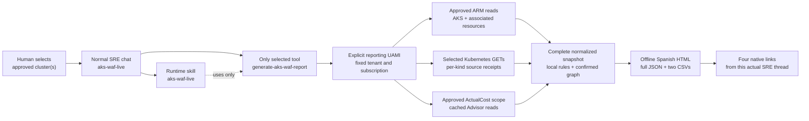

The tool collects fresh evidence, evaluates bounded local predicates and writes
the four complete files. The specialist explains that result; it does not
replace a failed read with old data, invoke another tool or change Azure.
HTML filters are **local**: they do not make another cloud call.

The assessment covers three levels, four areas and five WAF pillars:

| Level | Typical evidence |
|---|---|
| Cluster | Version, tier, identity, pools, scale, upgrades, network, maintenance and diagnostics |
| Workload | Deployments/StatefulSets/DaemonSets/Jobs/CronJobs, probes, requests/limits, replicas, PDB/HPA, admission, quotas and NetworkPolicy |
| Associated resources | Explicitly approved ACR/Key Vault/Storage/identities; referenced network resources; contextual node-resource-group assets; PV/PVC/service metadata |

The pinned AKS checklist has **112 source items**. There are **42 local rules
mapped to 36 distinct checklist IDs**; the other **76** questions remain
explicit architecture/intent reviews. A high local pass indicator does not make
those unevaluated questions disappear.

## Customer scope coverage and checklist limits

Use this matrix to agree what the existing reader can substantiate for
**AKS itself, its workloads and associated Storage, public/private Azure Load
Balancers and DNS**. It maps the requested areas to implemented local rules
and admitted fields, **not new live findings or permission to collect more**.
Rule IDs refer to the [local catalog](rules_catalog.json); exact paths are in
the [fixed Kubernetes GET list](engine.py#L447-L467) and
[associated-resource API whitelist](engine.py#L468-L483).

| Requested scope / area | Existing checks and collected configuration | Evidence prerequisite | Limits / still unassessed |
|---|---|---|---|
| AKS best practices and operations | `C11-C20`, `C22`: tier/SLA requirement, pool zones/state/taints, system/application placement, autoscaling, upgrade channels, regional version catalog, upgrade profile, diagnostic settings and maintenance windows | Approved managedCluster, agentPools, maintenance, diagnostic, regional-version and upgrade-profile ARM reads; `C14` also needs complete Nodes/Pods and exact pool-label joins | Intent-dependent absence is not automatically failure. ARM `Running`, configured diagnostics, an upgrade channel or multiple zones does not establish application availability, log delivery, completed upgrades or DR readiness. |
| Workload reliability and optimization | `W01-W05`, `N01`: CPU/memory requests, memory limits, readiness/liveness presence for identified serving containers, PDB selectors, HPA targets, desired/ready replicas and ResourceQuota. Startup-probe presence is retained as inventory, not a separate rule. | Current Deployments/StatefulSets/DaemonSets/Jobs/CronJobs; Services, PDBs, HPAs, Namespaces and ResourceQuotas as required by each join; confirmed per-workload requirements where applicability is unknown | Namespace filtering happens after fixed GET collection. Missing manifests are not zero workloads. Batch/system/zero-replica cases are qualified separately; probe presence, HPA configuration and desired replicas do not prove effective behavior. CPU limits are required only when explicitly agreed. |
| Cluster and workload security | `C01-C07`, `C09-C10`, `W06-W08`, `N02`: managed identity/Entra, RBAC/local-account/API-access options, OIDC/Workload ID, policy engine/addons, explicit Linux container privileges, image references, NetworkPolicy selection and Pod Security Admission `enforce` labels | Exact ARM cluster configuration plus authorized manifests, namespace labels and complete policy lists; explicit business requirements for conditional controls | Configuration is not effective least privilege, policy enforcement, use of Workload ID by every pod, image vulnerability scanning or Defender sensor/license/telemetry health. Windows is not evaluated by analogy with Linux controls. No secrets, image contents or runtime exploitation tests are collected. |
| Associated Storage | `R01`: PVC binding state with consumer/StorageClass context. `R03`: Storage-account HTTPS/minimum TLS. Inventory also retains PV/PVC capacity, CSI handles/approved attributes, reclaim/binding policy, selected StorageClass parameters, disk state/encryption/zones and Storage-account access flags. | Authorized PVC/Pod/PV/StorageClass GETs plus exact approved or observed-reference ARM resource reads. Azure Files account association requires observed CSI account/resource-group attributes matching an already collected account. | No Storage keys/share data, mount/read tests, IOPS/latency history, backup/restore proof or complete storage-resilience assessment. Access flags are admitted evidence, not additional automatic rules. A configured CSI driver or `Bound` PVC does not prove a working or recoverable mount. |
| Public Azure Load Balancer (ELB) and internal Load Balancer (ILB) | `R02`: Standard versus Basic SKU. Observed topology retains frontend public-IP/private-IP/subnet fields, probes, backend pools and rule references; Services retain type, selected Azure annotations, ports and `status.loadBalancer.ingress`. | Approved/referenced/node-RG ARM LB and public-IP details; current Services for a Service-to-frontend join. That join needs an exact observed ingress-IP match without a conflicting internal/public annotation. | ELB here is Azure public Load Balancer, not AWS. An annotation or resource name alone is not an observed mapping. Probe configuration is not backend health, traffic reachability, end-to-end ingress/TLS validation or an automatic review of every balancing setting. |
| DNS, IPAM and network context | `R06` explicitly records an unassessed DNS/IPAM review. Inventory retains cluster service/pod CIDR, DNS service IP, FQDN/private FQDN/private-DNS reference, VNet address space/DNS servers and whitelisted public/private DNS-zone metadata. | Exact ARM cluster and approved or directly referenced VNet/subnet/DNS-zone detail reads; a zone reference must be an actual resource ID to trigger a detail read | No DNS queries, record-set/VNet-link enumeration, CoreDNS configuration, resolver latency/failover tests, LocalDNS effectiveness or IP-exhaustion calculation. Successful zone inventory does **not** change `R06` to passed. |
| Other associated resources and network security | `R04`: Key Vault RBAC option. `R05`: explicit broad Internet-to-administrative-port NSG rules. Inventory/topology also admit ACR `loginServer`, matching workload image hosts, exact referenced identities and optional observed-kubelet-principal registry-role metadata. | Fixed approved resource IDs, direct-reference closure or the exact observed node resource group; whitelisted detail reads and separately permitted role-metadata reads when applicable | Node-RG membership is context, not ownership. No SecretProviderClass/vault mount, secret value, effective ACR pull, full IAM/ABAC decision or effective NSG traffic/priority analysis. Unsupported detail types and missing joins stay explicit, not invented dependencies. |
| FinOps and general optimization | `C08`, `C16`, `C21`, `F01-F04`: network/scaling/current-metric context, ActualCost/PreTaxCost ResourceId rows with actual currency/window/scope, cached exact-cluster Advisor recommendations and qualified current capacity-review candidates | Billing disabled unless separately approved: exact ARM-observed node-RG query or subscription query filtered to approved observed IDs; separate Cost Management authorization. Current metrics need authorized `metrics.k8s.io` Nodes/Pods and timestamp/window/denominator evidence. | `F01-F03` remain unassessed for workload cost allocation, historical right-sizing and Spot/commitment eligibility. Current CPU samples are not monthly utilization; requests are not consumption; no guaranteed savings, price/reservation model, deletion or paid-plan activation is inferred. |

**Reference mapping is not full control coverage.** The pinned Microsoft
checklist has 112 items; the 42 local rules reference 36 distinct IDs, and
the remaining 76 are emitted as architecture/intent questions with
`not_evaluated`. Multiple rules can share an ID and expand over observed
resources, so neither number is the denominator of a report's check coverage.
Some mappings are deliberately narrower local adaptations: `R01` checks
binding, not the whole upstream LRS/ZRS/zonal-storage design; `R03` checks
HTTPS/TLS, not the upstream private-endpoint recommendation. A mapped ID
must not be presented as a fully automated upstream control.

The [pinned checklist and current-guide provenance](#references-and-licensing)
are retained alongside Kubernetes links for resources, probes, PDBs, HPA,
Pod Security and NetworkPolicy in the catalog. Legacy checklist snippets are
not executed. Microsoft guidance and agreed workload requirements qualify
the interpretation; this is not official WAF certification or a general
Kubernetes security scan.

For acceptance, inspect the source receipts for **each selected cluster**
before interpreting its checks. An HTTP 403/502, partial list, missing
manifest or stopped cluster leaves the affected scope unknown; successful
ARM/billing reads or four downloaded files cannot fill that gap. The
[four read boundaries](#step-0---identify-the-reporting-identity-and-approve-scope)
remain separate, and the stopped cluster is never started to complete a demo.

## Setup steps (guide order)

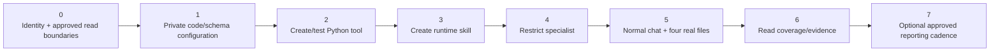

These numbers match the guide headings, not runtime execution order.
For each step, use its **Checkpoint** before continuing. Source-partial
delivery can be demonstrated honestly without claiming full Kubernetes
acceptance; no branch in this setup authorizes IAM, a paid cluster or recovery.

## Prerequisites

Before opening Builder, confirm these separately:

| Requirement | Why it matters |
|---|---|
| An existing Azure SRE Agent and an approved AKS scope | This guide does not deploy a new SRE Agent or AKS cluster |
| **SRE Agent Author + SRE Agent Standard User** on the **SRE Agent resource** | Authoring and chat are different data actions; **SRE Agent Administrator** is the full-management alternative |
| The reporting agent's **user-assigned managed identity Client ID** | The Python code uses that exact UAMI, not your browser identity, Object ID or cached Azure CLI login |
| Fixed tenant/subscription and one to five approved cluster names/resource groups | Requests cannot expand the allowlist or discover the subscription |
| An authorized operator who can verify each source read | Reader, clusterUser credentials, Kubernetes data reads and billing access are separate boundaries |
| A private working copy and a browser | Configured source, real snapshots and customer logos must remain outside Git |

**Builder is a UI label, not a role.** Azure Owner/Contributor are not
substitutes for the SRE Agent data-action roles. The actual screenshots may
show the portal's broad RBAC warning: do not select **Assign yourself the SRE
Agent Admin role** just to match a screenshot. Have an authorized administrator
verify the exact human roles separately.

Read-only is not free: SRE/model/runtime execution, telemetry and Azure service
charges may apply. A new demo cluster, new power-scheduling identity, role
assignment or paid service needs its own explicit budget/access approval.

## Files to download

Open a file link and use **Download raw file** in GitHub. Access to this private
repository is still required. Each deployment step repeats its relevant links
so you do not have to scroll back here.

| File | Use |
|---|---|
| [`generate-aks-waf-report.py`](generate-aks-waf-report.py) | Canonical **whole-file paste** into the Python tool; configure only a private copy |
| [`tool-parameters.schema.json`](tool-parameters.schema.json) | Exact typed inputs, defaults, enums, bounds and mutually exclusive selectors |
| [`requirements.txt`](requirements.txt) | Declared runtime dependencies; optional Pillow is needed only for a configured raster logo |
| [`skills/aks-waf-live/SKILL.md`](skills/aks-waf-live/SKILL.md) | Separate SRE runtime skill, not the repository's authoring skill |
| [`subagent-instructions-and-prompts.md`](subagent-instructions-and-prompts.md) | Restricted specialist instructions and copy-ready report/query prompts |
| [`report_template.html`](report_template.html) | Development source for the offline UI; **do not paste it as a Python tool** |
| [`rules_catalog.json`](rules_catalog.json) and [`references/`](references/) | Source-qualified local-rule mappings, pinned checklist and licenses |

## Step 0 - Identify the reporting identity and approve scope

1. In [Azure SRE Agent](https://sre.azure.com), open the approved agent. Open
   **Settings > Azure settings > Managed Identity > Go to Identity**, or find
   the attached user-assigned identity in the agent's Azure resource group.
   Older **Settings > Basics** screenshots are historical label variants.
2. On the identity's Azure portal **Overview**, copy **Client ID**. Do not copy
   **Object (principal) ID** into code: they are different GUIDs. Record the
   principal separately for source RBAC checks, and do not select the internal
   system-assigned identity or the cluster's kubelet identity as the reporter.
3. Record the approved tenant, subscription, exact AKS names/resource groups
   and environment. Keep that record privately.
4. Ask the authorized operator to verify the following **four read boundaries**
   with the reporting UAMI. Do not grant broader access to improve a score.

| Boundary | Required permission/read check |
|---|---|
| Approved ARM resources | Reader or verified approved equivalent on AKS, its agent pools/maintenance/diagnostics, exact associated resources and optional node-RG inventory. Regional Kubernetes-version and filtered cached Advisor reads use subscription-level provider endpoints; resource-only Reader is not proof that those are authorized. No subscription inventory discovery is performed. |
| clusterUser server/CA | Azure Kubernetes Service Cluster User Role on the exact managed-Entra cluster; Reader alone does not grant `listClusterUserCredential/action` |
| Kubernetes configuration | Customer-approved Kubernetes / Azure AKS RBAC **data reads** for the fixed GET lists below. AKS RBAC Reader is not Cluster Admin and can exclude Nodes/PVs/StorageClasses; an ARM Reader/clusterUser grant does not grant these data reads. |
| Billing evidence | Applicable Cost Management query/data-read authorization on the **actual query scope**. `node_resource_group` queries that exact observed group; `resource_ids` uses a subscription-level query with a fixed approved-ID filter. Resource Reader on one selected ID does not prove billing-query authorization. 429 is throttling, not denial. |

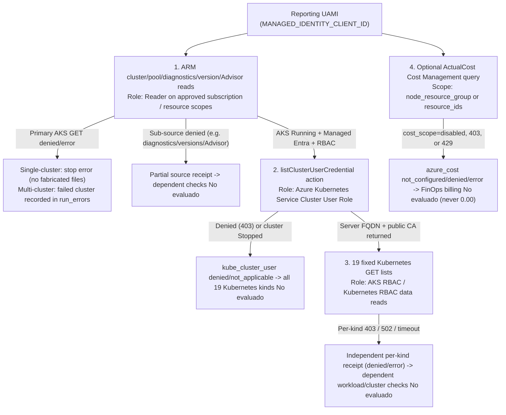

| Read boundary | Exact API / operation | Required role & scope | Outcome if missing, denied or unreachable (`No evaluado` vs stop error) |
|---|---|---|---|
| **1. ARM cluster/pool/diagnostics/version/Advisor reads** | ARM `GET` on `managedClusters`, `agentPools`, `maintenanceConfigurations`, `diagnosticSettings`, `upgradeProfiles`, subscription regional `orchestrators` and filtered cached `Advisor/recommendations` | **Reader** (or verified equivalent) on the monitored subscription or exact cluster, node-RG and approved related resources | Primary `arm_cluster` / `arm_node_pools` failure stops a single-cluster run with a sanitized error (or records the cluster in `run_errors` in a multi-cluster run); optional ARM sub-source denials record `denied`/`error` and leave only dependent rules **`No evaluado`** |
| **2. `listClusterUserCredential` action** | ARM `POST .../managedClusters/<name>/listClusterUserCredential` (extracts server FQDN + public CA only; never admin credentials) | **Azure Kubernetes Service Cluster User Role** on each approved AKS resource (ARM `Reader` alone does **not** grant this `POST` action) | `kube_cluster_user` is recorded as `denied` (or `not_applicable` when the cluster is `Stopped`); all 19 Kubernetes data-plane lists and workload checks remain **`No evaluado`**, while ARM/billing evidence still delivers |
| **3. 19 fixed Kubernetes GET lists** | 19 HTTPS `GET` lists against the cluster API server (`namespaces`, `nodes`, `pods`, `services`, `pvcs`, `pvs`, `resource_quotas`, `deployments`, `statefulsets`, `daemonsets`, `replicasets`, `jobs`, `cronjobs`, `pdbs`, `hpas`, `network_policies`, `storage_classes`, `node_metrics`, `pod_metrics`) | **Azure Kubernetes Service RBAC Reader** + cluster-scoped `nodes`/`persistentvolumes`/`storageclasses`/`metrics.k8s.io` read binding (or equivalent Kubernetes RBAC `get`/`list`) | Each failed or forbidden kind records its own `403`/`502` receipt independently; successful kinds are retained and only rules depending on unavailable kinds become **`No evaluado`** (never zero workloads) |
| **4. Optional `ActualCost` Cost Management query** | ARM `POST .../providers/Microsoft.CostManagement/query` on `node_resource_group` or subscription `resource_ids` filter | **Cost Management Reader** (or `Microsoft.CostManagement/query/action`) on the exact queried `node_resource_group` or subscription scope | When `cost_scope="disabled"`, denied (`403`) or throttled (`429`), `azure_cost` is `not_configured`/`denied`/`error` and FinOps cost/savings stay **`No evaluado` / `Por estimar`** (never `$0`) |

Cached Advisor reads remain filtered to the approved AKS ResourceId. ACR role
metadata, when configured, is restricted to the observed kubelet principal and
already approved registry scopes; an assignment is **not** verified effective
pull permission.

The code reads **configuration**, not Key Vault secret values, Storage keys,
ACR image contents or Log Analytics tables. Diagnostic settings are ARM
configuration receipts, not log ingestion/history. Do not add Key Vault/
Storage data roles, Graph grants or workspace access without another scoped
requirement. The clusterUser and ActualCost operations use bounded **POST
read requests**; only the Kubernetes data-plane adapter is GET-only.

### Exact Kubernetes data-read scope

| Fixed source group | Lists requested by this implementation |
|---|---|
| Core | Namespaces, Nodes, Pods, Services, PVCs, PVs, ResourceQuotas |
| Workloads | Deployments, StatefulSets, DaemonSets, ReplicaSets, Jobs, CronJobs |
| Policy/scale/storage | PodDisruptionBudgets, HorizontalPodAutoscalers, NetworkPolicies, StorageClasses |
| Current metrics | `metrics.k8s.io/v1beta1` Nodes and Pods; current samples, not historical utilization |

That is **19 independent GET sources**, with per-kind receipts. Namespace and
workload selectors filter **locally after collection**; they do not change
these all-namespace/cluster-scoped endpoints. A namespace-only grant does not
magically make an all-namespace list succeed. Have the customer's access team
verify its actual authorization mode and explicitly permitted reads; this
guide supplies no guessed universal minimum custom role and no Cluster Admin
shortcut. Keep unavailable kinds **No evaluado**.

### Customer administrator's assignment procedure

Inspect existing direct/inherited rights first. Only if missing access has
been approved:

1. For **human setup/chat/task roles**, open the actual **SRE Agent Azure
   resource > Access control (IAM) > Add > Add role assignment**, choose the
   approved Author/Standard User role, then **Members > User, group, or service
   principal > Select members**. Select the implementer/group, not the UAMI.
2. For approved **Azure source roles**, open the exact approved subscription,
   cluster, related-resource or billing scope. Choose the precise approved
   role, then **Members > Managed identity > Select members > User-assigned
   managed identity**. In the selector, find the attached reporting UAMI in
   its **SRE-hosting subscription** and verify its **Object (principal) ID**.
   That selection does not change the destination scope.
3. Review tenant, scope, role, principal and duration. Only an authorized
   customer administrator with applicable
   `Microsoft.Authorization/roleAssignments/write` authority, such as Role Based Access
   Control Administrator/User Access Administrator, uses **Review + assign**.
   Managed identities cannot activate eligible PIM assignments; approve
   appropriate active access rather than assume eligibility works at runtime.
4. Kubernetes-native bindings, if that is the cluster's authorization design,
   are a separate access-team action. No binding, IAM or consent is performed
   by following this guide. Verify each required read after normal propagation;
   a successful ARM read cannot stand in for the other three boundaries.

> [!WARNING]
> Never use `--admin`, OBO, another identity, insecure TLS, an alternate
> endpoint/proxy, `az aks command invoke`, exec or port-forward to bypass a denied
> source. Missing evidence must remain **No evaluado**.

**Checkpoint:** the four boundaries are recorded independently. A successful
ARM read is not proof that Kubernetes or Cost Management reads work.

## Step 1 - Configure the private standalone file

**Download here:** [`generate-aks-waf-report.py`](generate-aks-waf-report.py),
[`tool-parameters.schema.json`](tool-parameters.schema.json) and
[`requirements.txt`](requirements.txt).

1. Save the canonical Python file **outside the repository**.
2. Replace `SUBSCRIPTION_ID`, `TENANT_ID` and `MANAGED_IDENTITY_CLIENT_ID` with
   the approved values. Use the UAMI **Client ID** from Step 0.
3. Set `CLIENT_NAME`; the generic source default is `CLIENTE`. Documentation images use
   the exact privacy replacement **client NAME**, not real customer branding.
4. Configure `APPROVED_CLUSTERS` with the exact approved names and resource
   groups. Its order defines the legacy empty-selector default.

```python
SUBSCRIPTION_ID = "<YOUR_SUBSCRIPTION_ID>"
TENANT_ID = "<YOUR_TENANT_ID>"
MANAGED_IDENTITY_CLIENT_ID = "<YOUR_AGENT_CLIENT_ID>"
CLIENT_NAME = "CLIENTE"
CLIENT_LOGO_DATA_URI = ""
CLIENT_LOGO_ALT = "Logotipo autorizado del cliente"
APPROVED_CLUSTERS = {
    "<APPROVED_AKS_NAME>": {
        "resource_group": "<APPROVED_AKS_RESOURCE_GROUP>",
        "environment": "UNSPECIFIED",
        "kubernetes_enabled": True,
        "include_node_resource_group": True,
        "advisor_enabled": True,
        "approved_related_resource_ids": [],
        "approved_cost_resource_ids": [],
        "cost_scope": "disabled",
        "cost_timeframe": "month_to_date",
        "requirements": {}
    }
}
```

5. Add associated resource IDs only after exact scope approval. A similarly
   named resource group is not proof of ownership. Actual `nodeResourceGroup`
   membership is contextual inventory, not an orphan/ownership assertion.
6. Keep cost disabled until its scope/access is approved. Then use
   `cost_scope="node_resource_group"` for the exact group returned by ARM, or
   `cost_scope="resource_ids"` for fixed approved billing IDs that are present
   in approved inventory. MonthToDate is the default; `last_30_days` is a
   separate explicit Custom/Daily billing window.
7. Set business requirements only when agreed: SLA, zones, autoscaling,
   network policy, CPU limits and per-workload requirements. Empty
   `requirements={}` means **unknown**, not "apply every recommendation".

The canonical defaults above are not a customer configuration. Replace cluster
and resource-group placeholders, set `environment` only to confirmed `LAB`,
`PRODUCTION` or `UNSPECIFIED`, and keep boolean source flags deliberate.
`CLIENT_NAME` is 1..120 plain characters. The fixed global identity/tenant/
subscription and each approved cluster/resource ID are not chat overrides.
Privately update `cluster_name.enum` in the linked schema to `""` plus the
**same exact approved names** as `APPROVED_CLUSTERS`; preserve all other
types/defaults/bounds. There is no `period` or arbitrary snapshot-path input.

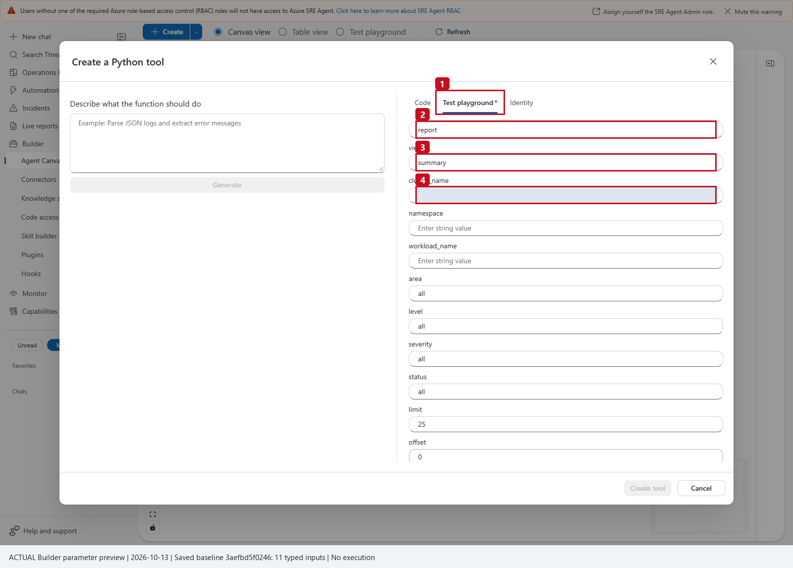

**1** opens the real Test playground; **2** is `report`, **3** is `summary`,
and **4** is the exact fixed cluster name, privacy-masked in the image. This
is an **unsaved preview of the verified 11-input deployment baseline**, not a
new execution or proof of the newer multi-cluster deployment.

**Checkpoint:** the code and the schema contain the **same fixed allowlist**.
Unreplaced placeholders must fail before authentication.

### Side-by-side synchronization example (structural only — NOT paste-ready)

Whenever you configure `APPROVED_CLUSTERS` in your private copy of
`generate-aks-waf-report.py`, update `properties.cluster_name.enum` in your
private copy of `tool-parameters.schema.json` to contain `""` followed by the
**exact same cluster keys**. For multi-cluster runs, pass `cluster_names` as
comma-separated names with **no spaces** (for example `"aks-prod-01,aks-prod-02"`),
and leave `cluster_name=""`.

> [!WARNING]
> **Structural overview only — NOT paste-ready Python:** The `APPROVED_CLUSTERS` column below uses `...` to abbreviate the remaining per-cluster dictionary keys (`kubernetes_enabled`, `include_node_resource_group`, `advisor_enabled`, `approved_related_resource_ids`, `approved_cost_resource_ids`, `cost_scope`, `cost_timeframe`, `requirements`). Do **not** paste `...` into `generate-aks-waf-report.py`; copy and duplicate the **complete 10-field cluster configuration block** shown in the preceding Step 1 code example above.

| Scenario | Private `generate-aks-waf-report.py` (`APPROVED_CLUSTERS` — structural only, see full block above) | Private `tool-parameters.schema.json` (`cluster_name.enum`) | Valid runtime selector call |
|---|---|---|---|
| **Single cluster** (`aks-prod-01`) | `APPROVED_CLUSTERS = {"aks-prod-01": {"resource_group": "rg-aks-prod-01", "environment": "PRODUCTION", ...}}` *(abbreviated; use full 10-key dict above)* | `"enum": ["", "aks-prod-01"]` | `{"operation":"report","cluster_name":"aks-prod-01"}` (or `cluster_name=""` for the first key) |
| **Two clusters** (`aks-prod-01`, `aks-prod-02`) | `APPROVED_CLUSTERS = {"aks-prod-01": {"resource_group": "rg-aks-prod-01", ...}, "aks-prod-02": {"resource_group": "rg-aks-prod-02", ...}}` *(abbreviated; use full 10-key dict above)* | `"enum": ["", "aks-prod-01", "aks-prod-02"]` | Single: `{"operation":"report","cluster_name":"aks-prod-02"}`<br/>Combined (no spaces): `{"operation":"report","cluster_names":"aks-prod-01,aks-prod-02"}` |

### Optional private branding

Use only an explicitly authorized inline PNG/JPEG. The engine verifies a
genuine raster with Pillow, then reopens/loads it; MIME/base64 text alone is not
enough. Limits are 100,000 raster bytes, 2,048 pixels per dimension and one
frame. Set descriptive `CLIENT_LOGO_ALT` text (1..120 characters).
Remote URLs, corrupt/truncated images and animated/oversized rasters are
rejected before source collection. Keep the configured logo and source private.

For an approved PNG, this **local** command emits short Python string chunks.
It checks bytes; the engine performs genuine raster/MIME/dimension validation:

```powershell
python -c "import base64, sys, textwrap; from pathlib import Path; b = Path(r'C:\path\company-logo.png').read_bytes(); 0 < len(b) <= 100000 or sys.exit('Use a logo of 1 to 100000 bytes'); u = 'data:image/png;base64,' + base64.b64encode(b).decode('ascii'); print('CLIENT_LOGO_DATA_URI = (\n' + '\n'.join('    ' + repr(s) for s in textwrap.wrap(u, 88)) + '\n)')"
```

For JPEG, use `data:image/jpeg;base64,`. Replace only the empty
`CLIENT_LOGO_DATA_URI` assignment in the private deployment copy with the
generated block and set descriptive `CLIENT_LOGO_ALT`. Leave it empty for the
default generic design. Do not change the evidence, colors, score/coverage,
source dates or file-delivery contract to add branding.

## Step 2 - Create the Python tool and verify its inputs

**Download here:** [`generate-aks-waf-report.py`](generate-aks-waf-report.py),
[`tool-parameters.schema.json`](tool-parameters.schema.json).

1. Open **Builder > Agent Canvas**.
2. Open the arrow beside **Create**, then **Tool > Python tool**.
3. Select **Code**. Set the tool name to **`generate-aks-waf-report`**, enter a
   clear read-only description and paste the **entire privately configured
   canonical Python file**. Do not select Generate, paste a fragment, or paste
   unbuilt `engine.py`.
4. Use the approved timeout. The verified deployment used **900 seconds**;
   the collector's separate shared budget bounds new reads to 240 seconds /
   300 HTTP attempts across selected clusters, with a bounded in-flight read
   allowed to finish.

Copy-ready **Description**:

```text
Read-only AKS architecture/configuration review for the fixed approved
clusters and associated resources. Collect source-qualified ARM, Kubernetes
and optional ActualCost evidence; return offline HTML, complete JSON,
failed-findings CSV and inventory CSV, or bounded typed queries. No remediation.
```

Ensure the approved runtime supplies
[`requirements.txt`](requirements.txt): **`azure-identity>=1.19,<2`**,
**`PyYAML>=6.0.2,<7`**, and **`Pillow>=12.2,<13`** only when a logo is configured.
HTTP/TLS uses Python's standard library. The reporting tool does not require
your local Azure CLI/kubectl login or an operator kubeconfig file, and it has
no fallback to those identities. Do not add a package-install/shell tool to
the specialist to solve a runtime import error.

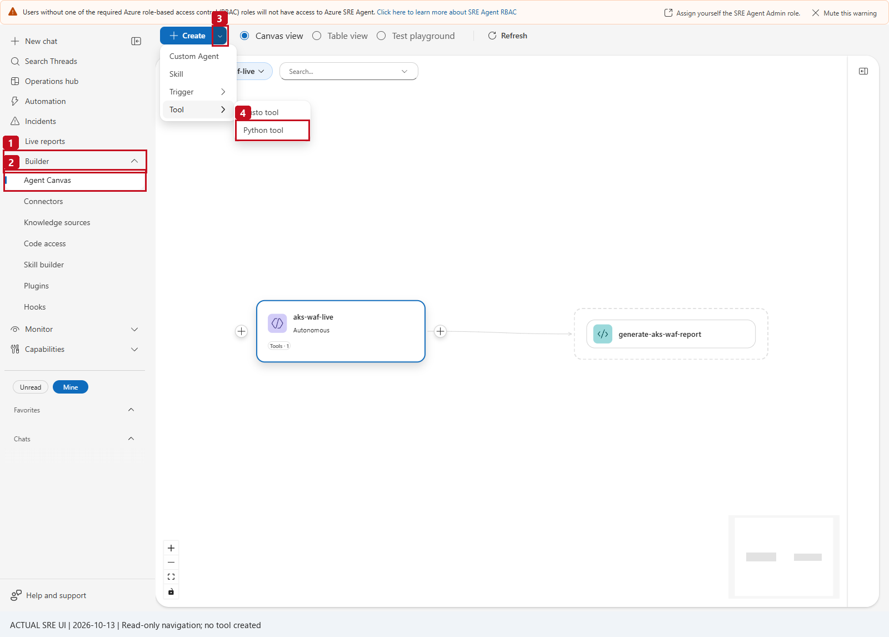

**1-2** identify Builder and Agent Canvas; **3** is the Create arrow and
**4** the Python tool entry. This is the real portal, not a recreated diagram.


**1** is the exact tool name, **2** the Code tab and **3** the whole-file editor.
The private configured source is deliberately obscured; the real dialog and
controls remain visible. This capture previews the read-back baseline
`3aefbd5f0246...`; **Create tool/Test was not clicked during capture**.

### Verify the current typed schema

The current package has **12 inputs**. The dated portal baseline had 11;
`cluster_names` and the added operations/views must be deployed and read back,
not inferred from an older screenshot.

| Input | Type / default | What to enter |
|---|---|---|
| `operation` | string / `report` | `report`, `query`, or `list_clusters` |
| `view` | string / `summary` | `summary`, `cluster`, `node_pools`, `workloads`, `resources`, `findings`, `finops`, `coverage`, `actions`, `architecture` |
| `cluster_name` | string / `""` | One exact fixed name; empty selects the first configured cluster |
| `cluster_names` | string / `""` | One to five distinct comma-separated fixed names, **no spaces**, maximum 319 characters |
| `namespace` | string / `""` | Exact local name, maximum 63 characters; not a server-side scope override |
| `workload_name` | string / `""` | Exact local name, maximum 253 characters |
| `area` | string / `all` | `all`, `best_practices`, `security`, `finops`, `optimization` |
| `level` | string / `all` | `all`, `cluster`, `workload`, `resource` |
| `severity` | string / `all` | `all`, `critical`, `high`, `medium`, `low` |
| `status` | string / `all` | Findings/actions: `passed`, `failed`, `not_evaluated`, `not_applicable`; coverage: `complete`, `partial`, `denied`, `error`, `not_configured`, `not_applicable`; incompatible combinations are rejected |
| `limit` | `integer` (schema), `int` (Python) / `25` | 1..100; the transport budget can return fewer **whole** rows |
| `offset` | `integer` (schema), `int` (Python) / `0` | 0..500000 within this fresh collection, not a persistent cursor |

**Editor type mapping:** keep standard JSON Schema **`integer`** in the file.
In a row-based SRE parameter editor that uses Python/runtime type labels,
select **`int`** for `limit` and `offset`. Supply numeric JSON values such as
`25` and `0`, not quoted strings; do not rewrite the schema type to `int`.

Do not supply both selectors. For `report`, leave `view=summary`, filters empty/
`all`, `limit=25`, `offset=0`; otherwise the report is rejected instead of
quietly narrowed. `list_clusters` accepts no selector/filter overrides and
returns fixed configuration metadata **without authentication or network**.

For queries, `area`/`level`/`severity` apply only to findings/actions.
Summary/cluster/node_pools/coverage/architecture reject namespace/workload
filters; `status` belongs only to findings/actions or coverage. Booleans and
floats are not integers. Query calls recollect: `next_offset` is not a stable
cursor into the last downloaded report. A filtered page is not its exact total.

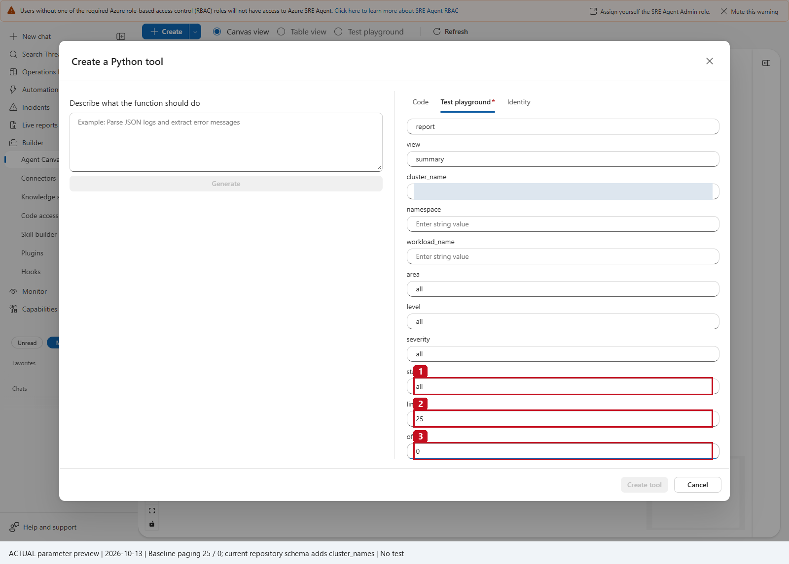

**1** shows `status=all`; **2-3** show integer paging defaults **25 / 0**.
This real 11-input preview was not run. Use the linked current schema for all
12 inputs, exact enums, defaults and bounds; read them back after saving.

### Identity tab: preserve the actual authentication design

The verified Case 04 tool has **`authEnabled=false`, `authScopes=null`**:
the portal's Identity preset is **Off**. Authentication happens in Python
through `ManagedIdentityCredential` with the fixed UAMI Client ID and fixed
tenant/subscription. That is not DefaultAzureCredential, your browser account,
an Azure CLI login or an alternate-identity fallback.


**1** is the Identity tab; **2** is the actual Off switch. Do not enable broad
Key Vault/Storage/token presets simply to resemble another case. Step 0's
four read boundaries still require explicit approval and verification.

5. In Test playground, enter an explicit approved cluster and report defaults.
   An authorized operator tests the code before creation. If a source fails,
   inspect the sanitized error and its **No evaluado** result; do not broaden
   access or fabricate a smaller successful scope.
6. Select **Create tool** only after the approved test. Reopen/read back the
   saved source hash, parameter definitions, identity setting and timeout.

**Checkpoint:** the saved tool is Python, its code matches the configured
whole-file hash, and every current input/default/enum/bound is correct. Merely
opening or filling a Builder dialog is not deployment evidence.

## Step 3 - Create the runtime skill

**Download here:** [`skills/aks-waf-live/SKILL.md`](skills/aks-waf-live/SKILL.md).

1. In **Builder > Agent Canvas**, select **Create > Skill**.
2. Use the name **`aks-waf-live`**.
3. Use a description such as `Read-only AKS evidence review for the fixed
   approved cluster scope; preserve source coverage and deliver actual files.`
   Copy/upload the complete runtime `SKILL.md` into the skill body. Preserve
   portal-generated name/description/tool front matter if present, replacing
   its body placeholder with the reviewed content.
4. Attach **only `generate-aks-waf-report`**, save through the approved process
   and reopen the skill.
5. Confirm both its actual file and attached tool.


**1** is the Skills tab; **2** is the single attached report tool; **3** is the
saved `SKILL.md`. This is actual saved-component readback, not an empty form.

[Full-resolution Python creation menu](images/aks04-step02-01-python-menu.png) ·
[Saved skill](images/aks04-step03-skill-readback.png).
These images identify real controls/readback; they do not replace the
creation steps for the customer's new objects.

**Checkpoint:** the runtime skill exists with its complete restrictions and
one attached tool. It cannot grant roles, run shell commands or remediate.

## Step 4 - Create the restricted specialist

**Download here:** [`subagent-instructions-and-prompts.md`](subagent-instructions-and-prompts.md)
and [`skills/aks-waf-live/SKILL.md`](skills/aks-waf-live/SKILL.md).

1. In **Builder > Agent Canvas**, select **Create > Custom Agent**.
2. Name it **`aks-waf-live`** and copy the complete restricted instructions.
3. In **Choose tools**, select **exactly one**:
   `generate-aks-waf-report`. Do not leave the picker empty: an empty selection
   can inherit global tools.
4. Enable skills and allow **only `aks-waf-live`**. Do not add system skills,
   other agents, connectors, shell/exec/write tools, handoffs or knowledge
   retrieval that could expand this scenario.
5. Save through the approved process, reopen the actual specialist and verify
   its selected tools/skills rather than trusting the creation form.


**1** is Sub Agents; **2** is **Tools · 1**; **3** is the exact selected Python
tool; **4** shows the allowed runtime skill. The existing global tools are not
changed by this specialist.

**Checkpoint:** one specialist, one runtime skill, one selected tool, no
remediation authority. The HTML reference design does not give it deployment
permission.

> [!NOTE]
> **Dated SRE UI badge caveat:** While the captured detail panel above shows `Tools · 1`, the live Agent Canvas list/card summary badges can display inherited global rollups (for example, `131 tools` / `52 skills`) even when both native APIs, selected chips and the saved form policy enforce one explicit tool and skill (`tools`, `allowedSkills`, `addSystemSkills=false`, `disableDocumentRetrieval=true`). Always verify the exact selected tool and skill **names** in the saved form and effective supported policy; the list summary badge is not authoritative restriction proof, and you must not modify globals to change it.

## Step 5 - Run one report in normal chat and download its files

**Copy-ready prompts here:** [`subagent-instructions-and-prompts.md`](subagent-instructions-and-prompts.md).

1. Open **New chat** in the approved SRE Agent.
2. Type **`/agent`** and select **`aks-waf-live`**. The deployment baseline also
   used the named specialist via `@aks-waf-live`; confirm the selected agent in
   your portal version rather than assuming a plain mention selects it.
3. Ask for the fixed roster first when needed:

   ```json
   {"operation":"list_clusters"}
   ```

   A roster is configured scope, not proof of presence/health.
4. Choose an exact approved cluster. Ask for one complete report, for example:

   ```text
   Generate the complete read-only AKS configuration review for
   <APPROVED_AKS_NAME>. Use operation=report once, include all three levels,
   four areas and five WAF pillars, and immediately deliver the HTML,
   complete JSON, findings CSV and inventory CSV. Show score and coverage
   together, preserve No evaluado/No aplica and source errors. Change nothing.
   ```

   ```json
   {"operation":"report","cluster_name":"<APPROVED_AKS_NAME>"}
   ```

   For the current multi-cluster package, explicitly choose the fixed names:

   ```json
   {"operation":"report","cluster_names":"<APPROVED_AKS_NAME>,<APPROVED_SECOND_AKS_NAME>"}
   ```

5. Wait for **four native links/file widgets in the same response**. Partial
   sources must not suppress the real files.
6. Download **all four**. Opening an HTML link does not verify the JSON/CSV
   downloads or their source coverage.

The dated **2026-10-13T18:17:15Z** baseline has actual ordinary-chat and four
HTTP 200 download receipts, without a manual publication step. The corrected
fresh combined run has independent source references **2026-10-14T09:25:00Z**
and **09:26:26Z**, four automatic native URLs and verified HTTP 200 downloads.
The earlier 08:56 run with its UI startup failure remains retained as a failed
UI receipt. No missing chat screenshot is substituted with a recreated or
synthetic conversation.
Source failure and file delivery are separate: files can be real while
Kubernetes is unavailable.

| Returned file | Keep it for |
|---|---|
| HTML (`report_path` / `report_url` when native) | Offline report, local filters, confirmed/reference architecture, print/PDF |
| JSON (`snapshot_path` / `snapshot_url` when native) | Entire normalized model, source receipts, extra admitted metadata and multi-cluster outcomes |
| Findings CSV (`findings_csv_path` / `findings_csv_url` when native) | **Failed checks only**, with full `details_json`, evidence and references |
| Inventory CSV (`inventory_csv_path` / `inventory_csv_url` when native) | All canonical inventory records with full `details_json`, source and UTC |

Use provided native aliases unchanged when `sharing_mode=native_ui`.
`artifact_status=written` is file creation; `http_verified=false` means the
Python tool did not fetch the UI endpoint and must not hide returned aliases.
Outside recognized guarded ThreadFiles roots, `local_files_only` returns real
paths, not invented download URLs. A source-partial report and a broken
download are different failures.

For a **separate** English follow-up, keep the same selected specialist:

```text
For <APPROVED_AKS_NAME>, use query/coverage once. Show the failed or partial
source receipts, their UTC reference and HTTP/error codes, and explain which
checks cannot be evaluated. A successful download is not Kubernetes recovery;
do not substitute historical workloads, grant roles or start a cluster.
```

```json
{"operation":"query","view":"coverage","cluster_name":"<APPROVED_AKS_NAME>","limit":5}
```

Read `total_matched`, `returned`, `has_more`, `next_offset` and
`transport_capped`. Use the complete JSON for exhaustive evidence; do not page
merely to discover totals already returned. No follow-up is hidden inside the
report call or its scheduled run.

Spanish (ES) copy-ready equivalents for the normal-chat report and coverage
follow-up above (matching [`subagent-instructions-and-prompts.md`](subagent-instructions-and-prompts.md)):

- **Single-cluster full report (ES):**

```text
@aks-waf-live Genera la revision de configuracion de AKS para
<APPROVED_AKS_NAME> con operation=report. Cubre cluster, workloads y recursos
asociados: buenas practicas, seguridad, FinOps y optimizacion, con los cinco
pilares WAF. Entrega HTML, JSON completo, CSV de hallazgos y CSV de inventario.
Muestra cobertura, fuentes, No evaluado/No aplica y limites. No cambies nada.
```

- **Source coverage follow-up (ES):**

```text
@aks-waf-live Usa query/coverage para <APPROVED_AKS_NAME>. Que fuentes
fallaron o fueron parciales, con que codigo HTTP y que campos no podemos
evaluar? Un 502/429 no es permiso denegado, y un 403 no significa cero objetos.
```

**Checkpoint:** four actual downloads; matching run/reference time; complete
normalized JSON; source errors visible; no historic workloads silently
substituted for an unavailable fresh read.

## Step 6 - Read and explore the HTML report

Open the **downloaded HTML** in Edge or another current browser. It needs local
JavaScript but has no external scripts, fonts, analytics or fetches. Keep the
JSON beside it privately; the HTML already embeds the complete model.

### Start with identity, date and coverage

1. Read the cover: client, cluster, environment, **LIVE/SIMULATED** provenance
   and UTC reference are different facts.
2. Open **Resumen ejecutivo**. Read the local index **beside** coverage.
3. Use the chart's table to distinguish **Superadas**, **Con hallazgo**,
   **No evaluadas** and **No aplicables**. Its centre is a count, not a health
   grade. Unknowns are neutral, never green.

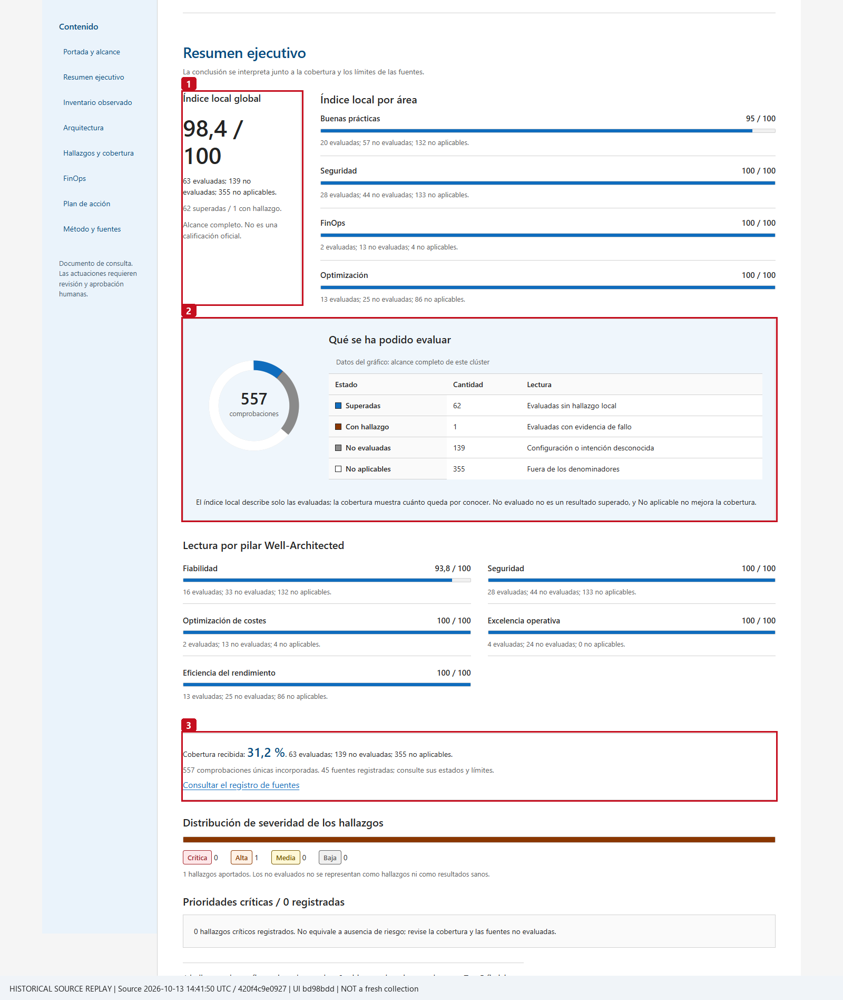

The local index is `100 × passed / (passed + failed)`. Coverage is
`100 × evaluated / (evaluated + not_evaluated)`; N/A is excluded. No evaluated
checks means `null` / **No evaluado**. Read the caption's source time: replay
is not a fresh collection and an earlier high pass indicator is not recovery.

### Follow namespace, workload and resource evidence

1. Under **Explorar el alcance**, select a namespace.
2. Select the workload. The UI uses its Kubernetes UID, or namespace/kind/name
   when UID is unavailable; it does not mix workloads through the cluster's
   shared ARM parent ID.
3. Open the inventory and finding receipts. Compare actual source, UTC, value,
   desired/ready replicas and conditional applicability.
4. Reset filters to return to the whole selected cluster. Global/area/pillar
   scores remain the supplied whole-snapshot values; filters do not improve
   the score.

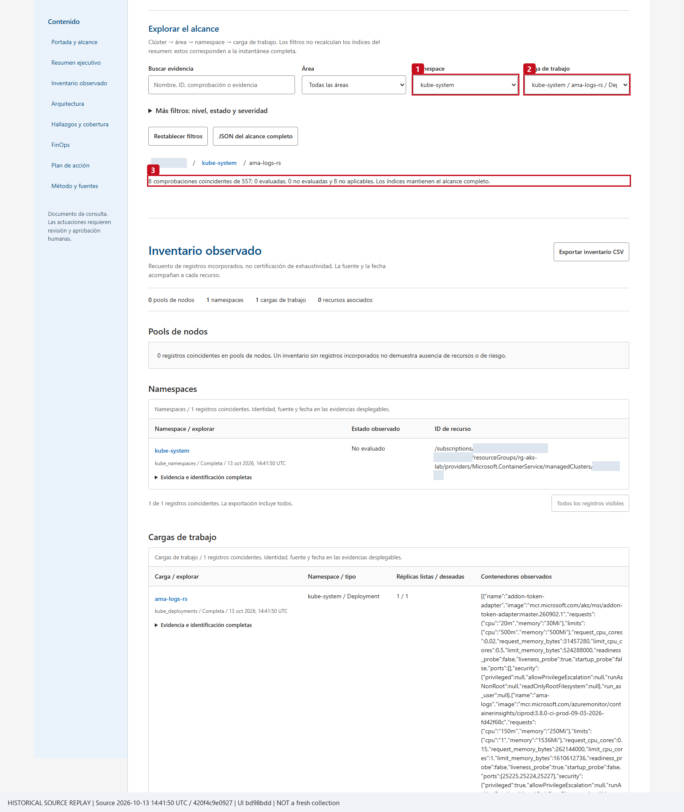

When current Kubernetes reads are unavailable there are no current manifest
records to drill into. This dated historical example demonstrates the actual
controls; it must not be merged into the fresh HTTP 502 snapshot.

### Inspect observed architecture, then the undeployed proposal

1. Open **Arquitectura > Arquitectura observada**.
2. Use **Tipo de recurso** and **Recurso / objeto observado**, or the grouped
   resource tree. Inspect real ARM IDs and Kubernetes identities.
3. Open node/edge receipts to see exact join fields and sources. A service
   annotation alone is intent, not an observed LB mapping. Public/private
   frontend/IP evidence qualifies **ELB/ILB**; ELB means **Azure public Load
   Balancer**, not AWS.
4. Check **Relaciones no evaluadas**. An unavailable kind or missing exact join
   is not an invented edge.


The illustration shows a bounded neighbourhood (at most thirteen nodes) and
its visible/total counts. Complete node/edge/unknown tables and JSON retain all
records. On a phone, scroll the diagram locally; do not interpret abbreviated
labels as replacement identities.

5. Select **Propuesta de referencia - NO desplegada**. This separate view
   illustrates conditional Azure baseline choices: protected HTTP(S) or public
   L4 entry, private frontend when appropriate, pool/subnet separation,
   namespace controls and platform services **only if required and approved**.
6. Read the assumptions, tradeoffs and official source links. Choose a design
   with the customer; do not present its components as discovered resources,
   prices, deployment or an official WAF assessment.

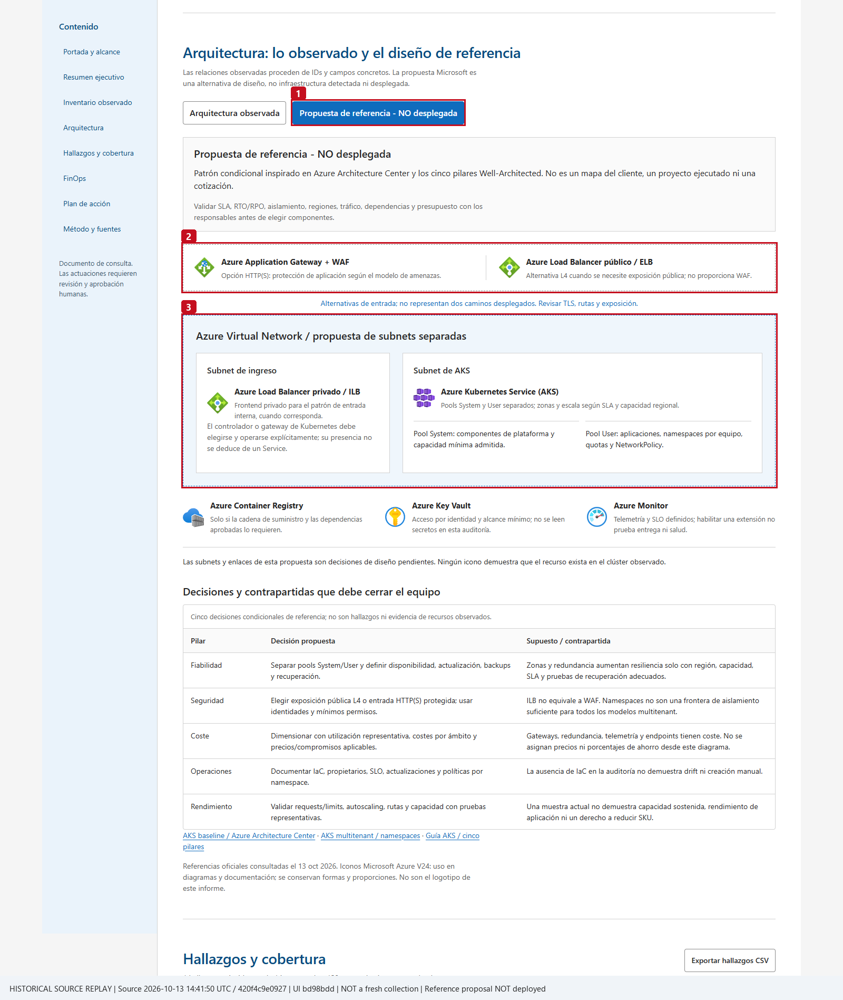

No database, Redis, Service Bus, ingress or dependency is added to the observed
view merely because it appears in an architecture example.

### Read FinOps without turning candidates into savings

1. Open **FinOps**. **Coste observado** shows the provided amount and actual
   currency. Read its billing period, exact scope and association.
2. Read **Ahorro estimado** independently. **Por estimar / No calculado**
   means no monetary savings model was supplied, **not zero savings**.
3. Open utilization/candidate receipts: timestamp, duration, units, samples,
   numerator/denominator and business need must accompany a capacity review.
4. Keep billing context separate from current inventory and namespace filters.
   MonthToDate rows can include historical/deleted resources and VMSS child IDs.
   They are not workload invoices or proof of ownership.

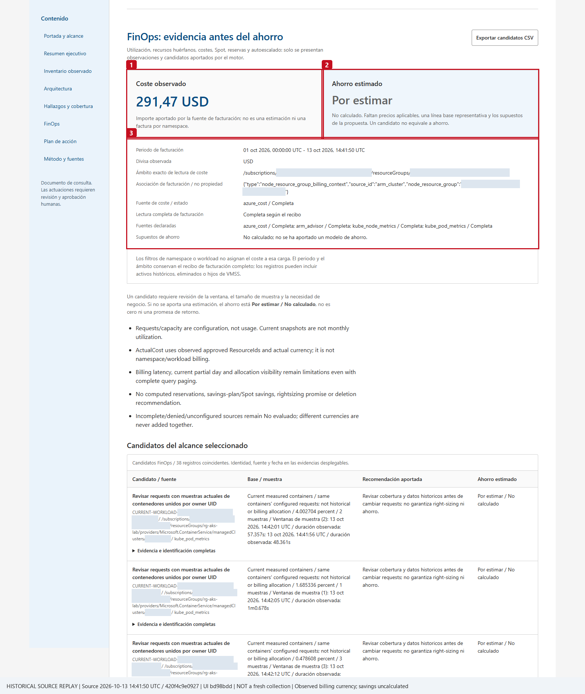

Current CPU/memory samples do not establish 30-day sustained underuse.
Requests are configuration, not consumption. Applicable prices, a
representative baseline, reservations/commitments and explicit assumptions
are needed before a monetary savings figure is meaningful.

### Select clusters, export and print

The multi-cluster document has a separate supplied aggregate and an explicit
**Clúster de la lectura detallada** selector. Selecting a cluster resets local
filters. A failed primary read shows its error and **no borrowed score, cost,
workload or topology**. Configured roster entries absent from the artifact are
marked unavailable for local selection; choosing them requires a new approved
SRE call.

Cluster identity comparisons validate the complete Azure resource ID and
ignore only its case. A prefix, another subscription/resource group/cluster,
or an unsafe path is not equivalent. Each run retains its own exact UTC
reference; sequential collection times need not equal the wrapper reference.
Original IDs and timestamps are never rewritten in display or exports.

**JSON completo** preserves the original wrapper and every run, including
errors. Scope JSON filters only the selected snapshot and explicitly preserves
all other snapshots/errors and the original aggregate. CSV exports include all
matching records, not just the visible page. **Imprimir / PDF** expands the
matching evidence; both architecture views retain the undeployed label.

## Step 7 - Keep reporting cadence optional

On demand is the default. **No Case 04 SRE scheduled task or new-cloud power
schedule was created for the captured baseline.**

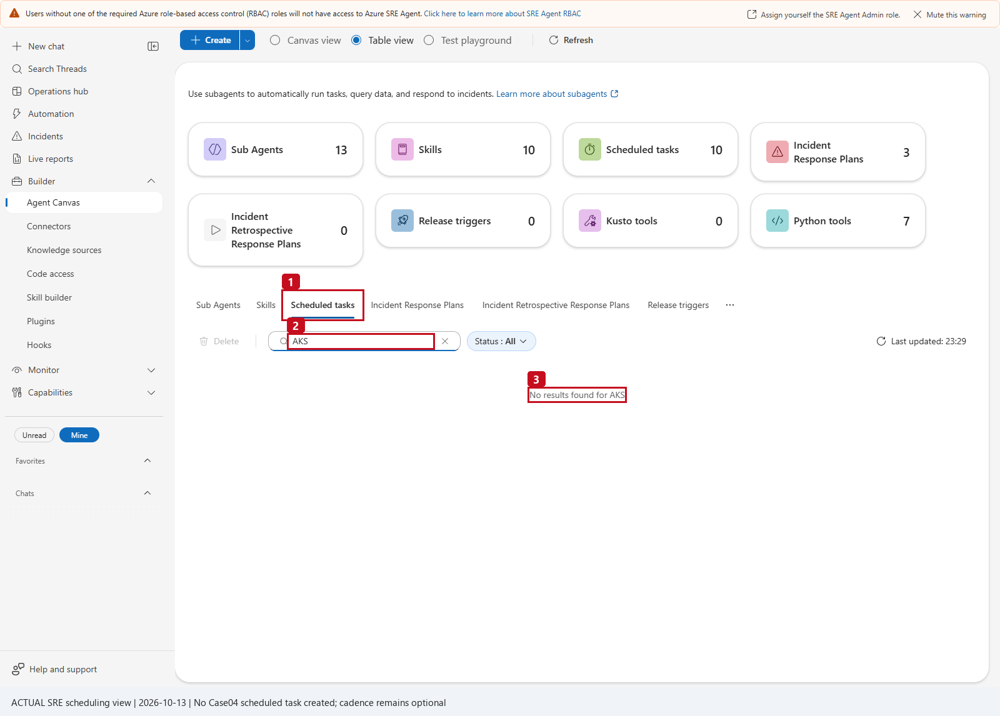

**1** is Scheduled tasks, **2** the AKS filter, **3** the actual no-results
state. This is not a successful schedule/next-run receipt.

Only after an explicit customer request and an accepted ordinary-chat run:

1. Search **Automation** for a matching **customer-owned** task. Inspect its
   owner, approved fixed scope, responder, prompt and cadence; reuse an
   approved match rather than duplicate it or modify another owner's task.
   To create a new one, open **Automation > Create > Scheduled task**, or
   **Builder > Agent Canvas > Create > Trigger > Scheduled tasks**.
2. Choose `aks-waf-live` as the response specialist and specify the approved
   cadence/time zone and exact fixed cluster selection.
3. Use a prompt for **one complete report call** and immediate four-file
   delivery. Include source-error/partial disclosure; no hidden queries,
   narrower retries, remediation or start/stop operations.
4. Save through the separately authorized process. Reopen/read back enabled
   state, actual next-run time, agent, prompt, selector and time zone.
5. Use **Run now** only when approved, then validate its actual thread and all
   four downloads. A saved task is not proof of a successful execution.

### Optional monthly reporting template - not a deployed task

The package defines **no mandatory Case04 cron or prior monthly-task
receipt**. If the customer chooses a monthly **current configuration
snapshot**, the following is a complete proposed template to approve:

| Field | Proposed value / gate |
|---|---|
| Task name | `Monthly AKS configuration review` |
| Response custom agent | `aks-waf-live` |
| Frequency / cron | **Custom cron (UTC)** / `0 9 1 * *` = first day at 09:00 UTC, only if chosen |
| Scope | One exact fixed `cluster_name`, or the distinct approved comma-separated `cluster_names`; never both |
| Evidence meaning | Configuration/current Kubernetes samples at execution time, plus the **privately configured** billing timeframe; not a previous-month telemetry report |
| Start on / model tier | Customer-approved activation date and usage policy |
| Run mode / thread | Autonomous only for approved unattended read-only execution; Review can pause. Use a separate execution thread where offered. |

Replace `<APPROVED_AKS_NAME>` with the actual fixed approved name before
saving **Task details**:

```text
Use aks-waf-live and ONLY generate-aks-waf-report. Make exactly one complete
call with operation=report and cluster_name="<APPROVED_AKS_NAME>"; keep all
other report defaults. Do not add query filters, period parameters, paging,
fresh follow-up calls, narrower retries or changes.
If status=error, stop with the sanitized code/source and invent no files,
counts or healthy-zero workloads. Otherwise immediately deliver the actual
HTML, complete JSON, failed-findings CSV and inventory CSV. When sharing_mode
is native_ui, render report_url, snapshot_url, findings_csv_url and
inventory_csv_url unchanged as relative native links/file widgets. For
local_files_only, explain that native aliases are unavailable and show only
the actual returned paths. written is not download verification;
http_verified=false must not hide provided aliases.
Summarize only returned UTC/source coverage, counts and local assessment
beside unknowns. Disclose partial/error sources; unavailable Kubernetes stays
No evaluado, not historical workloads or health. Do not claim the current
configuration or samples cover the previous calendar month. Never grant roles,
enable plans, start/stop a cluster, remediate, call operator assets, fabricate
links, drop evidence, split the requested scope or upload to alternative storage.
```

For a requested multi-cluster task, replace only the single selector with
`cluster_names="<APPROVED_AKS_NAME>,<APPROVED_SECOND_AKS_NAME>"`, using actual
configured names **without spaces**. Do not add `period`, start/end dates or a
billing-window override to the call; those are not supported tool parameters.

The normal picker can display browser-local time but save a fixed UTC
schedule. Local wall-clock time may shift after DST; prefer explicit UTC cron
and read back the **next UTC run**, enabled state and activation date. A
separately authorized manual run must show the actual execution thread, one
tool call and all four real downloads. **Success** may mean handoff to a
thread, not completed collection; **No thread found** is not acceptance.
Manual acceptance does not prove a future calendar trigger fired.

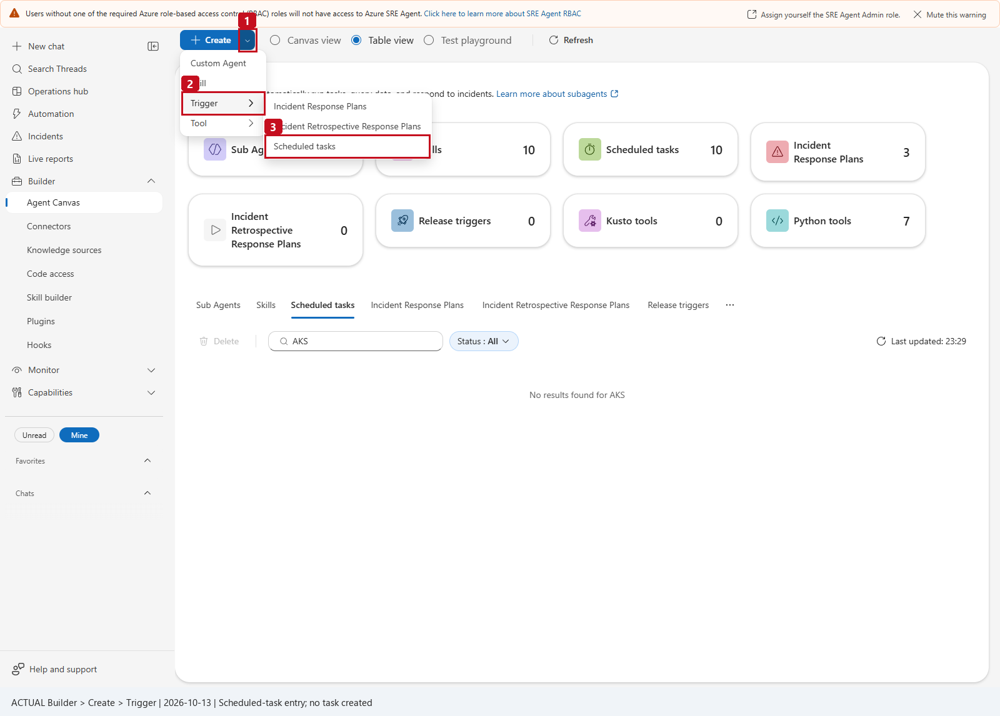

Do not confuse **reporting cadence** with a demo cluster's **power schedule**.
Any Azure Automation identity/runbook that starts or stops a new demo cluster
is a separate, paid, narrowly scoped operator deployment; it is never an SRE
reporting tool or a permission of the reporting UAMI. Its infrastructure,
IAM, budget and genuine nextRun/completion evidence need separate approval.
New-cloud captures remain **Not collected** until that deployment happens.

## Troubleshooting

| Symptom | What to do honestly |
|---|---|
| `configuration_required` | Correct fixed private constants before authentication; no alternate identity |
| Wrong cluster / selector rejected | Match the private code/schema allowlist exactly; use one selector only and no spaces in `cluster_names`. Empty selects the first configured cluster, not all clusters. |
| Human Builder/chat denied | Verify Author + Standard User (or Administrator) on the SRE Agent resource; do not self-grant based on a warning |
| Import / syntax error or only 11 saved inputs | Check declared dependencies, complete standalone paste and the current 12-input schema. Do not Generate/Refine a replacement, use unbuilt `engine.py` or infer `cluster_names` from the old screenshot. |
| `invalid_combination` / wrong type | Use query-only filters only with compatible views/statuses; leave report defaults untouched. Namespace filtering does not change server-side data-read scope. |
| clusterUser HTTP 403 | Ask the authorized operator to verify the exact minimal approved permission; never use admin kubeconfig |
| A Kubernetes kind HTTP 403 | Preserve that blind spot; AKS RBAC Reader can exclude cluster-scoped kinds |
| Kubernetes HTTP 502 / TLS / timeout | Inspect approved reachability, source and peer/FQDN validation; no insecure/proxy/endpoint workaround |
| Cost HTTP 429 | Bounded retries, then the actual error / No evaluado; no zero cost or savings |
| Partial list / continuation / cap error | Retain normalized rows with their partial receipt; do not call page one the whole estate |
| Invalid HTML startup | Request a complete compatible snapshot; the UI deliberately exposes no partial success |
| File/response limit exceeded | Keep the requested full scope; do not drop records, ZIP, upload to Storage or silently compress metadata |
| File written but native download failed | Report the actual delivery failure; writing a path is not HTTP/download verification |
| Missing tool/widget / wrong specialist answered | Reopen normal chat, explicitly select `aks-waf-live`, and verify its saved one-tool/one-skill allowlist. Do not attach global execution/file tools as a workaround. |
| High local index with low coverage | Read unknown counts and source errors; no official WAF/health conclusion |
| Missing current manifests | Do not substitute the historical screenshot's workloads for failed fresh reads |

## Dated evidence and release state

| Evidence | What it establishes |
|---|---|
| Existing approved LAB, source reference **2026-10-13T18:17:15Z** | Actual ordinary chat automatically delivered four native URLs; all four original downloads returned HTTP 200; current Kubernetes evidence was source-partial |
| Current baseline local index / coverage | **94.44 / 100**, **15.13%** coverage; **18** evaluated, **101** No evaluado, **1** N/A; not an official score or health assertion |
| Current baseline billing | **295.82358809701833 USD**, MonthToDate **2026-10-01 to 2026-10-13T18:17:15Z**, **53** billed ResourceId rows; estimated savings `null` |
| Earlier source **2026-10-13T14:41:50Z** | **53 workloads / 77 pods** were captured then; Nodes/PVs/StorageClasses had HTTP 403. Historical source plus later replay, not present Kubernetes recovery |
| Real Builder captures, 2026-10-13 | Actual saved one-tool/one-skill specialist and current UI controls; unsaved code/parameter/identity previews are identified as previews |
| Corrected two-scope package, **2026-10-14T09:25:00Z / 09:26:26Z** | Actual saved/read-back 12-input deployment; four automatic HTTP 200 downloads; both selectors, full JSON/CSV, observed/reference views, light/dark/mobile and print passed. First cluster: 19 Kubernetes 502s; second: stopped ARM configuration read without starting it |
| New demo cluster / power scheduler | Not deployed or collected; no new paid cluster, roles or scheduler approval is implied by an existing-tool update |

The verified baseline generic canonical source was
`b1df6c82582018735e75771efa32d8d1d40a9ef0b9b74cf3e58811d3e4befee0`
(329,605 bytes). The captured private configured tool read back as
`3aefbd5f0246deb91e5938e170472f84b4911a3aa95b630bbef59fa152f54096`,
with 11 inputs, Identity preset Off and timeout 900. These are **dated baseline
receipts**, not the hash of the newly integrated package.

The first updated deployment's generic canonical source was
`29d8acac226272669715281a091db13585333322ba654caeecf08678d5841ef8`;
the configured source read back as
`eec7df989e7e030dddb13e61c1d8ba49653fe421829e436de7eab2400fbd544b`.
The operator reported that initial save/readback on 2026-10-14. Its first
combined report delivered files but failed UI startup because equivalent full
ARM IDs differed in capitalization; that failed-run receipt is retained.

**Corrected fresh delivery, verified 2026-10-14:** generic source
`4d367ae72e6829f4b2eaed41d37e65edfa263ca83acca5dd7c454e8df887265d`;
configured source
`160bfd20d47ca08f07a98702106776a27726c857954b4b269e0b240be39e2a05`.
Its four automatic native downloads returned HTTP 200: HTML **1,227,761 bytes**,
full JSON **1,035,153 bytes**, findings CSV **2,937 bytes**, inventory CSV
**122,968 bytes**. JSON SHA-256:
`30251aa20df79eecfcce6a2107d0bfff0a650b4f18ec72a549c6944389d0d38d`.
Actual 1440/390/320px light/dark, both selectors and combined summary,
observed versus undeployed-reference views, complete JSON/fields/snapshots/
aggregate and print passed, with no external requests, JavaScript errors or
page overflow. Original per-cluster reference times and evidence remain
unchanged. This is delivery/UI validation, **not** Kubernetes recovery or
new-cluster/power-schedule deployment.

The earlier workload-complete replay showed **98.41 / 100** over 63 evaluated
checks and **31.19%** coverage, with 139 No evaluado and 355 N/A. Its chart is
not current source health. No earlier workload is inserted into the later 502
report, and no current/source-partial capture is captioned as recovered.

Release gates are **DRAFT -> OFFLINE_VALIDATED -> LIVE_VALIDATED -> PUBLISHED**.
PARTIAL_LIVE records functional execution/delivery with explicitly accepted
source blind spots; it is not complete current workload assessment.
Publication additionally needs privacy review, approved repository
visibility and a remote commit receipt. A local commit is not publication.
Real identities/configurations/logos/datasets stay outside Git.

## Technical boundaries and development

<details>
<summary>Collection, authentication and source completeness</summary>

The runtime uses `azure-identity` and PyYAML, plus Pillow only for an optional
logo. It has no DefaultAzureCredential, cached CLI/OBO/admin fallback. A
non-managed-Entra clusterUser flow is rejected. Server/CA validation uses the
exact approved ARM FQDN, HTTPS/default port 443, hostname/peer verification and
system roots plus the approved public cluster CA, in memory only.

ARM managedCluster/pool/version/maintenance reads use fixed API versions
(`2025-05-01` for AKS); diagnostics use `2021-05-01-preview`; related inventory
uses `2021-04-01`. Per-type asset reads are explicitly whitelisted. Kubernetes
reads are fixed GET paths with independent per-kind continuation/resourceVersion
receipts. Metrics retain current timestamps/durations, cores/bytes and sample
counts, not history. Cost uses read-only ActualCost/PreTaxCost queries
(`2023-11-01`) on approved observed scope; Advisor reads cached recommendations
(`2025-01-01`) without generation actions.

GETs have 30-second timeouts, at most three attempts for
429/500/502/503/504 and bounded Retry-After. Source limits are 100 pages /
20,000 rows, Kubernetes 500 rows/page, HTTP bodies 8,000,000 bytes, related
details 200 records. A shared 240-second / 300-attempt budget bounds new reads
across selected clusters; an in-flight bounded read can finish. Failed pages
retain already normalized rows with an explicit partial/error receipt.
Successful-empty, denied, unsupported/unconfigured and transport-error sources
are different states. Stopped clusters are never started.

Never retrieved as review evidence: Secrets/ConfigMap data, container
env/command/args/logs, secret values, Storage keys, private certificates/keys,
raw kubeconfig, token/CA material or arbitrary annotations. Whitelists retain
every admitted record/field in the full JSON, including unused `source_data`,
original quantities, IDs and window metadata.

</details>

<details>
<summary>Billing, utilization windows and transport</summary>

Billing `finops.window` is `{start,end}`. A capacity candidate retains one
`{timestamp,duration}` or an array of such samples; repeated timestamps are
not deduplicated or converted into a fictitious interval. Unattached candidates
can have no measurement window. Stale/undated samples remain exported but cannot
become current capacity candidates; the freshness guard is five minutes from
the declared reference and sample windows must be positive and at most one day.

Node-resource-group billing retains historical/deleted/VMSS-child ResourceIds
even when absent from current inventory. It is billing context, not proven
ownership or workload allocation. Attachment-state/orphan reviews require
explicit evidence and complete reference visibility, not a naming heuristic.
No deletion, price assumption, reservation purchase or savings eligibility is
inferred.

The fixed runtime-owned `cwd\aks-waf-reports` directory has symlink/junction/
escape guards and unique run names. Four prepared files are byte-checked,
written atomically and read back against the complete normalized model.
Each artifact is at most **4,800,000 actual encoded bytes**, including CSV BOM;
oversize complete evidence fails before writing instead of dropping data.
Responses must fit **3,500 bytes with Python's default JSON serialization**.
Queries reduce whole-row count with explicit paging/cap disclosure; one
oversized row is an error, not an endless zero-row cursor.

Native delivery derives this actual thread UUID only from guarded SRE
ThreadFiles roots; no fixed thread/hostname, manual publication, static URL
prefix, Storage or ZIP fallback is used. Outside those roots, delivery remains
`local_files_only` with unchanged actual paths. `artifact_status=written` is
not a download receipt, and `http_verified=false` must not hide provided native
links.

</details>

<details>
<summary>Repository build and offline checks</summary>

The development sources are `engine.py`, `rules_catalog.json`, pinned
references and `report_template.html`. The builder embeds them into the
canonical whole-file Python tool. The separate UI workstream does not hand-edit
the generated canonical file.

These are **optional maintainer commands**, not ordinary customer deployment
steps, permission to rebuild frozen assets or evidence of a new live read.
An operator pastes the existing canonical tool; running a build or browser
suite is not required to install it.

```powershell
python .\04-aks-well-architected-review\build_tool.py
python .\04-aks-well-architected-review\build_tool.py --check
python -m pytest .\04-aks-well-architected-review\tests -q -p no:cacheprovider
```

For the existing local Edge/Playwright browser gate:

```powershell
$env:SRE_REPORT_BROWSER_TESTS = '1'
python -m pytest .\04-aks-well-architected-review\tests\test_report_ui.py -q -p no:cacheprovider
```

`SRE_REPORT_UI_ACTUAL_MODEL` optionally points to a private complete normalized
snapshot for bootstrap, source metadata, scope, print and lossless-export checks.
It is not a tool input, a public fixture or a new cloud read. Public test data
are permanently SIMULATED/LAB. The runtime does not accept arbitrary snapshot
paths.

```powershell
Set-Location .\04-aks-well-architected-review
python .\tests\offline_demo.py
```

The developer-only demo produces four clearly SIMULATED files; it is never
imported or selected by the SRE runtime.

</details>

## References and licensing

| Source | Purpose / pinned evidence |
|---|---|
| [AKS WAF service guide](https://learn.microsoft.com/en-us/azure/well-architected/service-guides/azure-kubernetes-service) | All five pillars; checked 2026-10-13, page updated 2026-09-29 |
| [AKS baseline architecture](https://learn.microsoft.com/en-us/azure/architecture/reference-architectures/containers/aks/baseline-aks) | Conditional production design choices, not the observed customer's deployment |
| [AKS multitenant guidance](https://learn.microsoft.com/en-us/azure/architecture/guide/multitenant/service/aks) | Namespace/isolation tradeoffs; namespaces are not a universal hard-security boundary |
| [Official Azure icons and usage terms](https://learn.microsoft.com/en-us/azure/architecture/icons/) | V24 original SVGs, nearby product names, no cropping/rotation/distortion/product-logo use |
| [SRE user roles](https://learn.microsoft.com/en-us/azure/sre-agent/user-roles) | Human Author/Standard/Administrator roles, separate from source identity access |
| [Create an SRE Agent / getting started](https://learn.microsoft.com/azure/sre-agent/create-agent) | Separate service prerequisite if no approved agent exists; requires the customer's cost/access decision before this case's setup |
| [SRE identity](https://learn.microsoft.com/azure/sre-agent/agent-identity) | Current UAMI discovery; Client ID for code versus principal for RBAC |
| [Portal role assignments](https://learn.microsoft.com/azure/role-based-access-control/role-assignments-portal) | Authorized admin workflow and managed-identity assignment limits |
| [AKS clusterUser credential access](https://learn.microsoft.com/azure/aks/control-kubeconfig-access) | ARM clusterUser permission is separate from Kubernetes data authorization |
| [AKS Kubernetes data authorization](https://learn.microsoft.com/azure/aks/manage-azure-rbac) | Read-role scope/limitations, not a Cluster Admin workaround |
| [SRE Python tools](https://learn.microsoft.com/en-us/azure/sre-agent/python-code-execution) | Whole-function code, typed inputs, test-before-create and Identity tab |
| [SRE skills](https://learn.microsoft.com/en-us/azure/sre-agent/skills) | Runtime `SKILL.md` and tool attachment |
| [SRE custom agents](https://learn.microsoft.com/en-us/azure/sre-agent/sub-agents) | Agent Canvas, explicit specialist activation and scoped tools |
| [SRE scheduled tasks](https://learn.microsoft.com/en-us/azure/sre-agent/scheduled-tasks) | Optional cadence, readback and actual run evidence |
| [SRE automation workflow](https://learn.microsoft.com/azure/sre-agent/automate-workflows) | UTC versus browser-local picker and Success/handoff meaning |
| [Official Azure Architecture Review](https://learn.microsoft.com/en-us/assessments/azure-architecture-review/) | A separate official assessment; this tool does not issue its grade |

The pinned [AKS checklist](references/aks_checklist.en.json) is from
Azure/review-checklists commit
`f131b93418892102b00c247fd9cf685e3d356522`, blob
`8c9d49dedf2c8f0aa0e11fba86c7a17aa927dc22` (66,436 bytes), SHA-256
`e1f7e0f44e121a4f96a9258e64383d33a14c78e56bf0d7c7b6638f8b72acff31`.
Its Microsoft copyright/full MIT license is retained in
[`references/LICENSE.azure-review-checklists`](references/LICENSE.azure-review-checklists).
Legacy graph snippets are not executable evaluation input.

Azure product icons have their **own permitted-use terms**, not the checklist's
MIT license. Only the eleven needed original SVGs are persisted, with
[`usage/source/hash notices`](images/azure-icons/NOTICE.md). No external
asset/script/CDN is required by the report. WARA/Polaris inform narrative and
wayfinding only; neither is installed or presented as the scoring authority.

<!-- BILINGUAL_QA_PROMPT_PACK -->

---

## Copy-Ready Bilingual Q&A Prompt Pack (Castellano & English)

Select `/agent aks-waf-live` in **New chat** and use any of these prompts in **Spanish (Castellano)** or **English**:

### 1. Discover Configured AKS Clusters Roster / Listar los Clusteres AKS Configurados (`list_clusters`)
- **Castellano:**
  ```text
  @aks-waf-live Ejecuta operation="list_clusters" para mostrarme los clusteres AKS configurados en el alcance aprobado antes de lanzar la evaluacion completa.
  ```
- **English:**
  ```text
  @aks-waf-live Run operation="list_clusters" to show the configured AKS clusters in the approved roster before launching the full assessment.
  ```

### 2. Full Multi-Cluster Well-Architected Report (4 Files) / Informe Completo Multi-Cluster AKS WAF (4 Archivos)
- **Castellano:**
  ```text
  @aks-waf-live Genera el informe completo Well-Architected y de configuracion para todos los clusteres AKS aprobados (operation="report", cluster_name="all") y entregame los 4 enlaces descargables (HTML, JSON, CSV de hallazgos y CSV de inventario) manteniendo cada cluster independiente.
  ```
- **English:**
  ```text
  @aks-waf-live Generate the complete Well-Architected and configuration review report across all approved AKS clusters (operation="report", cluster_name="all") and deliver all 4 downloadable file links (HTML, JSON, findings CSV, and inventory CSV) while keeping each cluster's posture independent.
  ```

### 3. Security, Identity & Network Isolation Findings / Hallazgos de Seguridad, Identidad y Red en AKS
- **Castellano:**
  ```text
  @aks-waf-live Consulta en modo query los hallazgos del pilar Security (operation="query", view="findings", pillar="Security", status="fail") y explicame el estado de RBAC/Entra ID, Workload Identity, red privada/authorized IP ranges, Network Policy y Defender for Containers en cada cluster.
  ```
- **English:**
  ```text
  @aks-waf-live Query the failing findings in the Security pillar (operation="query", view="findings", pillar="Security", status="fail") and explain the posture of RBAC/Entra ID, Workload Identity, private cluster/authorized IP ranges, Network Policy, and Defender for Containers for each cluster.
  ```

### 4. Reliability, Availability Zones & Node Pool Architecture / Fiabilidad, Zonas de Disponibilidad y Node Pools
- **Castellano:**
  ```text
  @aks-waf-live Revisa los hallazgos del pilar Reliability y el inventario de node pools (operation="query", view="node_pools"): que node pools separan modo System vs User, cuales tienen Availability Zones y autoscaling habilitados, y que pasa si un cluster esta detenido (Stopped)?
  ```
- **English:**
  ```text
  @aks-waf-live Review the Reliability pillar findings and node pool inventory (operation="query", view="node_pools"): which node pools separate System vs User mode, which ones have Availability Zones and cluster autoscaler enabled, and how is a Stopped cluster qualified?
  ```

### 5. Cost Optimization (FinOps) & Capacity Sizing / Optimizacion de Costes (FinOps) y Dimensionamiento
- **Castellano:**
  ```text
  @aks-waf-live Consulta los hallazgos del pilar Cost Optimization (operation="query", view="findings", pillar="Cost Optimization") y resume las oportunidades reales de ahorro en SKUs de nodos, autoscale min/max, entorno dev/test y telemetria de uso de CPU/memoria.
  ```
- **English:**
  ```text
  @aks-waf-live Query the Cost Optimization pillar findings (operation="query", view="findings", pillar="Cost Optimization") and summarize the concrete optimization opportunities across node VM SKUs, autoscale min/max bounds, dev/test lifecycle, and observed CPU/memory utilization.
  ```

### 6. Unassessed In-Cluster Kubernetes Checks vs. ARM Plane / Controles Dentro de Kubernetes (`No evaluado`) frente a ARM
- **Castellano:**
  ```text
  @aks-waf-live Que controles de la checklist oficial de AKS quedaron en estado "No evaluado" porque requieren inspeccionar objetos dentro de la API de Kubernetes (PodDisruptionBudgets, ResourceQuotas, requests/limits de pods) y no solo el plano ARM?
  ```
- **English:**
  ```text
  @aks-waf-live Which checks from the official AKS checklist remained "Not evaluated" because they require inspecting in-cluster Kubernetes API objects (PodDisruptionBudgets, ResourceQuotas, pod requests/limits) rather than the ARM control plane?
  ```
