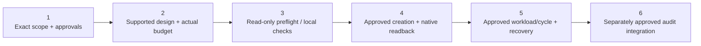

# Bounded low-cost AKS demo operator assets

**State: prepared / offline validated, NOT deployed.** No new AKS cluster,
Automation account, schedule, identity or role assignment has been created.
Actual new-cluster workload, stop/start-cycle, scheduler `nextRun`, native job
and file-download receipts remain **Not collected**. A positive forecast is
not spend approval.

These assets are separate from the read-only `aks-waf-live` specialist and
`generate-aks-waf-report`. Never install the operator scripts as an SRE tool,
give the auditing identity write access, or schedule either existing cluster.

**Quick navigation:** [Prepare files and people](#before-a-separately-approved-operator-workshop) ·
[Scope/approval](#1-scope-and-approval-gates) · [Cost](#2-supported-minimum-and-cost) ·
[Preflight](#3-read-only-preflight-and-local-validation) ·
[Creation/readback](#4-approved-creation-publishing-and-schedule-readback) ·
[Workload/cycle](#5-demo-workload-and-safe-cycle) ·
[Audit integration](#6-audit-integration-and-source-boundaries) ·
[Troubleshooting](#troubleshooting-and-stop-decisions).

## Before a separately approved operator workshop

This is an **optional operator runbook**, not the customer's ordinary
[read-only Case04 implementation](../README.md). Reading it, running local
checks, an old LAB authorization or a positive forecast is not permission to
spend, grant IAM, create resources, deploy a workload or start/stop anything.
All such actions need current exact-scope customer approval.

1. Confirm private repository read access or an approved offline copy of the
   **entire operator folder** before the meeting. Individual file links below
   support **Raw / Download raw file**; verify real source/JSON, not an HTML
   sign-in page. Preserve adjacent asset names.
2. Use an approved private directory **outside Git**, PowerShell **7+**
   (`ConvertFrom-Json -AsHashtable` is used), Azure CLI and an approved Bicep
   toolchain. CLI authentication is the **human operator's** approved tenant
   session, not the audit UAMI. Do not change a global/default subscription or
   evade Conditional Access/device policy; every helper operation already
   names the fixed subscription.
3. Arrange the customer's deployment, billing and access administrators. The
   human must have the specifically approved resource/deployment and custom
   role-definition/assignment authority for any selected write path.
   **SRE Agent Author/Standard User is not Azure deployment or IAM authority**.
   Conversely, those SRE roles are needed only for the later SRE integration,
   not for a local Bicep compile.
4. Review existing access, exact new resource names, budget, regional SKU/quota,
   independent stop/recovery procedure and retention of private receipts.
   Keep optional grant flags false until individually approved. Never solve
   access by granting the reporting UAMI Contributor/Owner or Cluster Admin.

| Download | Actual purpose |
|---|---|
| [`Demo-Operator.ps1`](Demo-Operator.ps1) | Human-operated `Preflight`, approved `Deploy`, and `Readback`; validates fixed scope/settings/consent, reads current quote/quota and orchestrates the bounded new resources |
| [`settings.example.json`](settings.example.json) | All ten required private settings; zero budget / false role flags are deliberate safety defaults |
| [`low-cost-aks.bicep`](low-cost-aks.bicep) | New fixed cluster/Automation identity and narrowly scoped approved roles; not a reporting tool |
| [`daily-schedules.bicep`](daily-schedules.bicep) | The two new daily Madrid-time power schedules and job links |
| [`Power-Control.ps1`](Power-Control.ps1) | Private published Automation runbook template; system-identity fixed-target Start/Stop only, not the audit identity |
| [`retail-price-reference.json`](retail-price-reference.json) | Dated meter identifiers/reference, used to request fresh rates; never a fallback quote |
| [`demo-workload.yaml`](demo-workload.yaml) | Separately approved human-applied bounded demo manifest; no stress workload |



The numbers match the existing runbook sections. Every write boundary is a
gate, not an instruction to execute during an ordinary reporting workshop.
No new-cloud screenshots are supplied: actual deployment/nextRun/cycle
captures remain **Not collected**.

## 1. Scope and approval gates

The fixed proposed target is `aks-sre-demo-small` in
`rg-aks-sre-demo-small`, with node RG `rg-aks-sre-demo-small-nodes` and
Automation account `aa-aks-sre-demo-small`. The helper refuses an existing
resource group rather than overwriting it. Privately configure its immutable
approved subscription/tenant constants and matching settings; public
placeholders fail **before authentication or network reads**. Every Azure CLI
operation explicitly names that subscription; the corporate default is not
changed or used as a fallback.

Before `Deploy`, obtain an exact numeric EUR quote/budget and approval
reference, plus approval of a **new** scheduler identity's three actions:
`Microsoft.ContainerService/managedClusters/read`, `start/action`,
`stop/action`. Its custom role is assignable only within the new RG and
assigned only on the new cluster, with no data actions. No Owner,
Contributor, Kubernetes Administrator, subscription-wide assignment,
credential, license or paid Defender/monitoring plan is added.

Optional audit grants are separately gated: Cluster User and AKS RBAC Reader
on **only the new cluster**. Reader still does not prove access to nodes,
PVs or StorageClasses; retain actual 403/502 as No evaluado. An optional
separate human demo role permits only namespace/Deployment/Service writes
and associated reads on the new cluster, without secrets, exec, role
bindings or admin. It is never given to the audit/scheduler identity.

## 2. Supported minimum and cost

Use Free control plane, one VMSS **System pool with two Linux nodes**, each
at least four vCPUs/four GB and 30 pods. Current system-pool documentation
requires two nodes; one-node/B-series/Spot shortcuts are not used. Proposed
`Standard_D4pls_v6` is Arm64, four vCPUs/eight GB; `D4pls_v5` is an explicit
alternative with a different quote, never a silent substitute. Managed
32-GiB OS disks avoid relying on an unverified ephemeral-disk stop/start
combination. Azure Linux 3, Entra/Azure RBAC, disabled local accounts,
overlay/Cilium, OIDC/workload identity and regular upgrades are explicit.
No NAP, autoscaling, user pool, public node IP or additional paid addon is
created. This lab has no production availability/SLA promise.

Retail rates in `retail-price-reference.json` were actually read on
2026-10-13 in EUR for Sweden Central/Global meters. They are a dated public
reference, **not customer billing, savings or consent**. `Preflight`
recollects paid meters, exact SKU restrictions, family/regional/network
quota and regional Kubernetes versions; failed/empty reads never fall
back to reference prices or zero quota. Quota availability is not a
physical capacity guarantee at restart.

For 30 days, 09:00-17:00 every day and two `D4pls_v6` nodes:

| Component | Modeled EUR |
|---|---:|
| Compute: two nodes x 240 hours x 0.1162 | 55.7760 |
| Two retained P4 OS disks, conservative full quoted month | 10.2204 |
| One retained Standard outbound LB, 720 hours x 0.022 | 15.8400 |
| One retained Standard IPv4, 720 hours x 0.0044 | 3.1680 |
| Base before scheduler/variables | **85.0044** |
| One additional stop-overrun compute hour/day | 6.9720 |
| Maximum modeled scheduler: 60 jobs x 61 minutes x 0.0018 | 6.5880 |
| Subtotal with those allowances, before excluded variables | **98.5644** |

The subscription-wide 500 free Automation minutes are **not assumed
available**. Actual completed/no-op jobs can cost less, but the maximum
model treats all job minutes as billable. Native job history is distinct
from optional separately billed Log Analytics; none is created here.
Tax, customer contract/discounts, initial validation runtime, temporary
upgrade surge, bandwidth and processed data are excluded. A missed/failed
stop allowing 24x7 compute gives **203.1444 EUR before those variables**,
not the daily-model subtotal.

The demo is a ClusterIP Service: no extra inbound public IP or ILB.
An explicitly requested public Service adds about 3.168 EUR/30 days for
one retained IP; an ILB can add another retained LB, about 15.840 EUR,
plus variable data. Those assets require a revised approval.
The architecture UI may show a **reference proposal - NOT deployed** for
ELB/ILB; it must not invent them as observed assets.

**No hard spending cap is implemented.** A budget alert or tag does not
prevent charges. Start/stop failures, capacity and job timing must be
reviewed; stop the demo and investigate a failed job rather than assuming
the schedule limited the bill.

## 3. Read-only preflight and local validation

Copy the entire operator folder to an approved private working directory,
replace only the immutable scope placeholders in `Demo-Operator.ps1`,
and fill a private copy of `settings.example.json`. Keep budget zero and
both optional role flags false until specifically approved.

Set `$ApprovedSubscriptionId` and `$ApprovedTenantId` in the private helper to
the same approved GUIDs as the settings. Do not substitute the corporate
default subscription. The helper creates the private configured
`Power-Control.ps1` copy using verified deployment outputs; do not manually
point the generic runbook template at either existing cluster.

| Private settings field | Type / default | Meaning |
|---|---|---|
| `subscription_id`, `tenant_id` | strings / placeholders | Must exactly match the helper's fixed approved scope |
| `kubernetes_version` | string / placeholder | Explicit supported non-preview regional patch from preflight; verified again for Deploy |
| `node_vm_size` | string / `Standard_D4pls_v6` | Only that SKU or separately quoted `Standard_D4pls_v5`; no silent alternative |
| `approved_thirty_day_budget_eur` | nonnegative **integer** / `0` | Deploy requires positive approved EUR budget; a forecast gate, never a hard cap |
| `approval_reference` | string / `""` | Deploy requires an actual nonblank approval reference, at most 120 characters; do not invent consent |
| `audit_principal_id` | string / `""` | Optional reporting identity **Object/principal ID**, not Client ID; required only for its separately selected audit grants |
| `grant_audit_read_roles` | boolean / `false` | Optional new-cluster-only read-role gate, separately approved |
| `demo_operator_principal_id` | string / `""` | Optional human's **Object ID**, distinct from the audit principal |
| `grant_demo_operator_role` | boolean / `false` | Optional bounded human data-write role gate, separately approved |

All ten fields are required and unknown keys are rejected. JSON booleans are
`true`/`false`, not quoted strings. Nonempty principal values must be explicit
GUIDs. Preserve the fixed target names; this helper is not a generic
subscription, region, script-URL or command runner.

| Helper parameter | Default / supported contract |
|---|---|
| `-Mode` | `Preflight`; only `Preflight`, `Deploy`, `Readback` |
| `-SettingsPath` | Adjacent `settings.example.json`; select your approved local private settings copy |
| `-ApproveSpend`, `-ApproveSchedulerRole` | Off; both and a real positive budget/reference are required before Deploy writes |
| `-ApproveAuditRoles`, `-ApproveDemoRole` | Off; required separately when the matching settings flag is true; not an approval substitute |

From the **private copied operator directory**, and only with approved
read-only source access:

```powershell
.\Demo-Operator.ps1 -Mode Preflight -SettingsPath .\private-settings.json
```

The JSON labels its state `READ_ONLY_PREFLIGHT_NOT_PROVISIONED`. Its next
Madrid instants are **calculated**, not native scheduler readback. No
resource write is performed. Pick a non-preview regional Kubernetes patch
from that response; deployment verifies it against the actual version list.

Repository checks (no cloud writes):

```powershell
python -m unittest discover -s .\04-aks-well-architected-review\tests -p 'test_operator.py'
```

That command starts at the repository root. **Optional maintainer-only** Bicep
compilation starts in the copied operator directory with the approved
toolchain; it is not ordinary customer reporting deployment:

```powershell
az bicep build --subscription <APPROVED_LAB_SUBSCRIPTION_ID> --file .\low-cost-aks.bicep --outfile .\private-compiled-cluster.json
az bicep build --subscription <APPROVED_LAB_SUBSCRIPTION_ID> --file .\daily-schedules.bicep --outfile .\private-compiled-schedules.json
```

Actual parser/function checks cover DST transitions, exact forecast math,
missing configuration/consent before auth, failed retail reads, no-op Stop,
foreign identity/scope rejection and the difference between ARM acceptance
and observed completion. Bicep compilation is not a successful deployment.

**Checkpoint:** preserve the actual preflight UTC reference, current rates,
quota/version responses, cost exclusions and calculated times privately.
No new cluster, scheduler, IAM assignment or native nextRun exists merely
because the command returned a forecast.

## 4. Approved creation, publishing and schedule readback

Only after the required approvals:

The customer's authorized access administrator approves the exact custom
role definition/actions, **new cluster-only** assignment and principal.
Check existing/inherited access before enabling any optional grant. The helper
performs its gated assignments during approved Deploy; do not pre-grant broad
subscription access, choose an unrelated managed identity or click a portal
Admin warning to make it succeed. Runtime audit Client ID and IAM
Object/principal ID remain different values.

```powershell
.\Demo-Operator.ps1 -Mode Deploy -SettingsPath .\private-settings.json -ApproveSpend -ApproveSchedulerRole
```

Add `-ApproveAuditRoles` / `-ApproveDemoRole` only for separately approved
optional grants already enabled in settings. Current prices exceeding the
approved subtotal stop the helper before creation. This comparison remains
a forecast gate, not an Azure spending limit.

The helper creates only the fixed new RG, compiles/deploys the cluster and
separate Automation resources, injects fixed scope/new principal into a
private runbook copy, uploads/publishes it, then creates two daily schedules
and fresh-GUID job links. Nothing points to a public script URI or stores
keys. Private generated parameters/code/readback stay beside the private
settings, outside the public repository.

`Power-Control.ps1` has only `Action=Start|Stop` as a runtime parameter.
It authenticates solely with the Automation sandbox's system identity,
checks token tenant/principal/ARM audience, validates the exact cluster and
VMSS/non-NAP configuration, and performs only the exact GET/start/stop.
Redirects, CLI credentials and identity/target fallback are rejected.
It polls the target resource under a one-hour bound; an accepted ARM POST
is not success. Timeout/denial becomes a failed job, not a fake receipt.
No pods, roles, secret values or asynchronous regional operation URLs are read.

The schedules use `frequency=Day`, `interval=1`, **`Europe/Madrid`**, with
wall-clock start 09:00 and stop 17:00 on all seven days. UTC is 07:00/15:00
in summer and 08:00/16:00 in winter. The helper derives future instants using
the time-zone database, not hardcoded offsets.

```powershell
.\Demo-Operator.ps1 -Mode Readback -SettingsPath .\private-settings.json
```

Readback requires actual enabled definitions, native `nextRun` matching
Madrid hours, both proper job links, the new identity, and exact scoped
three-action/no-data-action role. Missing native values are failures;
calculated times do not substitute for them. Its
`stop_start_cycle_verified=false` is deliberate until actual cycle/job
receipts have separately been captured.

**Checkpoint:** verify actual target IDs, new scheduler principal, exact role
actions/scope, published runbook, both enabled native schedules, job links and
their **nextRun**. This Madrid/DST-aware Azure Automation schedule is **not**
the SRE reporting task's fixed-UTC Custom cron. No calculated time or SRE task
Success badge establishes a completed stop/start cycle.

## 5. Demo workload and safe cycle

Use only the approved human's clusterUser/Entra access and a dedicated
new-cluster kubeconfig/context. Never use `--admin`, SRE audit credentials,
command invoke, or an original cluster's context:

```powershell
az aks get-credentials --subscription <APPROVED_LAB_SUBSCRIPTION_ID> --resource-group rg-aks-sre-demo-small --name aks-sre-demo-small --file .\private-demo-kubeconfig --context case04-new-demo
kubectl --kubeconfig .\private-demo-kubeconfig --context case04-new-demo apply -f .\demo-workload.yaml
kubectl --kubeconfig .\private-demo-kubeconfig --context case04-new-demo rollout status deployment/tiny-http -n case04-demo --timeout=180s
```

If the human lacks the separately approved bounded data actions, stop.
Do not grant admin or change the reporting identity. The public OCI image
index was actually read and pinned by digest; it contains a Linux/Arm64
manifest (`e00b7e27...`). The Deployment is one replica, non-root, restricted
pod security, read-only root, no service-account token, all capabilities
dropped, CPU/memory limits and a bounded memory-only `/tmp`. It is not a
stress/OOM/disruption workload and creates no data disk, secrets or extra LB.
Manifest/registry validation is not proof that a pod has run.

For an explicitly approved safe cycle on **only the new cluster**,
collect Running/provisioning/workload evidence, invoke the published Stop
runbook or explicitly scoped `az aks stop`, verify `Stopped`, wait **30
minutes after completed stop**, then Start and verify Running/provisioning
and the Deployment again. Never start within the documented 15-30 minute
shutdown settling interval. Record exact job IDs, fixed identity/target,
timestamps and before/after state. Return the demo to Stopped when not
needed; do not leave deployment runtime unpriced before the first schedule.
09:00 is a start request, not guaranteed immediate workload readiness.

No automatic resource-group deletion/rollback is performed. A failed
deployment can leave billable partial assets; inspect actual created IDs
and obtain explicit cleanup approval. Never delete a broad/root directory
or either original cluster. Failed schedules require operator attention.

## 6. Audit integration and source boundaries

Add the new cluster to the private fixed reporting allowlist/schema **only
after its actual ARM ID and approved read access are verified**. Until then,
only the approved existing cluster scopes are selectable. `list_clusters`
is configured scope metadata, not resource-presence or health evidence.
`cluster_names` selects distinct exact names and preserves each full
snapshot/error. The stopped existing cluster is never started. Current
gateway 502, missing nodes/PVs and historical captures remain explicitly
different from current live Kubernetes evidence.

## Troubleshooting and stop decisions

| Symptom | Check | Safe action |
|---|---|---|
| `configuration_required` / `scope_mismatch` | Both fixed helper GUIDs and all ten private settings, types and approved target | Correct the private copy; no cached/global subscription fallback or arbitrary target change. |
| `operator_tenant_mismatch` / sign-in policy denial | Human CLI tenant and compliant customer flow | Stop and resolve with the identity team; no CA/device-policy bypass or use of the reporting UAMI. |
| `approval_required` / `role_approval_required` | Actual approval reference, positive integer budget, switches and independently selected role flags | Obtain the missing exact approval. A switch, README or quote does not grant it. |
| Existing target RG is refused | Exact fixed new target and any previous partial deployment | Stop; do not overwrite or repoint the helper at either original cluster. |
| Failed/empty retail rate or quota read | Fresh EUR meter/SKU/region/version responses | Preserve the failure; no reference-price/zero-cost fallback, larger SKU, Spot or paid-plan substitution. |
| Quote passes but bill is higher | Excluded variables, initial runtime, missed stop and retained disks/LB/IP | No hard cap exists. Investigate under the approved stop/recovery process and revise the budget before continuing. |
| Role/custom-role creation denied | Human's approved role-definition/assignment authority at the new scope | Escalate to the customer's access administrator; do not broaden the audit/scheduler identity or silently omit required readback. |
| Native schedule `nextRun` absent or wrong | Enabled state, `Europe/Madrid`, native definitions and both job links | Treat readback as failed. Calculated instants are not native receipts. |
| Job/ARM POST accepted, cluster not yet stopped/running | Actual native job result and repeated fixed-target state under the one-hour bound | Keep pending/failed explicit; do not call request acceptance recovery or bypass polling/timeouts. |
| Pod is not ready / human apply denied | New-cluster context, bounded human role, Arm64 manifest and actual rollout | Stop; never use `--admin`, exec or an existing cluster as a substitute. Manifest validation is not workload execution. |
| Kubernetes 403/502 in audit | Separate source/data-role/network boundary | Preserve **No evaluado**; do not start an existing stopped cluster, create a paid cluster or add Cluster Admin to improve coverage. |
| Deployment partially fails | Actual created IDs, native deployment/job receipts and continuing charges | Record the failure and obtain explicit cleanup/recovery approval. No automatic RG deletion or rollback is implemented. |

## Official references

- [System-pool minimums](https://learn.microsoft.com/azure/aks/use-system-pools)
- [AKS VM size and availability checks](https://learn.microsoft.com/azure/aks/aks-virtual-machine-sizes)
- [AKS stop/start restrictions and wait interval](https://learn.microsoft.com/azure/aks/start-stop-cluster)
- [Arm64 node pools](https://learn.microsoft.com/azure/aks/use-arm64-vms)
- [Azure Automation DST-aware schedules](https://learn.microsoft.com/azure/automation/shared-resources/schedules)
- [Automation identity HTTP authentication](https://learn.microsoft.com/azure/automation/enable-managed-identity-for-automation)
- [Schedule resource schema](https://learn.microsoft.com/azure/templates/microsoft.automation/2023-11-01/automationaccounts/schedules)
- [Runbook resource schema](https://learn.microsoft.com/azure/templates/microsoft.automation/2023-11-01/automationaccounts/runbooks)
- [Job-link resource schema](https://learn.microsoft.com/azure/templates/microsoft.automation/2023-11-01/automationaccounts/jobschedules)
- [Public Azure Retail Prices API](https://prices.azure.com/api/retail/prices)
