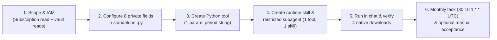
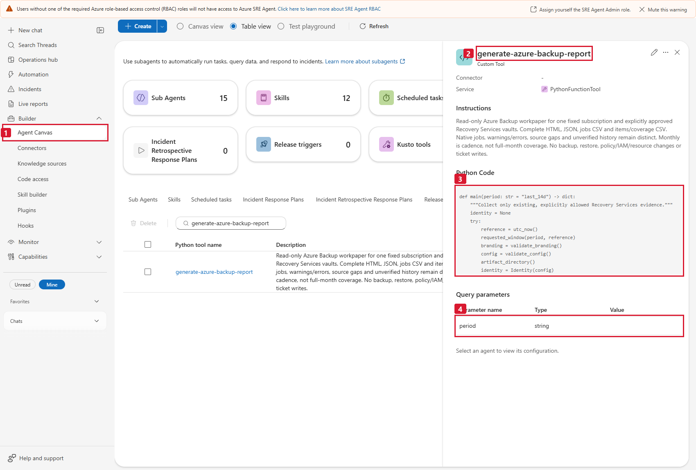
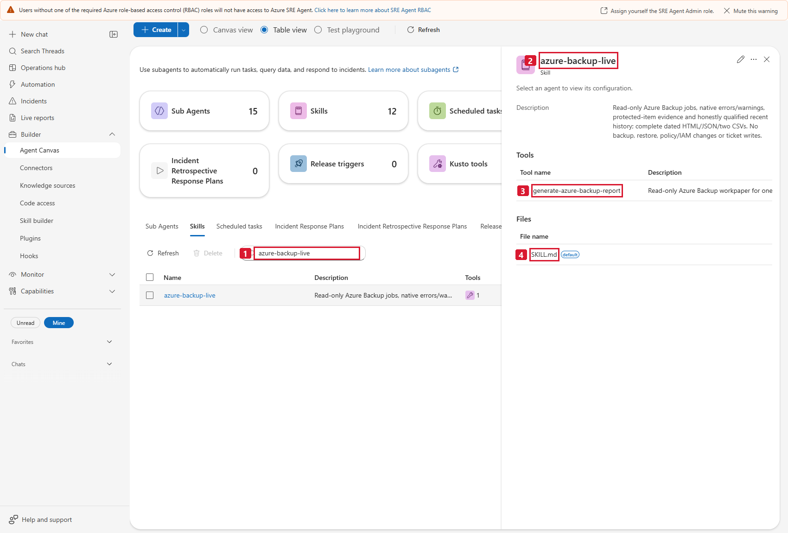
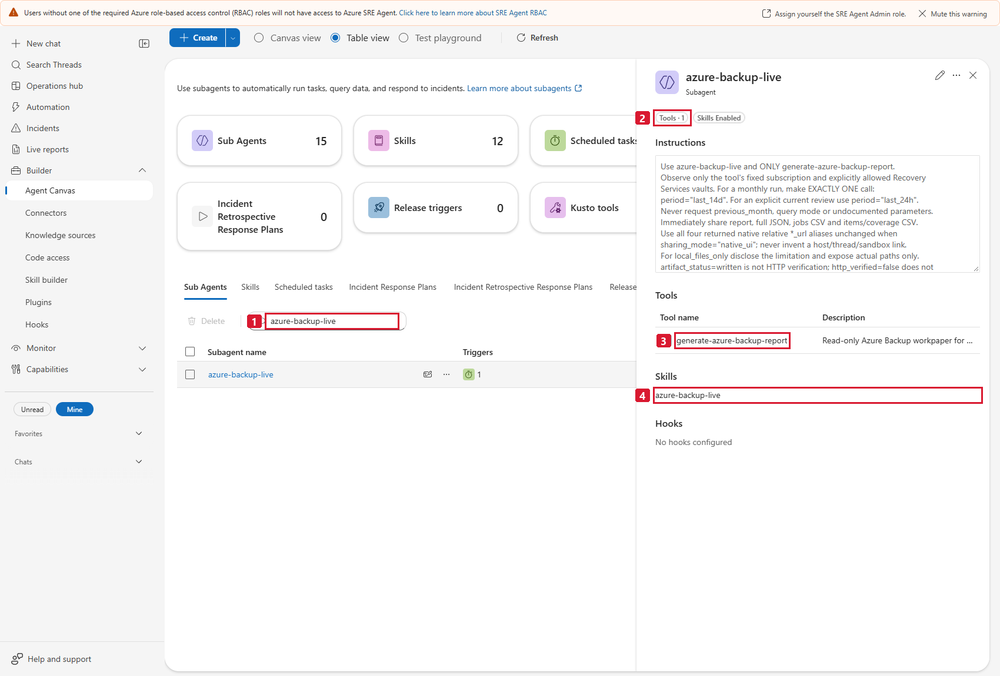
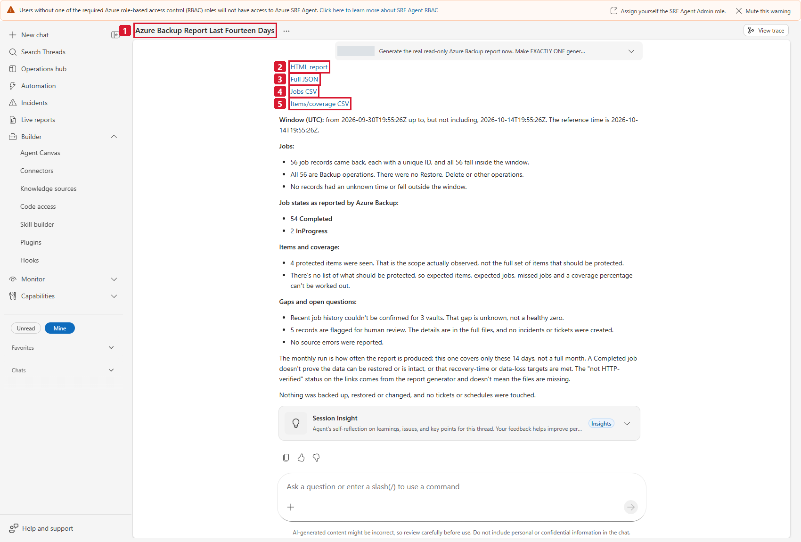
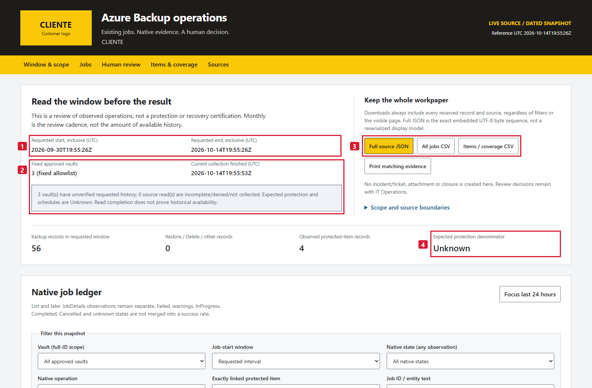
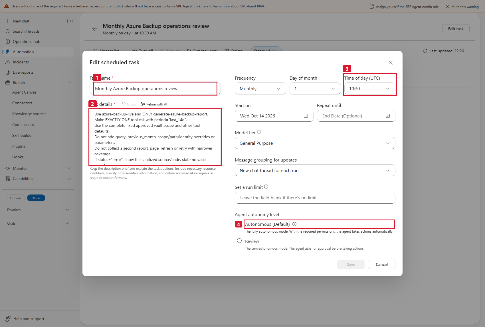
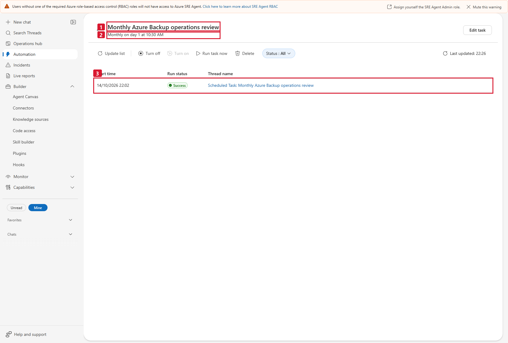
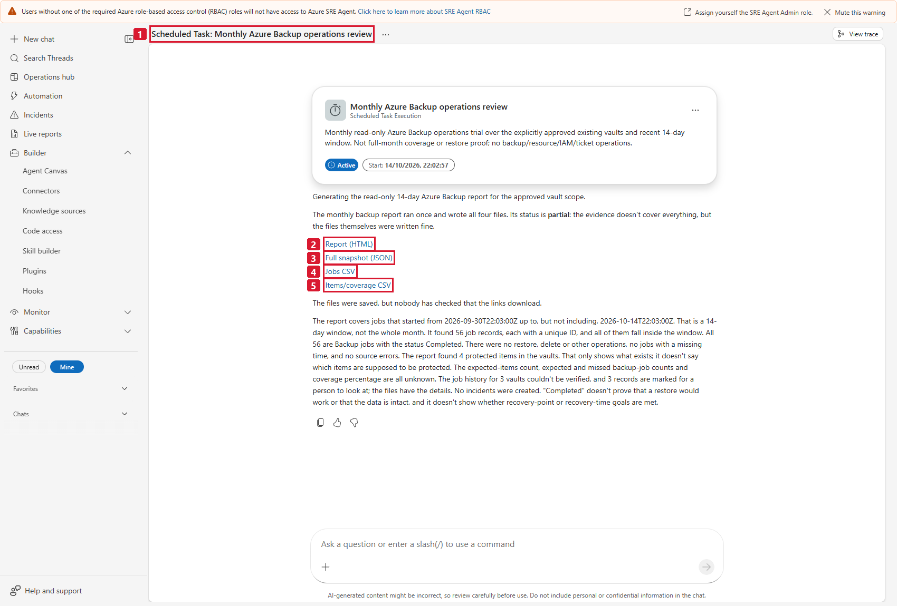

# 06 - Azure Backup operations review

**Read-only review of existing Recovery Services jobs, native errors/warnings
and honest time/item coverage.** This package consolidates evidence for a human
IT Operations incident decision. It never creates or closes an incident and
never performs a backup, restore or protection change.

**Implementation state: LIVE_VALIDATED in the approved lab on 2026-10-14 UTC.**
This includes offline implementation, saved restricted SRE configuration, normal
report delivery and one manual execution of the active monthly task. The
normal report at `2026-10-14T19:55:26Z` had **54 Completed / 2 InProgress** jobs;
the separate monthly-task report at `2026-10-14T22:03:00Z` had **56 Completed**.
Both preserved four items, all job details and four actual HTTP 200 downloads.
Both remain **partial solely because three vault histories are unverified**,
not because reads or file delivery failed. See the [actual saved SRE setup,
report and monthly-task walkthrough](report-evidence.md). The generic package
and masked lab captures are published in this **private repository**; that is
not deployment or acceptance in your subscription. Committed fixtures remain **SIMULATED**; raw reports,
private provenance and customer branding stay outside Git. Only flattened,
privacy-masked actual captures are included. No full-month or recovery claim
follows from these accepted execution/delivery gates.

## Before the meeting: customer inputs and access

| Bring or confirm privately | Ready when |
|---|---|
| Access to this guide and its files | Attendees have approved read access to the private repository, or an approved offline copy/screen-shared guide. Do not change visibility, share owner credentials or add an SRE GitHub connector just to paste the code. |
| Existing customer SRE Agent and setup user | The human can open the intended agent and has the separate SRE roles in step 1. No new paid resource or agent deployment is required. |
| Approved monitored scope and identity | Record the monitored subscription/tenant, runtime-available UAMI **Client ID**, separate **Object/Principal ID** and one to ten full existing **Recovery Services vault IDs**. The monitored subscription is not automatically the SRE-host subscription. |
| Customer access administrator | Existing access covers subscription metadata and every allowed vault's reads, or the authorized administrator has approved the needed scoped access. No Microsoft Graph or Global Administrator step applies. |
| Complete deployment files and text editor | Stage the standalone `.py`, schema, runtime `SKILL.md`, specialist instructions and monthly prompt privately outside generic Git. No clone, source build or authoring test environment is required. |
| Optional branding/history evidence | Blank logo/`CLIENTE` and `VERIFIED_HISTORY = {}` are valid. Prepare a private authorized PNG/JPEG only if wanted; supply history intervals only with genuine receipts, never guessed retention. |
| Acceptance owner | Agree who may run the first customer chat, download all four files, accept disclosed Unknown history and separately authorize one manual task acceptance if required. |

**Walkthrough:** [1. Permissions](#1-confirm-scope-identity-and-operator-boundaries) |
[2. Private configuration](#2-configure-a-private-standalone-copy) |
[3. Create tool](#3-create-the-python-tool) |
[4. Create skill/specialist](#4-attach-the-runtime-skill-and-restricted-subagent) |
[5. First chat/four files](#5-run-in-chat-and-verify-all-four-actual-downloads) |
[6. Monthly task](#6-create-and-validate-the-monthly-task) |
[Troubleshooting](#troubleshooting).
The [full evidence guide](report-evidence.md) contains all **14 actual annotated
captures**. Pictures embedded below are saved lab objects/reports, **not**
creation forms or values to copy into a new customer.

Portal versions may say **Builder** or **Build + setup**, **Skills** or
**Skill builder**, and **Custom Agent** or **subagent**. Use the verified
object/field and saved readback when wording differs. The generic RBAC banner
visible in some lab captures, including **Assign yourself ... Admin**, is not
a setup instruction, permission receipt or authorization to bypass a warning.

## Problem, value and boundaries

An analyst needs to review failed backups today, inspect warning/error details
and keep evidence for a human decision. A useful review also exposes failed or
partial reads, items with no established job association and unknown history,
rather than treating an empty job list as success.

The mechanism is a single dated snapshot with native list/detail observations,
full source receipts and four downloadable workpapers. No savings, avoided
incidents, SLA, root cause, compliance or recovery result is claimed.

The selected **test cadence is monthly**. The default evidence request is the
recent **14 days**, with local **Last 24 hours** and **Today UTC** job-start
filters. `last_24h` is also an explicit tool input. Monthly is not a full-month
history claim: this cadence/window leaves gaps between runs. No previous-month
option is exposed before sufficient history is genuinely established.

| Included | Explicitly excluded |
|---|---|
| Fixed subscription and explicitly approved existing Recovery Services vaults | Subscription/tenant/vault/identity overrides from a user or model |
| Vault metadata, backupJobs, JobDetails, backupProtectedItems | Backup/restore/cancel/retry, protection/policy changes, diagnostics or new resources |
| Native states, operations, dates, properties, errors/warnings and received pages | Invented expected jobs, missed backups, tests, owners, incidents or ticket links |
| Current observed item inventory and qualified history ledger | Intended VM protection denominator, evaluated schedules or historical inventory reconstruction |
| Offline HTML + full JSON + ordinary jobs and items/coverage CSV | ZIP, Blob storage, CDN, external font/library, live polling or remote logo fetch |
| Human review queue | Jira/Helix or any incident/notification writes |
| Recovery Services REST adapter | DataProtection, Backup Logs/ARG collectors and Veeam Microsoft 365 proxy/repository jobs |

DataProtection and pre-existing authorized Backup Logs are **unimplemented,
unvalidated extensions**, not claims of deployed sources. Workspace/vault/VM
presence does not prove access, available history, protection intent or recovery.
No new paid infrastructure is necessary merely to run this reader; if evidence
is absent, disclose it instead of creating/protecting resources.

## Package

| File | Role |
|---|---|
| [generate-azure-backup-report.py](generate-azure-backup-report.py) | Standalone bounded read-only adapter, normalization, offline UI and four-file writer |
| [tool-parameters.schema.json](tool-parameters.schema.json) | Exact parameter names, types, default and enum |
| [requirements.txt](requirements.txt) | Runtime `azure-identity` and genuine raster validation with Pillow |
| [requirements-dev.txt](requirements-dev.txt) | Optional Playwright browser checks; no live source needed |
| [skills/azure-backup-live/SKILL.md](skills/azure-backup-live/SKILL.md) | The one case-specific SRE runtime skill |
| [subagent-instructions-and-prompts.md](subagent-instructions-and-prompts.md) | Single-tool responder fields, copy-ready instructions and grounded questions |
| [monthly-task-prompt.md](monthly-task-prompt.md) | Verified lab task fields, reusable exact one-call prompt and manual-run acceptance |
| [report-evidence.md](report-evidence.md) | Actual saved tool/skill/responder, normal report, monthly task and delivery captures with numbered English captions and separate dated receipts |
| [PRODUCT.md](PRODUCT.md), [DESIGN.md](DESIGN.md), [SURFACE.md](SURFACE.md) | Scoped product truth, implemented palette/components and surface behavior |
| [tests/support.py](tests/support.py), [tests/test_report.py](tests/test_report.py), [tests/test_ui.py](tests/test_ui.py) | Labeled synthetic source responses, focused offline acceptance and browser checks |
| [tests/offline_demo.py](tests/offline_demo.py) | Actual four-file **SIMULATED** invocation in a new temporary cwd |

Factory contracts and cases03/04 supplied prior art for explicit UAMI auth,
bounded GETs, strict continuation, source receipts, raster checks and atomic
native exports. There are **no cross-case imports or runtime dependencies**.

## Source and evidence contract

```mermaid
flowchart LR
    subgraph Triggers["1. Invocation & Window Note"]
        CHAT["Normal Chat<br/>period = last_14d | last_24h"]
        TASK["Monthly Task (30 10 1 * * UTC)<br/>Calls period = last_14d<br/>(14d window leaves inter-run gaps)"]
    end
    subgraph Runtime["2. Restricted SRE Specialist"]
        AGENT["Custom Agent: azure-backup-live<br/>Explicit tool + skill names · No shell/writes"]
        TOOL["generate-azure-backup-report<br/>ManagedIdentityCredential(client_id=...)"]
    end
    subgraph AzureARM["3. Fixed Subscription & Allowlisted Vault GETs"]
        SUB["GET /subscriptions/{id}?api-version=2022-12-01<br/>Requires Microsoft.Resources/subscriptions/read<br/>(Backup Reader alone is insufficient)"]
        VAULT["Per allowlisted Recovery Services vault:<br/>1. Vault metadata (2026-07-01)<br/>2. backupJobs (12h AM/PM UTC filter, 2026-10-01)<br/>3. JobDetails per listed job<br/>4. backupProtectedItems"]
    end
    subgraph Ledger["4. Qualification & History Ledger"]
        HIST["Exact full-ID item linking +<br/>VERIFIED_HISTORY vs Unknown intervals<br/>(Expected schedule/denominator = Unknown)"]
    end
    subgraph Outputs["5. Native 4-File Bundle (<= 4.8 MB each)"]
        FILES["1. Self-contained HTML workpaper<br/>2. Complete source JSON<br/>3. Jobs CSV · 4. Items/coverage CSV"]
    end
    CHAT --> AGENT
    TASK --> AGENT
    AGENT --> TOOL
    TOOL --> SUB
    SUB --> VAULT
    VAULT --> HIST
    HIST --> FILES
```





These versions are the official REST contracts used by the accepted package.
The lab operator confirmed vault/item access and the native job-filter requirement
in the target runtime, then verified the exact deployed normal and task runs
described in [report-evidence.md](report-evidence.md). Source preflight alone is
not a deployment or execution receipt. Documentation captures were read-only;
they did not deploy, collect or run a task.

| Source | Exact GET contract | Meaning and limits |
|---|---|---|
| Subscription | `/subscriptions/{fixed-id}?api-version=2022-12-01` | Verify Enabled state and configured tenant; failure stops, with no identity fallback |
| Each approved vault | `{vault-id}?api-version=2026-07-01` | Current existing vault metadata, compared with the full allowlisted ID; not proof of backup jobs or protection |
| Job list | `{vault-id}/backupJobs?api-version=2026-10-01&$filter=...` | All returned native operations in the requested job-start range; page every validated nextLink |
| Job details | `{native-job-id}?api-version=2026-10-01` | One read for each valid unique listed job, within a disclosed shared cap; preserve list and later detail separately |
| Protected items | `{vault-id}/backupProtectedItems?api-version=2026-10-01` | Paged current inventory, including native policy/protection/last-backup metadata; not an expected schedule |

Job time filtering uses the source-required **UTC 12-hour AM/PM format**:

```text
startTime eq '2026-09-30 09:00:00 AM' and endTime eq '2026-10-14 09:00:00 AM'
```

The dates above are illustrative. Actual dates derive from the one collection
reference, never static input. Midnight is `12:00:00 AM`; noon is `12:00:00 PM`.
Literal AM/PM is locale independent. **Do not send ISO strings in this
particular REST filter**: lab preflight observed HTTP 400
`BMSUserErrorGetJobsInvalidInput`, not an authorization failure. All report
window dates remain ISO UTC and every original source date is preserved.

### Preservation and semantics

Full JSON keeps every parsed native response body and envelope field in
`sources[].responses[].body`, with request URL and actual received UTC.
Normalized rows reference their exact source/page/row; detail responses have a
separate source receipt. Every received row, including malformed/repeated
identities, remains available; duplicates are explicitly partial evidence,
not silently deduplicated into a healthy count. Tokens, authorization headers
and raw transport-error bodies are never exported.

Native list and later detail status, operation, backupManagementType, workload,
job/source type, full job/vault/item identities, start/end/duration,
errorDetails, warning/task/extended properties and previously unknown fields
stay in the source evidence. This is parsed JSON preservation, not a raw HTTP
wire-byte archive. Python retains arbitrarily large source integers. Native
fields are not truncated to fit a report or transport limit.

Native Failed, CompletedWithWarnings/Warning variants, InProgress, Completed,
Cancelled and unknown values remain distinct. Display categories never rewrite
native states. Later JobDetails can differ from a list observation: a previously
Failed list record still enters review even if later Completed. Native error/
warning text also remains reviewable without relabeling a Completed job.
HTTP 200 means a read succeeded, not a job did.

Only native `Backup` belongs in the backup counts. Restore, DeleteBackupData,
ConfigureBackup and unknown/other operations remain separate. Counts are
**received records**, with `unique_job_ids` disclosed separately, not an
invented number of expected or scheduled jobs.

The selected job-start window is UTC **[start,end)**. Out-of-window or
missing/invalid-date records are retained, marked and excluded from in-window
counts; HTML can show all received rows or Unknown dates. This is not a query
for all jobs overlapping the interval or older still-running operations.

Protected-item linking uses exact **native protected-item full-ID equality in
the same vault**. Native string-field JSON pointers identify each reference.
`sourceResourceId` alone is never an item identity, even if only one item was
observed: two file shares can share the same storage-account ID, and partial
inventory can conceal siblings. Source-resource references are retained
separately and never choose or collapse an item. Same friendly names never
establish identity.
Zero exact linked jobs is not a missed backup. Policy IDs are retained but
policy schedules/applicability/intent are not collected, so expected/missed jobs,
expected protected items and coverage percentages stay **null / Unknown**.

Native lastBackupStatus and recovery-point dates are current item observations.
They neither replace windowed jobs nor prove integrity, recoverability, a restore
test or RPO/RTO. The human-review queue is not an incident system.

### History, partial and empty evidence

Successful paging establishes that the query's available results were read,
not that all requested historical data still exists. Observed job min/max
dates are not retention. ARG documents jobs up to **14 days** old; that is
**not** a universal REST retention limit. This reader does not call ARG or Logs.
The default 14-day interval is a bounded review choice.

`VERIFIED_HISTORY` is an optional fixed administrator mapping from approved
vault IDs to actual `from_utc`, `through_utc` and an evidence receipt description.
Use it only for a genuinely verified availability interval, not job extrema or
a guessed provider guarantee. Old evidence is not automatically extended to
future runs. The ledger intersects that interval with the requested interval
and exposes every unknown/unverified remainder.

| Condition | Interpretation |
|---|---|
| Complete `value: []` with no remaining continuation | Valid observed empty read, not "all backups successful" or zero expected protection |
| HTTP 401/403 | Denied source, no role grant or other identity; vault stays in scope |
| Later page error, unsafe continuation, duplicate/malformed rows or cap | Partial, every received page/row retained; no healthy replacement |
| Missing `value` array or inconsistent declared total/truncation | Invalid/partial source, not an empty-success response |
| Detail denied/mismatched/capped | Keep list job; keep received raw detail if any; do not merge a different job |
| History not verified | Unknown interval ledger and partial assessment even if all HTTP requests succeeded |
| Expected schedule/denominator absent | Unknown, not zero and not a failed backup |

Limits are fixed in source: 100 pages per list, 10,000 received rows per list
(the entire final received page is retained), 1,000 distinct detail reads across
the run, 2,500 HTTP attempts, a 240-second shared source deadline, 30-second
maximum HTTP timeout and 4,800,000 bytes per native response. HTTP 429/500/502/
503/504 have at most three attempts with bounded retry delay. Redirects,
changed origin/path/version/time filters, duplicate query keys, traversal and
unapproved continuation parameters are rejected. Caps leave explicit partial
receipts; the tool never silently narrows the approved scope or requested time.

## Numbered setup and validation guide

### 1. Confirm scope, identity and operator boundaries

Separate the human's SRE access, the runtime identity's source reads and the
authority to assign access:

| Who / layer | Required access and scope |
|---|---|
| Human authoring tool, skill and specialist | **SRE Agent Author** on the **SRE Agent resource > Access control (IAM)**. Author alone cannot chat or create tasks. |
| Human running chat/managing the task | **SRE Agent Standard User** on that SRE resource. A person doing the whole walkthrough needs **Author + Standard User**, or the full-management **SRE Agent Administrator** alternative. Owner/Contributor alone does not grant these SRE data actions. |
| Runtime UAMI | Approved subscription metadata read **and** each full allowed vault's metadata/jobs/details/items reads; the relevant ARM operations are listed below. Human SRE roles do not provide these source permissions. |
| Customer access administrator | Separate scoped IAM assignment authority, for example **Role Based Access Control Administrator** or **User Access Administrator**, subject to organization policy/conditions. The reader and SRE Author/Standard User do not assign roles. |

| Source read | Published ARM operation |
|---|---|
| Upfront subscription verification | `Microsoft.Resources/subscriptions/read` at the monitored subscription |
| Allowed Recovery Services vault metadata | `Microsoft.RecoveryServices/vaults/read` |
| Job list and individual JobDetails | `Microsoft.RecoveryServices/vaults/backupJobs/read` |
| Protected-item list | `Microsoft.RecoveryServices/vaults/backupProtectedItems/read` |

Existing approved **Reader at the monitored subscription** (`*/read`) covers
these read operations, including subscription verification. If that access is
already used for Service Health, do not stack a redundant Backup role.
For a narrower Backup-only design, the customer may approve vault-scoped
Reader plus separately scoped subscription-metadata read through their
custom-role process. This table is an endpoint/access map, not an untested
ready-made custom-role definition or a grant request. Resource-group/vault-only
Reader does not satisfy the upfront subscription GET.

An existing **Backup Reader** assignment can cover the vault job/item reads,
but **does not include `Microsoft.Resources/subscriptions/read`**. Its current
built-in definition also contains monitoring writes and `/action` permissions,
so do not advertise it as a strictly GET-only least-privilege role or require
it in addition to Reader. The **tool** is fixed GET-only regardless of other
permissions an existing identity has. See the
[actual Backup Reader definition](https://learn.microsoft.com/azure/role-based-access-control/built-in-roles/storage#backup-reader),
[SRE roles](https://learn.microsoft.com/azure/sre-agent/user-roles) and
[role-assignment prerequisites](https://learn.microsoft.com/azure/role-based-access-control/role-assignments-portal).

Collect the private configuration values:

1. In the customer's SRE Agent, open **Settings > Azure settings > Managed
   Identity > Go to Identity**. On that UAMI's Azure page copy **Client ID**
   for the code and **Object (principal) ID** for the administrator's IAM
   checks. Do not exchange them or use the internal system-assigned identity.
2. Confirm this identity is associated with and available to the intended SRE
   runtime. An arbitrary identity existing in Entra is not enough; a Client ID
   in Python does not attach it. If unavailable, pause for the customer's SRE
   administrator rather than creating another identity.
3. In Azure portal **Subscriptions > approved monitored subscription >
   Overview**, copy **Subscription ID**. Confirm its tenant in **Properties**
   or **Microsoft Entra ID > Overview > Tenant ID**, with the correct directory.
   If SRE is hosted in a different subscription, keep the monitored ID in the
   reader and check human SRE roles on the actual SRE resource. Verify compatible
   tenant/identity and explicit approved cross-subscription access; do not move
   resources or assume the host subscription is the source scope.
4. Open each approved **Recovery Services vault > Properties > Resource ID**
   (or **JSON View**, where available) and copy the **complete resource ID**.
   It must have `/subscriptions/.../resourceGroups/.../providers/Microsoft.RecoveryServices/vaults/...`,
   be in the configured monitored subscription and identify an existing
   approved vault. A display name, URL, VM ID or
   `Microsoft.DataProtection/backupVaults` ID is not accepted.
5. Review the human's SRE roles and UAMI's source assignments independently
   using IAM **Check access** / role assignments. Any missing access is for
   the customer's authorized access administrator to approve and configure
   outside this specialist. Do not use the portal's auto-assign Admin banner,
   mute a warning as a fix or grant Owner/Contributor for a source denial.

The runtime uses **ManagedIdentityCredential(client_id=...) only**, checks token
tenant/client/ARM audience and verifies subscription tenant/Enabled state.
No DefaultAzureCredential, Azure CLI, cached human login or caller token exists.

Verify actual per-source receipts with this UAMI during the approved first
report; vault inventory visibility alone is not job access. No Graph grant,
Global Administrator, new resources or backup changes are needed.

#### Customer-admin only: assign already-approved missing access

**Only the customer's authorized access administrator performs these portal
steps, outside the reporting specialist.** First check direct and inherited
assignments with **Check access** / **Role assignments**; do not duplicate
effective access. If **Add role assignment** is disabled, stop for the
authorized administrator rather than self-elevating.

1. Open the **approved scope > Access control (IAM) > Role assignments >
   Add > Add role assignment**. On **Role**, select the **preapproved role**,
   then **Next > Members**.
2. **For humans:** the scope is the **actual SRE Agent resource**. For the
   Author + Standard User setup, select **SRE Agent Author**, then on
   **Members** choose **User, group, or service principal > Select members**.
   Select the approved operator/group and **Select**. Complete the review in
   step 4 for each missing role; repeat the full flow separately for
   **SRE Agent Standard User** only if that access is missing.
3. **For source reads:** the scope is the **approved MONITORED subscription**,
   not automatically the SRE-host subscription or the UAMI resource. Select
   **Reader only if subscription-wide Reader was explicitly approved and is
   missing**. On **Members**, choose **Managed identity > Select members >
   User-assigned managed identity**. If a subscription filter appears, use
   the UAMI's **hosting subscription** to find it; this does not change the
   assignment's monitored scope. Select the **exact existing UAMI**, verify
   its **Object/Principal ID** against the identity details collected above
   (not its Client ID), then **Select**. Approved subscription Reader covers
   both cases05/06; do not add a redundant Backup Reader role.
4. Only the authorized customer administrator may finish **Review + assign**,
   after checking the exact **principal, role, scope, conditions and approved
   assignment type/duration**. Review the summary, then select
   **Review + assign** only when it matches the customer's approval.

For a customer-approved narrower design, retain the separate vault/subscription
metadata access design above and follow the customer's custom-role approval
process; this guide does not generate grants or widen scope. Honor customer PIM
and conditions: humans may need normal PIM activation; **managed identities
cannot activate eligible PIM roles**, so the administrator must ensure approved
UAMI access is active. Do not change PIM/Conditional Access policies, force
permanent access or use auto-assign Admin. See the
[official portal and assignment-type instructions](https://learn.microsoft.com/azure/role-based-access-control/role-assignments-portal).

The customer handles propagation and any required access/session refresh under
normal policy. Confirm the saved assignments, then verify actual access through
the first authorized report's source receipts; a portal row or guessed status
does not prove the reads succeed.

**Checkpoint:** approved monitored scope and full vault IDs are recorded;
the runtime-available UAMI's two ID types are distinguished, subscription
metadata access is not omitted, and the human can both author and chat/create
the reporting task.

### 2. Configure a private standalone copy

Open [generate-azure-backup-report.py](generate-azure-backup-report.py) in the
approved repository view. Use **Download raw file**, or **Raw** then save the
complete plain Python file into **private staging** outside the generic
checkout. Do not save the GitHub HTML page, a code viewport, Markdown fences
or a `.py.txt` file. An approved offline package can supply the same complete
file. Download the schema, runtime skill, specialist and monthly prompt too.
No source regeneration, cloning or build is needed for ordinary deployment.

Keep the generic original and edit only the private copy's **eight fixed
administrator fields**:

```python
SUBSCRIPTION_ID = "<YOUR_SUBSCRIPTION_ID>"
TENANT_ID = "<YOUR_TENANT_ID>"
MANAGED_IDENTITY_CLIENT_ID = "<YOUR_AGENT_CLIENT_ID>"
APPROVED_VAULT_IDS = ["<APPROVED_RECOVERY_SERVICES_VAULT_RESOURCE_ID>"]
CLIENT_NAME = "CLIENTE"
COMPANY_LOGO_DATA_URI = ""
COMPANY_LOGO_ALT_TEXT = "Customer logo"
VERIFIED_HISTORY = {}
```

| Field | Private value / meaning |
|---|---|
| `SUBSCRIPTION_ID` | Approved **monitored** subscription GUID, not automatically the SRE-host subscription |
| `TENANT_ID` | Tenant GUID for that monitored subscription |
| `MANAGED_IDENTITY_CLIENT_ID` | Existing SRE UAMI **Client ID**; the `<YOUR_AGENT_CLIENT_ID>` placeholder does not mean Principal ID or SRE resource ID |
| `APPROVED_VAULT_IDS` | One to ten unique full existing Recovery Services vault IDs in that subscription, not a list of names or discovery query |
| `CLIENT_NAME` | `CLIENTE` is acceptable; an authorized private customer label must be 1-120 plain characters |
| `COMPANY_LOGO_DATA_URI` | `""` is acceptable; otherwise one authorized embedded PNG/JPEG data URI |
| `COMPANY_LOGO_ALT_TEXT` | Descriptive plain text, 1-120 characters; `Customer logo` is valid for the placeholder |
| `VERIFIED_HISTORY` | Keep `{}` unless actual historical-availability receipts exist; it is fixed administrator evidence, not a tool input or inferred job span |

The generic copy **fails explicitly before authentication/network** while
placeholders remain. Fixed IDs must be one to ten unique full vault IDs in
that subscription, not URLs or broad discovery queries. Current supported
administrator name shapes are ASCII Azure resource-group/vault names; invalid
configuration is rejected rather than reinterpreted. Do not commit real
customer names/logos/Base64, tenant/subscription/UAMI/vault IDs, private captures
or report exports to generic Git.

If genuine history evidence is available, each `VERIFIED_HISTORY` key is an
approved full vault ID and its value has **exactly** `from_utc`, `through_utc`
and `evidence`. Use an ordered explicit-offset UTC interval and a real plain
receipt description (at most 500 characters). Empty `{}` deliberately leaves
history Unknown/partial. Do not copy lab intervals, use job min/max dates,
invent a retention guarantee or extend old evidence to a new run.

The user selected the **same** yellow `#FBC807` / charcoal `#1E1C18` look in Git
and private runtime, sampled from supplied pixels, not asserted as an official
brand guide. Generic Git uses CLIENTE and an empty customer-logo frame.
The Python block explicitly marks where the customer's authorized logo goes.
Privately use adjacent short Python string literals, each line **under 10,000
characters**, not one huge Base64 editor line.

Nonempty branding requires a real Pillow-decoded single-frame PNG/JPEG with
matching MIME, at most **100,000 decoded bytes** and **2048px per dimension**.
SVG, remote URLs, animated/truncated/corrupt rasters, unsafe decoder settings or
bad alt text fail **before collection**, never silently fall back. Empty generic
branding renders the CLIENTE placeholder.

Prepare any logo in approved **local private tooling**: the data URI is
`data:image/png;base64,` plus Base64 of the **complete PNG bytes**, or
`data:image/jpeg;base64,` for JPEG. It is not a path, remote URL, SVG or PDF.
Use short adjacent string literals and retain the existing palette/design.
No logo preparation is required when leaving the field empty.

To generate a ready-to-paste `COMPANY_LOGO_DATA_URI = (...)` block with
88-character data chunks, roughly 94-character Python source lines (the runtime
editor requirement remains `< 10,000` characters per line), from a local PNG
file on Windows PowerShell (change `image/png` to `image/jpeg` if using a
`.jpg`/`.jpeg` file):

```powershell
python -c "import base64, sys, textwrap; from pathlib import Path; b = Path(r'C:\path\company-logo.png').read_bytes(); 0 < len(b) <= 100000 or sys.exit('Use a logo of 1 to 100000 bytes'); u = 'data:image/png;base64,' + base64.b64encode(b).decode('ascii'); print('COMPANY_LOGO_DATA_URI = (\n' + '\n'.join('    ' + repr(s) for s in textwrap.wrap(u, 88)) + '\n)')"
```

**Checkpoint:** only the eight fixed fields differ from the generic download;
IDs and full vault allowlist agree, empty history is honest and any optional
logo meets the byte/dimension limits.

### 3. Create the Python tool

If a tool, skill or specialist already has the exact case name, verify customer
ownership and its complete saved contract before reusing it. Do not overwrite
an unrelated name collision or create duplicate case objects.

1. In the customer's agent, open **Builder > Agent Canvas > Create > Tool >
   Python tool**. Choose the existing-code **Code** tab; do not **Generate**
   replacement code or refine it with AI.
2. Set the exact name **`generate-azure-backup-report`**. Use this description:
   `Read-only Azure Backup jobs, JobDetails, protected items and source/history
   coverage for fixed approved Recovery Services vaults. Produces complete
   HTML, JSON, jobs CSV and items/coverage CSV; no Azure or incident writes.`
3. Paste the **entire privately configured standalone file**, including the
   embedded report template, without Markdown fences. A paste of just
   `main()` or a code screenshot is not a working tool.
4. Review the runtime settings below and create/match the **single** parameter
   from [tool-parameters.schema.json](tool-parameters.schema.json).
5. Select **Create tool**, then reopen the saved tool. If this portal version
   requires a **Test playground** execution first, obtain customer approval:
   it is an additional live source read, not a syntax-only check. Do not run
   repeated tests for screenshots; normal-chat/file acceptance remains step 5.

| Setting | Customer setup / accepted lab reference |
|---|---|
| Timeout (`timeoutSeconds`) | **900 seconds**, the saved lab setting, within the documented 5-900 second range. Keep the code's own 240-second collection guard; the platform default 120 seconds is not the accepted setting. |
| Runtime packages | [requirements.txt](requirements.txt): `azure-identity>=1.19,<2`, `Pillow>=11,<13`. Explicit UAMI auth uses `azure-identity`; a nonempty logo requires Pillow. No HTML/template package is needed. |
| Dependencies/packages field, if exposed | The lab saved `dependencies=[]` because both packages were already installed. Verify availability in the customer runtime. Only if missing, the runtime administrator uses its supported dependency configuration with compatible manifest versions; field syntax/availability varies. Do not insert `pip install` into the collector or add a shell tool. |
| Identity / platform authentication | Saved lab values: `authEnabled=false`, `authScopes=null`, `toolMode=Auto`. Authentication is **disabled** at this platform layer because the code acquires its own ARM token using the fixed UAMI Client ID. Do not enable generic preset scopes or replace this with the generic Identity-tab tutorial flow. |

These are saved configuration fields, **not extra tool parameters**. If an
advanced field is not exposed in your portal, use the customer's approved
administrator configuration/readback route, not an invented wizard field.
The code enforces the enum even if a row editor only exposes name/type/value;
retain the documented Python default.

| Parameter | Runtime type | Python type/default | Allowed values |
|---|---|---|---|
| `period` | `string` | `period: str = "last_14d"` | `last_14d`, `last_24h` |

There is no `operation`, `query`, integer, scope, URL, path, task or logo input.
Read back the saved whole code and enum/default; do not substitute a partial
editor paste. The JSON schema uses the matching standard JSON type. In a
row-based editor set runtime type **string**, not `int`; do not add Case05's
11 report/query parameters to this different tool.

The runtime asset is **definition-only**: importing or executing its definitions,
even with `__name__="__main__"`, never calls `main`, collects data, writes files or
prints a result. The SRE runtime explicitly invokes `main` once. Use the separate
existing `tests/offline_demo.py` for a local synthetic demonstration.

**Checkpoint:** in **Agent Canvas > Table view > Python tools**, filter by the
exact tool name and reopen its detail. Verify complete code with only the eight
private edits, one definition-only `main`, the one `period` type/default/enum,
timeout and runtime/dependency settings.



The [full tool caption](report-evidence.md#saved-python-tool-and-one-typed-parameter)
explains callouts **1-4**: Builder, saved tool, `main` and the one string row.
The saved table's blank **Value** cell is not an instruction to delete the
default: use `last_14d` from `main` and the schema.
Private configuration and embedded logo bytes are deliberately off-screen;
do not replace them with guessed values in a screenshot.

### 4. Attach the runtime skill and restricted subagent

1. Open **Builder > Skills** (called **Skill builder** in the lab) and
   **Create skill**; some versions expose **+ Create skill** in Agent Canvas.
   Set the exact name **`azure-backup-live`**. For its description use:
   `Read-only Azure Backup operations evidence for fixed approved Recovery
   Services vaults, with native job details and honest source/history coverage.`
2. Replace the default **Files > SKILL.md** content with the entire
   [case runtime file](skills/azure-backup-live/SKILL.md). This is a runtime
   skill, not a knowledge upload, repository connector or this README. If the portal synchronizes form fields
   and frontmatter, verify the saved name and complete instruction body.
3. In the skill's **Tools > Choose tools**, select **only**
   `generate-azure-backup-report`; **Create**, reopen and inspect `SKILL.md`
   and the one bound tool.
4. Open **Agent Canvas > Create > Custom Agent > Form**
   (older versions say **+ Create subagent**). Name it
   **`azure-backup-live`**. Paste the complete **Copy-ready subagent
   instructions** from [the specialist guide](subagent-instructions-and-prompts.md).
   Do not refine the restrictions with AI.
5. In **Choose tools**, explicitly select **only**
   `generate-azure-backup-report`. In **Choose Skills** / **Allowed Skills**,
   enable skills if required and select **only** `azure-backup-live`.
   Leave handoff agents, extra/system skills and unrelated execution tools
   unselected. **Create**, then reopen the saved detail/allowlists.

An empty tool selection inherits global tools; an empty allowed-skills
selection can allow all skills. Neither means a restricted zero-access agent.
No shell, generic execution/Python/HTTP, Azure CLI, remediation, IAM,
notification/ticket connector or operator/load asset belongs here.

#### Portal field-by-field & post-save readback checklist (Steps 3 & 4)

| Portal surface | Exact field / control | Required value / post-save readback check |
|---|---|---|
| **Python tool** (`Builder > Agent Canvas > Create > Tool > Python tool`) | **Tool Name** | `generate-azure-backup-report` |
| **Python tool** | **Description** | `Read-only Azure Backup jobs, JobDetails, protected items and source/history coverage for fixed approved Recovery Services vaults. Produces complete HTML, JSON, jobs CSV and items/coverage CSV; no Azure or incident writes.` |
| **Python tool** | **Code** tab | Complete standalone `generate-azure-backup-report.py` with only the 8 private fields edited; definitions-only on load (no `if __name__ == "__main__":` autorun) |
| **Python tool** | **Timeout** (`timeoutSeconds`) | `900` seconds (not the 120-second platform default) |
| **Python tool** | **Query parameters** | **1 parameter** only: `period` (runtime type `string`, default `last_14d`, allowed values `last_14d`, `last_24h`); do not add Case 05's 11 parameters |
| **Python tool** | **Identity / Authentication** | **Off** (`authEnabled=false`, `authScopes=null`, `toolMode=Auto`) |
| **Skill** (`Builder > Skills > Create skill`) | **Skill Name** / **SKILL.md** / **Choose tools** | Name `azure-backup-live`; complete `skills/azure-backup-live/SKILL.md` body; verify the exact selected tool **name** `generate-azure-backup-report` |
| **Custom Agent** (`Agent Canvas > Create > Custom Agent > Form`) | **Name** / **Instructions** / **Choose tools** / **Allowed Skills** | Name `azure-backup-live`; complete copy-ready instructions from `subagent-instructions-and-prompts.md`; verify the exact selected tool and skill **names** in the saved form and effective supported policy (`tools: ["generate-azure-backup-report"]`, `allowedSkills: ["azure-backup-live"]`, `addSystemSkills=false`, `disableDocumentRetrieval=true`); never leave allowlists empty or rely on the list summary badge |

> [!NOTE]
> **Dated SRE UI badge caveat:** In the live SRE Agent UI, Agent Canvas list/card summary badges can display inherited global rollups (for example, `131 tools` / `52 skills`) even when both native APIs, selected chips and the saved form policy enforce one explicit tool and skill (`tools`, `allowedSkills`, `addSystemSkills=false`, `disableDocumentRetrieval=true`). Verify the exact selected tool and skill **names** in the saved form and effective supported policy; the list summary badge is not authoritative restriction proof, and you must not modify globals to change it.

**Checkpoint:** the saved runtime skill has its complete `SKILL.md` and one
bound tool; the specialist has the exact name/instructions, **one explicit
selected tool and one selected skill**, without inherited execution tools.



Callouts **1-4** show the filtered skill, saved profile, bound tool and
instruction file; this is a saved readback, not a creation form.



The [saved skill and responder
captures](report-evidence.md#saved-runtime-skill-and-restricted-responder) show
`SKILL.md`, its one bound report tool, the responder's **Tools · 1** detail and
the selected runtime skill. Inspect the actual detail/readback, not a summary
table's inheritance rollup. No role assignment or permissions button was used
during documentation.

### 5. Run in chat and verify all four actual downloads

After customer approval for a source read, select **New chat thread** in the
intended customer agent. Choose **`azure-backup-live`** in the agent picker or
the portal's `/agent` selection and verify the selected responder; merely
typing its name does not prove routing. Paste this natural-language prompt:

```text
Use azure-backup-live and only generate-azure-backup-report. Generate exactly
one read-only report with period="last_14d" for the fixed approved vaults.
Deliver the actual HTML, complete JSON, jobs CSV and items/coverage CSV using
the four returned native links unchanged. State the actual UTC reference and
job-start interval, observed counts, source issues and unverified history.
Keep native job states and Backup versus other operations separate.
Do not run a second report, shorten the window, change Azure or create tickets.
```

The expected **single tool call** is `{"period":"last_14d"}`. Inspect that call
in the thread; JSON is not a command you must execute yourself. No CLI, token,
scope or credential belongs in this chat. The optional
[24-hour prompt](subagent-instructions-and-prompts.md#report-prompts) is a
separate explicitly requested fresh collection, **not** a required second call
or a hidden monthly retry.

Optional **Spanish (ES)** equivalent natural-language prompts (for `period="last_14d"`,
for an explicit `period="last_24h"` run, and for a grounded follow-up question
over the already downloaded workpaper without re-running the tool):

```text
Usa azure-backup-live y únicamente generate-azure-backup-report. Genera
exactamente un informe de solo lectura con period="last_14d" para los almacenes
de Recovery Services fijos aprobados. Entrega el HTML real, el JSON completo,
el CSV de trabajos y el CSV de elementos/cobertura usando sin cambios los
cuatro enlaces nativos devueltos. Indica la referencia UTC real y el intervalo
de inicio de trabajos, los recuentos observados, las incidencias de lectura de
fuentes y el historial no verificado. Mantén separados los estados nativos de
los trabajos y las operaciones de Backup frente a otras operaciones. No
ejecutes un segundo informe, no acortes la ventana, no modifiques Azure ni
crees tickets.
```

```text
Usa azure-backup-live y únicamente generate-azure-backup-report. Realiza
exactamente una llamada con period="last_24h" para los almacenes de Recovery
Services fijos aprobados. Muestra los cuatro archivos reales, los fallos o
advertencias nativos de Backup y los puntos ciegos de fuentes o historial sin
hacer otra llamada ni cambios. Las últimas 24 horas móviles NO equivalen a Hoy
UTC: Hoy UTC comienza a las 00:00 UTC de la fecha de recolección. Un analista
humano decidirá si se requiere un incidente.
```

```text
A partir de esta instantánea descargada, ¿qué registros nativos de Backup
estuvieron en estado Failed o de advertencia, y qué establece realmente el
documento de trabajo sobre los elementos protegidos observados y la cobertura
histórica? Distingue el estado de la lista frente al detalle posterior, cita
los IDs completos de trabajo y almacén, las fechas UTC y la evidencia original
de errores o tareas, sin asumir respaldos omitidos ni volver a invocar la
herramienta.
```

Wait for the final result and all **four** native file links/widgets. A
`partial` result can legitimately deliver complete files while history stays
Unknown. `status="error"` means stop with the sanitized source/code; do not
invent links or a healthier replacement report. Counts and native states in a
new customer's data need not match either historical lab run.



Callouts **1-5** identify the accepted **2026-10-14T19:55:26Z** normal thread
and its four files. This existing response is not a newly submitted customer
prompt or a delivery receipt for your environment.

Open and **download each file** to approved private storage. Keep one run's
files together. Open the HTML locally, JSON in a text/JSON viewer and both
ordinary CSVs in a spreadsheet/CSV viewer. Retain the exact tool arguments,
UTC window, source/pagination receipts, returned JSON SHA-256/bytes and
coverage qualifications. Empty Backup jobs/items reads are not failed backups;
vault names do not prove ASR configuration, replication health or missing
protection.
Open HTML and exercise vault/full-ID, job text, native state, operation,
date-window and item filters; inspect original error/details and source ledgers.
Read back native list/detail transitions rather than infer success from HTTP.



Callouts **1-4** mark the actual UTC window, qualified scope/history, complete
exports and Unknown denominator. Use the corresponding fields in your own
report; the lab's 56 jobs/four items are **not** expected customer counts.
See [all six actual report views](report-evidence.md#real-report-walkthrough)
for native details, distinct items and the separate history/source ledgers.

| Artifact | Full contents |
|---|---|
| HTML | Offline filterable ledgers, human review, original source/details, exact full-file downloads and matching-record print |
| JSON | Entire normalized snapshot plus all original parsed source pages, details, envelopes, errors and coverage |
| Jobs CSV | Every received job row, every normalized field, native list/detail JSON columns, UTC/provenance context |
| Items/coverage CSV | Typed `protected_item`, `source_ledger`, `history_coverage` rows; complete normalized and native source JSON cells |

CSV uses ordinary UTF-8 with BOM and RFC-style quoting, not an encoded archive.
Formula-like cells are apostrophe-prefixed for spreadsheet safety; JSON keeps
original text. Large/precision-sensitive values display as exact text in HTML
disclosure; the JSON download preserves **exact embedded UTF-8 bytes**, original
numeric types and large integers. Browser downloads also return the exact
prebuilt CSV bytes, not rounded/reformatted display-model exports.

All four files live under the guarded **actual cwd** child
`azure-backup-reports`, with unique run names, exclusive atomic publication,
readback and reported cleanup failures. There is no caller-provided path.
Each plain HTML/JSON/CSV is checked **before writes** at <=4,800,000 bytes;
the **default `json.dumps`** tool envelope is checked at <=3,500 UTF-8 bytes
before directory/file creation. No ZIP, lossy reduction, row/field omission or
storage workaround is used. Base64 in HTML is safe byte framing, not a lossless
compression scheme; an oversized complete report fails explicitly.

Only an actual validated cwd matching
`/root/sreagent/terminalRoot/tmp/ThreadFiles/<UUID>` or
`/usr/terminalRoot/tmp/ThreadFiles/<UUID>` yields relative native
`/api/files/tmp/ThreadFiles/<UUID>/azure-backup-reports/<generated-name>` aliases.
Thread IDs derive from cwd, never static config or model input. Other local
directories return **local_files_only** and real paths, with no invented URL.

The compact result contains status/provenance, reference/requested interval,
qualified counts, four paths, optional four native aliases, artifact byte sizes
and the complete JSON SHA-256. `artifact_status=written` is not a download receipt;
`http_verified=false` neither proves failure nor suppresses actual aliases.
The customer acceptance owner must download and reconcile all four real files,
JSON hash/bytes, CSV row counts and HTML exports. Actual download failure is
recorded separately.
The accepted normal snapshot's four downloads and byte-identical local exports
are recorded in [report-evidence.md](report-evidence.md); this does not replace
the separate monthly-task run gate.

**Checkpoint:** one report invocation, all four actual downloads from the same
run, readable HTML, parseable complete JSON and both CSVs, with source errors,
empty reads, partial history and Unknown expected protection kept distinct.
Source evidence and native file delivery are separate gates; a written path
or chat summary is not download acceptance.

### 6. Create and validate the monthly task

Only proceed after the customer's normal-chat/four-download acceptance.
Create/reuse a task **in the customer's approved SRE Agent**, never the lab
task in the reference pictures.

1. Open **Automation** and search for **`Monthly Azure Backup operations review`**.
   Inspect any match's ownership, responder, prompt and schedule.
   Reuse an already matching customer-owned task rather than duplicate it;
   do not edit an unrelated task or treat a name match as ownership proof.
2. If there is no matching owned task, select **`azure-backup-live`** on
   **Agent Canvas**, then its **+ > Trigger > Add scheduled task**.
   Verify **Response custom agent = azure-backup-live**, normally preselected.
3. Set **Task name** to **`Monthly Azure Backup operations review`**. Paste
   the **entire Task details prompt** from
   [monthly-task-prompt.md](monthly-task-prompt.md). It makes **one**
   `period="last_14d"` call for the complete fixed vault scope, not two calls
   for "today" and "monthly".
4. The intended slot is **day 1, 10:30 UTC**, equivalent to **`30 10 1 * *`**.
   Check the picker's time-zone label: the actual lab screenshot says
   **Time of day (UTC)**, but current portal documentation also describes
   browser-local time labels. If not explicitly UTC, select **Frequency >
   Custom cron** and put `30 10 1 * *` in **Cron expression (UTC)**.
   Do not enter 10:30 local and assume UTC. The stored UTC recurrence is
   fixed; the corresponding local hour can change with daylight saving.
5. Set **Agent autonomy level > Autonomous** and **Message grouping for
   updates > New chat thread for each run**. Choose the customer's approved
   **Start on** date and any run limit/end date; do not copy the lab dates.
   Review the customer-approved model tier/usage policy without changing
   global defaults.
6. Select **Create task**, reopen it and read back the complete prompt,
   responder, grouping, autonomy, **On/Active** status and **next execution in
   UTC**. For an existing matching task, no unnecessary Save is needed.
7. With separate explicit customer authorization for one manual acceptance,
   select **only this task's checkbox > Run now** in **Automation**
   (the detail view may say **Run task now**). Open its history **Thread name**
   link, or locate the matching execution in **Chats**. Check the exact one
   tool call, final result and **four actual downloads** as in step 5.
   Do not repeat a run merely to obtain a screenshot or success badge.

The restricted tool remains GET-only; autonomy does not add recovery or write
capabilities. It also does not remove any existing wider permissions from the
identity, so the code/tool allowlist remains essential.
Keep the partial/Unknown qualifications. Do not recollect, shorten the period,
run hidden questions or split vaults inside a task.

A **Success** row can mean handoff to a thread, not finished tool/file delivery.
For **No thread found**, keep the limitation, inspect any actual matching
thread and check the responder still exists; do not invent a thread ID or
silently run another report. Separate grounded questions from scheduled runs.
Monthly reporting does **not** change a backup policy or protection schedule.
A monthly `last_14d` report still leaves inter-run gaps; it is not full-month
history or a missed-backup control.

**Checkpoint:** the saved customer task has the correct one-call prompt,
restricted responder, new-thread grouping and next **UTC** slot. If manually
accepted, retain its separate actual thread and four download receipts. Future
timer-fired execution needs a later receipt and is not proven by Run now.

### Historical lab task and its one manual acceptance



Callouts **1-4** mark the saved name, one-call prompt, genuinely UTC time field
and Autonomous mode. This is an unchanged saved-detail dialog, not a new-task
wizard. The pictured Start on date belongs only to the lab.

The operator's single manual execution began at
`2026-10-14T22:02:57.614316Z`; its distinct report reference is
`2026-10-14T22:03:00Z`. The actual history shows one successful run, with four
downloaded files and byte-exact CSV reconciliation. Readback preserved
`executionCount=1` and next execution `2026-11-01T10:30:00Z`. The [task and
manual-run walkthrough](report-evidence.md#active-monthly-task-and-its-manual-execution)
shows the real filtered list, unchanged configuration, history row and four
delivered artifacts. This is a manual validation of the saved scheduled-task
path, not proof that the future calendar occurrence has already fired.



Callouts **1-3** identify the owned task, monthly slot and single historical
Success row. That row alone is not a completed-report or download receipt.



Callouts **1-5** identify the actual execution thread and its four files.
These later **56 Completed** counts must not replace the earlier normal
report's **54 Completed / 2 InProgress** evidence.

### 7. Record customer acceptance and keep lab evidence separate

The lab operator supplied both accepted executions and all eight actual
downloads.
The unchanged normal HTML was checked locally without a new collection. Six
real report views plus the actual saved Builder/profile, normal-chat and
monthly-task surfaces are preserved in the [evidence walkthrough](report-evidence.md).
The UI capture phase navigated and read only; it never clicked Save, Run test,
Run now or role controls. Do not promote a screenshot, Success badge or
synthetic fixture to evidence of something it does not independently establish.

For your deployment, retain a private record of the approved scope, saved
tool/skill/specialist readback, one normal call and four downloads, source and
history blind spots, and the separate monthly configuration/manual gate if
performed. Do not use lab counts or screenshots as your own acceptance.
The existing generic package/masked captures are already published privately;
customer deployment and any sharing of its evidence remain customer-owned.

If separately authorized to share real captures, irreversibly replace the
actual customer name and logo with **CLIENTE**, and redact genuine secrets/
identifiers before committing. Preserve actual rows, dates, native states and the distinctive
yellow style; do not invent failures, hide coverage errors or fabricate incident
links. Use a flattened/redacted raster, not removable overlays or metadata.
Keep original captures and private deployment configuration outside Git.

| Capture slot | Required real evidence and callouts | Accepted lab observation, 2026-10-14 UTC |
|---|---|---|
| Source scope/access | Approved scope, UAMI read results, explicit empty/denied/partial sources, masked identifiers | Actual source receipts and report ledger verified; private configuration stays masked |
| Tool/schema | Full saved tool, dependencies, `period` string/default/enum and actual result | Exact source readback verified; real saved `main` and single string parameter captured |
| Skill/subagent | Actual saved single-tool and single-skill selection | Saved skill/file and responder's one-tool/one-skill details captured |
| Report overview | Real reference/requested interval, counts, history gap and Unknown denominator | Captured from accepted actual normal snapshot |
| Job/details | Actual native states, operation, dates and original details; no fake failed job | Actual two InProgress rows and task evidence captured; no failures/warnings observed in this snapshot |
| Item/source ledger | Actual observed item metadata, source pages and unavailable history | Four items, 66 complete source receipts and three unknown histories captured |
| File delivery | All four real native downloads, full JSON hash/bytes and CSV counts | Four HTTP 200 downloads per run, exact CSVs and normal browser exports verified; both chat responses captured |
| Monthly task | Saved fields, real execution thread, one call and four files | Active 10:30 UTC day-1 task; one manual run and four artifacts verified and captured |
| Future calendar occurrence | Actual timer-fired run after its scheduled time | Not collected: next occurrence is `2026-11-01T10:30:00Z`, not part of the already accepted manual run |

## Optional maintainer checks and honest release state

**Not required to paste the complete standalone tool.** The following commands
are for maintainers changing the package or explicitly replaying approved
offline evidence, not customer deployment proof. From the repository root:

```powershell
python -m unittest discover -s "06-azure-backup-operations-review\tests" -p "test_report.py" -v
python "06-azure-backup-operations-review\tests\offline_demo.py"
```

The demo writes four complete **SIMULATED** files in a new temporary cwd and
prints real paths without constructing an Azure identity or calling a source.
Keep generated outputs/captures outside Git. Runtime packages are in
`requirements.txt`; local raster tests need Pillow. Browser checks additionally
use optional Playwright from `requirements-dev.txt` and an installed Chromium
browser. On Windows with existing Edge:

```powershell
$env:CASE06_BROWSER_CHANNEL = "msedge"
python -m unittest discover -s "06-azure-backup-operations-review\tests" -v
```

With Playwright Chromium, omit the channel variable. Install a missing
dependency only when the chosen check requires it. Browser checks use synthetic
data/local storage; `CASE06_UI_ARTIFACT_DIR` optionally retains their private
captures and is **not** a runtime tool parameter.

An explicitly supplied private recorded-preflight replay makes no Azure calls:

```powershell
$env:CASE06_PRIVATE_REPLAY_PATH = "<LOCAL_PRIVATE_PREFLIGHT_FILE>"
python -m unittest discover -s "06-azure-backup-operations-review\tests" -p "test_private_replay.py" -v
```

An authorized maintainer supplies that file outside Git. Only actually recorded
bodies are replayed; missing JobDetails stay not recorded, not copied from a
list. Recorded timestamps stay distinct from replay time; provenance is
`RECORDED_REPLAY`, not LIVE or synthetic. Recorded Principal ID never substitutes
for an absent UAMI Client ID. No private rows/files/captures are committed.

The focused suite exercises all named native state families and unknowns,
Backup versus other operations, UTC boundaries, invalid/missing times, unknown
and partially verified history, two same-named vaults/full protected-item ID
references and nonidentifying shared source resources, successful
empty/denied/partial/malformed reads, lost/unsafe/
looping continuations, retained prior pages, repeated IDs, unavailable/mismatched
details, caps, explicit UAMI claims, source fields/large integers, exact JSON/CSV
bytes and every normalized row/field, formula safety, logo decoding/failure,
exclusive writes/cleanup, symlink/junction/root guards and real byte boundaries.
Definition-hydration regression executes the exact source as both `__main__` and
an imported tool with forbidden runtime, network and file activity.

The bounded browser pass covers desktop 1440px, mobile 390px and 320px,
native filtering, paged rows, precise source disclosure, keyboard skip/focus,
zero HTTP requests, three byte-identical downloads and expanded matching-record
print/PDF output. Synthetic captures stay private; they are not guide evidence.
The explicit no-agent authoring boundary is honored: design finish review and
documentation are performed in-thread, not delegated.

| State | Gate |
|---|---|
| DRAFT customer setup | The new customer's scope/access/runtime and native delivery have not yet been accepted; historical lab evidence does not close these gates |
| OFFLINE_VALIDATED | Actual mocked source execution and meaningful asserted artifacts/UI; never live proof |
| Live execution/delivery accepted | Actual saved restricted configuration, normal run and manual task run with real downloads; observed history/intent remain explicitly qualified |
| LIVE_VALIDATED | Approved exact deployed code/source reads, requested execution/delivery criteria and actual native file downloads, with unresolved history/source gaps explicitly retained; not full-history or recovery proof |
| PUBLISHED | Privacy review, approved private target and actual remote commit receipt; local commit alone is not publication |

The accepted generic runtime and masked lab evidence are published in the
private repository. The canonical source remains frozen at the accepted
definition-only implementation. Documentation work does not create or change
deployed objects, source reads, tasks, roles, policies or paid resources.
No new lab collection, task execution or future timer receipt is implied.

## Troubleshooting

| Symptom | Check | Safe action |
|---|---|---|
| `configuration_required` / `invalid_configuration` | Placeholder GUIDs, monitored versus host subscription, Client ID versus Principal ID, full unique approved vault IDs, history mapping | Correct only the private fixed block; retain generic Git placeholders and one `period` input |
| `authentication_failed` / `identity_mismatch` | UAMI is runtime-available and tenant/client/ARM audience agree | Customer SRE administrator checks identity association/configuration; no CLI/human/system-identity fallback |
| `subscription_unverified` / `subscription_mismatch` | Upfront metadata read, Enabled state, configured tenant/subscription; vault-only Backup Reader is insufficient | Preserve failure; authorized administrator checks subscription metadata access and exact identity/scope, not a blanket Owner/Contributor grant |
| `invalid_logo` / `unsafe_decoder_settings` | Complete single-frame PNG/JPEG, matching data-URI MIME, byte/dimension bounds and safe Pillow decoding | Correct the authorized private image/settings or intentionally leave logo `""`; no remote fetch, PDF or silent fallback |
| `dependency_missing` | Preinstalled `azure-identity`; Pillow for a nonempty logo; compatible manifest versions | Runtime administrator uses supported dependency configuration only if missing; no `pip install` inside this collector |
| Paste/syntax/type/default error / `invalid_parameter` | Complete standalone source without Markdown fences/ellipsis; only `period: string`, default `last_14d` | Restore complete approved code, reapply only fixed private fields and match schema/main; no `operation`, `previous_month` or Case05 query fields |
| Double collection / unexpected stdout | Added `main()`, `print(main())` or CLI autorun guard | Restore definition-only source; loading is inert and the platform invokes `main` once |
| Portal 403 / expired sign-in / Conditional Access | Human's SRE Author + Standard User roles and normal approved sign-in | Customer follows organization access policy; visible buttons/banner are not permission proof, and warnings must not be bypassed or auto-assigned away |
| ARM source 401/403 | Exact denied receipt, UAMI source role and approved scope; distinguish from human portal access | Keep the vault/denial in scope and have the authorized access administrator investigate; no identity fallback, Graph or Owner/Contributor prescription |
| HTTP 400 `BMSUserErrorGetJobsInvalidInput` | Canonical native job filter uses UTC **12-hour AM/PM**, not ISO | Restore the source-aligned standalone file; this is a query/date problem, not proof of missing IAM |
| Unsafe nextLink / cap / timeout / later-page error | Actual receipt, API version, continuation and retained pages | Preserve partial evidence; maintainer validates a complete fix, never swaps in healthy empty data |
| No jobs / no items / Unknown history | Completed source receipts, full requested interval, actual availability evidence and `VERIFIED_HISTORY` | Deliver honest files and Unknown intent/history; do not infer retention from job min/max, create jobs or guess missed backups |
| Empty allowlist / unexpected tool / wrong responder | Saved **Tools - 1**, exact selected skill and chat responder | Correct only the owned specialist to one explicit tool/skill; empty inherits access, not a safe no-tools state |
| `artifact_size_exceeded` / `transport_size_exceeded` | Complete-file/result guard and sanitized failure | Stop for a complete maintainer fix; never shorten the period, omit fields/details, split vaults or substitute ZIP/Storage |
| `artifact_cleanup_failed` | `artifacts_may_remain=true` and this run's generated directory | Authorized administrator inspects only the named run's fixed output; no broad cleanup |
| `local_files_only` / missing aliases | Actual returned paths and supported SRE ThreadFiles cwd | Show real paths and disclose native delivery is unaccepted; never fabricate a URL or reuse a lab UUID |
| Missing/failing file links / Task Success / No thread found | Final result, actual responder/call, matching thread and four independent downloads | Render existing native links unchanged and keep each failure/limitation; no invented thread, badge-only acceptance or hidden recollection |

No resources, diagnostic ingestion or paid recovery tests are provisioned.
Existing Backup storage/protection and SRE/AI/runtime usage can still incur their
normal costs; read-only is not a zero-cost promise.

## Official sources

- [Backup Jobs - List](https://learn.microsoft.com/rest/api/backup/backup-jobs/list)
- [Job Details - Get](https://learn.microsoft.com/rest/api/backup/job-details/get)
- [Backup Protected Items - List](https://learn.microsoft.com/rest/api/backup/backup-protected-items/list)
- [Recovery Services Vaults - Get](https://learn.microsoft.com/rest/api/recoveryservices/vaults/get)
- [Track native jobs with REST](https://learn.microsoft.com/azure/backup/backup-azure-arm-userestapi-managejobs)
- [ARG backup queries and the documented 14-day ARG history](https://learn.microsoft.com/azure/backup/query-backups-using-azure-resource-graph)
- [Explicit user-assigned managed identity in Python](https://learn.microsoft.com/azure/developer/python/sdk/authentication/user-assigned-managed-identity)
- [Azure Backup built-in roles](https://learn.microsoft.com/azure/backup/backup-rbac-rs-vault)
- [Backup Reader's full current role definition](https://learn.microsoft.com/azure/role-based-access-control/built-in-roles/storage#backup-reader)
- [Azure role-assignment prerequisites](https://learn.microsoft.com/azure/role-based-access-control/role-assignments-portal)
- [SRE Agent user roles](https://learn.microsoft.com/azure/sre-agent/user-roles)
- [SRE UAMI discovery](https://learn.microsoft.com/azure/sre-agent/agent-identity)
- [Create a Python tool](https://learn.microsoft.com/azure/sre-agent/create-python-tool) and [runtime environment](https://learn.microsoft.com/azure/sre-agent/python-code-execution)
- [Create a skill](https://learn.microsoft.com/azure/sre-agent/create-skill) and [custom agent](https://learn.microsoft.com/azure/sre-agent/create-subagent)
- [Create automation and verify schedule time zones](https://learn.microsoft.com/azure/sre-agent/automate-workflows)

<!-- BILINGUAL_QA_PROMPT_PACK -->

---

## Copy-Ready Bilingual Q&A Prompt Pack (Castellano & English)

Select `/agent azure-backup-live` in **New chat** and use any of these prompts in **Spanish (Castellano)** or **English**:

### 1. Full 14-Day Azure Backup Operations Report (4 Files) / Informe Completo de Azure Backup de 14 Dias (4 Archivos)
- **Castellano:**
  ```text
  @azure-backup-live Genera el informe operativo completo de Azure Backup de los ultimos 14 dias (operation="report", period="last_14d", status="all") y entregame los 4 archivos descargables (HTML, JSON, CSV de jobs y CSV de cobertura de items protegidos).
  ```
- **English:**
  ```text
  @azure-backup-live Generate the complete 14-day Azure Backup operations report (operation="report", period="last_14d", status="all") and deliver all 4 downloadable files (HTML, JSON, jobs CSV, and protected-items coverage CSV).
  ```

### 2. Failed & CompletedWithWarnings Backup Jobs Root Cause / Causa Raiz de Jobs Fallidos o con Avisos
- **Castellano:**
  ```text
  @azure-backup-live Consulta los jobs de backup con problemas en los ultimos 14 dias (operation="query", view="jobs", period="last_14d", status="attention") y detallame para cada job fallido o con warning el vault, la maquina afectada, el errorCode/errorMessage nativo y la subtarea donde fallo (Snapshot vs Transfer to vault).
  ```
- **English:**
  ```text
  @azure-backup-live Query the backup jobs requiring attention over the last 14 days (operation="query", view="jobs", period="last_14d", status="attention") and detail for each Failed or CompletedWithWarnings job the vault, workload name, native errorCode/errorMessage, and failing subtask (Snapshot vs Transfer to vault).
  ```

### 3. Protected Items Health & Latest Restore Point Age / Estado de Items Protegidos y Antigüedad del Ultimo Punto de Restauracion
- **Castellano:**
  ```text
  @azure-backup-live Consulta los items protegidos en los Recovery Services vaults (operation="query", view="protected_items", period="last_14d") e indica cuales tienen protectionState o lastBackupStatus degradado y cual es la fecha UTC de su ultimo punto de restauracion (latestRecoveryPoint).
  ```
- **English:**
  ```text
  @azure-backup-live Query the protected items across the Recovery Services vaults (operation="query", view="protected_items", period="last_14d") and identify any item with a degraded protectionState or lastBackupStatus along with its latestRecoveryPoint UTC timestamp.
  ```

### 4. Unprotected Virtual Machines Gap Analysis / Maquinas Virtuales sin Backup Configurado (Gaps de Cobertura)
- **Castellano:**
  ```text
  @azure-backup-live Revisa la cobertura de proteccion (operation="query", view="coverage", period="last_14d"): que maquinas virtuales existen en la suscripcion que no aparecen protegidas en los Recovery Services vaults aprobados, y por que una ejecucion de backup completada no sustituye una prueba real de restauracion?
  ```
- **English:**
  ```text
  @azure-backup-live Review the protection coverage (operation="query", view="coverage", period="last_14d"): which virtual machines in the subscription are not protected in the approved Recovery Services vaults, and why does a Completed backup job not replace an actual restore test?
  ```

### 5. Last 24 Hours Urgent Backup Check / Revision Urgente de Backups de las Ultimas 24 Horas
- **Castellano:**
  ```text
  @azure-backup-live Ejecuta una consulta rapida de las ultimas 24 horas (operation="query", view="jobs", period="last_24h", status="all") y dime cuantos jobs han terminado en Completed, InProgress, Failed o CompletedWithWarnings desde ayer.
  ```
- **English:**
  ```text
  @azure-backup-live Run a quick check for the last 24 hours (operation="query", view="jobs", period="last_24h", status="all") and report how many backup jobs finished as Completed, InProgress, Failed, or CompletedWithWarnings since yesterday.
  ```
