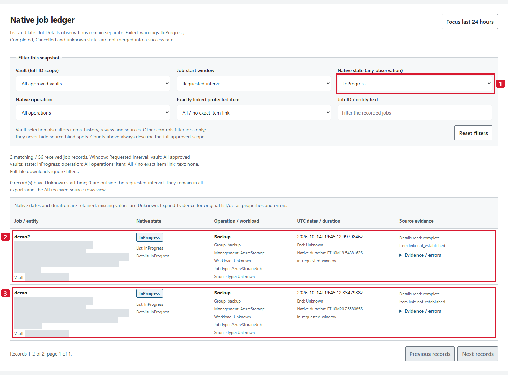
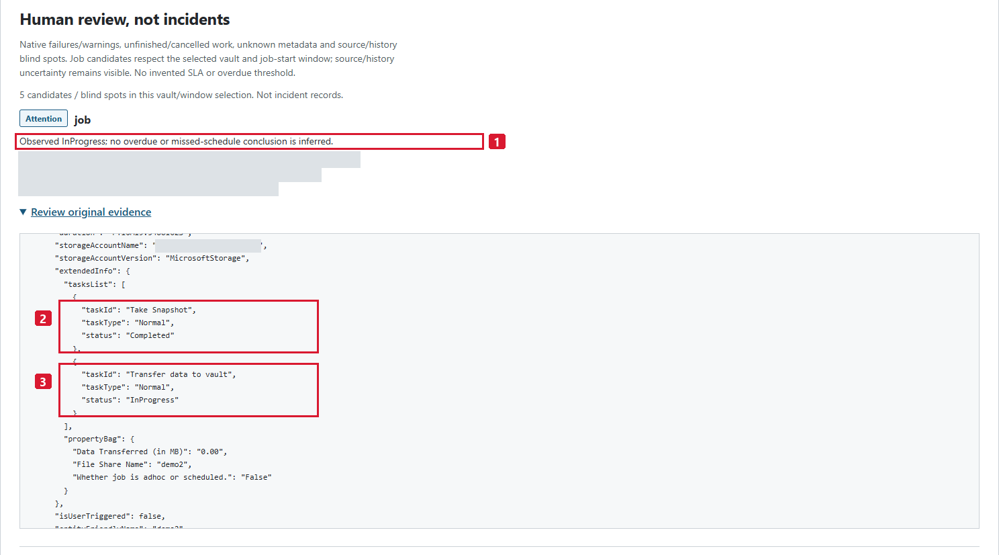
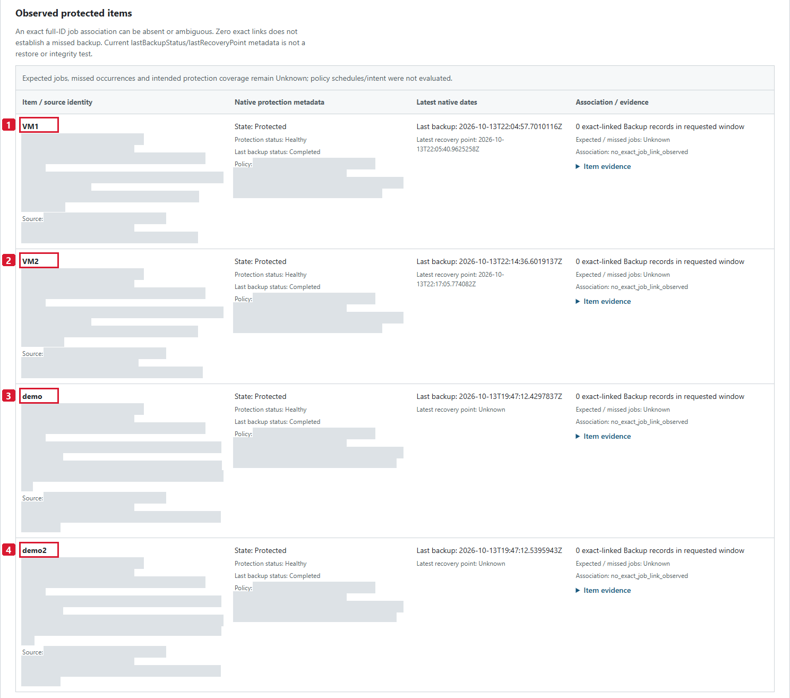
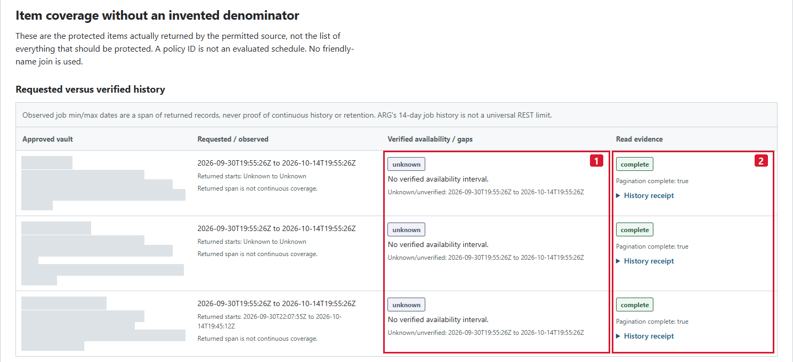
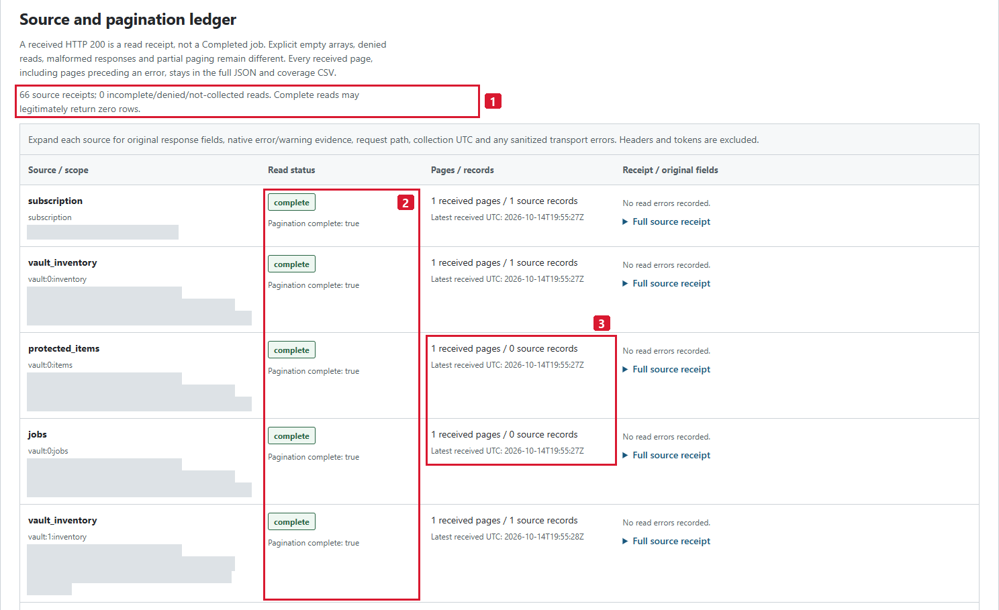
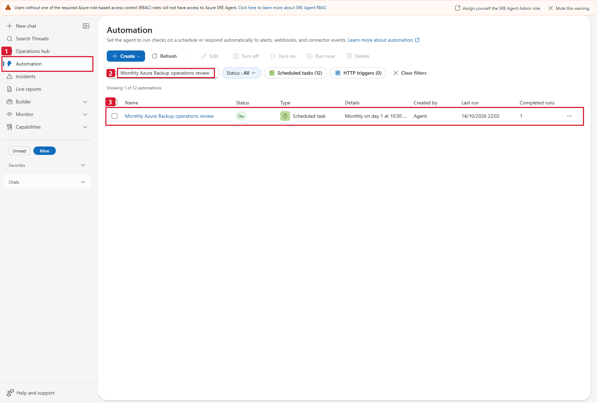

# Actual SRE setup, normal report and monthly-task evidence

These are **real saved SRE UI and downloaded-report captures**, not synthetic
examples, a new collection or a recreated UI. Two accepted executions remain
separate: the normal report at **2026-10-14T19:55:26Z** and the monthly task's
single manual validation report at **2026-10-14T22:03:00Z**. Both have actual
four-file download receipts. The later all-Completed result is not substituted
into the earlier InProgress screenshots.

**For a new customer, start with the [numbered implementation guide](README.md#numbered-setup-and-validation-guide).**
Create and read back the customer's own tool, skill, specialist and task there
before comparing with these saved-detail references. All **14 existing PNGs**
are historical lab evidence; their counts, dates, private values and object
names do not prove acceptance in another environment. The generic package and
masked captures are already published in the private repository; approved
access or an approved offline guide copy is needed to read them.

The normal report's requested job-start interval was
**2026-09-30T19:55:26Z to 2026-10-14T19:55:26Z**, start-inclusive and
end-exclusive. The report completed collection at **2026-10-14T19:55:53Z**.
Local browser inspection and these screenshots preserve that dated snapshot.

The original customer logo and all visible customer-name pixels were
irreversibly replaced with **CLIENTE**. Opaque gray pixels redact private
resource/job/scope IDs, vault/account names and URLs where visible. The images
are flattened RGB PNGs without metadata or removable overlays. The six report
images were annotated directly from their existing masked pixels, without
another browser visit or any data re-render. Pixel proof is separate at each
stage: original to masked differs only within declared privacy rectangles;
masked to annotated differs only within declared annotation rectangles.
Original pixels remain identical outside the **union** of those two sets,
and the selected native-value regions remain unchanged. Original files,
unannotated masked baselines, raw captures, both rectangle sets, full provenance
and browser receipts remain private and are not committed.
Red numbered callouts on report and SRE captures explain real controls/evidence;
red is an annotation style, not an Azure Backup failure or severity. No underlying
UI content was fabricated or changed. Read-only inspection used an isolated UTC
browser, an explicitly authorized existing operator identity and exact-host
authorization held in memory. All non-read HTTP methods were blocked. No Save,
Run test, Run now, role control, deployment or report call was performed during
documentation capture. The reporting tool still uses only its configured UAMI.

## What the normal run establishes

| Evidence | Observed result at this reference |
|---|---|
| Report generations | One accepted normal generation after the definition-only fix |
| Jobs and details | 56 unique job records and all 56 JobDetails preserved |
| Native operations | 56 Backup; no Restore, Delete or other operations in this collection |
| Native states | **54 Completed, 2 InProgress**; no Failed or warning-state jobs observed |
| Protected items | Four distinct native items: two VMs and two file shares |
| Source receipts | 66 complete receipts; zero source read issues |
| Time coverage | All 56 returned jobs fall inside the requested interval; no unknown-date or outside-window records |
| History qualification | All three vault histories remain unverified; no continuous-history or retention guarantee inferred |
| Expected scope/schedule | Unknown; no expected/missed-job count or protection percentage |
| Human review | Five candidates/blind spots: unfinished work and unknown histories, not incident records |

The run's `partial` status is solely the unverified history for three vaults,
**not a source-read or file-delivery failure**. Completed jobs do not establish
recoverability, integrity, a restore test or RPO/RTO. No incident was created.
The two empty vault reads establish only that no Azure Backup jobs/items were
returned from those sources in this snapshot; names do not prove ASR setup,
replication health or required protection.

## Saved SRE setup

The generic source's private configuration was saved and read back before the
accepted runs. The actual saved views were subsequently inspected read-only for
documentation. The generic RBAC advisory remains visible in the
platform chrome; neither its role-assignment action nor its mute control was
used. A screenshot of that advisory is not a role-grant receipt. In particular,
**Assign yourself ... Admin** is not a setup instruction or permission proof;
do not click it or bypass an authentication/Conditional Access warning to
follow this guide. Use the separate human SRE-role and UAMI source-read checks
in [README step 1](README.md#1-confirm-scope-identity-and-operator-boundaries).

### Saved Python tool and one typed parameter

**1** locates **Builder > Agent Canvas**; use **Table view > Python tools** and
filter by the exact new name. **2** identifies the saved
`generate-azure-backup-report` detail, not a new-tool dialog. **3** shows the
actual `main(period: str = "last_14d") -> dict` definition. **4** shows its one
query parameter, `period`, with runtime type **string**. The Python default is
visible in the signature; the display table's Value cell is not a second input.
Its blank saved-detail cell does not remove the default: configure `last_14d`
from the schema/main contract, with only `last_14d` and `last_24h` allowed.
The entire saved code matched its private readback hash. No test was run during
capture and no private configuration/Base64 lines were published.

The canonical source is definition-only: loading it does not call `main`,
print output or create files. The removed CLI autorun and the guarded loading
regression are documented separately from live execution.

### Saved runtime skill and restricted responder

**1** filters the list to `azure-backup-live`; **2** identifies its saved skill
profile. **3** shows the single bound report tool and **4** the default
`SKILL.md` instruction file. The full reusable instructions are in
[skills/azure-backup-live/SKILL.md](skills/azure-backup-live/SKILL.md).

**1** filters the Sub Agents list to the owned responder. **2** is the saved
detail's **Tools · 1** count, **3** is its only listed tool and **4** is the
selected runtime skill. Saved readback also confirmed the explicit tool and
`allowedSkills` allowlists, no added system skills and no parallel tool calls.
Do not use an overview table's inheritance rollup as allowlist evidence: the
actual detail and saved configuration are the relevant proof. No empty global
tool selection, shell, remediation or ticket connector is presented as this
responder's authorization.

### Actual normal-thread file delivery

**1** identifies the accepted normal thread. **2-5** are its actual HTML, full
JSON, jobs CSV and items/coverage CSV links. The message preserves the
`19:55:26Z` reference, **54 Completed / 2 InProgress**, four observed items,
zero source errors and unknown histories. The capture is an existing response,
not a new prompt submission or a second collection. Actual native HTTP
downloads and complete-byte checks below establish delivery beyond what the
message alone can prove.

## Real report walkthrough

### 1. Requested window, complete-file actions and explicit uncertainty

**1** selects the requested UTC boundaries; **2** selects the fixed vault scope,
collection timestamp and explicit history/read qualification. **3** marks the
three complete-file export actions and **4** the Unknown expected denominator.

**Read the two UTC boundaries before the counts.** The snapshot shows three
approved vaults, 56 observed Backup records, four protected items and an
**Unknown** expected-protection denominator. The qualification explicitly says
three vault histories are unverified and zero source reads are incomplete.
The full JSON and two CSV actions export the entire collection, not the
currently filtered rows. The yellow/charcoal appearance is the actual report
style; only customer branding and private identifiers were masked.

### 2. The two actual InProgress Backup records

**1** selects the actual InProgress state filter. **2** encloses the recorded
`demo2` row and **3** the separate `demo` row, with native states, UTC starts,
durations and source-detail status still readable.

**Two matching records out of 56**, both native `InProgress`, are visible for
the distinct `demo2` and `demo` file shares. List and JobDetails both report
InProgress; the recorded start times and native durations are preserved.
`End: Unknown` is not rewritten as a failure or overdue result. The screenshot
uses the report's actual state filter; no failed backup was generated or added
for demonstration.

### 3. Original JobDetails and human-only review

**1** selects the human-review qualification, **2** the native completed
snapshot task and **3** the still-in-progress vault-transfer task. The
rectangles do not change either task status or the enclosing job outcome.

**Inspect the actual native task evidence rather than infer a job outcome.**
The opened `extendedInfo.tasksList` shows **Take Snapshot: Completed** and
**Transfer data to vault: InProgress** for the selected real job. Those are
task-level observations within an unfinished job, not a completed restore or
integrity test. The human-review explanation deliberately makes no overdue,
missed-schedule or incident-creation claim. The source disclosure is scrolled
within the existing UI; its data was not rewritten.

### 4. Four protected items, with both shares kept distinct

**1-4** identify the four distinct displayed item rows in order: `VM1`, `VM2`,
`demo`, `demo2`. These names are highlighted for navigation, not used as identity
joins; full native IDs remain in the private complete evidence.

**Four native item rows remain four rows:** `VM1`, `VM2`, `demo` and `demo2`.
The two shares have distinct protected-item IDs even though they share the
same storage-account source ID in the private evidence. No sourceResourceId
or friendly-name join collapses them. Native current protection/last-backup
metadata and dates remain visible. Zero exact-linked job records is not a
missed backup: expected and missed occurrences are still **Unknown** because
policy schedules and intent were not evaluated.

### 5. Complete reads are not verified historical availability

**1** selects the three unknown availability intervals and their gaps. **2**
selects the separately complete native-read/pagination receipts. The side-by-side
selections deliberately distinguish historical assurance from read completion.

**Read status and history availability are separate columns.** All three
queried vault intervals have `complete` read evidence and completed pagination,
while their historical availability remains **unknown**. The nonempty vault's
returned job-start span is displayed without promoting it to continuous
coverage or a provider retention guarantee. The requested interval is kept
intact; monthly cadence does not fill any history gaps.

### 6. The actual source ledger, including valid empty reads

**1** selects the 66-receipt/zero-read-error summary. **2** marks the named read
statuses and pagination receipts; **3** marks the actual zero-record items/jobs
responses and their collection timestamps.

**The ledger reports 66 receipts and zero incomplete/denied/not-collected
reads.** This image shows the first visible source rows, including an explicit
zero-record jobs read and zero-record protected-items read. It is a screenshot
of a ledger subset, not a replacement for the complete source export. HTTP 200
and complete pagination establish a successful read, not a successful backup
or an expected-empty protection scope.

## Download and local browser acceptance

The lab operator downloaded all four actual native artifacts with **HTTP 200**.
The unchanged HTML was then opened in an isolated local browser with external
HTTP/HTTPS blocked; no Azure/SRE call or recollection was made.

| Actual artifact | Bytes | Data rows, excluding CSV header |
|---|---:|---:|
| HTML | 1,069,237 | Not a CSV |
| Complete JSON | 278,582 | Not a CSV |
| Jobs CSV | 172,842 | 56 |
| Items/coverage CSV | 251,038 | 73: four items, 66 source receipts and three history rows |

The complete JSON SHA-256 is
`e10d42ef09aa0c071a753a0ecc08075b18dc225d6dfe7020d7b986814597c9a8`.
The HTML SHA-256 is
`174a8a9dd9aef49799ff96d38655a166c18f0d00c23d6c1e2ad2bff42040c936`.
The lab operator reconciled both CSVs byte-for-byte with the complete model.

Local acceptance checked desktop **1600px** and mobile **390px/320px**, without
horizontal page overflow and with controls at least 44px high. Native state,
vault, operation, item, job-text and window filters; pagination; original
details; keyboard skip/focus; and complete expanded print output were exercised.
Printing included all **56 matching jobs**, not only the 40 visible on the first
page. No page errors or HTTP requests occurred.

While the UI showed only the two InProgress records, each of its **three
full-file export buttons** downloaded bytes identical to the corresponding
original native JSON/CSV. The exports retained all 56 jobs and the entire
coverage ledger. The original four downloaded artifacts remained unchanged.

The same fixed snapshot returned **four jobs for rolling last 24 hours** and
**two for Today UTC**. These are different filters at this reference, not
interchangeable labels or a fresh observation made during screenshot capture.

## Active monthly task and its manual execution

The operator created **Monthly Azure Backup operations review**, bound it to
`azure-backup-live` and read back the saved **Active** configuration:
`30 10 1 * *` UTC, day 1 at 10:30 UTC, Autonomous, one bounded `last_14d` call,
new chat thread for each run. The next saved execution is
**2026-11-01T10:30:00Z**. The lab operator separately checked that the ten pre-existing
task configurations were unchanged when adding this task; later unrelated
tasks may change the total shown in the platform's global counters.

### 1. Filter to the owned task, not unrelated customer automations

**1** identifies Automation. **2** is the applied exact-name search; the list
explicitly shows **one matching automation**, not a mock or a cropped unfiltered
customer list. **3** preserves the actual task's On status, last-run time and
one completed run. A task row is configuration/history evidence, not by itself
proof that the returned files can be downloaded.

### 2. Inspect the actual saved monthly configuration

**1** identifies the existing task, **2** shows the one-call `last_14d` prompt,
**3** identifies **Time of day (UTC): 10:30**, alongside Monthly and day 1, and
**4** shows the saved Autonomous mode. New-thread grouping is also visible.
The dialog was opened only for inspection: no field was changed, Save remained
disabled and Cancel closed it. Autonomous scheduling does not enlarge the
responder's read-only scope. The pictured **UTC** label belongs to this actual
lab browser; a customer whose picker shows a local zone must use the explicit
**Custom cron > Cron expression (UTC)** route in the
[monthly setup instructions](monthly-task-prompt.md#create-or-reuse-the-task),
then verify the next execution in UTC.

### 3. Keep the existing manual execution receipt separate from its schedule

**1** identifies the task, **2** preserves its monthly slot and **3** is the
single actual successful history row, displayed at minute precision in the
UTC browser. The exact manual start receipt is
**2026-10-14T22:02:57.614316Z**. The lab operator performed that manual execution once.
The visible **Run task now** button was not clicked during documentation capture.
Saved readback retained `executionCount=1` and the future November schedule.

### 4. Read the task's actual response and all four delivered files

**1** is the actual scheduled-task execution thread; **2-5** are its HTML, full
JSON, jobs CSV and items/coverage CSV. This is the **22:03:00Z** snapshot:
56 Completed Backup jobs, all 56 details, four distinct items and zero source
read errors. Three histories remain unknown, so its evidence status is still
partial. Do not replace the normal report's earlier **54 Completed /
2 InProgress** captions with these later counts.

The captured assistant message says that links were not checked by the
generator. That historical text is intentionally unchanged. The separate
operator receipts below establish the later **HTTP 200** downloads; a runtime
`http_verified=false` flag or an unchanged old message does not override those
actual receipts. Similarly, the task card's Active badge describes the saved
task; the execution-history Success row, generated report and downloaded files
are separate evidence.

### Monthly report and download receipt

| Evidence | Actual manual-task result |
|---|---|
| Manual start | `2026-10-14T22:02:57.614316Z` |
| Report reference | `2026-10-14T22:03:00Z` |
| Collection finished | `2026-10-14T22:03:29Z` |
| Requested job-start window | `2026-09-30T22:03:00Z` to `2026-10-14T22:03:00Z`, end-exclusive |
| Native jobs | 56 unique Backup records, all Completed; all 56 JobDetails retained |
| Items / source issues | Four distinct protected items; zero source issues |
| Unknowns / review | Three unverified vault histories; three human-review history blind spots |
| Schedule readback | Active, `30 10 1 * *` UTC, one execution, next `2026-11-01T10:30:00Z` |

| Monthly artifact | Actual HTTP | Bytes | CSV data rows |
|---|---:|---:|---:|
| HTML | 200 | 1,068,301 | Not a CSV |
| Full JSON | 200 | 277,490 | Not a CSV |
| Jobs CSV | 200 | 173,061 | 56 |
| Items/coverage CSV | 200 | 251,210 | 73 |

Monthly complete JSON SHA-256:
`932f9b84276b165d3e2da54b674258613193229d00314c0717b9c9f3b76e938e`.
Monthly HTML SHA-256:
`bfe26ba092dd9a4001760990ab42d97b1ae9f4ba190692d3f3c8346c315257af`.
All four downloaded bytes/hashes were checked against the private receipt.
The frozen export functions also reproduced **both monthly CSVs byte-for-byte
from the complete actual model**, without another collection.

| Snapshot | Native job states | Qualification |
|---|---|---|
| Normal, `2026-10-14T19:55:26Z` | 54 Completed, 2 InProgress | Five review candidates/blind spots, three histories unknown |
| Manual task, `2026-10-14T22:03:00Z` | 56 Completed | Three history blind spots; histories still unknown |

These are separate windows and source observations. Equal record counts do
not prove identical membership or a particular job's transition. No failed
job, restore test, protection change, incident or root cause was manufactured
to make either demonstration look more complete.

## Accepted execution gates and release boundary

The initial normal attempt was **rejected** because a CLI autorun executed
during definition hydration and produced two collections. Its raw outputs
remain private failed-attempt evidence. The definition-only fix removed that
load-time side effect; the accepted normal run used the corrected source, empty
runtime-test stdout and one result/file generation. The screenshots above
belong only to that accepted run.

The generic runtime is frozen at commit
`e71abb50e0a24bf5247e0c3744006d7e4a7f934e`, canonical LF source SHA-256
`278df518562b2201eccf95f1c9419a51401599524b71a375ffaa19b4f53481c4`.
This documentation/capture work changed no runtime code or UI.

The actual saved tool/skill/responder, normal execution/delivery, active
monthly configuration and one manual task execution/delivery are now
documented with separate receipts and privacy-masked captures. Raw exports,
tokens, original private screenshots and private scope/configuration remain
outside Git. Read-only capture permitted no cloud write method, role change,
report test or reexecution. The runtime source and report UI stayed frozen.

**Published lab baseline, separate customer gates:** the generic package and
these masked captures were published in the private repository. A new customer
still needs approved scope/access, saved-object readback and actual normal/
task file-delivery acceptance; this guide performs none of those actions.
The next recorded calendar occurrence was in the future at acceptance; it is
not claimed as already observed.
Unknown histories and intended protection remain unknown in both accepted
runs. Monthly cadence is not full-month coverage, and Completed is not proof
of recovery or integrity.
