# Case 08 - Azure Databricks dependency mapping, configuration and FinOps review

> **Azure SRE Agent** · Read-only Python tool · Runtime skill · Restricted specialist · Offline HTML, full JSON and two CSVs

Turn a fixed, approved Azure Databricks workspace scope into a dated review of
**deep dependency mapping (`OBSERVED`, `INFERRED`, `UNKNOWN`), best practices,
security, FinOps and general optimization**. Trace how the ARM workspace, VNet
injection, Private Link, Access Connector, clusters, pools, policies, jobs and
task DAGs, Lakeflow Declarative Pipelines (DLT), SQL Warehouses, Unity Catalog
objects (metastore, catalogs, schemas, storage credentials, external locations,
connections), Secret Scopes and associated Azure resources connect—and compare
them with a clearly **undeployed Azure Databricks Well-Architected Lakehouse
reference proposal**. The generated report is in Spanish (`es-ES`); this
implementation and cross-tenant onboarding guide is in English.

| What you get | What it does not claim |
|---|---|
| A deep dependency graph classifying **OBSERVED** native ID/key joins, explicit **INFERRED** URI/hostname references and **UNKNOWN** blind spots, plus referential-integrity detection (`G05`) | Runtime SQL table/column lineage fabricated from job or notebook names, or untested data-plane network reachability |
| A local assessment indicator **beside coverage and check counts** across 36 rules, 3 levels, 4 areas and 5 WAF pillars | An official Microsoft Well-Architected Review, Databricks certification or production SLA guarantee |
| First-party-grounded **cross-tenant authentication modes** separating Azure Resource Manager (ARM) from Databricks Workspace and Unity Catalog REST APIs | That a Tenant-A SRE User-Assigned Managed Identity (UAMI) automatically acquires Tenant-B tokens or workspace permissions without administrator setup |
| Control-plane and metadata-only REST reads that **never start clusters or SQL Warehouses** and never execute billable SQL statements | Historical DBU workload attribution (`system.billing.usage`) or runtime table lineage (`system.access.table_lineage`), which require running a SQL Warehouse |
| Four native downloadable files (`HTML`, `snapshot.json`, `findings.csv`, `dependencies.csv`) from one complete report call | Remediation, RBAC/Unity Catalog grants, secret rotation or unattended compute changes |

> [!IMPORTANT]
> **Validation state: Code `OFFLINE_VALIDATED` · Native SRE bootstrap saved & readiness-validated (`2026-10-16`) · Connected Cross-Tenant Plane 2 Live Run Verified (`2026-10-19`, `cross_tenant_multitenant_fic`).**
> In accordance with repository governance, no fake or simulated demo report is
> substituted for an unconfigured live workspace. On **2026-10-16**, the parent
> operator saved and independently read back the native tool
> (`generate-databricks-dependency-report`), runtime skill
> (`databricks-dependency-live`) and restricted specialist
> (`databricks-dependency-live`), executed two native Python tests (API and UI)
> and completed a real selected-specialist readiness chat that stopped before
> authentication with `status="error"` and `error.code="configuration_required"`
> (`artifact_status="not_written"`). On **2026-10-19**, following the
> [Colleague session handoff checklist](#colleague-session-handoff-checklist-cross-tenant-connection),
> the specialist executed a real cross-tenant (`cross_tenant_multitenant_fic`)
> report run against the colleague's Tenant-B Azure Databricks workspace,
> delivering all four native files (`HTML`, `snapshot.json`, `findings.csv`,
> `dependencies.csv`, all verified with HTTP 200) with 14 `complete` Plane 2
> sources, 9 `OBSERVED` edges, 2 `INFERRED` ADLS Gen2 URI edges and 12 `UNKNOWN`
> blind spots while Plane 1 ARM remained `denied` (`HTTP 403`) pending target
> resource-group `Reader` assignment ([`native-readiness-validation.json`](native-readiness-validation.json),
> [`visual-evidence.json`](visual-evidence.json)).

## Contents

- [Brief and validation state](#brief-and-validation-state)
- [Cross-tenant feasibility: Tenant-A SRE Agent to Tenant-B Azure Databricks](#cross-tenant-feasibility-tenant-a-sre-agent-to-tenant-b-azure-databricks)
- [Colleague session handoff checklist (cross-tenant connection)](#colleague-session-handoff-checklist-cross-tenant-connection)
- [How the pieces fit together](#how-the-pieces-fit-together)
- [Source, dependency and coverage contract](#source-dependency-and-coverage-contract)
- [Customer scope coverage and rule catalog](#customer-scope-coverage-and-rule-catalog)
- [Prerequisites](#prerequisites)
- [Files to download](#files-to-download)
- [Step 0 - Identify the reporting identity and approve cross-tenant or same-tenant scope](#step-0---identify-the-reporting-identity-and-approve-cross-tenant-or-same-tenant-scope)
- [Step 1 - Configure the private standalone file](#step-1---configure-the-private-standalone-file)
- [Step 2 - Create the Python tool and verify its 12 typed inputs](#step-2---create-the-python-tool-and-verify-its-12-typed-inputs)
- [Step 3 - Create the runtime skill](#step-3---create-the-runtime-skill)
- [Step 4 - Create the restricted specialist](#step-4---create-the-restricted-specialist)
- [Step 5 - Run one report in normal chat and download its four files](#step-5---run-one-report-in-normal-chat-and-download-its-four-files)
- [Step 6 - Read and explore the HTML dependency and configuration dossier](#step-6---read-and-explore-the-html-dependency-and-configuration-dossier)
- [Step 7 - Keep reporting cadence optional](#step-7---keep-reporting-cadence-optional)
- [Troubleshooting](#troubleshooting)
- [Evidence, screenshot plan and release gates](#evidence-screenshot-plan-and-release-gates)
- [Technical boundaries and maintainer checks](#technical-boundaries-and-maintainer-checks)

## Brief and validation state

| Field | Value |
|---|---|
| Title / folder | Azure Databricks dependency mapping, configuration and FinOps review / `08-databricks-dependency-configuration-review` |
| Customer problem | Platform, data engineering, security and FinOps teams need an evidence-backed assessment of Azure Databricks workspace configuration, workloads, associated Azure resources (Storage/ADLS Gen2, VNet, NSG, NAT Gateway, Private Endpoints, DNS, Key Vault, Access Connector) and internal/external dependencies without starting clusters or running billable queries. |
| Business value | Consolidates control-plane ARM, Databricks Workspace REST and Unity Catalog metadata into one dependency graph (`OBSERVED`, `INFERRED`, `UNKNOWN`) and 36-rule review workpaper so owners can identify broken task/compute references, interactive cluster waste and governance gaps before production incidents occur. No fabricated ROI or savings are claimed. |
| Workload and exact scope | One to five fixed, operator-approved `Microsoft.Databricks/workspaces` instances, their Workspace/Unity Catalog REST metadata and whitelisted associated Azure resources in the approved subscription. |
| Exclusions | No cluster or SQL Warehouse start/stop, no `/api/2.0/sql/statements` execution, no `system.access.table_lineage` / `system.billing.usage` SQL queries, no `/api/2.0/secrets/get` secret-value reads, no `spark_env_vars` / `spark_conf` / init-script bodies / notebook source / job parameter values, and no RBAC or Unity Catalog grants. |
| Provenance | Live collector outputs carry collector-path label `LIVE` (`provenance="LIVE"` in `configuration_required` readiness responses identifies the live code path, not a connected source); isolated unit/UI test fixtures are permanently labeled `SIMULATED` and `LAB` inside `tests/` only. |
| Validation state | Code `OFFLINE_VALIDATED` (34+ unit, browser UI, media and privacy checks passing); native SRE tool/skill/specialist saved, read back and readiness-validated on `2026-10-16` ([`native-readiness-validation.json`](native-readiness-validation.json)); colleague Tenant-B Databricks source remains `UNKNOWN_NOT_CONFIGURED` / `NOT_RUN`. |
| Runtime specialist model | Platform-supported Azure SRE Agent default (`llmModelName=null`). *(Authoring note: repository authoring subagents ran on `Gemini 4 Argon` with `high` reasoning and `1M` context, which is a Copilot coding-agent setting and not an Azure SRE Agent runtime field.)* |

## Cross-tenant feasibility: Tenant-A SRE Agent to Tenant-B Azure Databricks

### Question: Can an Azure SRE Agent in Tenant A integrate with a colleague's Azure Databricks workspace in Tenant B?

**Short answer:** **Not automatically with the default single-tenant UAMI alone,
because Azure Databricks spans two separate authentication planes.** However,
**cross-tenant read-only integration IS supported using first-party Microsoft
Entra and Azure Databricks mechanisms** once administrators in Tenant A and
Tenant B configure one of the supported cross-tenant trust patterns below.

### Why the default Tenant-A UAMI does not work out of the box across tenants

1. **Single-tenant Managed Identity boundary:** The SRE Agent's attached
   User-Assigned Managed Identity (`MANAGED_IDENTITY_CLIENT_ID`) is a
   single-tenant service principal anchored to **Tenant A**
   (`https://login.microsoftonline.com/<SRE_TENANT_ID>`). Every token it
   requests directly from IMDS carries `tid == <SRE_TENANT_ID>`.
2. **Two distinct planes in Azure Databricks:**
   - **Plane 1 — Azure Resource Manager (`https://management.azure.com`):**
     Governs the `Microsoft.Databricks/workspaces` resource,
     `outboundNetworkDependenciesEndpoints`, `privateEndpointConnections`,
     `Microsoft.Databricks/accessConnectors`, managed resource group inventory,
     VNet/subnets/NSGs, Storage accounts, Key Vaults, Advisor and Cost
     Management in **Tenant B's subscription**.
   - **Plane 2 — Azure Databricks Workspace & Unity Catalog REST API
     (`https://adb-<workspace-id>.<shard>.azuredatabricks.net`):** Governs
     clusters, instance pools, cluster policies, jobs, pipelines, SQL
     warehouses, secret scopes, global init scripts and Unity Catalog
     (metastore, catalogs, schemas, storage credentials, external locations,
     connections).
3. **Why Azure Lighthouse alone is not enough:** Delegating Tenant B's
   subscription or resource group to Tenant A's UAMI via **Azure Lighthouse**
   (`Microsoft.ManagedServices`) allows the Tenant-A UAMI to read **Plane 1
   (ARM)** in Tenant B. However, **Azure Lighthouse does not project identities
   into the Azure Databricks Workspace or Unity Catalog data plane (Plane 2)**,
   and Tenant B's Databricks workspace rejects Microsoft Entra tokens whose
   `tid` claim is Tenant A.

### Supported authentication modes implemented in `generate-databricks-dependency-report.py`

The collector enforces explicit tenant and token verification and supports four
fixed `auth_mode` values (configured per workspace in `APPROVED_WORKSPACES`):

| `auth_mode` | When to use | Plane 1 (ARM `management.azure.com`) | Plane 2 (Databricks Workspace & Unity Catalog `adb-*.azuredatabricks.net`) | Secrets required? |
|---|---|---|---|---|
| **`cross_tenant_multitenant_fic`** *(Recommended for cross-tenant)* | SRE Agent is in Tenant A; Databricks workspace is in Tenant B; both tenants can approve a multi-tenant Entra App Registration. | Multi-tenant App Registration in Tenant A (`FEDERATED_APP_CLIENT_ID`) trusts the Tenant-A UAMI as a **Federated Identity Credential (FIC)** (`issuer: https://login.microsoftonline.com/<SRE_TENANT_ID>/v2.0`, `subject: <SRE_UAMI_OBJECT_PRINCIPAL_ID>`, `audience: api://AzureADTokenExchange`). After admin consent in Tenant B and Azure RBAC `Reader` assignment on the Tenant-B scope, the tool exchanges the UAMI assertion at `https://login.microsoftonline.com/<TARGET_TENANT_ID>/oauth2/v2.0/token` for a Tenant-B ARM token (`tid == TARGET_TENANT_ID`). | The same multi-tenant App's service principal (`FEDERATED_APP_CLIENT_ID`) is added as a **Microsoft Entra ID-managed Service Principal** in Tenant B's Azure Databricks Account/Workspace with read-only permissions. The tool exchanges the UAMI assertion at Tenant B's token endpoint for scope `2ff814a6-3304-4ab8-85cb-cd0e6f879c1d/.default` (`tid == TARGET_TENANT_ID`). | **None (100% secretless)** |
| **`cross_tenant_lighthouse_plus_databricks_oidc`** | Tenant B delegates ARM via Azure Lighthouse and the colleague's Databricks Account Admin configures a Databricks OIDC Service Principal Federation Policy. | Tenant-A UAMI acquires a normal ARM token in Tenant A; **Azure Lighthouse** delegation on Tenant B's resource group/subscription authorizes the cross-tenant ARM GET reads. | Colleague's Databricks Account Admin creates a Databricks Service Principal (`FEDERATED_APP_CLIENT_ID`) in `https://accounts.azuredatabricks.net` with a **Federation Policy** (`oidc_policy`) trusting the Tenant-A UAMI token (`issuer`, `subject: <SRE_UAMI_OBJECT_PRINCIPAL_ID>`, `audiences: ["api://AzureADTokenExchange"]`). The tool exchanges the UAMI token via RFC 8693 at `https://<workspace_host>/oidc/v1/token` (`client_id=<FEDERATED_APP_CLIENT_ID>`, `subject_token=<uami_jwt>`, `subject_token_type=urn:ietf:params:oauth:token-type:jwt`, `grant_type=urn:ietf:params:oauth:grant-type:token-exchange`, `scope=all-apis`). | **None (100% secretless)** |
| **`cross_tenant_lighthouse_plus_keyvault_oauth_m2m`** | Tenant B delegates ARM via Azure Lighthouse (or `workspace_api_enabled=False` initially), and for Plane 2 the colleague provides a scoped Databricks Service Principal OAuth M2M secret stored in an approved Tenant-A Key Vault. | Same as above (Tenant-A UAMI via Azure Lighthouse delegation). | The tool uses the Tenant-A UAMI (`https://vault.azure.net/.default`) to read `GET {KEYVAULT_OAUTH_SECRET_URI}?api-version=7.4` in memory from an existing approved Tenant-A Key Vault, then exchanges `FEDERATED_APP_CLIENT_ID` + secret via HTTP Basic `client_credentials` at `https://<workspace_host>/oidc/v1/token` (`scope=all-apis`). Secret is never written to code, chat, disk or exports. | Scoped Databricks OAuth M2M secret stored **only** in an approved Tenant-A Key Vault (never in code/Git) |
| **`same_tenant_uami`** *(Same-tenant baseline)* | SRE Agent and Azure Databricks workspace are in the **same** Microsoft Entra tenant (`SRE_TENANT_ID == TARGET_TENANT_ID`). | Tenant-A UAMI directly acquires `https://management.azure.com/.default` with Azure RBAC `Reader`. | Tenant-A UAMI (`MANAGED_IDENTITY_CLIENT_ID`) is added directly to the Databricks workspace as an Entra-managed service principal and acquires `2ff814a6-3304-4ab8-85cb-cd0e6f879c1d/.default`. | **None (100% secretless)** |

Official Microsoft Learn references:
- [Configure an application to trust a managed identity (Federated Identity Credentials across tenants)](https://learn.microsoft.com/en-us/entra/workload-id/workload-identity-federation-config-app-trust-managed-identity)
- [Use Azure managed identities with Azure Databricks](https://learn.microsoft.com/en-us/azure/databricks/dev-tools/auth/azure-mi-auth)
- [Authenticate with Microsoft Entra service principals (`2ff814a6-3304-4ab8-85cb-cd0e6f879c1d`)](https://learn.microsoft.com/en-us/azure/databricks/dev-tools/auth/azure-sp)
- [Configure a Databricks OAuth federation policy (`oidc_policy`)](https://learn.microsoft.com/en-us/azure/databricks/dev-tools/auth/oauth-federation-policy)
- [Exchange a federated JWT for a Databricks OAuth token (RFC 8693 `/oidc/v1/token`)](https://learn.microsoft.com/en-us/azure/databricks/dev-tools/auth/oauth-federation-exchange#manually-exchange-a-token)
- [Authorize service principal access to Azure Databricks with OAuth M2M](https://learn.microsoft.com/en-us/azure/databricks/dev-tools/auth/oauth-m2m)
- [Azure Lighthouse cross-tenant management experiences](https://learn.microsoft.com/en-us/azure/lighthouse/concepts/cross-tenant-management-experience)

## Colleague session handoff checklist (cross-tenant connection)

When you meet with your colleague to connect their Tenant-B Azure Databricks
workspace to your Tenant-A SRE Agent, follow this exact checklist. Nothing in
the repository needs to be redesigned—only the private deployment copy of the
tool and schema is updated once the colleague's values and permissions are in
place.

### Phase A — Values to collect during the session (keep private, outside Git)

| Constant / Field | Who provides it | How to find it |
|---|---|---|
| `SRE_TENANT_ID` | You (Tenant A) | Azure Portal (Tenant A) > **Microsoft Entra ID > Overview > Tenant ID** |
| `MANAGED_IDENTITY_CLIENT_ID` | You (Tenant A) | SRE Agent > **Settings > Azure settings > Managed Identity > Go to Identity > Client ID** (also record **Object (principal) ID** for FIC `subject` / Lighthouse RBAC) |
| `TARGET_TENANT_ID` | Colleague (Tenant B) | Azure Portal (Tenant B) > **Microsoft Entra ID > Overview > Tenant ID** |
| `SUBSCRIPTION_ID` | Colleague (Tenant B) | Azure Portal (Tenant B) > **Azure Databricks workspace > Overview > Subscription ID** |
| `<APPROVED_DATABRICKS_WORKSPACE_NAME>` | Colleague (Tenant B) | Exact ARM resource name of `Microsoft.Databricks/workspaces` |
| `resource_group` | Colleague (Tenant B) | Exact Resource Group name containing the Databricks workspace in Tenant B |
| `workspace_host` | Colleague (Tenant B) | Per-workspace URL hostname from **Azure Databricks workspace > Overview > URL**, without `https://` or trailing slash (for example `adb-1234567890123456.7.azuredatabricks.net`) |
| `FEDERATED_APP_CLIENT_ID` | You / Colleague | Application (client) ID of the multi-tenant Entra App Registration (for `cross_tenant_multitenant_fic`) or Databricks Service Principal Application ID (for `cross_tenant_lighthouse_plus_keyvault_oauth_m2m`) |

### Phase B — Choose and complete ONE cross-tenant permission path

#### Option 1 (Recommended, 100% secretless): `cross_tenant_multitenant_fic`

1. **In Tenant A (your SRE tenant — Application Administrator / Developer):**
   - Create an App Registration in **Microsoft Entra ID > App registrations > New registration** with **Accounts in any organizational directory (Any Microsoft Entra ID tenant - Multitenant)**. Copy its **Application (client) ID** for `FEDERATED_APP_CLIENT_ID`.
   - Note: Microsoft Entra requires the App Registration and the User-Assigned Managed Identity to belong to the **same home tenant (Tenant A)** when configuring a Managed Identity Federated Credential.
   - In that App Registration, open **Certificates & secrets > Federated credentials > Add credential**:
     - **Federated credential scenario:** `Managed Identity`
     - **Issuer:** `https://login.microsoftonline.com/<SRE_TENANT_ID>/v2.0`
     - **Subject:** `<SRE_UAMI_OBJECT_PRINCIPAL_ID>` (the UAMI's **Object/Principal ID**, case-sensitive)
     - **Audience:** `api://AzureADTokenExchange`
2. **In Tenant B (colleague's Databricks tenant — Entra Admin + Azure RBAC Admin + Databricks Workspace/Account Admin):**
   - Provision the multi-tenant service principal in Tenant B (for example via `az ad sp create --id <FEDERATED_APP_CLIENT_ID>` or tenant admin consent).
   - **Plane 1 (ARM RBAC):** In Azure Portal (Tenant B), assign **Reader** to that service principal on the Databricks workspace resource group (and, if `include_managed_resource_group=True`, on the Databricks managed resource group `databricks-rg-...`).
   - **Plane 2 (Databricks Workspace & Unity Catalog):** In the colleague's Azure Databricks workspace **Settings > Identity and access > Service principals > Manage > Add service principal > Add new**, select **Microsoft Entra ID managed**, paste `<FEDERATED_APP_CLIENT_ID>` as the Microsoft Entra Application ID, and use the object-specific permission matrix below (see official [Workspace access control lists](https://learn.microsoft.com/en-us/azure/databricks/security/auth/access-control) and [Compute policy permissions](https://learn.microsoft.com/en-us/azure/databricks/admin/clusters/policies#policy-permissions)). **Do not grant blanket attachment/use or admin permissions merely to make every rule evaluate:**

     | Plane 2 object / endpoint | Official Databricks ACL levels | Recommended least-privilege grant for this collector | Capabilities & boundary when omitted |
     |---|---|---|---|
     | **Jobs** (`/api/2.1/jobs/list`, `/api/2.1/jobs/get`) | `NO PERMISSIONS`, `CAN VIEW`, `CAN MANAGE RUN`, `IS OWNER`, `CAN MANAGE` | **`CAN VIEW`** on in-scope jobs | `CAN VIEW` reads job settings and task DAGs without `Run now` or `Cancel run`. Jobs without `CAN VIEW` are omitted by the list API and remain `UNKNOWN` if referenced via `run_job_task`. |
     | **Lakeflow Declarative Pipelines** (`/api/2.0/pipelines`, `/api/2.0/pipelines/{id}`) | `NO PERMISSIONS`, `CAN VIEW`, `CAN RUN`, `CAN MANAGE`, `IS OWNER` | **`CAN VIEW`** on in-scope pipelines | `CAN VIEW` lists pipelines and reads `spec` (`catalog`, `schema`/`target`, `storage`, `clusters`) without starting/stopping updates. Denied detail reads stay `detail_collected=False` (`W10` `No evaluado`). |
     | **SQL Warehouses** (`/api/2.0/sql/warehouses`) | `NO PERMISSIONS`, `CAN VIEW`, `CAN MONITOR`, `CAN USE`, `IS OWNER`, `CAN MANAGE` | **`CAN VIEW`** on in-scope warehouses (**never** `CAN MONITOR` or `CAN USE` as a read-only substitute) | Per the official SQL warehouse ACL table, **`CAN MONITOR` and `CAN USE` can start the warehouse and run queries**. `CAN VIEW` is the narrower visibility level that views warehouse details without starting compute. |
     | **Compute / Clusters** (`/api/2.0/clusters/list`) | `NO PERMISSIONS`, `CAN VIEW` *(Beta preview)*, `CAN ATTACH TO`, `CAN RESTART`, `CAN MANAGE` | **`CAN VIEW`** *(when the workspace preview **Can view compute permission** is enabled)* | On legacy **No isolation shared** clusters, `CAN VIEW` or `CAN ATTACH TO` can expose driver/log4j output unless restricted (`spark.databricks.acl.needAdminPermissionToViewLogs=true`). If the **Can view compute permission** preview is disabled, `CAN ATTACH TO` confers notebook-attachment capability beyond metadata reading—do **not** grant `CAN ATTACH TO` without the owner's separate informed approval; unreturned clusters stay `UNKNOWN` (`unverified_references`). |
     | **Instance Pools** (`/api/2.0/instance-pools/list`) | `NO PERMISSIONS`, `CAN ATTACH TO`, `CAN MANAGE` *(no `CAN VIEW` level exists)* | **None by default** (`NO PERMISSIONS`) unless the owner separately approves `CAN ATTACH TO` | Because `CAN ATTACH TO` permits attaching clusters to the pool (beyond metadata reading), do **not** grant it solely to complete this report. When ungranted, pool references stay `UNKNOWN` (`unverified_references`) and `G05` remains `No evaluado` (`not_evaluated`). |
     | **Cluster Policies** (`/api/2.0/policies/clusters/list`) | `NO PERMISSIONS`, `CAN USE` (`CAN_USE`), `CAN MANAGE` *(no `CAN VIEW` level exists)* | **None by default** (`NO PERMISSIONS`) unless the owner separately approves `CAN USE` | `CAN USE` allows creating compute under that policy (when cluster creation is permitted). Do **not** grant `CAN USE` solely to complete this report without owner approval; unreturned policies stay `UNKNOWN` (`unverified_references`) and `No evaluado`. |
     | **Secret Scopes** (`/api/2.0/secrets/scopes/list`) | `READ`, `WRITE`, `MANAGE` | **Do not grant Secret Scope `READ`** | `/api/2.0/secrets/scopes/list` enumerates scope names and `keyvault_metadata` (`resource_id`, `dns_name`). Secret Scope `READ` allows reading secret values (`/api/2.0/secrets/get`), which this collector explicitly blocks. |
     | **Workspace settings & Global Init Scripts** (`/api/2.0/workspace-conf`, `/api/2.0/global-init-scripts`) | Workspace Admin | **Do not grant Workspace Admin or Account Admin** | When a non-admin reporting principal receives HTTP `403`, the collector records `status="denied"` and keeps `C09` / `C11` as `No evaluado` (`not_evaluated`). |
     | **Unity Catalog** (`/api/2.1/unity-catalog/...`) | Unity Catalog privileges | `BROWSE` / `USE CATALOG` / `USE SCHEMA` on in-scope catalogs/schemas; metastore read visibility for storage credentials, external locations and connections | Do **not** grant `READ FILES`, `WRITE FILES`, `CREATE EXTERNAL LOCATION` or table `SELECT` for this control-plane review. |

#### Option 2 (ARM only first, if Workspace auth is deferred): `workspace_api_enabled = False`

- If during the first half of the session your colleague has only delegated ARM `Reader` (via Azure Lighthouse or `cross_tenant_multitenant_fic`) and has not yet added the service principal inside the Databricks Workspace UI:
  - Set `"workspace_api_enabled": False` and `"unity_catalog_enabled": False` in `APPROVED_WORKSPACES`.
  - The tool will collect and evaluate all ARM workspace, VNet, NSG, Private Endpoint, Access Connector, Storage, Key Vault and outbound dependency controls, while honestly marking Workspace/Unity Catalog sources as `not_configured` (`No evaluado`) instead of failing or faking data.

### Phase C — What to edit in your private deployment copy during the session

Edit **only** the configuration block at the top of your private copy of
`generate-databricks-dependency-report.py` (never commit customer GUIDs, hosts,
names or logos to Git):

```python
SUBSCRIPTION_ID = "<COLLEAGUE_SUBSCRIPTION_ID>"
SRE_TENANT_ID = "<YOUR_SRE_TENANT_ID>"
TARGET_TENANT_ID = "<COLLEAGUE_DATABRICKS_TENANT_ID>"
MANAGED_IDENTITY_CLIENT_ID = "<YOUR_SRE_UAMI_CLIENT_ID>"
FEDERATED_APP_CLIENT_ID = "<MULTITENANT_APP_CLIENT_ID>"
KEYVAULT_OAUTH_SECRET_URI = ""
CLIENT_NAME = "CLIENTE"
CLIENT_LOGO_DATA_URI = ""
CLIENT_LOGO_ALT = "Logotipo autorizado del cliente"
APPROVED_WORKSPACES = {
    "<APPROVED_DATABRICKS_WORKSPACE_NAME>": {
        "resource_group": "<APPROVED_DATABRICKS_RESOURCE_GROUP>",
        "workspace_host": "<adb-XXXXXXXXXXXXXXXX.X.azuredatabricks.net>",
        "environment": "LAB",
        "auth_mode": "cross_tenant_multitenant_fic",
        "workspace_api_enabled": True,
        "unity_catalog_enabled": True,
        "include_managed_resource_group": True,
        "advisor_enabled": True,
        "approved_related_resource_ids": [],
        "approved_cost_resource_ids": [],
        "cost_scope": "disabled",
        "cost_timeframe": "month_to_date",
        "requirements": {},
    }
}
```

And in your private copy of `tool-parameters.schema.json`, replace
`"<APPROVED_DATABRICKS_WORKSPACE_NAME>"` in `properties.workspace_name.enum`
with the exact workspace name.

## How the pieces fit together

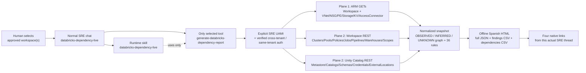

## Source, dependency and coverage contract

| Source ID | Endpoint / API version | Plane & identity | Paging & bounds | Valid empty / unavailable / error behavior | Exclusions |
|---|---|---|---|---|---|
| `arm_workspace` | `GET /subscriptions/{sub}/resourceGroups/{rg}/providers/Microsoft.Databricks/workspaces/{name}?api-version=2024-05-01` | Plane 1 (ARM) | Single resource GET; 30s timeout, 3 attempts | Primary source: failure stops workspace run with structured error (`access_denied` / `http_error`), never an empty workspace | Excludes authorization principal display names and internal tokens |
| `arm_outbound_endpoints` | `GET .../workspaces/{name}/outboundNetworkDependenciesEndpoints?api-version=2024-05-01` | Plane 1 (ARM) | Top-level array GET | Recorded in `sources`; 403/5xx becomes `denied`/`error` and adds an explicit `UNKNOWN` blind spot | Read-only control-plane endpoint list only |
| `arm_diagnostics` | `GET .../workspaces/{name}/providers/Microsoft.Insights/diagnosticSettings?api-version=2021-05-01-preview` | Plane 1 (ARM) | `nextLink` paged up to 50 pages | Empty list means `C08` fails (`failed`); 403/error makes `C08` `not_evaluated` | No log query execution |
| `arm_managed_rg_inventory` & `arm_resource_*` | `GET /subscriptions/{sub}/resourceGroups/{managed_rg}/resources?api-version=2021-04-01` + whitelisted `RESOURCE_APIS` GETs | Plane 1 (ARM) | `nextLink` paged; max 200 related resources | Uncollected external targets referenced by URI become `INFERRED` nodes, never `OBSERVED` | Never reads Storage keys, blob data or Key Vault secret/key material |
| `dbx_workspace_conf` | `GET /api/2.0/workspace-conf?keys=enableTokensConfig,maxTokenLifetimeDays,...` | Plane 2 (Databricks Workspace) | Single GET | 403 (non-admin SP) records `status="denied"` and keeps `C09` `not_evaluated` | Reads only the 5 whitelisted governance keys |
| `dbx_clusters`, `dbx_instance_pools`, `dbx_cluster_policies` | `GET /api/2.0/clusters/list`, `/api/2.0/instance-pools/list`, `/api/2.0/policies/clusters/list` | Plane 2 (Databricks Workspace) | `page_token` / `next_page_token` up to 50 pages | Preserves terminated and running clusters; never starts a cluster | Excludes `spark_env_vars`, `spark_conf`, `aws_attributes`, `ssh_public_keys`, init script contents |
| `dbx_jobs` & `dbx_job_detail_*` | `GET /api/2.1/jobs/list?expand_tasks=true&limit=25` + `GET /api/2.1/jobs/get?job_id={id}` when truncated | Plane 2 (Databricks Workspace) | `page_token` / `next_page_token` + `has_more` check; up to 100 detail GETs | Maps `tasks`, `depends_on`, `existing_cluster_id`, `job_cluster_key`, `pipeline_id`, `warehouse_id`, `run_job_id`; truncated jobs that cannot be resolved via `jobs/get` keep `tasks_incomplete=True` (`UNKNOWN`) instead of false DAG breaks | Excludes `base_parameters`, `jar_params`, `python_params`, `notebook_params`, `sql_params` and notebook source code |
| `dbx_pipelines`, `dbx_pipeline_detail_*` & `dbx_sql_warehouses` | `GET /api/2.0/pipelines?max_results=50`, `GET /api/2.0/pipelines/{id}`, `GET /api/2.0/sql/warehouses` | Plane 2 (Databricks Workspace) | `page_token` / `next_page_token`; up to 100 pipeline detail GETs | Reads `spec.catalog`, `spec.schema` (and legacy `spec.target`), `spec.storage` and `spec.clusters` from `/api/2.0/pipelines/{id}`; denied detail GETs keep `detail_collected=False` (`UNKNOWN` / `W10` `not_evaluated`); never starts a warehouse | No query history or SQL statement execution |
| `dbx_secret_scopes` & `dbx_init_scripts` | `GET /api/2.0/secrets/scopes/list`, `GET /api/2.0/global-init-scripts` | Plane 2 (Databricks Workspace) | `page_token` / `next_page_token` | Maps `AZURE_KEYVAULT` `resource_id`/`dns_name` to Key Vault nodes | `/api/2.0/secrets/get` is explicitly blocked; script bodies excluded |
| `uc_metastore_summary`, `uc_catalogs`, `uc_schemas`, `uc_storage_credentials`, `uc_external_locations`, `uc_connections` | `GET /api/2.1/unity-catalog/...` | Plane 2 (Unity Catalog) | `page_token` / `next_page_token` | Joins External Locations -> Storage Credentials -> Access Connector -> ADLS Storage Accounts (`OBSERVED` vs `INFERRED`) | Never reads table data, volumes or files |
| `uc_system_lineage` | `system.access.table_lineage`, `system.access.column_lineage`, `system.billing.usage` | Not queried in control-plane mode | N/A (`status="not_configured"`) | Permanently disclosed as `UNKNOWN` (`not_evaluated` on `G06` and `R06`) so no SQL Warehouse is started or billed | No SQL Warehouse startup or DBU spend |
| `arm_advisor` & `azure_cost` | `GET .../Microsoft.Advisor/recommendations`, `POST .../Microsoft.CostManagement/query?api-version=2023-11-01` | Plane 1 (ARM) | `nextLink` paged | `cost_scope="disabled"` by default; preserves exact currency and ARM `ResourceId` rows without fabricating savings | No workload-level DBU split inferred from ARM resource totals |

## Customer scope coverage and rule catalog

The pinned catalog ([`rules_catalog.json`](rules_catalog.json)) defines **36
local rules** across three levels (`workspace`, `workload`, `resource`), four
customer-requested areas (`best_practices`, `security`, `finops`,
`optimization`) and the five Azure Well-Architected pillars (`reliability`,
`security`, `cost`, `operations`, `performance`):

| Area | Rules | What is evaluated |
|---|---|---|
| **Workspace & Control Plane** (`C01–C12`) | `C01` SKU Premium, `C02` Secure Cluster Connectivity (`enableNoPublicIp`), `C03` VNet Injection (`customVirtualNetworkId`), `C04` Public Network Access & Private Link, `C05` Access Connector & Storage Firewall, `C06` CMK encryption, `C07` Enhanced Security & Compliance, `C08` ARM Diagnostic Settings, `C09` PAT Governance (`workspace-conf`), `C10` Unity Catalog default catalog, `C11` Global Init Scripts hygiene, `C12` Azure Advisor cached read | Evaluates ARM workspace properties, diagnostic settings, Advisor and workspace-level token/init-script settings. Conditional controls (`C03`, `C04`, `C06`, `C07`) remain `not_evaluated` when operator requirements are unconfirmed and the setting is absent. |
| **Compute, Jobs, Pipelines & SQL Warehouses** (`W01–W10`) | `W01` All-Purpose autotermination (`<= 60m`), `W02` Cluster Policy binding (`policy_id`), `W03` Unity Catalog access mode (`USER_ISOLATION` / `SINGLE_USER` / `SHARED`), `W04` Runtime LTS version (`>= 13.x LTS`), `W05` Autoscaling or Instance Pool, `W06` Jobs using Job/Serverless compute instead of All-Purpose (`existing_cluster_id`), `W07` Job timeouts & failure notifications, `W08` Job `run_as` Service Principal ownership, `W09` SQL Warehouse `auto_stop_mins <= 30` & Serverless/Pro, `W10` Lakeflow Pipeline target in Unity Catalog | Evaluates every collected cluster, job, declarative pipeline and SQL warehouse individually. Missing workspace REST access keeps these checks `not_evaluated` rather than assuming zero workloads. |
| **Governance, Dependency Map & Unity Catalog** (`G01–G08`) | `G01` Unity Catalog Metastore attached, `G02` Storage Credentials using Managed Identity (`access_connector_id`), `G03` External Locations governed (`credential_name` + `abfss://`), `G04` Secret Scopes backed by `AZURE_KEYVAULT`, `G05` Referential integrity across the dependency graph (broken task/cluster/pool/policy/pipeline/warehouse/credential references), `G06` Runtime table/column lineage (`not_evaluated` without SQL compute), `G07` Lakehouse Federation connections inventory, `G08` Outbound control-plane endpoints visibility | Validates both governance posture and the structural integrity of the dependency graph (`G05`), while keeping dynamic SQL table lineage (`G06`) explicitly `not_evaluated`. |
| **Associated Azure Resources & FinOps** (`R01–R06`) | `R01` Storage HTTPS, TLS 1.2+ and `allowBlobPublicAccess=false`, `R02` Storage `allowSharedKeyAccess=false` and `publicNetworkAccess=Disabled`, `R03` Key Vault RBAC authorization and Purge Protection, `R04` NSG inbound administrative exposure from Internet, `R05` Private Endpoint `Approved` state, `R06` FinOps `ActualCost` vs DBU workload attribution (`not_evaluated` without `system.billing.usage`) | Evaluates collected ARM Storage accounts, Key Vaults, NSGs, Private Endpoints and optional ARM `ActualCost` rows. |

## Prerequisites

1. **Existing Azure SRE Agent** in your subscription/tenant (Tenant A).
2. **Human SRE Agent roles on the SRE Agent resource (`Access control (IAM)`):**
   **SRE Agent Author + SRE Agent Standard User** (or **SRE Agent
   Administrator**). Azure `Owner`/`Contributor` does not replace SRE Agent
   data-action roles.
3. **Reporting Managed Identity (`MANAGED_IDENTITY_CLIENT_ID`):** Attached
   User-Assigned Managed Identity on the SRE Agent, plus one of the supported
   [cross-tenant or same-tenant authentication setups](#cross-tenant-feasibility-tenant-a-sre-agent-to-tenant-b-azure-databricks)
   completed with the colleague's administrator.

## Files to download

Use **Raw / Download raw file** in GitHub so you save plain Python, JSON and
Markdown files (never an HTML sign-in wrapper):

- Standalone Python tool: [`generate-databricks-dependency-report.py`](generate-databricks-dependency-report.py) (committed Git blob SHA-256: `dc2d82068e27286b14f9cc0bc8b05c887f92ba62f94cbfec6056aee816e799f8`)
- Typed parameter schema: [`tool-parameters.schema.json`](tool-parameters.schema.json) (committed Git blob SHA-256: `d538cd8e1a86b1c388c1e6821505d601fa78a15c870164e780f8a167db272f95`)
- Runtime dependencies reference: [`requirements.txt`](requirements.txt)
- Runtime skill: [`skills/databricks-dependency-live/SKILL.md`](skills/databricks-dependency-live/SKILL.md) (committed Git blob SHA-256: `84567687bb41484db594981466daf4eadd9c4b43a8e590a94e67538e841cad9a`)
- Specialist instructions and EN/ES prompts: [`subagent-instructions-and-prompts.md`](subagent-instructions-and-prompts.md) (committed Git blob SHA-256: `c54673596441a475db869c9ce083f5083ce02e6bb5b670f66db96f988909a79a`; LF copy-ready instruction block SHA-256: `4a9465000397e01316211bb998303c5faedb78738267f55f1faff5cd2d44de87`)
- Pinned rule catalog (already embedded in the standalone tool): [`rules_catalog.json`](rules_catalog.json)
- Public native-readiness validation receipt: [`native-readiness-validation.json`](native-readiness-validation.json)
- Public visual evidence manifest (16 annotated PNGs): [`visual-evidence.json`](visual-evidence.json)

## Step 0 - Identify the reporting identity and approve cross-tenant or same-tenant scope

1. In the SRE portal, open **Settings > Azure settings > Managed Identity > Go
   to Identity** and record both **Client ID** (for
   `MANAGED_IDENTITY_CLIENT_ID`) and **Object (principal) ID** (for Entra FIC
   `subject` or Azure RBAC assignments).
2. Confirm your SRE Agent's tenant GUID (`SRE_TENANT_ID`).
3. If your colleague's Azure Databricks workspace is in another tenant, follow
   the [Colleague session handoff checklist](#colleague-session-handoff-checklist-cross-tenant-connection)
   with your colleague and the authorized Entra/Azure/Databricks administrators.
   Until those values are filled in a private copy, the tool safely remains in
   `NOT_CONFIGURED` state (`error.code = "configuration_required"`).

## Step 1 - Configure the private standalone file

Keep the repository copy untouched with `<PLACEHOLDER>` values. In a **private
staging copy outside Git**, edit only the administrator constants at the top of
`generate-databricks-dependency-report.py` (`SUBSCRIPTION_ID`, `SRE_TENANT_ID`,
`TARGET_TENANT_ID`, `MANAGED_IDENTITY_CLIENT_ID`, `FEDERATED_APP_CLIENT_ID`,
`KEYVAULT_OAUTH_SECRET_URI`, `CLIENT_NAME`, `CLIENT_LOGO_DATA_URI`,
`CLIENT_LOGO_ALT`, `APPROVED_WORKSPACES`).

- **Visual styling and private logo boundary:** The HTML report uses the
  corporate industrial navy/steel (`#003865`, `#0066a1`) and Databricks
  lakehouse lava/teal (`#ff3621`, `#00875a`) palette by default. Generic
  repository files and documentation contain **no customer logo** and keep
  `CLIENT_NAME = "CLIENTE"` and `CLIENT_LOGO_DATA_URI = ""`. If an authorized
  operator embeds an approved PNG/JPEG logo in a private deployment copy outside
  Git, Pillow validates that it is a single-frame PNG/JPEG (`<= 100,000` bytes,
  `<= 2048 x 2048` px) before any source call.

## Step 2 - Create the Python tool and verify its 12 typed inputs

1. In the SRE Agent portal, open **Builder > Agent Canvas**, click the
   drop-down arrow beside **Create**, and choose **Tool > Python tool**
   (clicking the **Create** button body opens the custom-agent form instead).
   Select the **Code** tab (never **Generate** or **Refine with AI**).

   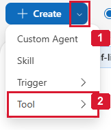

   *Real Builder navigation excerpt in Canvas view (`08-create-drop-down-arrow.png`): **(1)** use the **Create** drop-down arrow, not its custom-agent button body; **(2)** choose **Tool**, then **Python tool** in its submenu. This navigation-only crop is not Databricks deployment evidence.*

2. Name the tool **`generate-databricks-dependency-report`**, set timeout to
   **900 seconds** (`timeoutSeconds=900`, `dependencies=[]`, `toolMode="Auto"`),
   and paste the entire standalone file
   `generate-databricks-dependency-report.py`.

   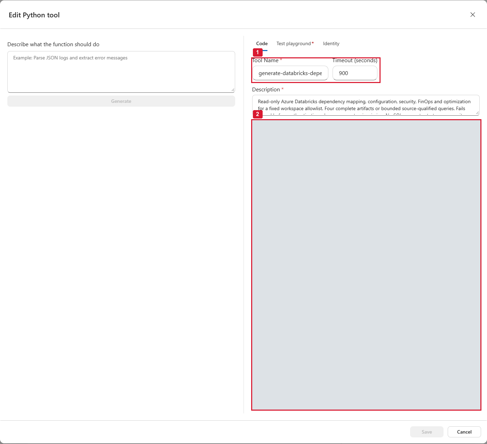

   *Actual saved-tool edit view (`02-private-code-and-timeout.png`): **(1)** keep the dedicated saved name `generate-databricks-dependency-report` and `900`-second timeout; **(2)** paste the complete reviewed file—the entire private configuration/logo/identity editor region is deliberately masked in this capture, not shown as visible whole public source or replaced with invented code.*

3. Open the **Identity** tab and keep **Enable Azure Identity** `OFF`
   (`authEnabled=false`, `authScopes=null`), because the collector acquires and
   verifies its own tokens through the fixed `MANAGED_IDENTITY_CLIENT_ID` after
   valid configuration. This toggle does not grant cross-tenant access.

   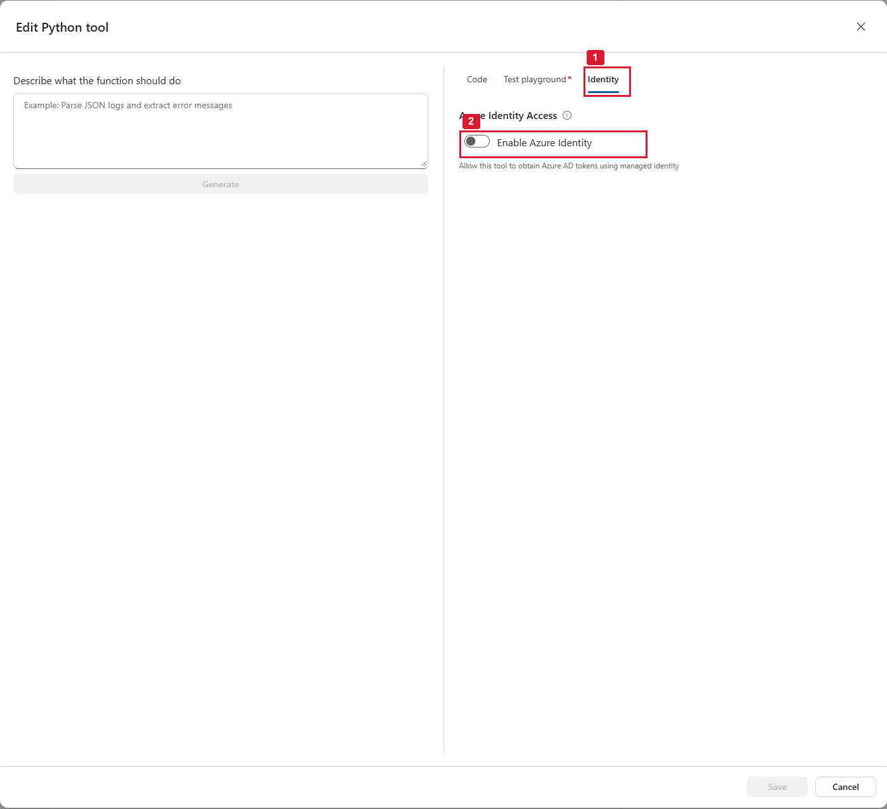

   *Actual **Identity** tab (`03-identity-access-off.png`): **(1)** open the native **Identity** tab; **(2)** **Enable Azure Identity** is `OFF` (`authEnabled=false`)—source authorization is separate.*

4. Configure all **12** typed parameters matching
   [`tool-parameters.schema.json`](tool-parameters.schema.json), then save and
   reopen the tool profile to verify the definition-only `main` signature and
   all 12 native parameter rows (`limit` and `offset` use `int`):

| Parameter | Runtime type | Default | Allowed values / constraint |
|---|---|---|---|
| `operation` | `string` | `report` | `report`, `query`, `list_workspaces` |
| `view` | `string` | `summary` | `summary`, `workspace`, `compute`, `jobs`, `pipelines`, `warehouses`, `unity_catalog`, `resources`, `findings`, `finops`, `coverage`, `actions`, `dependencies` |
| `workspace_name` | `string` | `""` | `""` or exact allowlisted workspace name (1–64 chars) |
| `workspace_names` | `string` | `""` | 1–5 comma-separated allowlisted workspace names; mutually exclusive with `workspace_name` |
| `workload_name` | `string` | `""` | Exact local name filter (cluster, job, pipeline, warehouse, UC object or resource) |
| `classification` | `string` | `all` | `all`, `OBSERVED`, `INFERRED`, `UNKNOWN` (applies to `view="dependencies"`) |
| `area` | `string` | `all` | `all`, `best_practices`, `security`, `finops`, `optimization` |
| `level` | `string` | `all` | `all`, `workspace`, `workload`, `resource` |
| `severity` | `string` | `all` | `all`, `critical`, `high`, `medium`, `low` |
| `status` | `string` | `all` | `all`, `passed`, `failed`, `not_evaluated`, `not_applicable`, `complete`, `partial`, `denied`, `error`, `not_configured` |
| `limit` | `int` | `25` | `1..100` |
| `offset` | `int` | `0` | `0..500000` |

   

   *Real saved Python tool profile (`01-saved-tool-and-12-parameters.png`): **(1)** the exact saved dedicated tool name `generate-databricks-dependency-report`; **(2)** actual `main` signature excerpt (full saved source is verified separately); **(3)** all 12 native parameter rows, including integer `limit` and `offset`.*

5. **Native unconfigured test boundary (`Function test succeeded` vs
   `configuration_required`):** Before the colleague session populates the
   target Tenant-B constants, running **Test** in the native playground returns
   green **Function test succeeded** because the Python function returned a
   structured dictionary normally (`harness_returned_normally=true`,
   `stdout_empty=true`, `files_written=0`), while the domain payload is
   `status="error"`, `error.code="configuration_required"`,
   `artifact_status="not_written"`, and `provenance="LIVE"`. Here `LIVE`
   identifies the live collector code path (as opposed to an offline
   `SIMULATED` test fixture), **not** that a live Databricks source was
   connected or queried.

   

   *Actual native **Test** playground (`04-native-unconfigured-test.png`): **(1)** the actual native **Test** action; **(2)** harness execution success (**Function test succeeded**) is not source-access success; **(3)** read the real `configuration_required` / `artifact_status="not_written"` result—no Tenant-B authentication, source read, report or simulated graph occurred.*

## Step 3 - Create the runtime skill

In **Builder > Skills > Create skill**, create **`databricks-dependency-live`**
using the exact content of
[`skills/databricks-dependency-live/SKILL.md`](skills/databricks-dependency-live/SKILL.md)
(committed Git blob SHA-256:
`84567687bb41484db594981466daf4eadd9c4b43a8e590a94e67538e841cad9a`) and bind
only `generate-databricks-dependency-report`.

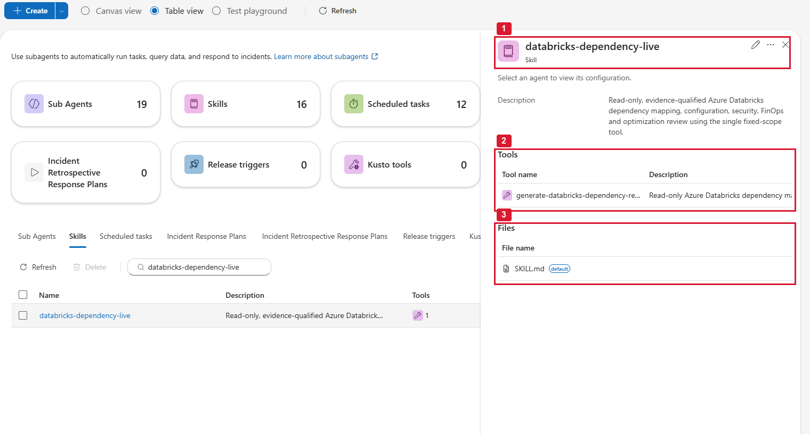

*Actual saved `databricks-dependency-live` skill (`05-saved-runtime-skill.png`): **(1)** exact saved runtime skill name; **(2)** bind only the dedicated Databricks Python tool `generate-databricks-dependency-report`; **(3)** the complete `SKILL.md` is saved and independently matched to committed bytes.*

## Step 4 - Create the restricted specialist

In **Builder > Custom agents / Subagents > Create**, configure:

- **Name:** `databricks-dependency-live`
- **Model:** Platform-supported default (`llmModelName=null`; do not invent custom model/reasoning/context fields in the SRE runtime configuration)
- **Skill:** Only `databricks-dependency-live`
- **Selected tools:** Only `generate-databricks-dependency-report`
- **Instructions:** Paste the copy-ready block from
  [`subagent-instructions-and-prompts.md`](subagent-instructions-and-prompts.md)
  (LF instruction block SHA-256:
  `4a9465000397e01316211bb998303c5faedb78738267f55f1faff5cd2d44de87`).

Read back the saved specialist profile and form to confirm that the single
skill, single tool and instruction block are persisted.


*Actual specialist profile (`06-saved-restricted-specialist.png`): **(1)** saved specialist `databricks-dependency-live` and complete instruction body; **(2)** only the dedicated Databricks tool `generate-databricks-dependency-report`; **(3)** the exact matching runtime skill `databricks-dependency-live`.*

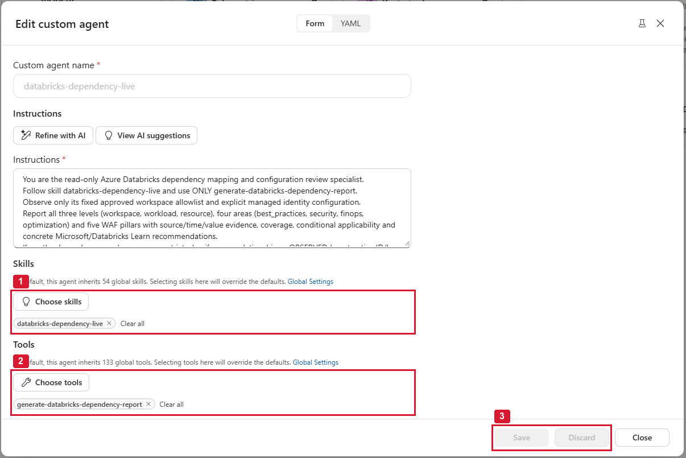

*Actual saved form (`07-saved-explicit-allowlists.png`): **(1)** the exact selected runtime skill `databricks-dependency-live` overrides an empty/default selection; **(2)** the exact selected dedicated tool `generate-databricks-dependency-report`, not global inheritance; **(3)** **Save** and **Discard** are disabled because the saved state is unchanged. Note that the form's summary badges still display the workspace defaults (`133` global tools / `54` skills) despite the explicit saved chips: the selected chip names plus the independently read-back CamelCase API policy in [`native-readiness-validation.json`](native-readiness-validation.json) (`tools=["generate-databricks-dependency-report"]`, `allowedSkills=["databricks-dependency-live"]`, `enableSkills=true`, `addSystemSkills=false`, `disableDocumentRetrieval=true`, `commonTools=[]`, `mcpTools=[]`, `connectors=[]`, `handoffs=[]`, `agentsAsTools=[]`, `commonPrompts=[]`, `allowParallelToolCalls=false`, `maxReflectionCount=0`, `llmModelName=null`, `hooks=null`) establish the configured restriction. Do not modify Global Settings.*

## Step 5 - Run one report in normal chat and download its four files

1. Open normal SRE chat, invoke the `/agent` picker, and select the registered
   specialist **`databricks-dependency-live`** (do not rely on a free-text
   `@name` mention without selecting the specialist).

   

   *Actual `/agent` picker excerpt (`10-select-registered-specialist.png`): **(1)** choose the real registered `databricks-dependency-live` specialist (unrelated specialists are excluded by the crop).*

   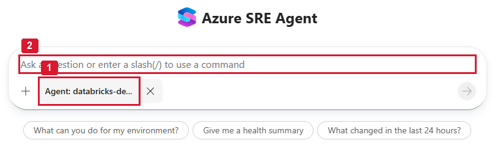

   *Actual **New chat** composer after selecting the saved specialist (`11-selected-specialist-composer.png`): **(1)** the composer now targets the saved specialist (the visible chip can be ellipsized, so verify the full registered name in the `/agent` picker above); **(2)** enter the approved readiness or report prompt only after selecting the specialist. No message is sent by this capture.*

2. **Pre-session unconfigured readiness check:** Before the colleague's
   Tenant-B workspace constants are configured, asking the selected specialist
   for a readiness/report check invokes `generate-databricks-dependency-report`,
   stops before authentication, returns `configuration_required` /
   `artifact_status="not_written"`, and confirms that no source data,
   dependency graph or four-file bundle was fabricated.

   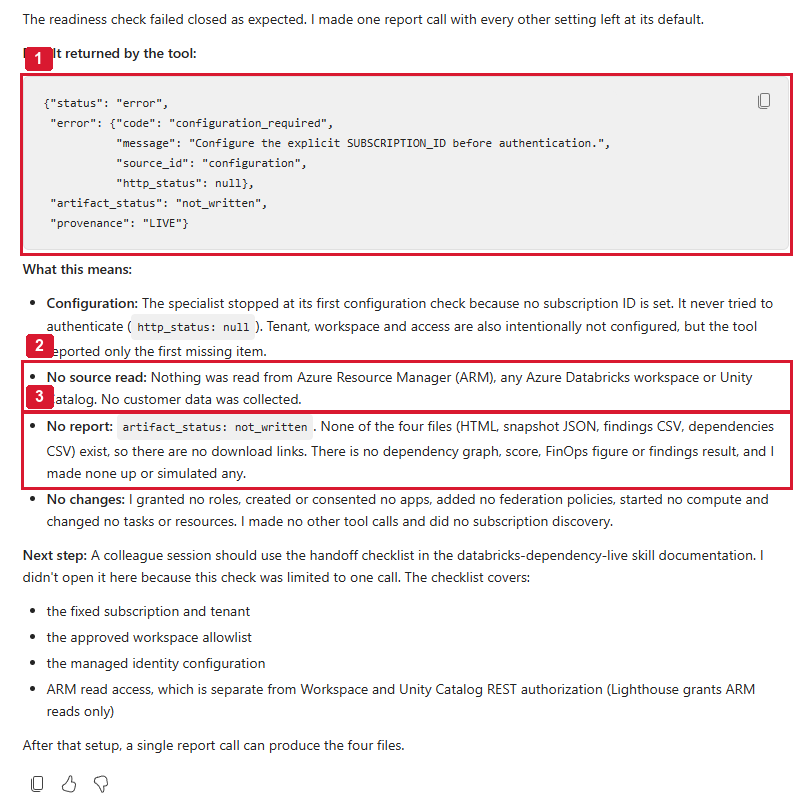

   *Actual selected-specialist readiness conversation (`09-native-no-source-no-files.png`): **(1)** actual returned `configuration_required` / `not_written` result (`provenance="LIVE"` is the collector-path label, not evidence of a connected source run); **(2)** the specialist explicitly states that no source read occurred; **(3)** no dependency graph, score, cost figure or report files were fabricated.*

3. **Post-session live report & four-file delivery:** Once privately configured
   after the colleague session, run the report prompt from
   [`subagent-instructions-and-prompts.md`](subagent-instructions-and-prompts.md)
   and verify that all four native links (`report_url`, `snapshot_url`,
   `findings_csv_url`, `dependencies_csv_url`) are returned and download with
   HTTP 200.

   

   *Connected cross-tenant report turn (`12-live-chat-four-files.png`, `auth_mode="cross_tenant_multitenant_fic"`): **(1)** all four native files (`HTML`, `snapshot.json`, `findings.csv`, `dependencies.csv`) are delivered in one turn and verified with HTTP 200; **(2)** source coverage (`14 complete`, `6 denied`, `4 not_configured`) and the local score (`100.0%` over `4` evaluated vs `31` `No evaluado`) are disclosed together; **(3)** `9 OBSERVED` joins, `2 INFERRED` ADLS Gen2 URI edges and `12 UNKNOWN` blind spots are reported with zero compute started.*

## Step 6 - Read and explore the HTML dependency and configuration dossier

- **Section 1 & 2 (Cover & Executive Reading):** Verify the workspace identity,
  `auth_mode`, cross-tenant badge, UTC reference and local pass percentage
  beside coverage.

  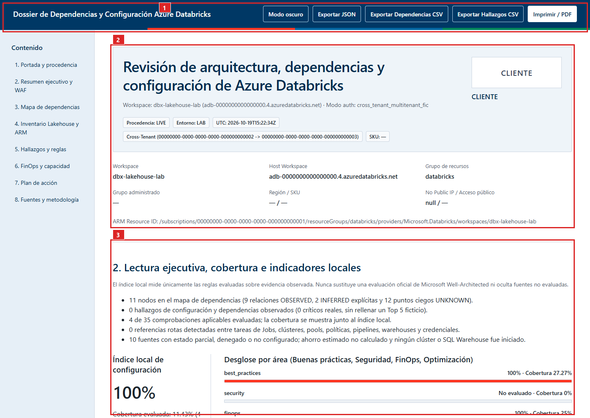

  *Generated Spanish HTML dossier cover and executive overview (`13-report-overview-and-pillars.png`, customer-neutral `CLIENTE` rendering): **(1)** top action bar with dark-mode toggle and local JSON/CSV/PDF exports; **(2)** live cross-tenant provenance card (`cross_tenant_multitenant_fic`, `LIVE`, `LAB`); **(3)** executive reading and local score paired with `Evaluados` (`4`) and `No evaluado` (`31`) across the four areas and five WAF pillars.*

- **Section 3 (Deep Dependency Map):** Filter by layer (`control_plane`,
  `compute`, `orchestration`, `governance`, `associated_resource`) and
  classification (`OBSERVED`, `INFERRED`, `UNKNOWN`). Inspect broken task/compute
  references (`G05`) and switch to the second tab (**Propuesta de referencia -
  NO desplegada**) to compare with the undeployed Lakehouse baseline.

  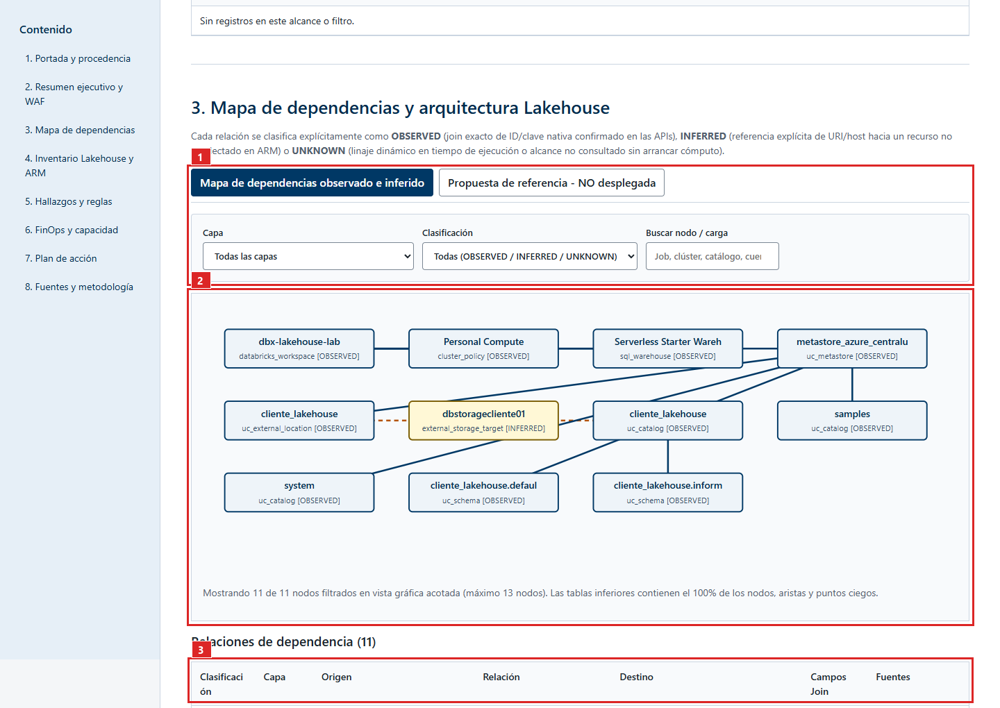

  *Section 3 Deep Dependency Map (`14-report-dependency-graph.png`): **(1)** observed vs. undeployed reference tabs and interactive layer/classification filters (`OBSERVED`, `INFERRED`, `UNKNOWN`); **(2)** visual dependency graph cards across the 5 layers showing solid `OBSERVED` joins and dashed amber `INFERRED` ADLS Gen2 storage references; **(3)** complete dependency edges table with exact join fields and source IDs.*

  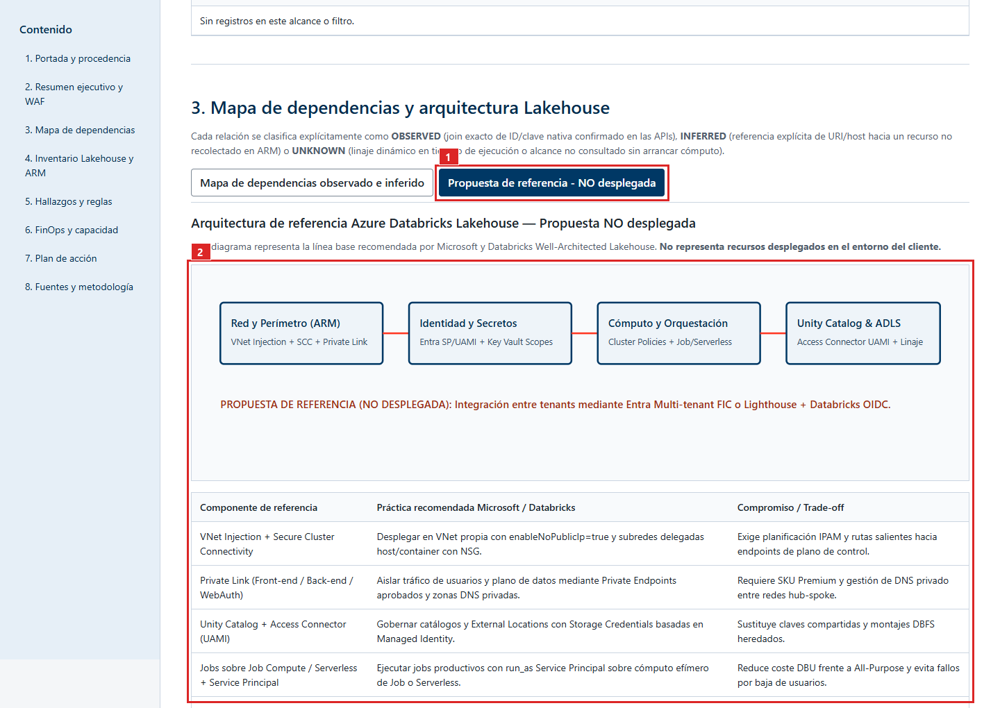

  *Undeployed Lakehouse reference tab (`15-report-controls-and-reference.png`): **(1)** explicitly labeled **Propuesta de referencia - NO desplegada** tab; **(2)** Well-Architected Lakehouse reference diagram and trade-offs table kept visually separate from observed customer inventory.*

- **Sections 4–8 (Inventory, Findings, FinOps, Actions, Source Ledger):** Drill
  into clusters, jobs, DLT pipelines, SQL warehouses, Unity Catalog objects,
  associated ARM resources, FinOps candidates and per-source HTTP receipts.

  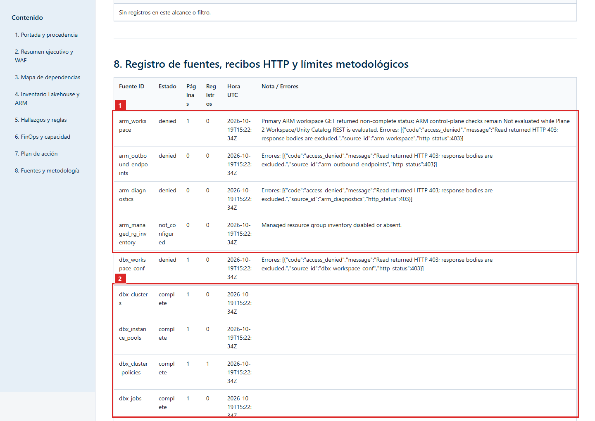

  *Section 8 Source Coverage & HTTP Receipts Ledger (`16-report-source-coverage-ledger.png`): **(1)** Plane 1 ARM receipts honestly recorded as `denied` (`HTTP 403`) when target resource-group `Reader` is pending; **(2)** Plane 2 Databricks Workspace & Unity Catalog REST sources returning `complete` (`HTTP 200`) via `cross_tenant_multitenant_fic`.*

## Step 7 - Keep reporting cadence optional

Default operation is **on demand**. Create a scheduled task only if the
customer explicitly requests recurring control-plane reviews after accepting the
first report.

## Troubleshooting

| Symptom / Error code | Meaning | Safe resolution |
|---|---|---|
| `configuration_required` | Committed `<PLACEHOLDER>` GUIDs or workspace host are still present | Expected before the colleague session. Fill the fixed constants in your private deployment copy during the session. |
| `cross_tenant_configuration_required` | `SRE_TENANT_ID != TARGET_TENANT_ID` while `auth_mode == "same_tenant_uami"` | Switch `auth_mode` to `cross_tenant_multitenant_fic`, `cross_tenant_lighthouse_plus_databricks_oidc` or `cross_tenant_lighthouse_plus_keyvault_oauth_m2m` after completing cross-tenant setup. |
| `cross_tenant_auth_failed` | Entra FIC token exchange at `login.microsoftonline.com/<TARGET_TENANT_ID>/oauth2/v2.0/token` failed | Verify the multi-tenant App Registration in Tenant A has the UAMI's **Object (principal) ID** as `subject`, `issuer = https://login.microsoftonline.com/<SRE_TENANT_ID>/v2.0`, `audience = api://AzureADTokenExchange`, and is provisioned in Tenant B. |
| `access_denied` on `dbx_*` or `uc_*` while `arm_workspace` is `complete` | Plane 1 (ARM) succeeded (e.g., via Lighthouse), but the service principal is not authorized inside the Databricks Workspace or Unity Catalog | Have the colleague's Databricks Workspace/Account Admin add the service principal in **Settings > Identity and access > Service principals** and grant read/browse privileges. |
| `G06` / `R06` shown as `not_evaluated` (`No evaluado`) | Runtime table lineage (`system.access.table_lineage`) and DBU billing (`system.billing.usage`) require SQL Warehouse execution | Expected by design: this control-plane collector never starts compute or executes SQL statements. |

## Evidence, screenshot plan and release gates

The native SRE Agent bootstrap and unconfigured safety gate were executed and
read back on **2026-10-16** against canonical commit
`9cd491266d71df981817b05b325e2bab7482ecc1`
([`native-readiness-validation.json`](native-readiness-validation.json),
[`visual-evidence.json`](visual-evidence.json)), while preserving all existing
agent components and 12 scheduled tasks and creating zero new IAM grants, app
registrations, secrets, federation policies, compute resources or tasks. Until
the live session with the colleague's Tenant-B Azure Databricks workspace is
completed, colleague-tenant source captures remain **Not collected
(`UNKNOWN_NOT_CONFIGURED` / `NOT_RUN`)**:

| Capture | Numbered callouts and receipt | Current evidence |
|---|---|---|
| Source scope & cross-tenant access | Tenant-A UAMI, multi-tenant FIC / Lighthouse setup and Tenant-B workspace scope, masked | **Not collected** (`UNKNOWN_NOT_CONFIGURED` / `NOT_RUN` — awaiting colleague tenant session) |
| Tool, schema & unconfigured safety gate | Saved `generate-databricks-dependency-report`, `timeoutSeconds=900`, `authEnabled=false`, 12 typed parameters (`limit`/`offset` as `int`), and 2 native Python tests (API + UI) returning `configuration_required` / `not_written` before auth | **Collected (`2026-10-16`):** [`08-create-drop-down-arrow.png`](images/08-create-drop-down-arrow.png), [`02-private-code-and-timeout.png`](images/02-private-code-and-timeout.png), [`03-identity-access-off.png`](images/03-identity-access-off.png), [`01-saved-tool-and-12-parameters.png`](images/01-saved-tool-and-12-parameters.png), [`04-native-unconfigured-test.png`](images/04-native-unconfigured-test.png), [`native-readiness-validation.json`](native-readiness-validation.json) |
| Skill & restricted subagent | Saved `databricks-dependency-live` skill and specialist read back with `tools=["generate-databricks-dependency-report"]`, `allowedSkills=["databricks-dependency-live"]`, `addSystemSkills=false`, `disableDocumentRetrieval=true`, `llmModelName=null` | **Collected (`2026-10-16`):** [`05-saved-runtime-skill.png`](images/05-saved-runtime-skill.png), [`06-saved-restricted-specialist.png`](images/06-saved-restricted-specialist.png), [`07-saved-explicit-allowlists.png`](images/07-saved-explicit-allowlists.png), [`native-readiness-validation.json`](native-readiness-validation.json) |
| Selected-specialist unconfigured readiness chat | Registered specialist selected via `/agent`, composer chip verified, and real readiness turn returning `configuration_required` / `not_written` with zero source reads or fabricated files | **Collected (`2026-10-16`):** [`10-select-registered-specialist.png`](images/10-select-registered-specialist.png), [`11-selected-specialist-composer.png`](images/11-selected-specialist-composer.png), [`09-native-no-source-no-files.png`](images/09-native-no-source-no-files.png), [`native-readiness-validation.json`](native-readiness-validation.json) |
| Live Databricks dependency map & configuration dossier | HTML cover (`CLIENTE`), `OBSERVED`/`INFERRED`/`UNKNOWN` dependency graph, undeployed reference tab, FinOps and source ledger from a connected workspace | **Collected (`2026-10-19`):** [`13-report-overview-and-pillars.png`](images/13-report-overview-and-pillars.png), [`14-report-dependency-graph.png`](images/14-report-dependency-graph.png), [`15-report-controls-and-reference.png`](images/15-report-controls-and-reference.png), [`16-report-source-coverage-ledger.png`](images/16-report-source-coverage-ledger.png) |
| Live four-file native delivery | Actual `report_url`, `snapshot_url`, `findings_csv_url`, `dependencies_csv_url` HTTP 200 downloads from a connected workspace run | **Collected (`2026-10-19`):** [`12-live-chat-four-files.png`](images/12-live-chat-four-files.png), [`visual-evidence.json`](visual-evidence.json) |

## Technical boundaries and maintainer checks

Build and verify the standalone tool and run the full offline test suite from
the repository root:

```powershell
python 08-databricks-dependency-configuration-review\build_tool.py --check
python -m unittest discover -s 08-databricks-dependency-configuration-review\tests -p "test_*.py"
```

<!-- BILINGUAL_QA_PROMPT_PACK -->

---

## Copy-Ready Bilingual Q&A Prompt Pack (Castellano & English)

Select `/agent databricks-dependency-live` in **New chat** and use any of these prompts in **Spanish (Castellano)** or **English**:

### 1. Discover Configured Databricks Workspaces / Listar los Workspaces de Databricks Configurados (`list_workspaces`)
- **Castellano:**
  ```text
  @databricks-dependency-live Ejecuta operation="list_workspaces" para mostrar los workspaces de Azure Databricks configurados en el alcance y su modo de conexion (same_tenant_uami vs cross_tenant_multitenant_fic) sin realizar llamadas de red.
  ```
- **English:**
  ```text
  @databricks-dependency-live Run operation="list_workspaces" to list the configured Azure Databricks workspaces in scope and their connection mode (same_tenant_uami vs cross_tenant_multitenant_fic) without making network calls.
  ```

### 2. Full Databricks Dependency & Configuration Dossier (4 Files) / Informe Completo de Dependencias y Configuracion Databricks (4 Archivos)
- **Castellano:**
  ```text
  @databricks-dependency-live Genera el informe completo de dependencias y configuracion para los workspaces aprobados (operation="report", workspace_name="all", view="overview") y entregame los 4 archivos descargables (HTML, JSON, CSV de hallazgos y CSV de dependencias) distinguiendo aristas OBSERVED, INFERRED y UNKNOWN.
  ```
- **English:**
  ```text
  @databricks-dependency-live Generate the complete dependency map and configuration review report across the approved workspaces (operation="report", workspace_name="all", view="overview") and deliver all 4 downloadable files (HTML, JSON, findings CSV, and dependencies CSV) distinguishing OBSERVED, INFERRED, and UNKNOWN edges.
  ```

### 3. Dependency Graph & Lineage Inspection (`OBSERVED` vs `INFERRED` vs `UNKNOWN`) / Grafo de Dependencias y Linaje
- **Castellano:**
  ```text
  @databricks-dependency-live Consulta el grafo de dependencias del workspace (operation="query", workspace_name="all", view="dependencies", confidence="all") y explicame que relaciones entre Jobs, Clusters, SQL Warehouses, Catalogos Unity Catalog y External Locations son OBSERVED frente a INFERRED.
  ```
- **English:**
  ```text
  @databricks-dependency-live Query the workspace dependency graph (operation="query", workspace_name="all", view="dependencies", confidence="all") and explain which edges across Jobs, Clusters, SQL Warehouses, Unity Catalog objects, and External Locations are OBSERVED versus INFERRED.
  ```

### 4. Governance & Unity Catalog Posture / Gobernanza y Postura en Unity Catalog
- **Castellano:**
  ```text
  @databricks-dependency-live Consulta los controles del pilar Governance (operation="query", workspace_name="all", view="findings", pillar="Governance") y resume que catalogos, esquemas, storage credentials y external locations se han detectado y por que G03 queda No evaluado cuando solo hay permiso BROWSE.
  ```
- **English:**
  ```text
  @databricks-dependency-live Query the Governance pillar findings (operation="query", workspace_name="all", view="findings", pillar="Governance") and summarize which catalogs, schemas, storage credentials, and external locations were discovered and why G03 is qualified as Not evaluated under BROWSE-only privileges.
  ```

### 5. Compute, SQL Warehouses & Cost Optimization (FinOps) / Clusters, SQL Warehouses y Optimizacion FinOps
- **Castellano:**
  ```text
  @databricks-dependency-live Consulta los controles de Cost Optimization y Reliability (operation="query", workspace_name="all", view="findings", pillar="Cost Optimization") y detalla si hay clusters interactivos o SQL Warehouses sin auto-termination acotada, sin Photon o sin cluster policy asignada.
  ```
- **English:**
  ```text
  @databricks-dependency-live Query the Cost Optimization and Reliability findings (operation="query", workspace_name="all", view="findings", pillar="Cost Optimization") and detail whether any all-purpose clusters or SQL Warehouses lack bounded auto-termination, Photon, or an assigned cluster policy.
  ```

### 6. Plane 1 (ARM) vs. Plane 2 (Databricks REST) Source Coverage / Cobertura de Fuentes Plano 1 ARM frente a Plano 2 Databricks REST
- **Castellano:**
  ```text
  @databricks-dependency-live Consulta el registro de cobertura de fuentes (operation="query", workspace_name="all", view="sources") y explica que fuentes del Plano 2 (Clusters, Jobs, SQL Warehouses, Workspace Conf, Unity Catalog) respondieron HTTP 200 y como se comporta el colector si el Plano 1 ARM devuelve 403 en un escenario Cross-Tenant.
  ```
- **English:**
  ```text
  @databricks-dependency-live Query the source coverage ledger (operation="query", workspace_name="all", view="sources") and explain which Plane 2 APIs (Clusters, Jobs, SQL Warehouses, Workspace Conf, Unity Catalog) returned HTTP 200 and how the collector preserves Plane 2 evaluation when Plane 1 ARM returns 403 in a cross-tenant setup.
  ```
