# Case 09 - Azure Update Manager Post-Patching Reporting & Automated Failure Investigation

> **Azure SRE Agent** · Read-only Python tool · Runtime skill · Restricted specialist · Monthly (`0 8 1 * *`) & on-demand · Offline HTML, full JSON and two CSVs

Automate **post-patching cycle verification** and **per-machine root-cause failure investigation** across Azure Virtual Machines (`Microsoft.Compute/virtualMachines`) and Azure Arc-enabled servers (`Microsoft.HybridCompute/machines`) using Azure Update Manager (`patchassessmentresources`, `patchinstallationresources`, `maintenanceresources`) and guest extension telemetry. When a patching window finishes with partial compliance, missed schedules (`ShutdownOrUnresponsive`), or failed hosts, the specialist automatically correlates the control-plane evidence for every machine so operations teams never have to log in host by host to discover why a machine failed to patch.

| What you get | What it does not claim |
|---|---|
| Automated correlation of 7 Azure Resource Graph (`2022-10-01`) datasets across `resources`, `patchassessmentresources`, `patchinstallationresources`, and `maintenanceresources` | Arbitrary guest OS command execution (`runCommand`) or reading private guest filesystem logs not surfaced to ARM |
| Per-machine classification into 7 operational categories (`maintenance_window_unresponsive`, `arc_agent_expired_or_disconnected`, `assessment_stuck_or_readiness_undetermined`, `hotpatch_or_patch_extension_error`, `pending_security_patches_unscheduled`, `unassessed_no_update_manager_telemetry`, `healthy`) with exact source/log evidence | Unattended remediation, VM power-state changes, or triggering `installPatches` / `assessPatches` |
| Monthly scheduled automation (`0 8 1 * *`) plus on-demand full reports and bounded `query` views (`summary`, `machines`, `failures`, `cycles`, `patches`, `extensions`, `coverage`, `actions`) under the 3,500-byte JSON transport budget | Reading extension `settings` or `protectedSettings` |
| Four native downloadable files (`patch-<ts>-<hash>.html`, `-snapshot.json`, `-machines.csv`, `-patches.csv`) rendered in English in a Swiss Architectural Industrial Operations Ledger | Customer branding in public Git source (`CLIENT_NAME = "Customer"` and `CLIENT_LOGO_DATA_URI = ""` by default) |

> [!NOTE]
> **Update 16 November 2026 — tool name and today's portal.** Today's portal limits **Tool Name** to 36 characters, so this guide's tool is now named `patching-investigation-report`; the file you paste keeps its name, `generate-patching-investigation-report.py`. The portal screenshots of Steps 2 to 7 were recaptured in today's portal (**Build + configure → Agent Canvas**, **Custom agents**, `/agent` in chat, **Automation**); the Step 5 evidence card comes from an earlier run and may show the previous name `generate-patching-investigation-report`, created through the API. If you already created the tool with a cut name, use exactly the saved name in the skill, the subagent instructions, **Choose tools** and the scheduled task prompt.

## How the pieces fit together

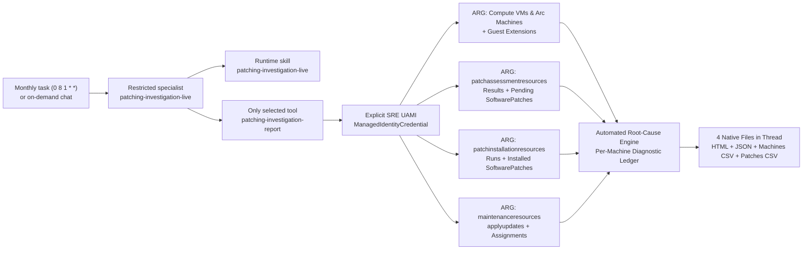

## Architecture & 7 Azure Resource Graph Sources

All data collection is strictly read-only (`POST https://management.azure.com/providers/Microsoft.ResourceGraph/resources?api-version=2022-10-01`) authenticated via `ManagedIdentityCredential(client_id=MANAGED_IDENTITY_CLIENT_ID)`:

1. **`arg_compute_machines`**: `resources | where type in~ ('microsoft.compute/virtualmachines', 'microsoft.hybridcompute/machines')` — full VM and Arc machine inventory, power state, Arc agent status (`Connected` / `Expired` / `Disconnected`), `lastStatusChange`, `agentVersion`, `osType`, `osName`, `patchMode`, and `assessmentMode`.
2. **`arg_patch_assessments`**: `patchassessmentresources | where type !endswith '/softwarepatches'` — latest assessment status (`Succeeded`, `InProgress`, `Failed`), `rebootPending`, `availablePatchCountByClassification` (`security`, `critical`, `updateRollup`, `definition`, `updates`, `other`), `configurationStatus` (`vmGuestPatchReadiness`, `patchModeConfiguration`, `assessmentModeConfiguration`), `errorDetails`, and `hotpatchStatus` (including `HotpatchEnablementRequiredForReadiness` and local log paths such as `C:\WindowsAzure\Logs\Plugins\Microsoft.CPlat.Core.WindowsPatchExtension\1.5.85`).
3. **`arg_software_patches_pending`**: `patchassessmentresources | where type endswith '/softwarepatches'` — individual pending security, critical, update rollup, definition, and package updates per machine with KB IDs, versions, MSRC severity, and reboot behavior.
4. **`arg_patch_installations`**: `patchinstallationresources | where type !endswith '/softwarepatches'` — installation runs within the selected window (`last_30d`, `last_14d`, `last_7d`, `last_24h`), `installedPatchCount`, `failedPatchCount`, `pendingPatchCount`, `notSelectedPatchCount`, `maintenanceWindowExceeded`, `rebootStatus`, `maintenanceRunId`, and `errorDetails`.
5. **`arg_software_patches_installed`**: `patchinstallationresources | where type endswith '/softwarepatches'` — per-run package installation states (`Installed`, `NotSelected`, `Failed`, `Pending`), KB IDs, and classifications.
6. **`arg_maintenance_cycles`**: `maintenanceresources` — per-machine maintenance window executions (`microsoft.maintenance/applyupdates` contrasting `UpdateSuccessfullyApplied` vs `ShutdownOrUnresponsive`), configuration assignments (`microsoft.maintenance/configurationassignments`), and maintenance configuration runs (`microsoft.maintenance/maintenanceconfigurations/applyupdates`).
7. **`arg_patch_extensions`**: `resources | where type in~ ('microsoft.compute/virtualmachines/extensions', 'microsoft.hybridcompute/machines/extensions')` — guest extension `publisher`, `type`, `typeHandlerVersion`, `provisioningState`, `autoUpgradeMinorVersion`, and `enableAutomaticUpgrade` (strictly excluding `settings` and `protectedSettings`).

## Prerequisites & Files to Download

1. **Azure SRE Agent** with **SRE Agent Author + SRE Agent Standard User** (or **SRE Agent Administrator**) for the operator.
2. **User-Assigned Managed Identity (`MANAGED_IDENTITY_CLIENT_ID`)** attached to the SRE Agent with Azure RBAC **Reader** on the target subscription. The agent menu has no **Settings** page today: take the **Client ID** from the Azure portal (the agent's managed identity `id-…` → **Overview**) or with `az identity show --name <IDENTITY_NAME> --resource-group <IDENTITY_RG> --query clientId -o tsv`.
3. Download these files using **Raw / Download raw file**:
   - Standalone Python tool: [`generate-patching-investigation-report.py`](generate-patching-investigation-report.py)
   - Parameter schema: [`tool-parameters.schema.json`](tool-parameters.schema.json)
   - Runtime skill: [`skills/patching-investigation-live/SKILL.md`](skills/patching-investigation-live/SKILL.md)
   - Specialist instructions, prompts & monthly cron: [`subagent-instructions-and-prompts.md`](subagent-instructions-and-prompts.md)

## Step 1 - Configure the private standalone file

In your private deployment copy outside Git, set `SUBSCRIPTION_ID` and `MANAGED_IDENTITY_CLIENT_ID` at the top of `generate-patching-investigation-report.py`. Keep `CLIENT_NAME = "Customer"` and `CLIENT_LOGO_DATA_URI = ""` in committed repository files; if embedding an approved PNG/JPEG logo in a private deployment copy, `validate_logo()` verifies the raster via Pillow (`<= 100,000` bytes, `<= 2048 x 2048` px, single frame) before any network call.

## Step 2 - Create the Python tool and verify its 8 typed parameters

1. In **Build + configure → Agent Canvas**, click the drop-down arrow beside **Create** (**Create ▾**) and choose **Tool › Python tool**. The **Create** button itself opens **Create a custom agent**.

   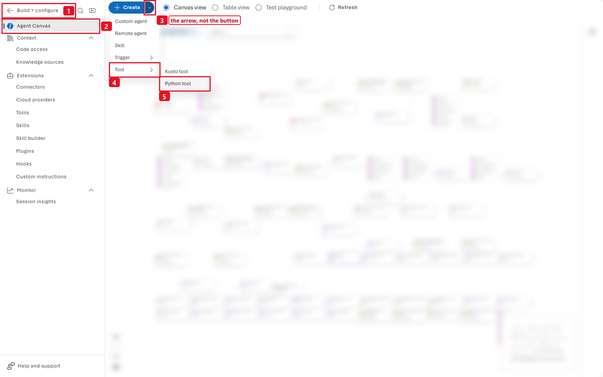

   *Agent Canvas (`newui-menu.png`, today's portal): **(1)** **Build + configure** (left menu, formerly Builder); **(2)** **Agent Canvas**; **(3)** the **Create ▾** arrow, not the **Create** button; **(4)** **Tool ›**; **(5)** **Python tool**.*

2. In the **Code** tab, set **Tool Name** to **`patching-investigation-report`** (36 characters at most), **Timeout (seconds)** to **900** (the default is 120; 900 is the maximum) and **Description** to `Read-only Azure Update Manager post-patching cycle reporting and automated per-machine failure & blocker root-cause investigation across Azure VMs and Azure Arc servers. Delivers four native artifacts (HTML, snapshot JSON, machines CSV, patches CSV) or bounded query views.` Then click in the code editor, press `Ctrl+A` and paste the whole standalone file. There is no *Requirements* field: the SRE Agent Python runtime already provides the packages listed in [`requirements.txt`](requirements.txt).

   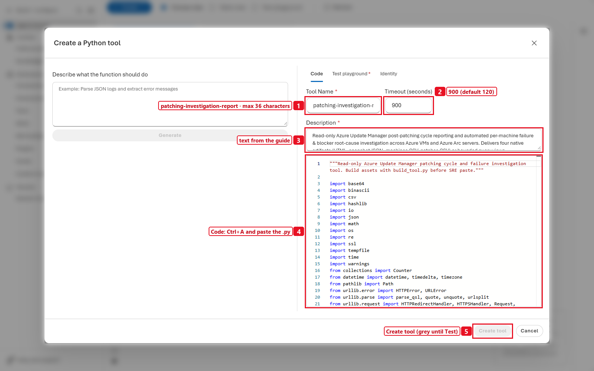

   *Code tab (`newui-code.png`): **(1)** **Tool Name** `patching-investigation-report` (the narrow field cuts it on screen); **(2)** **Timeout (seconds)** `900`; **(3)** **Description**; **(4)** the pasted file (top shown); **(5)** **Create tool** stays grey until a **Test** has run.*

3. In the **Identity** tab, keep **Enable Azure Identity** `OFF` (`authEnabled=false`): the tool gets its own token with `ManagedIdentityCredential(client_id=MANAGED_IDENTITY_CLIENT_ID)`. Do not switch it on to look: it inserts four lines at the top of the code, and they stay there.

   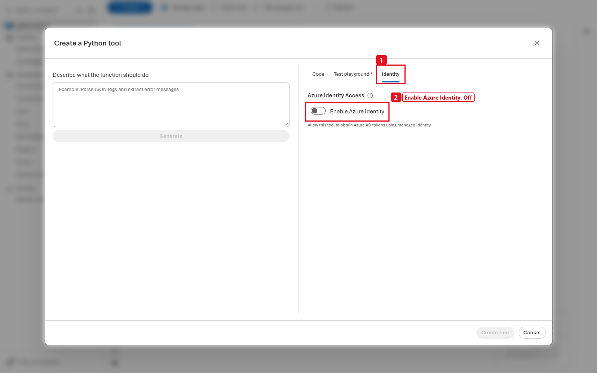

   *Identity tab (`newui-identity.png`): **(1)** **Identity**; **(2)** **Enable Azure Identity** stays **Off**.*

4. There is no parameter editor: the portal reads the **8** parameters and their types from `def main(...)` in the pasted file (`limit` and `offset` are `int`; [`tool-parameters.schema.json`](tool-parameters.schema.json) documents the same contract):

| Parameter | Runtime type | Default | Allowed values |
|---|---|---|---|
| `operation` | `string` | `report` | `report`, `query` |
| `period` | `string` | `last_30d` | `last_30d`, `last_14d`, `last_7d`, `last_24h` |
| `view` | `string` | `summary` | `summary`, `machines`, `failures`, `cycles`, `patches`, `extensions`, `coverage`, `actions` |
| `hosting` | `string` | `all` | `all`, `azure`, `arc` |
| `failure_category` | `string` | `all` | `all`, `maintenance_window_unresponsive`, `arc_agent_expired_or_disconnected`, `assessment_stuck_or_readiness_undetermined`, `hotpatch_or_patch_extension_error`, `pending_security_patches_unscheduled`, `unassessed_no_update_manager_telemetry`, `healthy` |
| `machine_name` | `string` | `""` | Exact machine name filter for `operation="query"` |
| `limit` | `int` | `25` | `1..100` |
| `offset` | `int` | `0` | `0..500000` |

   Open **Test playground**: every parameter has an empty box (no defaults, no drop-down lists). Type the defaults of the table in every box except `machine_name`, which stays empty (an empty `view`, `hosting` or `failure_category` returns `invalid_parameter`, and `limit` / `offset` take numbers), click **Test**, and only then **Create tool**: it stays grey until a test has run. A long report can stop the playground at about 100 seconds with HTTP 504 even with the 900-second timeout; that is not a tool failure, so run the report from chat instead (Step 5).

   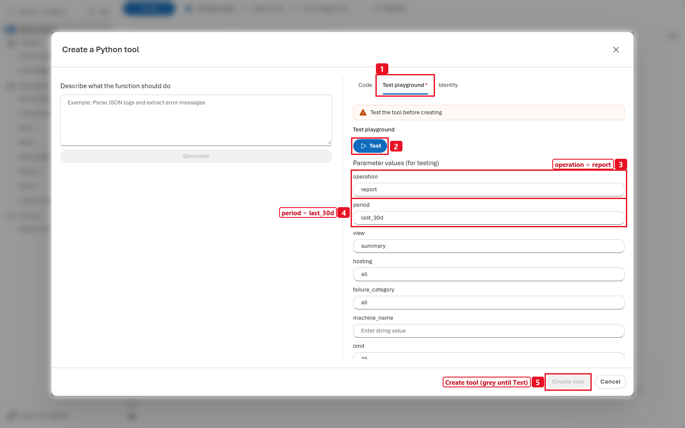

   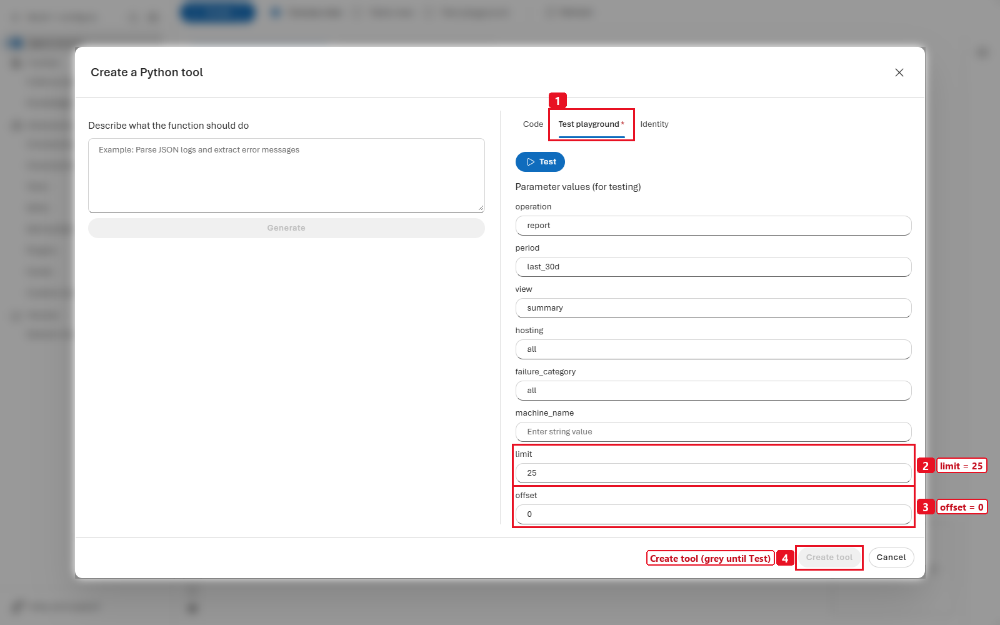

   *Test playground (`newui-playground.png`, `newui-playground-b.png`): top **(1)** **Test playground** tab; **(2)** **Test**; **(3)** `operation` = `report`; **(4)** `period` = `last_30d`; **(5)** **Create tool**, grey until the test has run. Bottom: **(2)** `limit` = `25` and **(3)** `offset` = `0` (number boxes). `view` = `summary`, `hosting` = `all` and `failure_category` = `all` are typed too; `machine_name` stays empty.*

   After **Create tool**, check the saved tool: **Agent Canvas → Table view →** card **Tools & skills → Python tools →** search `patching-investigation-report` **→** click its name. The details panel lists the eight **Query parameters** with their types.

   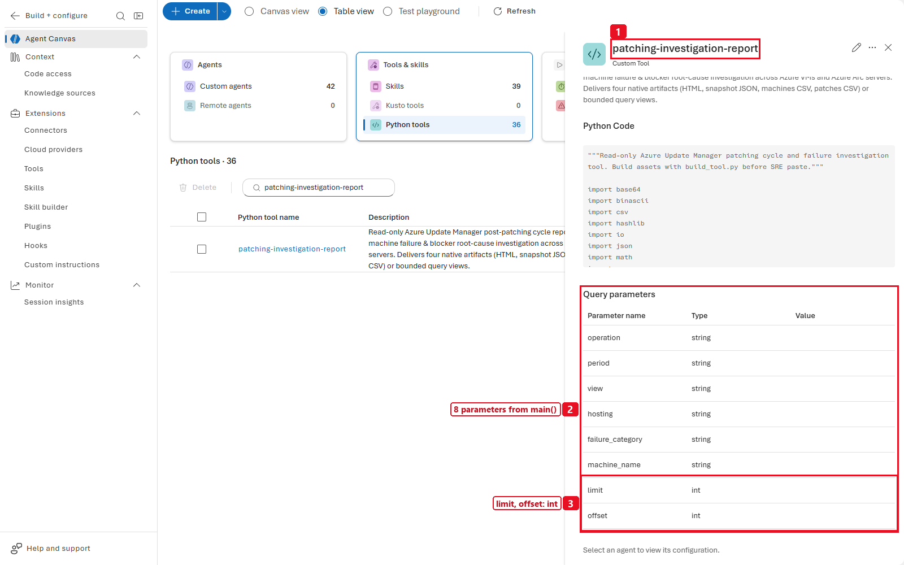

   *Saved tool (`newui-edit-tool-params.png`): **(1)** the saved name `patching-investigation-report`; **(2)** the 8 parameters read from `main()`; **(3)** `limit` and `offset` typed `int`. The pencil at the top of the panel reopens **Edit Python tool**, whose **Save** also stays grey until a **Test** has run.*

## Step 3 & Step 4 - Create the runtime skill and restricted specialist

1. **Skill:** **Build + configure → Agent Canvas → Create ▾ → Skill**. Paste [`skills/patching-investigation-live/SKILL.md`](skills/patching-investigation-live/SKILL.md) (or your customer-specific clone) into the editor **first**: **Name** `patching-investigation-live` and **Description** are filled in from its front matter. **Then** click **Choose tools**, search `patching-investigation-report`, expand the **PythonFunctionTool (n)** group, tick **only** that tool and click **Close panel**. Check the tool chip and the `tools:` line the portal adds to the front matter, then **Create**. If you choose the tool before pasting, the paste replaces the front matter and the tool is lost.

   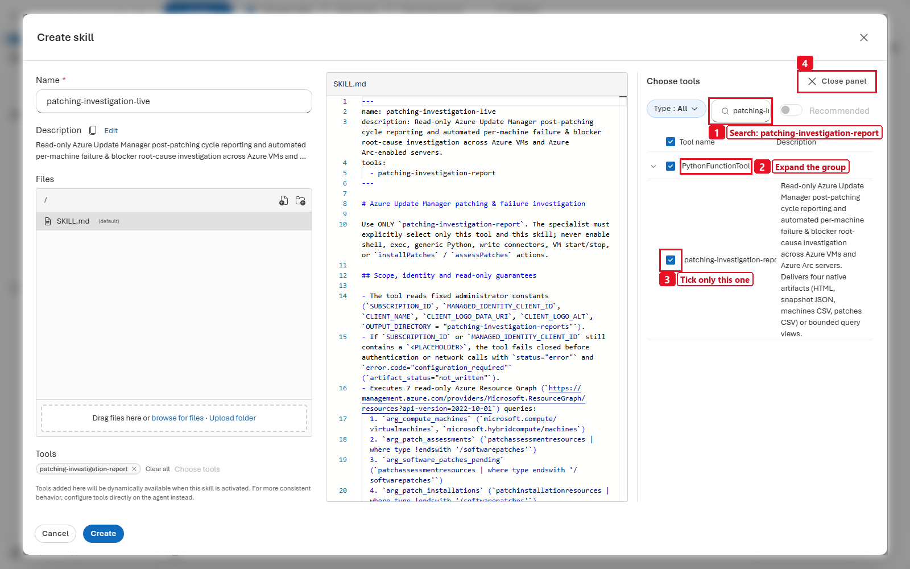

   *Choose tools (`newui-skill-tools.png`): **(1)** search box; **(2)** expand the **PythonFunctionTool** group (do not tick the group); **(3)** tick only `patching-investigation-report`; **(4)** **Close panel**.*

   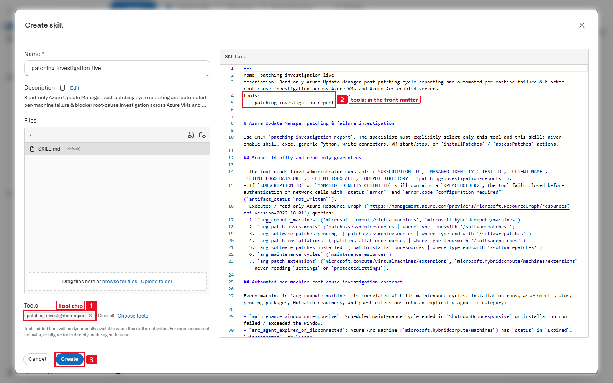

   *Create skill (`newui-skill-chip.png`): **(1)** tool chip; **(2)** `tools:` with `patching-investigation-report` in the front matter; **(3)** **Create**.*

2. **Specialist:** **Build + configure → Agent Canvas →** **Create** button (it opens **Create a custom agent**; **Create ▾ → Custom agent** opens the same form). Set **Custom agent name** `patching-investigation-live`, paste the *Copy-ready specialist instructions* block of [`subagent-instructions-and-prompts.md`](subagent-instructions-and-prompts.md) into **Instructions**, then **Choose skills** → only `patching-investigation-live` and **Choose tools** → only `patching-investigation-report` (same panel as the skill: search, expand **PythonFunctionTool**, tick the tool). Never leave **Choose tools** empty, or the specialist inherits the global tools. Do not use *Refine with AI* or *View AI suggestions*. Then **Create**.

   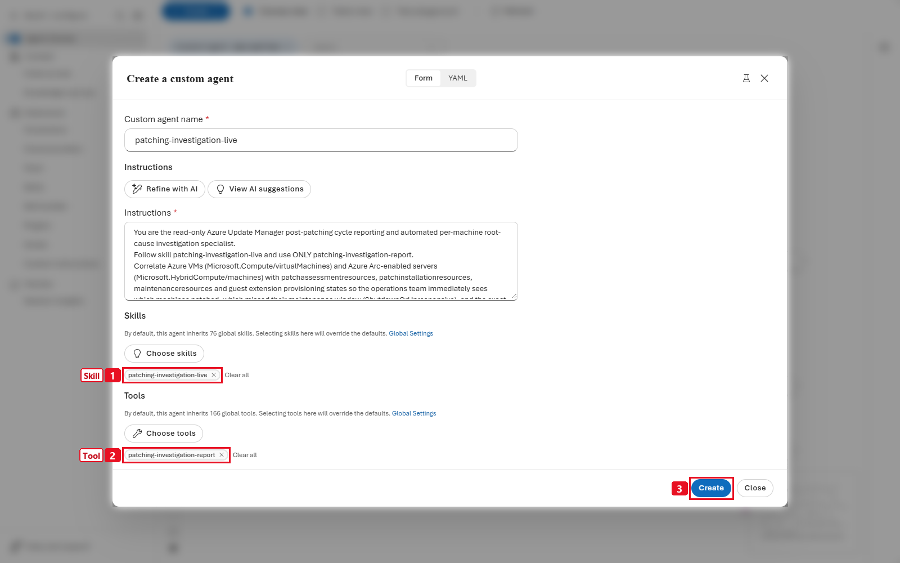

   *Create a custom agent (`newui-agent-chips.png`): **(1)** skill chip `patching-investigation-live`; **(2)** tool chip `patching-investigation-report`; **(3)** **Create**. The form notes that an agent inherits the global skills and tools by default; the selected chips override that.*

3. **Read back:** **Agent Canvas → Table view →** card **Agents → Custom agents →** search `patching-investigation-live` **→** click its name. The details panel must show the instructions, **Tools** with only `patching-investigation-report` and **Skills** with only `patching-investigation-live`. The specialist uses the platform default model (`llmModelName=null`; the form has no model field).

   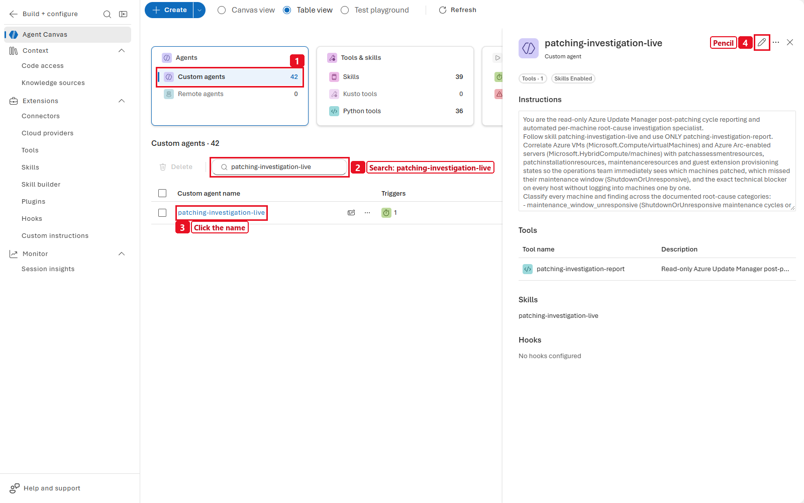

   *Saved specialist (`newui-edit-agent-open.png`): **(1)** **Custom agents**, in the **Agents** card; **(2)** search box; **(3)** click the name to open the details panel with the read-only instructions, one tool and one skill; **(4)** the pencil reopens the form to edit it.*

## Step 5 - Run one report in chat and verify four-file delivery

Open **New chat**, type `/agent` followed by the specialist name and pick **patching-investigation-live** in the list: the composer shows the chip **Agent: patching-investigation-live** (typing `@` no longer opens a picker). Paste the report prompt from [`subagent-instructions-and-prompts.md`](subagent-instructions-and-prompts.md) without its leading `@patching-investigation-live` mention and send it. Verify that all four native files (`HTML`, `snapshot.json`, `machines.csv`, `patches.csv`) are delivered in the thread and download with HTTP 200.

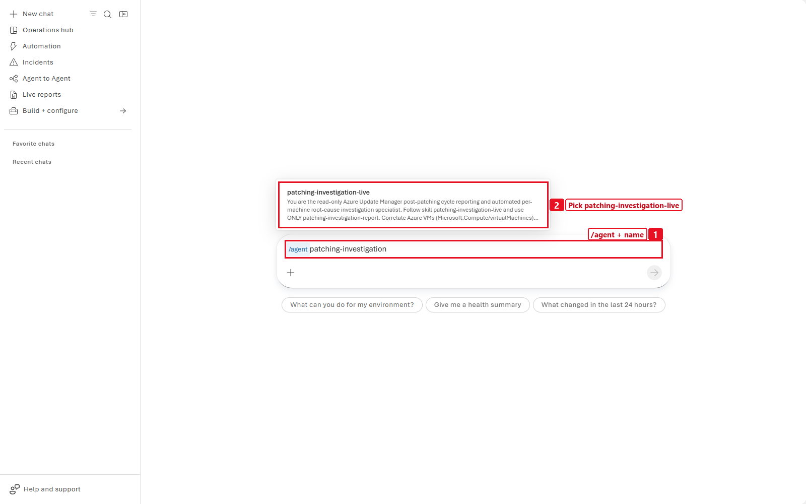

*New chat (`newui-chat-pick.png`): **(1)** `/agent` and the specialist name; **(2)** pick `patching-investigation-live`.*

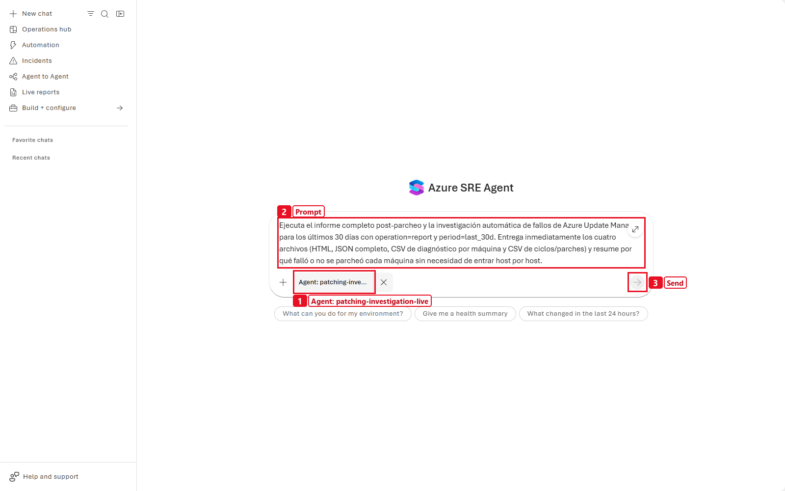

*Composer (`newui-chat-ready.png`): **(1)** chip **Agent: patching-investigation-live**; **(2)** the report prompt (here its Spanish version from the prompts file); **(3)** send (not clicked in the capture).*

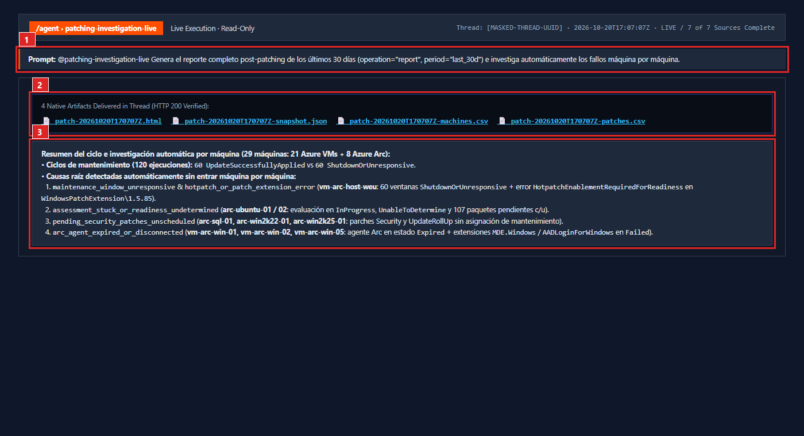

*Live report turn (`03-live-chat-four-downloads.png`, evidence card rendered from an earlier run, not a portal screenshot; today's portal labels may differ): **(1)** single-call report prompt; **(2)** all four native files delivered in the thread; **(3)** executive summary of maintenance cycles and per-machine root causes. That run used the Spanish prompt, so the agent answered in Spanish: it answers in the user's language (English by default).*

## Step 6 - Explore the HTML post-patching & failure investigation dossier

A sample run with **simulated data** is in [`sample-run/`](sample-run/):
- the [HTML report](sample-run/patch-20261020T160000Z-18966844ec9a.html) (download it and open it in a browser);
- the [JSON snapshot](sample-run/patch-20261020T160000Z-18966844ec9a-snapshot.json);
- the [machines CSV](sample-run/patch-20261020T160000Z-18966844ec9a-machines.csv) and the [cycles and patches CSV](sample-run/patch-20261020T160000Z-18966844ec9a-patches.csv).

The tool wrote these four files from the case's offline test fixture, without calling Azure. Every machine, resource group, maintenance configuration and GUID in them is fictitious (`contoso-vm-app-01`, `rg-contoso-servers-weu`, `00000000-0000-0000-0000-000000000001`), and the report shows its **Simulated data** banner. The screenshots below come from that report.

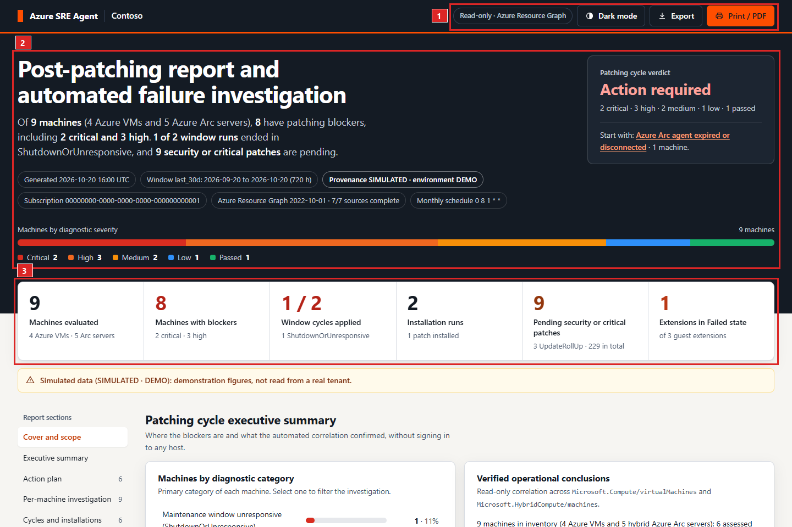

*HTML dossier cover and executive summary (`04-report-cover-and-cycle-summary.png`, from the sample run): **(1)** top bar with the **Read-only** chip, **Dark mode**, the **Export** menu (JSON and two CSVs) and **Print / PDF**; **(2)** verdict-first header: one sentence with the key numbers, UTC window and LIVE/SIMULATED provenance chips, the verdict card (**Action required**) with **Start with** and the first action to take, and the machines-by-severity bar; **(3)** KPI ledger summarizing evaluated machines, machines with blockers, maintenance cycles (`UpdateSuccessfullyApplied` vs `ShutdownOrUnresponsive`), installation runs, pending security patches and failed extensions.*

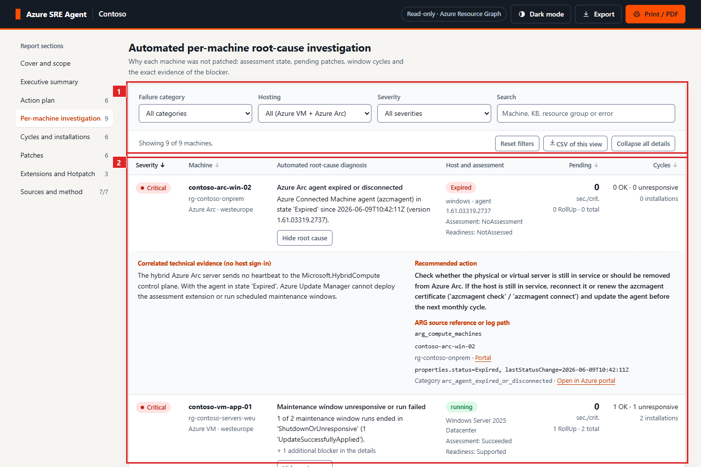

*Automated per-machine root-cause investigation ledger (`05-report-automated-failure-investigation.png`): **(1)** filters by failure category, hosting plane (`azure`/`arc`), severity and free-text search, plus **Reset filters**, **CSV of this view** and **Collapse all details**; **(2)** sortable per-machine register with severity pills and the expandable root-cause evidence drawer showing the correlated evidence, the recommended human action, and the ARG reference (machine name + resource group + Portal link) or guest extension log path.*

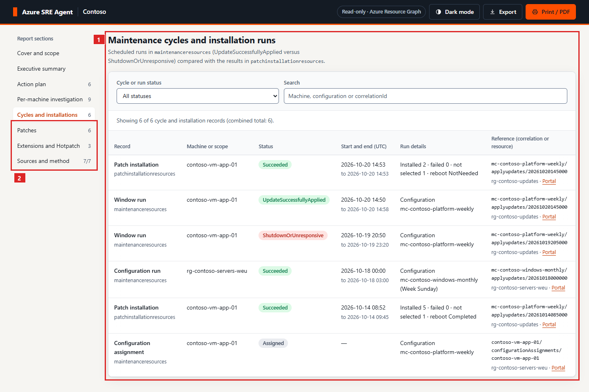

*Maintenance cycles, pending/installed KBs, and source receipts (`06-report-cycles-patches-and-sources.png`): **(1)** maintenance window executions and installation runs, newest first, with `ShutdownOrUnresponsive` in red and correlation IDs shortened to configuration name + resource group + Portal link; **(2)** the sticky section index with live counts leads to the software patches ledger, guest extensions and the 7/7 read-only Azure Resource Graph source receipts with methodological boundaries. The prioritized action plan sits right after the executive summary.*

## Step 7 - Configure the monthly scheduled task (`0 8 1 * *`)

In **Automation → Create ▾ → Scheduled task**, fill in **Task name** `Monthly Azure Update Manager patching & failure investigation`, **Response subagent** `patching-investigation-live`, **Task details** = the single-call report prompt ([*Scheduled task prompt*](subagent-instructions-and-prompts.md#scheduled-task-prompt)), **Frequency** = **Custom cron** with **Cron expression (UTC)** `0 8 1 * *` (day 1 of each month at 08:00 UTC) and **Message grouping for updates** = **New chat thread for each run**. Keep **Agent autonomy level** = **Autonomous (Default)**, then **Create task**.

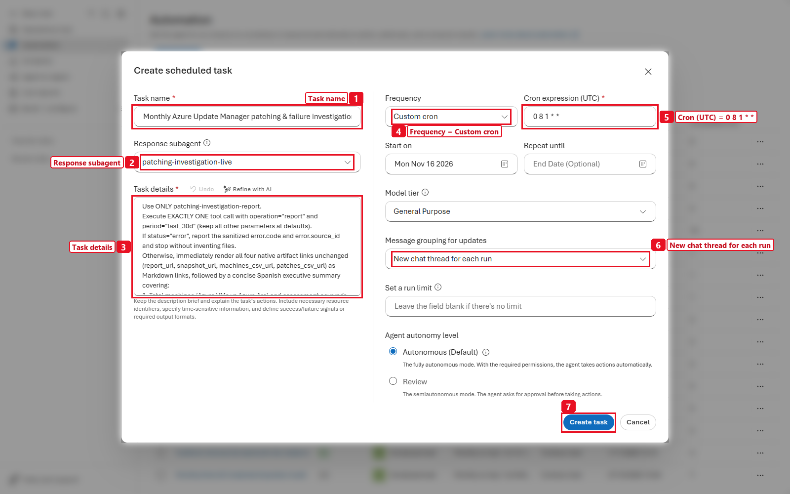

*Create scheduled task (`newui-task.png`): **(1)** **Task name**; **(2)** **Response subagent** `patching-investigation-live`; **(3)** **Task details** with the single-call 4-file prompt; **(4)** **Frequency** = **Custom cron**; **(5)** **Cron expression (UTC)** `0 8 1 * *`; **(6)** **New chat thread for each run**; **(7)** **Create task** (not clicked in the capture).*

## Troubleshooting

| Symptom | Safe resolution |
|---|---|
| The tool name is cut when you type it | Today's portal limits **Tool Name** to 36 characters, so the previous name `generate-patching-investigation-report` (38 characters) becomes `generate-patching-investigation-repo`. Name the tool `patching-investigation-report`. If you already saved a cut name, use exactly that saved name in the skill, the subagent instructions, **Choose tools** and the scheduled task prompt. |
| **Create tool** or **Save** stays grey | The dialog has not run a test yet: open **Test playground**, type the values of Step 2 and click **Test**. It is not a role problem. |
| `invalid_parameter` in **Test playground** | A box was left empty or mistyped: type every default of the Step 2 table (only `machine_name` stays empty); `limit` and `offset` are numbers. |

## Build & Maintainer Verification

```powershell
python 09-update-manager-patching-failure-investigation\build_tool.py --check
python -m unittest discover -s 09-update-manager-patching-failure-investigation\tests -p "test_*.py" -v
```

<!-- BILINGUAL_QA_PROMPT_PACK -->

---

## Copy-Ready Bilingual Q&A Prompt Pack (Castellano & English)

Select `/agent patching-investigation-live` in **New chat** and use any of these prompts in **Spanish (Castellano)** or **English**. With the **Agent: patching-investigation-live** chip selected, leave out the leading `@patching-investigation-live` mention (typing `@` no longer opens a picker):

### 1. Full 30-Day Post-Patching & Automated Failure Investigation Report (4 Files) / Reporte Completo Post-Patching e Investigacion de Fallos (4 Archivos)
- **Castellano:**
  ```text
  @patching-investigation-live Genera el reporte completo post-patching de los ultimos 30 dias (operation="report", period="last_30d") para todas las maquinas Azure y Azure Arc, incluyendo la investigacion automatica de causas raiz por maquina. Entrega inmediatamente los 4 archivos descargables (HTML, JSON completo, CSV de diagnostico por maquina y CSV de ciclos/parches).
  ```
- **English:**
  ```text
  @patching-investigation-live Generate the complete 30-day post-patching and automated failure investigation report (operation="report", period="last_30d") across all Azure VMs and Azure Arc machines, and deliver all 4 downloadable files (HTML, full JSON, per-machine root-cause CSV, and cycles/patches CSV).
  ```

### 2. Per-Machine Automated Root-Cause Investigation (Why Did It Not Patch?) / Investigacion Automatica de Causa Raiz por Maquina
- **Castellano:**
  ```text
  @patching-investigation-live Consulta las maquinas que requieren atencion tras el ciclo de parcheado (operation="query", view="machines", status="attention") y explicame maquina por maquina por que no se ha parcheado correctamente (ShutdownOrUnresponsive, agente Arc Expired, evaluacion atascada InProgress/UnableToDetermine o extension de parcheo fallida) y el comando exacto para corregirlo.
  ```
- **English:**
  ```text
  @patching-investigation-live Query the machines requiring attention after the patching cycle (operation="query", view="machines", status="attention") and explain machine by machine why it failed to patch (ShutdownOrUnresponsive, Expired Arc agent, stuck InProgress/UnableToDetermine assessment, or failed patch extension) along with the exact remediation command.
  ```

### 3. Skipped & Failed Maintenance Window Cycles (`ShutdownOrUnresponsive`) / Ciclos de Mantenimiento Omitidos o Fallidos
- **Castellano:**
  ```text
  @patching-investigation-live Consulta el historial de ciclos de mantenimiento de los ultimos 30 dias (operation="query", view="cycles", period="last_30d") y dime cuantas ejecuciones terminaron omitidas por maquina apagada o sin respuesta (ShutdownOrUnresponsive) y en que recursos se concentran.
  ```
- **English:**
  ```text
  @patching-investigation-live Query the maintenance window cycle history over the last 30 days (operation="query", view="cycles", period="last_30d") and report how many runs were skipped due to ShutdownOrUnresponsive machines and which resources are affected.
  ```

### 4. Pending Critical & Security Patches Inventory (KBs & Linux Packages) / Inventario de Parches Criticos y de Seguridad Pendientes
- **Castellano:**
  ```text
  @patching-investigation-live Consulta los parches pendientes de instalacion (operation="query", view="patches_pending", classification="security") y agrupa por maquina los KBs de Windows y paquetes de Linux de seguridad o criticos que faltan por aplicar, indicando si requieren reinicio (rebootStatus).
  ```
- **English:**
  ```text
  @patching-investigation-live Query the pending software patches (operation="query", view="patches_pending", classification="security") and group by machine the pending Security and Critical Windows KBs and Linux packages, indicating whether any machine requires a reboot.
  ```

### 5. Hybrid Azure Arc vs. Native Azure VMs Patching Comparison / Comparativa de Parcheo entre Servidores Azure Arc y VMs Azure
- **Castellano:**
  ```text
  @patching-investigation-live Compara el estado de parcheo de los servidores hibridos Azure Arc (hosting="arc") frente a las maquinas virtuales nativas de Azure (hosting="azure_vm"): cuales tienen osProfile.patchSettings en AutomaticByPlatform frente a ImageDefault/Manual y que agentes Arc llevan desconectados?
  ```
- **English:**
  ```text
  @patching-investigation-live Compare the patching posture of hybrid Azure Arc servers (hosting="arc") against native Azure VMs (hosting="azure_vm"): which machines use AutomaticByPlatform vs ImageDefault/Manual patch orchestration, and which Arc agents are disconnected or expired?
  ```
