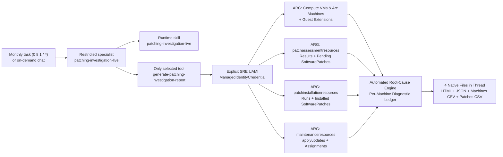
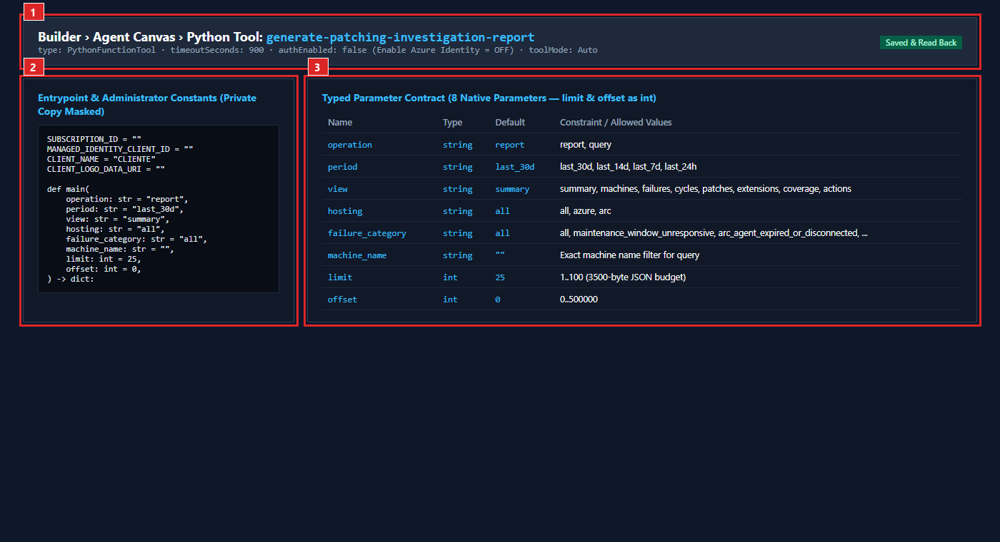
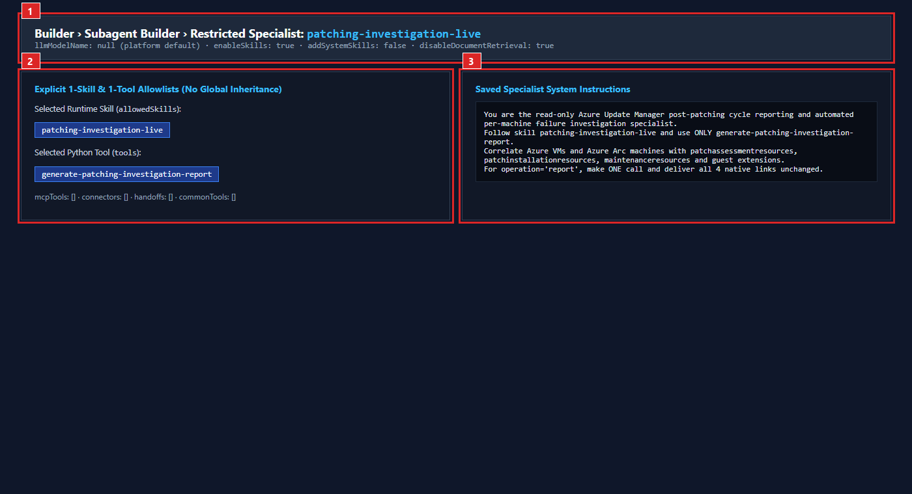
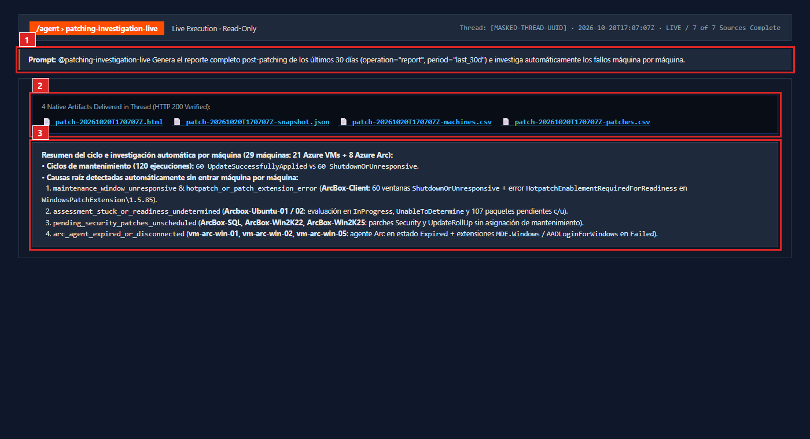
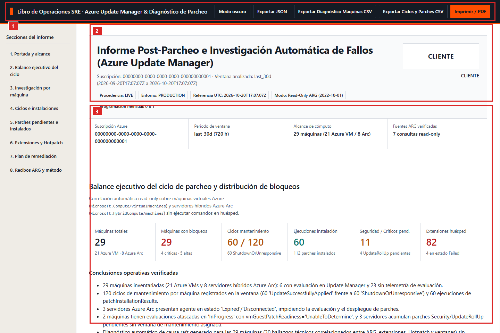
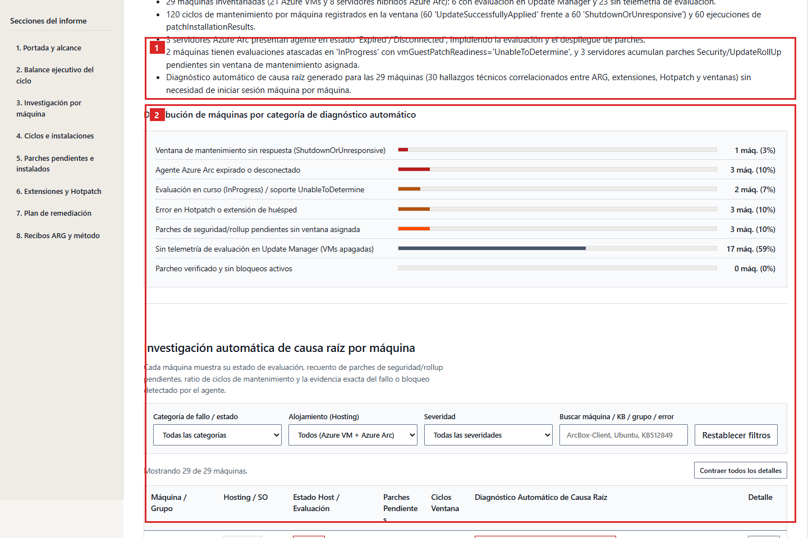
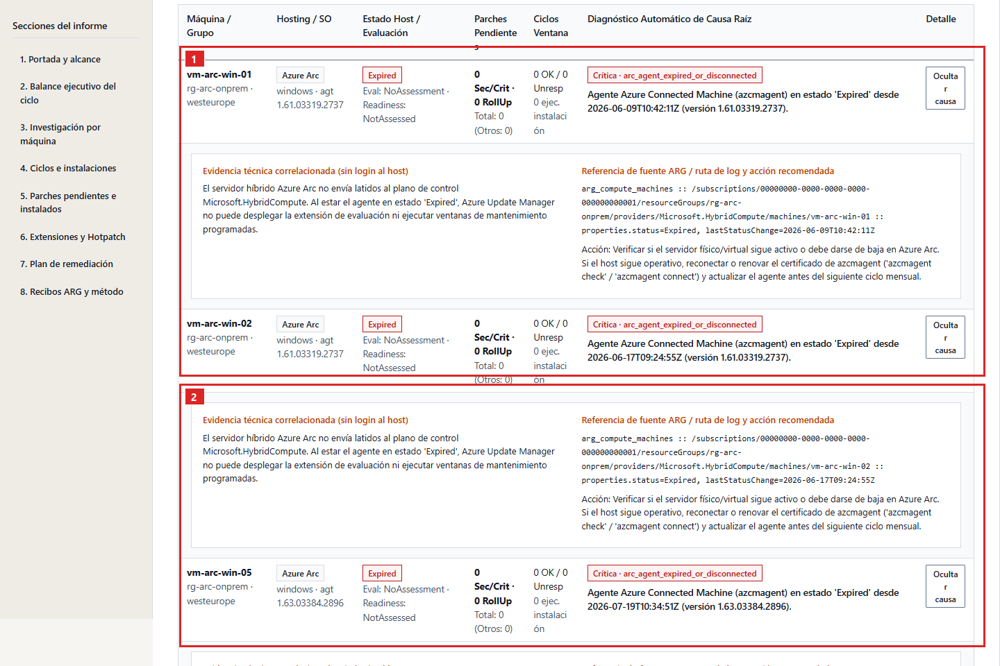
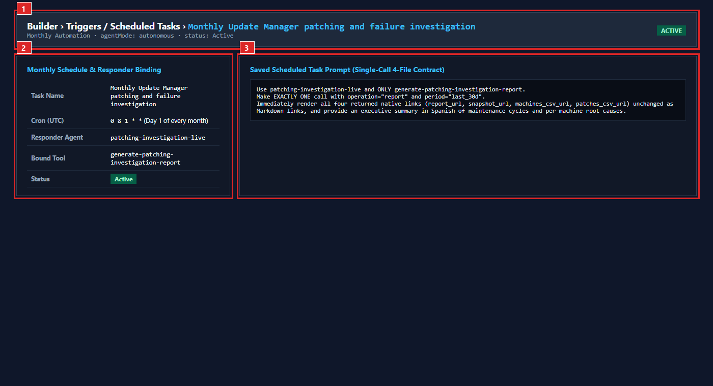

# Case 09 - Azure Update Manager Post-Patching Reporting & Automated Failure Investigation

> **Azure SRE Agent** · Read-only Python tool · Runtime skill · Restricted specialist · Monthly (`0 8 1 * *`) & on-demand · Offline HTML, full JSON and two CSVs

Automate **post-patching cycle verification** and **per-machine root-cause failure investigation** across Azure Virtual Machines (`Microsoft.Compute/virtualMachines`) and Azure Arc-enabled servers (`Microsoft.HybridCompute/machines`) using Azure Update Manager (`patchassessmentresources`, `patchinstallationresources`, `maintenanceresources`) and guest extension telemetry. When a patching window finishes with partial compliance, missed schedules (`ShutdownOrUnresponsive`), or failed hosts, the specialist automatically correlates the control-plane evidence for every machine so operations teams never have to log in host by host to discover why a machine failed to patch.

| What you get | What it does not claim |
|---|---|
| Automated correlation of 7 Azure Resource Graph (`2022-10-01`) datasets across `resources`, `patchassessmentresources`, `patchinstallationresources`, and `maintenanceresources` | Arbitrary guest OS command execution (`runCommand`) or reading private guest filesystem logs not surfaced to ARM |
| Per-machine classification into 7 operational categories (`maintenance_window_unresponsive`, `arc_agent_expired_or_disconnected`, `assessment_stuck_or_readiness_undetermined`, `hotpatch_or_patch_extension_error`, `pending_security_patches_unscheduled`, `unassessed_no_update_manager_telemetry`, `healthy`) with exact source/log evidence | Unattended remediation, VM power-state changes, or triggering `installPatches` / `assessPatches` |
| Monthly scheduled automation (`0 8 1 * *`) plus on-demand full reports and bounded `query` views (`summary`, `machines`, `failures`, `cycles`, `patches`, `extensions`, `coverage`, `actions`) under the 3,500-byte JSON transport budget | Reading extension `settings` or `protectedSettings` |
| Four native downloadable files (`patch-<ts>-<hash>.html`, `-snapshot.json`, `-machines.csv`, `-patches.csv`) rendered in a Swiss Architectural Industrial Operations Ledger (`es-ES`) | Customer branding in public Git source (`CLIENT_NAME = "CLIENTE"` and `CLIENT_LOGO_DATA_URI = ""` by default) |

## How the pieces fit together



## Architecture & 7 Azure Resource Graph Sources

All data collection is strictly read-only (`POST https://management.azure.com/providers/Microsoft.ResourceGraph/resources?api-version=2022-10-01`) authenticated via `ManagedIdentityCredential(client_id=MANAGED_IDENTITY_CLIENT_ID)`:

1. **`arg_compute_machines`**: `resources | where type in~ ('microsoft.compute/virtualmachines', 'microsoft.hybridcompute/machines')` — full VM and Arc machine inventory, power state, Arc agent status (`Connected` / `Expired` / `Disconnected`), `lastStatusChange`, `agentVersion`, `osType`, `osName`, `patchMode`, and `assessmentMode`.
2. **`arg_patch_assessments`**: `patchassessmentresources | where type !endswith '/softwarepatches'` — latest assessment status (`Succeeded`, `InProgress`, `Failed`), `rebootPending`, `availablePatchCountByClassification` (`security`, `critical`, `updateRollup`, `definition`, `updates`, `other`), `configurationStatus` (`vmGuestPatchReadiness`, `patchModeConfiguration`, `assessmentModeConfiguration`), `errorDetails`, and `hotpatchStatus` (including `HotpatchEnablementRequiredForReadiness` and local log paths such as `C:\WindowsAzure\Logs\Plugins\Microsoft.CPlat.Core.WindowsPatchExtension\1.5.85`).
3. **`arg_software_patches_pending`**: `patchassessmentresources | where type endswith '/softwarepatches'` — individual pending security, critical, update rollup, definition, and package updates per machine with KB IDs, versions, MSRC severity, and reboot behavior.
4. **`arg_patch_installations`**: `patchinstallationresources | where type !endswith '/softwarepatches'` — installation runs within the selected window (`last_30d`, `last_14d`, `last_7d`, `last_24h`), `installedPatchCount`, `failedPatchCount`, `pendingPatchCount`, `notSelectedPatchCount`, `maintenanceWindowExceeded`, `rebootStatus`, `maintenanceRunId`, and `errorDetails`.
5. **`arg_software_patches_installed`**: `patchinstallationresources | where type endswith '/softwarepatches'` — per-run package installation states (`Installed`, `NotSelected`, `Failed`, `Pending`), KB IDs, and classifications.
6. **`arg_maintenance_cycles`**: `maintenanceresources` — per-machine maintenance window executions (`microsoft.maintenance/applyupdates` contrasting `UpdateSuccessfullyApplied` vs `ShutdownOrUnresponsive`), configuration assignments (`microsoft.maintenance/configurationassignments`), and maintenance configuration runs (`microsoft.maintenance/maintenanceconfigurations/applyupdates`).
7. **`arg_patch_extensions`**: `resources | where type in~ ('microsoft.compute/virtualmachines/extensions', 'microsoft.hybridcompute/machines/extensions')` — guest extension `publisher`, `type`, `typeHandlerVersion`, `provisioningState`, `autoUpgradeMinorVersion`, and `enableAutomaticUpgrade` (strictly excluding `settings` and `protectedSettings`).

## Prerequisites & Files to Download

1. **Azure SRE Agent** with **SRE Agent Author + SRE Agent Standard User** (or **SRE Agent Administrator**) for the operator.
2. **User-Assigned Managed Identity (`MANAGED_IDENTITY_CLIENT_ID`)** attached to the SRE Agent with Azure RBAC **Reader** on the target subscription.
3. Download these files using **Raw / Download raw file**:
   - Standalone Python tool: [`generate-patching-investigation-report.py`](generate-patching-investigation-report.py)
   - Parameter schema: [`tool-parameters.schema.json`](tool-parameters.schema.json)
   - Runtime skill: [`skills/patching-investigation-live/SKILL.md`](skills/patching-investigation-live/SKILL.md)
   - Specialist instructions, prompts & monthly cron: [`subagent-instructions-and-prompts.md`](subagent-instructions-and-prompts.md)

## Step 1 - Configure the private standalone file

In your private deployment copy outside Git, set `SUBSCRIPTION_ID` and `MANAGED_IDENTITY_CLIENT_ID` at the top of `generate-patching-investigation-report.py`. Keep `CLIENT_NAME = "CLIENTE"` and `CLIENT_LOGO_DATA_URI = ""` in committed repository files; if embedding an approved PNG/JPEG logo in a private deployment copy, `validate_logo()` verifies the raster via Pillow (`<= 100,000` bytes, `<= 2048 x 2048` px, single frame) before any network call.

## Step 2 - Create the Python tool and verify its 8 typed parameters

In **Builder > Agent Canvas**, click the drop-down arrow beside **Create > Tool > Python tool**, paste the standalone file, set timeout to **900 seconds**, keep **Enable Azure Identity** `OFF` (`authEnabled=false`), and configure all **8** parameters (`limit` and `offset` as `int`):

| Parameter | Runtime type | Default | Allowed values |
|---|---|---|---|
| `operation` | `string` | `report` | `report`, `query` |
| `period` | `string` | `last_30d` | `last_30d`, `last_14d`, `last_7d`, `last_24h` |
| `view` | `string` | `summary` | `summary`, `machines`, `failures`, `cycles`, `patches`, `extensions`, `coverage`, `actions` |
| `hosting` | `string` | `all` | `all`, `azure`, `arc` |
| `failure_category` | `string` | `all` | `all`, `maintenance_window_unresponsive`, `arc_agent_expired_or_disconnected`, `assessment_stuck_or_readiness_undetermined`, `hotpatch_or_patch_extension_error`, `pending_security_patches_unscheduled`, `unassessed_no_update_manager_telemetry`, `healthy` |
| `machine_name` | `string` | `""` | Exact machine name filter for `operation="query"` |
| `limit` | `int` | `25` | `1..100` |
| `offset` | `int` | `0` | `0..500000` |



*Saved Python tool profile (`01-saved-tool-and-8-parameters.png`): **(1)** dedicated tool name, 900s timeout and `Enable Azure Identity = OFF`; **(2)** administrator constants and `main()` signature; **(3)** all 8 native parameters (`limit` and `offset` configured as `int`).*

## Step 3 & Step 4 - Create the runtime skill and restricted specialist

1. In **Builder > Skills > Create skill**, create `patching-investigation-live` (or your customer-specific clone) using [`skills/patching-investigation-live/SKILL.md`](skills/patching-investigation-live/SKILL.md) and bind **only** `generate-patching-investigation-report`.
2. In **Builder > Subagent builder > Create**, create `patching-investigation-live`, paste the instructions from [`subagent-instructions-and-prompts.md`](subagent-instructions-and-prompts.md), and select **explicitly** 1 skill and 1 tool (never leave **Choose tools** empty).



*Saved restricted specialist (`02-saved-skill-and-specialist.png`): **(1)** specialist profile using platform default model (`llmModelName=null`); **(2)** explicit 1-skill and 1-tool allowlist; **(3)** read-only system instructions.*

## Step 5 - Run one report in chat and verify four-file delivery

Open **New chat**, select the specialist via `/agent`, and run the report prompt from [`subagent-instructions-and-prompts.md`](subagent-instructions-and-prompts.md). Verify that all four native files (`HTML`, `snapshot.json`, `machines.csv`, `patches.csv`) are delivered in the thread and download with HTTP 200.



*Live report turn (`03-live-chat-four-downloads.png`): **(1)** single-call report prompt; **(2)** all four native files delivered in the thread; **(3)** Spanish executive summary of maintenance cycles and per-machine root causes.*

## Step 6 - Explore the HTML post-patching & failure investigation dossier



*HTML dossier cover and executive summary (`04-report-cover-and-cycle-summary.png`, anonymized `CLIENTE` view): **(1)** top action bar with dark-mode toggle and local JSON/CSV/PDF exports; **(2)** provenance header and UTC window; **(3)** tabular KPI strip summarizing evaluated machines, maintenance cycles (`UpdateSuccessfullyApplied` vs `ShutdownOrUnresponsive`), and root-cause categories.*



*Automated per-machine root-cause investigation ledger (`05-report-automated-failure-investigation.png`): **(1)** interactive filters by failure category, hosting plane (`azure`/`arc`) and machine search; **(2)** per-machine diagnostic table and expandable root-cause evidence drawer showing exact error codes, extension log paths, and human remediation steps.*



*Maintenance cycles, pending/installed KBs, and source receipts (`06-report-cycles-patches-and-sources.png`): **(1)** maintenance window executions and software patches ledger; **(2)** 7/7 read-only Azure Resource Graph source receipts and methodological boundaries.*

## Step 7 - Configure the monthly scheduled task (`0 8 1 * *`)

In **Builder > Triggers / Scheduled tasks**, create the monthly task with cron `0 8 1 * *` (day 1 of each month at 08:00 UTC) bound to the restricted specialist and the single-call report prompt from [`subagent-instructions-and-prompts.md`](subagent-instructions-and-prompts.md).



*Monthly scheduled task (`07-monthly-scheduled-task.png`): **(1)** active monthly automation header; **(2)** cron `0 8 1 * *` and specialist binding; **(3)** single-call 4-file prompt.*

## Build & Maintainer Verification

```powershell
python 09-update-manager-patching-failure-investigation\build_tool.py --check
python -m unittest discover -s 09-update-manager-patching-failure-investigation\tests -p "test_*.py" -v
```

<!-- BILINGUAL_QA_PROMPT_PACK -->

---

## Copy-Ready Bilingual Q&A Prompt Pack (Castellano & English)

Select `/agent patching-investigation-live` in **New chat** and use any of these prompts in **Spanish (Castellano)** or **English**:

### 1. Full 30-Day Post-Patching & Automated Failure Investigation Report (4 Files) / Reporte Completo Post-Patching e Investigacion de Fallos (4 Archivos)
- **Castellano:**
  ```text
  @patching-investigation-live Genera el reporte completo post-patching de los ultimos 30 dias (operation="report", period="last_30d") para todas las maquinas Azure y Azure Arc, incluyendo la investigacion automatica de causas raiz por maquina. Entrega inmediatamente los 4 archivos descargables (HTML, JSON completo, CSV de diagnostico por maquina y CSV de ciclos/parches).
  ```
- **English:**
  ```text
  @patching-investigation-live Generate the complete 30-day post-patching and automated failure investigation report (operation="report", period="last_30d") across all Azure VMs and Azure Arc machines, and deliver all 4 downloadable files (HTML, full JSON, per-machine root-cause CSV, and cycles/patches CSV).
  ```

### 2. Per-Machine Automated Root-Cause Investigation (Why Did It Not Patch?) / Investigacion Automatica de Causa Raiz por Maquina
- **Castellano:**
  ```text
  @patching-investigation-live Consulta las maquinas que requieren atencion tras el ciclo de parcheado (operation="query", view="machines", status="attention") y explicame maquina por maquina por que no se ha parcheado correctamente (ShutdownOrUnresponsive, agente Arc Expired, evaluacion atascada InProgress/UnableToDetermine o extension de parcheo fallida) y el comando exacto para corregirlo.
  ```
- **English:**
  ```text
  @patching-investigation-live Query the machines requiring attention after the patching cycle (operation="query", view="machines", status="attention") and explain machine by machine why it failed to patch (ShutdownOrUnresponsive, Expired Arc agent, stuck InProgress/UnableToDetermine assessment, or failed patch extension) along with the exact remediation command.
  ```

### 3. Skipped & Failed Maintenance Window Cycles (`ShutdownOrUnresponsive`) / Ciclos de Mantenimiento Omitidos o Fallidos
- **Castellano:**
  ```text
  @patching-investigation-live Consulta el historial de ciclos de mantenimiento de los ultimos 30 dias (operation="query", view="cycles", period="last_30d") y dime cuantas ejecuciones terminaron omitidas por maquina apagada o sin respuesta (ShutdownOrUnresponsive) y en que recursos se concentran.
  ```
- **English:**
  ```text
  @patching-investigation-live Query the maintenance window cycle history over the last 30 days (operation="query", view="cycles", period="last_30d") and report how many runs were skipped due to ShutdownOrUnresponsive machines and which resources are affected.
  ```

### 4. Pending Critical & Security Patches Inventory (KBs & Linux Packages) / Inventario de Parches Criticos y de Seguridad Pendientes
- **Castellano:**
  ```text
  @patching-investigation-live Consulta los parches pendientes de instalacion (operation="query", view="patches_pending", classification="security") y agrupa por maquina los KBs de Windows y paquetes de Linux de seguridad o criticos que faltan por aplicar, indicando si requieren reinicio (rebootStatus).
  ```
- **English:**
  ```text
  @patching-investigation-live Query the pending software patches (operation="query", view="patches_pending", classification="security") and group by machine the pending Security and Critical Windows KBs and Linux packages, indicating whether any machine requires a reboot.
  ```

### 5. Hybrid Azure Arc vs. Native Azure VMs Patching Comparison / Comparativa de Parcheo entre Servidores Azure Arc y VMs Azure
- **Castellano:**
  ```text
  @patching-investigation-live Compara el estado de parcheo de los servidores hibridos Azure Arc (hosting="arc") frente a las maquinas virtuales nativas de Azure (hosting="azure_vm"): cuales tienen osProfile.patchSettings en AutomaticByPlatform frente a ImageDefault/Manual y que agentes Arc llevan desconectados?
  ```
- **English:**
  ```text
  @patching-investigation-live Compare the patching posture of hybrid Azure Arc servers (hosting="arc") against native Azure VMs (hosting="azure_vm"): which machines use AutomaticByPlatform vs ImageDefault/Manual patch orchestration, and which Arc agents are disconnected or expired?
  ```
