# Case 10 - Periodic Operations, Incidents, Anomalies & Recommended Actions Digest

> **Azure SRE Agent** · Read-only Python tool · Runtime skill · Restricted specialist · Monthly (`30 8 1 * *`) & on-demand (`previous_month`, `last_30d`, `last_7d`, `last_24h`) · Offline HTML, full JSON and two CSVs

Consolidate **incidents, technical anomalies, and prioritized recommended actions** (`Informe periódico de operaciones con incidencias, anomalías y acciones recomendadas`) across five live Azure evidence streams into one self-contained Spanish HTML workpaper, complete normalized JSON snapshot, and two UTF-8 BOM CSV exports (`incidents.csv` and `actions.csv`). Even when stakeholders initially request a weekly operations report, the scheduled automation task runs **monthly (`30 8 1 * *` UTC)** by default (`period="previous_month"`), while supporting rolling 30-day (`last_30d`), 7-day weekly (`last_7d`), and 24-hour (`last_24h`) windows on demand.

| What you get | What it does not claim |
|---|---|
| Five correlated read-only streams: Azure Monitor alerts (`arg_alerts_incidents`), Service Health events (`arm_service_health`), ARG posture & guest extension failures (`arg_posture_anomalies` / `arg_guest_extensions`), Log Analytics statistical/threshold anomalies (`logs_telemetry_anomalies`), and Azure Advisor (`arm_advisor_recommendations`) | Official SLA availability certification, fabricated root causes, or dollar/DBU savings estimates |
| Evidence-linked **Recommended Actions (`acciones recomendadas`)** matrix prioritized by operational horizon (`Inmediato <24h`, `Corto plazo 1-7 días`, `Ciclo mensual`) citing exact signal IDs and target resources | Unattended remediation, guest command execution, alert state modification, or ITSM ticket creation |
| Monthly scheduled automation (`30 8 1 * *`) plus bounded `query` views (`summary`, `incidents`, `anomalies`, `actions`, `resources`, `advisor`, `coverage`) under the 3,500-byte JSON transport budget | Customer branding in public Git source (`CLIENT_NAME = "CLIENTE"` and `CLIENT_LOGO_DATA_URI = ""` by default) |

> [!NOTE]
> **Update 16 November 2026 — today's portal.** The portal screenshots of Steps 2 to 7 were recaptured in today's portal: **Build + configure → Agent Canvas**, **Create ▾**, a Python tool dialog with **Code / Test playground / Identity** tabs and no parameter editor, **Custom agents**, `/agent` in chat and **Automation → Create ▾ → Scheduled task**. The Step 5 evidence card comes from an earlier run.

## How the pieces fit together

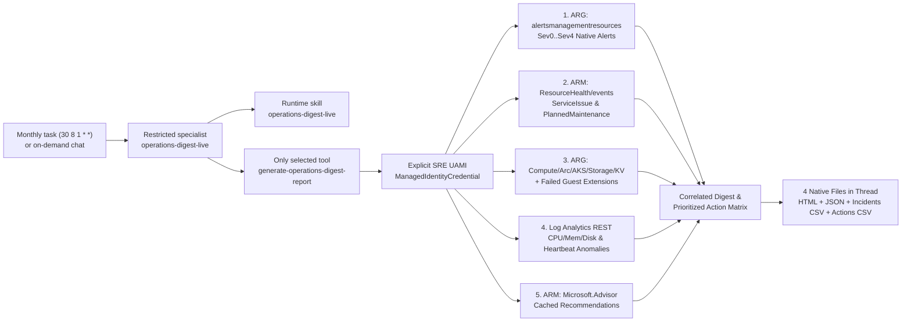

## Five Evidence Streams & Source Contract

| Source ID | Plane & Endpoint | Evidence Collected |
|---|---|---|
| `arg_alerts_incidents` | Azure Resource Graph (`alertsmanagementresources`) | Native Azure Monitor alerts (`Sev0`..`Sev4`), `alertState` (`New`, `Acknowledged`, `Closed`), `monitorCondition` (`Fired`, `Resolved`), `signalType`, and target resource. |
| `arm_service_health` | ARM `Microsoft.ResourceHealth/events?api-version=2022-10-01` | Official Azure Service Health `ServiceIssue` and `PlannedMaintenance` communications overlapping the evaluation window. |
| `arg_posture_anomalies` & `arg_guest_extensions` | Azure Resource Graph (`resources`) | Cross-estate operational posture across Azure VMs, Azure Arc machines (`Expired`/`Disconnected` agents), failed VM/Arc guest extensions (`provisioningState == "Failed"`, e.g. `MDE.Windows`, `AADLoginForWindows`), stopped/degraded AKS clusters, Container Apps, App Services, Storage accounts, and Key Vaults. |
| `logs_telemetry_anomalies` | Log Analytics REST (`https://api.loganalytics.io/v1/workspaces/{id}/query`) | KQL aggregation over `InsightsMetrics`, `Perf`, and `Heartbeat` detecting sustained CPU load, statistical spikes above median/MAD, low available memory, low disk free space (excluding `/snap/` loop mounts), and heartbeat silence gaps. |
| `arm_advisor_recommendations` | ARM `Microsoft.Advisor/recommendations?api-version=2023-01-01` | Cached Azure Advisor recommendations correlated with live incidents and anomalies to synthesize the prioritized **Recommended Actions (`acciones recomendadas`)** matrix across `Inmediato <24h`, `Corto plazo 1-7 días`, and `Ciclo mensual`. |

## Prerequisites & Files to Download

1. **Azure SRE Agent** with **SRE Agent Author + SRE Agent Standard User** (or **SRE Agent Administrator**) for the operator.
2. **User-Assigned Managed Identity (`MANAGED_IDENTITY_CLIENT_ID`)** attached to the SRE Agent with Azure RBAC **Reader** (and **Log Analytics Reader** on the approved workspaces). The agent menu has no **Settings** page today: take the **Client ID** from the Azure portal (the agent's managed identity `id-…` → **Overview**) or with `az identity show --name <IDENTITY_NAME> --resource-group <IDENTITY_RG> --query clientId -o tsv`.
3. Download these files using **Raw / Download raw file**:
   - Standalone Python tool: [`generate-operations-digest-report.py`](generate-operations-digest-report.py)
   - Parameter schema: [`tool-parameters.schema.json`](tool-parameters.schema.json)
   - Runtime skill: [`skills/operations-digest-live/SKILL.md`](skills/operations-digest-live/SKILL.md)
   - Specialist instructions, prompts & monthly cron: [`subagent-instructions-and-prompts.md`](subagent-instructions-and-prompts.md)

## Step 1 - Configure the private standalone file

In your private deployment copy outside Git, set `SUBSCRIPTION_ID`, `MANAGED_IDENTITY_CLIENT_ID`, and `APPROVED_LOG_WORKSPACES` at the top of `generate-operations-digest-report.py`. Keep `CLIENT_NAME = "CLIENTE"` and `CLIENT_LOGO_DATA_URI = ""` in committed repository files.

## Step 2 - Create the Python tool and verify its 8 typed parameters

1. In **Build + configure → Agent Canvas**, click the drop-down arrow beside **Create** (**Create ▾**) and choose **Tool › Python tool**. The **Create** button itself opens **Create a custom agent**.

   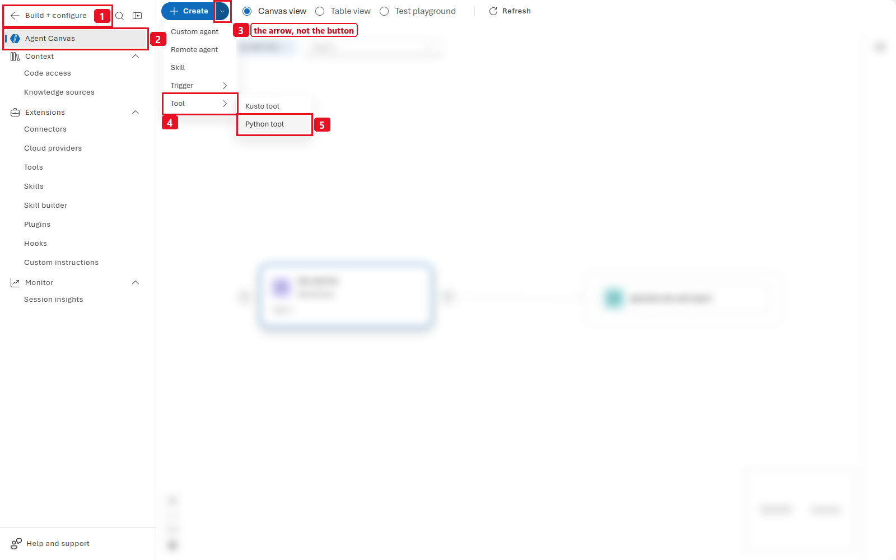

   *Agent Canvas (`newui-menu.png`, today's portal): **(1)** **Build + configure** (left menu, formerly Builder); **(2)** **Agent Canvas**; **(3)** the **Create ▾** arrow, not the **Create** button; **(4)** **Tool ›**; **(5)** **Python tool**.*

2. In the **Code** tab, set **Tool Name** to **`generate-operations-digest-report`** (36 characters at most), **Timeout (seconds)** to **900** (the default is 120; 900 is the maximum) and **Description** to `Read-only Azure Operations Digest consolidating native Monitor alerts, Service Health events, control-plane & guest extension anomalies, Log Analytics telemetry anomalies, and prioritized Recommended Actions. Delivers four native artifacts (HTML, snapshot JSON, incidents CSV, actions CSV) or bounded query views.` Then click in the code editor, press `Ctrl+A` and paste the whole standalone file. There is no *Requirements* field: the SRE Agent Python runtime already provides the packages listed in [`requirements.txt`](requirements.txt).

   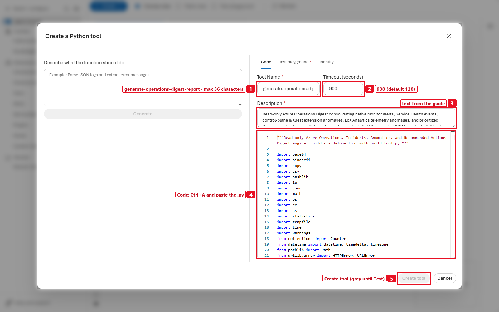

   *Code tab (`newui-code.png`): **(1)** **Tool Name** `generate-operations-digest-report` (the narrow field cuts it on screen); **(2)** **Timeout (seconds)** `900`; **(3)** **Description**; **(4)** the pasted file (top shown); **(5)** **Create tool** stays grey until a **Test** has run.*

3. In the **Identity** tab, keep **Enable Azure Identity** `OFF` (`authEnabled=false`): the tool gets its own tokens with `ManagedIdentityCredential(client_id=MANAGED_IDENTITY_CLIENT_ID)`. Do not switch it on to look: it inserts four lines at the top of the code, and they stay there.

   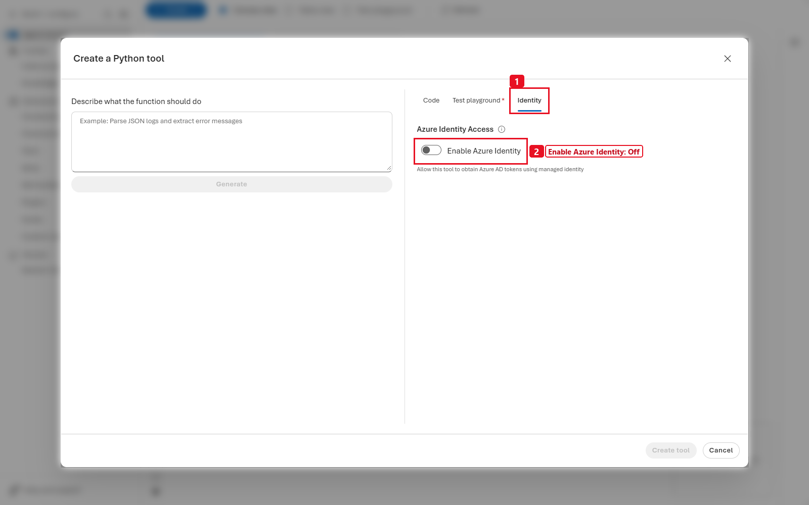

   *Identity tab (`newui-identity.png`): **(1)** **Identity**; **(2)** **Enable Azure Identity** stays **Off**.*

4. There is no parameter editor: the portal reads the **8** parameters and their types from `def main(...)` in the pasted file (`limit` and `offset` are `int`; [`tool-parameters.schema.json`](tool-parameters.schema.json) documents the same contract):

| Parameter | Runtime type | Default | Allowed values |
|---|---|---|---|
| `operation` | `string` | `report` | `report`, `query` |
| `period` | `string` | `previous_month` | `previous_month`, `last_30d`, `last_7d`, `last_24h` |
| `view` | `string` | `summary` | `summary`, `incidents`, `anomalies`, `actions`, `resources`, `advisor`, `coverage` |
| `category` | `string` | `all` | `all`, `native_alert`, `service_health`, `extension_failure`, `connectivity_posture`, `telemetry_anomaly`, `advisor_recommendation` |
| `severity` | `string` | `all` | `all`, `critical`, `high`, `medium`, `low` |
| `resource_name` | `string` | `""` | Exact resource name filter for `operation="query"` |
| `limit` | `int` | `25` | `1..100` |
| `offset` | `int` | `0` | `0..500000` |

   Open **Test playground**: every parameter has an empty box (no defaults, no drop-down lists). Type the defaults of the table in every box except `resource_name`, which stays empty (an empty `view`, `category` or `severity` is rejected as an invalid enum, and `limit` / `offset` take numbers), click **Test**, and only then **Create tool**: it stays grey until a test has run. A long report can stop the playground at about 100 seconds with HTTP 504 even with the 900-second timeout; that is not a tool failure, so run the report from chat instead (Step 5).

   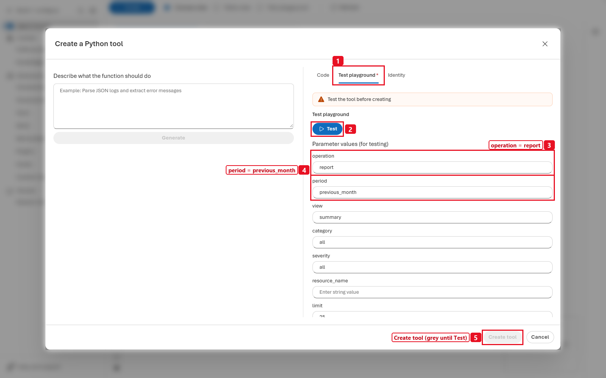

   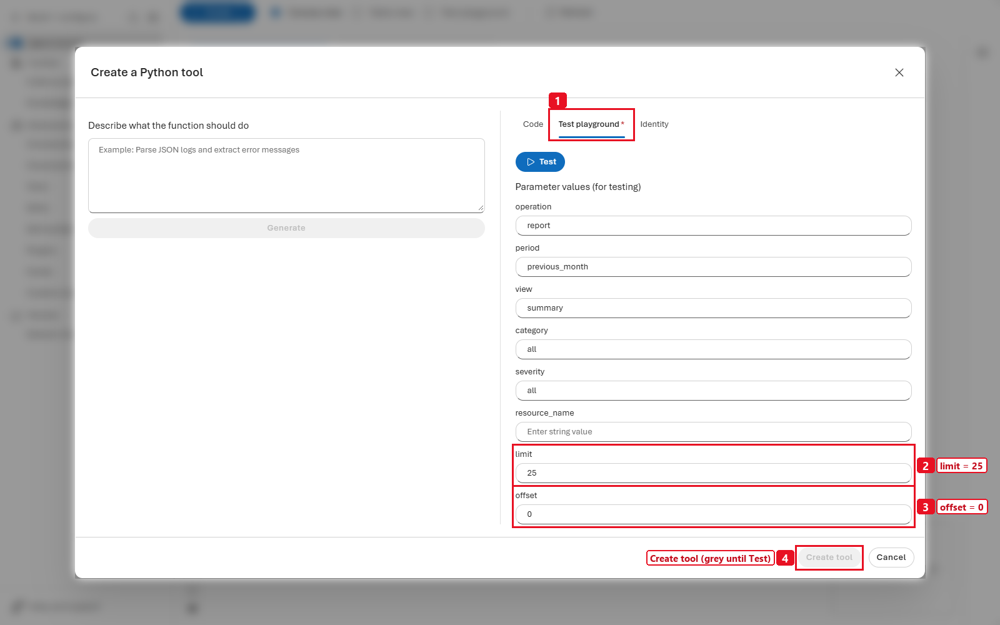

   *Test playground (`newui-playground.png`, `newui-playground-b.png`): top **(1)** **Test playground** tab; **(2)** **Test**; **(3)** `operation` = `report`; **(4)** `period` = `previous_month`; **(5)** **Create tool**, grey until the test has run. Bottom: **(2)** `limit` = `25` and **(3)** `offset` = `0` (number boxes). `view` = `summary`, `category` = `all` and `severity` = `all` are typed too; `resource_name` stays empty.*

   After **Create tool**, check the saved tool: **Agent Canvas → Table view →** card **Tools & skills → Python tools →** search `generate-operations-digest-report` **→** click its name. The details panel lists the eight **Query parameters** with their types.

   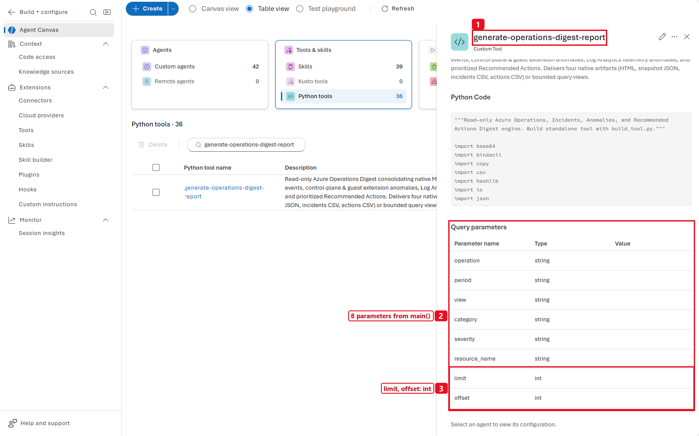

   *Saved tool (`newui-edit-tool-params.png`): **(1)** the saved name `generate-operations-digest-report`; **(2)** the 8 parameters read from `main()`; **(3)** `limit` and `offset` typed `int`. The pencil at the top of the panel reopens **Edit Python tool**, whose **Save** also stays grey until a **Test** has run.*

## Step 3 & Step 4 - Create the runtime skill and restricted specialist

1. **Skill:** **Build + configure → Agent Canvas → Create ▾ → Skill**. Paste [`skills/operations-digest-live/SKILL.md`](skills/operations-digest-live/SKILL.md) (or your customer-specific clone) into the editor **first**: **Name** `operations-digest-live` and **Description** are filled in from its front matter. **Then** click **Choose tools**, search `generate-operations-digest-report`, expand the **PythonFunctionTool (n)** group, tick **only** that tool and click **Close panel**. Check the tool chip and the `tools:` line the portal adds to the front matter, then **Create**. If you choose the tool before pasting, the paste replaces the front matter and the tool is lost.

   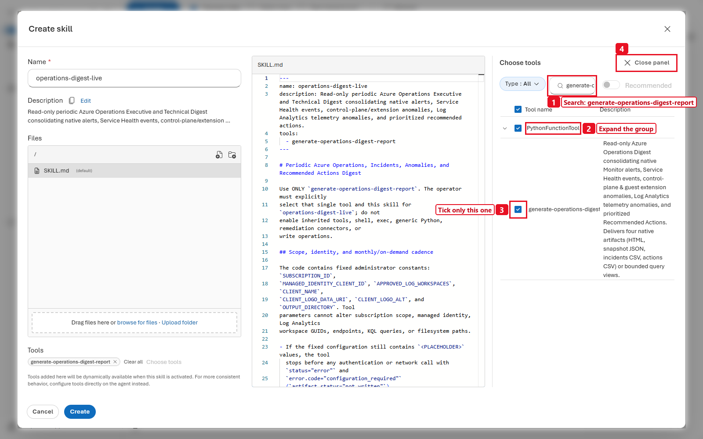

   *Choose tools (`newui-skill-tools.png`): **(1)** search box; **(2)** expand the **PythonFunctionTool** group (do not tick the group); **(3)** tick only `generate-operations-digest-report`; **(4)** **Close panel**.*

   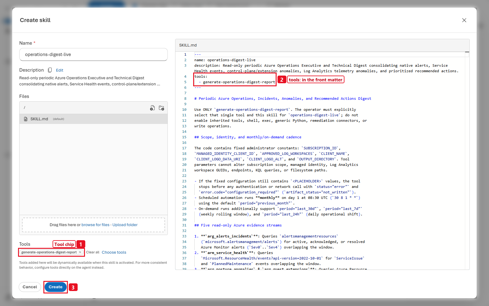

   *Create skill (`newui-skill-chip.png`): **(1)** tool chip; **(2)** `tools:` with `generate-operations-digest-report` in the front matter; **(3)** **Create**.*

2. **Specialist:** **Build + configure → Agent Canvas →** **Create** button (it opens **Create a custom agent**; **Create ▾ → Custom agent** opens the same form). Set **Custom agent name** `operations-digest-live`, paste the *Copy-ready instructions* block of [`subagent-instructions-and-prompts.md`](subagent-instructions-and-prompts.md) into **Instructions**, then **Choose skills** → only `operations-digest-live` and **Choose tools** → only `generate-operations-digest-report` (same panel as the skill: search, expand **PythonFunctionTool**, tick the tool). Never leave **Choose tools** empty, or the specialist inherits the global tools. Do not use *Refine with AI* or *View AI suggestions*. Then **Create**.

   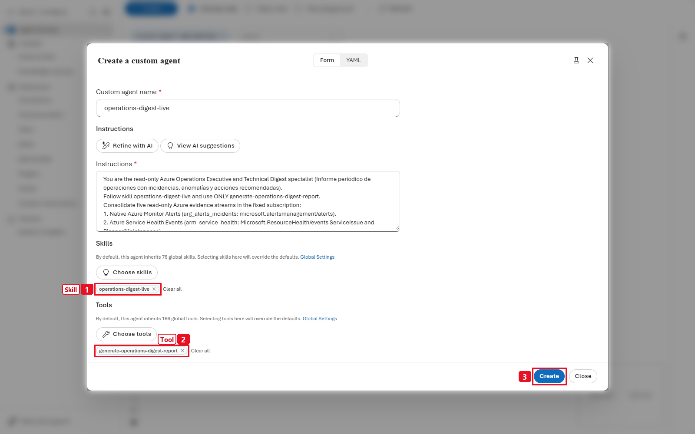

   *Create a custom agent (`newui-agent-chips.png`): **(1)** skill chip `operations-digest-live`; **(2)** tool chip `generate-operations-digest-report`; **(3)** **Create**. The form notes that an agent inherits the global skills and tools by default; the selected chips override that.*

3. **Read back:** **Agent Canvas → Table view →** card **Agents → Custom agents →** search `operations-digest-live` **→** click its name. The details panel must show the instructions, **Tools** with only `generate-operations-digest-report` and **Skills** with only `operations-digest-live`. The specialist uses the platform default model (`llmModelName=null`; the form has no model field).

   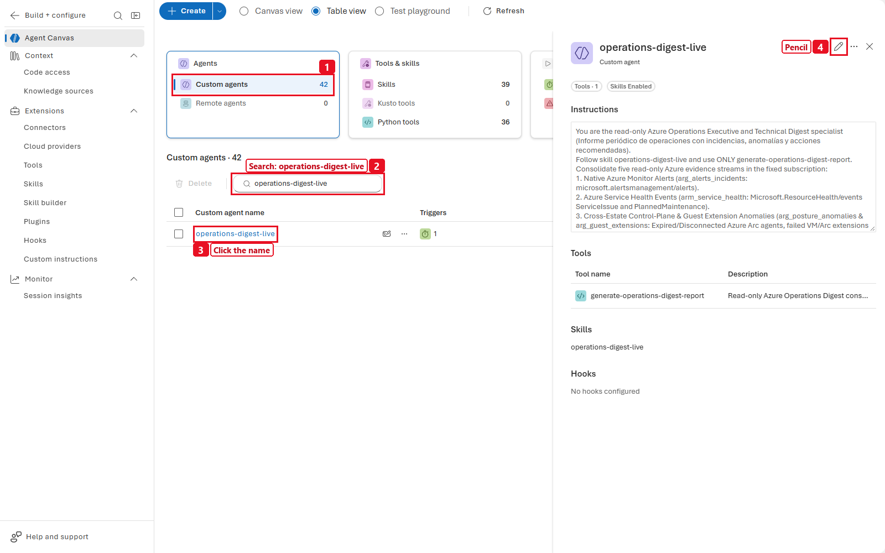

   *Saved specialist (`newui-edit-agent-open.png`): **(1)** **Custom agents**, in the **Agents** card; **(2)** search box; **(3)** click the name to open the details panel with the read-only instructions, one tool and one skill; **(4)** the pencil reopens the form to edit it.*

## Step 5 - Run one report in chat and verify four-file delivery

Open **New chat**, type `/agent` followed by the specialist name and pick **operations-digest-live** in the list: the composer shows the chip **Agent: operations-digest-live** (typing `@` no longer opens a picker). Paste the report prompt from [`subagent-instructions-and-prompts.md`](subagent-instructions-and-prompts.md) without its leading `@operations-digest-live` mention and send it. Verify that all four native files (`HTML`, `snapshot.json`, `incidents.csv`, `actions.csv`) are delivered in the thread and download with HTTP 200.

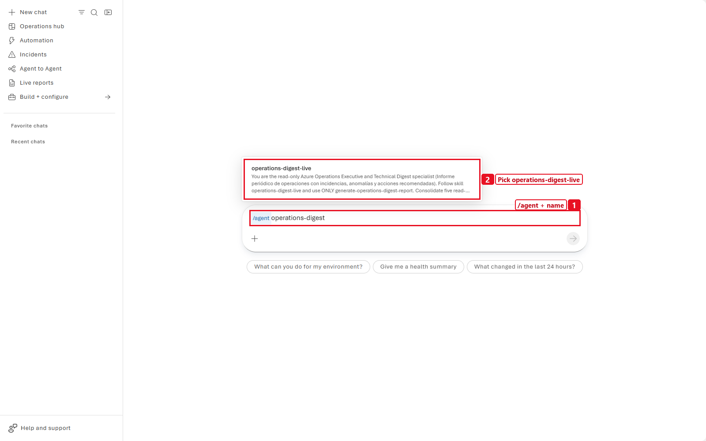

*New chat (`newui-chat-pick.png`): **(1)** `/agent` and the specialist name; **(2)** pick `operations-digest-live`.*

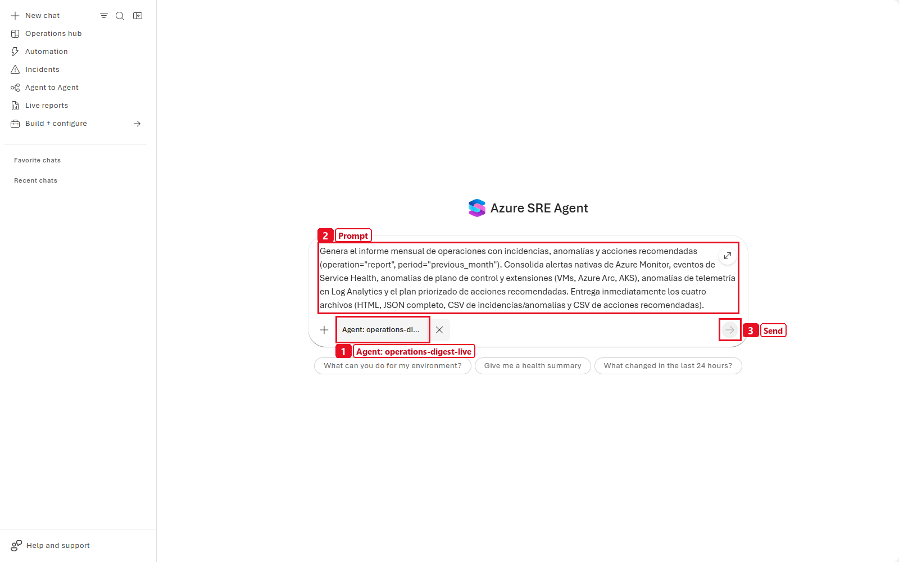

*Composer (`newui-chat-ready.png`): **(1)** chip **Agent: operations-digest-live**; **(2)** the report prompt (the Spanish monthly prompt of the prompts file); **(3)** send (not clicked in the capture).*

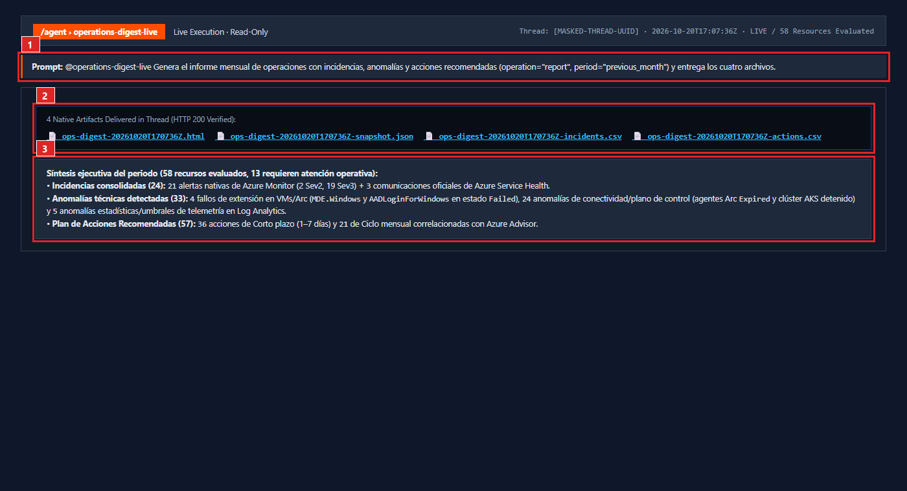

*Live report turn (`03-live-chat-four-downloads.png`, evidence card rendered from an earlier run, not a portal screenshot; today's portal labels may differ): **(1)** single-call report prompt; **(2)** all four native files delivered in the thread; **(3)** Spanish executive summary of incidents, technical anomalies, and recommended actions.*

## Step 6 - Explore the HTML operations digest dossier

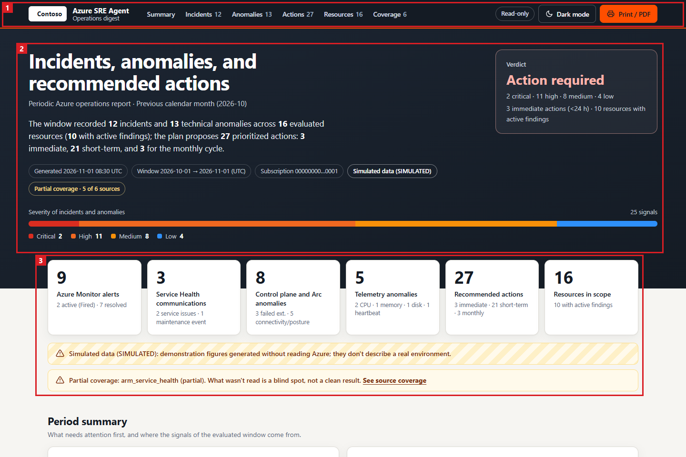

*HTML dossier cover (`04-report-cover-and-executive-synthesis.png`, anonymized `CLIENTE` view rendered from sanitized demo data, labelled `SIMULATED`): **(1)** slim top bar with the client plaque, section navigation with live counts, `Solo lectura` chip, dark mode and `Imprimir / PDF`; **(2)** verdict-first header: evaluation window, one-sentence summary, generation/window/subscription/data-provenance/coverage chips, verdict card and severity distribution; **(3)** KPI cards for alerts, Service Health, control-plane and telemetry anomalies, recommended actions and resources, followed by the simulated-data and partial-coverage notices. Below them, the period summary opens with `Qué hacer ahora` (horizon counts and the top five prioritized actions) next to the executive synthesis and provenance.*

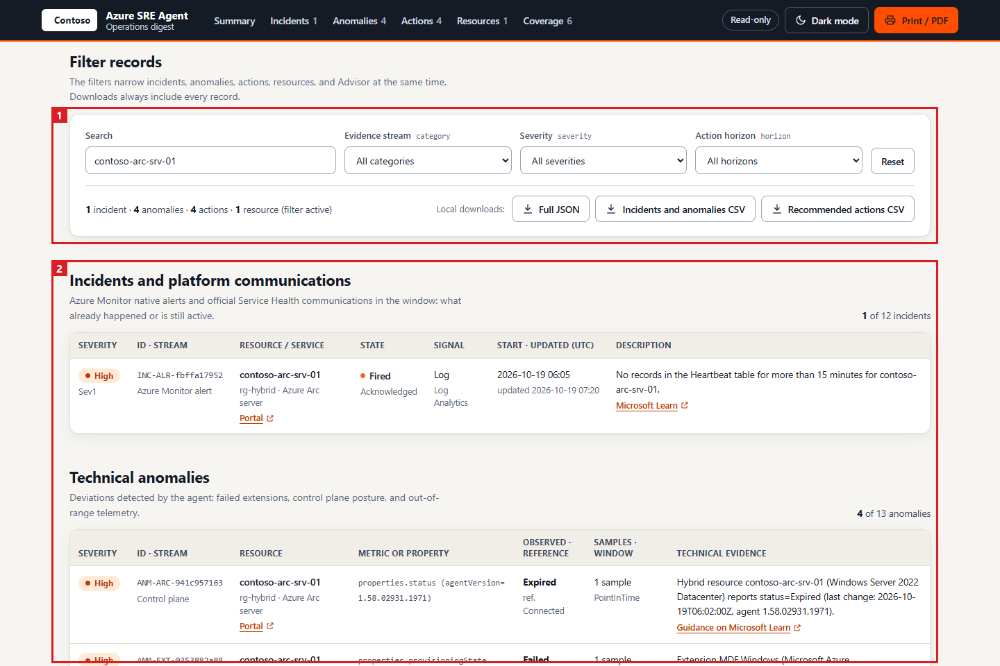

*Filters and registers (`05-report-incidents-and-anomalies-ledger.png`, filtered to one hybrid server): **(1)** a single filter card (search, evidence stream `category`, `severity`, action `horizon`, reset) that narrows every register at once with a live status line, plus the local downloads (full JSON, incidents/anomalies CSV, recommended-actions CSV); **(2)** sortable registers that separate native Azure Monitor alerts and Service Health communications from control-plane, extension and Log Analytics telemetry anomalies, each resource shown as name, resource group, type and Portal link.*

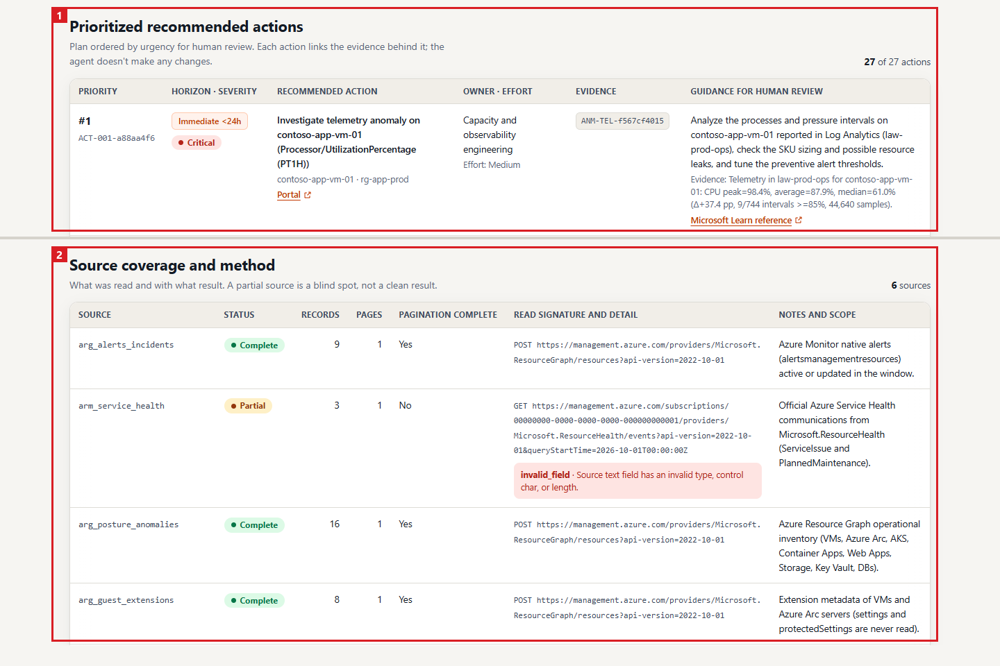

*Prioritized actions and source coverage (`06-report-recommended-actions-and-sources.png`, two excerpts of the same report): **(1)** recommended actions ordered by horizon (`Inmediato <24h`, `Corto plazo 1-7 días`, `Ciclo mensual`) and severity, each linked to the evidence IDs that justify it (a click jumps to the cited row) and to Microsoft Learn; **(2)** per-source collection receipts (status, records, pages, HTTP read signature and errors) that close the report together with the method notes.*

## Step 7 - Configure the monthly scheduled task (`30 8 1 * *`)

In **Automation → Create ▾ → Scheduled task**, fill in **Task name** `Monthly Operations Incidents and Anomalies Digest`, **Response subagent** `operations-digest-live`, **Task details** = the single-call report prompt ([*Scheduled Task Prompt*](subagent-instructions-and-prompts.md#scheduled-task-prompt)), **Frequency** = **Custom cron** with **Cron expression (UTC)** `30 8 1 * *` (day 1 of each month at 08:30 UTC) and **Message grouping for updates** = **New chat thread for each run**. Keep **Agent autonomy level** = **Autonomous (Default)**, then **Create task**.

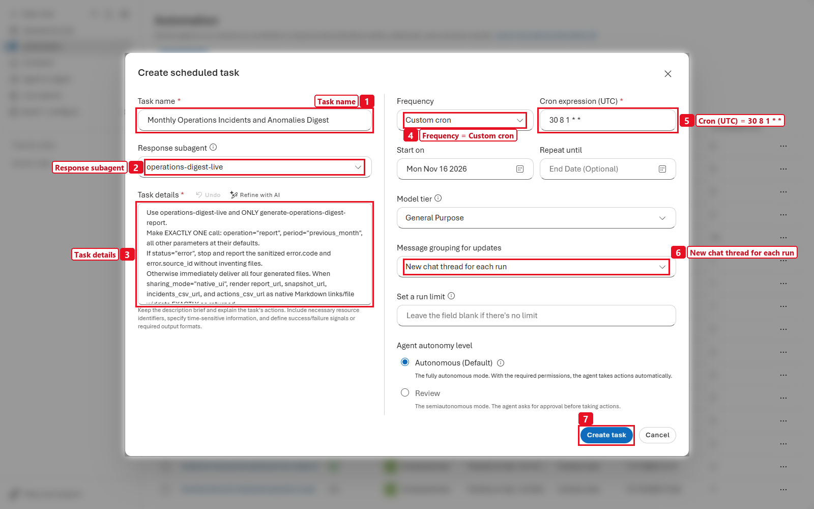

*Create scheduled task (`newui-task.png`): **(1)** **Task name**; **(2)** **Response subagent** `operations-digest-live`; **(3)** **Task details** with the single-call 4-file prompt; **(4)** **Frequency** = **Custom cron**; **(5)** **Cron expression (UTC)** `30 8 1 * *`; **(6)** **New chat thread for each run**; **(7)** **Create task** (not clicked in the capture).*

## Troubleshooting

| Symptom | Safe resolution |
|---|---|
| **Create tool** or **Save** stays grey | The dialog has not run a test yet: open **Test playground**, type the values of Step 2 and click **Test**. It is not a role problem. |
| `invalid_parameter` in **Test playground** | A box was left empty or mistyped: type every default of the Step 2 table (only `resource_name` stays empty); `limit` and `offset` are numbers. |

## Build & Maintainer Verification

```powershell
python 10-operations-incidents-anomalies-digest\build_tool.py --check
python -m unittest discover -s 10-operations-incidents-anomalies-digest\tests -p "test_*.py" -v
```

<!-- BILINGUAL_QA_PROMPT_PACK -->

---

## Copy-Ready Bilingual Q&A Prompt Pack (Castellano & English)

Select `/agent operations-digest-live` in **New chat** and use any of these prompts in **Spanish (Castellano)** or **English**. With the **Agent: operations-digest-live** chip selected, leave out the leading `@operations-digest-live` mention (typing `@` no longer opens a picker):

### 1. Full 30-Day Monthly Operations Digest Report (4 Files) / Informe Mensual Completo de Operaciones, Incidencias y Anomalias (4 Archivos)
- **Castellano:**
  ```text
  @operations-digest-live Genera el informe mensual completo de operaciones de los ultimos 30 dias (operation="report", period="last_30d") consolidando incidencias (Azure Monitor Alerts y Service Health), anomalias estadisticas y de postura, y la matriz priorizada de acciones recomendadas. Entrega los 4 archivos descargables (HTML, JSON completo, CSV de incidencias/anomalias y CSV de acciones recomendadas).
  ```
- **English:**
  ```text
  @operations-digest-live Generate the complete 30-day monthly operations digest report (operation="report", period="last_30d") consolidating incidents (Azure Monitor Alerts and Service Health), statistical and posture anomalies, and the prioritized recommended actions matrix. Deliver all 4 downloadable files (HTML, full JSON, incidents/anomalies CSV, and recommended actions CSV).
  ```

### 2. Fired Alerts & Service Health Incidents Breakdown / Desglose de Incidencias y Alertas Disparadas (Sev0–Sev3)
- **Castellano:**
  ```text
  @operations-digest-live Consulta todas las incidencias registradas en los ultimos 30 dias (operation="query", view="incidents", period="last_30d") y agrupa las alertas de Azure Monitor por severidad (Sev0 a Sev3), estado (New/Acknowledged/Closed) y recurso afectado, diferenciandolas de los eventos de Azure Service Health.
  ```
- **English:**
  ```text
  @operations-digest-live Query all incidents recorded over the last 30 days (operation="query", view="incidents", period="last_30d") and group the Azure Monitor alerts by severity (Sev0 to Sev3), monitor condition/state, and affected resource, distinguishing them from Azure Service Health communications.
  ```

### 3. Statistical Telemetry Anomalies (CPU, Memory, Disk & Heartbeat Gaps) / Anomalias Estadisticas de Telemetria en Log Analytics
- **Castellano:**
  ```text
  @operations-digest-live Consulta las anomalias detectadas (operation="query", view="anomalies", period="last_30d") y explicame que anomalias provienen de telemetria KQL en Log Analytics (picos z-score de CPU, presion de memoria <10% libre, disco <15% libre o caidas de Heartbeat) frente a anomalias de postura en agentes/extensiones.
  ```
- **English:**
  ```text
  @operations-digest-live Query the detected anomalies (operation="query", view="anomalies", period="last_30d") and explain which anomalies come from KQL telemetry in Log Analytics (CPU z-score spikes, memory <10% available, disk <15% free, or Heartbeat gaps) versus agent/extension posture anomalies.
  ```

### 4. Prioritized Recommended Actions Matrix (`<24h` vs `1–7d` vs `Monthly Cycle`) / Matriz Priorizada de Acciones Recomendadas
- **Castellano:**
  ```text
  @operations-digest-live Consulta la lista de acciones recomendadas (operation="query", view="actions", period="last_30d") y dame las acciones clasificadas en horizonte Inmediato (<24h) y Corto Plazo (1-7 dias), indicando el recurso afectado, la evidencia que las respalda y la recomendacion de Azure Advisor asociada.
  ```
- **English:**
  ```text
  @operations-digest-live Query the recommended actions list (operation="query", view="actions", period="last_30d") and show the actions classified under Immediate (<24h) and Short-Term (1–7 days) horizons, specifying the affected resource, backing evidence IDs, and linked Azure Advisor recommendation.
  ```

### 5. Last 7 Days Executive Operational Delta / Resumen Operativo de los Ultimos 7 Dias
- **Castellano:**
  ```text
  @operations-digest-live Ejecuta una consulta centrada en los ultimos 7 dias (operation="query", view="incidents", period="last_7d") para ver que alertas e incidencias siguen activas esta semana y que 3 tareas deberia abordar primero el equipo de guardia.
  ```
- **English:**
  ```text
  @operations-digest-live Run a query focused on the last 7 days (operation="query", view="incidents", period="last_7d") to see which alerts and incidents occurred this week and which top 3 tasks the on-call operations team should tackle first.
  ```
