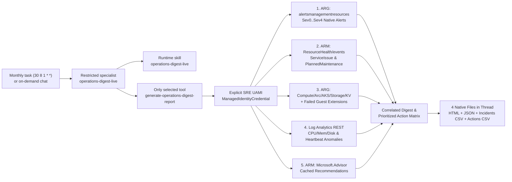
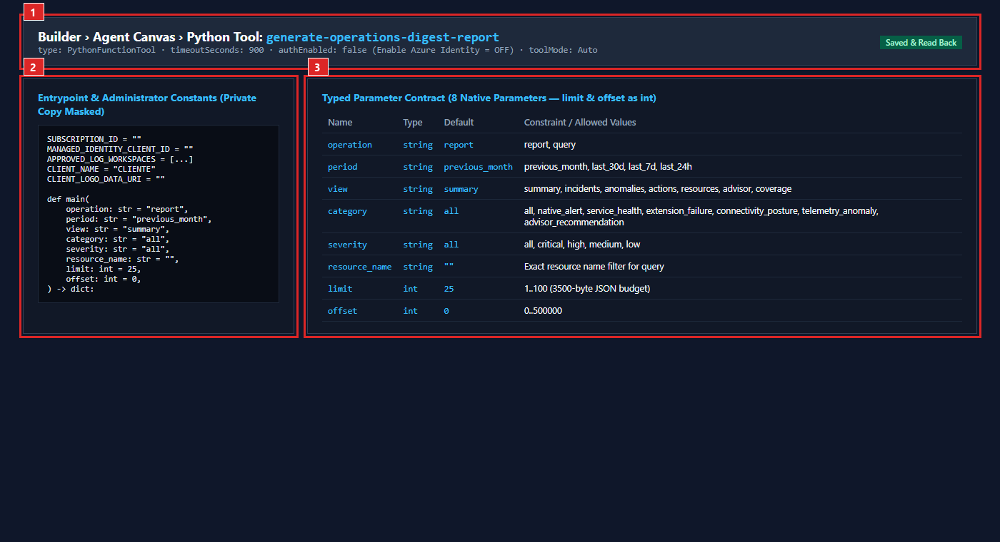
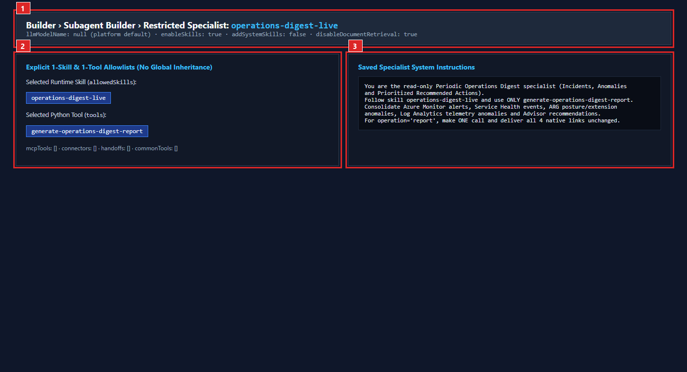
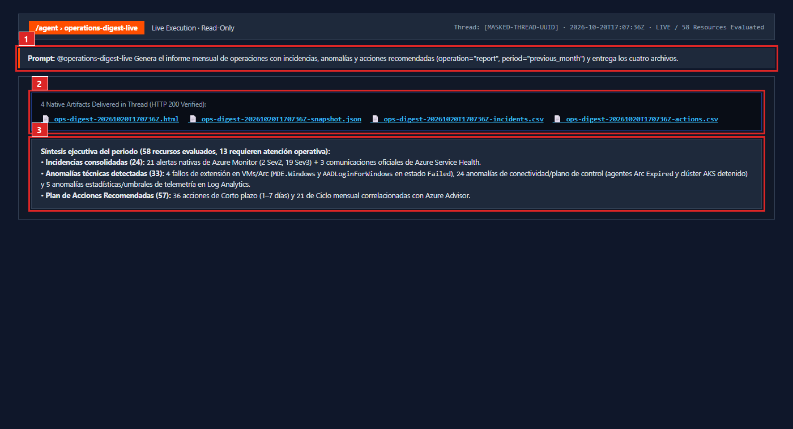
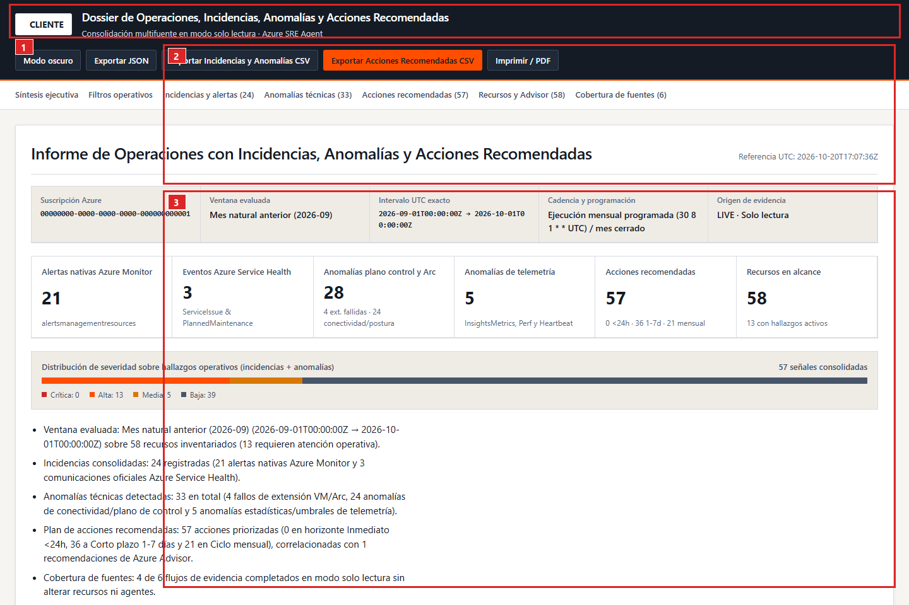
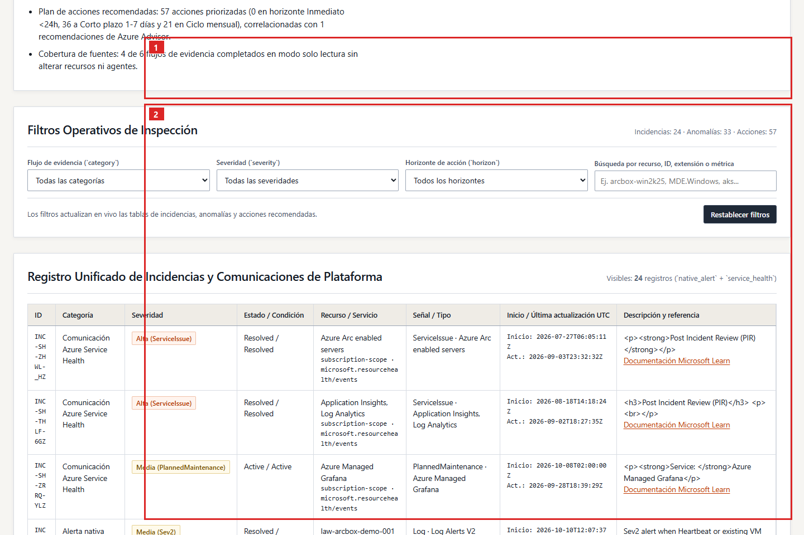
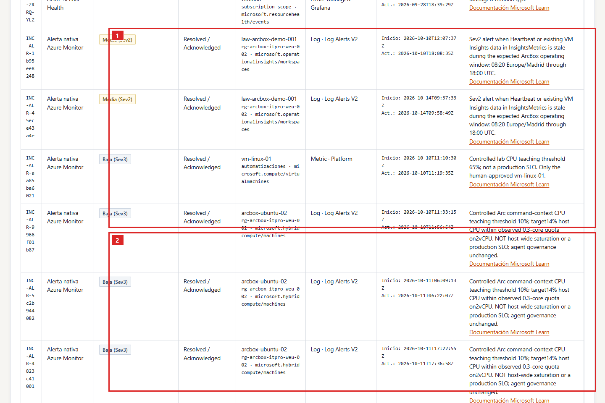
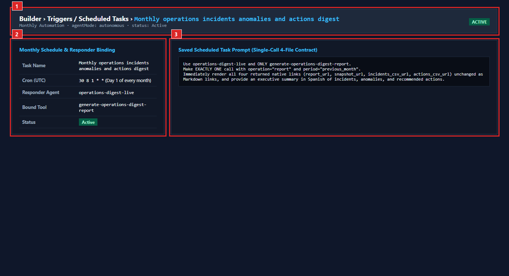

# Case 10 - Periodic Operations, Incidents, Anomalies & Recommended Actions Digest

> **Azure SRE Agent** · Read-only Python tool · Runtime skill · Restricted specialist · Monthly (`30 8 1 * *`) & on-demand (`previous_month`, `last_30d`, `last_7d`, `last_24h`) · Offline HTML, full JSON and two CSVs

Consolidate **incidents, technical anomalies, and prioritized recommended actions** (`Informe periódico de operaciones con incidencias, anomalías y acciones recomendadas`) across five live Azure evidence streams into one self-contained Spanish HTML workpaper, complete normalized JSON snapshot, and two UTF-8 BOM CSV exports (`incidents.csv` and `actions.csv`). Even when stakeholders initially request a weekly operations report, the scheduled automation task runs **monthly (`30 8 1 * *` UTC)** by default (`period="previous_month"`), while supporting rolling 30-day (`last_30d`), 7-day weekly (`last_7d`), and 24-hour (`last_24h`) windows on demand.

| What you get | What it does not claim |
|---|---|
| Five correlated read-only streams: Azure Monitor alerts (`arg_alerts_incidents`), Service Health events (`arm_service_health`), ARG posture & guest extension failures (`arg_posture_anomalies` / `arg_guest_extensions`), Log Analytics statistical/threshold anomalies (`logs_telemetry_anomalies`), and Azure Advisor (`arm_advisor_recommendations`) | Official SLA availability certification, fabricated root causes, or dollar/DBU savings estimates |
| Evidence-linked **Recommended Actions (`acciones recomendadas`)** matrix prioritized by operational horizon (`Inmediato <24h`, `Corto plazo 1-7 días`, `Ciclo mensual`) citing exact signal IDs and target resources | Unattended remediation, guest command execution, alert state modification, or ITSM ticket creation |
| Monthly scheduled automation (`30 8 1 * *`) plus bounded `query` views (`summary`, `incidents`, `anomalies`, `actions`, `resources`, `advisor`, `coverage`) under the 3,500-byte JSON transport budget | Customer branding in public Git source (`CLIENT_NAME = "CLIENTE"` and `CLIENT_LOGO_DATA_URI = ""` by default) |

## How the pieces fit together



## Five Evidence Streams & Source Contract

| Source ID | Plane & Endpoint | Evidence Collected |
|---|---|---|
| `arg_alerts_incidents` | Azure Resource Graph (`alertsmanagementresources`) | Native Azure Monitor alerts (`Sev0`..`Sev4`), `alertState` (`New`, `Acknowledged`, `Closed`), `monitorCondition` (`Fired`, `Resolved`), `signalType`, and target resource. |
| `arm_service_health` | ARM `Microsoft.ResourceHealth/events?api-version=2022-10-01` | Official Azure Service Health `ServiceIssue` and `PlannedMaintenance` communications overlapping the evaluation window. |
| `arg_posture_anomalies` & `arg_guest_extensions` | Azure Resource Graph (`resources`) | Cross-estate operational posture across Azure VMs, Azure Arc machines (`Expired`/`Disconnected` agents), failed VM/Arc guest extensions (`provisioningState == "Failed"`, e.g. `MDE.Windows`, `AADLoginForWindows`), stopped/degraded AKS clusters, Container Apps, App Services, Storage accounts, and Key Vaults. |
| `logs_telemetry_anomalies` | Log Analytics REST (`https://api.loganalytics.io/v1/workspaces/{id}/query`) | KQL aggregation over `InsightsMetrics`, `Perf`, and `Heartbeat` detecting sustained CPU load, statistical spikes above median/MAD, low available memory, low disk free space (excluding `/snap/` loop mounts), and heartbeat silence gaps. |
| `arm_advisor_recommendations` | ARM `Microsoft.Advisor/recommendations?api-version=2023-01-01` | Cached Azure Advisor recommendations correlated with live incidents and anomalies to synthesize the prioritized **Recommended Actions (`acciones recomendadas`)** matrix across `Inmediato <24h`, `Corto plazo 1-7 días`, and `Ciclo mensual`. |

## Prerequisites & Files to Download

1. **Azure SRE Agent** with **SRE Agent Author + SRE Agent Standard User** (or **SRE Agent Administrator**) for the operator.
2. **User-Assigned Managed Identity (`MANAGED_IDENTITY_CLIENT_ID`)** attached to the SRE Agent with Azure RBAC **Reader** (and **Log Analytics Reader** on the approved workspaces).
3. Download these files using **Raw / Download raw file**:
   - Standalone Python tool: [`generate-operations-digest-report.py`](generate-operations-digest-report.py)
   - Parameter schema: [`tool-parameters.schema.json`](tool-parameters.schema.json)
   - Runtime skill: [`skills/operations-digest-live/SKILL.md`](skills/operations-digest-live/SKILL.md)
   - Specialist instructions, prompts & monthly cron: [`subagent-instructions-and-prompts.md`](subagent-instructions-and-prompts.md)

## Step 1 - Configure the private standalone file

In your private deployment copy outside Git, set `SUBSCRIPTION_ID`, `MANAGED_IDENTITY_CLIENT_ID`, and `APPROVED_LOG_WORKSPACES` at the top of `generate-operations-digest-report.py`. Keep `CLIENT_NAME = "CLIENTE"` and `CLIENT_LOGO_DATA_URI = ""` in committed repository files.

## Step 2 - Create the Python tool and verify its 8 typed parameters

In **Builder > Agent Canvas**, click the drop-down arrow beside **Create > Tool > Python tool**, paste the standalone file, set timeout to **900 seconds**, keep **Enable Azure Identity** `OFF` (`authEnabled=false`), and configure all **8** parameters (`limit` and `offset` as `int`):

| Parameter | Runtime type | Default | Allowed values |
|---|---|---|---|
| `operation` | `string` | `report` | `report`, `query` |
| `period` | `string` | `previous_month` | `previous_month`, `last_30d`, `last_7d`, `last_24h` |
| `view` | `string` | `summary` | `summary`, `incidents`, `anomalies`, `actions`, `resources`, `advisor`, `coverage` |
| `category` | `string` | `all` | `all`, `native_alert`, `service_health`, `extension_failure`, `connectivity_posture`, `telemetry_anomaly`, `advisor_recommendation` |
| `severity` | `string` | `all` | `all`, `critical`, `high`, `medium`, `low` |
| `resource_name` | `string` | `""` | Exact resource name filter for `operation="query"` |
| `limit` | `int` | `25` | `1..100` |
| `offset` | `int` | `0` | `0..500000` |



*Saved Python tool profile (`01-saved-tool-and-8-parameters.png`): **(1)** dedicated tool name, 900s timeout and `Enable Azure Identity = OFF`; **(2)** administrator constants and `main()` signature; **(3)** all 8 native parameters (`limit` and `offset` configured as `int`).*

## Step 3 & Step 4 - Create the runtime skill and restricted specialist

1. In **Builder > Skills > Create skill**, create `operations-digest-live` (or your customer-specific clone) using [`skills/operations-digest-live/SKILL.md`](skills/operations-digest-live/SKILL.md) and bind **only** `generate-operations-digest-report`.
2. In **Builder > Subagent builder > Create**, create `operations-digest-live`, paste the instructions from [`subagent-instructions-and-prompts.md`](subagent-instructions-and-prompts.md), and select **explicitly** 1 skill and 1 tool.



*Saved restricted specialist (`02-saved-skill-and-specialist.png`): **(1)** specialist profile using platform default model (`llmModelName=null`); **(2)** explicit 1-skill and 1-tool allowlist; **(3)** read-only system instructions.*

## Step 5 - Run one report in chat and verify four-file delivery

Open **New chat**, select the specialist via `/agent`, and run the report prompt from [`subagent-instructions-and-prompts.md`](subagent-instructions-and-prompts.md). Verify that all four native files (`HTML`, `snapshot.json`, `incidents.csv`, `actions.csv`) are delivered in the thread and download with HTTP 200.



*Live report turn (`03-live-chat-four-downloads.png`): **(1)** single-call report prompt; **(2)** all four native files delivered in the thread; **(3)** Spanish executive summary of incidents, technical anomalies, and recommended actions.*

## Step 6 - Explore the HTML operations digest dossier



*HTML dossier cover and executive synthesis (`04-report-cover-and-executive-synthesis.png`, anonymized `CLIENTE` view): **(1)** top action bar with dark-mode toggle and local JSON/CSV/PDF exports; **(2)** provenance header and evaluation window; **(3)** executive synthesis and tabular KPI summary strip across incidents, anomalies, and prioritized actions.*



*Unified incidents and technical anomalies ledger (`05-report-incidents-and-anomalies-ledger.png`): **(1)** interactive filters by stream category, severity, and resource search; **(2)** structured tables separating native Azure Monitor alerts and Service Health events from control-plane/extension failures and Log Analytics telemetry anomalies.*



*Prioritized recommended actions and source coverage ledger (`06-report-recommended-actions-and-sources.png`): **(1)** prioritized recommended actions (`Inmediato <24h`, `Corto plazo 1-7 días`, `Ciclo mensual`) linked to exact incident/anomaly IDs and Microsoft Learn URLs; **(2)** per-source HTTP receipts and methodological boundaries.*

## Step 7 - Configure the monthly scheduled task (`30 8 1 * *`)

In **Builder > Triggers / Scheduled tasks**, create the monthly task with cron `30 8 1 * *` (day 1 of each month at 08:30 UTC) bound to the restricted specialist and the single-call report prompt from [`subagent-instructions-and-prompts.md`](subagent-instructions-and-prompts.md).



*Monthly scheduled task (`07-monthly-scheduled-task.png`): **(1)** active monthly automation header; **(2)** cron `30 8 1 * *` and specialist binding; **(3)** single-call 4-file prompt.*

## Build & Maintainer Verification

```powershell
python 10-operations-incidents-anomalies-digest\build_tool.py --check
python -m unittest discover -s 10-operations-incidents-anomalies-digest\tests -p "test_*.py" -v
```

<!-- BILINGUAL_QA_PROMPT_PACK -->

---

## Copy-Ready Bilingual Q&A Prompt Pack (Castellano & English)

Select `/agent operations-digest-live` in **New chat** and use any of these prompts in **Spanish (Castellano)** or **English**:

### 1. Full 30-Day Monthly Operations Digest Report (4 Files) / Informe Mensual Completo de Operaciones, Incidencias y Anomalias (4 Archivos)
- **Castellano:**
  ```text
  @operations-digest-live Genera el informe mensual completo de operaciones de los ultimos 30 dias (operation="report", period="last_30d") consolidando incidencias (Azure Monitor Alerts y Service Health), anomalias estadisticas y de postura, y la matriz priorizada de acciones recomendadas. Entrega los 4 archivos descargables (HTML, JSON completo, CSV de incidencias/anomalias y CSV de acciones recomendadas).
  ```
- **English:**
  ```text
  @operations-digest-live Generate the complete 30-day monthly operations digest report (operation="report", period="last_30d") consolidating incidents (Azure Monitor Alerts and Service Health), statistical and posture anomalies, and the prioritized recommended actions matrix. Deliver all 4 downloadable files (HTML, full JSON, incidents/anomalies CSV, and recommended actions CSV).
  ```

### 2. Fired Alerts & Service Health Incidents Breakdown / Desglose de Incidencias y Alertas Disparadas (Sev0–Sev3)
- **Castellano:**
  ```text
  @operations-digest-live Consulta todas las incidencias registradas en los ultimos 30 dias (operation="query", view="incidents", period="last_30d") y agrupa las alertas de Azure Monitor por severidad (Sev0 a Sev3), estado (New/Acknowledged/Closed) y recurso afectado, diferenciandolas de los eventos de Azure Service Health.
  ```
- **English:**
  ```text
  @operations-digest-live Query all incidents recorded over the last 30 days (operation="query", view="incidents", period="last_30d") and group the Azure Monitor alerts by severity (Sev0 to Sev3), monitor condition/state, and affected resource, distinguishing them from Azure Service Health communications.
  ```

### 3. Statistical Telemetry Anomalies (CPU, Memory, Disk & Heartbeat Gaps) / Anomalias Estadisticas de Telemetria en Log Analytics
- **Castellano:**
  ```text
  @operations-digest-live Consulta las anomalias detectadas (operation="query", view="anomalies", period="last_30d") y explicame que anomalias provienen de telemetria KQL en Log Analytics (picos z-score de CPU, presion de memoria <10% libre, disco <15% libre o caidas de Heartbeat) frente a anomalias de postura en agentes/extensiones.
  ```
- **English:**
  ```text
  @operations-digest-live Query the detected anomalies (operation="query", view="anomalies", period="last_30d") and explain which anomalies come from KQL telemetry in Log Analytics (CPU z-score spikes, memory <10% available, disk <15% free, or Heartbeat gaps) versus agent/extension posture anomalies.
  ```

### 4. Prioritized Recommended Actions Matrix (`<24h` vs `1–7d` vs `Monthly Cycle`) / Matriz Priorizada de Acciones Recomendadas
- **Castellano:**
  ```text
  @operations-digest-live Consulta la lista de acciones recomendadas (operation="query", view="actions", period="last_30d") y dame las acciones clasificadas en horizonte Inmediato (<24h) y Corto Plazo (1-7 dias), indicando el recurso afectado, la evidencia que las respalda y la recomendacion de Azure Advisor asociada.
  ```
- **English:**
  ```text
  @operations-digest-live Query the recommended actions list (operation="query", view="actions", period="last_30d") and show the actions classified under Immediate (<24h) and Short-Term (1–7 days) horizons, specifying the affected resource, backing evidence IDs, and linked Azure Advisor recommendation.
  ```

### 5. Last 7 Days Executive Operational Delta / Resumen Operativo de los Ultimos 7 Dias
- **Castellano:**
  ```text
  @operations-digest-live Ejecuta una consulta centrada en los ultimos 7 dias (operation="query", view="incidents", period="last_7d") para ver que alertas e incidencias siguen activas esta semana y que 3 tareas deberia abordar primero el equipo de guardia.
  ```
- **English:**
  ```text
  @operations-digest-live Run a query focused on the last 7 days (operation="query", view="incidents", period="last_7d") to see which alerts and incidents occurred this week and which top 3 tasks the on-call operations team should tackle first.
  ```
