# Case 11 - Microsoft Fabric FinOps & Chargeback (real cost, idle capacity, savings, per-workspace split)

> **Azure SRE Agent** · Read-only Python tool · Runtime skill · Restricted subagent · Monthly task (`0 7 2 * *`) & on-demand (`last_30d`, `last_14d`, `last_7d`) · **Same-tenant (default) or cross-tenant**, zero secrets in both · Offline HTML, full JSON and two CSVs

**What do we really pay for Microsoft Fabric, what is actually used, and how much can we save?** A restricted SRE Agent subagent reads the Fabric tenant live from 14 read-only sources - the **real bill per meter** (Azure Cost Management), the **capacity on/off hours** (Azure Activity Log), **user activity, Spark sessions, inventory and tenant settings** (Fabric / Power BI admin APIs) - and returns an interactive FinOps report with prioritized, evidence-backed savings and a **chargeback split per workspace**.

Every figure comes from the tenant. **Nothing is simulated.**

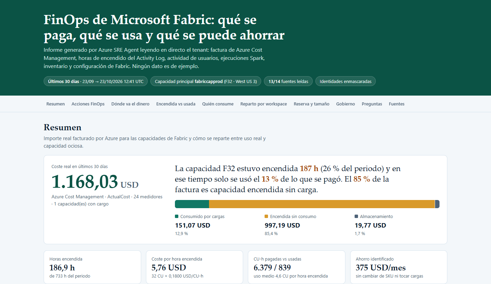

*Summary from the anonymized sample run: **1,168.03 USD** billed in 30 days, of which **85.4 % was capacity switched on with no workload**, and the actions that recover it.*

| What you get | What it does not claim |
|---|---|
| Real billed cost **meter by meter** (Compute Pool, Spark, Copilot/AI, Real-Time, OneLake…), monthly trend and Fabric's weight in the subscription | A forecast or an invoice. Cost Management publishes with a 24-48 h delay and the report says so |
| **CU-h paid vs CU-h used**, hours on, hours after the last job of the day, days on without load, fixed-time pause simulation | Real-time CU utilization from the *Capacity Metrics* app (a service principal cannot query it; see [limits](#security-and-limits)) |
| 10-12 **FinOps actions with amount and evidence**: pause schedule, no-load days, reservation yes/no, SKU right-size, expensive notebooks, risky paused capacities, AI cost, governance | Any automatic change. The tool never pauses, resumes, resizes, re-assigns or edits settings; a person applies the actions |
| **Chargeback per workspace**: direct consumption of each meter by its real usage + a proportional share of idle time; unassignable cost shown apart | A perfect split: storage, transactions and deleted workspaces stay **unassigned** on purpose |
| Who consumes what: identities (**masked by default**), top items, Spark notebooks, activity heat map, governance (failed refreshes, stale items, trial capacities, sensitive tenant settings) | User names in clear text unless explicitly requested for an authorized recipient |

## Business value

| Who | Pain today | With this case |
|---|---|---|
| **FinOps / Finance** | One Fabric line on the invoice, no idea what drives it | Bill per meter and per workload, monthly trend, and a CSV to reconcile against the invoice |
| **Platform owner** | F-SKU capacities left on overnight and at weekends | Exact idle hours and cost, a pause time backed by evidence, and the monthly saving |
| **Business units** | "Why am I being charged this?" | Defensible per-workspace chargeback, with the method written in the report |
| **Procurement** | "Should we buy a reservation?" | Break-even point vs actual uptime: buy only if it pays off |
| **Governance / Security** | Tenant settings and stale content nobody reviews | Sensitive settings (Publish to web, guests, AI), failed refreshes, items untouched for 90+ days, untagged / trial capacities |

In the anonymized sample run below, the report found **375.5 USD/month** of direct savings from a pause schedule, avoided **16,045 USD/year** of reservation overspend, and flagged an **8,294 USD/month** risk (a paused, empty F64). It runs every month with no human effort.

**Contents:** [How it fits together](#how-the-pieces-fit-together) · [14 sources](#14-read-only-sources-and-the-permission-each-needs) · [Choose your option](#choose-your-option-same-tenant-or-cross-tenant) · [Prerequisites](#prerequisites--files-to-download) · [Option A - same tenant](#option-a---same-tenant-recommended-for-customers) · [Option B - cross-tenant](#option-b---cross-tenant-sre-agent-in-tenant-a-fabric-in-tenant-b) · [Build in SRE Agent](#step-3---configure-the-tool-the-3-constants) · [Report tour](#step-9---read-the-report-section-by-section) · [Formulas](#how-each-figure-is-calculated) · [Troubleshooting](#troubleshooting) · [Prompts](#copy-ready-bilingual-qa-prompt-pack-castellano--english)

## How the pieces fit together

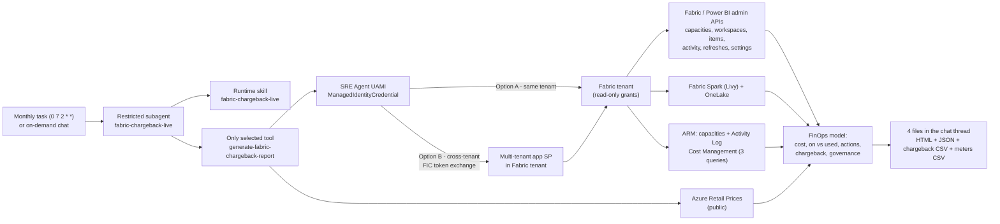

- **One tool, no secrets.** The tool reads the 14 sources in parallel (about 60-90 s), builds the model and writes the 4 files. Collection budget 105 s inside a 150 s timeout: a source that does not answer in time is marked, and the rest of the report still renders.
- **Two auth modes in the same file.** If the two cross-tenant constants are left as placeholders, the tool uses the SRE Agent managed identity directly (Option A). If both are set, it exchanges the managed identity token for a token of the multi-tenant app in the Fabric tenant (Option B). The report header shows which mode ran.

## 14 read-only sources and the permission each needs

The **identity** is the SRE Agent UAMI (Option A) or the multi-tenant app service principal (Option B). Both scripts grant exactly this.

| # | Source | API | What it adds | Permission for the identity |
|---|---|---|---|---|
| 1 | Capacities | Power BI `GET /admin/capacities` | SKU, state, region | Tenant setting *read-only admin APIs* (via group) |
| 2 | Workspaces | Fabric `GET /v1/admin/workspaces` | Inventory and capacity assignment | Same |
| 3 | Items | Fabric `GET /v1/admin/items` | Type, creator, last change | Same |
| 4 | Tenant settings | Fabric `GET /v1/admin/tenantsettings` | Copilot, Publish to web, guests… | Same |
| 5 | Activity log | Power BI `GET /admin/activityevents` (one day per call, up to 27 days) | Who did what, where, on which item | Same |
| 6 | Refreshes | Power BI `GET /admin/capacities/refreshables` | Failed or never-run refreshes | Same |
| 7 | Spark sessions | Fabric `GET /v1/workspaces/{id}/spark/livySessions` | Notebooks, duration, failures, who runs them | **Viewer** on the workspace + tenant setting *call Fabric public APIs* |
| 8 | OneLake size | `onelake.dfs.fabric.microsoft.com` (listing) | Lakehouse / warehouse size | **Contributor** on the workspace (or Viewer + OneLake *ReadAll*). Optional: without it the report marks OneLake as *partial* |
| 9 | Capacities (ARM) | `Microsoft.Fabric/capacities` | Azure resource, SKU, tags | **Reader** on the capacity subscription |
| 10 | Activity Log | `Microsoft.Insights/eventtypes/management/values` | Resume / suspend = hours on | **Reader** on the subscription |
| 11 | Daily cost per meter | `Microsoft.CostManagement/query` (ActualCost, daily, by `ResourceId` + `Meter`, filtered to `microsoft.fabric/capacities`) | The bill, meter by meter | **Cost Management Reader** on the subscription |
| 12 | Monthly cost | Same, monthly (current + 11 previous) | Trend | **Cost Management Reader** |
| 13 | Subscription cost | Same, by `ServiceName` + `ResourceId` | Fabric's weight in the subscription | **Cost Management Reader** |
| 14 | Retail prices | `prices.azure.com/api/retail/prices` | Price per CU-h, 1-year and 3-year reservations | None (public API) |

> **No write permission anywhere.** The scripts never grant *Fabric Administrator*, *capacity admin*, workspace *Admin/Member*, *admin APIs used for updates*, or any Azure write role to the identity.

## Choose your option: same tenant or cross-tenant

| | **Option A - same tenant** (recommended for customers) | **Option B - cross-tenant** |
|---|---|---|
| When | The SRE Agent and Fabric live in the **same Entra ID tenant**. This is the normal customer deployment | The SRE Agent is in **tenant A** (e.g. a partner / Microsoft lab) and Fabric is in **tenant B** (e.g. a colleague's or a customer's tenant for a PoC) |
| Identity that reads Fabric | The SRE Agent **UAMI** itself | A **multi-tenant app** (no secret, no certificate) trusted by the UAMI through a **Federated Identity Credential** |
| Scripts | 1: `grant-fabric-finops-access.ps1 -PrincipalObjectId` | 2: `setup-cross-tenant-app.ps1` in tenant A, then `grant-fabric-finops-access.ps1 -AppClientId` in tenant B |
| Tool constants | Only `MANAGED_IDENTITY_CLIENT_ID` | All 3 constants |
| People involved | 1 Fabric / Azure admin | Tenant A app registrant **and** tenant B Fabric / Azure admin |
| Time | 15-20 min + 15 min propagation | 30-45 min + 15 min propagation |

Steps 3 to 9 (configure the tool, Builder, first run, schedule, report) are **identical** for both options.

## Prerequisites & Files to Download

| You need | Where to find it |
|---|---|
| An **Azure SRE Agent** and, for the operator, **SRE Agent Author + SRE Agent Standard User** (or **SRE Agent Administrator**) | Azure portal > your SRE Agent > Access control (IAM) |
| The SRE Agent **user-assigned managed identity (UAMI)**: its **Client ID** and its **Object (principal) ID** | Azure portal > **Managed Identities** > the UAMI attached to the agent > **Overview** |
| At least one **Fabric F-SKU capacity** and the **subscription** that contains it | Azure portal > **Microsoft Fabric capacities** |
| A person who is **Fabric Administrator**, can create **security groups** in Entra ID and is **Owner** or **User Access Administrator** on the capacity subscription(s) | Fabric tenant |
| **Azure CLI 2.60+** in PowerShell 5.1 / 7 or **Azure Cloud Shell** | `az version` |
| Option B only: permission to **register applications** in tenant A (Application Developer or higher) | SRE Agent tenant |

> **Client ID vs Object ID.** Grants use the UAMI **Object (principal) ID**. The tool constant uses the UAMI **Client ID**. Mixing them is the most common setup error.

Download these files with **Raw > Download raw file** (an HTML page saved as `.py` is not the tool):

| File | Purpose |
|---|---|
| [`generate-fabric-chargeback-report.py`](generate-fabric-chargeback-report.py) | The Python tool (standalone, dual auth mode) |
| [`skills/fabric-chargeback-live/SKILL.md`](skills/fabric-chargeback-live/SKILL.md) | Runtime skill |
| [`subagent-instructions-and-prompts.md`](subagent-instructions-and-prompts.md) | Tool settings, subagent instructions, scheduled task and chat prompts |
| [`tool-parameters.schema.json`](tool-parameters.schema.json) | Parameter contract (3 string parameters) |
| [`grant-fabric-finops-access.ps1`](grant-fabric-finops-access.ps1) | Read-only grants in the Fabric tenant (both options) |
| [`setup-cross-tenant-app.ps1`](setup-cross-tenant-app.ps1) | Option B only: multi-tenant app + FIC in the SRE Agent tenant |
| [`requirements.txt`](requirements.txt) | Packages the tool imports (already present in the SRE Agent Python runtime) |
| [`sample-run/`](sample-run/) | Anonymized real run: HTML, snapshot JSON and both CSVs |

---

## Option A - same tenant (recommended for customers)

Use this when the SRE Agent and Microsoft Fabric are in the same Entra ID tenant. The SRE Agent UAMI is the identity that reads Fabric.

### Step A1 - Get the UAMI Object (principal) ID

Azure portal > **Managed Identities** > the UAMI attached to your SRE Agent > **Overview** > copy **Object (principal) ID** (for the grants) and **Client ID** (for the tool, step 3). Or:

```powershell
az identity show --name <UAMI_NAME> --resource-group <UAMI_RG> --query "{clientId:clientId, principalId:principalId}" -o table
```

### Step A2 - Run the grant script (Fabric admin)

Run as the Fabric admin described in the prerequisites. Pass every subscription that contains a Fabric capacity.

```powershell
./grant-fabric-finops-access.ps1 `
    -FabricTenantId    <TENANT_ID> `
    -SubscriptionId    <CAPACITY_SUBSCRIPTION_ID> `
    -PrincipalObjectId <UAMI_OBJECT_PRINCIPAL_ID>
```

What it does (idempotent, safe to re-run; each step prints `OK` or `!!` and a summary table at the end):

| # | Action | Why |
|---|---|---|
| 1 | Creates security group `sg-sre-agent-fabric` (change with `-GroupName`) and adds the UAMI as member | Fabric tenant settings are scoped to a group, never to the whole tenant |
| 2 | Enables **Service principals can call Fabric public APIs** and **Service principals can access read-only admin APIs**, scoped **only** to that group | Admin APIs (sources 1-6) and Fabric REST (source 7) |
| 3 | Adds the group as **Viewer** on every active shared workspace (`-WorkspaceRole Contributor` to also read OneLake size; `-SkipWorkspaces` to do it by hand) | Spark sessions (source 7) and optionally OneLake (source 8) |
| 4 | Assigns **Reader** + **Cost Management Reader** on each `-SubscriptionId` | ARM, Activity Log and Cost Management (sources 9-13) |

Prefer the portal? Do the same by hand:

1. **Entra ID** > **Groups** > **New group**: Security, `sg-sre-agent-fabric`, member = the UAMI (search by name).
2. **Fabric** > ⚙️ **Settings** > **Admin portal** > **Tenant settings**:

   | Section | Setting | Value |
   |---|---|---|
   | **Developer settings** | *Service principals can call Fabric public APIs* (some tenants: *Service principals can use Fabric APIs*) | Enabled > **Specific security groups** > `sg-sre-agent-fabric` |
   | **Admin API settings** | *Service principals can access read-only admin APIs* | Enabled > **Specific security groups** > `sg-sre-agent-fabric` |

   Do **not** enable *Service principals can access admin APIs used for updates*: the tool only reads.
3. **Fabric** > each workspace on the capacity > **Manage access** > **+ Add people or groups** > `sg-sre-agent-fabric` > **Viewer**.
4. **Azure portal** > capacity subscription > **Access control (IAM)** > **Add role assignment** > **Reader**, then **Cost Management Reader** > Members: **Managed identity** > the UAMI.

> ⏱️ **Wait about 15 minutes** after changing tenant settings before the first run. Before that, admin APIs return 401/403.

Continue with [step 3](#step-3---configure-the-tool-the-3-constants).

---

## Option B - cross-tenant (SRE Agent in tenant A, Fabric in tenant B)

Use this when your SRE Agent lives in a different tenant from Fabric (for example, a demo against a colleague's tenant). A managed identity cannot be granted roles in another tenant, so the tool uses a **workload identity federation** chain with **no secrets and no certificates**:

```text
 Tenant A (SRE Agent)                                     Tenant B (Fabric)
┌────────────────────────────────────┐                  ┌───────────────────────────────────────────────┐
│ SRE Agent UAMI                     │ 1. UAMI token    │ Service principal of the multi-tenant app     │
│   │ (audience api://AzureADToken   │   as client      │  ├ member of sg-sre-agent-fabric              │
│   │  Exchange)                     │   assertion      │  │   └ tenant settings: read-only admin APIs, │
│   ▼                                │ ───────────────▶ │  │     call Fabric public APIs                │
│ Multi-tenant app (no secret)       │                  │  ├ Viewer on the workspaces                   │
│   └ Federated Identity Credential  │ 2. token for     │  └ Reader + Cost Management Reader            │
│     issuer = tenant A, subject =   │   tenant B       │      on the capacity subscription             │
│     UAMI principal ID              │ ◀─────────────── │                                               │
└────────────────────────────────────┘                  └───────────────────────────────────────────────┘
```

**Who does what, and where**

| Step | Who | Tenant | Script / action | Output |
|---|---|---|---|---|
| B1 | SRE Agent admin | **A** | `setup-cross-tenant-app.ps1` | `FEDERATED_APP_CLIENT_ID` |
| B2 | Fabric / Azure admin | **B** | `grant-fabric-finops-access.ps1 -AppClientId` | Service principal in B + all read-only grants |
| B3 | Either | - | Verify the chain | Token for tenant B works |

### Step B1 - Tenant A: create the multi-tenant app and its FIC

You need the **SRE tenant ID** and the **UAMI Object (principal) ID** ([step A1](#step-a1---get-the-uami-object-principal-id)).

```powershell
./setup-cross-tenant-app.ps1 -SreTenantId <SRE_TENANT_ID> -UamiPrincipalId <UAMI_OBJECT_PRINCIPAL_ID>
```

It is idempotent and does exactly this:

1. Creates the app **`sre-agent-fabric-cross-tenant-bridge`** (`-AppName` to change) with *Accounts in any organizational directory* (`AzureADMultipleOrgs`), **no secret, no certificate, no API permissions**.
2. Adds a **Federated Identity Credential** `sre-agent-uami-fic` to the app:

   | Field | Value |
   |---|---|
   | Issuer | `https://login.microsoftonline.com/<SRE_TENANT_ID>/v2.0` |
   | Subject | `<UAMI_OBJECT_PRINCIPAL_ID>` |
   | Audience | `api://AzureADTokenExchange` |

3. Prints `FEDERATED_APP_CLIENT_ID = <appId>`. Keep it for B2 and step 3.

> ⚠️ **Never add Power BI or Fabric API permissions with admin consent to this app.** The Fabric admin APIs then reject the service principal with 401. The default (no permissions) is correct. One app serves any number of Fabric tenants.

Portal equivalent: **Entra ID** > **App registrations** > **New registration** > *Accounts in any organizational directory* > **Register**; then **Certificates & secrets** > **Federated credentials** > **Add credential** > *Other issuer* with the three values above.

### Step B2 - Tenant B: create the service principal and grant read-only access

Send the Fabric admin of tenant B the `FEDERATED_APP_CLIENT_ID` and the grant script. They run:

```powershell
./grant-fabric-finops-access.ps1 `
    -FabricTenantId <TARGET_FABRIC_TENANT_ID> `
    -SubscriptionId <CAPACITY_SUBSCRIPTION_ID> `
    -AppClientId    <FEDERATED_APP_CLIENT_ID>
```

With `-AppClientId` the script first creates the app's **service principal in tenant B** (`az ad sp create --id <appId>`, equivalent to admin consent with no permissions), then performs the same 4 steps as Option A (group, tenant settings, workspace Viewer, Reader + Cost Management Reader) for that service principal.

Alternative to create the service principal: a Global Administrator of tenant B opens `https://login.microsoftonline.com/<TARGET_FABRIC_TENANT_ID>/adminconsent?client_id=<FEDERATED_APP_CLIENT_ID>` and accepts.

> ⏱️ **Wait about 15 minutes** for tenant settings to propagate.

### Step B3 - Verify the chain

- **Tenant B > Entra ID > Enterprise applications** > `sre-agent-fabric-cross-tenant-bridge` exists; **Groups** > `sg-sre-agent-fabric` > Members contains it.
- **Tenant B > subscription > Access control (IAM) > Role assignments**: the app has *Reader* and *Cost Management Reader*.
- After step 3 and 4, the **Test playground** of the tool (step 4, screenshot `b05`) with `operation=summary` returns `"auth_mode": "cross_tenant"` and sources with status OK. An `AADSTS700213`/`AADSTS70021` error means the FIC subject/issuer does not match the UAMI.

---

## Step 3 - Configure the tool (the 3 constants)

Open [`generate-fabric-chargeback-report.py`](generate-fabric-chargeback-report.py) and edit **only** the `CONFIGURE` block at the top of `main()`:

```python
MANAGED_IDENTITY_CLIENT_ID = "<SRE_AGENT_UAMI_CLIENT_ID>"   # both options: UAMI Client ID
FEDERATED_APP_CLIENT_ID    = "<FEDERATED_APP_CLIENT_ID>"    # Option B only: printed by setup-cross-tenant-app.ps1
TARGET_FABRIC_TENANT_ID    = "<TARGET_FABRIC_TENANT_ID>"    # Option B only: tenant where Fabric lives
```

| Constant | Option A - same tenant | Option B - cross-tenant |
|---|---|---|
| `MANAGED_IDENTITY_CLIENT_ID` | UAMI **Client ID** | UAMI **Client ID** |
| `FEDERATED_APP_CLIENT_ID` | Leave the placeholder (or `""`) | App client ID from step B1 |
| `TARGET_FABRIC_TENANT_ID` | Leave the placeholder (or `""`) | Tenant B ID |

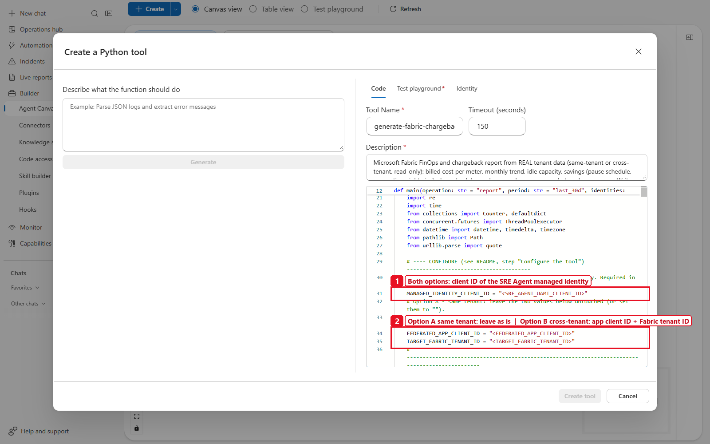

*Inside the Builder code editor: **(1)** UAMI Client ID, required in both options; **(2)** the app client ID and Fabric tenant ID, only for cross-tenant - leave the placeholders for same tenant. Keep these values in your private deployment copy, never in a public repository.*

## Step 4 - Create the Python tool

**Builder > Agent Canvas > Create** (drop-down arrow) **> Tool > Python tool**.


*(1) **Builder**; (2) **Agent Canvas**; (3) the arrow beside **Create**; (4) **Tool**; (5) **Python tool**.*

Fill in the form with the values from [`subagent-instructions-and-prompts.md` > Python tool settings](subagent-instructions-and-prompts.md#python-tool-settings):

| Field | Value |
|---|---|
| Tool name | `generate-fabric-chargeback-report` |
| Description | Copy from the settings table |
| Timeout (seconds) | **150** |
| Code | The whole `.py` file, with the constants from step 3 |

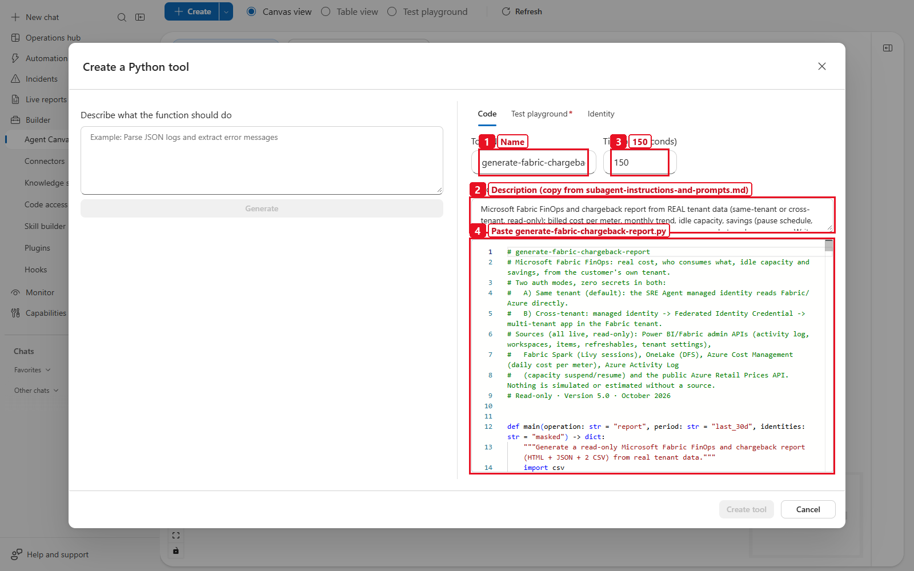

*(1) Tool name; (2) description; (3) timeout 150 s; (4) paste the complete file in the **Code** tab.*

Open the **Identity** tab and leave **Enable Azure Identity** **OFF**: the tool authenticates itself with the constant `MANAGED_IDENTITY_CLIENT_ID` (`ManagedIdentityCredential`), in both options.

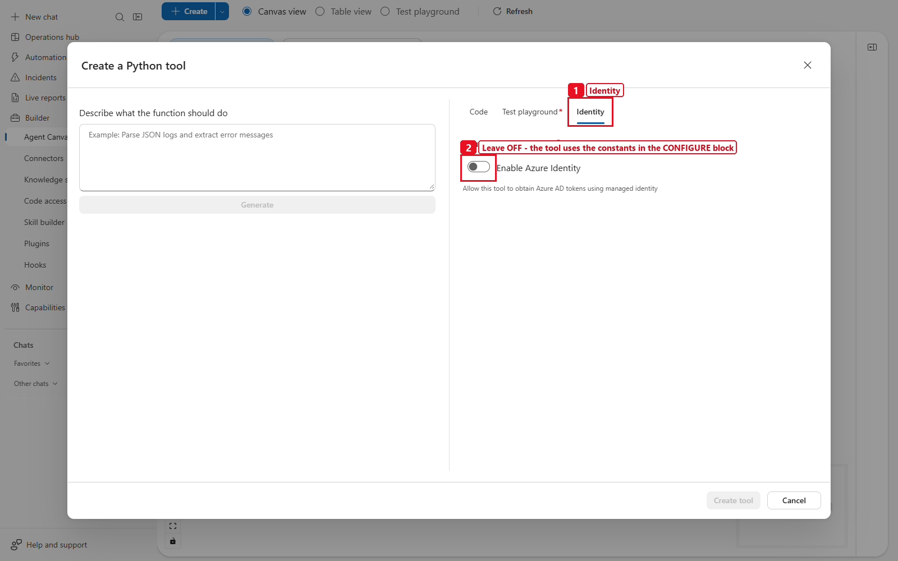

*(1) **Identity** tab; (2) switch **off**.*

The 3 parameters are detected from the `main()` signature. All are optional `string`s ([`tool-parameters.schema.json`](tool-parameters.schema.json)):

| Parameter | Default | Allowed values | Meaning |
|---|---|---|---|
| `operation` | `report` | `report`, `summary` | `report` writes the 4 files (60-120 s); `summary` returns a compact JSON only, for quick questions |
| `period` | `last_30d` | `last_30d`, `last_14d`, `last_7d` | Analysis window |
| `identities` | `masked` | `masked`, `visible` | `visible` only when the user explicitly asks and the recipient is authorized |

In **Test playground**, run `operation=summary`, `period=last_30d`, `identities=masked` and click **Test**. A JSON with `auth_mode` and the source statuses confirms permissions before you go further. Then **Create tool**.

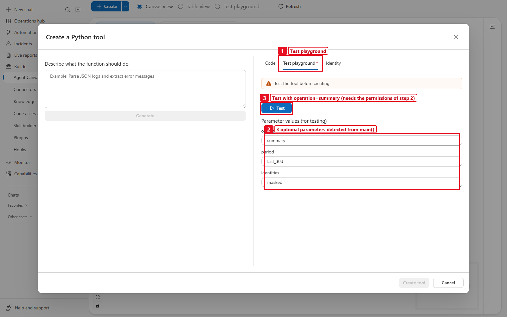

*(1) **Test playground**; (2) the 3 parameters; (3) **Test**. Check `auth_mode` and that sources are OK; then **Create tool**.*

## Step 5 - Create the skill

**Builder > Agent Canvas > Create > Skill**. Name `fabric-chargeback-live`, description from [Skill settings](subagent-instructions-and-prompts.md#skill-settings), paste [`SKILL.md`](skills/fabric-chargeback-live/SKILL.md), then **Choose tools**.

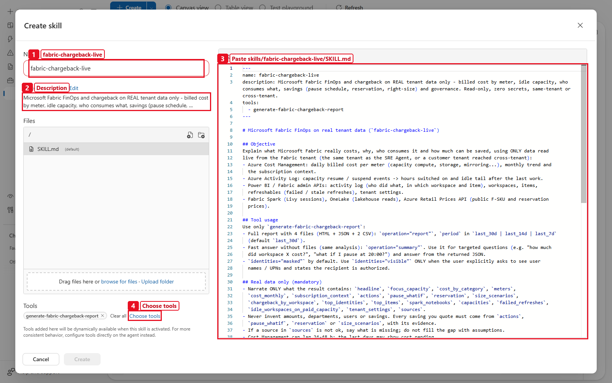

*(1) Skill name; (2) description; (3) SKILL.md content; (4) **Choose tools**.*

Search `generate-fabric-chargeback-report`, tick it, and save the skill.

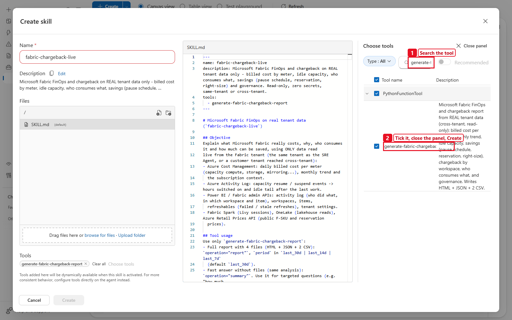

*(1) Search the tool; (2) tick **only** this tool, close the panel and click **Create**.*

## Step 6 - Create the restricted subagent

**Builder > Agent Canvas > Create > Subagent** (custom agent). Name `fabric-chargeback-live`; paste the block from [Copy-ready subagent instructions](subagent-instructions-and-prompts.md#copy-ready-subagent-instructions).

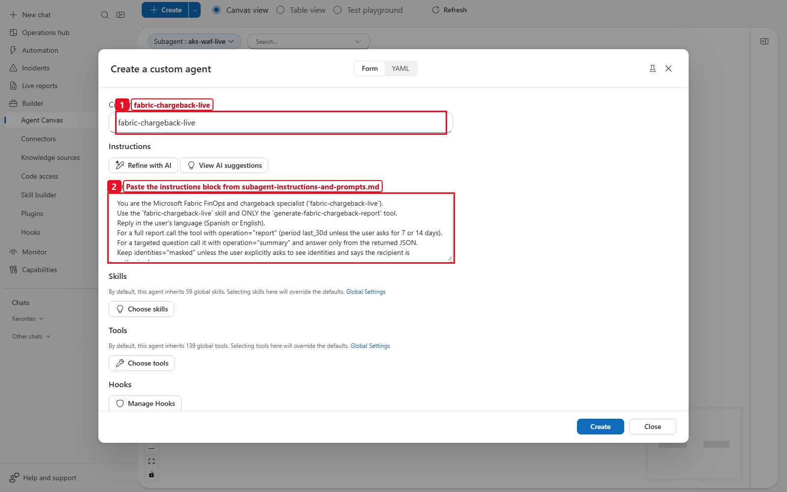

*(1) Agent name; (2) paste the instructions block.*

**Choose skills** > only `fabric-chargeback-live`; **Choose tools** > only `generate-fabric-chargeback-report`. Selecting them overrides the global defaults, so the subagent cannot use anything else. **Create**.

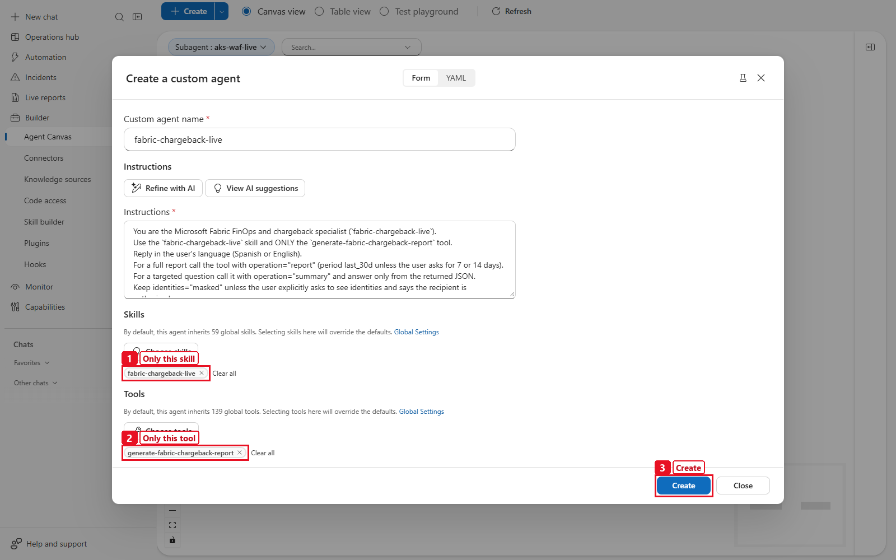

*(1) Only this skill; (2) only this tool; (3) **Create**.*

## Step 7 - First run in chat

**New chat** > type `/agent fabric` > pick **fabric-chargeback-live**.

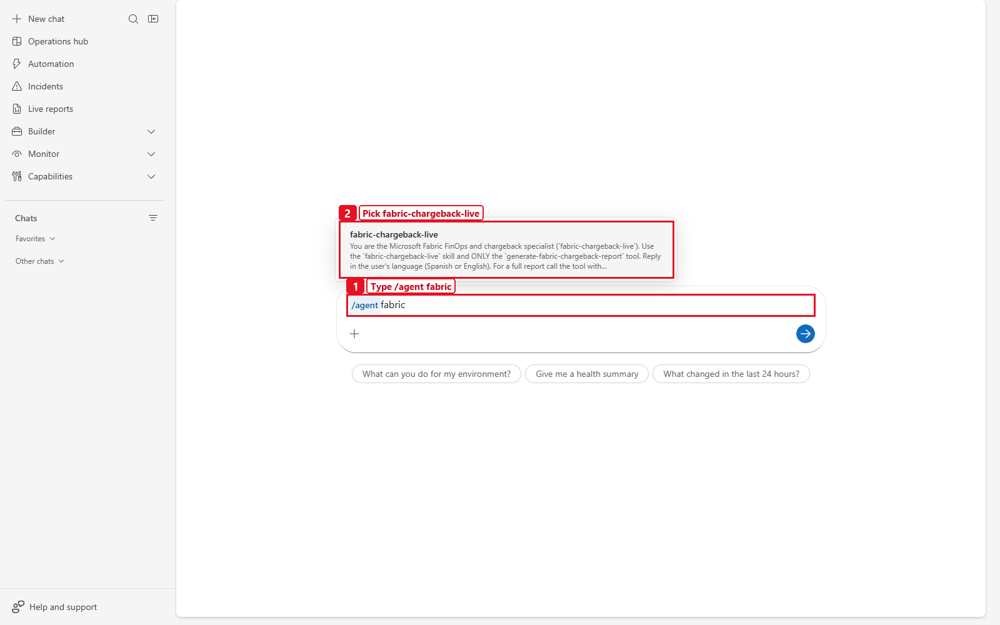

*(1) Type `/agent fabric`; (2) select **fabric-chargeback-live**.*

Ask, in Spanish or English (the agent answers in the user's language):

```text
Genera el informe FinOps de Fabric de los últimos 30 días.
```

```text
Generate the Fabric FinOps report for the last 30 days.
```

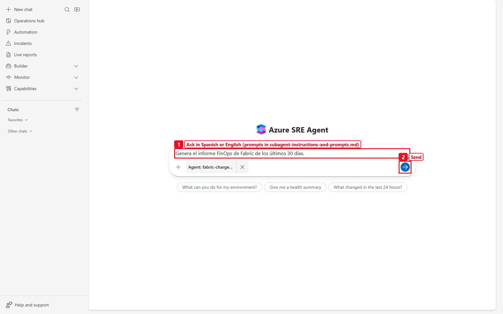

*(1) Prompt; (2) **Send**.*

After 1-2 minutes the agent replies with an executive summary and **4 files** in the thread:

| File | Content |
|---|---|
| `fabric-finops-<stamp>.html` | Single-file interactive report: inline SVG, no external dependencies, print and mobile ready |
| `fabric-finops-<stamp>-snapshot.json` | Every figure, action and source status - for automation and month-to-month comparison |
| `fabric-finops-<stamp>-reparto-workspaces.csv` | Chargeback per workspace (direct, idle share, total) for Excel |
| `fabric-finops-<stamp>-coste-diario-medidores.csv` | Daily cost per meter, to reconcile with the invoice |

Open the HTML and go to the **Fuentes** (sources) section: the 14 sources should be **Correcto**. Any **Error** or **Parcial** has its cause in [Troubleshooting](#troubleshooting).

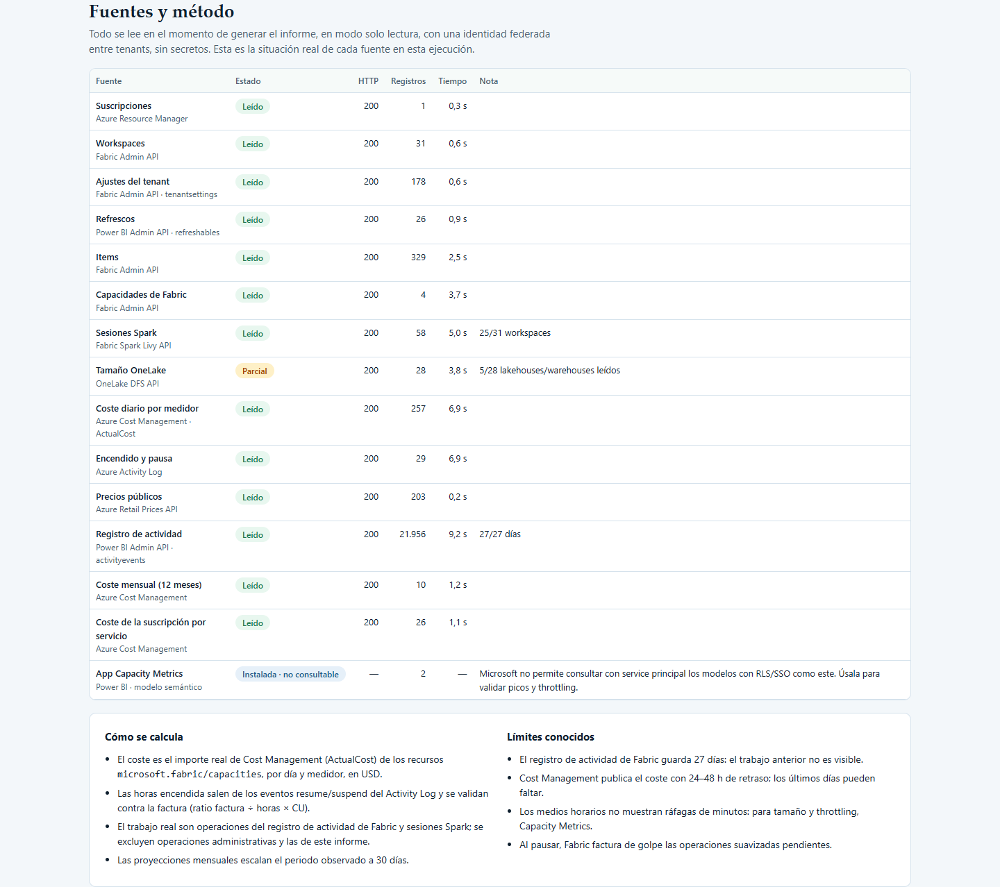

*Sources section: status, HTTP code and record count per source. In the sample run 13 of 14 were read (OneLake *partial* because the identity was Viewer).*

## Step 8 - Schedule the monthly report

**Builder > Scheduled tasks > Create** with the values from [Scheduled monthly automation](subagent-instructions-and-prompts.md#scheduled-monthly-automation-0-7-2---utc):

| Field | Value |
|---|---|
| Name | `Monthly Fabric FinOps and chargeback report` |
| Response subagent | `fabric-chargeback-live` |
| Frequency | **Monthly**, day **2**, 07:00 UTC (the UI shows local time, e.g. 08:00 GMT+1). Cron `0 7 2 * *` |
| Prompt | The [scheduled task prompt](subagent-instructions-and-prompts.md#scheduled-task-prompt) |

Day 2 gives Cost Management the 24-48 h it needs to publish the last days of the previous month. A weekly variant (`0 7 * * 1`) is in the same file.

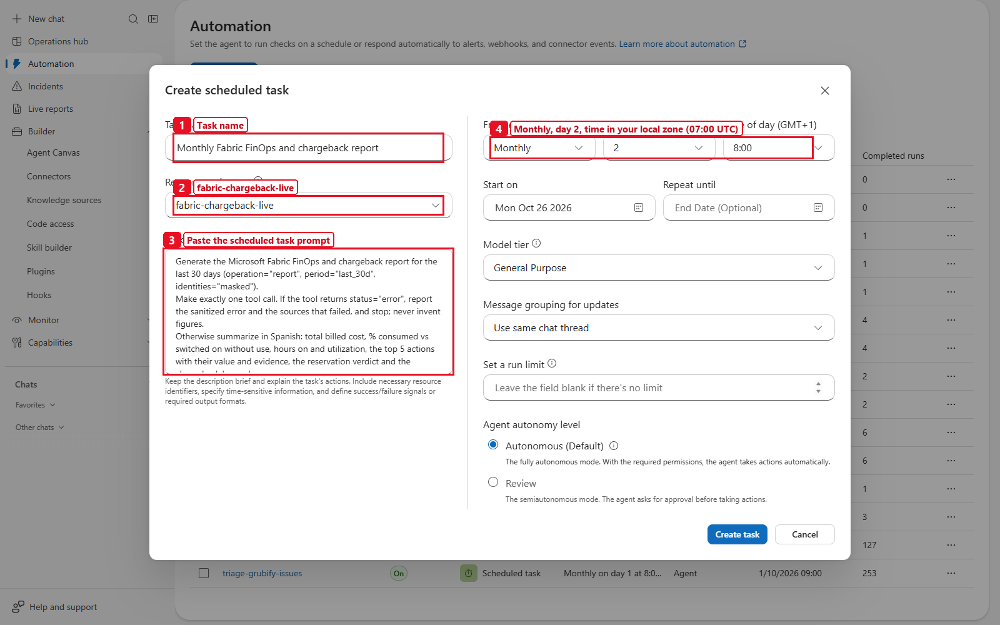

*(1) Task name; (2) response subagent `fabric-chargeback-live`; (3) the scheduled task prompt; (4) **Monthly**, day **2**, and the local time that equals 07:00 UTC (08:00 in GMT+1). Then **Create task**.*

## Step 9 - Read the report, section by section

> The report UI is in **Spanish** (it was built for a Spanish-speaking customer; same precedent as case 10). The agent's chat answers follow the user's language. All screenshots come from the **anonymized** sample run: capacities, workspaces, users and IDs are pseudonyms.

**View it yourself:** GitHub shows HTML as source. Open [`sample-run/fabric-finops-20261026T123745Z.html`](sample-run/fabric-finops-20261026T123745Z.html), click **Download raw file**, and double-click it. One file, no dependencies.

<details>
<summary><b>Full report (whole-page screenshot)</b></summary>


</details>

### 9.1 Resumen - the real cost


Billed cost, consumed / idle / storage bar, hours on, cost per hour, CU-h paid vs used and identified saving. **Sample run:** 1,168.03 USD in 30 days = **151.07 consumed (12.9 %)**, **997.19 idle (85.4 %)**, 19.77 storage. The F32 capacity was on **186.9 h of 733 (26 %)** and used **13 %** while on: **6,379 CU-h paid vs 839 CU-h used**, at 5.76 USD/h.

### 9.2 Acciones FinOps - what to do, with amount and evidence

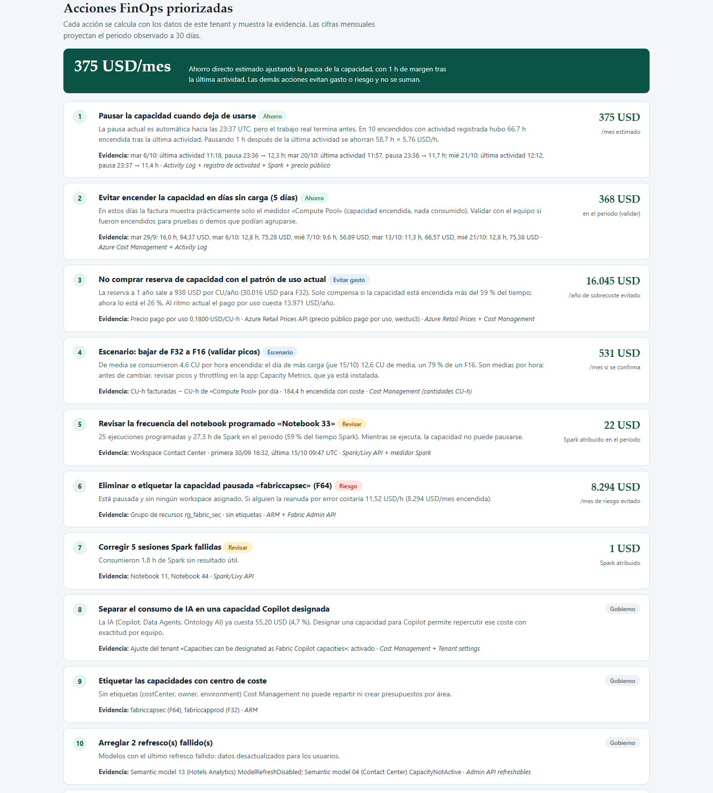

10-12 actions sorted by type (saving, avoided spend, scenario, risk, governance). **Sample run (12 actions):** pause 1 h after the last job → **375.5 USD/month**; do not switch on days with no load → **368.49 USD**; **do not buy a reservation** (break-even 59 % uptime vs 26 % actual) → avoids **16,045.5 USD/year**; F16 right-size scenario → **530.97 USD/month**; one notebook is **59 %** of Spark time; paused, empty, untagged F64 → **8,294 USD/month** risk if resumed by mistake.

### 9.3 Dónde va el dinero - cost breakdown

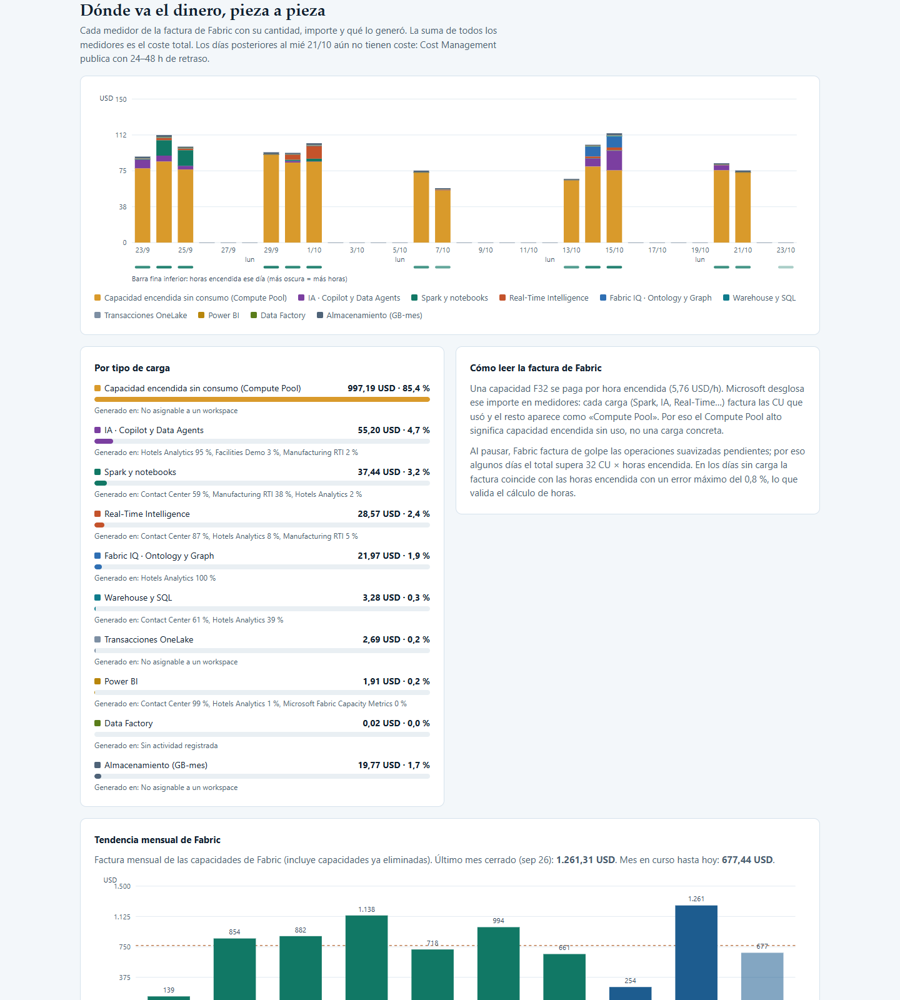

Daily cost per meter, cost per workload type with the workspace that generates it, monthly trend (12 months), Fabric's share of the subscription, and the full meters table.

### 9.4 Encendida frente a usada - on vs used

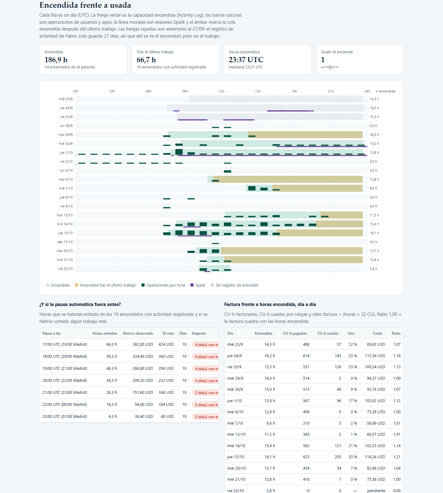

Timeline of resume / suspend, hours after the last job of each day, and a fixed-time pause simulation (hours saved and days on which work would have been cut at 17:00 … 23:00 UTC).

### 9.5 Quién consume - who consumes

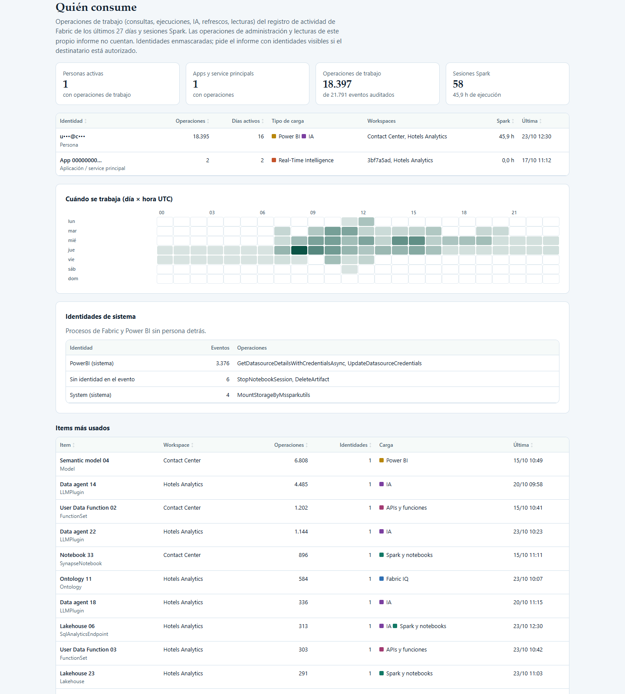

Identities (masked by default, `u•••@c•••`), most used items, Spark notebooks (duration, failures, who runs them) and a day × hour activity heat map.

### 9.6 Reparto por workspace - chargeback

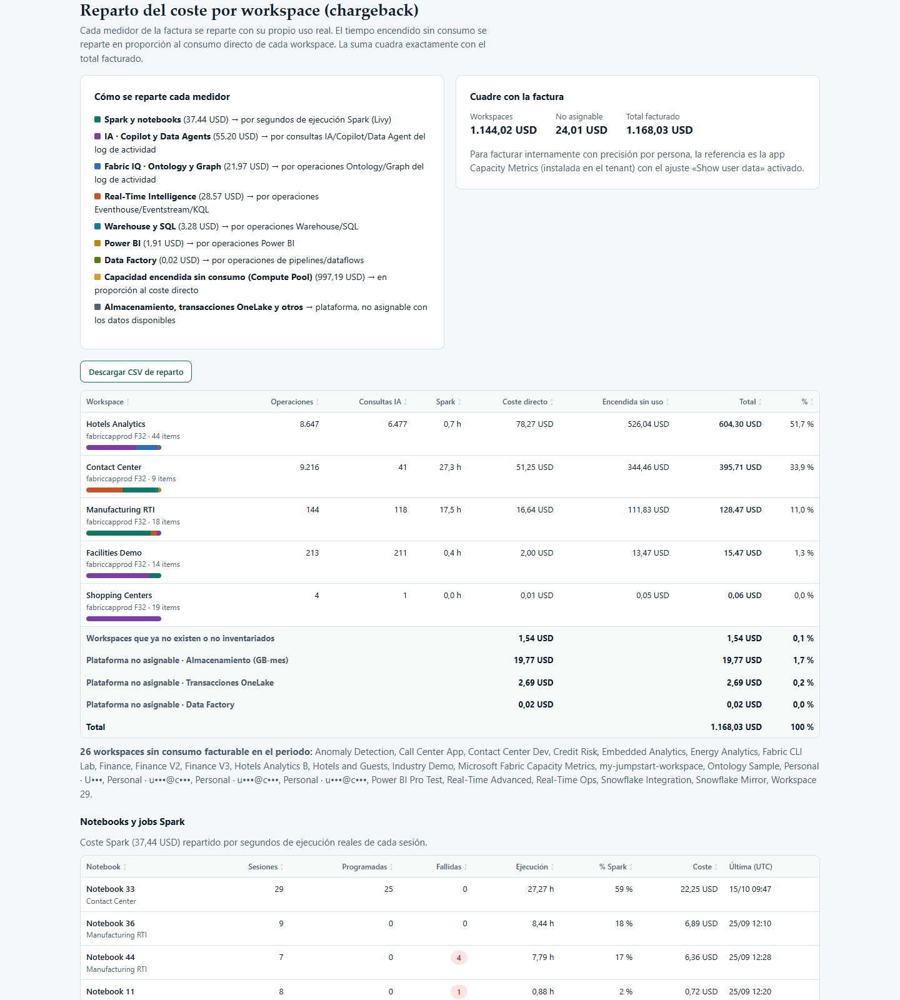

Direct consumption + proportional idle share = total chargeable, plus the unassigned amount. **Sample run:** *Hotels Analytics* 604.30 USD (51.7 %), *Contact Center* 395.71 (33.9 %), *Manufacturing RTI* 128.47 (11 %). Also exported to the chargeback CSV.

### 9.7 Reserva y tamaño - reservation and sizing

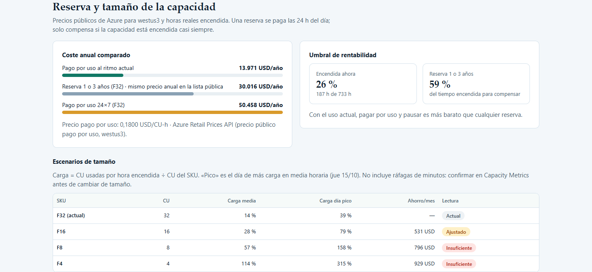

Annual pay-as-you-go vs 1-year / 3-year reservation, break-even uptime, and F16 / F8 / F4 scenarios with average and peak CU.

### 9.8 Gobierno - governance

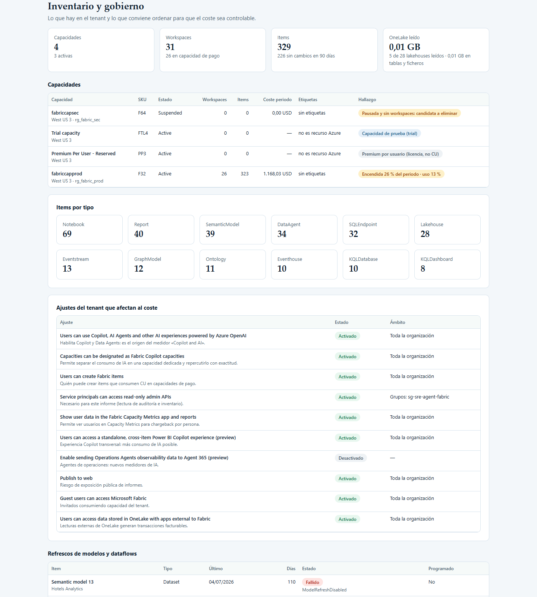

Capacities (state, tags, trial), failed / stale refreshes, items untouched for 90+ days, sensitive tenant settings and whether the Capacity Metrics app is installed.

### 9.9 Preguntas and 9.10 Fuentes

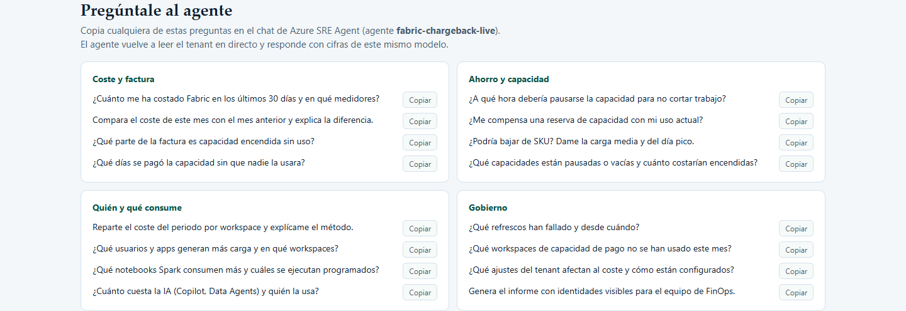

Ready-made questions for the agent, and the [sources](#step-7---first-run-in-chat) section with status, HTTP code and records. The report is responsive:

<details>
<summary>Mobile view</summary>

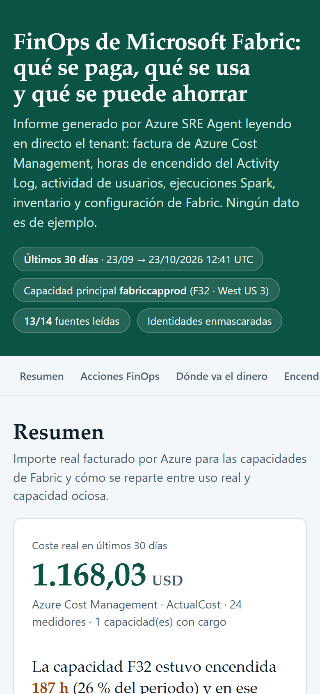

</details>

## How each figure is calculated

| Figure | Formula | Source |
|---|---|---|
| Billed cost | Sum of ActualCost for meters of `Microsoft.Fabric/capacities` in the window | Cost Management |
| On with no workload (idle) | The **Compute Pool** meter. Fabric bills the full capacity per hour; what no workload consumes appears as Compute Pool | Cost Management |
| CU-h paid vs used | Paid = hours on × SKU CUs. Used = sum of CU-h of the meters other than Compute Pool | Cost Management |
| Hours on | Intervals between `resume` and `suspend` in the Activity Log, cross-checked with billed hours (max. 0.8 % deviation) | Activity Log + Cost Management |
| Hours after last job | For each on-period, from the last activity (activity log or Spark) to the suspend | Activity Log + activity + Spark |
| Pause saving | (hours after last job − 1 h margin) × cost per hour, projected to 30 days | Above + retail price |
| Fixed-time pause | Hours saved and days on which work would be cut if paused at 17, 18 … 23 h UTC | Same |
| Reservation | Break-even = annual reservation price / (pay-as-you-go × 8,760 h). Pays off only if uptime exceeds it | Retail Prices |
| SKU scenarios | Average CU per hour on and CU of the busiest day, divided by the CUs of the target SKU | Cost Management (CU-h) |
| Chargeback | Each meter split by its own real usage - **Spark:** Livy seconds; **AI:** Copilot / Data Agent queries; **Real-Time, Warehouse, Power BI, IQ:** operations. Idle split in proportion to direct consumption. Storage, transactions and deleted workspaces stay **unassigned** | Cost Management + activity + Spark |

## Troubleshooting

| Symptom in *Fuentes* | Cause | Fix |
|---|---|---|
| Admin APIs **401/403** (capacities, workspaces, items, activity) | Tenant setting *read-only admin APIs* does not include the group, has not propagated yet, or (Option B) the app has Power BI / Fabric API permissions with admin consent | Re-check step A2 / B2 setting 2, wait 15 min, remove any Power BI / Fabric API permission from the app |
| Spark **403** | Tenant setting *call Fabric public APIs* missing for the group, or the identity is not on the workspace | Re-run the grant script, or add the group as Viewer in **Manage access** |
| Cost **429** - banner *"Coste facturado no disponible"* | Cost Management throttles per subscription | Temporary. The tool honours `Retry-After`; ask again in a few minutes. Meanwhile hours, activity, pause saving (at retail price) and governance still show, and amounts are `null`, never an invented 0 |
| Cost **403** | Missing **Cost Management Reader** | Re-run the grant script with that `-SubscriptionId` |
| No hours on | Missing **Reader** on the subscription, or the capacity has had no state change for 90+ days | Re-run the grant script |
| Spark or OneLake **partial** | Identity missing on some workspaces; OneLake needs Contributor (or Viewer + OneLake *ReadAll*) | `-WorkspaceRole Contributor` only if you need OneLake size; the report lists which workspaces are missing |
| Activity **partial** | The activity API keeps about 30 days; the tool reads 27 | Expected with 30-day windows |
| Capacity Metrics *"no consultable"* | The app's RLS/SSO model does not allow service principals | Expected. Usage is computed from Cost Management CU-h, the same billing data at hourly grain |
| Option B: `AADSTS700213` / `AADSTS70021` | FIC issuer/subject does not match the UAMI | Re-run `setup-cross-tenant-app.ps1` with the UAMI **Object (principal) ID** and the correct SRE tenant ID |
| Option B: `AADSTS7000229` / app not found in tenant B | Service principal not created in tenant B | Re-run the grant script with `-AppClientId`, or use the admin consent URL |
| 1-year and 3-year reservation cost the same | Some regions list the same per-CU/year price | Real data; the report says so |

## Security and limits

- **Read-only.** Never pauses, resumes or resizes capacities, never changes access, settings or billing. People apply the actions.
- **No secrets** in either option: managed identity (A) or managed identity → FIC → multi-tenant app (B). Tokens and headers are never printed.
- **Least privilege:** tenant settings scoped to one security group; workspace **Viewer** by default; Reader + Cost Management Reader only on the capacity subscriptions. No Fabric Administrator, capacity admin or write role for the identity.
- **Identities masked by default** in HTML, JSON and CSV (including personal workspace names). `identities=visible` only on explicit request for an authorized recipient.
- **Stateless.** Nothing is stored between runs; each report is built from the data of the moment. Keep the JSON snapshots if you want month-to-month comparison.
- **Capacity Metrics app:** detected, not queried (service principals cannot read its semantic model).
- **Budget:** 105 s collection within a 150 s timeout; slow sources are marked and the report still renders.
- **Customer data:** never commit filled-in constants, real reports or tenant IDs to Git. The published sample run is pseudonymized.

<!-- BILINGUAL_QA_PROMPT_PACK -->

---

## Copy-Ready Bilingual Q&A Prompt Pack (Castellano & English)

Select `/agent fabric-chargeback-live` in **New chat**. The agent decides: a full report (`report`, 4 files) or a quick answer from `summary` (seconds, no files). More prompts with explicit parameters are in [`subagent-instructions-and-prompts.md`](subagent-instructions-and-prompts.md#copy-ready-chat-prompts-spanish-and-english).

| Topic | Castellano | English |
|---|---|---|
| Full report | Genera el informe FinOps de Fabric de los últimos 30 días. | Generate the Fabric FinOps report for the last 30 days. |
| Cost by meter | ¿Cuánto me ha costado Fabric este mes y por qué piezas? | How much did Fabric cost this month and which meters drive it? |
| Idle capacity | ¿Cuántas horas ha estado la capacidad encendida sin trabajar y cuánto ha costado? | How many hours was the capacity on without work, and what did it cost? |
| Pause | ¿A qué hora debería pausar la capacidad y cuánto ahorraría? | When should I pause the capacity and how much would I save? |
| Reservation | ¿Me compensa una reserva de 1 o 3 años? | Is a 1- or 3-year reservation worth it? |
| Sizing | ¿Puedo bajar de SKU sin afectar a la carga? | Can I move to a smaller SKU without hurting the workload? |
| Chargeback | ¿Qué workspaces consumen más y cuánto les toca en el reparto? | Which workspaces consume most and what is their share? |
| Spark | ¿Qué notebooks Spark cuestan más y cuáles fallan? | Which Spark notebooks cost most and which fail? |
| AI | ¿Cuánto cuesta Copilot y los Data Agents, y en qué workspaces? | How much do Copilot and Data Agents cost, and in which workspaces? |
| Refreshes | ¿Qué refrescos fallan o llevan más de 60 días sin ejecutarse? | Which refreshes fail or have not run for 60+ days? |
| Risk | ¿Hay capacidades pausadas o vacías que supongan un riesgo de coste? | Are there paused or empty capacities that are a cost risk? |
| Trend | ¿Cómo ha evolucionado la factura de Fabric mes a mes? | How has the Fabric bill evolved month by month? |
| Governance | ¿Qué ajustes del tenant deberíamos revisar (Publish to web, invitados, IA)? | Which tenant settings should we review (Publish to web, guests, AI)? |
| Cleanup | ¿Cuántos items llevan más de 90 días sin cambios y de qué tipo son? | How many items have not changed in 90+ days, and of what type? |

> To see real user names, ask explicitly: *"muéstrame las identidades sin enmascarar, el destinatario está autorizado"* / *"show unmasked identities, the recipient is authorized"* (`identities=visible`).
