# Case 12 - Azure SQL Managed Instance maintenance windows & application resilience

> **Azure SRE Agent** · Read-only Python tool · Runtime skill · Restricted subagent · Weekly task (`0 7 * * 1`) & on-demand (`last_30d`, `last_14d`, `last_7d`) · Demo mode with zero configuration, live mode with zero secrets · Offline HTML, full JSON and two CSVs

**"Why do our users see errors every time Azure patches our SQL Managed Instances, and can we pick the exact hour like we did on-premises?"** A restricted SRE Agent subagent answers that question with data. It reads the SQL MI estate read-only - maintenance windows, connection type, failover groups (ARM and Resource Graph), **real reconfigurations** (Resource Health and Activity Log), **upcoming planned maintenance** (Service Health), hourly load (Azure Monitor) and **per-application user impact** (Application Insights in Log Analytics) - and returns a report that shows which applications surface errors to users, which ones absorb the reconfiguration, which window each instance should use, and the exact commands to fix it.

The agent **never changes anything**. It hands the commands to a person.

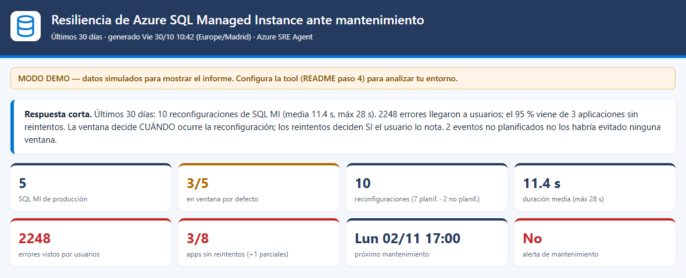

*Header of the sample report (demo mode, 30 days): **10 reconfigurations**, average **11.4 s**, maximum **28 s**, **2,248 user-facing errors**, and **95 %** of them came from **3 applications without retries**.*

> The screenshots in this guide use **demo mode** (deterministic simulated data) in a Microsoft lab environment. Instance and application names are fictitious. The generated report is written in Spanish (same convention as [case 11](../11-fabric-finops-chargeback/)); this guide gives the English meaning of each section.

**Time to deploy:** about **10 minutes in demo mode** and **30-45 minutes with real data** (plus up to 10 minutes of role propagation).

## Contents

1. [The problem and the short answer](#1-the-problem-and-the-short-answer)
2. [What it solves and business value](#2-what-it-solves-and-business-value)
3. [How it works](#3-how-it-works)
4. [Package contents](#4-package-contents)
5. [Prerequisites](#5-prerequisites)
6. [Fast path - demo mode in 10 minutes](#fast-path---demo-mode-in-10-minutes)
7. [Step 1 - Check the SRE Agent and get its identity](#step-1---check-the-sre-agent-and-get-its-identity)
8. [Step 2 - Download the package](#step-2---download-the-package)
9. [Step 3 - Grant the read-only permissions](#step-3---grant-the-read-only-permissions)
10. [Step 4 - Configure the tool code](#step-4---configure-the-tool-code)
11. [Step 5 - Create the tool, the skill and the subagent](#step-5---create-the-tool-the-skill-and-the-subagent) (portal or script)
12. [Step 6 - First run in the chat](#step-6---first-run-in-the-chat)
13. [Step 7 - Schedule the weekly report](#step-7---schedule-the-weekly-report)
14. [Step 8 - Apply the improvements](#step-8---apply-the-improvements)
15. [Validation checklist](#validation-checklist)
16. [Troubleshooting](#troubleshooting)
17. [Security and limits](#security-and-limits)
18. [Copy-ready prompts](#copy-ready-prompts)

---

## 1. The problem and the short answer

**Situation.** On-premises, the DBA team chose the exact day and hour of every SQL Server patch. In **Azure SQL Managed Instance** the platform applies maintenance. During each maintenance the instance is **reconfigured**: open connections drop for a few seconds and new ones fail with transient errors (**40613, 40197, 4060, 233**). Applications that **do not retry** show that error to the end user.

**What Azure offers today** ([Microsoft Learn](https://learn.microsoft.com/azure/azure-sql/managed-instance/maintenance-window)):

| Window | Days and hours (region local time) | Technical name |
|---|---|---|
| Default | Every day, 17:00-08:00 | `SQL_Default` |
| Weekday | Monday to Thursday, 22:00-06:00 | `SQL_<Region>_MI_1` |
| Weekend | Friday to Sunday, 22:00-06:00 | `SQL_<Region>_MI_2` |

- You cannot pick an exact day and hour, and you cannot postpone a specific maintenance.
- Azure notifies **24 h before, at the start and at the end** of each planned maintenance, **but only if a Service Health alert exists**.
- **No window covers unplanned events** (hardware or network failures) or some critical security updates.
- Changing the window **changes the instance IP** inside its subnet: NSGs, firewalls and allow lists must be reviewed.

**The short answer for the customer:**

> **The window decides WHEN the reconfiguration happens; retries decide IF users notice.**

Asking for a finer-grained window is reasonable and can be passed on as product feedback, but **it would not fix the problem**: unplanned events would still cause errors at any hour. The only measure that removes user impact is **retry logic with backoff** in the applications. Platform improvements (the right window per instance, different windows on the primary and secondary of a failover group, a Service Health alert, Redirect connections and failover drills) reduce exposure and make it predictable.

### Suggested message for the customer

> "We measured with real data how many reconfigurations happened, how long they lasted and which applications showed errors to users. We propose 3 things. First, move each production instance to the window that least affects your workload, with different windows on primary and secondary. Second, turn on the 24 h maintenance notice. Third, add retries to the applications that do not have them today; here is sample code for .NET, EF Core, Java and Python. The applications that already retry went through the same reconfigurations with zero user errors."

---

## 2. What it solves and business value

This case adds a **specialist advisor** to Azure SRE Agent (`sqlmi-maintenance-advisor`). With one natural-language request it delivers a report that answers, with evidence, "why do users see errors when there is maintenance?".

| Need | What the agent delivers |
|---|---|
| Know which window each instance has | SQL MI inventory with current window, service tier, connection type (Proxy or Redirect) and failover group. |
| Know what really happened | Reconfigurations in the last 7, 14 or 30 days (Resource Health and Activity Log), planned, unplanned and user-initiated, with their duration. |
| Know what is coming | Upcoming planned maintenance (Service Health) with tracking ID, affected instances and **applications at risk**. |
| Measure user impact | Correlation with Application Insights: SQL errors per application and how many **reached the user** versus how many were absorbed by retries. |
| Choose the best window | Recommended window per instance from real load (hour-by-day heat map), with different windows on primary and secondary. |
| Act | Prioritized actions (High, Medium, Low) with the exact command, for the team to validate and run. |
| Cadence with no effort | A scheduled task that every Monday produces the report for the previous week. |
| Reusable deliverables | 4 downloadable files: **HTML**, full **JSON**, **instances CSV** and **impact CSV**. |

| Who | Pain today | With this case |
|---|---|---|
| **Application owners / business** | "The app fails every few weeks and nobody can explain why" | Each error tied to a specific reconfiguration, with duration and the number of users who saw it |
| **DBA / data platform** | "We want to choose the exact patch hour, like on-premises" | What Azure allows, the best of the 3 windows per instance from real load, and the command to apply it |
| **Development teams** | No priority list for resilience work | Ranking of applications by real user errors: **No retries**, **Partial**, **Resilient** |
| **Operations / NOC** | Maintenance arrives by surprise | Next planned maintenance with affected instances and applications at risk, plus a 24 h alert |
| **Architecture / CIO** | Recurring escalations with Microsoft about "Azure instability" | A measurable plan (window + alert + retries) and a weekly report to track progress |

**Sample result** (demo mode, 30 days): **10 reconfigurations** (7 planned, 2 unplanned and 1 user-initiated), average **11.4 s** and maximum **28 s**, and **2,248 user errors**. **95 %** came from **3 applications without retries** (`customer-portal-web`, `pricing-api`, `crm-contactcenter`). The applications with retries went through the same reconfigurations with **0 user errors**. The 2 unplanned events would not have been avoided by any window.

| Business indicator | Before | With this case |
|---|---|---|
| Time to answer "what happened in the last maintenance?" | Hours, cross-checking the portal, Activity Log and Application Insights | 1-2 minutes, one question in the chat |
| Visibility of the next maintenance | None, or a generic email | 24 h notice and the list of applications at risk |
| Prioritizing development work | Opinion | Applications ranked by real user errors |
| Customer conversation | "We want to choose the exact hour" | A measurable plan: window, alert and retries |

---

## 3. How it works

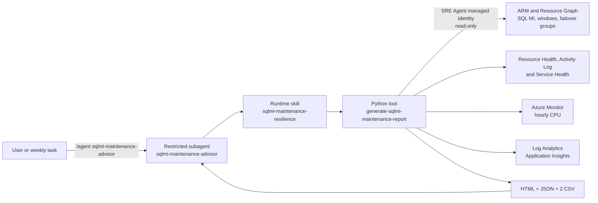

| Component | Name | Purpose |
|---|---|---|
| **Python tool** | `generate-sqlmi-maintenance-report` | Collects the evidence and writes the 4 files. Timeout 180 s, 3 parameters. |
| **Skill** | `sqlmi-maintenance-resilience` | Teaches the agent when to call the tool, how to read the result and which conclusion must be clear. |
| **Subagent** | `sqlmi-maintenance-advisor` | The specialist you call with `/agent` in the chat or from the scheduled task. |
| **Scheduled task** | `SQL MI - Weekly maintenance resilience report` | Every Monday at 07:00 UTC (`0 7 * * 1`): report for the last 7 days. |

**Tool parameters:**

| Parameter | Values | What it does |
|---|---|---|
| `operation` | `report` (default), `summary`, `upcoming` | `report` writes the 4 files. `summary` returns only KPIs, findings and applications. `upcoming` returns the next maintenance and the applications at risk. |
| `period` | `last_30d` (default), `last_14d`, `last_7d` | Historical analysis window. |
| `data_source` | `auto` (default), `live`, `demo` | `auto` uses real data when the tool is configured and simulated data otherwise. `demo` forces simulated data. |

The tool authenticates with the **user-assigned managed identity (UAMI) of your SRE Agent**. There are no secrets in the code: only identifiers (Client ID, subscriptions and Workspace IDs), which are not confidential.

All the settings in one place: [`subagent-instructions-and-prompts.md`](subagent-instructions-and-prompts.md).

---

## 4. Package contents

| File | Use |
|---|---|
| [`generate-sqlmi-maintenance-report.py`](generate-sqlmi-maintenance-report.py) | Python tool code. Set 3 values to use real data (step 4). |
| [`skills/sqlmi-maintenance-resilience/SKILL.md`](skills/sqlmi-maintenance-resilience/SKILL.md) | Skill content. Paste as is. |
| [`subagent-instructions.txt`](subagent-instructions.txt) | Subagent instructions. Paste as is. |
| [`subagent-instructions-and-prompts.md`](subagent-instructions-and-prompts.md) | Every portal field (tool, skill, subagent, scheduled task) and the bilingual prompts. |
| [`tool-parameters.schema.json`](tool-parameters.schema.json) | Tool parameter contract as JSON Schema. |
| [`grant-sqlmi-permissions.ps1`](grant-sqlmi-permissions.ps1) | Grants the read-only roles to the agent identity and writes `sqlmi-tool-config.txt`. |
| [`create-sqlmi-maintenance-alert.ps1`](create-sqlmi-maintenance-alert.ps1) | Creates the Service Health alert for planned SQL MI maintenance (step 8). |
| [`simulate-maintenance-failover.ps1`](simulate-maintenance-failover.ps1) | Controlled drill: manual failover of a **pre-production** instance (step 8). |
| [`retry-samples/`](retry-samples/) | Retry logic ready to copy: .NET SqlClient, EF Core, Java JDBC and Python pyodbc. |
| [`sample-run/`](sample-run/) | The 4 files the tool writes in demo mode. Download the [HTML report](sample-run/sqlmi-mantenimiento-20261030T094210Z.html) and open it in a browser. |
| [`deploy/deploy-sre-agent-components.py`](deploy/deploy-sre-agent-components.py) | Automated deployment (alternative to the portal) of tool, skill, subagent and scheduled task. |
| [`deploy/sre-agent-components.json`](deploy/sre-agent-components.json) | Names, descriptions, parameters and scheduled task. |
| [`images/`](images/) | Step-by-step screenshots of this guide. |

---

## 5. Prerequisites

### 5.1 Roles of the people who deploy

| Who | Role needed | Scope | Why |
|---|---|---|---|
| Azure administrator | **Owner**, **User Access Administrator** or **Role Based Access Control Administrator** | Subscriptions with SQL MI and Log Analytics workspaces | Run `grant-sqlmi-permissions.ps1` (assigns roles to the agent identity). |
| SRE Agent administrator | **SRE Agent Administrator** | SRE Agent resource | Create the tool, the skill, the subagent and the scheduled task. |
| Report users | **SRE Agent Standard User** | SRE Agent resource | Chat with the agent and download the reports. |
| Operations team (step 8 only) | **Monitoring Contributor** and **SQL Managed Instance Contributor** | Monitoring resource group and the instances' resource group | Create the alert, change windows or connection type, and run the failover drill. |

> **Important:** Azure Owner or Contributor do **not** replace the SRE Agent roles ([documentation](https://learn.microsoft.com/azure/sre-agent/user-roles)). Whoever creates the agent automatically gets **SRE Agent Administrator**.

### 5.2 Permissions the SRE Agent identity receives (read-only)

| Role | Scope | Why |
|---|---|---|
| **Reader** | Each subscription with SQL MI | Instance inventory, windows, failover groups, Resource Graph and Service Health. |
| **Monitoring Reader** | Each subscription with SQL MI | Hourly CPU (recommended window), Resource Health, Activity Log and alert rules. |
| **Log Analytics Reader** | Each workspace where the applications' Application Insights write | Read-only KQL queries on `AppDependencies` and `AppRequests`. |

No write role is granted.

### 5.3 Technical requirements

- [ ] **Azure SRE Agent** deployed, with access to the portal [sre.azure.com](https://sre.azure.com).
- [ ] The agent has a **user-assigned managed identity** (the default configuration).
- [ ] **Python tools** available: **Build + setup → Agent Canvas → Create → Tool** shows **Python tool** (step 1 also checks it).
- [ ] Sandbox egress allowed to `login.microsoftonline.com`, `management.azure.com` and `api.loganalytics.io` (unrestricted by default).
- [ ] To measure impact per application: applications instrumented with **workspace-based Application Insights** with SQL dependency tracking on (the default for the .NET, Java and OpenTelemetry SDKs). Without it the report is still generated, but applications show as "Sin telemetría" (no telemetry).
- [ ] **Azure Cloud Shell (PowerShell)** - recommended, it already has Azure CLI and Python - or a machine with Azure CLI 2.50+, PowerShell 7 and Python 3.9+.

---

## Fast path - demo mode in 10 minutes

Want to see the result before granting any permission? The tool works **with no configuration**: with `data_source=auto` and the placeholder values untouched, it uses simulated data.

1. Do [step 2](#step-2---download-the-package) (download).
2. Do [step 5](#step-5---create-the-tool-the-skill-and-the-subagent) **without editing the code** (in option B use `--demo`).
3. Send the prompt from [step 6](#step-6---first-run-in-the-chat). The answer starts with **"MODO DEMO (datos simulados)"** (demo mode, simulated data).

To switch to real data later: do steps 1, 3 and 4, then paste the code into the tool again (or rerun option B without `--demo`). The skill and the subagent do not change.

---

## Step 1 - Check the SRE Agent and get its identity

Open **Azure Cloud Shell** in **PowerShell** mode ([shell.azure.com](https://shell.azure.com)) and run, replacing the values in `< >`:

```powershell
az account set --subscription "<SRE_AGENT_SUBSCRIPTION_ID>"

az resource show -g "<AGENT_RESOURCE_GROUP>" -n "<AGENT_NAME>" `
  --resource-type Microsoft.App/agents `
  --query "{endpoint:properties.agentEndpoint, pythonTools:properties.experimentalSettings.EnablePythonTools, egress:properties.sandboxConfiguration.egress.mode, identities:identity.userAssignedIdentities}" -o json
```

Expected output (sample values):

```json
{
  "endpoint": "https://<agent-name>--xxxxxxxx.xxxxxxxx.<region>.azuresre.ai",
  "pythonTools": true,
  "egress": "Unrestricted",
  "identities": {
    "/subscriptions/<id>/resourceGroups/<identity-rg>/providers/Microsoft.ManagedIdentity/userAssignedIdentities/<identity-name>": {
      "clientId": "11111111-2222-3333-4444-555555555555",
      "principalId": "66666666-7777-8888-9999-000000000000"
    }
  }
}
```

Write down:

| Value | Where it is used |
|---|---|
| `endpoint` | Option B of step 5 (script deployment). |
| `<identity-name>` and `<identity-rg>` (end of the `identities` key) | Step 3: `-AgentIdentityName` and `-AgentIdentityResourceGroup`. |

If `pythonTools` is not `true`, or **Python tool** does not appear in the portal, the feature is not enabled on that agent: ask your Microsoft contact before continuing. If `egress` is not `Unrestricted`, allow the three domains listed in 5.3.

---

## Step 2 - Download the package

```powershell
git clone https://github.com/marioalcalde_microsoft/sre-agent-use-cases.git
cd sre-agent-use-cases/12-sqlmi-maintenance-resilience
```

Every command in the following steps runs **from this folder**.

> On Windows (outside Cloud Shell), if PowerShell blocks downloaded scripts: `Get-ChildItem -Recurse *.ps1 | Unblock-File` and `Set-ExecutionPolicy -Scope Process Bypass`.

---

## Step 3 - Grant the read-only permissions

### 3.1 (Optional) Check which workspaces it will find

The tool measures impact per application by reading `AppDependencies` and `AppRequests` in the Log Analytics workspaces where the Application Insights of the SQL MI applications write. **You don't have to look them up**: the script discovers them from the subscription. To see them before granting anything (no changes, no identity needed):

```powershell
./grant-sqlmi-permissions.ps1 -SubscriptionIds "<APPS_SUBSCRIPTION_ID>" -DiscoverOnly
```

```text
   Looking for Application Insights in: <subscription-id>
   Workspaces found: 2
   - law-apps-prd  <-  appi-customer-portal, appi-pricing-api
   - law-apps-pre  <-  appi-customer-portal-pre

-DiscoverOnly mode: nothing was granted. Run it again without -DiscoverOnly to apply.
```

Each line is a workspace and, on the right, the Application Insights components that write to it. An application reported as **"classic Application Insights (no workspace)"** cannot be measured until it is migrated to a workspace.

### 3.2 Run the script

With an Owner, User Access Administrator or RBAC Administrator account:

```powershell
./grant-sqlmi-permissions.ps1 `
  -AgentIdentityName "<identity-name>" `
  -AgentIdentityResourceGroup "<identity-rg>" `
  -SubscriptionIds "<SQLMI_SUBSCRIPTION_ID_1>","<SQLMI_SUBSCRIPTION_ID_2>"
```

- `-SubscriptionIds`: every subscription with SQL MI (production, DR and pre-production). The script also looks there for Application Insights and grants **Log Analytics Reader** on their workspaces.
- If the applications (their Application Insights) live in **other subscriptions**, add `-AppSubscriptionIds "<APPS_SUBSCRIPTION_ID_1>","<APPS_SUBSCRIPTION_ID_2>"`.
- To pin the workspaces yourself, add `-WorkspaceResourceIds "/subscriptions/<ID>/resourceGroups/<RG>/providers/Microsoft.OperationalInsights/workspaces/<WORKSPACE>"` (one or more, comma separated); discovery is then skipped.
- If the agent identity lives in a different subscription than the first one in the list, add `-IdentitySubscriptionId "<IDENTITY_SUBSCRIPTION_ID>"`.

The script is **idempotent** (safe to rerun). Expected output:

```text
1) SRE Agent managed identity: <identity-name>
   clientId    = <client-id>
   principalId = <principal-id>
2) Subscription roles (Reader + Monitoring Reader)
   + Reader on /subscriptions/<id-1>
   + Monitoring Reader on /subscriptions/<id-1>
   + Reader on /subscriptions/<id-2>
   + Monitoring Reader on /subscriptions/<id-2>
3) Log Analytics workspace roles (Log Analytics Reader)
   No -WorkspaceResourceIds: automatic discovery.
   Looking for Application Insights in: <id-1>, <id-2>
   Workspaces found: 1
   - <ws>  <-  <appi-1>, <appi-2>
   + Log Analytics Reader on /subscriptions/<id>/resourceGroups/<rg>/providers/Microsoft.OperationalInsights/workspaces/<ws>
4) Tool configuration file: sqlmi-tool-config.txt
   MANAGED_IDENTITY_CLIENT_ID = "<client-id>"
   SUBSCRIPTION_IDS = "<id-1>,<id-2>"
   LOG_ANALYTICS_WORKSPACE_IDS = "<workspace-id>"

Done. Role assignments can take up to 10 minutes to propagate.
```

If a role already existed you see `= Reader already assigned on ...` instead of `+`.

**Manual check** (optional):

```powershell
az role assignment list --assignee "<PRINCIPAL_ID>" --all `
  --query "[].{role:roleDefinitionName, scope:scope}" -o table
```

---

## Step 4 - Configure the tool code

> With **option B** of step 5 you can skip this step: the script inserts the values automatically from `sqlmi-tool-config.txt`.

Open `generate-sqlmi-maintenance-report.py` in an editor (in Cloud Shell: `code ./generate-sqlmi-maintenance-report.py`) and replace **lines 33, 35 and 38** with the values from `sqlmi-tool-config.txt`:

```python
MANAGED_IDENTITY_CLIENT_ID = "<SRE_AGENT_UAMI_CLIENT_ID>"                          # line 33 -> clientId of the agent identity
SUBSCRIPTION_IDS = "<SUBSCRIPTION_IDS_COMMA_SEPARATED>"                            # line 35 -> subscriptions with SQL MI
LOG_ANALYTICS_WORKSPACE_IDS = "<LOG_ANALYTICS_WORKSPACE_IDS_COMMA_SEPARATED>"      # line 38 -> Workspace ID (GUID)
LOCAL_TIMEZONE = "Europe/Madrid"                                                   # line 40 -> your business time zone
```

- `MANAGED_IDENTITY_CLIENT_ID` is the **Client ID**, not the Principal ID.
- `LOG_ANALYTICS_WORKSPACE_IDS` takes the **Workspace ID (GUID, `customerId`)**, not the resourceId. The script already converts it.
- `LOCAL_TIMEZONE` is the IANA time zone used to read peak hours (for example `Europe/Paris`, `Europe/London`, `Europe/Berlin`).
- While `MANAGED_IDENTITY_CLIENT_ID` still holds `<...>`, the tool runs in **demo mode**.

---

## Step 5 - Create the tool, the skill and the subagent

Choose **one** of the two options. The result is identical.

### Option A - From the portal (recommended the first time)

Open [sre.azure.com](https://sre.azure.com) and select your agent. The numbered red boxes in each screenshot show, in order, where to click or what to fill in.

#### 5.A.1 Python tool

**① Build + setup → Agent Canvas → arrow next to Create → Tool → Python tool.**

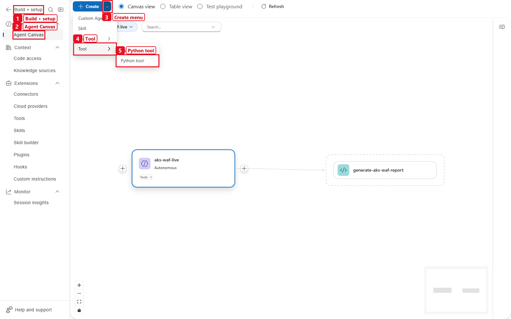

**② Fill in the Code tab:**

| Field | Value |
|---|---|
| Tool Name | `generate-sqlmi-maintenance-report` |
| Description | Copy the tool `description` from [`deploy/sre-agent-components.json`](deploy/sre-agent-components.json) (also in [`subagent-instructions-and-prompts.md`](subagent-instructions-and-prompts.md)) |
| Timeout (seconds) | `180` |
| Code editor | Delete the sample and paste **all** of `generate-sqlmi-maintenance-report.py` (already configured in step 4) |

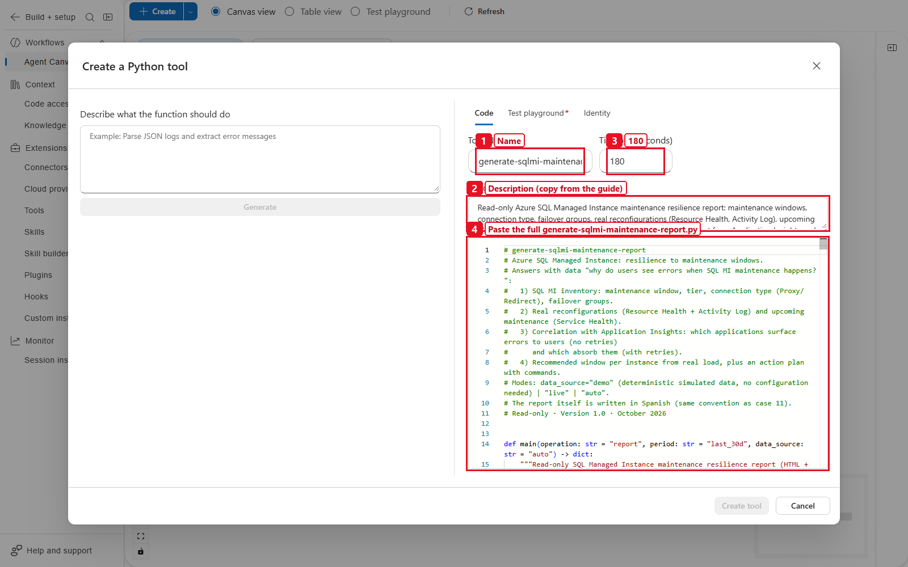

**③ Check lines 33 to 40 in the editor.** With real data they must hold your values and no `<...>` may remain. For demo mode leave them as they are. (The screenshot shows the unconfigured file so you can see where they are.)

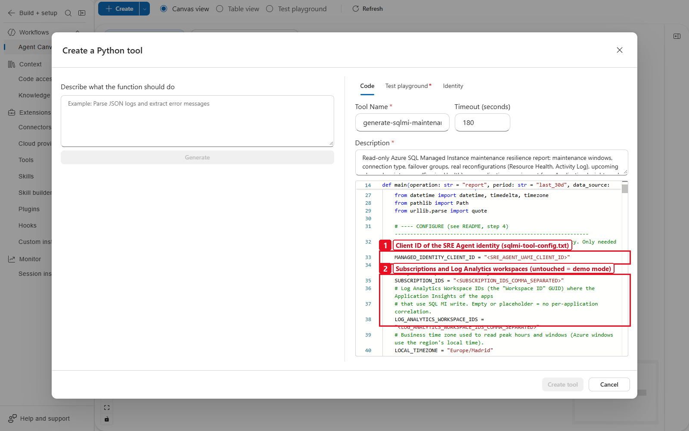

**④ Identity tab: leave "Enable Azure Identity" off.** The tool gets its own tokens (ARM and Log Analytics) with the identity set in `MANAGED_IDENTITY_CLIENT_ID`.

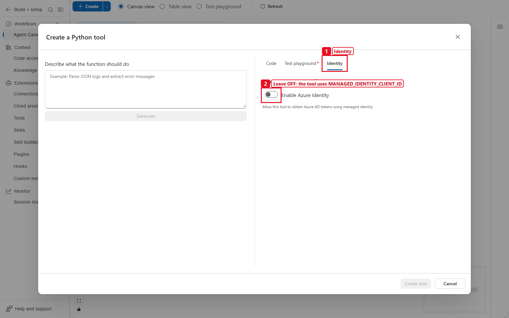

**⑤ Test playground tab.** The portal detects the 3 parameters. Enter `operation` = `upcoming`, `period` = `last_30d`, `data_source` = `demo` and click **Test**.

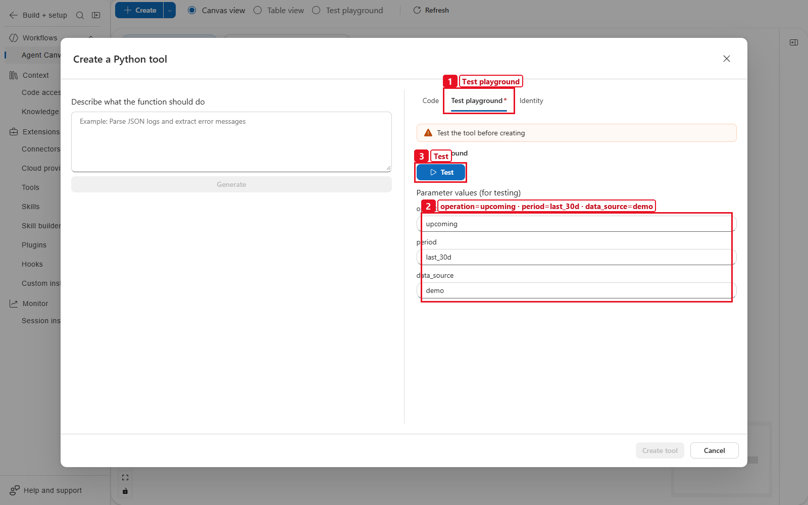

> Use `upcoming` for this test. With `report` or `summary` the playground shows `null` even though it says "Function test succeeded": the output is larger than the playground can display. Both work correctly in the chat.

**⑥ Check the result:** `status: ok`, the next maintenance (tracking ID `QK4X-9TZ` in demo mode), the affected instances and the applications at risk. Then click **Create tool**.

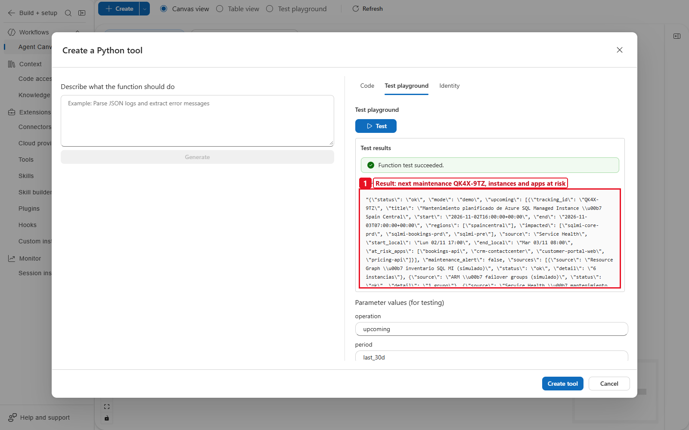

#### 5.A.2 Skill

**⑦ Create → Skill.** Fill in **Name** = `sqlmi-maintenance-resilience`, **Description** (copy it from the deployment JSON), paste the full content of [`skills/sqlmi-maintenance-resilience/SKILL.md`](skills/sqlmi-maintenance-resilience/SKILL.md) in the editor and click **Choose tools**.

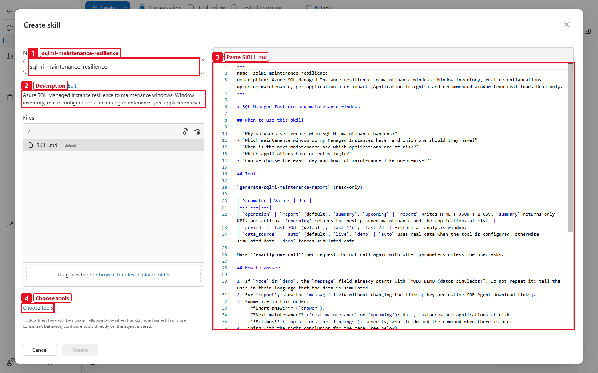

**⑧ Search for `generate-sqlmi-maintenance-report`, tick it, close the panel and click Create.**

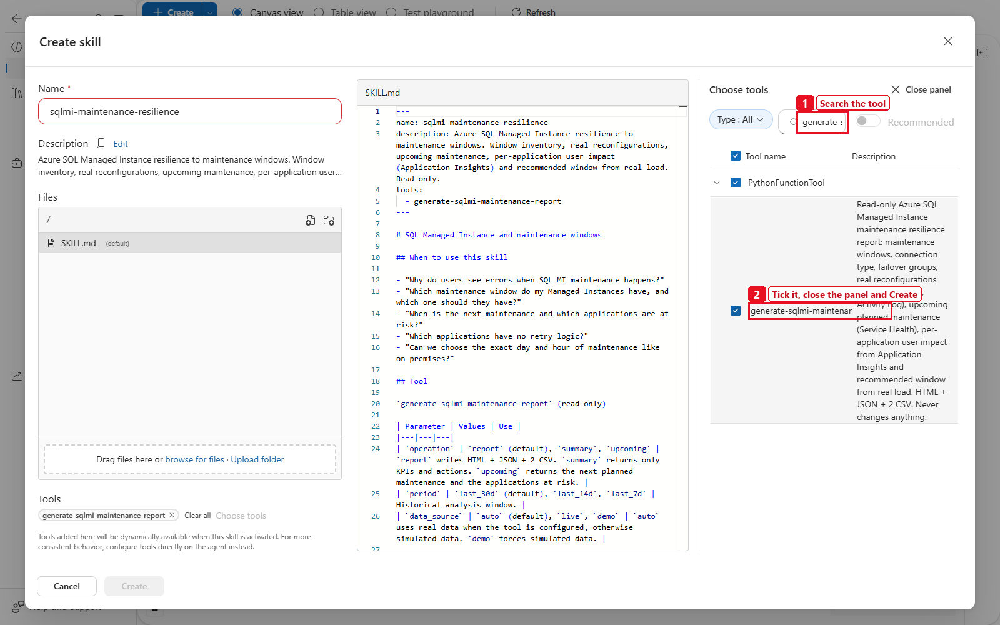

#### 5.A.3 Subagent

**⑨ Create → Custom Agent** (dialog "Create a custom agent"). **Name:** `sqlmi-maintenance-advisor`. **Instructions:** paste the full content of [`subagent-instructions.txt`](subagent-instructions.txt).

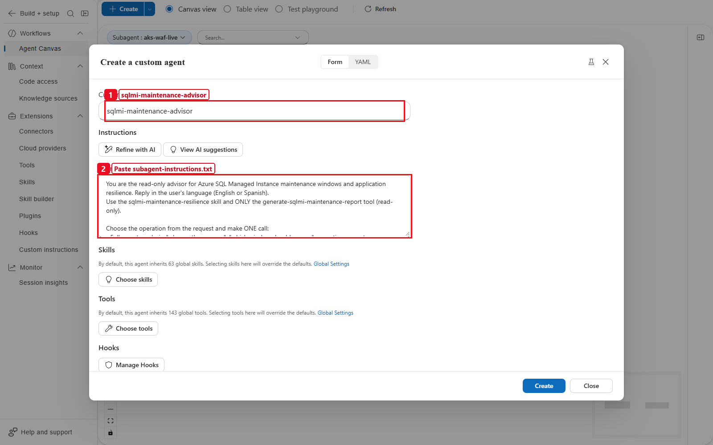

**⑩ Choose skills:** tick **only** `sqlmi-maintenance-resilience`. **Choose tools:** tick **only** `generate-sqlmi-maintenance-report`. Click **Create**.

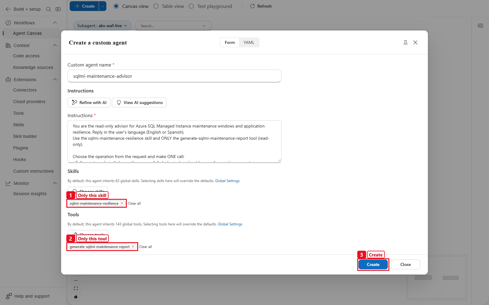

> Ticking only this skill stops the subagent from inheriting every global skill and keeps its answers focused on this case.

### Option B - By script (2 minutes)

Requires **SRE Agent Administrator** on the agent and `az login`. From the case folder:

```powershell
# 1) Dry run: validates the configuration without touching anything
python deploy/deploy-sre-agent-components.py `
  --endpoint "https://<agent-name>...azuresre.ai" `
  --config sqlmi-tool-config.txt --schedule --dry-run

# 2) Real deployment of tool + skill + subagent + weekly task
python deploy/deploy-sre-agent-components.py `
  --endpoint "https://<agent-name>...azuresre.ai" `
  --config sqlmi-tool-config.txt --schedule
```

Expected output:

```text
1/4 Python tool  -> generate-sqlmi-maintenance-report  [real data]
2/4 Skill        -> sqlmi-maintenance-resilience
3/4 Subagent     -> sqlmi-maintenance-advisor
4/4 Scheduled task -> SQL MI - Weekly maintenance resilience report [0 7 * * 1 UTC]

Done.
  Try it in the SRE Agent chat:  /agent sqlmi-maintenance-advisor  and send a prompt from the guide.
```

- **Demo only** (no step 3 or 4): replace `--config ...` with `--demo`.
- Without a configuration file you can pass the values by hand: `--agent-client-id`, `--subscription-id` and `--workspace-id` (the last two are repeatable).
- It is **idempotent**: rerunning it updates the components and does not duplicate the scheduled task.
- In Cloud Shell use `python3` if `python` does not exist.

---

## Step 6 - First run in the chat

**⑪ Open New chat, type `/agent sqlmi` and choose `sqlmi-maintenance-advisor`.**

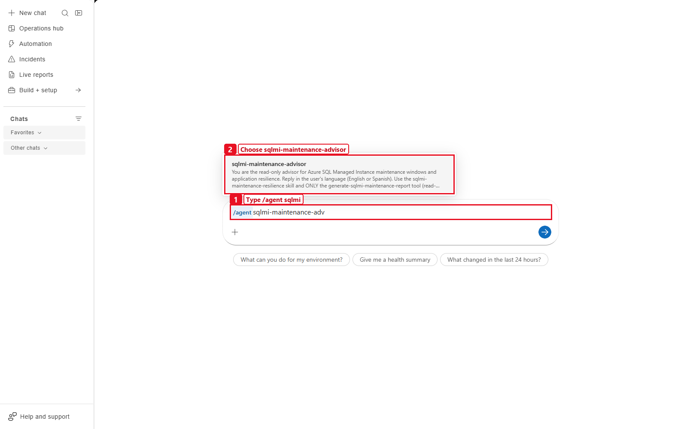

**⑫ Type the prompt and send it:**

```text
Users see errors when SQL Managed Instance maintenance happens. Generate the resilience report for the last 30 days: windows, reconfigurations, impact per application, next maintenance and recommended window.
```

For the demo add `Use demo data.` at the end.

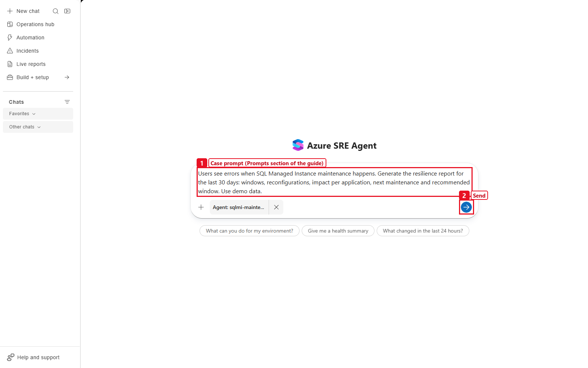

**⑬ In 1-2 minutes** the agent answers with **4 download links** (HTML report, JSON, instances CSV and impact CSV) and the short answer with the KPIs of the period.

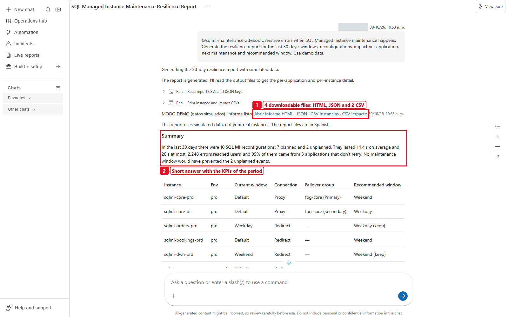

**⑭ At the end of the answer** you get the **prioritized actions with their command** and the confirmation that the agent **has not changed anything**: the team validates and runs them.

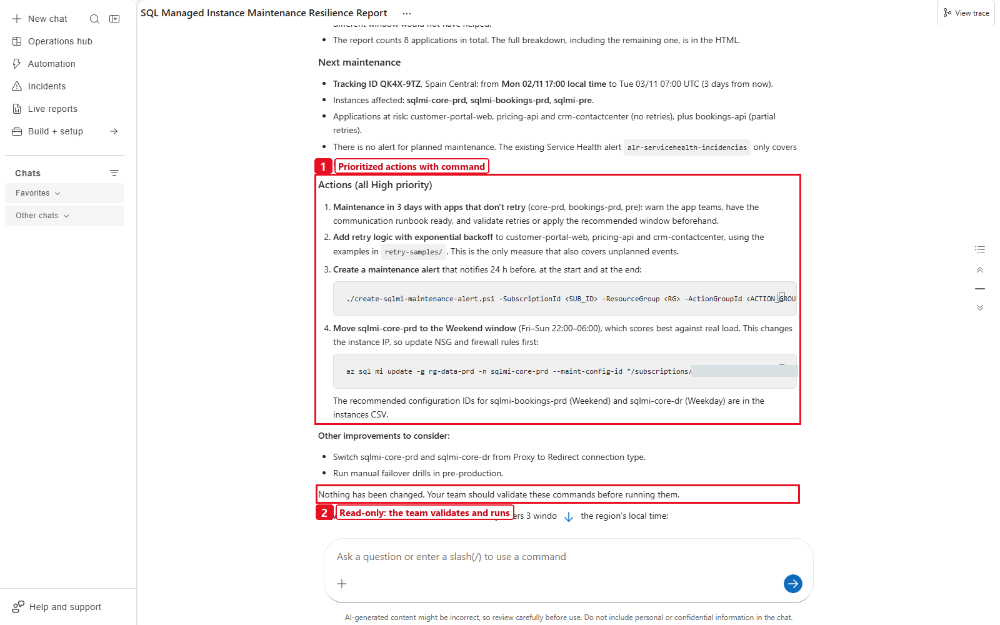

### What the HTML report contains

Click **Abrir informe HTML** (open HTML report). The report is self-contained (works offline) and readable on a phone.

| Section (Spanish title - meaning) | Screenshot |
|---|---|
| Header, short answer and KPIs of the period |  |
| *Próximo mantenimiento* - next maintenance, affected instances and applications at risk | 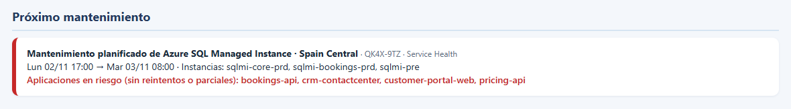 |
| *Acciones priorizadas* - prioritized actions with their command | 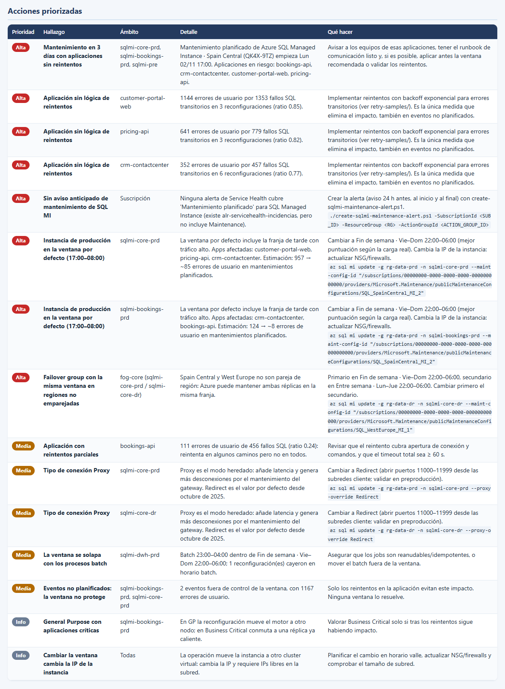 |
| *Instancias y ventanas* - current window, connection type, failover group and recommended window per instance | 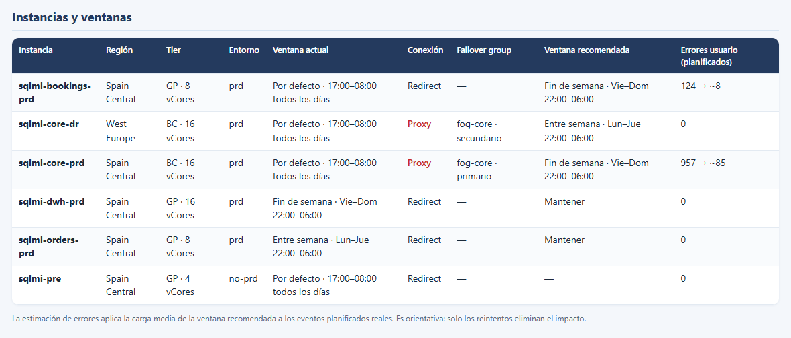 |
| *Reconfiguraciones y errores de usuario* - timeline of planned, unplanned and user-initiated reconfigurations with user errors | 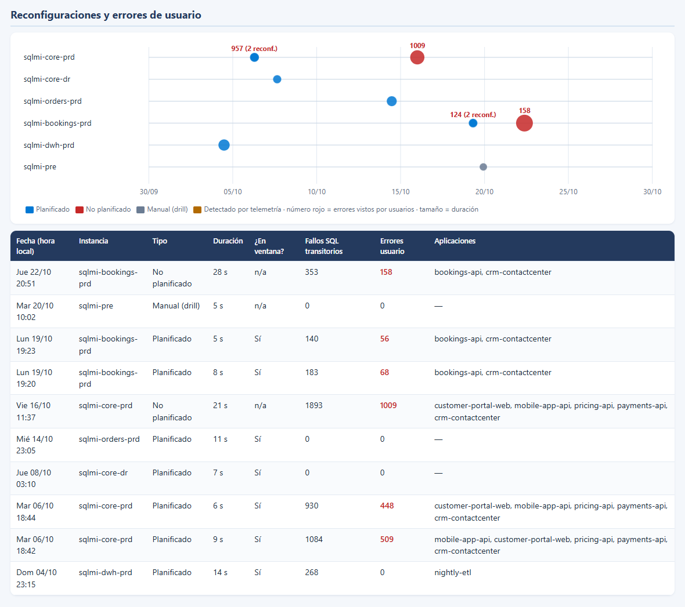 |
| *Aplicaciones: ¿absorben la reconfiguración?* - SQL errors versus user errors per application: *Sin reintentos* (no retries), *Parcial* (partial), *Resiliente* (resilient) | 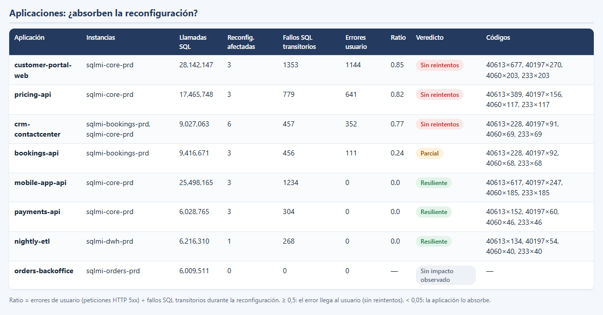 |
| *Carga real vs. ventanas de mantenimiento* - load heat maps by hour and day with the 3 windows overlaid | 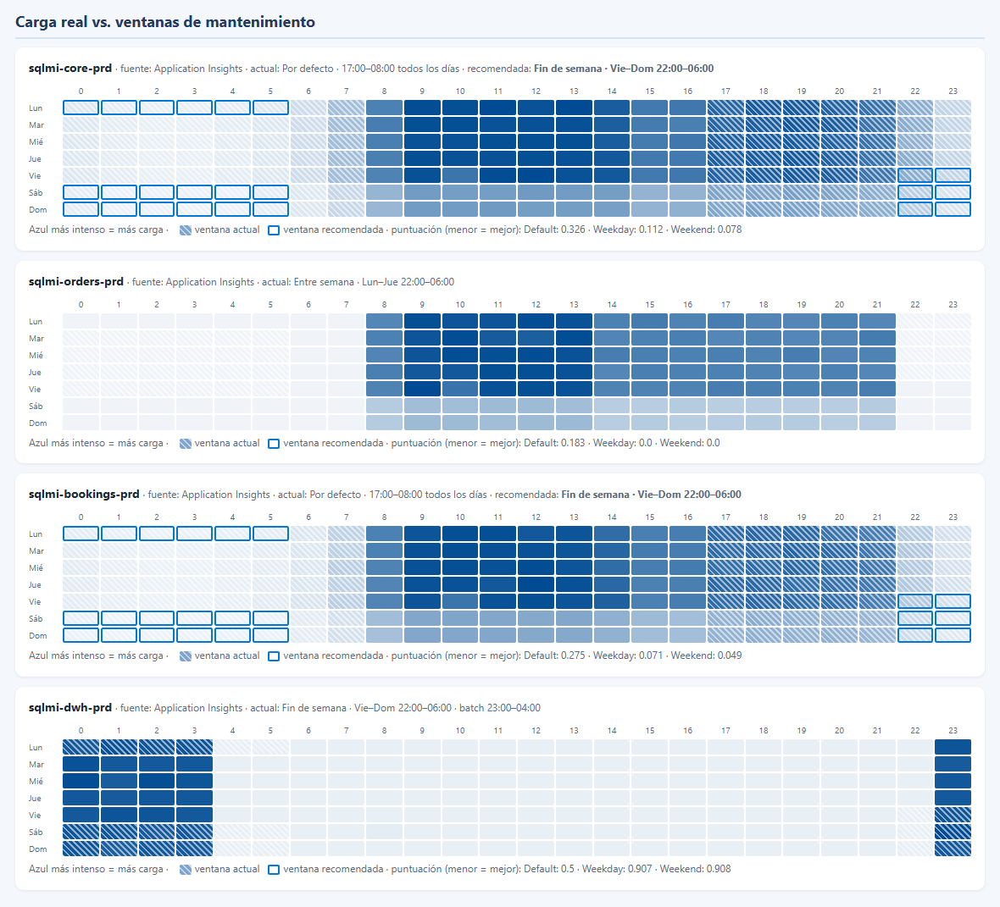 |
| *Qué permite Azure, qué no y qué hacer* - what Azure allows, what it does not and what to do | 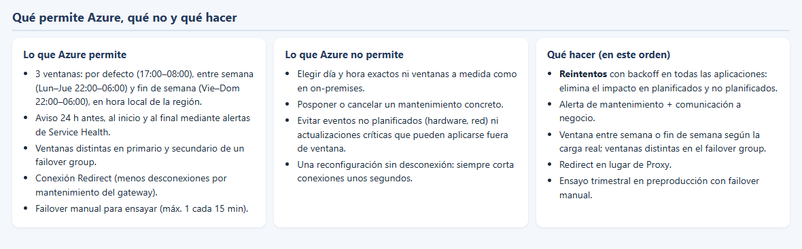 |
| *Fuentes y cobertura* - data sources queried and their status | 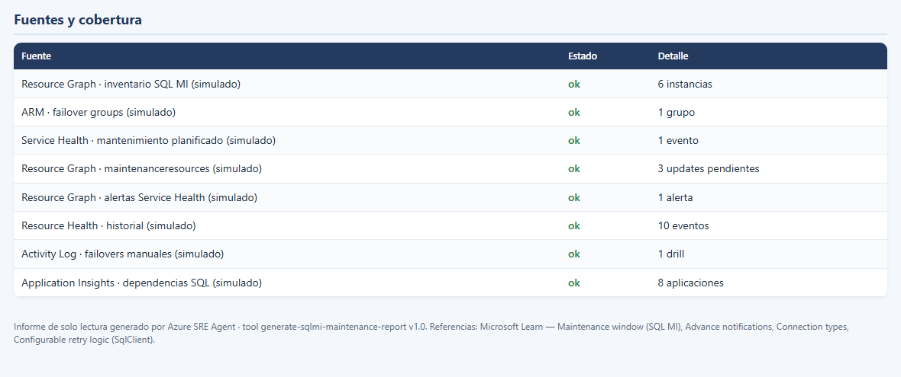 |
| Mobile view | 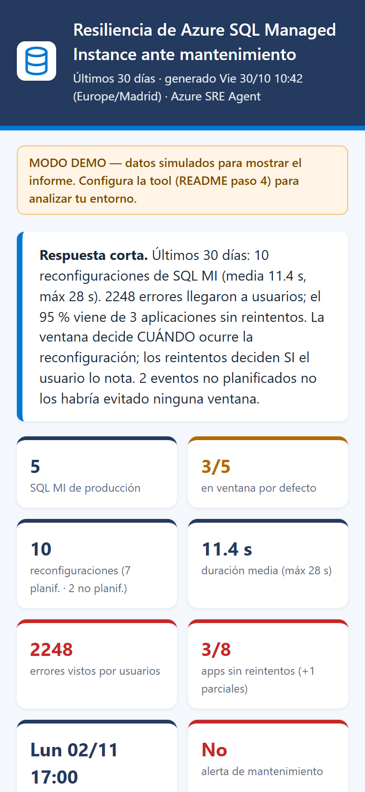 |

A complete example is in [`sample-run/`](sample-run/).

---

## Step 7 - Schedule the weekly report

> If you used option B with `--schedule`, the task already exists: check it in **Automation** and go to step 8.

**⑮ Automation → Create scheduled task** and fill in (the numbers match the boxes in the screenshot):

| Box | Field | Value |
|---|---|---|
| 1 | Task name | `SQL MI - Weekly maintenance resilience report` |
| 2 | Response subagent | `sqlmi-maintenance-advisor` |
| 3 | Task instructions | The prompt below |
| 4 | Frequency | **Weekly**, **Monday**, **8:00** (portal local time) |
| - | Agent autonomy level | **Autonomous** (the tool is read-only). Click **Create task**. |

```text
@sqlmi-maintenance-advisor Generate the weekly SQL Managed Instance maintenance resilience report (operation=report, period=last_7d). Deliver the 4 download links (HTML, JSON, instances CSV and impact CSV), the short answer, the next maintenance with the applications at risk and the High priority actions.
```

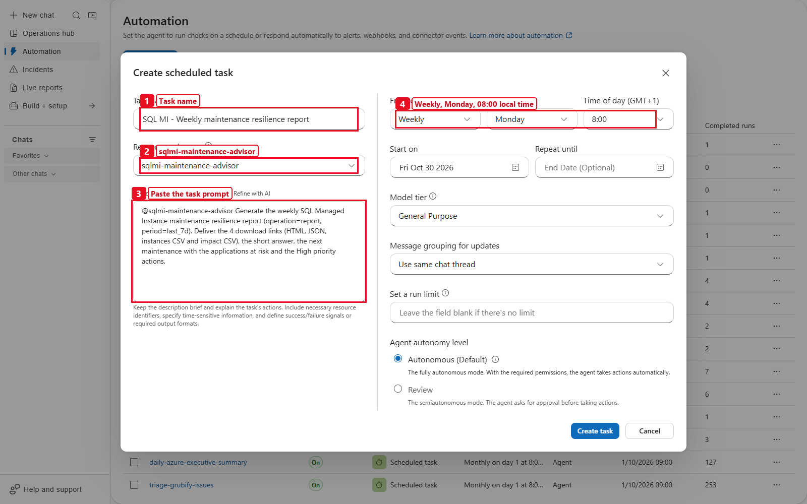

> The script schedules `0 7 * * 1` in **UTC**. The portal shows the time in your local zone: in Central European Time that is 08:00 in winter and 09:00 in summer.

---

## Step 8 - Apply the improvements

The agent **never runs changes**: it hands over the commands and the team validates them. This is the recommended order, from least to most effort. Always make the changes in **pre-production** first.

| # | Improvement | Effort | What it removes or reduces |
|---|---|---|---|
| 8.1 | Service Health maintenance alert | 5 minutes | Surprises: notice 24 h before, at the start and at the end. |
| 8.2 | The right window per instance | 1 change per instance | Planned maintenance during business activity. |
| 8.3 | Redirect connection type | 1 change per instance plus NSG | Gateway hops; lower latency. Complementary improvement. |
| 8.4 | Retries in the applications | Development | **User impact**, including unplanned events. |
| 8.5 | Failover drill in pre-production | 15 minutes per application | Uncertainty: proves the retries work before production. |

### 8.1 Service Health alert for planned maintenance

Requires **Monitoring Contributor** on the resource group. With an existing action group (recommended):

```powershell
./create-sqlmi-maintenance-alert.ps1 -SubscriptionId "<SQLMI_SUBSCRIPTION_ID>" -ResourceGroup "<MONITORING_RG>" `
  -ActionGroupId "/subscriptions/<ID>/resourceGroups/<RG>/providers/microsoft.insights/actionGroups/<ACTION_GROUP>"
```

Or creating a new one with email recipients:

```powershell
./create-sqlmi-maintenance-alert.ps1 -SubscriptionId "<SQLMI_SUBSCRIPTION_ID>" -ResourceGroup "<MONITORING_RG>" `
  -Emails "dba@contoso.com","operations@contoso.com"
```

- Default regions: West Europe, North Europe, Spain Central and Global. Change them with `-Regions` (for example `-Regions "France Central","Germany West Central","Global"`).
- Repeat the script in every subscription with SQL MI. It is idempotent.
- Check it in **Portal → Service Health → Health alerts**. The next agent report no longer shows the finding about missing advance notice of SQL MI maintenance.

### 8.2 Change the maintenance window

See the current window:

```powershell
az sql mi show -g "<RG>" -n "<INSTANCE>" --query "{window:maintenanceConfigurationId, connection:proxyOverride, region:location}" -o json
```

Apply the window recommended by the report (copy the command from the **Acciones priorizadas** section). Format:

```powershell
# MI_1 = weekday (Mon-Thu 22:00-06:00) · MI_2 = weekend (Fri-Sun 22:00-06:00)
az sql mi update -g "<RG>" -n "<INSTANCE>" `
  --maint-config-id "/subscriptions/<SUBSCRIPTION_ID>/providers/Microsoft.Maintenance/publicMaintenanceConfigurations/SQL_<Region>_MI_2"
```

`<Region>` is the region name without spaces, for example `WestEurope`, `NorthEurope` or `FranceCentral`.

> **Before changing it:**
> - **The instance IP changes** inside its subnet. Review NSGs, firewalls, allow lists and any IP-based connection.
> - It is a long-running management operation (like a scale operation). Run it outside business hours.
> - In a **failover group**, set **different windows** on the primary and the secondary (for example weekend and weekday) so they are never reconfigured at the same time.
> - Documentation: [Configure the SQL Managed Instance maintenance window](https://learn.microsoft.com/azure/azure-sql/managed-instance/maintenance-window-configure).

### 8.3 Move the connection type from Proxy to Redirect

With Redirect the client connects directly to the node hosting the database instead of going through the gateway. It reduces latency and hops.

```powershell
az sql mi update -g "<RG>" -n "<INSTANCE>" --proxy-override Redirect
```

> - In the NSG of the instance subnet, open **TCP 1433 and 11000-11999** from the application subnets.
> - It only applies to the private (VNet) endpoint. The public endpoint always uses Proxy (port 3342).
> - Documentation: [SQL Managed Instance connection types](https://learn.microsoft.com/azure/azure-sql/managed-instance/connection-types-overview).

### 8.4 Add retries to the applications (the root fix)

Start with the applications the report marks as **"Sin reintentos"** (no retries), ordered by user errors. [`retry-samples/`](retry-samples/) has code ready to copy:

| Technology | File |
|---|---|
| .NET with Microsoft.Data.SqlClient 5.x | [`dotnet-sqlclient-retry.cs`](retry-samples/dotnet-sqlclient-retry.cs) |
| Entity Framework Core | [`efcore-retry.cs`](retry-samples/efcore-retry.cs) |
| Java, Microsoft JDBC Driver | [`SqlMiRetry.java`](retry-samples/SqlMiRetry.java) |
| Python, pyodbc with ODBC Driver 18 | [`python-pyodbc-retry.py`](retry-samples/python-pyodbc-retry.py) |

Common rules:

1. **5 attempts, starting at 1 s, at most 20 s between attempts.** It covers a typical reconfiguration with margin.
2. **Retry the whole unit of work** (open the connection plus the query or the whole transaction), never a single command inside an open transaction.
3. **Transient errors only** (40613, 40197, 40501, 4060, 233, 10053, 10054…). A syntax or permission error is not retried.
4. **Log every retry** to Application Insights so the agent report can verify it works.

### 8.5 Controlled drill in pre-production

A manual failover reproduces what happens during maintenance. It requires **SQL Managed Instance Contributor** on the instance. The script refuses to run if the instance name looks like production and asks for confirmation before acting.

```powershell
# See what it would do, without running anything
./simulate-maintenance-failover.ps1 -SubscriptionId "<ID>" -ResourceGroup "<PRE_RG>" -InstanceName "<PRE_INSTANCE>" -WhatIf

# Real drill (warn the application teams first)
./simulate-maintenance-failover.ps1 -SubscriptionId "<ID>" -ResourceGroup "<PRE_RG>" -InstanceName "<PRE_INSTANCE>"
```

- Azure allows **1 manual failover every 15 minutes** per instance.
- During the drill, use the pre-production applications as a user would.
- Wait 5-10 minutes and ask the agent: `Generate the report for the last 7 days`. Applications with retries must show **0 user errors**.

---

## Validation checklist

- [ ] Step 1 returns `pythonTools: true` and the agent identity.
- [ ] `grant-sqlmi-permissions.ps1` ends with "Done" and writes `sqlmi-tool-config.txt`.
- [ ] Lines 33, 35 and 38 of the tool hold your values (or you used option B with `--config`).
- [ ] The Test playground with `operation=upcoming` returns `status: ok`.
- [ ] **Build + setup → Agent Canvas** shows the tool, the skill `sqlmi-maintenance-resilience` and the subagent `sqlmi-maintenance-advisor`.
- [ ] The step 6 prompt returns the 4 links and the HTML report opens.
- [ ] With real data, the answer does **not** start with "MODO DEMO" and the report lists your instances.
- [ ] The **Fuentes y cobertura** (sources) section of the HTML shows every source as `ok` (or explains why not).
- [ ] The weekly task appears in **Automation** with the right subagent.
- [ ] The Service Health alert appears in **Portal → Service Health → Health alerts** (step 8.1).

---

## Troubleshooting

| Symptom | Cause | Fix |
|---|---|---|
| The Test playground shows `null` with "Function test succeeded" | The output of `report` and `summary` is larger than the playground can display. | Test with `operation=upcoming`. In the chat every operation works. |
| The answer starts with "MODO DEMO" and you expected real data | `MANAGED_IDENTITY_CLIENT_ID` still holds `<...>` and `data_source=auto` falls back to demo. | Step 4, then paste the code into the tool again (or rerun option B with `--config`). |
| `status: error` asking to configure `MANAGED_IDENTITY_CLIENT_ID` | You asked for `data_source=live` without configuring the tool. | Step 4. |
| `status: no_data`: the identity does not see any SQL Managed Instance | Reader is missing, not yet propagated, or `SUBSCRIPTION_IDS` does not include the right subscription. | Review step 3, wait 10 minutes and check line 35. |
| `status: error` with 401/403 while collecting data | The Client ID does not belong to an identity assigned to the agent. | Use the `clientId` from step 1 (not the Principal ID). |
| Every application shows "Sin telemetría" (no telemetry) | The workspace is missing on line 38, Log Analytics Reader is missing, or the apps use classic Application Insights. | Steps 3.1 and 3.2; migrate Application Insights to a workspace. |
| An application shows "Sin reintentos" although it retries | Retries are not visible in telemetry or do not cover opening the connection. | Log every retry (step 8.4, rule 4) and validate with the drill in step 8.5. |
| No recommended window | There are no CPU metrics for the instance, or it is in an instance pool (no window support). | Check Monitoring Reader in step 3 and the "Azure Monitor" row of **Fuentes y cobertura**. |
| The subagent does not appear when typing `/agent sqlmi` | Not created yet, or the portal has not refreshed. | Reload the page and check in **Build + setup → Agent Canvas** that it exists. |
| You cannot find **Builder** in the portal | The portal navigation was renamed. | Use **Build + setup** in the left menu, then **Agent Canvas**. |
| The deployment script returns HTTP 401/403 | Your user does not have **SRE Agent Administrator** on the agent. | Request the role. Azure Owner or Contributor do not work. |
| The deployment script rejects `--endpoint` | It is not the agent URL. | Copy `endpoint` from step 1 (it ends in `.azuresre.ai`). |
| The scheduled task runs at a different time | The cron is UTC and the portal shows local time. | Expected (step 7). Adjust it in the portal if needed. |
| `az sql mi update --maint-config-id` fails | The configuration name does not exist for that region. | Use the region without spaces (`SQL_WestEurope_MI_1`) and check the instance is in that region. |

---

## Security and limits

- **Read-only.** The agent identity only gets Reader, Monitoring Reader and Log Analytics Reader. The tool has no write call and the subagent instructions forbid any change.
- **No secrets.** The code only contains identifiers (Client ID, subscriptions, Workspace IDs), which are not confidential. The managed identity gets the tokens on every run.
- **Data stays in the tenant.** The files are written inside the agent sandbox and downloaded from the chat thread itself.
- **Aggregated application telemetry.** The tool counts errors per application and per reconfiguration. It does not read SQL query text, parameters or customer data.
- **Remediation commands are always run by a person**, after validating them in pre-production.
- **Limits:** the tool has a 105 s data-collection budget per run (180 s timeout). With many subscriptions or workspaces, restrict line 35 to the subscriptions with SQL MI. It analyzes up to 30 days of history.
- **Demo mode:** simulated data is always labelled "MODO DEMO (datos simulados)" in the chat and in the report.

---

## Copy-ready prompts

First choose the subagent with `/agent sqlmi-maintenance-advisor`. For the demo add `Use demo data.` / `Usa datos de demo.` at the end. The full bilingual pack, with the operation each prompt triggers, is in [`subagent-instructions-and-prompts.md`](subagent-instructions-and-prompts.md#copy-ready-chat-prompts-english-and-spanish).

| Goal | English | Castellano |
|---|---|---|
| Full report | Users see errors when SQL Managed Instance maintenance happens. Generate the resilience report for the last 30 days: windows, reconfigurations, impact per application, next maintenance and recommended window. | Los usuarios ven errores cuando hay mantenimiento en las SQL Managed Instance. Genera el informe de resiliencia de los últimos 30 días: ventanas, reconfiguraciones, impacto por aplicación, próximo mantenimiento y ventana recomendada. |
| Executive summary | Give me only the summary: KPIs for the last 30 days, the 3 most important actions and which applications have no retries. | Dame solo el resumen: KPI de los últimos 30 días, las 3 acciones más importantes y qué aplicaciones no tienen reintentos. |
| Next maintenance | When is the next planned SQL MI maintenance, which instances does it affect and which applications are at risk? | ¿Cuándo es el próximo mantenimiento planificado de SQL MI, qué instancias afecta y qué aplicaciones están en riesgo? |
| Windows | Which maintenance window does each Managed Instance have and which one should it have based on real load? Include the command to change it. | ¿Qué ventana de mantenimiento tiene cada Managed Instance y cuál debería tener según la carga real? Incluye el comando para cambiarla. |
| The customer question | Can we choose the exact day and hour of maintenance as we did on-premises? Answer with what Azure allows and with our data. | ¿Podemos elegir el día y la hora exactos del mantenimiento como en on-premises? Responde con lo que permite Azure y con nuestros datos. |
| After an incident | Generate the report for the last 7 days and explain what happened in each reconfiguration and how many users noticed. | Genera el informe de los últimos 7 días y explica qué pasó en cada reconfiguración y cuántos usuarios lo notaron. |
| After the failover drill | Generate the report for the last 7 days and tell me which applications are already resilient and which still surface errors to users. | Genera el informe de los últimos 7 días y dime qué aplicaciones ya son resilientes y cuáles siguen mostrando errores al usuario. |

---

*Based on the public Azure SQL Managed Instance documentation on Microsoft Learn. Built from a real customer engagement and fully anonymized.*
