# Case 13 - Azure RBAC privileged access review

> **Azure SRE Agent** · Read-only Python tool · Runtime skill · Restricted subagent · Monthly task (`0 8 1 * *`) & on-demand · Azure Resource Manager + Microsoft Graph (read only) · Zero secrets · Offline HTML, CSV and JSON

**"Who has Owner on our subscriptions, does each of them still need it, and which assignments can we remove today without anybody losing access?"** A restricted SRE Agent subagent answers that question every month with data. It reads every role assignment of the reviewed subscriptions (including the ones inherited from Management Groups), resolves each identity in Microsoft Entra ID (users, groups, service principals, managed identities and their last sign-in), and classifies every privileged assignment as **Remove · orphaned**, **Remove · redundant**, **Individual review** or **Compliant**, with the reason and the signals behind each decision.

The agent **never changes anything**. It proposes the cleanup; a person executes it through an approved change.

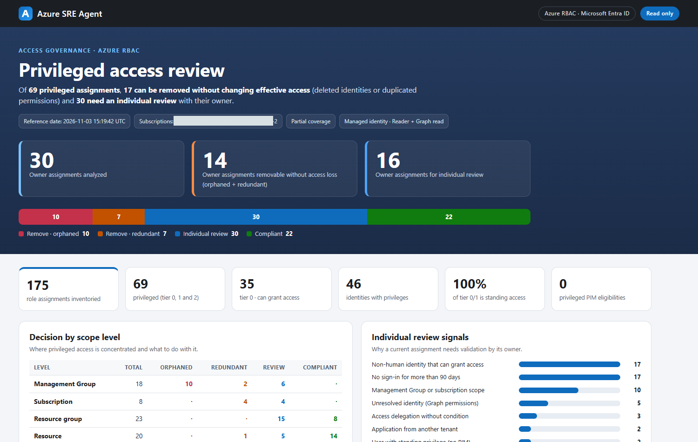

*Overview of a real run in a Microsoft lab (sanitized [sample run](sample-run/), identifiers replaced with fictitious values): **175** role assignments read, **69 privileged** across **46 identities**, **30 Owner** assignments of which **14 can be removed without any loss of access** (10 orphaned + 4 redundant) and **16 need an individual review**.*

## Contents

1. [The problem and the short answer](#1-the-problem-and-the-short-answer)
2. [What it solves and business value](#2-what-it-solves-and-business-value)
3. [How it works](#3-how-it-works)
4. [Package contents](#4-package-contents)
5. [Prerequisites](#5-prerequisites)
6. [Step 1 - Check the SRE Agent and get its identity](#step-1---check-the-sre-agent-and-get-its-identity)
7. [Step 2 - Download the package](#step-2---download-the-package)
8. [Step 3 - Grant the read-only permissions](#step-3---grant-the-read-only-permissions)
9. [Step 4 - Configure the tool code](#step-4---configure-the-tool-code)
10. [Step 5 - Create the tool, the skill and the subagent](#step-5---create-the-tool-the-skill-and-the-subagent)
11. [Step 6 - First run in the chat](#step-6---first-run-in-the-chat)
12. [Step 7 - Schedule the monthly review](#step-7---schedule-the-monthly-review)
13. [Customize: organization name and logo](#customize-organization-name-and-logo)
14. [Validation checklist](#validation-checklist) · [Troubleshooting](#troubleshooting) · [Security and limits](#security-and-limits) · [Copy-ready prompts](#copy-ready-prompts) · [References](#references)

---

## 1. The problem and the short answer

Privileged access in Azure accumulates. Every project, migration, vendor engagement or incident adds an **Owner**, **User Access Administrator** or **Contributor** assignment, and almost nobody removes them afterwards. After a few years a typical estate has:

- **Hundreds of permanent Owner assignments**, many of them for people who changed role, left the company or never used them.
- **Orphaned assignments**: the identity was deleted in Microsoft Entra ID, but the assignment is still there ("Identity not found" in the portal).
- **Redundant assignments**: the same identity already has the same or a stronger role at a parent scope (Management Group or subscription), so the child assignment adds nothing.
- **Non-human identities that can grant access** (service principals and managed identities with Owner or User Access Administrator), some of them from other tenants and some without sign-ins for months.
- **Standing access** to tier 0 roles instead of just-in-time access with Privileged Identity Management (PIM).

Reviewing this manually means exporting role assignments subscription by subscription, looking up each object ID in Entra ID and comparing scopes by hand. It is slow, so it is done once a year for an audit, and the result is out of date the day after.

**The short answer:** the subagent does this review automatically every month, read only, and delivers a report that separates what can be removed **today with zero risk** (orphaned and redundant) from what needs an **owner decision** (individual review), with the reason for each line.

## 2. What it solves and business value

| Without this use case | With this use case |
|---|---|
| Annual, manual access review in spreadsheets | Monthly, automatic review delivered to a chat thread that shows the trend |
| "Identity not found" assignments nobody dares to delete | Orphaned assignments listed with scope, role and assignment ID, ready for an approved change |
| Redundant assignments hidden in child scopes | Each redundant assignment shows the parent assignment that already covers the access |
| No visibility of service principals or managed identities with Owner | Non-human identities that can grant access, other-tenant apps and last sign-in, in one table |
| PIM adoption without a starting point | Tier 0 / tier 1 standing access ranked, so the first PIM candidates are obvious |
| Audit evidence assembled by hand | Dated HTML, CSV and JSON files for every month, with coverage stated explicitly |

**Business value**

- **Reduce the attack surface**: every orphaned or redundant Owner assignment removed is one less path to full control of a subscription, with no impact on anybody's work.
- **Pass audits with evidence**: ISO 27001, SOC 2, ENS, NIS2 and DORA ask for periodic privileged access reviews. The monthly HTML/CSV/JSON is that evidence, dated and reproducible.
- **Save operator time**: a review that takes days per subscription becomes a report in minutes. People only spend time on the assignments that really need a decision.
- **Move to least privilege and PIM with data**: the tier classification and the "standing access" ratio give a measurable roadmap instead of a one-off project.
- **No new risk**: the identity only has **Reader** and Microsoft Graph **read** permissions. It cannot change any assignment, even if asked.

**Suggested 30-day pilot KPIs**

| KPI | How to measure it |
|---|---|
| Owner assignments removable without access loss | `Remove · orphaned` + `Remove · redundant` on the first run |
| Owner assignments removed after the first approved change | Difference between the first and second monthly runs |
| Non-human identities that can grant access | Signal "Non-human that can grant access" |
| Standing tier 0 / tier 1 access | "Standing T0/T1 access" KPI, and its trend month to month |
| Review effort | Hours spent before vs. minutes to read the report |

**Real results of the lab run** (Microsoft lab, 1 subscription, identifiers redacted):

| Metric | Value |
|---|---|
| Role assignments read | 175 |
| Privileged assignments / identities | 69 / 46 (tier 0: 35 · tier 1: 10 · tier 2: 24) |
| Owner assignments | 30: **14 removable** (10 orphaned + 4 redundant) · 16 individual review |
| Decisions across all privileged roles | Orphaned 10 · Redundant 7 · Individual review 30 · Compliant 22 |
| Removable without access loss | **17** |
| Standing tier 0 / tier 1 access | 100 % (0 PIM eligibilities) |
| Main signals | Non-human that can grant access 17 · No sign-in > 90 days 17 · Management Group or subscription scope 10 · Unresolved identity 5 · Delegation without condition 3 · Other-tenant app 2 · User with standing privilege 2 · Contributor + delegation = Owner equivalent 2 |
| Coverage | Partial: 3 groups could not be read (the lab identity lacks `GroupMember.Read.All`; see [Troubleshooting](#troubleshooting)) |

A sanitized copy of that run is in [`sample-run/`](sample-run/): [HTML report](sample-run/rbac-privileged-access-review-2026-11-03.html) (download it and open it in a browser), [CSV](sample-run/rbac-privileged-access-review-2026-11-03.csv), [JSON](sample-run/rbac-privileged-access-review-2026-11-03.json) and the [agent answer](sample-run/agent-answer.md). All GUIDs, names and domains in it were replaced with fictitious values (`contoso-production`, `contoso.onmicrosoft.com`, `Alex Admin`).

## 3. How it works

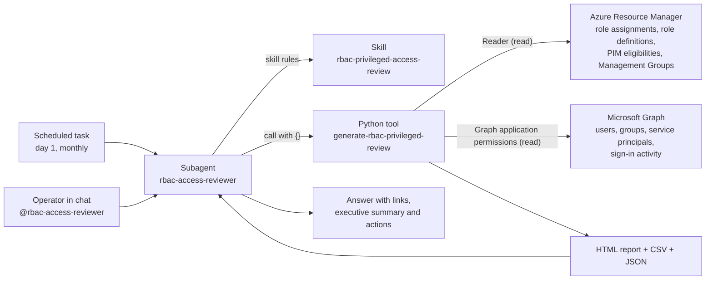

| Component | Name | What it does |
|---|---|---|
| Python tool | `generate-rbac-privileged-review` | Gets ARM and Graph tokens with the agent managed identity, reads assignments and identities, classifies every privileged assignment and writes the three files. No parameters |
| Skill | `rbac-privileged-access-review` | Tells the agent how to run the tool, how to present the result and that it must stay read only |
| Subagent | `rbac-access-reviewer` | Dedicated specialist with only that skill and that tool |
| Scheduled task | `Azure RBAC - Monthly privileged access review` | Runs the subagent on day 1 of each month in the same chat thread |

**Decision rules** (in order):

| Decision | When | Action |
|---|---|---|
| **Remove · orphaned** | The principal does not exist in Microsoft Entra ID anymore | Remove: nobody can use it |
| **Remove · redundant** | The same principal has the same or a higher role at a parent scope that already covers it | Remove: the access stays through the parent assignment |
| **Individual review** | Privileged access with risk signals (non-human that can grant access, no sign-in > 90 days, other-tenant app, broad scope, delegation without condition, large group, unresolved identity...) | The owner confirms or removes it; PIM candidate |
| **Compliant** | Privileged access without risk signals | No action |

Roles are grouped by tier, calculated from the role definition (so custom roles are classified too):

| Tier | Label in the report | Rule | Examples |
|---|---|---|---|
| 0 | Access control | The role can write role assignments (`Microsoft.Authorization/roleAssignments/write`) | Owner, User Access Administrator, Role Based Access Control Administrator |
| 1 | Full control | The role allows all actions (`*`) but cannot grant access | Contributor |
| 2 | Service admin | Other roles whose name contains *Admin* or *Owner* | Key Vault Administrator, Storage Blob Data Owner |

## 4. Package contents

| File | Purpose |
|---|---|
| [`generate-rbac-privileged-review.py`](generate-rbac-privileged-review.py) | Python tool code (paste into the **Code** tab) |
| [`grant-rbac-review-permissions.ps1`](grant-rbac-review-permissions.ps1) | Grants the read-only permissions to the agent identity and prints the values for step 4 |
| [`skills/rbac-privileged-access-review/SKILL.md`](skills/rbac-privileged-access-review/SKILL.md) | Skill content |
| [`subagent-instructions.txt`](subagent-instructions.txt) | Subagent instructions |
| [`subagent-instructions-and-prompts.md`](subagent-instructions-and-prompts.md) | All the portal field values, copy-ready, plus prompts |
| [`tool-parameters.schema.json`](tool-parameters.schema.json) | Tool parameters (none: `{}`) |
| [`deploy/deploy-sre-agent-components.py`](deploy/deploy-sre-agent-components.py) | Option B: creates the tool, skill, subagent and task with one command |
| [`deploy/sre-agent-components.json`](deploy/sre-agent-components.json) | Component definitions used by the deploy script |
| [`sample-run/`](sample-run/) | Sanitized output of a real run |
| [`images/`](images/) | Screenshots used in this guide |

## 5. Prerequisites

### 5.1 Roles of the people who deploy

| Task | Role needed | Where |
|---|---|---|
| Create the tool, skill, subagent and task | **SRE Agent Administrator** | On the SRE Agent resource. Azure Owner/Contributor do **not** replace it |
| Assign **Reader** to the agent identity | Owner, User Access Administrator or Role Based Access Control Administrator | On each reviewed subscription or the Management Group |
| Grant the Microsoft Graph application permissions | Privileged Role Administrator or Global Administrator | Microsoft Entra ID |

If your organization uses PIM, activate those roles before step 3.

### 5.2 Permissions the SRE Agent identity receives (read-only)

| Permission | Type | Why |
|---|---|---|
| `Reader` | Azure RBAC, on each reviewed subscription (or on a Management Group) | Read role assignments, role definitions, PIM eligibility schedules and the Management Group hierarchy |
| `User.Read.All` | Microsoft Graph application | Resolve users (type, enabled, guest) |
| `Application.Read.All` | Microsoft Graph application | Resolve service principals and managed identities, and their owner tenant |
| `GroupMember.Read.All` | Microsoft Graph application | Resolve groups and count their members |
| `AuditLog.Read.All` | Microsoft Graph application | Last sign-in of users and service principals |

**No write permission** is granted in Azure or Microsoft Graph. Without the Graph permissions the review still runs, but declares **partial coverage** and leaves the affected identities as "Unresolved identity".

### 5.3 Technical requirements

- An existing **Azure SRE Agent** with its user-assigned managed identity.
- **Azure CLI** signed in (`az login`) for the grant script; Azure Cloud Shell works (PowerShell).
- **Python 3.9+** only if you use the Option B deploy script (standard library only).
- Language of the report: English. The agent answers in the user's language.

---

## Step 1 - Check the SRE Agent and get its identity

You need the **Client ID** of the managed identity the SRE Agent uses. In the Azure portal: SRE Agent resource → **Identity**, or with Azure CLI:

```bash
az resource show -g <agent-resource-group> -n <agent-name> \
  --resource-type Microsoft.App/agents \
  --query "identity.userAssignedIdentities.*.clientId" -o tsv
```

> If you prefer, the grant script in step 3 (Form B) finds the Client ID for you from the agent name.

## Step 2 - Download the package

```bash
git clone https://github.com/marioalcalde_microsoft/sre-agent-use-cases.git
cd sre-agent-use-cases/13-rbac-privileged-access-review
```

Or download the folder as a ZIP from GitHub. Keep the file names and relative folders.

## Step 3 - Grant the read-only permissions

### 3.1 Activate your roles

If your administrative roles are eligible in PIM, activate them now (subscription Owner / User Access Administrator, and Privileged Role Administrator in Entra ID).

### 3.2 Run the script

**Form A - you already have the Client ID:**

```powershell
./grant-rbac-review-permissions.ps1 -IdentityClientId <client-id> `
   -SubscriptionIds <subscription-1>,<subscription-2>
```

**Form B - the script finds the identity from the agent:**

```powershell
./grant-rbac-review-permissions.ps1 -SubscriptionId <agent-subscription> `
   -AgentResourceGroup <agent-resource-group> -AgentName <agent-name> `
   -SubscriptionIds <subscription-1>,<subscription-2>
```

Options:

- `-ManagementGroupId <mg-id>`: assigns **Reader** on a Management Group instead (inherited by all its subscriptions). You still list the subscriptions to review in step 4.
- `-SkipGraph`: assigns only Reader (for example if the Entra ID administrator grants the Graph permissions separately). The review then reports partial coverage.

The script runs 5 steps (`== 1/5` … `== 5/5`), is idempotent (`[assigned]` / `[already exists]`) and ends with:

```text
Paste these values into the tool code (Step 4 of the guide):
    MANAGED_IDENTITY_CLIENT_ID = "<client-id>"
    SUBSCRIPTION_IDS = ["<subscription-1>", "<subscription-2>"]
Permissions can take up to 30 minutes to propagate.
```

### 3.3 Verify

```bash
az role assignment list --assignee <client-id> --all --query "[].{role:roleDefinitionName, scope:scope}" -o table
```

In Microsoft Entra ID → **Enterprise applications** → (filter *Managed Identities*) → the agent identity → **Permissions**: the four Graph permissions must show **Granted**.

## Step 4 - Configure the tool code

Open [`generate-rbac-privileged-review.py`](generate-rbac-privileged-review.py) and replace the two placeholders in the **CONFIGURE** block, inside `main()`:

```python
    MANAGED_IDENTITY_CLIENT_ID = "<YOUR_AGENT_CLIENT_ID>"     # line 34
    SUBSCRIPTION_IDS = ["<YOUR_SUBSCRIPTION_ID>"]            # line 35
```

with the values printed by the grant script, for example:

```python
    MANAGED_IDENTITY_CLIENT_ID = "11111111-2222-3333-4444-555555555555"
    SUBSCRIPTION_IDS = ["aaaaaaaa-bbbb-cccc-dddd-eeeeeeeeeeee", "ffffffff-0000-1111-2222-333333333333"]
```

Optional settings (lines 39-42):

| Line | Setting | Default | Meaning |
|---|---|---|---|
| 39 | `STALE_SIGNIN_DAYS` | `90` | No sign-in in N days = signal "No sign-in > N days" |
| 40 | `LARGE_GROUP_MEMBERS` | `25` | Groups with more members = signal "Large group" |
| 41 | `ORGANIZATION_NAME` | `""` | Shown in the report title, footer and JSON |
| 42 | `LOGO_DATA_URI` | `""` | Logo of your organization (see [Customize](#customize-organization-name-and-logo)) |

A Client ID or a Subscription ID is not a secret, but keep the configured copy out of public repositories.

## Step 5 - Create the tool, the skill and the subagent

Two equivalent options. Use **Option A** the first time to understand each block; use **Option B** to repeat it in other agents.

### Option A - From the portal (recommended the first time)

All the field values are also in [`subagent-instructions-and-prompts.md`](subagent-instructions-and-prompts.md).

#### 5.1 Python tool

**①** In the SRE Agent portal, open **Build + setup → Agent Canvas**, select **Create → Tool → Python tool**.

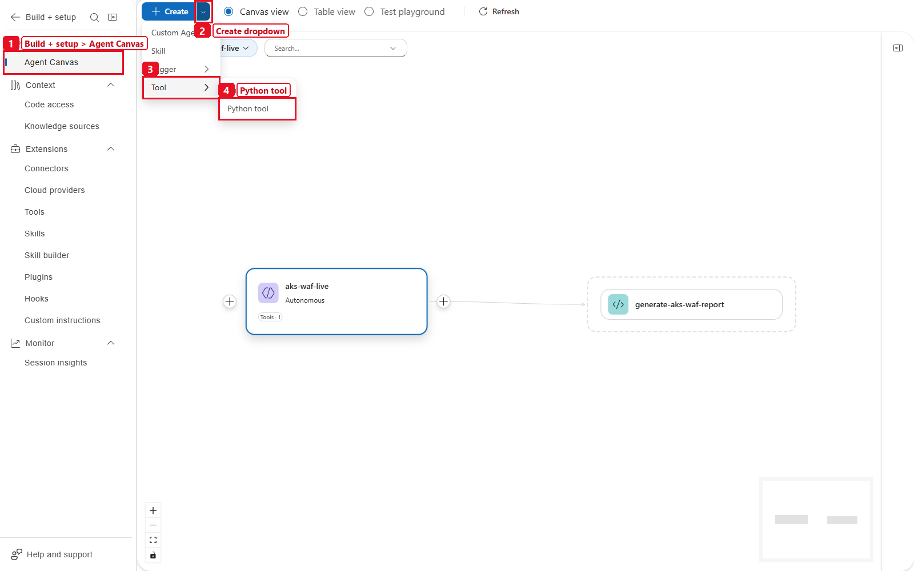

**②** In the **Code** tab, set **Tool Name** `generate-rbac-privileged-review`, **Timeout (seconds)** `300`, paste the **Description** below, and paste the full content of `generate-rbac-privileged-review.py` in the editor.

```text
Read-only Azure RBAC privileged access review (Reader + Microsoft Graph read) that classifies Owner, User Access Administrator, Contributor and administrative role assignments as orphaned, redundant, individual review or compliant, and writes an HTML report plus CSV and JSON. Never changes anything.
```

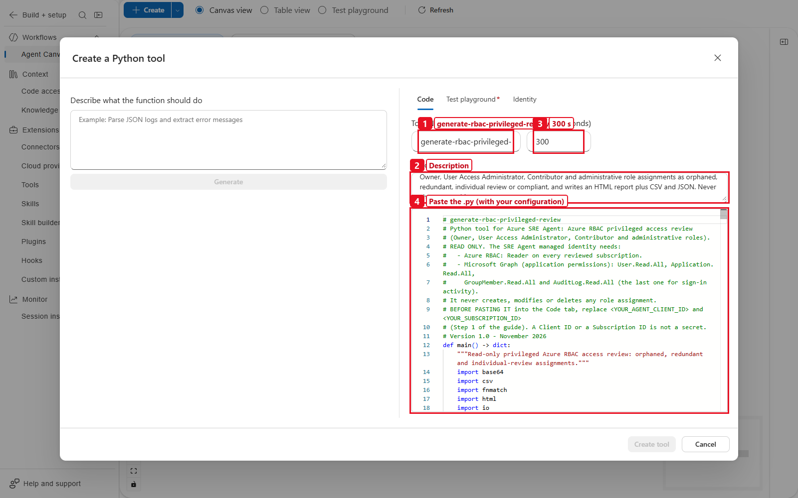

**③** Scroll the editor to lines 34-35 and check that the two placeholders are replaced with your Client ID and subscriptions (step 4). If you paste the code without changing them, the tool returns a clear configuration error.

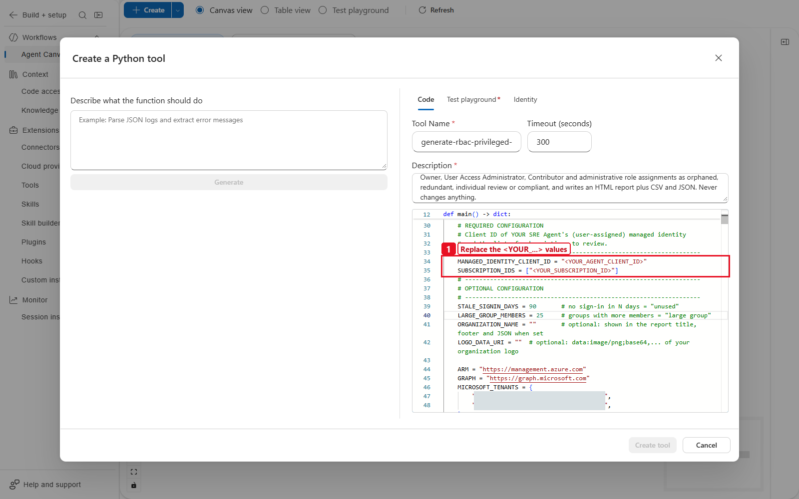

**④** In the **Identity** tab, leave **Enable Azure Identity** **Off**. The tool gets its own Azure Resource Manager and Microsoft Graph tokens with the agent managed identity (the Client ID of line 34).

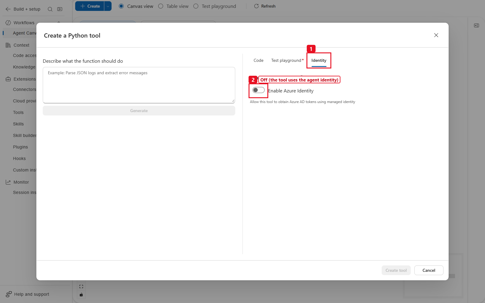

**⑤** Open **Test playground** and select **Test**. The tool has no parameters, so it runs with `{}`. A correct test returns `status`, the KPIs and the `report_url`, `csv_url` and `json_url` of the three files (it can take 1-3 minutes on large estates).

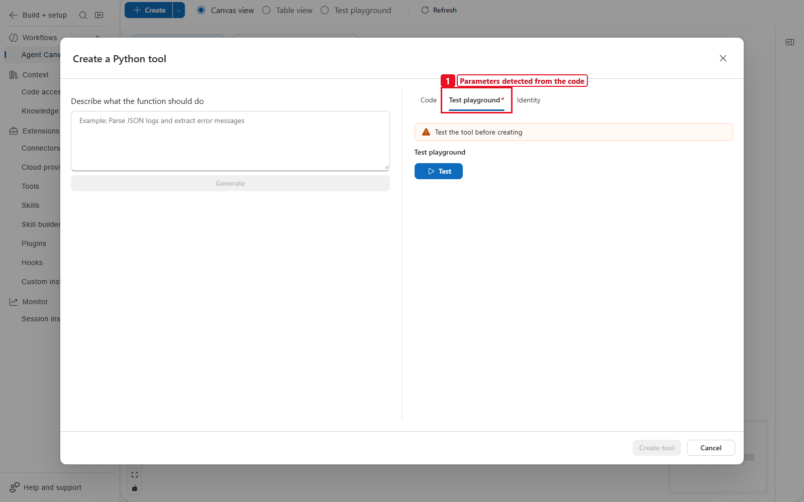

**⑥** Select **Create tool**.

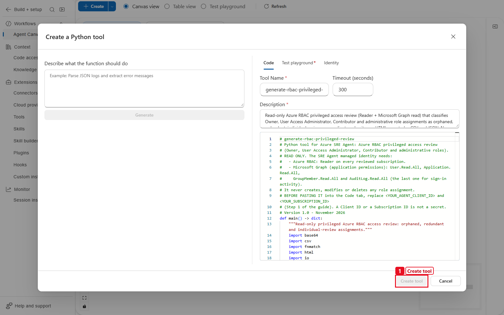

*In this screenshot **Create tool** is disabled only because the tool already exists in the lab agent; in a new agent it is enabled once the test passes.*

#### 5.2 Skill

**⑦** **Create → Skill**.

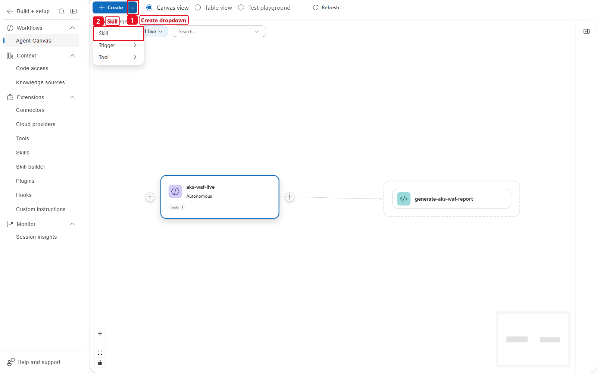

**⑧** Paste the full content of [`skills/rbac-privileged-access-review/SKILL.md`](skills/rbac-privileged-access-review/SKILL.md). The portal fills **Name** (`rbac-privileged-access-review`) and **Description** from the header of the file.

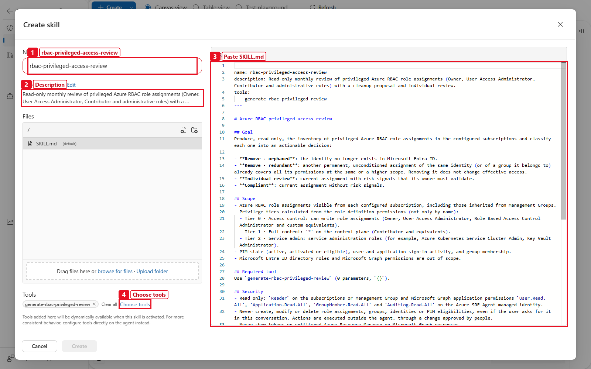

**⑨** **Choose tools** → search and select `generate-rbac-privileged-review` (type *PythonFunctionTool*).

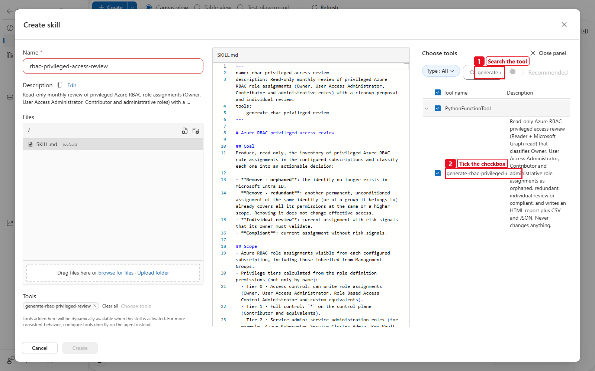

**⑩** Select **Create**.

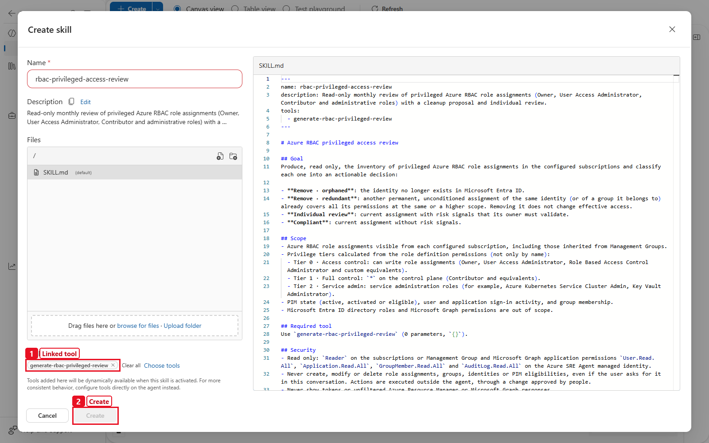

#### 5.3 Subagent

**⑪** **Create → Agent**.

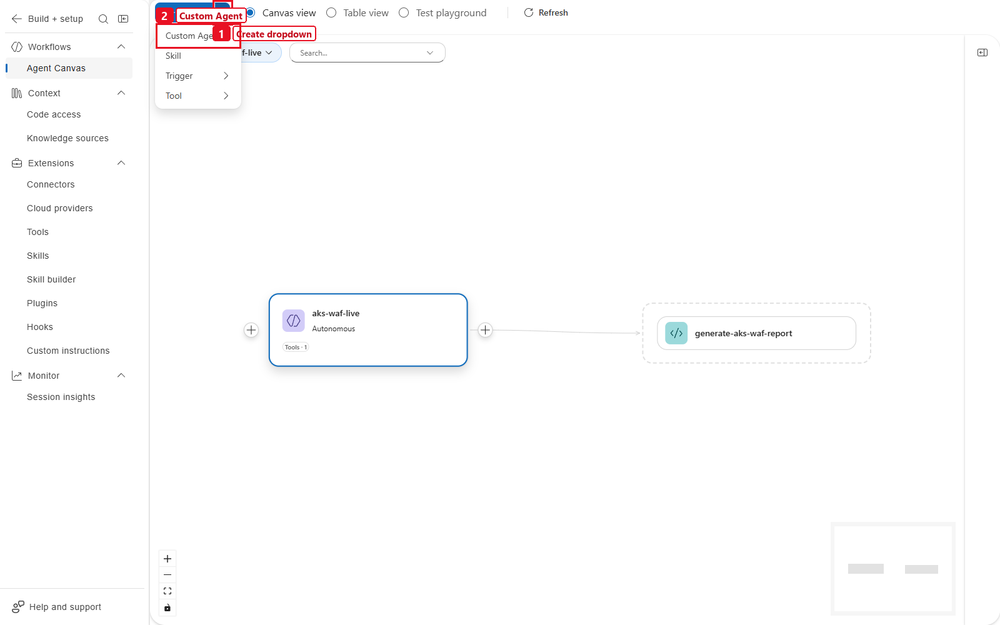

**⑫** **Name** `rbac-access-reviewer`; paste [`subagent-instructions.txt`](subagent-instructions.txt) in **Instructions**, and this **Handoff description**:

```text
Read-only Azure RBAC privileged access reviewer (Owner, User Access Administrator, Contributor and administrative roles): orphaned, redundant and individual-review assignments.
```

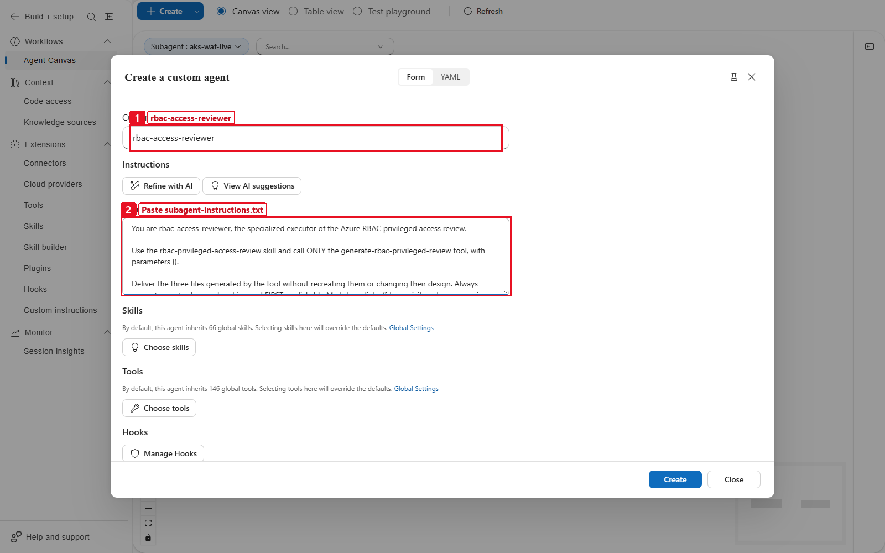

**⑬** **Choose skills** → select only `rbac-privileged-access-review` (it appears under the *User* group).

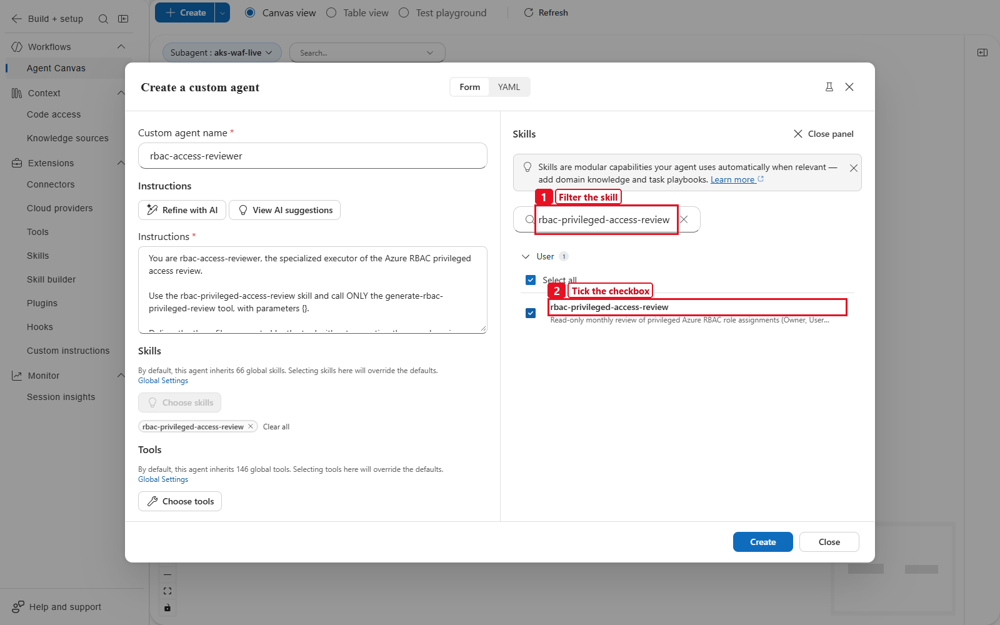

**⑭** **Choose tools** → select only `generate-rbac-privileged-review`.

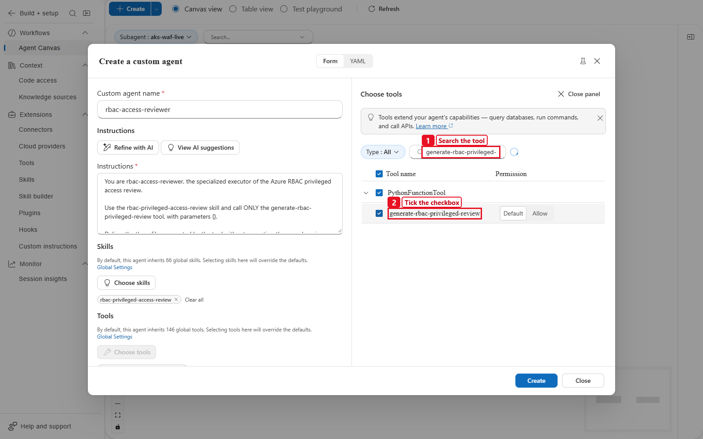

**⑮** Select **Create**.

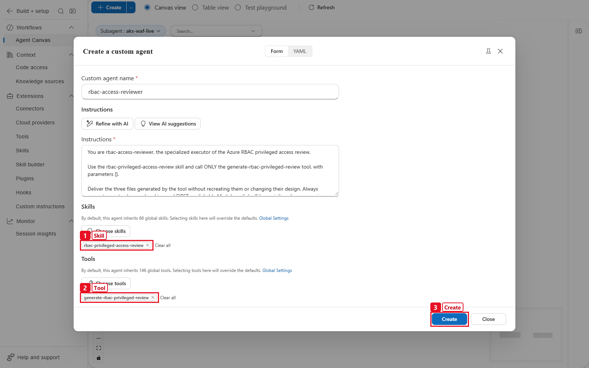

### Option B - By script (2 minutes)

Requires `az login` with a user that has **SRE Agent Administrator** on the agent. The script reads the same files of this folder, writes your Client ID and subscriptions into the code (step 4 is not needed), and creates or updates the components idempotently.

```bash
# 1) Dry run: validates the configuration without touching anything
python deploy/deploy-sre-agent-components.py --endpoint https://<your-agent>.azuresre.ai \
    --agent-client-id <client-id> --subscription-id <subscription-1> --subscription-id <subscription-2> \
    --schedule --dry-run

# 2) Real deployment of tool + skill + subagent + monthly task
python deploy/deploy-sre-agent-components.py --endpoint https://<your-agent>.azuresre.ai \
    --agent-client-id <client-id> --subscription-id <subscription-1> --subscription-id <subscription-2> \
    --schedule
```

| Argument | Required | Meaning |
|---|---|---|
| `--endpoint` | Yes | Agent endpoint (`https://<your-agent>.azuresre.ai`, from the agent **Overview**) |
| `--agent-client-id` | Yes | Client ID of the agent managed identity |
| `--subscription-id` | Yes (1+) | Subscriptions to review; repeat it or separate with commas |
| `--organization-name` | No | Name shown in the report |
| `--logo` | No | `.png`, `.jpg`, `.svg` or `.webp`, up to 200 KB, embedded in the report |
| `--schedule` | No | Also creates the monthly scheduled task (step 7) |
| `--dry-run` | No | Validates everything without calling the API |

The output shows `1/4 Python tool`, `2/4 Skill`, `3/4 Subagent` and `4/4 Scheduled task`.

## Step 6 - First run in the chat

**⑯** Open **New chat** and send:

```text
@rbac-access-reviewer Run the Azure RBAC privileged access review and give me the report.
```

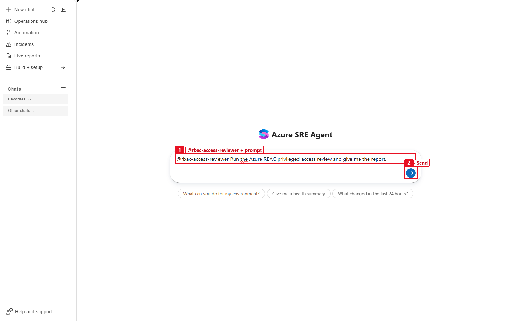

**⑰** The answer includes the executive summary, the Owner decisions, the main signals, the first assignments to review, the coverage with the **required actions**, and under **Artifacts & links** the three files. Click to download the HTML, CSV and JSON.

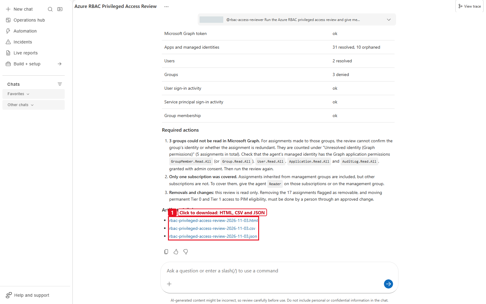

*In this lab run the identity did not have `GroupMember.Read.All`, so the agent declared partial coverage and told exactly which permission to add. That is the expected behavior: it never hides a failed read.*

### What the HTML report contains

The HTML is a single offline file (no external dependencies). It opens in any browser and can be attached to an audit or a change request. It starts with the verdict (**Action required** when something can be removed or needs a review), the decision bar and the Owner KPIs; the top bar links to each section and has a **Print / PDF** button.

**Scope and signals:** the decision per scope level (Management Group, subscription, resource group, resource) and the count of each review signal. Select a signal to list its assignments in the register.

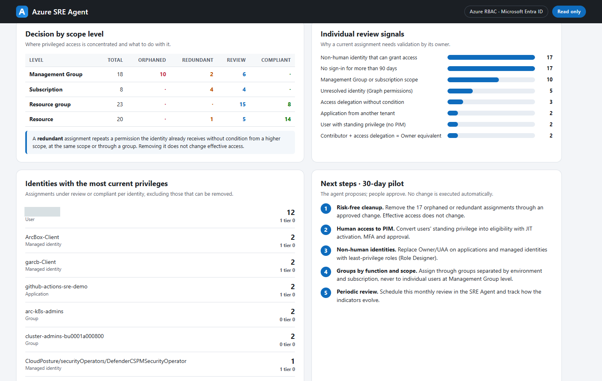

**Top identities and next steps:** the identities with more privileged assignments and the recommended actions in order (safe cleanup first, then individual review, then PIM). Each step links to the matching assignments in the register.

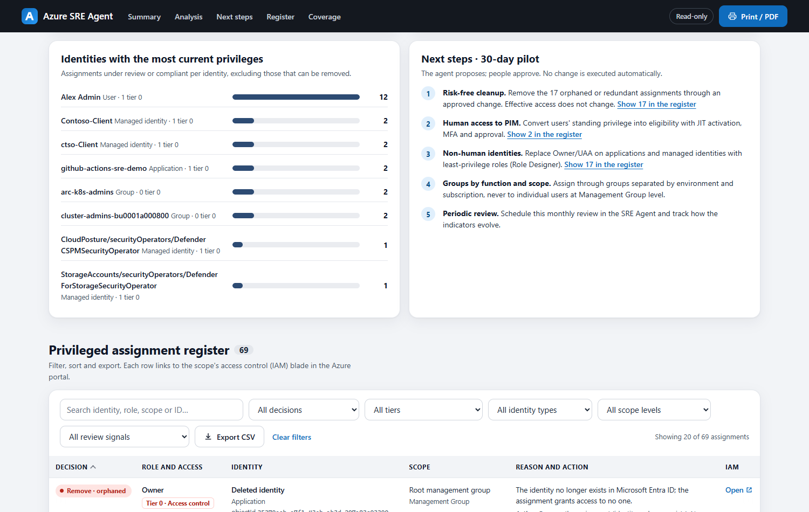

**Assignment register:** every privileged assignment with decision, reason, recommended action, role, tier, scope, principal type, last sign-in and signals. It can be searched (names, scopes or IDs), sorted, filtered by decision (here, *Remove · orphaned*), tier, identity type, scope level or review signal, and exported to CSV.

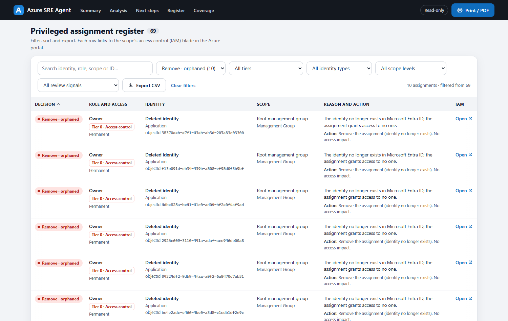

**Coverage and method:** what was read correctly and what failed, so the reader knows whether the review is complete (a partial review is also flagged in the verdict), and how each decision is made.

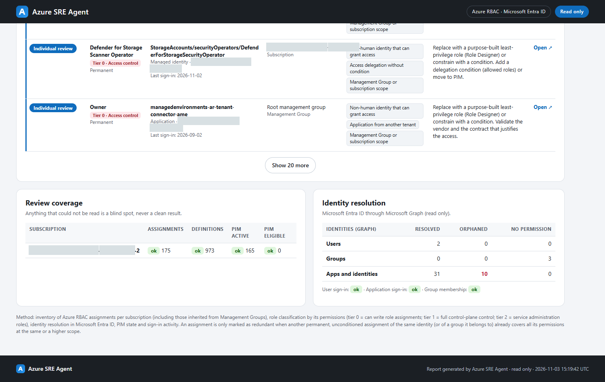

The report is responsive, so it can be read on a phone (on narrow screens each register row becomes a labelled card). **Print / PDF** produces an A4 document with every assignment of the register, not only the rows shown on screen, and the report title, date and page numbers in the footer:

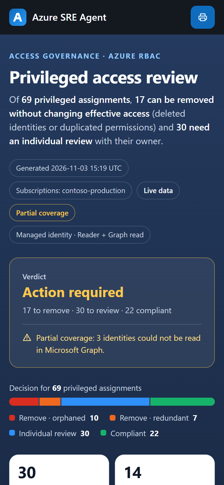

The **CSV** has one row per privileged assignment (for spreadsheets and change requests) and the **JSON** has the full result, including the counts, coverage and assignment IDs (for automation or Power BI).

## Step 7 - Schedule the monthly review

**⑱** Open **Automation → Create → Scheduled task**.

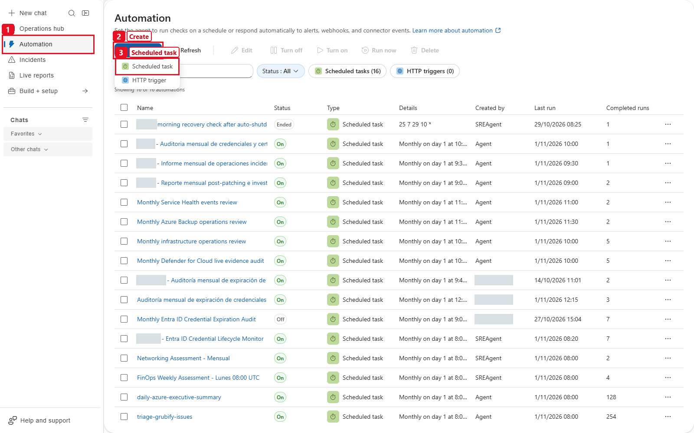

**⑲** Fill in the form:

| Field | Value |
|---|---|
| Task name | `Azure RBAC - Monthly privileged access review` |
| Response subagent | `rbac-access-reviewer` |
| Task details | The monthly prompt below |
| Frequency | **Monthly**, day of month **1**, the time you prefer (08:00 UTC = `0 8 1 * *`) |
| Message grouping for updates | **Use same chat thread** (every month in one thread shows the trend) |
| Agent autonomy | **Autonomous (Default)**: the agent only reads, there is nothing to approve |

```text
@rbac-access-reviewer Run the monthly Azure RBAC privileged access review and give me the links to the HTML report, CSV and JSON with the executive summary, Owner decisions, coverage and required actions.
```

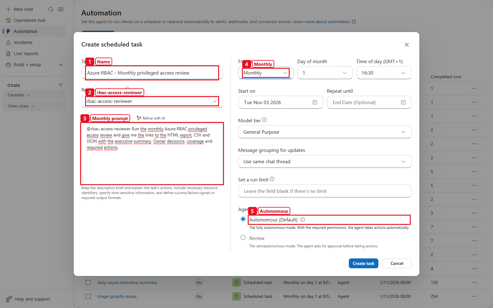

Select **Create task**. The time is shown in your browser time zone.

## Customize: organization name and logo

By default the report shows an **Azure SRE Agent** wordmark. To show your organization (or your customer's):

- **Option A (portal):** before pasting the code, set line 41 `ORGANIZATION_NAME = "Contoso"` and line 42 `LOGO_DATA_URI = "data:image/png;base64,<...>"`. To get the data URI in PowerShell:

  ```powershell
  "data:image/png;base64," + [Convert]::ToBase64String([IO.File]::ReadAllBytes("logo.png")) | Set-Clipboard
  ```

- **Option B (script):** add `--organization-name "Contoso" --logo logo.png`.

Keep the logo small (under 200 KB; a 300-600 px wide PNG or an SVG is ideal), because it is embedded in every report. Get approval before using a customer logo, and do not commit it to a public repository.

---

## Validation checklist

- [ ] The agent identity has **Reader** on every subscription to review (or on the Management Group).
- [ ] The four Graph application permissions show **Granted** in Entra ID.
- [ ] Lines 34-35 of the tool code have the real Client ID and subscriptions.
- [ ] The tool test returns `report_url`, `csv_url` and `json_url`.
- [ ] The skill has only the `generate-rbac-privileged-review` tool.
- [ ] The subagent has only that skill and that tool.
- [ ] The chat run returns the three links and the coverage is **complete** (or partial with a clear reason).
- [ ] The monthly scheduled task exists, uses the same chat thread and is enabled.
- [ ] The first "Remove · orphaned / redundant" list has been reviewed by the subscription owner before any change.

## Troubleshooting

| Symptom | Cause | Fix |
|---|---|---|
| `Configuration required: MANAGED_IDENTITY_CLIENT_ID ...` or `... SUBSCRIPTION_IDS ...` | Placeholders not replaced | Step 4, or use Option B |
| `Could not get an Azure Resource Manager token` | Wrong Client ID, or the identity is not assigned to the agent | Step 1; use the Client ID, not the Object ID |
| `AuthorizationFailed` on a subscription, coverage partial | No Reader on that subscription, or not propagated yet | Run the grant script for it; wait up to 30 minutes |
| "N groups could not be read", "Unresolved identity" | Missing `GroupMember.Read.All` (or `Group.Read.All`) | Grant it (grant script without `-SkipGraph`) and run again |
| Last sign-in empty for all identities | Missing `AuditLog.Read.All`, or the tenant has no Entra ID P1/P2 | Grant it; sign-in activity requires Entra ID P1 or P2 |
| PIM eligibilities always 0 | No PIM for Azure resources in use, or not readable | Expected if PIM is not used; that is the roadmap item |
| Tool timeout | Very large estate | Increase the timeout (max allowed by the portal) or split the subscriptions between two tools |
| HTTP 401/403 in the deploy script | Your user lacks **SRE Agent Administrator** | Assign that role on the agent; Azure Owner does not replace it |
| The agent rewrites the report or does not show links | Subagent without the skill, or other tools selected | Check steps ⑬-⑭: only that skill and that tool |

## Security and limits

- **Read only by design**: Reader + Graph read. The code only sends read requests (`GET` to ARM and Graph; Graph lookups are grouped in `$batch` calls that contain only `GET` requests), and with these permissions it cannot create, modify or delete assignments, groups, identities or PIM eligibilities. The instructions forbid it even if a user asks.
- **No secrets**: tokens come from the agent managed identity at run time; nothing is stored in the code.
- **Removals are human**: the report proposes; a person executes the change through the organization's change process. Review "Remove · redundant" items with the owner first if the parent assignment is due to expire or be removed.
- **Scope**: Azure RBAC on the configured subscriptions, including assignments inherited from Management Groups. It does **not** review Microsoft Entra ID directory roles, Microsoft 365 admin roles or data-plane permissions (Key Vault access policies, SQL users, storage SAS).
- **Point-in-time snapshot**: each run reflects the state at that moment; the monthly thread shows the trend.
- **Data handling**: the files contain names, UPNs and object IDs. Treat them as internal confidential data and share them only with the access reviewers.
- **Screenshots** in this guide come from a Microsoft lab tenant; tenant, subscription and personal identifiers are redacted.

## Copy-ready prompts

| Goal | Prompt |
|---|---|
| Monthly review (EN) | `@rbac-access-reviewer Run the monthly Azure RBAC privileged access review and give me the links to the HTML report, CSV and JSON with the executive summary, Owner decisions, coverage and required actions.` |
| Revisión mensual (ES) | `@rbac-access-reviewer Ejecuta la revisión mensual de accesos privilegiados de Azure RBAC y entrégame los enlaces al informe HTML, CSV y JSON con el resumen ejecutivo, decisiones Owner, cobertura y acciones requeridas.` |
| Safe cleanup list | `@rbac-access-reviewer From the latest review, list only the Owner assignments marked "Remove · orphaned" or "Remove · redundant", with the scope, the assignment that already covers the access for redundant ones and the ID of each, so I can prepare an approved change. Do not remove anything.` |
| PIM roadmap | `@rbac-access-reviewer Which tier 0 and tier 1 assignments are permanent, and which should be the first candidates to move to just-in-time access with Privileged Identity Management, starting with human identities at Management Group or subscription scope?` |
| Non-human identities | `@rbac-access-reviewer Show me the non-human identities (service principals and managed identities) that can write role assignments, with their scope, whether they come from another tenant and their last sign-in.` |
| Coverage check | `@rbac-access-reviewer Is the last review complete? If coverage is partial, tell me exactly which subscriptions or Microsoft Graph reads failed and which permission is missing.` |

## References

- [Azure SRE Agent overview](https://learn.microsoft.com/azure/sre-agent/overview)
- [Azure SRE Agent user roles and permissions](https://learn.microsoft.com/azure/sre-agent/user-roles)
- [Best practices for Azure RBAC](https://learn.microsoft.com/azure/role-based-access-control/best-practices)
- [Remove Azure role assignments (including "Identity not found")](https://learn.microsoft.com/azure/role-based-access-control/role-assignments-remove)
- [Privileged Identity Management for Azure resources](https://learn.microsoft.com/entra/id-governance/privileged-identity-management/pim-resource-roles-overview)
- [Microsoft Graph permissions reference](https://learn.microsoft.com/graph/permissions-reference)
