# Case 14 - Daily relevant Azure changes digest

> **Azure SRE Agent** · Read-only Python tool · Runtime skill · Restricted subagent · Daily task (`0 18 * * *`) & on-demand (`last_24h`, `last_7d`, `last_14d`) · Change Analysis in Azure Resource Graph + Activity Log (Reader only) · Zero secrets · Offline HTML, JSON and two CSVs

**"What changed in Azure today that actually matters, who did it, and how?"** Every customer environment records hundreds of resource changes a day, and most of them are platform noise: provisioning states, agent inventory uploads, autoscale, VM power cycles, timestamps. The few changes that matter get lost in that noise: a rule opened to the Internet, a Key Vault firewall relaxed, a resource deleted, monitoring removed, a lock taken off.

A restricted SRE Agent subagent reads **Change Analysis in Azure Resource Graph** every evening. It filters the platform noise with explainable rules and scores what is left as **high**, **medium** or **low**. It adds what Change Analysis cannot see: new role assignments, locks, diagnostic settings, policy assignments and the real caller of deletes. Then it delivers a short digest with **who, when, how (portal, CLI, IaC, SDK, Azure service) and the old → new value of every property**.

The agent **never changes anything**. It tells you what changed; a person decides what to do.

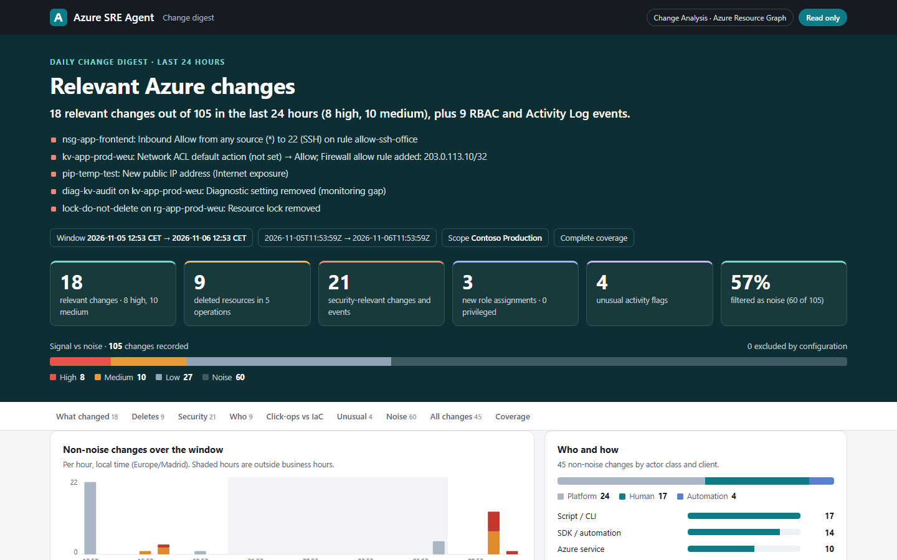

*Overview of a real run in a Microsoft lab (names and identifiers pseudonymized): **105 changes** recorded in 24 hours, **60 filtered as noise (57 %)**, **18 relevant** (8 high, 10 medium), plus **9 role-assignment and Activity Log events**. The top highlights read like a security briefing: SSH opened to any source, a Key Vault network rule relaxed, a public IP created, a diagnostic setting and a resource lock removed.*

## Contents

1. [The problem and the short answer](#1-the-problem-and-the-short-answer)
2. [What it solves and business value](#2-what-it-solves-and-business-value)
3. [How it works](#3-how-it-works)
4. [Package contents](#4-package-contents)
5. [Prerequisites](#5-prerequisites)
6. [Step 1 - Get the SRE Agent identity](#step-1---get-the-sre-agent-identity)
7. [Step 2 - Grant Reader](#step-2---grant-reader)
8. [Step 3 - Configure the tool code](#step-3---configure-the-tool-code)
9. [Step 4 - Create the tool, the skill and the subagent](#step-4---create-the-tool-the-skill-and-the-subagent)
10. [Step 5 - First run in the chat](#step-5---first-run-in-the-chat)
11. [Step 6 - Read the report](#step-6---read-the-report)
12. [Step 7 - Schedule the daily digest](#step-7---schedule-the-daily-digest)
13. [How changes are classified](#how-changes-are-classified)
14. [Validation checklist](#validation-checklist) · [Troubleshooting](#troubleshooting) · [Security and limits](#security-and-limits) · [Copy-ready prompts](#copy-ready-prompts) · [References](#references)

---

## 1. The problem and the short answer

Azure keeps a 14-day history of every control-plane change in Azure Resource Graph (`resourcechanges` and `resourcecontainerchanges`). It is the first place to look when something breaks ("what changed?"). In practice, teams only open it **during** an incident, because reading it every day is not realistic:

- **Volume.** Even a quiet single-subscription lab records about **100 changes a day and more than 1,000 in 14 days**. A production estate records many more.
- **Noise.** In the lab, **57 % to 69 %** of the changes are pure platform metadata: `provisioningState`, `lastInventoryUploadTime`, Defender status timestamps, VM power-state enrichment, AKS node churn, autoscale capacity.
- **Missing context.** Raw rows show a property path and two values. They do not say whether the change exposed something to the Internet, whether a person or the platform made it, or whether it happened at 03:00 on a Sunday.
- **Blind spots.** Role assignments, resource locks, diagnostic settings and policy assignments are **not** in `resourcechanges`, and deletes are sometimes recorded with no actor (`System`).

**The short answer:** the subagent runs every evening, turns the raw history into a short, ranked list of the changes that matter, explains each one in plain language with the evidence, and proves what it filtered out and why.

## 2. What it solves and business value

| Without this use case | With this use case |
|---|---|
| Change history only consulted after an incident | A proactive digest every evening, in the same chat thread, with a one-line verdict |
| Hundreds of raw rows a day, mostly noise | Noise counted by reason and hidden: **18 relevant of 105** in the sample day |
| "Who opened this port?" answered by digging through the Activity Log | Each change shows the actor, the client (portal, CLI, IaC, SDK, Azure service), the operation and the correlation ID |
| Property diffs in raw JSON | Readable old → new diffs, highlighted, per property |
| Role assignments, locks and diagnostic settings invisible in Change Analysis | Added from `authorizationresources` and the Activity Log, in the same report |
| Manual changes in production go unnoticed | Portal changes by people in resource groups tagged as production are flagged |
| Unusual activity found by chance | After-hours, first-time actor on a resource group and burst flags, all explainable |

**Business value**

- **Shorter incidents.** The first question in any incident is "what changed?". The last digest answers it in seconds, with the diff. For more detail, one chat question returns the last 7 or 14 days of a single resource group.
- **Security exposure caught the same day.** The high level is designed around the changes a security team must know about before the next morning:
  - NSG rules opened to the Internet;
  - public network access enabled;
  - Key Vault or storage firewalls relaxed;
  - public IPs created;
  - monitoring or locks removed.
- **Accountability without blame.** Every item quotes the evidence (`changedByType`, `clientType`, `operation`, `correlationId`), so the conversation is about the change, not the person. Changes by platform or governance automation are attributed to that automation, not to the user who last touched the resource.
- **Governance and drift.** Portal changes by people in production, changes outside business hours and first-time actors are early signals of drift from Infrastructure as Code.
- **Audit evidence.** A dated HTML report, JSON snapshot and two CSVs per day, with coverage stated explicitly, support change-management controls (ISO 27001 A.8.32, SOC 2 CC8.1, NIS2, DORA).
- **No new risk.** The identity only needs **Reader**. It cannot change, revert or delete anything, even if asked.

**Suggested 30-day pilot KPIs**

| KPI | How to measure it |
|---|---|
| Daily noise reduction | `noise_filtered_pct` in the snapshot (target: more than half of the rows never need reading) |
| High-level changes reviewed the same day | High items in the digest vs. items acknowledged by the team |
| Exposure changes detected | `security` count and the *Internet-exposed* / *Exposure increased* flags |
| Portal changes by people in production | *Click-ops in production* flag, and its trend week to week |
| Time to answer "what changed?" in incidents | Minutes before vs. after (one chat question with `operation=query`) |

**Real results of the lab run** (Microsoft lab, 1 subscription, names and identifiers pseudonymized):

| Metric | Last 24 hours | Last 7 days | Last 14 days |
|---|---|---|---|
| Changes recorded | 105 | 547 | 1,087 |
| Filtered as noise | 60 (57 %) | 69 % | 68 % |
| High / medium | 8 / 10 | 9 / 10 | 27 / 32 |
| Run time (local, read-only) | 23 s | 24 s | 24 s |

The 24-hour window included a set of **intentional changes**. They were made in a demo resource group tagged `environment=prod`, to show what the digest catches, and all of them were detected:

| Intentional change | Level in the digest |
|---|---|
| NSG rule added: inbound Allow from Internet to 3389 (RDP) | **High** · Internet-exposed |
| NSG rule `allow-ssh-office` widened from `198.51.100.0/24` to `*` on port 22 | **High** · Internet-exposed, with the old → new diff |
| Key Vault firewall: allow rule added for `203.0.113.10/32` | **High** · Exposure increased |
| Public IP created, then deleted 7 minutes later | **High** when created (new Internet exposure) and **High** when deleted (deleted by a person). Change Analysis recorded the delete as `System`; the caller was recovered from the Activity Log |
| Diagnostic setting created on the Key Vault, then removed | Medium when created · **High** when removed (monitoring gap) |
| `CanNotDelete` lock created on the resource group, then removed | Medium when created · **High** when removed |
| Managed disk resized 4 → 8 GB and moved from Standard_LRS to Premium_LRS | Medium · size / SKU change |
| Reader role assignment on the resource group for a managed identity | Medium · new role assignment (not privileged) |

Two results show why the evidence matters:

- **About 50 minutes later, the tenant's governance automation removed the RDP rule.** The digest reports that change as high and attributes it to that automation identity (PowerShell client, first time on that resource group), not to the user who created the rule.
- **Two storage changes never happened.** Azure Policy rewrote the requests (public network access and shared key access), so the properties never changed and Change Analysis has no record of them. The digest only reports what really changed.

A pseudonymized copy of that run is in [`sample-run/`](sample-run/):
- the [HTML report](sample-run/change-digest-20261106T115407Z-07932d59.html) (download it and open it in a browser);
- the [JSON snapshot](sample-run/change-digest-20261106T115407Z-07932d59-snapshot.json);
- the [changes CSV](sample-run/change-digest-20261106T115407Z-07932d59-changes.csv) and the [property diffs CSV](sample-run/change-digest-20261106T115407Z-07932d59-property-diffs.csv);
- the [agent answer](sample-run/agent-answer.md).

Users, subscriptions, resource names and every GUID were replaced with fictitious values (`alex.ops@contoso.com`, `Contoso Production`, `rg-app-prod-weu`).

## 3. How it works

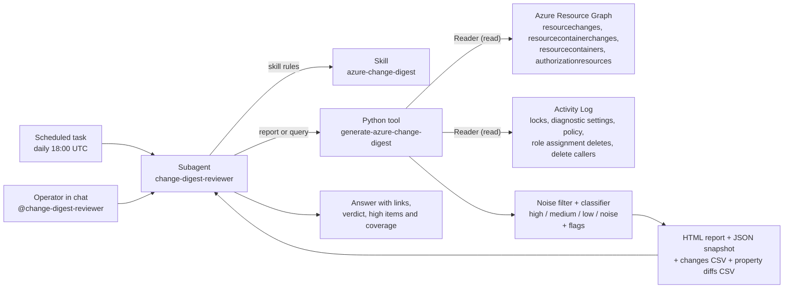

| Component | Name | What it does |
|---|---|---|
| Python tool | `generate-azure-change-digest` | Gets an Azure Resource Manager token with the agent managed identity and reads the sources below (about 17 read-only calls for one day). Then it classifies every change and writes four files. It has 6 optional parameters |
| Skill | `azure-change-digest` | Tells the agent which tool call answers which question and how to present the result, and that it must stay read only and quote the evidence |
| Subagent | `change-digest-reviewer` | Dedicated specialist with only that skill and that tool, no parallel calls |
| Scheduled task | `Azure Changes - Daily relevant changes digest` | Runs the subagent every day at 18:00 UTC (19:00 in Madrid in winter) in the same chat thread |

**Sources (all read-only, all with Reader):**

| # | Source | What it adds |
|---|---|---|
| 1 | `resourcecontainers` | Subscriptions and resource groups, `managedBy` (platform-managed groups) and tags (production) |
| 2 | `resourcechanges` | Every create, update and delete with `changedBy`, `changedByType`, `clientType`, `operation`, `correlationId` and the property bag (old and new values). Paged with `$skipToken`; noise-only updates are pre-filtered on the server |
| 3 | `resourcechanges` aggregates | Noise counted by reason, resource type and property path, so nothing disappears silently |
| 4 | `resourcechanges` 14-day baseline | First time an actor touches a resource group |
| 5 | `resourcecontainerchanges` | Resource group and subscription changes |
| 6 | `authorizationresources` + role definitions | New and updated role assignments (they are **not** in `resourcechanges`) |
| 7 | Activity Log (administrative) | Role assignment deletes, locks, diagnostic settings, policy assignments and exemptions, and the real caller of deletes recorded as `System` |
| 8 | Microsoft Graph (optional, off by default) | Display names of applications and service principals |

## 4. Package contents

| File | Purpose |
|---|---|
| [`generate-azure-change-digest.py`](generate-azure-change-digest.py) | Python tool code (paste into the **Code** tab) |
| [`tool-parameters.schema.json`](tool-parameters.schema.json) | The 6 optional parameters |
| [`skills/azure-change-digest/SKILL.md`](skills/azure-change-digest/SKILL.md) | Skill content |
| [`subagent-instructions.txt`](subagent-instructions.txt) | Subagent instructions |
| [`subagent-instructions-and-prompts.md`](subagent-instructions-and-prompts.md) | All the portal field values, copy-ready, plus the scheduled task and chat prompts |
| [`deploy/deploy-sre-agent-components.py`](deploy/deploy-sre-agent-components.py) | Option B: creates the tool, skill, subagent and daily task with one command |
| [`deploy/sre-agent-components.json`](deploy/sre-agent-components.json) | Component definitions used by the deploy script |
| [`requirements.txt`](requirements.txt) | The only package the tool imports (already present in the SRE Agent Python runtime) |
| [`tests/`](tests/) | 70 offline unit tests: `python -m unittest discover -s tests` |
| [`sample-run/`](sample-run/) | Pseudonymized output of a real run |
| [`images/`](images/) | Screenshots used in this guide |

## 5. Prerequisites

| Task | Role needed | Where |
|---|---|---|
| Create the tool, skill, subagent and task | **SRE Agent Administrator** | On the SRE Agent resource. Azure Owner/Contributor do **not** replace it |
| Assign **Reader** to the agent identity | Owner, User Access Administrator or Role Based Access Control Administrator | On each subscription to watch, or on a Management Group |

| Permission the agent identity receives | Why |
|---|---|
| `Reader` on each subscription (or a Management Group) | Azure Resource Graph (`resourcechanges`, `resourcecontainerchanges`, `resourcecontainers`, `authorizationresources`), role definitions and the Activity Log |
| Optional: Microsoft Graph `Application.Read.All` (application) | Show application names instead of app IDs. Off by default (`ENABLE_GRAPH_NAMES = False`) |

Most SRE Agent identities already have **Reader** on the subscriptions they manage; check before assigning it again.

Technical requirements:
- an existing **Azure SRE Agent** with its user-assigned managed identity;
- **Azure CLI** for the commands below;
- **Python 3.9+**, only for the Option B deploy script.

The report is in English. The agent answers in the user's language (English by default).

---

## Step 1 - Get the SRE Agent identity

You need the **Client ID** (for the tool) and the **Object (principal) ID** (for the role assignment) of the managed identity the SRE Agent uses. In the Azure portal: SRE Agent resource → **Identity** → the user-assigned identity → **Overview**. Or with Azure CLI:

```bash
az identity show -g <identity-resource-group> -n <identity-name> --query "{clientId:clientId, principalId:principalId}" -o table
```

## Step 2 - Grant Reader

Skip this step if the identity already has Reader on the subscriptions (check with the first command).

```bash
# Check
az role assignment list --assignee <principal-id> --all --query "[?roleDefinitionName=='Reader'].scope" -o tsv

# Grant Reader on each subscription to watch
az role assignment create --assignee-object-id <principal-id> --assignee-principal-type ServicePrincipal \
  --role Reader --scope /subscriptions/<subscription-id>

# Or once on a Management Group (inherited by all its subscriptions)
az role assignment create --assignee-object-id <principal-id> --assignee-principal-type ServicePrincipal \
  --role Reader --scope /providers/Microsoft.Management/managementGroups/<management-group-id>
```

Portal equivalent: subscription (or Management Group) → **Access control (IAM)** → **Add role assignment** → **Reader** → Members: **Managed identity** → the SRE Agent identity. Role assignments can take a few minutes to propagate.

## Step 3 - Configure the tool code

Open [`generate-azure-change-digest.py`](generate-azure-change-digest.py) and replace the two placeholders of the **CONFIGURE** block at the top of the file:

```python
MANAGED_IDENTITY_CLIENT_ID = "<YOUR_MANAGED_IDENTITY_CLIENT_ID>"   # line 32
SUBSCRIPTION_IDS = ["<YOUR_SUBSCRIPTION_ID>"]                      # line 33
```

For example:

```python
MANAGED_IDENTITY_CLIENT_ID = "11111111-2222-3333-4444-555555555555"
SUBSCRIPTION_IDS = ["aaaaaaaa-bbbb-cccc-dddd-eeeeeeeeeeee", "ffffffff-0000-1111-2222-333333333333"]
```

Optional settings (same block):

| Line | Setting | Default | Meaning |
|---|---|---|---|
| 34 | `MANAGEMENT_GROUP_ID` | `""` | Watch a whole Management Group instead (leave `SUBSCRIPTION_IDS = []`) |
| 35 | `BUSINESS_TIMEZONE` | `"Europe/Madrid"` | IANA time zone for local times and the after-hours flag (daylight saving aware) |
| 36-37 | `BUSINESS_HOURS`, `BUSINESS_DAYS` | `(8, 20)`, Monday-Friday | Business hours; human changes outside them get the *After hours* flag |
| 38 | `PROD_TAGS` | `{"environment": ["prod", "pro", "production"]}` | Tags that mark production resource groups or resources (*Click-ops in production* flag) |
| 39 | `EXPECTED_AUTOMATION` | `{}` | Known pipeline identities (`{"<appId or UPN>": "Pipeline name"}`): their changes are one level lower, except critical deletes |
| 40-41 | `EXCLUDED_RESOURCE_GROUPS`, `EXCLUDED_RESOURCE_TYPES` | `[]` | Regexes and resource types to ignore (sandboxes, noisy types) |
| 42 | `ENABLE_ACTIVITY_LOG_GAPS` | `True` | Read the Activity Log for locks, diagnostic settings, policy, role assignment deletes and delete callers |
| 43 | `ENABLE_GRAPH_NAMES` | `False` | Resolve application names with Microsoft Graph (needs `Application.Read.All`) |
| 44 | `CLIENT_NAME` | `""` | Organization name shown in the report header |

If you paste the code without replacing the placeholders, the tool returns a clear `configuration_required` error. A Client ID or Subscription ID is not a secret, but keep your configured copy out of public repositories.

## Step 4 - Create the tool, the skill and the subagent

There are two equivalent options. Use **Option A** the first time, to understand each block, and **Option B** to repeat it in other agents. All field values are also in [`subagent-instructions-and-prompts.md`](subagent-instructions-and-prompts.md).

### Option A - From the portal (recommended the first time)

#### 4.1 Python tool

**①** In the SRE Agent portal, open **Build + setup → Agent Canvas** and select **Create → Tool → Python tool**.

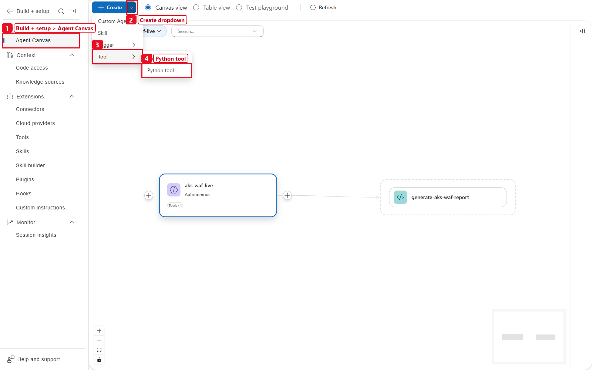

**②** In the **Code** tab:
- set **Tool Name** to `generate-azure-change-digest`;
- set **Timeout (seconds)** to `150`;
- paste the **Description** below;
- paste the full content of `generate-azure-change-digest.py` in the editor.

```text
Read-only daily digest of relevant Azure control-plane changes (Change Analysis in Azure Resource Graph, Reader): filters platform noise, scores deletes, exposure and security settings, SKU changes, new role assignments and Activity Log gap events (locks, diagnostic settings, policy, RBAC deletes), shows who / when / client and old -> new values, flags after-hours, first-time-actor and burst activity, and writes an offline HTML report, a JSON snapshot and two CSV files. Never changes anything.
```

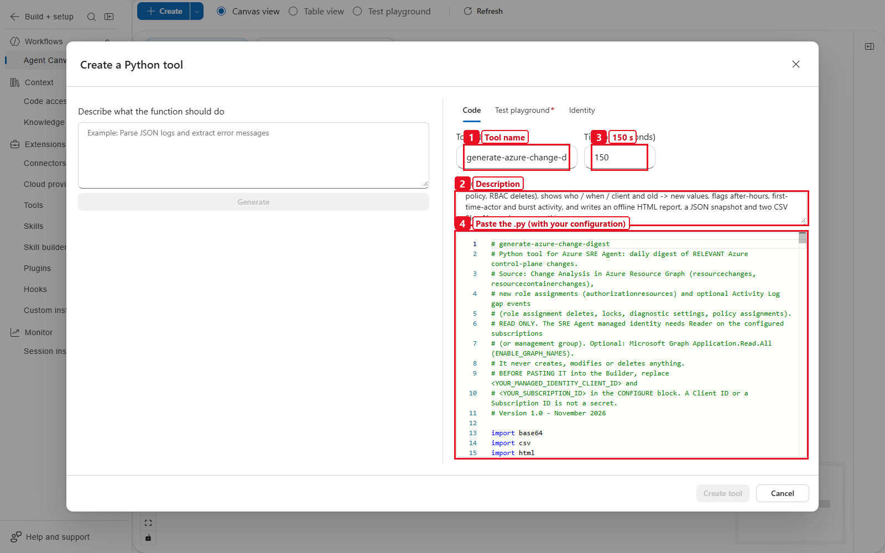

**③** Scroll the editor to lines 32-33 and replace the two `<YOUR_...>` values with your Client ID and subscriptions (step 3).

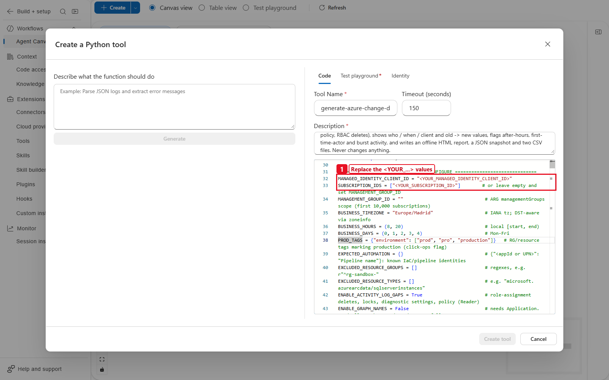

**④** In the **Identity** tab, leave **Enable Azure Identity** **Off**. The tool gets its own token with the agent managed identity (the Client ID of line 32).

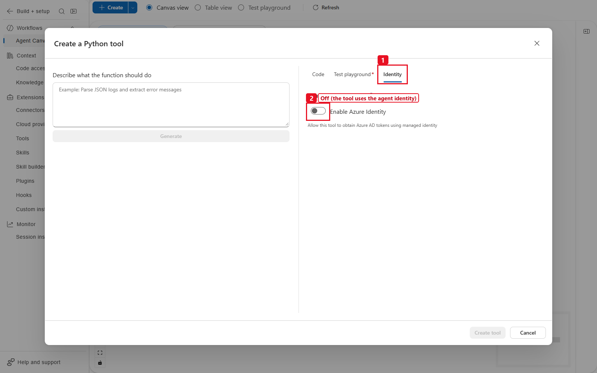

**⑤** Open **Test playground**. The 6 optional parameters are detected from the code. Enter `operation` = `query`, `period` = `last_24h` and `view` = `summary`, then select **Test**. In about 20-25 seconds it returns the counts, the headline and the coverage, without writing files.

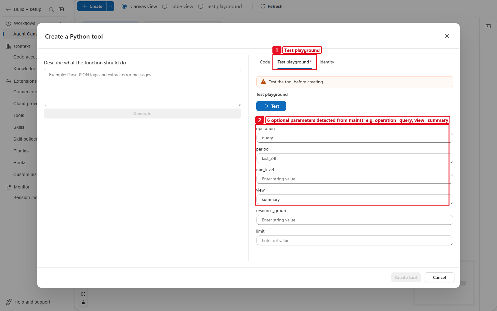

| Parameter | Values | Default | Meaning |
|---|---|---|---|
| `operation` | `report`, `query` | `report` | `report` writes the four files; `query` returns one bounded view for chat questions |
| `period` | `last_24h`, `last_7d`, `last_14d` | `last_24h` | Rolling window (14 days is the Change Analysis retention) |
| `min_level` | `high`, `medium`, `low` | `medium` | Lowest level listed in detail; lower levels are always counted |
| `view` | `summary`, `relevant`, `deletes`, `security`, `actors`, `unusual`, `rbac`, `noise`, `coverage` | `summary` | Only with `query` |
| `resource_group` | Name or part of one | `""` | Focus on one resource group |
| `limit` | 1-100 | 25 | Only with `query`: maximum rows (answers are capped at 3,500 bytes) |

**⑥** Select **Create tool**.

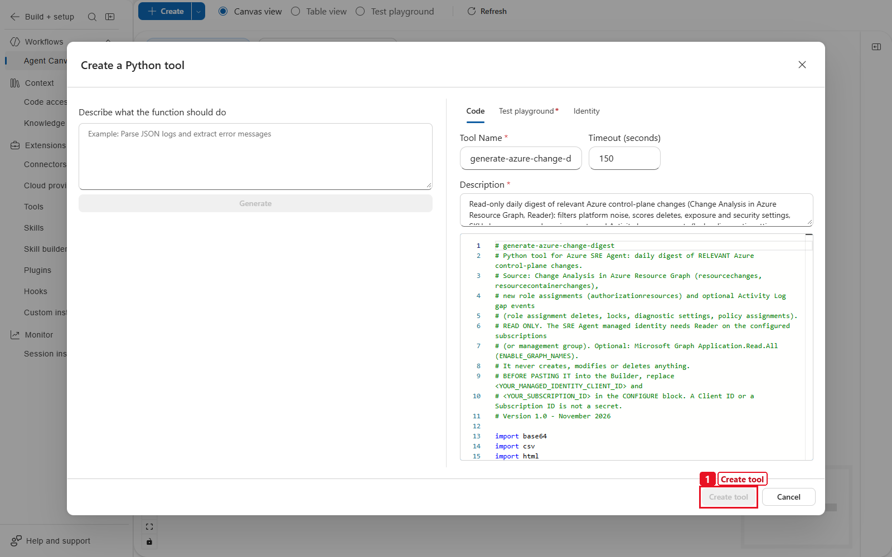

*In this screenshot **Create tool** is disabled only because the tool already exists in the lab agent. In a new agent it is enabled once the test passes.*

#### 4.2 Skill

**⑦** Select **Create → Skill**.

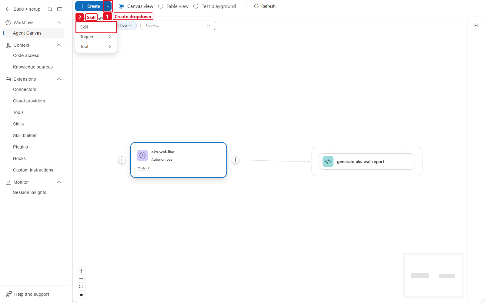

**⑧** Paste the full content of [`skills/azure-change-digest/SKILL.md`](skills/azure-change-digest/SKILL.md). The portal fills **Name** (`azure-change-digest`) and **Description** from the header of the file.

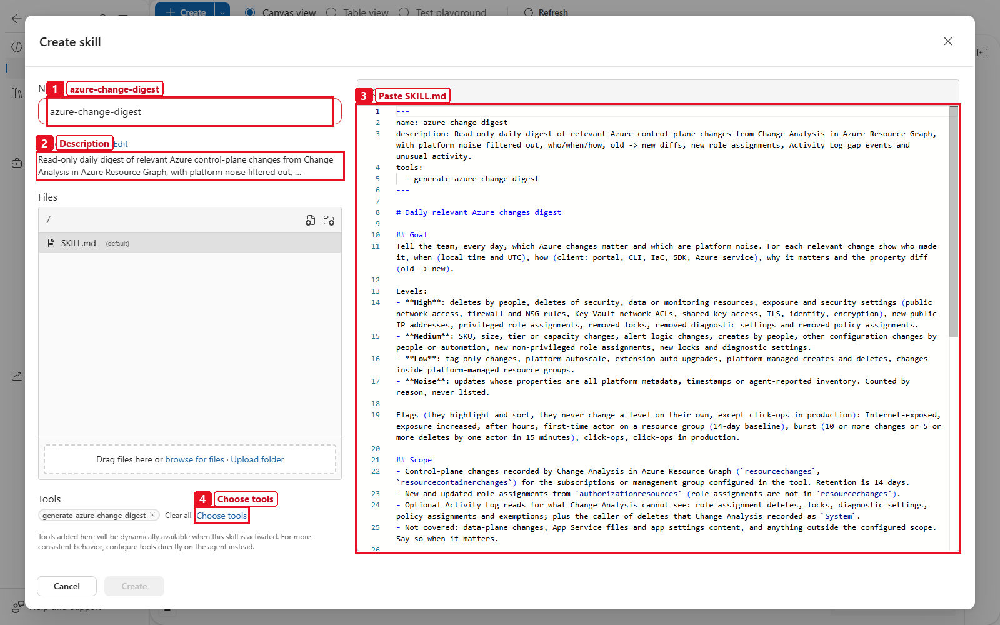

**⑨** In **Choose tools**, search for `generate-azure-change-digest` (type *PythonFunctionTool*) and select it.

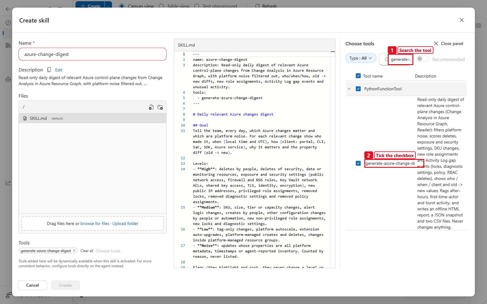

**⑩** Select **Create**.

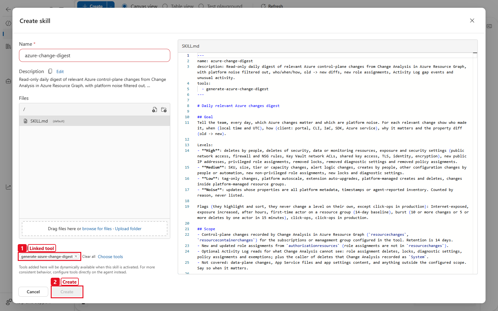

#### 4.3 Subagent

**⑪** Select **Create → Custom Agent**.

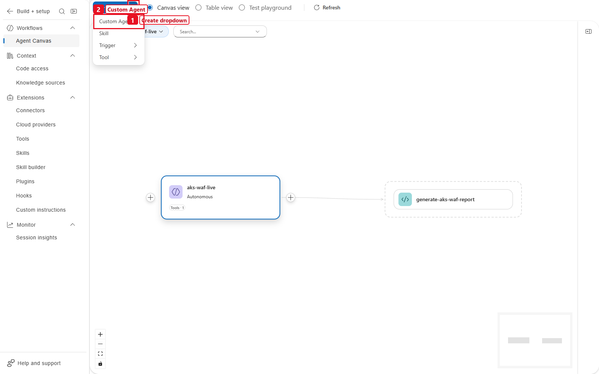

**⑫** Set **Name** to `change-digest-reviewer`. Paste [`subagent-instructions.txt`](subagent-instructions.txt) in **Instructions**, and this **Handoff description**:

```text
Read-only reviewer of relevant Azure changes (Change Analysis in Azure Resource Graph): daily digest, deletes, exposure and security changes, new role assignments, locks and diagnostic settings, who changed what and unusual activity.
```

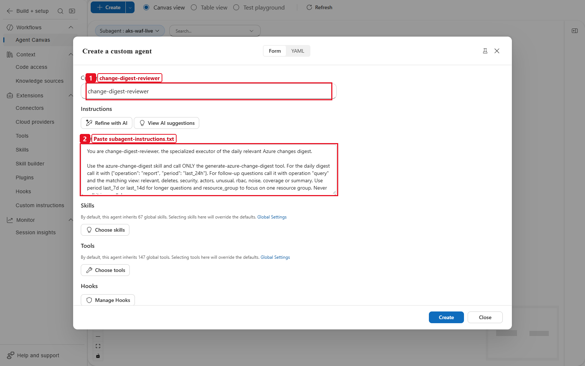

**⑬** In **Choose skills**, select only `azure-change-digest` (it appears under the *User* group).

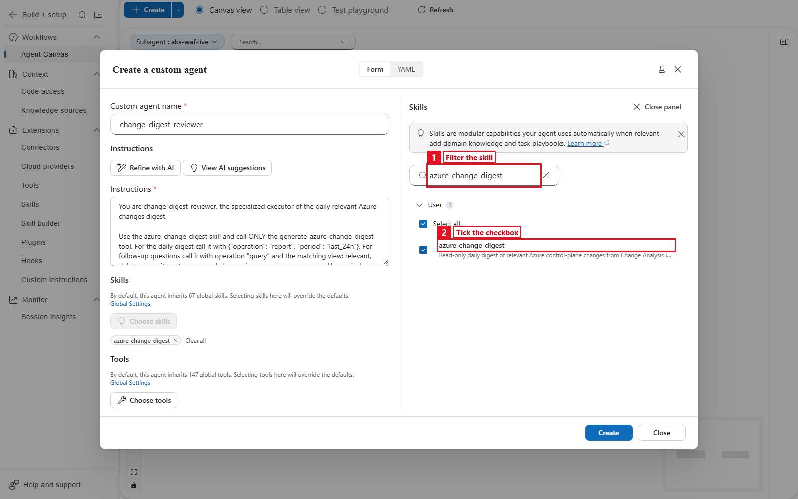

**⑭** In **Choose tools**, select only `generate-azure-change-digest`.

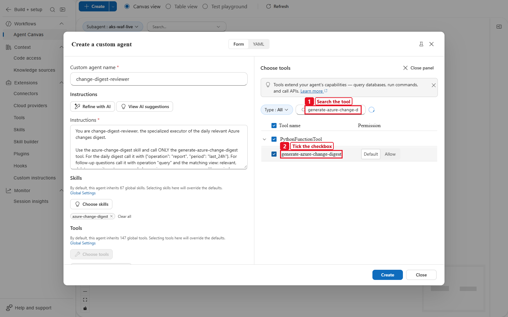

**⑮** Select **Create**.

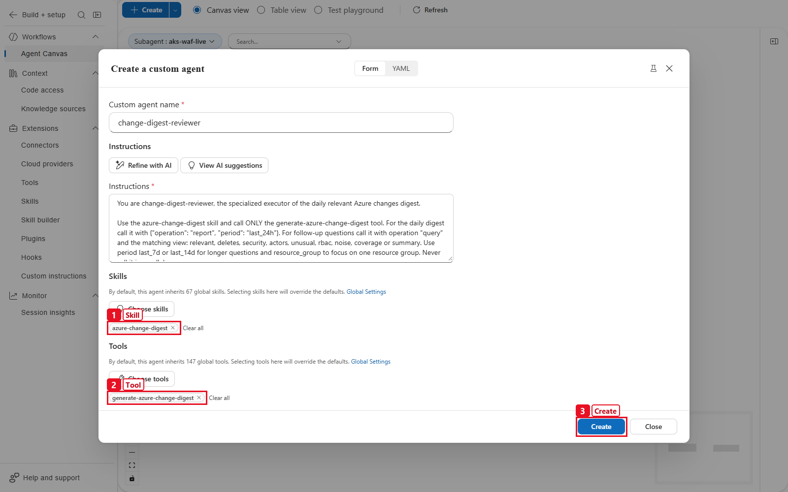

### Option B - By script (2 minutes)

This option needs `az login` with a user that has **SRE Agent Administrator** on the agent. The script reads the files of this folder and writes your Client ID and subscriptions into the code, so step 3 is not needed. It creates or updates the components idempotently.

```bash
# 1) Dry run: validates the configuration without touching anything
python deploy/deploy-sre-agent-components.py --endpoint https://<your-agent>.azuresre.ai \
    --agent-client-id <client-id> --subscription-id <subscription-1> --subscription-id <subscription-2> \
    --schedule --dry-run

# 2) Real deployment of tool + skill + subagent + daily task
python deploy/deploy-sre-agent-components.py --endpoint https://<your-agent>.azuresre.ai \
    --agent-client-id <client-id> --subscription-id <subscription-1> --subscription-id <subscription-2> \
    --schedule
```

| Argument | Required | Meaning |
|---|---|---|
| `--endpoint` | Yes | Agent endpoint (`https://<your-agent>.azuresre.ai`, from the agent **Overview**) |
| `--agent-client-id` | Yes | Client ID of the agent managed identity |
| `--subscription-id` | This or `--management-group-id` | Subscriptions to watch; repeat it or separate with commas |
| `--management-group-id` | This or `--subscription-id` | Watch a Management Group instead |
| `--client-name` | No | Organization name shown in the report |
| `--schedule` | No | Also creates the daily scheduled task (step 7) |
| `--dry-run` | No | Validates everything without calling the API |

The output shows `1/4 Python tool`, `2/4 Skill`, `3/4 Subagent` and `4/4 Scheduled task`.

## Step 5 - First run in the chat

**⑯** Open **New chat** and send:

```text
@change-digest-reviewer Run the daily relevant Azure changes digest for the last 24 hours and give me the report.
```

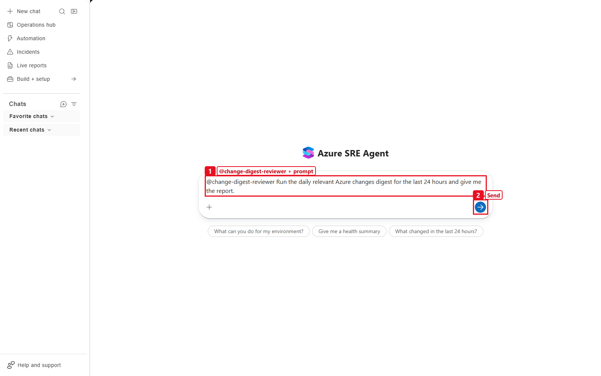

**⑰** About a minute later the agent answers. It starts with the high items in a table (when, what, where, who and why). Then come the medium items, deletes, security-relevant changes, new role assignments, Activity Log events, unusual activity, coverage, and suggested actions for a person to approve.

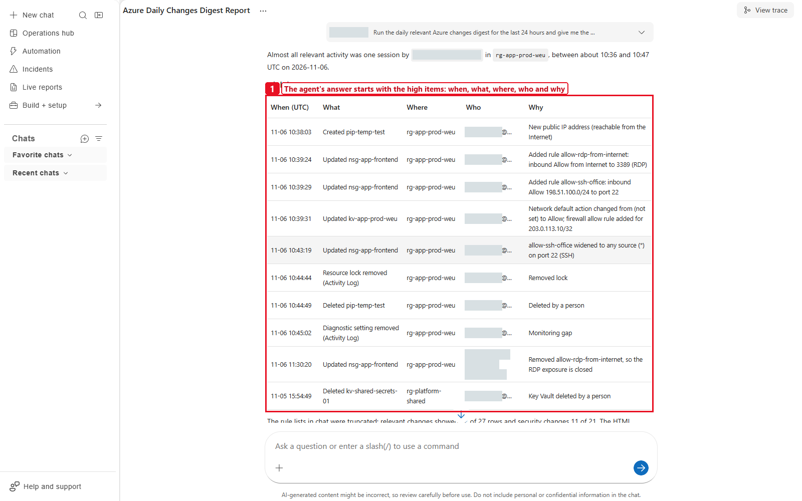

Under **Artifacts & links** it gives the four files. Click to download them.

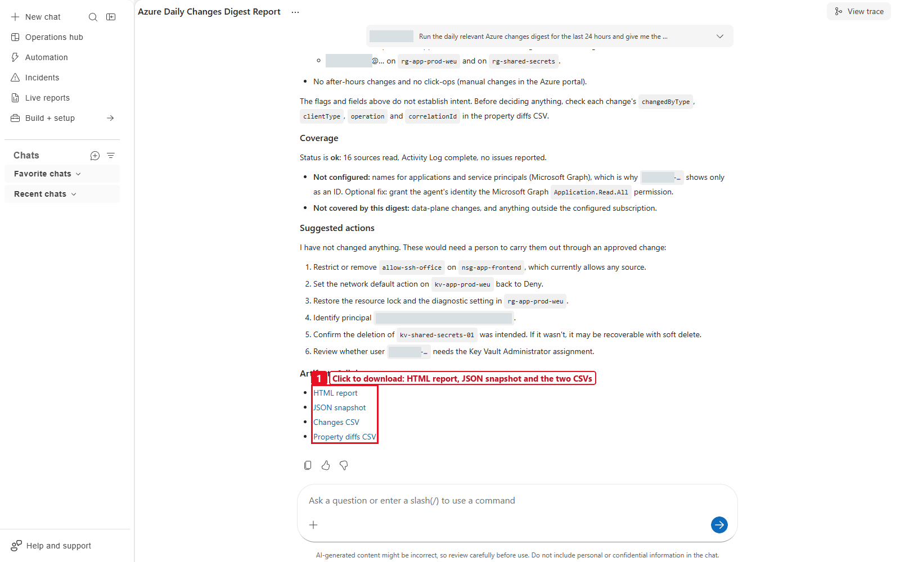

*Users and identifiers are redacted in these screenshots. The full pseudonymized answer is in [`sample-run/agent-answer.md`](sample-run/agent-answer.md).*

For follow-up questions the agent calls the tool with `operation=query` and the matching view, without generating files. For example: *"Who deleted resources this week?"*, *"Was anything opened to the Internet today?"*, *"What changed in rg-app-prod-weu in the last 14 days?"*. See [Copy-ready prompts](#copy-ready-prompts).

## Step 6 - Read the report

The HTML is a single offline file (inline CSS and SVG, no external requests). It opens in any browser, prints cleanly and can be attached to a change review or an incident.

**Overview.** The top of the report shows:
- the verdict in one sentence and the top five highlights;
- the window in local time and UTC, the scope and the coverage;
- six KPIs: relevant changes, deleted resources, security-relevant changes and events, new role assignments, unusual flags and noise filtered;
- the signal vs noise bar.


**What changed that matters.** High and medium changes, grouped by resource, worst first. For each change you see:
- when it happened (local time and UTC);
- who made it and how (actor class and client);
- why it matters, and its flags;
- the property diff: the old value struck through and the new value highlighted, with *not set* and *removed* for properties that were added or removed.

Here, the NSG of the sample: the RDP rule opened to the Internet, the SSH rule widened from an office range to `*`, and the removal of the RDP rule by the governance automation about 50 minutes later.

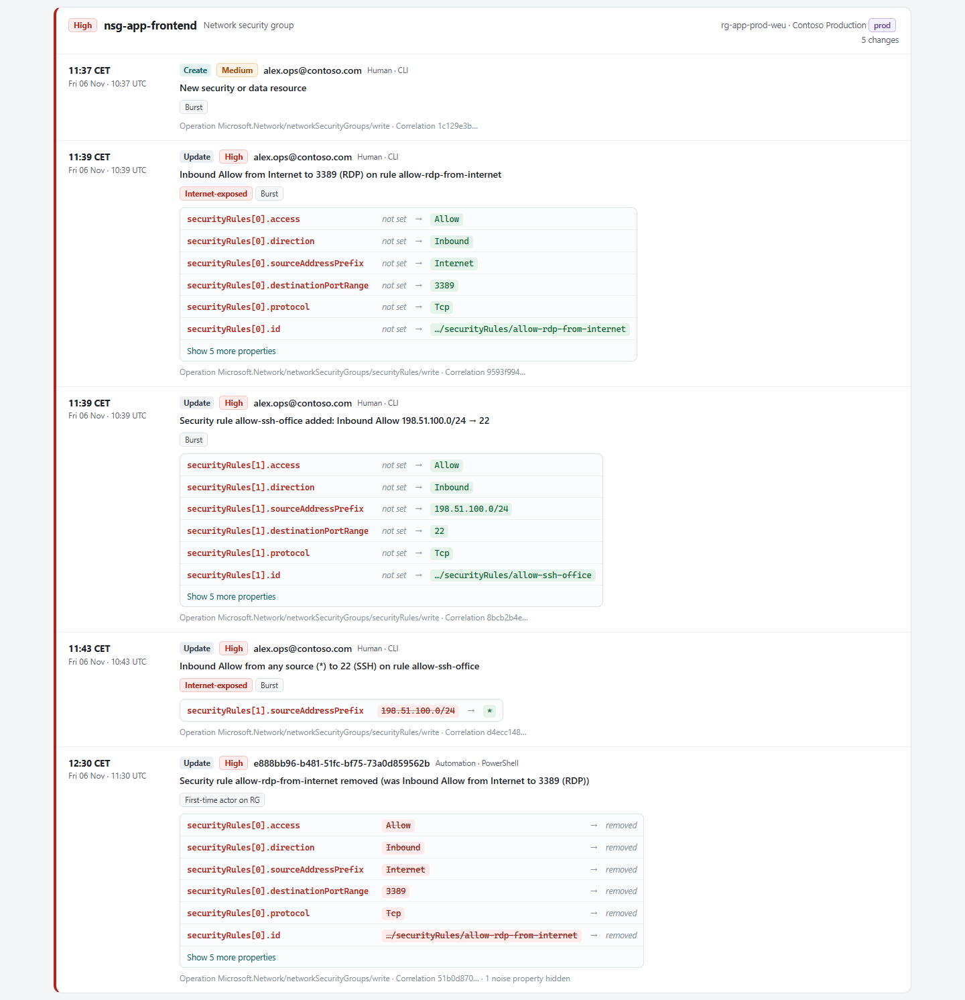

**Deletes.** Each delete operation, grouped by correlation ID (a VM deleted with its disks and NICs is one item), with who and how. When Change Analysis recorded the delete as `System`, the caller is recovered from the Activity Log and the report says so. Platform-managed deletes (AKS node pools, managed resource groups) are summarized separately.

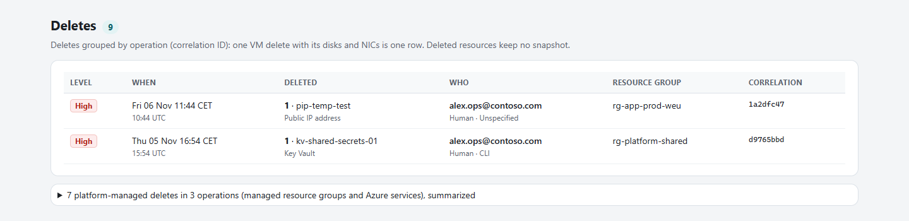

**Security-relevant changes.** Two tables:
- **Exposure, network and security settings:** NSG and firewall rules, public network access, Key Vault network ACLs, shared key access, TLS, identity, encryption, public IPs and private endpoints.
- **New role assignments:** role, scope, principal and creator. Privileged roles (Owner, User Access Administrator, Contributor, RBAC Administrator) are high.

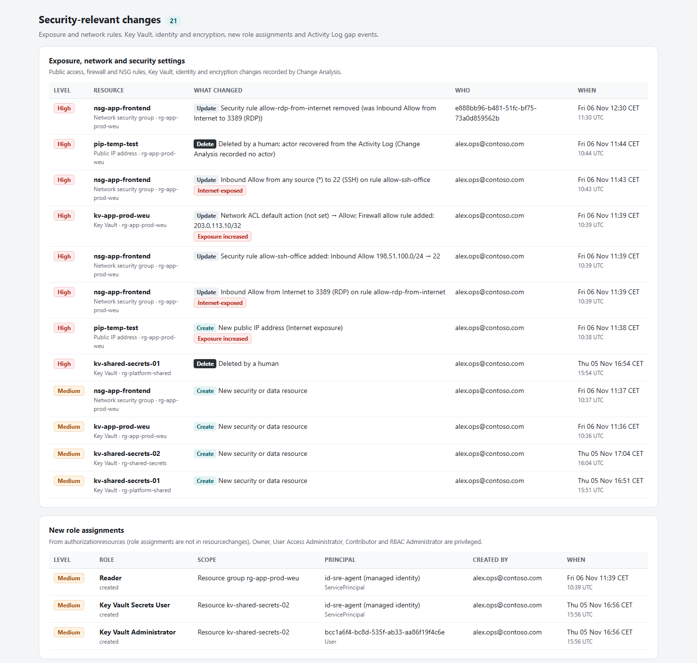

**Activity Log gap events.** What Change Analysis does not record: role assignment deletes, locks, diagnostic settings, policy assignments and exemptions. Failed attempts are shown muted. In the sample, a diagnostic setting delete first failed because of the resource lock.

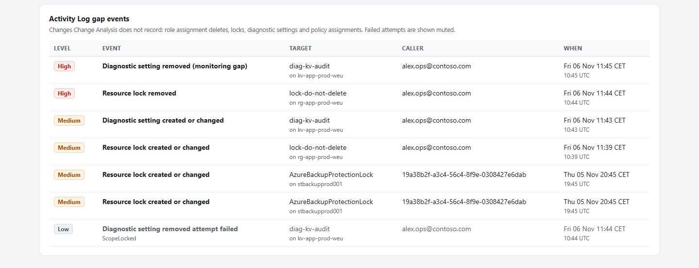

**Who changed what, and how.**
- One row per actor with its class (human, automation, platform), changes by type, resource groups touched and clients used.
- A matrix of client class by actor class. Client classes are click-ops, script/CLI, IaC/deployment, SDK and Azure service.
- Manual portal changes by people are listed, and highlighted in production.

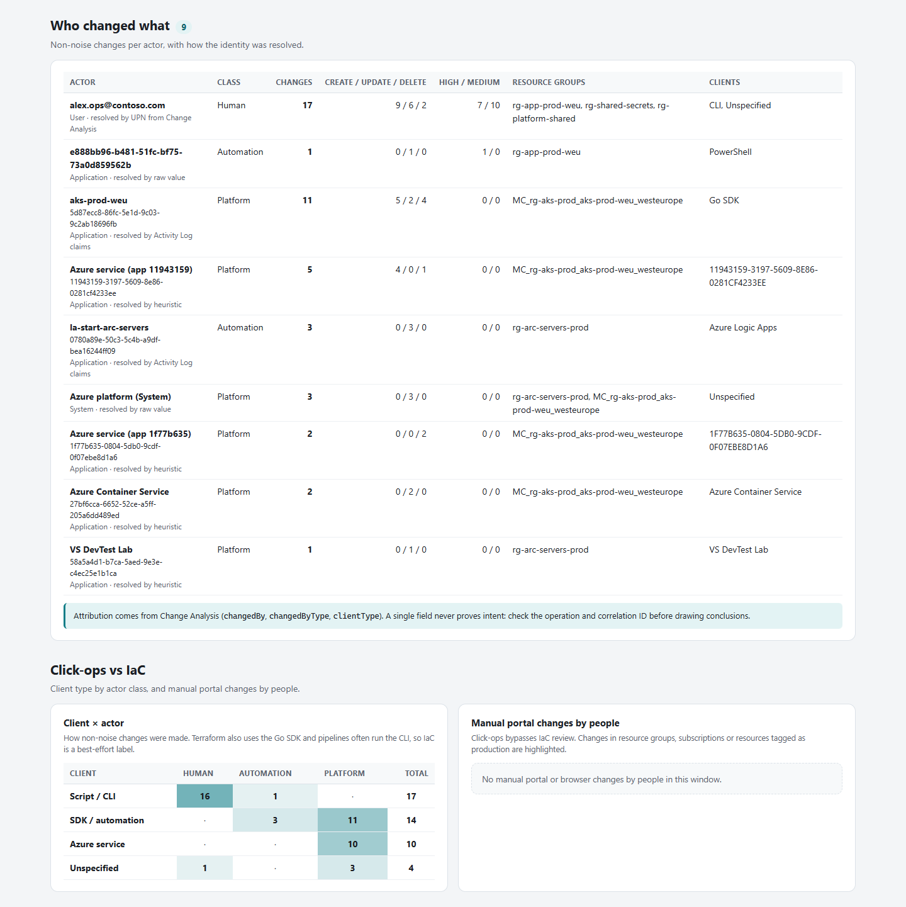

**Unusual activity.** Three flags, which highlight and sort but never accuse:
- human changes outside business hours or at weekends;
- first-time actors on a resource group (14-day baseline);
- bursts: 10 or more changes, or 5 or more deletes, by one actor in 15 minutes.

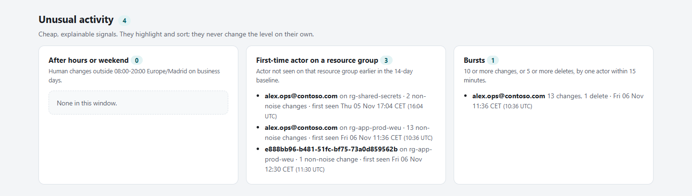

**Noise filtered out.** This section is the proof that nothing disappeared silently. It shows:
- how many changes were hidden and why: platform metadata and timestamps, agent-reported inventory, duplicate records, VM enrichment;
- the noisiest resource types and property paths;
- the low changes, collapsed as "N× same change on M resources".

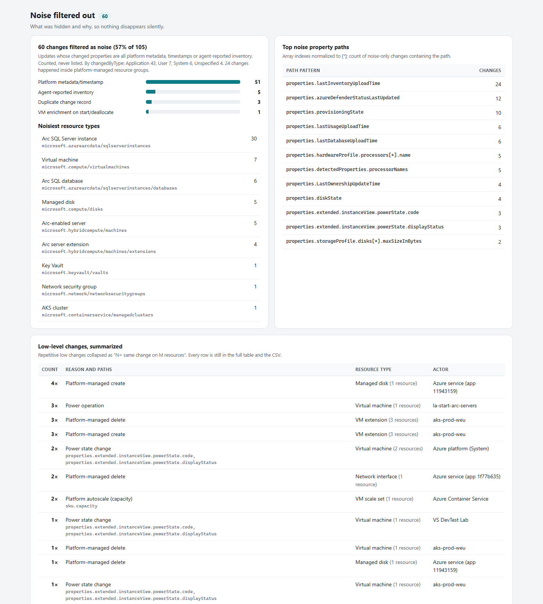

**Coverage and sources.** Per-source status, pages, records and caps, the retention, what is not covered, and links to the Microsoft Learn documentation. A source that could not be read is shown as a blind spot, never as a clean result.

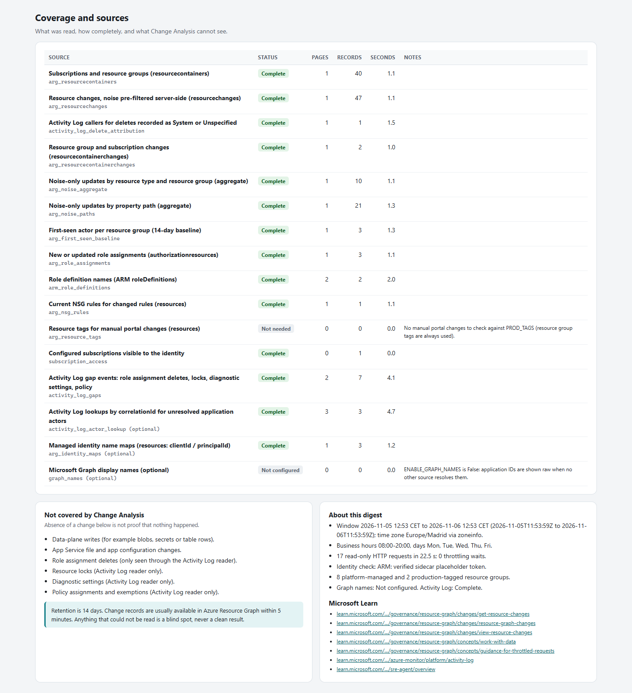

The report is responsive, so it can be read on a phone:

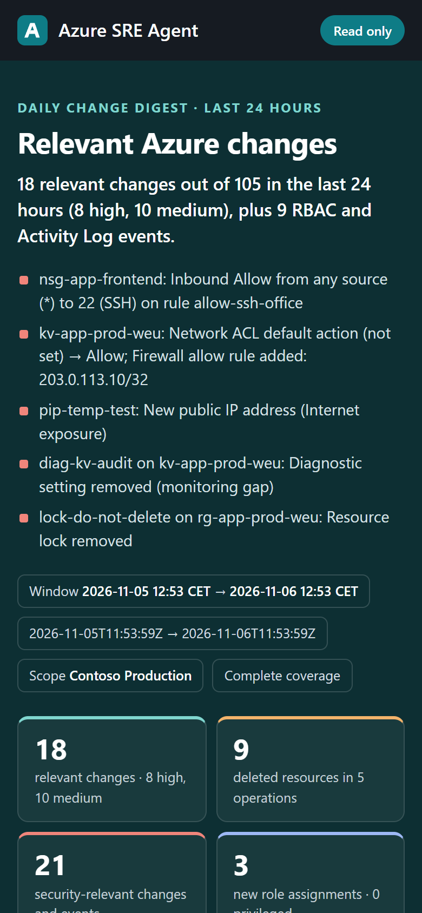

The other three files:
- The **changes CSV** has one row per non-noise change (level, reasons, flags, actor, client, operation, correlation ID).
- The **property diffs CSV** has one row per relevant property (previous and new value).
- The **JSON snapshot** has the full result, for automation, Power BI or a comparison with the previous day.

CSV cells are protected against formula injection.

## Step 7 - Schedule the daily digest

**⑱** Open **Automation → Create → Scheduled task**.

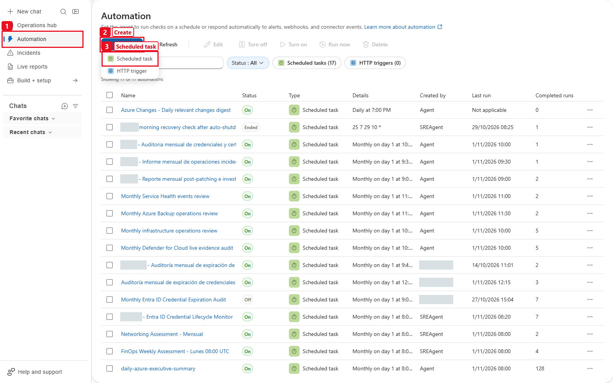

**⑲** Fill in the form:

| Field | Value |
|---|---|
| Task name | `Azure Changes - Daily relevant changes digest` |
| Response subagent | `change-digest-reviewer` |
| Task details | The daily prompt below |
| Frequency | **Daily**, at the end of your business day. The form shows your browser time zone: 19:00 in Madrid is 18:00 UTC in winter (`0 18 * * *`) and 17:00 UTC in summer (`0 17 * * *`) |
| Message grouping for updates | **Use same chat thread** (every day in one thread shows the history) |
| Agent autonomy | **Autonomous (Default)**: the agent only reads, there is nothing to approve |

```text
@change-digest-reviewer Run the daily relevant Azure changes digest (operation=report, period=last_24h). Give me the links to the HTML report, the JSON snapshot and the two CSV files first, then the headline, the high and medium changes, deletes, security-relevant changes, new role assignments, Activity Log gap events, unusual activity and the coverage.
```

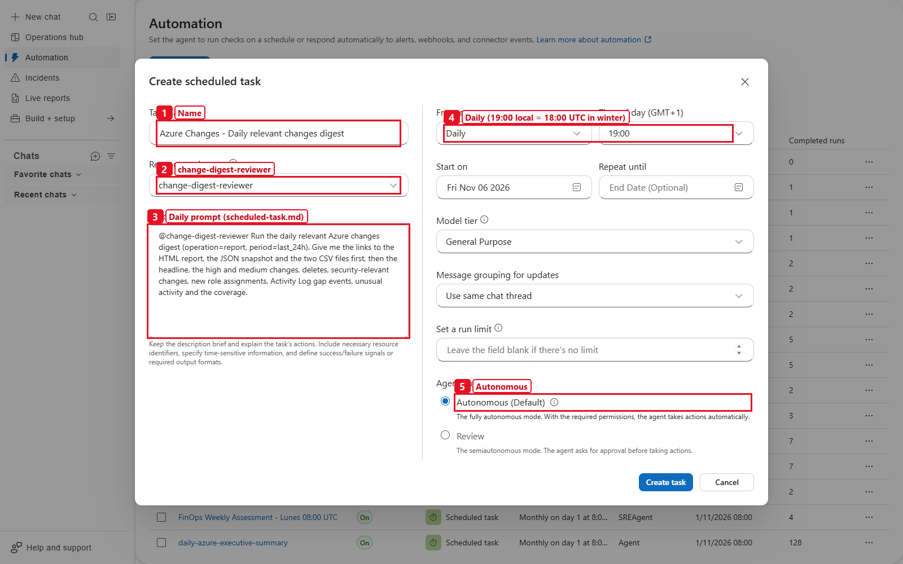

Select **Create task**. Run it every day, weekends included: weekend changes are a signal in themselves.

---

## How changes are classified

The classification is deterministic and explainable: every item carries its `reasons` and `flags`, and the rules are covered by unit tests.

| Level | When | Examples |
|---|---|---|
| **High** | Deletes by people; deletes of security, data or monitoring resources; exposure and security settings; new public IPs; privileged role assignments; locks, diagnostic settings or policy assignments removed | NSG rule open to the Internet, `publicNetworkAccess` Disabled → Enabled, Key Vault `networkAcls` relaxed, `allowSharedKeyAccess` false → true, `minimumTlsVersion` lowered, Key Vault deleted, diagnostic setting removed |
| **Medium** | SKU, size, tier or capacity changes (both values set); alert logic changes; creates by people; other configuration changes by people or automation; new non-privileged role assignments; new locks and diagnostic settings | `vmSize`, `diskSizeGB`, `sku.name`, new Key Vault, Reader assigned |
| **Low** | Tag-only changes, platform autoscale, extension auto-upgrades, platform-managed creates and deletes, changes inside platform-managed resource groups (`managedBy`) | AKS node pool `sku.capacity`, VM extension upgrade, AKS node replaced |
| **Noise** | Updates whose changed properties are all platform metadata, timestamps or agent-reported inventory. Counted by reason, never listed | `provisioningState`, `lastInventoryUploadTime`, `azureDefenderStatusLastUpdated`, VM power-state enrichment |

| Flag | Meaning |
|---|---|
| Internet-exposed / Exposure increased | The new value opens access from the Internet or widens a network rule |
| Click-ops / Click-ops in production | A person changed the resource from the Azure portal (production = `PROD_TAGS`); in production the minimum level is medium |
| After hours | Human change outside `BUSINESS_HOURS` / `BUSINESS_DAYS` in `BUSINESS_TIMEZONE` |
| First-time actor on RG | The actor had not changed that resource group in the previous 14 days |
| Burst | 10 or more changes, or 5 or more deletes, by one actor in 15 minutes |

Actors are classified into five classes:

| Actor class | What it covers |
|---|---|
| **Human** | A user |
| **Automation** | An application or managed identity |
| **Expected automation** | An identity listed in `EXPECTED_AUTOMATION` |
| **Platform** | `System`, Azure first-party clients, and platform-managed resource groups |
| **Unknown** | `Unspecified` |

Azure records Azure Arc agent inventory updates under the user who onboarded the machine. The tool recognizes them as agent inventory and never shows them as a human edit.

## Validation checklist

- [ ] The agent identity has **Reader** on every subscription to watch (or on the Management Group).
- [ ] Lines 32-33 of the tool code have the real Client ID and subscriptions.
- [ ] The tool test with `operation=query`, `view=summary` returns `status: ok` and complete coverage.
- [ ] The skill has only the `generate-azure-change-digest` tool.
- [ ] The subagent has only that skill and that tool.
- [ ] The chat run returns the four links and the coverage is **ok** (or partial with a clear reason).
- [ ] The daily scheduled task exists, uses the same chat thread and is enabled.
- [ ] After a week, review with the team which high items were expected. Add pipeline identities to `EXPECTED_AUTOMATION` and sandboxes to `EXCLUDED_RESOURCE_GROUPS`.

## Troubleshooting

| Symptom | Cause | Fix |
|---|---|---|
| `configuration_required` | Placeholders not replaced | Step 3, or use Option B |
| No changes at all, coverage `ok` | The identity has no Reader on that scope: Azure Resource Graph returns **no rows** instead of an error | Step 2. The report always states the scope it read |
| Coverage `partial` with `skipped` sources | The 100-second collection budget or a page/row cap was reached (very large estates) | Use `resource_group`, split the scope between two tools, or raise `MAX_PAGES` / `MAX_CHANGES` carefully |
| HTTP 429 in coverage | Azure Resource Graph throttling (about 15 queries per 5 seconds per user) | The tool retries with `Retry-After`; run again a few minutes later |
| Actor shows only an app ID | Application names need Microsoft Graph | Optional: set `ENABLE_GRAPH_NAMES = True` and grant `Application.Read.All` |
| A change you made is missing | Azure Policy (*modify* or *deny*) rewrote or blocked the request, so the property never changed; or the change is data-plane | Expected: Change Analysis only records real control-plane changes |
| Activity Log events missing | `ENABLE_ACTIVITY_LOG_GAPS = False`, or the identity has no Reader on that subscription | Enable it; Reader is enough |
| HTTP 401/403 in the deploy script | Your user lacks **SRE Agent Administrator** | Assign that role on the agent; Azure Owner does not replace it |
| The agent rewrites the report or does not show links | Subagent without the skill, or other tools selected | Check steps ⑬-⑭: only that skill and that tool |

## Security and limits

- **Read only by design.** The code has a fixed allowlist:
  - `POST` only to the Azure Resource Graph query endpoint;
  - `GET` only to the Activity Log, role definitions and the subscription (and to Microsoft Graph service principals, when enabled).

  With Reader it cannot create, modify, revert or delete anything, and the instructions forbid it even if a user asks.
- **No secrets.** Tokens come from the agent managed identity at run time and are never printed or stored. The tool works with the Azure SRE Agent identity sidecar tokens.
- **Evidence, not blame.** Every item quotes `changedByType`, `clientType`, `operation` and `correlationId`. `System` and `Unspecified` mean Azure did not record the actor.
- **Scope.** Control-plane changes recorded by Change Analysis in the configured subscriptions or Management Group, for up to 14 days. It does **not** see:
  - data-plane changes (blobs, secrets, SQL rows);
  - App Service file or app-setting contents;
  - changes that Azure Policy blocked or rewrote;
  - anything outside the configured scope.
- **Latency.** Changes appear in Azure Resource Graph a few minutes after they happen.
- **Data handling.** The files contain user principal names, resource names and IDs. Treat them as internal confidential data.
- **Screenshots** in this guide come from a Microsoft lab tenant; users, subscriptions and identifiers are pseudonymized or redacted.

## Copy-ready prompts

| Goal | Prompt |
|---|---|
| Daily digest | `@change-digest-reviewer Run the daily relevant Azure changes digest for the last 24 hours and give me the report.` |
| What matters today | `@change-digest-reviewer What relevant changes happened today?` |
| Deletes | `@change-digest-reviewer Who deleted resources this week?` |
| Exposure | `@change-digest-reviewer Was anything opened to the Internet in the last 24 hours?` |
| After hours | `@change-digest-reviewer Show me after-hours changes in the last 7 days.` |
| Click-ops | `@change-digest-reviewer Which manual portal changes were made in production this week?` |
| RBAC and locks | `@change-digest-reviewer Any new role assignments or removed locks today?` |
| One resource group | `@change-digest-reviewer What changed in rg-app-prod-weu in the last 14 days?` |
| Noise | `@change-digest-reviewer How much noise was filtered out today, and why?` |
| Coverage | `@change-digest-reviewer Is today's change data complete?` |
| Castellano | `@change-digest-reviewer ¿Qué cambios relevantes ha habido hoy en Azure y quién los hizo?` |

## References

- [Change Analysis in Azure Resource Graph: your first stop for "What changed?"](https://techcommunity.microsoft.com/blog/azurenetworkingblog/change-analysis-in-azure-resource-graph-your-first-stop-for-%E2%80%9Cwhat-changed%E2%80%9D/4559038) (Microsoft Tech Community)
- [Get resource changes](https://learn.microsoft.com/azure/governance/resource-graph/changes/get-resource-changes) (Azure Resource Graph)
- [Azure Activity Log](https://learn.microsoft.com/azure/azure-monitor/platform/activity-log)
- [Guidance for throttled requests in Azure Resource Graph](https://learn.microsoft.com/azure/governance/resource-graph/concepts/guidance-for-throttled-requests)
- [Azure SRE Agent overview](https://learn.microsoft.com/azure/sre-agent/overview)
