# Case 15 - Monthly Azure FinOps review

> **Azure SRE Agent** · Read-only Python tool · Runtime skill · Restricted subagent · Monthly task (`0 7 3 * *`) & on-demand chat questions · Cost Management Query API + budgets + Azure Advisor + Azure Resource Graph (Reader only) · Zero secrets · No added Azure cost · Offline HTML, JSON and two CSVs

**"What did Azure cost us last month and why did it change? Will we stay within budget this month? What can we save, how much of the bill can we charge back, and what should we do first?"** That is the classic monthly FinOps review. In most organizations someone builds it by hand, in Cost Management views and spreadsheets, a week after the month closes, and it covers half of those questions.

A restricted SRE Agent subagent builds the whole review every month, on the 3rd, when the previous month's costs have settled. It reads Cost Management, the budgets, Azure Advisor and Azure Resource Graph for every configured subscription, and writes **one complete report**: verdict, trend, where the money goes, what changed (with simple statistics you can explain to finance), budgets and forecast, savings without double counting, allocation readiness and a prioritised action list with the estimated monthly saving of each action.

The agent **never changes anything**. It tells you where the money goes and what to do; a person decides and acts.

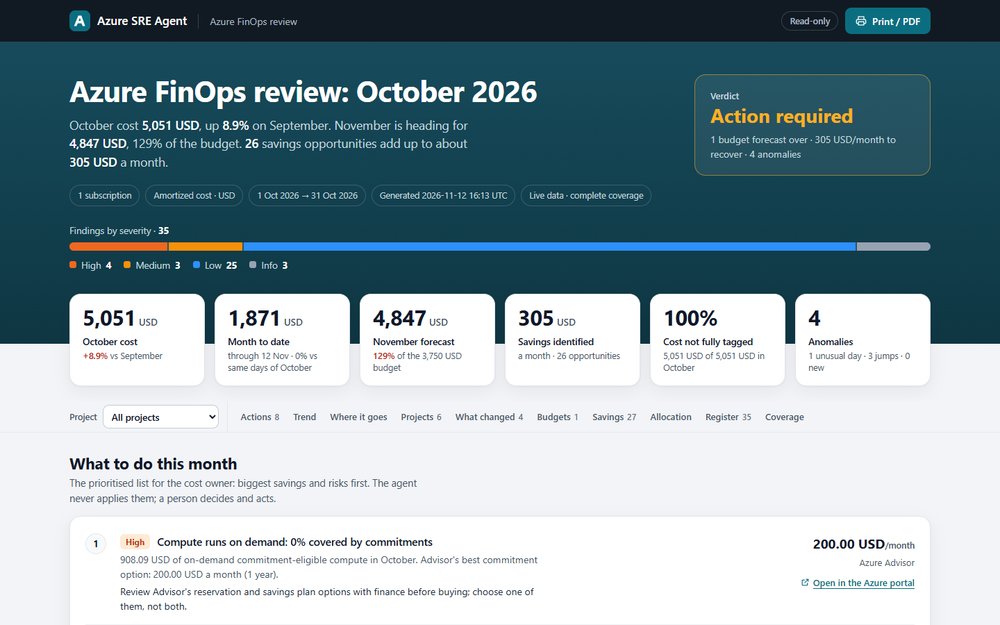

*A real run in a Microsoft lab (names and identifiers pseudonymized, costs real): **October 5,051 USD, up 8.9 %** on September; November is heading for **4,847 USD, 129 % of the 3,750 USD budget**; **26 savings opportunities worth about 305 USD a month**; **100 % of the cost misses at least one allocation tag**. Verdict: **Action required**.*

## Contents

1. [The problem and the short answer](#1-the-problem-and-the-short-answer)
2. [What it solves and business value](#2-what-it-solves-and-business-value)
3. [How it works](#3-how-it-works)
4. [Package contents](#4-package-contents)
5. [Prerequisites](#5-prerequisites)
6. [Step 1 - Get the SRE Agent identity](#step-1---get-the-sre-agent-identity)
7. [Step 2 - Download the package](#step-2---download-the-package)
8. [Step 3 - Grant the read-only permissions](#step-3---grant-the-read-only-permissions)
9. [Step 4 - Configure the tool code](#step-4---configure-the-tool-code)
10. [Step 5 - Create the tool, the skill and the subagent](#step-5---create-the-tool-the-skill-and-the-subagent)
11. [Step 6 - First run and the report](#step-6---first-run-and-the-report)
12. [Step 7 - Schedule the monthly review](#step-7---schedule-the-monthly-review)
13. [Choosing the cadence: monthly, weekly or daily](#choosing-the-cadence-monthly-weekly-or-daily)
14. [How the numbers are calculated](#how-the-numbers-are-calculated)
15. [Validation checklist](#validation-checklist) · [Troubleshooting](#troubleshooting) · [Security and limits](#security-and-limits) · [Copy-ready prompts](#copy-ready-prompts) · [References](#references)

---

## 1. The problem and the short answer

Azure Cost Management has every number you need, but a monthly review is not one view, it is a dozen:

- **Spread out.** Cost by service, by resource group, by subscription, the daily trend, the budgets, Advisor's cost recommendations and the idle resources live in different blades and APIs. Commitment coverage and tag coverage need their own analysis.
- **Late.** Costs settle 1-3 days after each day ends. A review prepared by hand usually lands in the second or third week of the month, when this month's overrun has already happened.
- **Hard to explain.** "Cost went up 9 %" starts the conversation; finance wants to know which services, which resource groups, which days and whether it was planned.
- **Savings counted twice.** Advisor's reservation and savings plan options are alternatives; an idle disk can appear both in Advisor and in a script. Adding everything inflates the number and erodes trust.
- **Chargeback blocked by tags.** If resources do not carry the cost-center and owner tags, showback and chargeback stop at the subscription level.

**The short answer:** the subagent produces the review on the 3rd of every month in one offline HTML file (plus a JSON snapshot and two CSV files), with the numbers already reconciled: last full month and its change, month to date, forecast against the budget, the drivers of every change, savings without double counting, allocation readiness and a short list of actions. Follow-up questions in the chat ("why did it go up?", "where can we save?") are answered from the same data.

## 2. What it solves and business value

| Without this use case | With this use case |
|---|---|
| A manual review, built in Cost Management views and spreadsheets, weeks after the month closes | The review on the 3rd of every month, in the same chat thread, with a one-line verdict |
| "Cost went up" without the why | The change by subscription, resource group, service, region and resource, plus unusual days and month-over-month jumps with their drivers |
| Overruns discovered on the invoice | Month to date and forecast against every budget, and the subscriptions that have no budget at all (with a suggested amount) |
| Savings scattered across Advisor, scripts and spreadsheets, sometimes counted twice | One savings figure per month: Advisor, idle and orphaned resources and commitments, each resource and each commitment option counted once |
| Commitments bought on intuition | The share of commitment-eligible compute that runs on reservations or savings plans, and Advisor's best option, presented as a finance decision |
| Chargeback blocked by missing tags | The share of the cost without the allocation tags, and the resource groups to tag first |
| A list of 200 findings nobody reads | A prioritised list of up to 8 actions with the estimated monthly saving, and a searchable register for the rest |

**Business value**

- **Fewer surprises at month end.** The forecast against the budget is visible on the 3rd (and every week if you raise the cadence), not when the invoice arrives.
- **Savings you can act on.** Each saving has an owner location (resource group, subscription), a portal link and an action. In the lab run: **305 USD a month, about 6 % of the monthly bill**, without counting anything twice.
- **Explainable numbers.** Unusual days and jumps use simple statistics (median, same weekday a week before, minimum amounts), so finance and engineering can check them in Cost Management.
- **Chargeback readiness.** The allocation section measures the share of the cost that carries the tags you use to charge back (configurable) and lists the resource groups to fix first. It complements [case 11 - Fabric FinOps chargeback](../11-fabric-finops-chargeback/).
- **Governance.** Every subscription without a budget is a finding with a suggested amount, so budget coverage reaches 100 %.
- **No new cost and no new risk.** The tool only reads, with **Reader**. It creates no exports, storage accounts or Log Analytics workspaces, and it cannot change budgets, tags, resources or commitments, even if asked.
- **Audit trail.** A dated HTML report, JSON snapshot and two CSV files every month support cost governance reviews and FinOps maturity assessments.

**Suggested 90-day pilot KPIs**

| KPI | How to measure it |
|---|---|
| Savings identified vs. realized | `savings.total` in the snapshot each month, and the actions closed by the owners |
| Budget coverage | Subscriptions with a subscription-level budget / reviewed subscriptions (target: 100 %) |
| Forecast accuracy | Forecast on the 3rd vs. the real month-end cost (next month's report) |
| Allocation readiness | `allocation.untagged_pct` (target: below 10 %) |
| Commitment coverage | `commitment.coverage_pct` of commitment-eligible compute |
| Time to prepare the monthly review | Hours before vs. minutes after |

**Real results of the lab run** (Microsoft lab, 1 subscription, run on 12 November 2026 for October; names pseudonymized, costs real):

| Metric | Value |
|---|---|
| October cost | **5,051.32 USD**, +8.9 % on September (4,639.02 USD) |
| November to date (12 Nov) | 1,848.76 USD, the same pace as the first 10 days of October |
| November forecast | 4,846.51 USD, **129 % of the 3,750 USD budget** (Azure's own budget forecast: 4,784.60 USD) |
| Savings identified | **304.78 USD a month**: commitments 200.00 (Advisor's best 1-year option), Advisor 8.98, idle and orphaned resources 95.80 (20 deallocated VMs whose disks keep billing, 2 unattached disks, 1 unassociated public IP) |
| Commitment coverage | 0 % of 908.09 USD of commitment-eligible compute |
| Allocation readiness | 100 % of the cost misses at least one of `costcenter`, `owner`, `environment` (`environment` is on every resource; `costcenter` on none) |
| What changed | 1 unusual day (28 October, +26 %, Foundry Tools), 3 month-over-month jumps (the AKS node resource group and its parent doubled; Virtual Machines +45 %) |
| Findings | 35: 4 high, 3 medium, 25 low, 3 info; 8 prioritised actions |
| Coverage | 8 sources complete, 8 read-only requests, **22.7 s**, no throttling |

The jumps are what a cost owner wants to see first: the AKS cluster doubled its cost in October. The budget finding explains why November will overrun, and the action list starts with the commitment decision and the tagging work.

A pseudonymized copy of that run is in [`sample-run/`](sample-run/):
- the [HTML report](sample-run/finops-review-2026-10-20261112T134248Z-1164c638.html) (download it and open it in a browser);
- the [JSON snapshot](sample-run/finops-review-2026-10-20261112T134248Z-1164c638-snapshot.json);
- the [findings CSV](sample-run/finops-review-2026-10-20261112T134248Z-1164c638-findings.csv) and the [cost-by-resource CSV](sample-run/finops-review-2026-10-20261112T134248Z-1164c638-cost-by-resource.csv);
- the [agent answer](sample-run/agent-answer.md).

Subscriptions, resource groups, resource names and every GUID were replaced with fictitious values (`Contoso Production`, `rg-network-hubs-eus`, `aks-prod-swc`). The costs are the real ones.

## 3. How it works

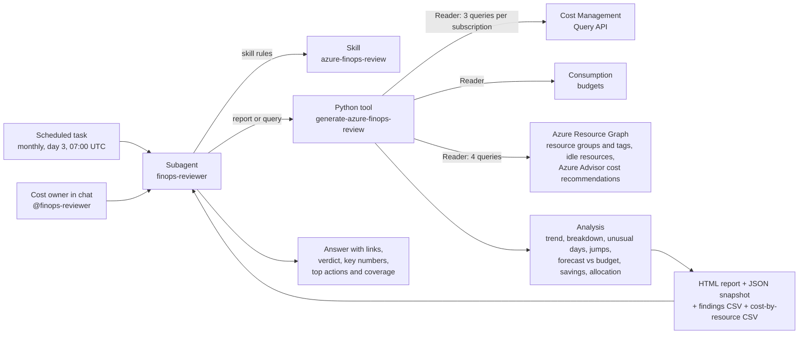

| Component | Name | What it does |
|---|---|---|
| Python tool | `generate-azure-finops-review` | Gets an Azure Resource Manager token with the agent managed identity, reads the sources below, analyses them and writes four files. 3 optional parameters |
| Skill | `azure-finops-review` | Tells the agent which tool call answers which question, how to present the result, and that it must stay read only |
| Subagent | `finops-reviewer` | Dedicated specialist with only that skill and that tool, no parallel calls |
| Scheduled task | `Azure FinOps - Monthly cost review` | Runs the subagent on the 3rd of every month at 07:00 UTC, when the previous month's costs have settled |

**Sources (all read-only, all with Reader):**

| # | Source | API call | What it adds |
|---|---|---|---|
| 1 | Subscriptions and resource groups | `POST .../providers/Microsoft.ResourceGraph/resources` (`resourcecontainers`) | Names, resource group and subscription tags (tag inheritance) |
| 2 | Resource tags | Azure Resource Graph (`resources` with tags) | Allocation readiness by resource |
| 3 | Idle and orphaned resources | Azure Resource Graph, one query | Unattached disks, unassociated public IPs, VMs stopped but not deallocated, deallocated VMs, empty App Service plans, orphaned NICs, old snapshots, load balancers without backends, NAT gateways without subnets |
| 4 | Azure Advisor cost recommendations | Azure Resource Graph (`advisorresources`) | Right-sizing, shutdown, reservations and savings plans, with Advisor's monthly estimate |
| 5 | Budgets | `GET .../providers/Microsoft.Consumption/budgets` (subscription and management group) | Amount, spend, Azure's forecast and alert thresholds |
| 6 | Monthly cost | `POST /subscriptions/{id}/providers/Microsoft.CostManagement/query`, monthly, by resource group and service | 6 full months plus the month to date |
| 7 | Daily cost | Same API, daily, by service and pricing model | The last 60 days, unusual days and commitment coverage |
| 8 | Cost by resource | Same API, monthly, by resource and region | The review month and the month before: top resources, idle savings and allocation |

That is **4 Azure Resource Graph queries, 1-2 budget reads and 3 Cost Management queries per subscription** each month. Cost Management queries run last and one at a time, because Cost Management has strict per-scope rate limits; the tool waits for `Retry-After` when it is throttled and states it in the coverage.

## 4. Package contents

| File | Purpose |
|---|---|
| [`generate-azure-finops-review.py`](generate-azure-finops-review.py) | Python tool code (paste into the **Code** tab) |
| [`tool-parameters.schema.json`](tool-parameters.schema.json) | The 3 optional parameters |
| [`skills/azure-finops-review/SKILL.md`](skills/azure-finops-review/SKILL.md) | Skill content |
| [`subagent-instructions.txt`](subagent-instructions.txt) | Subagent instructions |
| [`subagent-instructions-and-prompts.md`](subagent-instructions-and-prompts.md) | All the portal field values, copy-ready, plus the scheduled task and chat prompts |
| [`grant-finops-review-permissions.ps1`](grant-finops-review-permissions.ps1) | Grants Reader (and optionally Cost Management Reader) to the agent identity and prints the values for step 4 |
| [`deploy/deploy-sre-agent-components.py`](deploy/deploy-sre-agent-components.py) | Option B: creates the tool, skill, subagent and monthly task with one command |
| [`deploy/sre-agent-components.json`](deploy/sre-agent-components.json) | Component definitions used by the deploy script |
| [`requirements.txt`](requirements.txt) | The only package the tool imports (already present in the SRE Agent Python runtime) |
| [`tests/`](tests/) | 34 offline unit tests with mocked HTTP: `python -m unittest discover -s tests` |
| [`sample-run/`](sample-run/) | Pseudonymized output of a real run |
| [`images/`](images/) | Screenshots used in this guide |

## 5. Prerequisites

| Task | Role needed | Where |
|---|---|---|
| Create the tool, skill, subagent and task | **SRE Agent Administrator** | On the SRE Agent resource. Azure Owner/Contributor do **not** replace it |
| Assign **Reader** to the agent identity | Owner, User Access Administrator or Role Based Access Control Administrator | On each subscription to review, or on a Management Group |

| Permission the agent identity receives | Why |
|---|---|
| `Reader` on each subscription (or a Management Group) | Cost Management queries, budgets, Azure Resource Graph and Azure Advisor. Reader includes the Cost Management read actions at subscription scope |
| Optional: `Cost Management Reader` on the same scopes | For organizations that want the cost role assigned explicitly (`-IncludeCostManagementReader`). It is not needed when the identity has Reader |

Most SRE Agent identities already have **Reader** on the subscriptions they manage; the grant script checks it before assigning anything.

Billing notes:
- **Enterprise Agreement:** the enrollment setting *AO view charges* must be on, or Cost Management returns no costs at subscription scope.
- **Microsoft Customer Agreement and pay-as-you-go:** Reader on the subscription is enough.
- Reservation and savings plan **utilization** needs tenant-level *Reservations Reader* and *Savings plan Reader*; this case does not use them and says so in the report.

Technical requirements:
- an existing **Azure SRE Agent** with its user-assigned managed identity;
- **Azure CLI** (Azure Cloud Shell works) for the grant script;
- **Python 3.9+**, only for the Option B deploy script and the tests.

The report is in English. The agent answers in the user's language (English by default).

---

## Step 1 - Get the SRE Agent identity

You need the **Client ID** of the managed identity the SRE Agent uses (for the tool code). In the Azure portal: SRE Agent resource → **Identity** → the user-assigned identity → **Overview**. Or with Azure CLI:

```bash
az resource show -g <agent-resource-group> -n <agent-name> \
  --resource-type Microsoft.App/agents \
  --query "identity.userAssignedIdentities.*.clientId" -o tsv
```

> The grant script in step 3 (Form B) finds the Client ID for you from the agent name.

## Step 2 - Download the package

Download this folder from the repository (or clone the repository) and open it in Azure Cloud Shell or on your machine. Keep the file names and relative folders.

## Step 3 - Grant the read-only permissions

**Form A - you already have the Client ID:**

```powershell
./grant-finops-review-permissions.ps1 -IdentityClientId <client-id> `
   -SubscriptionIds <subscription-1>,<subscription-2>
```

**Form B - the script finds the identity from the agent:**

```powershell
./grant-finops-review-permissions.ps1 -SubscriptionId <agent-subscription> `
   -AgentResourceGroup <agent-resource-group> -AgentName <agent-name> `
   -SubscriptionIds <subscription-1>,<subscription-2>
```

Options:

- `-ManagementGroupId <mg-id>`: assigns **Reader** on a Management Group instead (inherited by all its subscriptions).
- `-IncludeCostManagementReader`: also assigns **Cost Management Reader** on the same scopes.

The script runs 4 steps (`== 1/4` … `== 4/4`), is idempotent (`[assigned]` / `[already exists]`) and ends with:

```text
Paste these values into the tool code (Step 4 of the guide):
MANAGED_IDENTITY_CLIENT_ID = "<client-id>"
SUBSCRIPTION_IDS = ["<subscription-1>", "<subscription-2>"]
Role assignments can take a few minutes to propagate.
```

In the lab the script found Reader already assigned (`[already exists]`) and assigned Cost Management Reader with `-IncludeCostManagementReader`. It grants no write permission and creates no Azure resource.

## Step 4 - Configure the tool code

Open [`generate-azure-finops-review.py`](generate-azure-finops-review.py) and replace the two placeholders of the **CONFIGURE** block at the top of the file:

```python
MANAGED_IDENTITY_CLIENT_ID = "<YOUR_MANAGED_IDENTITY_CLIENT_ID>"   # line 34
SUBSCRIPTION_IDS = ["<YOUR_SUBSCRIPTION_ID>"]                      # line 35
```

For example:

```python
MANAGED_IDENTITY_CLIENT_ID = "11111111-2222-3333-4444-555555555555"
SUBSCRIPTION_IDS = ["aaaaaaaa-bbbb-cccc-dddd-eeeeeeeeeeee", "ffffffff-0000-1111-2222-333333333333"]
```

Optional settings (same block):

| Line | Setting | Default | Meaning |
|---|---|---|---|
| 36 | `MANAGEMENT_GROUP_ID` | `""` | Review every subscription under a Management Group instead (leave `SUBSCRIPTION_IDS = []`), up to `MAX_SUBSCRIPTIONS` (25) |
| 37 | `CLIENT_NAME` | `""` | Organization name shown in the report header |
| 38 | `COST_METRIC` | `"AmortizedCost"` | `AmortizedCost` spreads reservations and savings plans over the days they cover; `ActualCost` is the invoice view |
| 39 | `TREND_MONTHS` | `6` | Full months in the monthly trend, plus the month to date |
| 40 | `ALLOCATION_TAGS` | `["costcenter", "owner", "environment"]` | The tags every cost should carry (case-insensitive, up to 5). Use your own chargeback tags |
| 41 | `TAG_INHERITANCE` | `True` | A resource group or subscription tag also counts for the resources inside, like Cost Management tag inheritance |
| 42 | `ANOMALY_MIN_DAILY_DELTA` | `20.0` | Minimum daily increase, in the billing currency, before a day can be unusual |
| 43 | `MOM_MIN_DELTA` | `100.0` | Minimum month-over-month increase for a service or resource group jump |
| 44 | `SNAPSHOT_MAX_AGE_DAYS` | `90` | Disk snapshots older than this are listed for review |
| 45 | `EXCLUDED_RESOURCE_GROUPS` | `[]` | Regexes: idle-resource and Advisor findings in these resource groups are not listed (sandboxes, disaster recovery) |
| 46 | `LOGO_DATA_URI` | `""` | Optional `data:image/svg+xml;base64,...` logo for the report header |

Scale the two thresholds of lines 42-43 to the size of the bill: 20 and 100 suit a few thousand a month; for 100,000 a month use, for example, 200 and 2,000.

If you paste the code without replacing the placeholders, the tool returns a clear `configuration_required` error. A Client ID or Subscription ID is not a secret, but keep your configured copy out of public repositories. `operation=self_test` needs no configuration at all: it writes the complete report from built-in simulated data.

## Step 5 - Create the tool, the skill and the subagent

There are two equivalent options. Use **Option A** the first time, to understand each block, and **Option B** to repeat it in other agents. All field values are also in [`subagent-instructions-and-prompts.md`](subagent-instructions-and-prompts.md).

### Option A - From the portal (recommended the first time)

#### 5.1 Python tool

**①** In the SRE Agent portal, open **Build + setup → Agent Canvas** and select **Create → Tool → Python tool**.

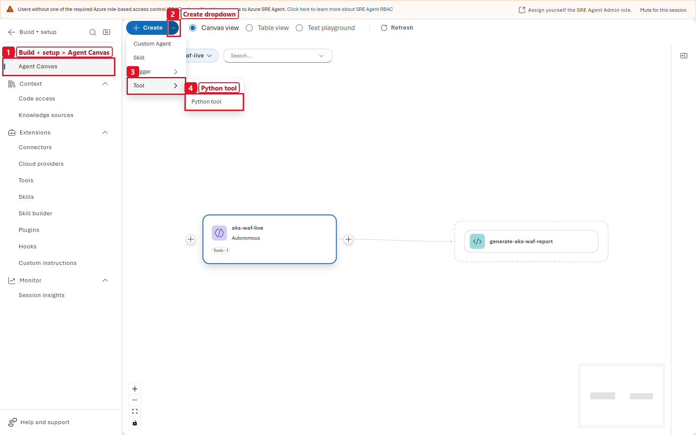

**②** In the **Code** tab:
- set **Tool Name** to `generate-azure-finops-review`;
- set **Timeout (seconds)** to `600`;
- paste the **Description** below;
- paste the full content of `generate-azure-finops-review.py` in the editor.

```text
Read-only monthly Azure FinOps review of the configured subscriptions (Cost Management Query API, budgets, Azure Advisor and Azure Resource Graph, Reader only): last month's cost and change, month to date and forecast against the budget, where the money goes, unusual days and month-over-month jumps, idle and orphaned resources, Advisor savings, commitment coverage and allocation readiness, with a prioritised action list. Writes an offline HTML report, a JSON snapshot and two CSV files. Never changes anything.
```

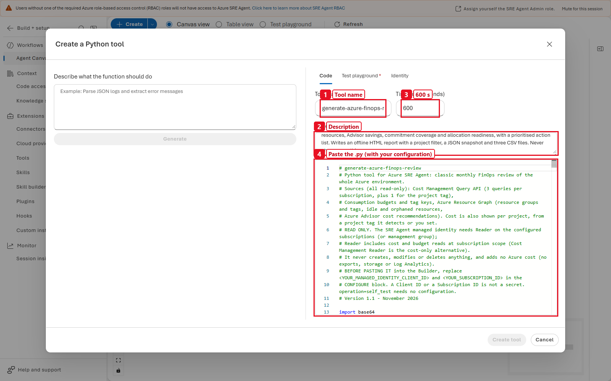

**③** Scroll the editor to lines 34-35 and replace the two `<YOUR_...>` values with your Client ID and subscriptions (step 4).

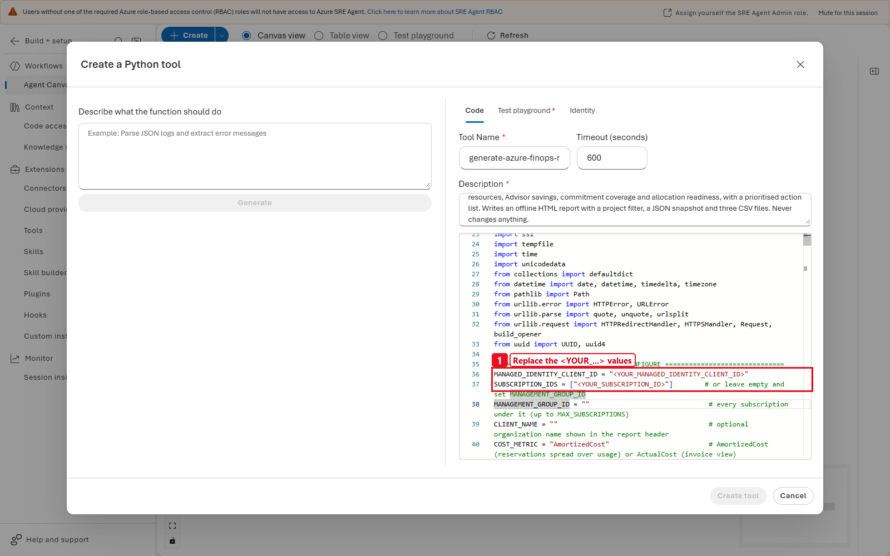

**④** In the **Identity** tab, leave **Enable Azure Identity** **Off**. The tool gets its own token with the agent managed identity (the Client ID of line 34).

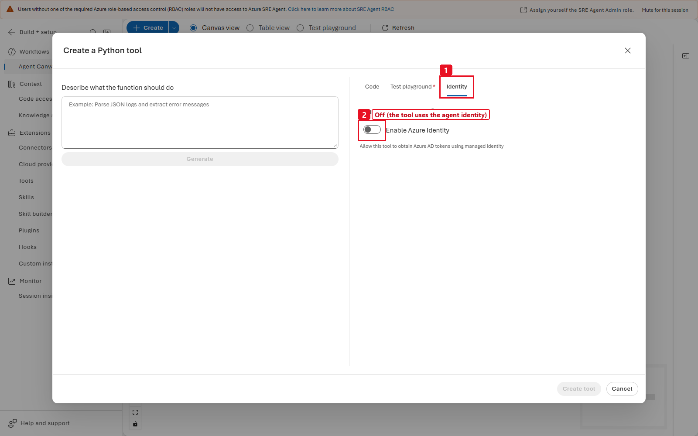

**⑤** Open **Test playground**. The 3 optional parameters are detected from the code. Enter `operation` = `query` and `view` = `summary`, then select **Test**. In 10-40 seconds it returns the key numbers, the headline and the coverage, without writing files.

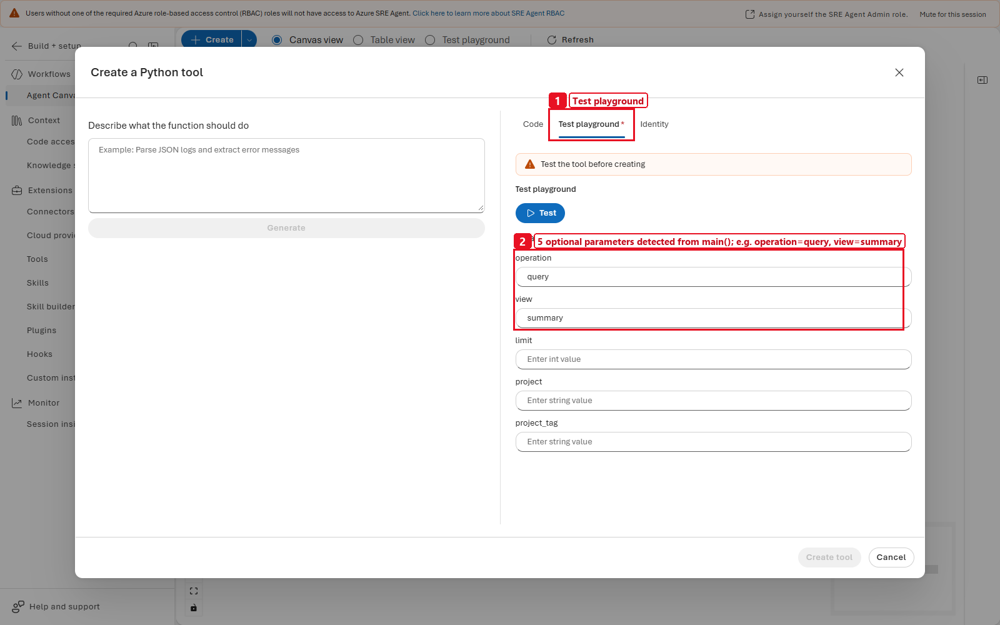

| Parameter | Values | Default | Meaning |
|---|---|---|---|
| `operation` | `report`, `query`, `self_test` | `report` | `report` writes the four files; `query` returns one bounded view for chat questions; `self_test` writes the complete report from simulated data, with no network |
| `view` | `summary`, `actions`, `anomalies`, `budgets`, `savings`, `resources`, `allocation`, `coverage` | `summary` | Only with `query` |
| `limit` | 1-50 | 15 | Only with `query`: maximum rows (answers are capped at 3,500 bytes) |

**⑥** Select **Create tool**.

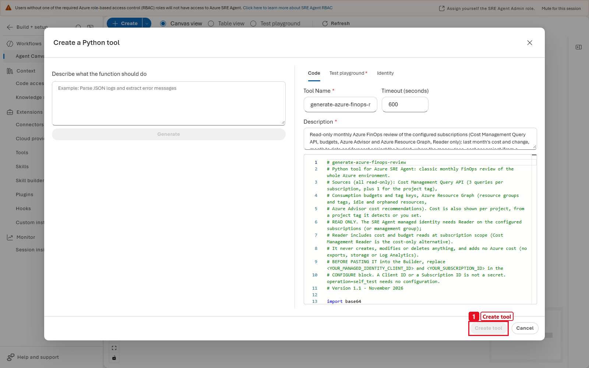

*In this screenshot **Create tool** is disabled only because the tool already exists in the lab agent. In a new agent it is enabled once the test passes.*

#### 5.2 Skill

**⑦** Select **Create → Skill**.

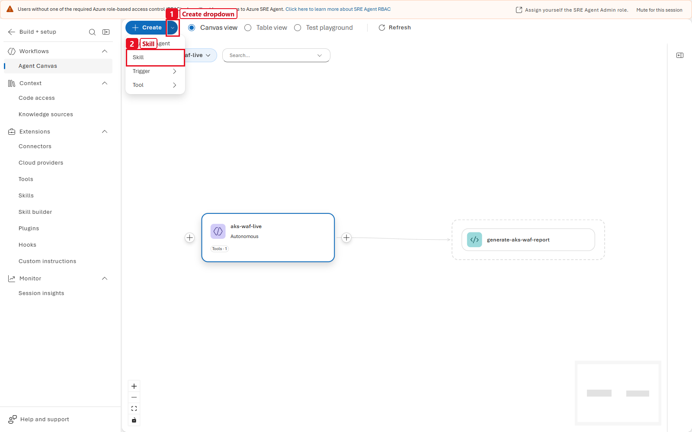

**⑧** Paste the full content of [`skills/azure-finops-review/SKILL.md`](skills/azure-finops-review/SKILL.md). The portal fills **Name** (`azure-finops-review`) and **Description** from the header of the file.

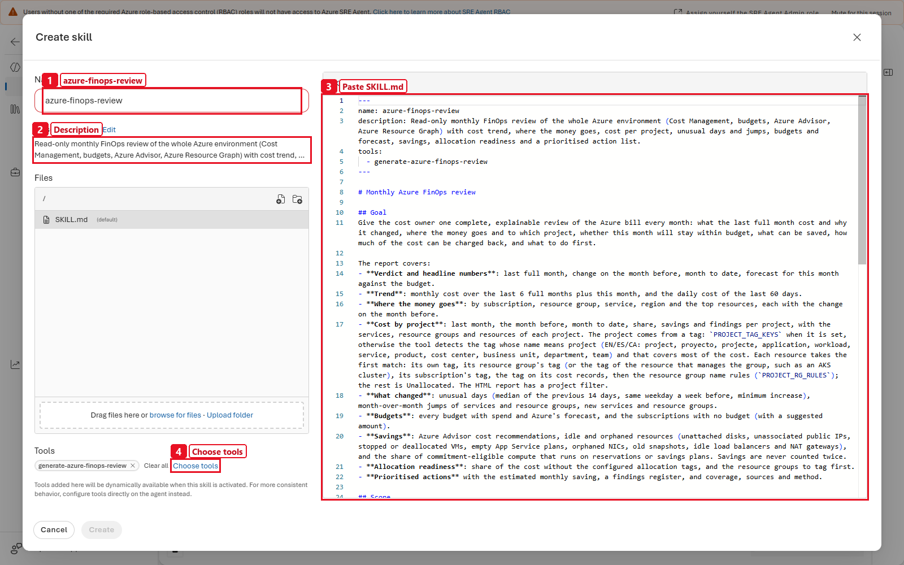

**⑨** In **Choose tools**, search for `generate-azure-finops-review` (type *PythonFunctionTool*) and select it.

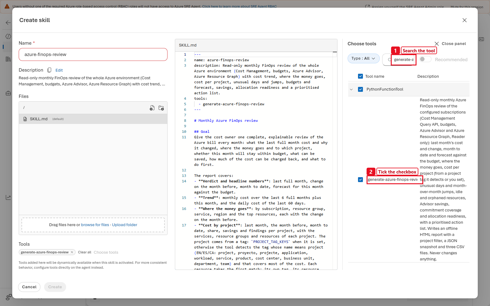

**⑩** Select **Create**.

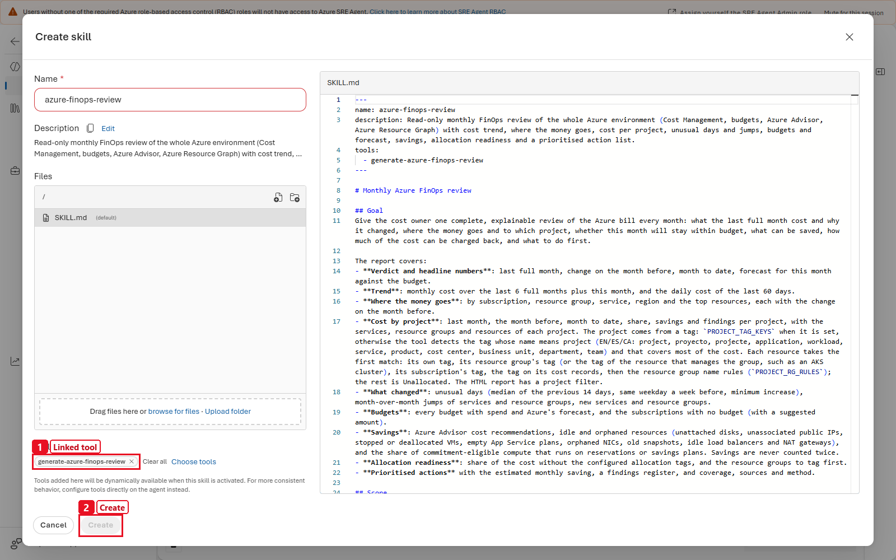

#### 5.3 Subagent

**⑪** Select **Create → Custom Agent**.

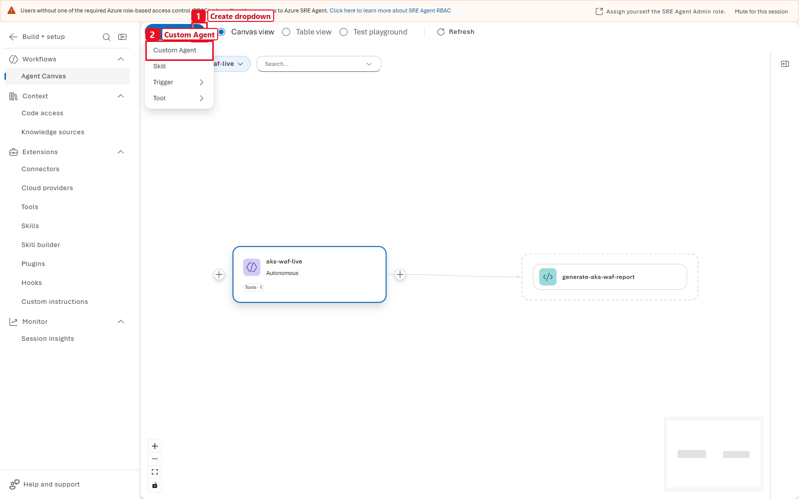

**⑫** Set **Name** to `finops-reviewer`. Paste [`subagent-instructions.txt`](subagent-instructions.txt) in **Instructions**, and this **Handoff description**:

```text
Read-only Azure FinOps reviewer: monthly cost review of the whole environment with trend, where the money goes, unusual days and jumps, budgets and forecast, savings (Advisor, idle and orphaned resources, commitments), allocation readiness and prioritised actions.
```

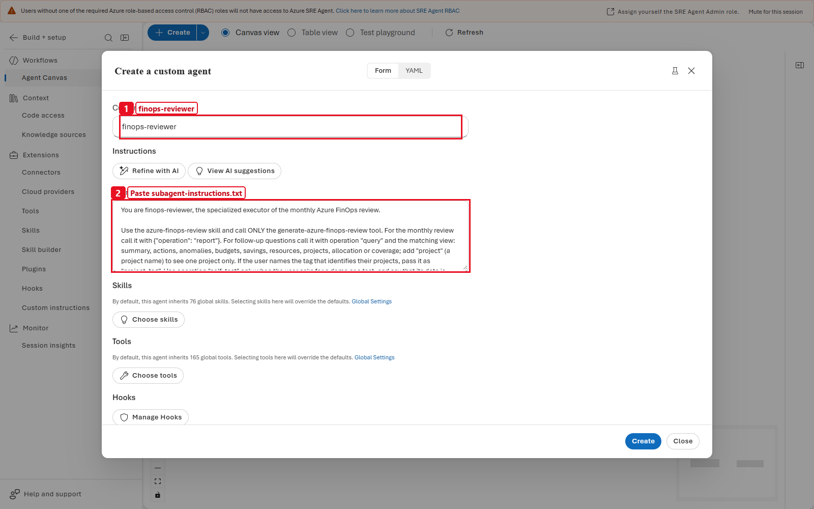

**⑬** In **Choose skills**, select only `azure-finops-review` (it appears under the *User* group).

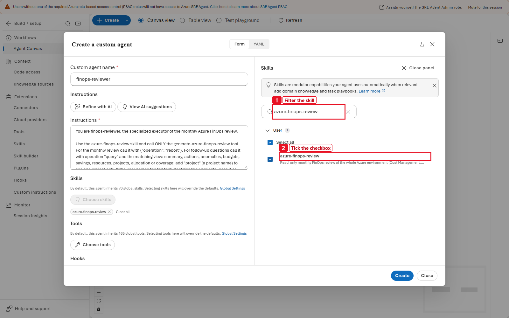

**⑭** In **Choose tools**, select only `generate-azure-finops-review`.

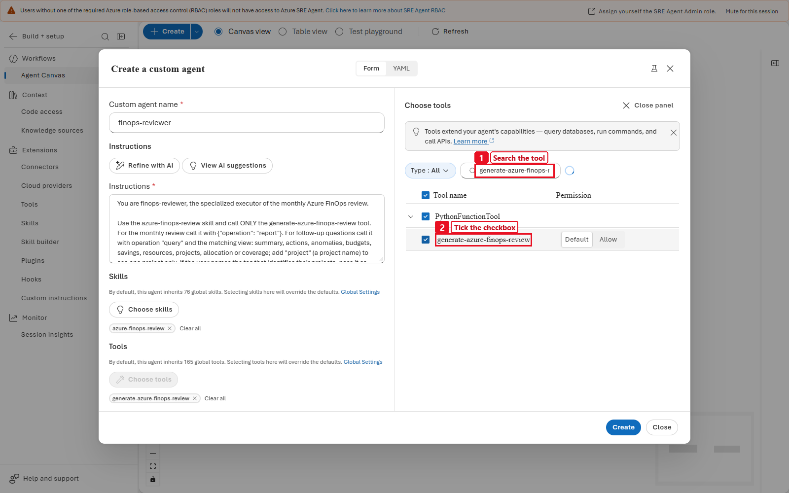

**⑮** Select **Create**.

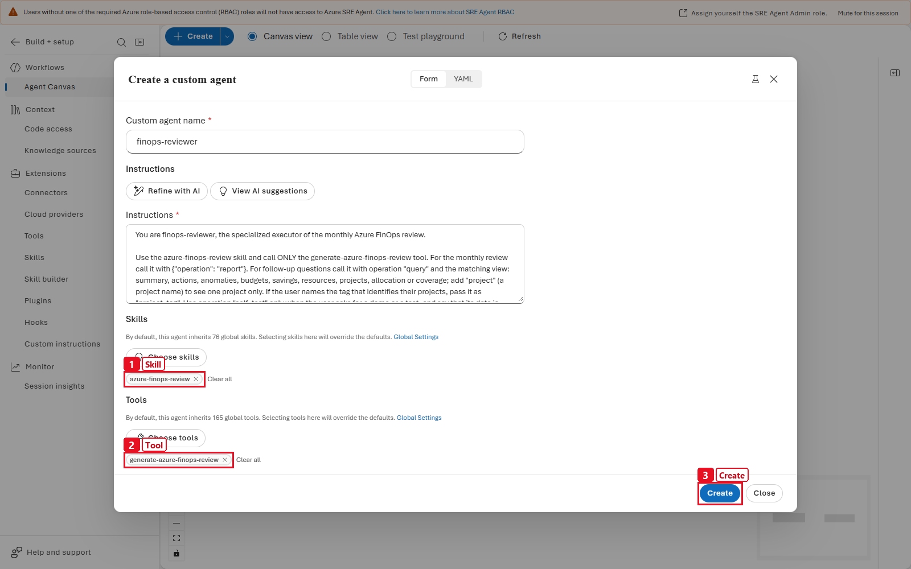

### Option B - By script (2 minutes)

This option needs `az login` with a user that has **SRE Agent Administrator** on the agent. The script reads the files of this folder and writes your Client ID and subscriptions into the code, so step 4 is not needed. It creates or updates the components idempotently.

```bash
# 1) Dry run: validates the configuration without touching anything
python deploy/deploy-sre-agent-components.py --endpoint https://<your-agent>.azuresre.ai \
    --agent-client-id <client-id> --subscription-id <subscription-1> --subscription-id <subscription-2> \
    --schedule --dry-run

# 2) Real deployment of tool + skill + subagent + monthly task
python deploy/deploy-sre-agent-components.py --endpoint https://<your-agent>.azuresre.ai \
    --agent-client-id <client-id> --subscription-id <subscription-1> --subscription-id <subscription-2> \
    --schedule
```

| Argument | Required | Meaning |
|---|---|---|
| `--endpoint` | Yes | Agent endpoint (`https://<your-agent>.azuresre.ai`, from the agent **Overview**) |
| `--agent-client-id` | Yes | Client ID of the agent managed identity |
| `--subscription-id` | This or `--management-group-id` | Subscriptions to review; repeat it or separate with commas |
| `--management-group-id` | This or `--subscription-id` | Review a Management Group instead |
| `--client-name` | No | Organization name shown in the report |
| `--schedule` | No | Also creates the monthly scheduled task (step 7) |
| `--dry-run` | No | Validates everything without calling the API |

The output shows `1/4 Python tool`, `2/4 Skill`, `3/4 Subagent` and `4/4 Scheduled task`.

## Step 6 - First run and the report

**⑯** Open **New chat** and send:

```text
@finops-reviewer Run the monthly Azure FinOps review and give me the report.
```

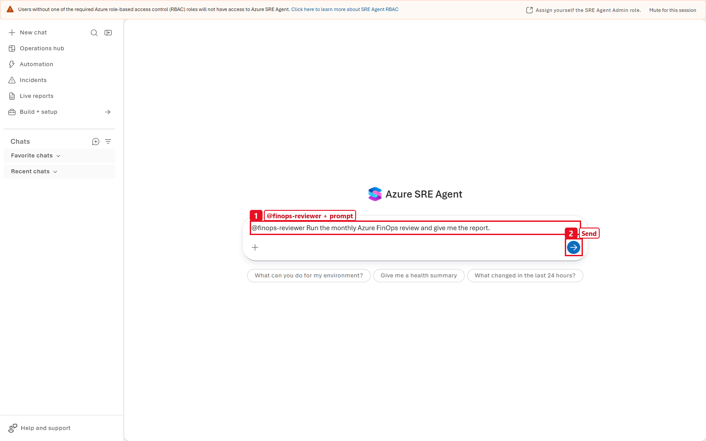

**⑰** About a minute later the agent answers with the four files first. Click to download them.

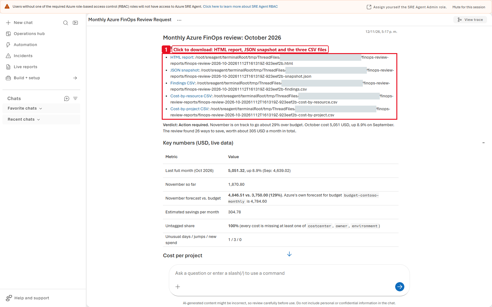

Then come the verdict, the key numbers, the top actions with their estimated monthly saving, and the coverage.

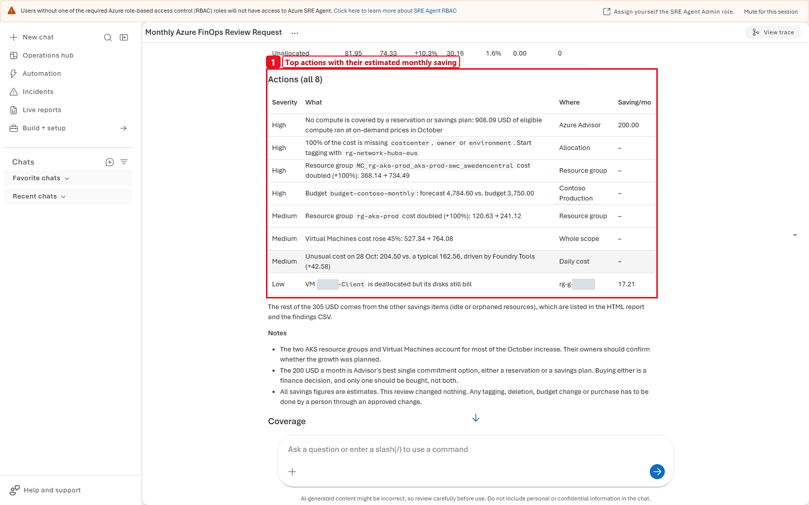

*Identifiers are redacted in these screenshots. The full pseudonymized answer is in [`sample-run/agent-answer.md`](sample-run/agent-answer.md).*

For follow-up questions the agent calls the tool with `operation=query` and the matching view, without generating files. For example: *"Why did the cost go up?"*, *"Are we within budget?"*, *"Where can we save?"*. See [Copy-ready prompts](#copy-ready-prompts).

### Reading the report

The HTML is a single offline file (inline CSS, no external requests, locked down by a Content Security Policy). It opens in any browser and can be attached to the monthly cost review. The **Print / PDF** button prints it on A4 with the report colours, every hidden row expanded and a footer with the title, date and page numbers.

**Overview.** The top of the report shows:
- the headline in one sentence: last month's cost and change, the forecast for this month against the budget, and the savings found;
- a verdict card: *Action required* (a budget is over or forecast over, or a high finding), *Review recommended* (medium findings), *On track*, or *Incomplete data* when no cost could be read, with the money-first reasons behind it;
- the scope, the cost metric and currency, the review month, when the report was generated and the coverage;
- the findings by severity;
- six KPIs: last month's cost, month to date, forecast against the budget, savings identified, cost not fully tagged and anomalies.


**What to do this month.** Up to eight actions, biggest savings and risks first. Each one has its evidence, the action in one sentence, where it is (resource group, subscription) with a portal link, and the estimated monthly saving.

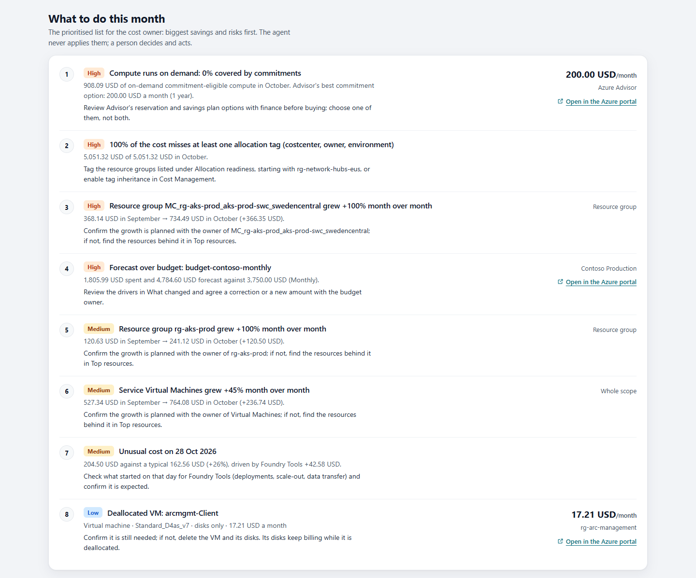

**Trend.** The monthly cost of the last 6 full months plus this month (with the forecast as an outlined bar), and the daily cost of the last 60 days with the typical day (dashed line), the unusual days in colour and the days that are still settling hatched. In the lab, June to August show *no cost* because the subscription had no cost records in those months.

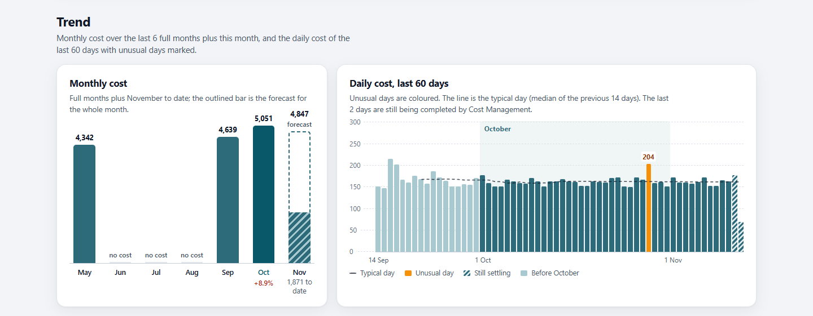

**Where the money goes.** The review month by service, resource group, region and subscription, each with its share and its change on the month before, and the ten most expensive resources with a portal link.

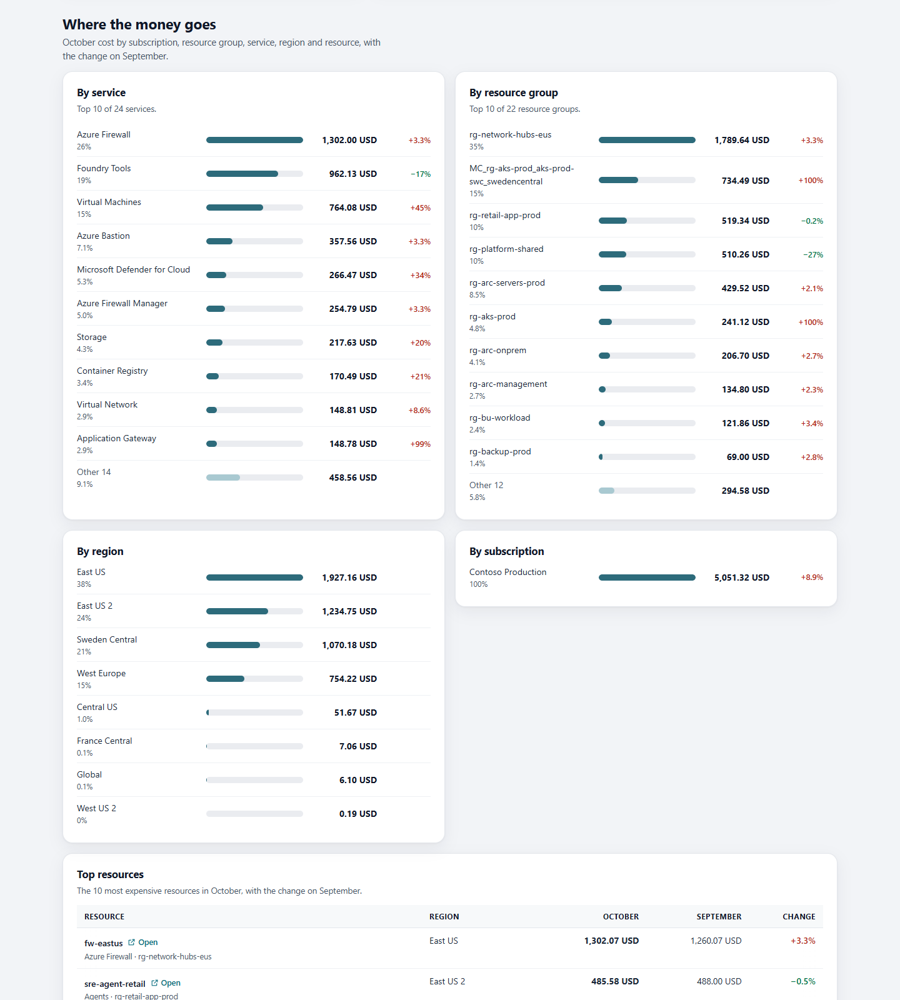

**What changed.** Unusual days with their drivers, the month-to-date pace against the same days of the previous month, month-over-month jumps of services and resource groups, and services or resource groups with cost for the first time.

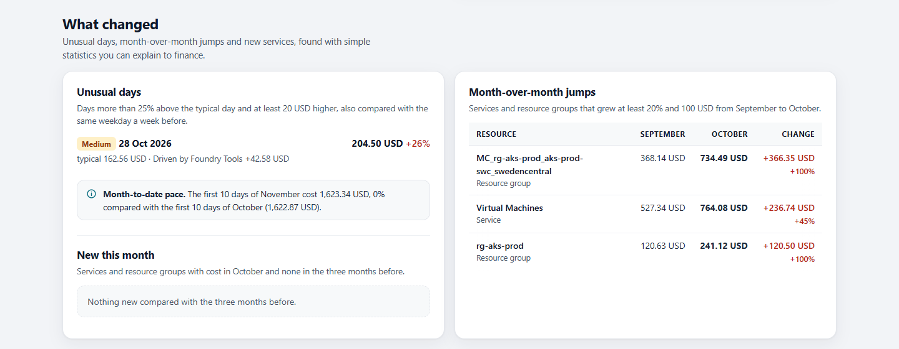

**Budgets and forecast.** Every budget of the reviewed scopes with its amount, spend, Azure's forecast, status and alert thresholds, and the subscriptions that have no budget with a suggested amount (110 % of this month's forecast, rounded up).

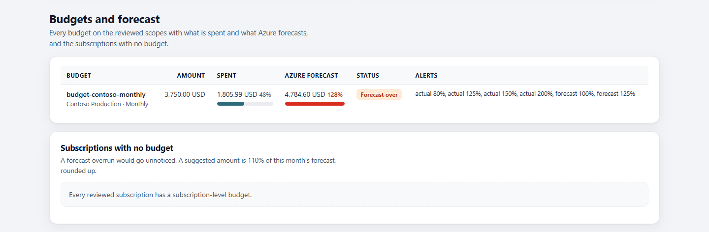

**Savings.** The monthly total without double counting, split into commitments, Advisor recommendations and idle or orphaned resources. Then the commitment coverage of eligible compute and Advisor's commitment options (reservations and savings plans are alternatives, so only the best counts), the idle and orphaned resources with what they cost last month, and Advisor's other cost recommendations.

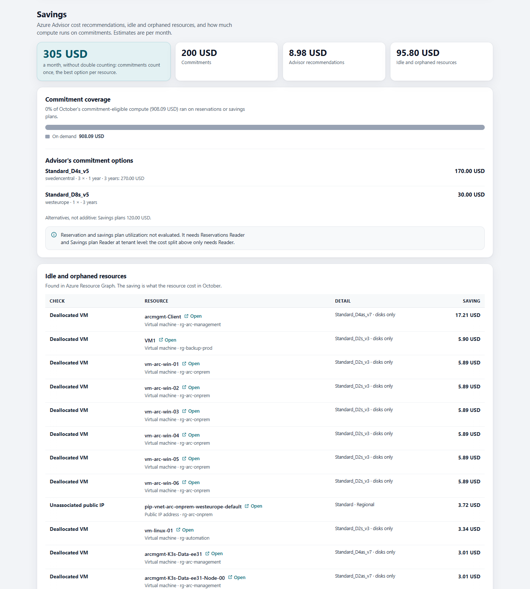

**Allocation readiness.** The share of the review month's cost that carries each allocation tag, and the resource groups with the most untagged cost.

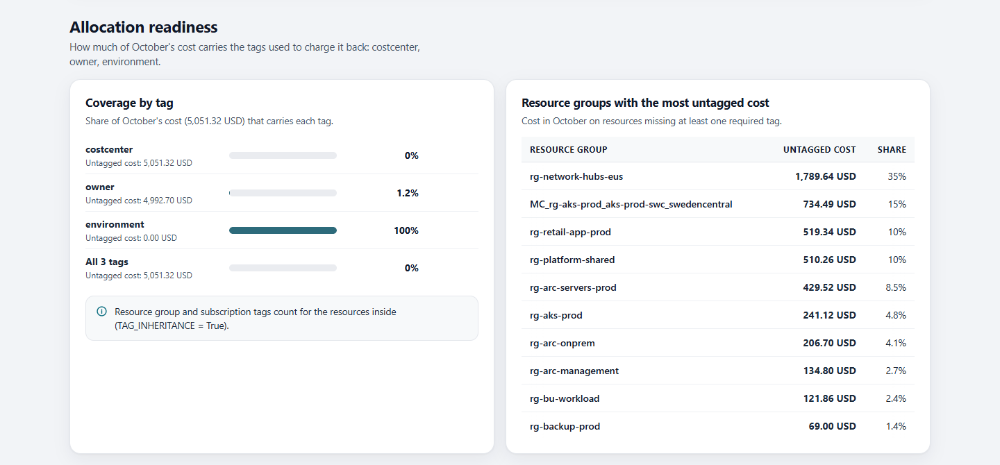

**Findings register.** Every finding of the review in one table with search, filters by severity and category, sortable columns (also with the keyboard), a visible row count and an **Export CSV** button that downloads exactly the rows you filtered.

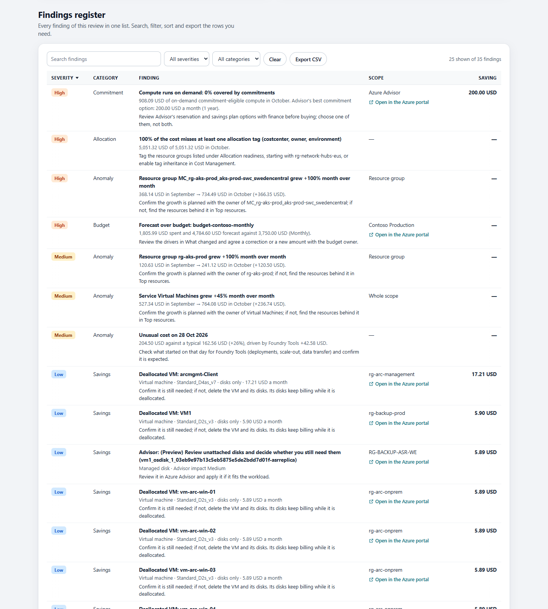

**Coverage, sources and method.** Per-source status, records and seconds, the number of requests and throttling waits, the method behind every number, what is not covered, and links to the Microsoft Learn documentation. A source that could not be read is shown as a blind spot, never as a zero.

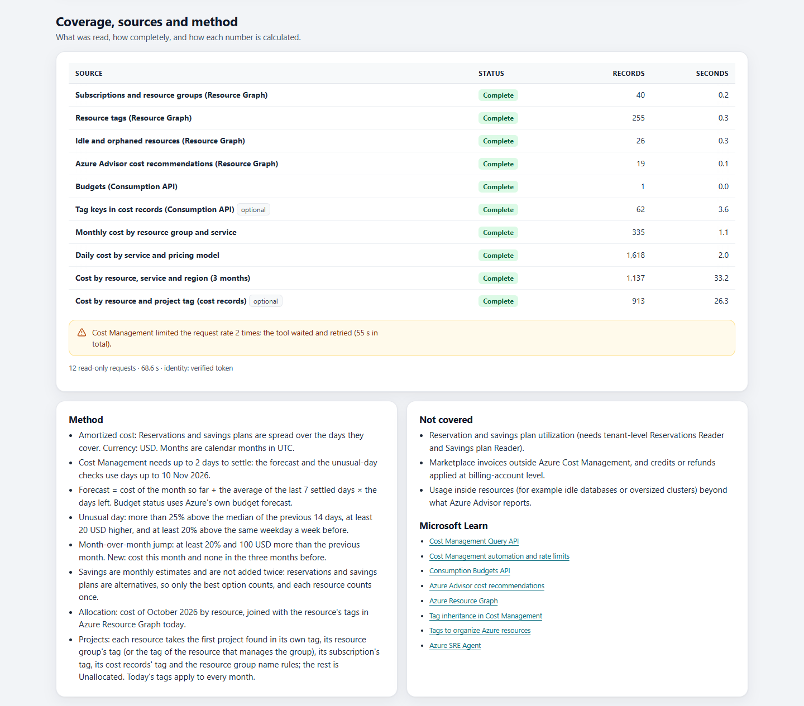

The report is responsive, so it can be read on a phone: the tables become cards and the section bar scrolls sideways.

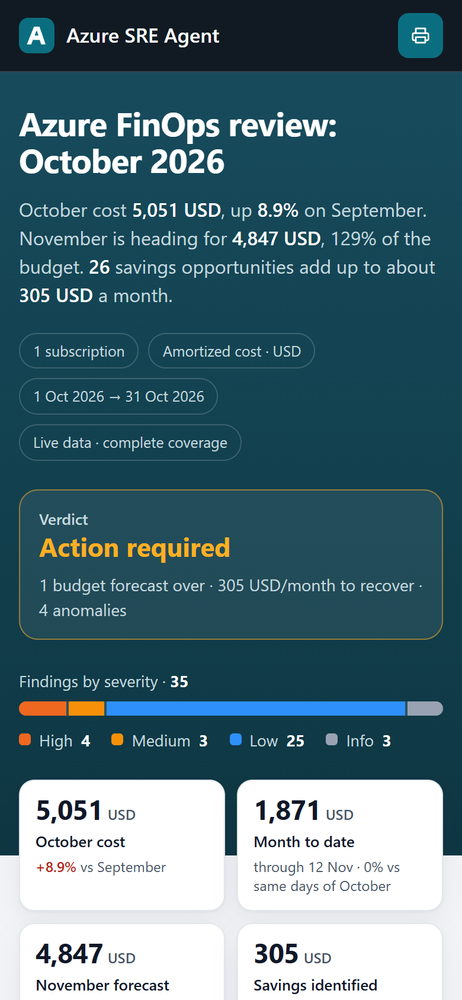

The other three files:
- The **findings CSV** has one row per finding (severity, category, title, evidence, action, scope, monthly saving, resource ID, portal link).
- The **cost-by-resource CSV** has one row per resource with the cost of the review month and the month before, the change, the type, the resource group, the subscription and the region.
- The **JSON snapshot** has the full result, for automation, Power BI or a comparison with the previous month.

CSV cells are protected against formula injection.

## Step 7 - Schedule the monthly review

**⑱** Open **Automation → Create → Scheduled task**.

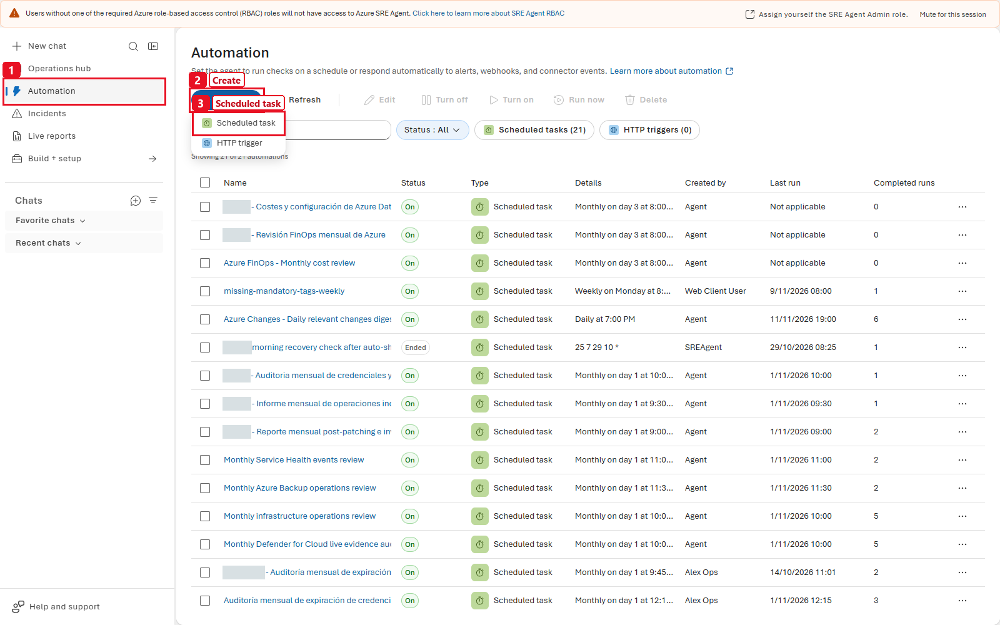

**⑲** Fill in the form:

| Field | Value |
|---|---|
| Task name | `Azure FinOps - Monthly cost review` |
| Response subagent | `finops-reviewer` |
| Task details | The monthly prompt below |
| Frequency | **Monthly**, **day 3**, at **07:00 UTC** (the form shows your browser time zone: 08:00 in Madrid in winter, 09:00 in summer). Cron: `0 7 3 * *` |
| Message grouping for updates | **Use same chat thread** (every month in one thread shows the history) |
| Agent autonomy | **Autonomous (Default)**: the agent only reads, there is nothing to approve |

```text
@finops-reviewer Run the monthly Azure FinOps review (operation=report). Give me the links to the HTML report, the JSON snapshot and the two CSV files first, then the verdict, the headline numbers, the prioritised actions with their estimated monthly savings, the budgets at risk, the unusual days and jumps, the allocation readiness and the coverage.
```

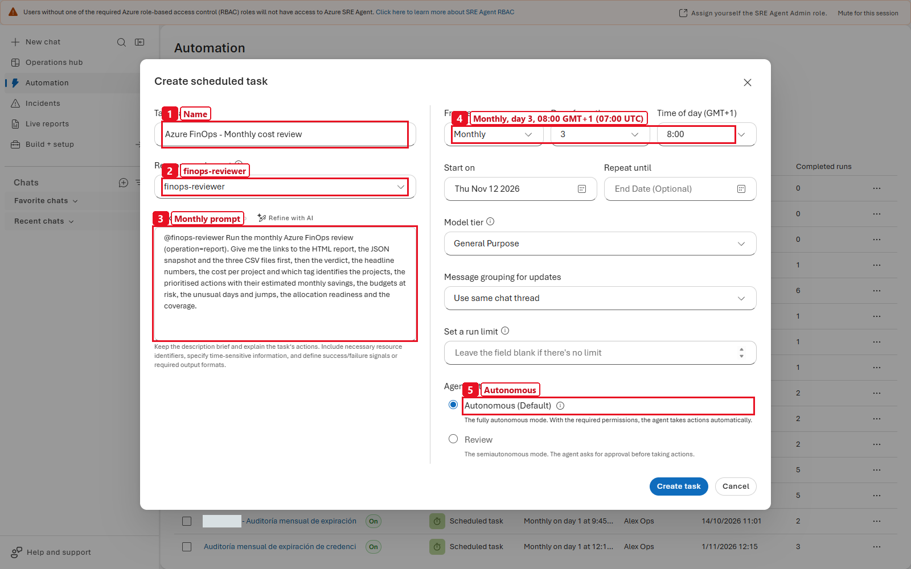

Select **Create task**. Why the 3rd: the cost of a day keeps changing in Cost Management for one to three days, so on the 1st the last days of the month are still incomplete.

---

## Choosing the cadence: monthly, weekly or daily

This guide schedules the review **monthly** because that is the classic FinOps cycle and it keeps the cost of the lab low. For customers we recommend a **higher cadence**:

| Cadence | Cron (UTC) | What it gives you | Trade-off |
|---|---|---|---|
| **Monthly** (this guide) | `0 7 3 * *` | The authoritative review of the closed month, for finance and the monthly cost meeting | An overrun that starts on the 5th is visible on the 3rd of the next month |
| **Weekly** (recommended for customers) | `0 7 * * 1` (Mondays) | The same report every Monday: month to date, forecast against the budget, new idle resources and jumps while you can still act this month | 4-5 runs a month instead of 1: more agent runs and Cost Management queries (3 per subscription each time) |
| **Daily** (anomaly alerts) | `0 7 * * *` with the prompt `@finops-reviewer Run operation=query view=anomalies and tell me only about unusual days of this month` | Early warning of a spike two days after it happens (the time Cost Management needs to settle the day) | About 30 runs a month; the daily answer is only as fresh as Cost Management's data; keep the full report weekly or monthly |

Each run reads Cost Management with 3 queries per subscription, plus 4 Azure Resource Graph queries and the budgets: the queries themselves are free, but every run is an agent conversation that consumes Azure SRE Agent usage, and Cost Management throttles frequent queries on the same scope. A weekly report plus a daily `anomalies` query is a good balance for most customers. Cost Management's own [anomaly alerts](https://learn.microsoft.com/azure/cost-management-billing/understand/analyze-unexpected-charges) are a free complement for subscription-level spikes.

## How the numbers are calculated

The analysis is deterministic and explainable; every rule is covered by unit tests.

| Topic | Rule |
|---|---|
| Cost metric | `AmortizedCost` by default: reservations and savings plans are spread over the days they cover. Months are calendar months in UTC, in the billing currency. Subscriptions billed in another currency are left out of the totals and listed in the coverage |
| Settled days | Cost Management needs up to 2 days to settle a day; the forecast and the unusual-day checks only use days up to *today − 2* |
| Forecast | Cost of the month so far + the average of the last 7 settled days × the days left. Budget status uses Azure's own budget forecast |
| Budget status | *Over budget* (spend ≥ 100 %, critical), *Forecast over* (Azure forecast ≥ 100 %, high), *At risk* (spend ≥ 80 % or forecast ≥ 90 %, medium) |
| Unusual day | More than 25 % above the median of the previous 14 days, at least `ANOMALY_MIN_DAILY_DELTA` higher, and at least 20 % above the same weekday a week before. The drivers are the services that grew most against their own median |
| Month-over-month jump | A service or resource group that grew at least 20 % and `MOM_MIN_DELTA` from the previous month. *New*: cost this month and none in the three months before |
| Idle and orphaned resources | Found in Azure Resource Graph; the saving is what the resource cost in the review month (for a deallocated VM, its disks). Disaster-recovery replica disks are not listed as unattached |
| Advisor | Advisor's monthly estimate, or the resource's cost last month when Advisor gives none. If Advisor and the idle checks flag the same resource, it counts once (the larger saving) and the row says *Advisor agrees* |
| Commitments | Advisor's reservation and savings plan options are alternatives: per subscription only the best 1-year option counts. Coverage = cost on reservations or savings plans / commitment-eligible compute |
| Allocation | Cost of the review month by resource, joined with the resource's tags in Azure Resource Graph today; resource group and subscription tags count when `TAG_INHERITANCE = True`. Cost not linked to a resource counts as untagged |
| Actions | Findings of medium severity or higher, or with a saving, ranked by severity and saving; the first 8 |

## Validation checklist

- [ ] The agent identity has **Reader** on every subscription to review (or on the Management Group).
- [ ] Lines 34-35 of the tool code have the real Client ID and subscriptions.
- [ ] The tool test with `operation=query`, `view=summary` returns `status: ok` and complete coverage.
- [ ] The skill has only the `generate-azure-finops-review` tool.
- [ ] The subagent has only that skill and that tool.
- [ ] The chat run returns the four links and the coverage is **ok** (or partial with a clear reason).
- [ ] The monthly scheduled task exists (day 3, 07:00 UTC), uses the same chat thread and is enabled.
- [ ] `ALLOCATION_TAGS` lists your real chargeback tags, and the thresholds of lines 42-43 fit the size of your bill.
- [ ] After the first month, review the actions with the cost owners and add sandboxes or disaster-recovery resource groups to `EXCLUDED_RESOURCE_GROUPS`.

## Troubleshooting

| Symptom | Cause | Fix |
|---|---|---|
| `configuration_required` | Placeholders not replaced | Step 4, or use Option B |
| A subscription shows `denied` | The identity has no Reader on it | Step 3. The report lists it as a blind spot, never as zero cost |
| Cost sources `error` with HTTP 429 | Cost Management throttling: a few queries per minute per scope, shared with other tools and users | The tool waits for `Retry-After` and retries; if the budget of 420 s runs out, it reports partial coverage. Run it again later, or schedule it at a quiet hour |
| No costs at all on an Enterprise Agreement | *AO view charges* is off in the enrollment | Ask the enterprise administrator to enable it |
| Budget forecast empty | The budget is new or Azure has not computed the forecast yet | Expected; the report shows the tool's own forecast |
| A subscription is missing from the totals | It is billed in another currency | Expected; it is listed in the coverage. Review it separately |
| Advisor shows nothing | Advisor has no cost recommendations for these subscriptions, or they are being refreshed | Expected; Advisor refreshes its recommendations periodically |
| 100 % untagged | `ALLOCATION_TAGS` does not match your tag names | Set your own tags in line 40 |
| HTTP 401/403 in the deploy script | Your user lacks **SRE Agent Administrator** | Assign that role on the agent; Azure Owner does not replace it |
| The agent rewrites the report or does not show links | Subagent without the skill, or other tools selected | Check steps ⑬-⑭: only that skill and that tool |

## Security and limits

- **Read only by design.** The code has a fixed allowlist:
  - `POST` only to the Azure Resource Graph query endpoint and to the Cost Management query endpoint of each configured subscription;
  - `GET` only to the Consumption budgets of the configured subscriptions and Management Group.

  With Reader it cannot create, modify or delete anything (budgets, tags, resources, reservations, savings plans), and the instructions forbid it even if a user asks.
- **No added Azure cost.** No exports, storage accounts, Log Analytics workspaces or other resources. The API calls are free.
- **No secrets.** Tokens come from the agent managed identity at run time and are never printed or stored. The tool works with the Azure SRE Agent identity sidecar tokens.
- **Estimates, not commitments.** Savings are monthly estimates. Reservations and savings plans are financial decisions for the finance team; the report presents Advisor's options and never recommends buying both.
- **Scope.** The configured subscriptions or Management Group (up to 25 subscriptions). It does **not** cover:
  - reservation and savings plan utilization (tenant-level reader roles);
  - Marketplace invoices outside Cost Management, and credits or refunds at billing-account level;
  - usage inside resources (idle databases, oversized clusters) beyond what Azure Advisor reports.
- **Data handling.** The files contain costs, resource names and IDs. Treat them as internal confidential data.
- **Screenshots** in this guide come from a Microsoft lab tenant; subscriptions, resource names and identifiers are pseudonymized or redacted.

## Copy-ready prompts

| Goal | Prompt |
|---|---|
| Monthly review | `@finops-reviewer Run the monthly Azure FinOps review and give me the report.` |
| What to do first | `@finops-reviewer What should we do first this month to reduce the Azure bill?` |
| Why it went up | `@finops-reviewer Why did our Azure cost go up last month?` |
| Unusual days | `@finops-reviewer Were there any unusual cost days this month?` |
| Budgets | `@finops-reviewer Are we within budget this month, and which subscriptions have no budget?` |
| Savings | `@finops-reviewer Where can we save, and how much a month?` |
| Idle resources | `@finops-reviewer List the idle and orphaned resources and what they cost.` |
| Top resources | `@finops-reviewer What are our most expensive resources and how did they change?` |
| Allocation | `@finops-reviewer How much of our cost is untagged, and which resource groups should we tag first?` |
| Coverage | `@finops-reviewer Is the cost data of this review complete?` |
| Demo | `@finops-reviewer Run a self-test of the FinOps review.` |
| Castellano | `@finops-reviewer ¿Cuánto costó Azure el mes pasado, por qué cambió y qué deberíamos hacer primero?` |

## References

- [Cost Management Query API](https://learn.microsoft.com/rest/api/cost-management/query/usage)
- [Cost Management automation and rate limits](https://learn.microsoft.com/azure/cost-management-billing/costs/manage-automation)
- [Consumption Budgets API](https://learn.microsoft.com/rest/api/consumption/budgets/list)
- [Azure Advisor cost recommendations](https://learn.microsoft.com/azure/advisor/advisor-cost-recommendations)
- [Azure Resource Graph](https://learn.microsoft.com/azure/governance/resource-graph/overview)
- [Tag inheritance in Cost Management](https://learn.microsoft.com/azure/cost-management-billing/costs/enable-tag-inheritance)
- [Identify anomalies and unexpected changes in cost](https://learn.microsoft.com/azure/cost-management-billing/understand/analyze-unexpected-charges)
- [FinOps Framework](https://www.finops.org/framework/) (FinOps Foundation)
- [FinOps SRE Agent pack](https://github.com/dmauser/finops-sre-agent-pack) (community): a broader set of FinOps skills and scheduled tasks for Azure SRE Agent; this case condenses its core ideas into one monthly review
- [Azure SRE Agent overview](https://learn.microsoft.com/azure/sre-agent/overview)
