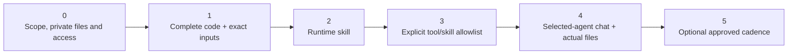

# Azure SRE Agent – Use cases

English, **step-by-step implementation guides for [Azure SRE Agent](https://learn.microsoft.com/azure/sre-agent/overview)**, with source code, restricted runtime instructions and dated evidence. Cases **01–03** include field-tested reference workflows; **04** retains explicit partial-live Kubernetes coverage. Read each guide's prerequisites and evidence limits before reproducing it in your own or a customer's environment. A published guide is not proof that the customer's sources or permissions are ready.

**Case 00** is the **SRE use-case builder**: describe a new operations idea in one sentence and the SRE Agent itself returns a tested use case (Python tool, skill, subagent and scheduled task) plus the exact permissions it needs. Start there to build scenarios beyond cases 01–11.

The workload guides preserve **real annotated screenshots** where collected: red boxes and numbers identify the controls, and captions distinguish dated live evidence, historical replay and synthetic samples. Use the linked code, schemas, skills and prompts, not code transcribed from an image.

**Quick navigation:** [Use cases](#use-cases) · [Before the workshop](#before-the-workshop) · [Inputs and outputs](#inputs-and-outputs-at-a-glance) · [Permissions](#common-prerequisites) · [Acceptance](#implementation-and-acceptance-checkpoints).

## Use cases

| # | Use case | What it does | Building blocks |
|:---:|---|---|---|
| 00 | [**SRE use-case builder** (start here to build new use cases)](case_0_v3/) | Describe an operations idea in one sentence and get a working use case: the subagent writes a JSON spec, and a tested engine generates the Python tool, lints it, self-tests it with the network blocked and live-checks it with the agent identity. Then it returns the 4 Builder blocks (tool, skill, subagent, scheduled task), exact permission commands and a setup guide, with no questions unless the data location is unknown. Read-only by design. [Business value](case_0_v3/README.md#business-value) | Builder kit Python tool · Skill · Subagent · One-command deploy script · 8 source types · 6 recipes · 28 step-by-step captures · Worked example |
| 01 | [**Microsoft Entra credential expiration audit**](01-entra-credential-expiration-audit/) | Helps reduce expiration-related disruption by identifying expired/expiring app secrets and certificates for owner review. Monthly, read-only audit of App Registrations and Service Principals that delivers an interactive HTML report with risk status, filters, CSV export and links to Microsoft Entra. [Business value](01-entra-credential-expiration-audit/README.md#business-value) | Python tool · Skill · Subagent · Scheduled task · Microsoft Graph |
| 02 | [**Defender for Cloud with SRE Agent**](02-arc-defender-posture-audit/) | Customer-neutral LIVE evidence across Azure services: native risks, recommendations, attack paths, resource details, posture controls and source CVEs. Separate branded offline Arc simulation, CSV/JSON exports and grounded questions. [Business value](02-arc-defender-posture-audit/README.md#business-value) | Two Python tools · Two skills · Restricted subagents · Monthly task · ARM / Resource Graph |
| 03 | [**Infrastructure operations with SRE Agent**](03-infrastructure-operations-health/) | Real Arc guest and Azure-native CPU, memory, utilization, capacity, platform-health and anomaly evidence. Interactive offline operations ledger, grounded questions, owner reviews and a separately approved real load → alert → restricted-subagent demonstration. [Business value](03-infrastructure-operations-health/README.md#business-value) | Read-only Python tool · Skill · Restricted subagent · Monthly task · Azure Monitor / Log Analytics |
| 04 | [**AKS Well-Architected configuration review**](04-aks-well-architected-review/) | Reviews cluster, workload and associated-resource configuration across best practices, security, FinOps and optimization. **PARTIAL_LIVE**: deployed read-only specialist with automatic four-file delivery; unavailable current Kubernetes sources remain No evaluado, separate from dated historical replay. | Standalone Python tool · Pinned rule catalog · Typed queries · Restricted skill/subagent · ARM / Kubernetes / ActualCost |
| 05 | [**Azure Service Health events review**](05-service-health-events-review/) | Gives operators one source-qualified workpaper for Microsoft-published service incidents and planned maintenance instead of repeated portal inspection. Keeps requested UTC updates, currently observed Active events, future maintenance and published potential resource associations separate; no measured workload-outage, announcement-newness or support-case claim. [Source and business limits](05-service-health-events-review/README.md#source-and-evidence-contract) | Read-only Python tool · Skill · Restricted subagent · Monthly task · Resource Health events / impacted resources · Offline HTML / JSON / CSV |
| 06 | [**Azure Backup operations review**](06-azure-backup-operations-review/) | Consolidates existing Backup jobs, native errors/warnings, job details and observed protected items into evidence for a human IT Operations incident decision. Distinguishes actual states and other operations, unknown expected protection and unverified history; monthly is cadence, not complete-month coverage or recovery proof. [Business value and limits](06-azure-backup-operations-review/README.md#problem-value-and-boundaries) | Read-only Python tool · Skill · Restricted subagent · Monthly task · Recovery Services jobs / protected items · Offline HTML / JSON / CSV |
| 08 | [**Azure Databricks dependency & configuration review**](08-databricks-dependency-configuration-review/) | Maps **OBSERVED** native dependencies, explicit **INFERRED** URI references and **UNKNOWN** runtime-lineage blind spots across ARM workspaces, VNet/NSG/UDR/Private Link, Access Connector, clusters, jobs/tasks, Lakeflow pipelines, SQL warehouses, Unity Catalog and associated Storage/Key Vault resources, with 36 best-practice, security, FinOps and optimization checks and documented cross-tenant setup. **Code `OFFLINE_VALIDATED` · Native SRE bootstrap saved & readiness-validated · Target Databricks source `NOT_CONFIGURED` / `NOT_RUN`** until colleague-tenant onboarding. [Cross-tenant guide](08-databricks-dependency-configuration-review/README.md#cross-tenant-feasibility-tenant-a-sre-agent-to-tenant-b-azure-databricks) | Standalone Python tool · Pinned 36-rule catalog · Typed queries · Restricted skill/subagent · ARM / Databricks REST / Unity Catalog |
| 09 | [**Azure Update Manager post-patching & failure investigation**](09-update-manager-patching-failure-investigation/) | Automates post-patching cycle reporting and per-machine failure root-cause investigation across Azure VMs and Azure Arc servers (`patchassessmentresources`, `patchinstallationresources`, `maintenanceresources` and guest extensions) so operators never have to inspect failed hosts machine by machine. | Read-only Python tool · Skill · Restricted subagent · Monthly task (`0 8 1 * *`) · Update Manager / Resource Graph · Offline HTML / JSON / 2 CSVs |
| 10 | [**Periodic operations incidents, anomalies & actions digest**](10-operations-incidents-anomalies-digest/) | Consolidates native Azure Monitor alerts, Service Health communications, control-plane & guest extension failures, Log Analytics telemetry anomalies and Azure Advisor into one executive operations workpaper and prioritized action matrix (`previous_month`, `last_30d`, `last_7d`, `last_24h`). | Read-only Python tool · Skill · Restricted subagent · Monthly task (`30 8 1 * *`) · Alerts / Service Health / ARG / Log Analytics / Advisor · Offline HTML / JSON / 2 CSVs |
| 11 | [**Microsoft Fabric FinOps & chargeback**](11-fabric-finops-chargeback/) | Explains what Microsoft Fabric really costs and why: billed cost per meter, hours the capacity is switched on without work, who consumes what, per-workspace chargeback and quantified savings (pause schedule, right-size, reservation break-even), all from live tenant data. Works **same-tenant** (customers) or **cross-tenant** (federated credential, no secrets). [Business value](11-fabric-finops-chargeback/README.md#business-value) | Read-only Python tool · Skill · Restricted subagent · Monthly task (`0 7 2 * *`) · Fabric / Power BI admin APIs / Cost Management / Activity Log · Offline HTML / JSON / 2 CSVs |

*More use cases coming soon.*

## Before the workshop

1. Choose the customer's pain point and open its **complete case guide** above. Agree the monitored scope, evidence window, output audience and whether this is a read-only implementation or a separately approved operator demonstration. Do not deploy every case merely because it is in the catalog.
2. Confirm **private repository read access** for every implementer before the meeting. Open each required file and select **Raw / Download raw file** in GitHub; an HTML sign-in page saved as `.py` is not the tool. If repository access is unavailable, arrange an **approved offline copy** of the complete case and its referenced assets. Preserve file names and relative folders. Do not make the repository public or copy private configured source into another service.
3. Have an **existing SRE Agent**, the correct human roles, its reporting UAMI, and an authorized source/access administrator available. The SRE-hosting subscription can differ from the monitored subscription: record both, the compatible tenant, source scopes and principals privately.
4. Prepare only the configuration the selected case supports. Obtain optional customer-logo approval before embedding a raster in a private deployment copy; a logo is not a runtime chat input. Never commit customer IDs, tokens, logos or raw reports.
5. Agree costs, activation date and cadence with the customer. Read-only collection can consume model/runtime and query usage. Source enablement, paid plans, IAM changes, resource starts and remediation are **separate approvals**, not prerequisites to conceal a failed read.

## Inputs and outputs at a glance

This routes to the contracts; it does not replace their exact parameters, role scopes or file-delivery checks.

| Guide | Prepare privately | Source-rights boundary | Output / important limit |
|---|---|---|---|
| [00 builder](case_0_v3/README.md) | A one-sentence operations idea; the agent endpoint for the deploy script | No rights of its own: it live-checks with what the agent managed identity can already read | Tested Python tool, 4 Builder blocks, exact `az` permission commands and `SETUP.md`; generated use cases are read-only |
| [01 credentials](01-entra-credential-expiration-audit/README.md) | Reporting UAMI **Client ID**; approved Entra tenant | Graph **application** `Application.Read.All`; separate authorized operator consent | **One HTML**, with CSV exported inside it; current credential snapshot, not month-long history or owner discovery |
| [02 Defender](02-arc-defender-posture-audit/README.md) | Approved live scope/identity; keep offline simulation separate | Source-specific ARM / Resource Graph reads in its guide | Native Defender evidence and the guide's HTML/CSV/JSON contract; plan/inventory presence is not sensor coverage |
| [03 infrastructure](03-infrastructure-operations-health/README.md) | Fixed tenant/subscription/UAMI; zero to five approved workspace GUIDs | ARM / ARG / metrics / health / alerts plus actual workspace-table reads | HTML, resource CSV, signal CSV, complete JSON; read UTC window, units and missing history before counts |
| [04 AKS](04-aks-well-architected-review/README.md) | Fixed cluster allowlist, identity, related-resource and optional billing scope | ARM, clusterUser, Kubernetes data reads and billing are separate | HTML, full JSON, failed-findings CSV, inventory CSV; **PARTIAL_LIVE**, not complete Kubernetes health |
| [05 Service Health](05-service-health-events-review/README.md) | Approved subscription/identity and requested UTC review window | Resource Health event / published association reads in its guide | HTML / JSON / CSV; published potential impact is not measured workload downtime |
| [06 Backup](06-azure-backup-operations-review/README.md) | Approved vault/job/protection scope and review period | Existing Backup job / protected-item reads in its guide | HTML / JSON / CSV; cadence is not complete-month history, expected protection or restore proof |
| [08 Databricks](08-databricks-dependency-configuration-review/README.md) | Fixed workspace allowlist, `SRE_TENANT_ID`, `TARGET_TENANT_ID`, UAMI and cross-tenant auth mode | Separate ARM control-plane vs Databricks Workspace/Unity Catalog REST rights; no SQL Warehouse start | HTML, full JSON, findings CSV, dependencies CSV; code **`OFFLINE_VALIDATED`**, native tool/skill/specialist **saved & readiness-validated**, target Databricks source **`NOT_CONFIGURED` / `NOT_RUN`**; runtime table lineage (`system.access.table_lineage`) remains `UNKNOWN` without compute execution |
| [09 Patching & failure investigation](09-update-manager-patching-failure-investigation/README.md) | Fixed subscription ID and reporting UAMI Client ID | Azure RBAC `Reader` over target subscription (`resources`, `patchassessmentresources`, `patchinstallationresources`, `maintenanceresources`) | HTML, full JSON, per-machine root-cause CSV, cycles/patches CSV; read-only control-plane correlation without `runCommand` or `installPatches` |
| [10 Operations digest](10-operations-incidents-anomalies-digest/README.md) | Fixed subscription ID, UAMI Client ID and approved Log Analytics workspace GUIDs | Azure RBAC `Reader` + `Log Analytics Reader` on approved workspaces | HTML, full JSON, incidents/anomalies CSV, recommended actions CSV; monthly scheduled (`30 8 1 * *`) plus on-demand `last_7d`/`last_30d`/`last_24h` |
| [11 Fabric FinOps](11-fabric-finops-chargeback/README.md) | UAMI Client ID; cross-tenant only: multi-tenant app client ID and Fabric tenant ID | Fabric admin API + workspace **Viewer** via group-scoped tenant settings; `Reader` + `Cost Management Reader` on the capacity subscription | HTML, full JSON, chargeback CSV, daily meters CSV; Capacity Metrics app not queryable by a service principal; cost lags 24–48 h |

## How each use case is organized

```
NN-use-case-name/
├── README.md        # Step-by-step guide with annotated screenshots
├── images/          # Screenshots used by the guide
├── *.py / *.ps1     # Tools and scripts to copy into the agent or run once
├── SKILL.md         # Skill content (when the use case uses a skill)
└── *.md             # Subagent instructions and prompts
```

The workload guides follow the same pattern: **permissions → tool → skill → subagent → test in chat → automate**. You validate every step before you move to the next one. The [Case 00 builder](case_0_v3/) generates exactly this set for any new idea.

## Common prerequisites

These prerequisites apply to every case, including the Case 00 builder.

- An Azure SRE Agent deployed in your subscription. See [Create an agent](https://learn.microsoft.com/azure/sre-agent/create-agent).
- Your **user account** needs **SRE Agent Author + SRE Agent Standard User** on the **SRE Agent resource**, configured through **Access control (IAM)**, for the full setup/chat/scheduling workflow. **SRE Agent Administrator** is the full-management alternative. See [User roles and permissions](https://learn.microsoft.com/azure/sre-agent/user-roles).
- The separate **agent managed-identity read permissions** listed in each use case: Microsoft Graph for case 01; the exact approved ARM, workspace, Kubernetes, billing or service reads for the other cases. Inventory visibility alone does not prove telemetry, data-plane access, network reachability or historical retention.
- An **authorized customer access administrator** for any missing assignments. Assignment authority is not a role the reporting UAMI needs. Reuse sufficient existing/inherited access before requesting a change.

**Builder** is a portal navigation label, not an Azure RBAC role. Author covers custom agents and response plans; Standard User covers chat, knowledge uploads and scheduled tasks. **SRE Agent Reader** is view-only. Azure Owner/Contributor do not replace the SRE Agent data-action roles: a visible portal button can still return 403.

Resource Graph and Log Analytics queries can use **HTTP POST for read-only
queries**; do not copy another case's GET-only contract globally. ARG results
are permission-filtered and eventually consistent. Completed paging/HTTP 200
does not prove all approved resources were visible, and an empty log query is
not access/sensor/history proof. Use the selected guide's actual source ledger
and independent approved scope/table/workspace checks.

For the customer question "How many Arc VMs per report?", see Case03's
[scale limits and supported Plan B](03-infrastructure-operations-health/README.md#scale-hard-limits-and-plan-b):
its **500 relevant inventory-resource** guard applies **before local filters**,
not just to Arc VMs. A larger same-subscription estate has no parameter-only
workaround in that package; this is not an Arc licensing maximum.

For the common human-role setup, an approved administrator opens the **actual SRE Agent Azure resource > Access control (IAM) > Check access / Role assignments**, checks existing direct/inherited assignments, then uses **Add > Add role assignment** only if needed. Select the approved role, **Members > User, group, or service principal > Select members**, and select the implementer or approved group. Check tenant, principal and resource scope before **Review + assign**; repeat for the second role if required. Do not select a managed identity for a human's Author/Standard User access or auto-assign Administrator from a portal warning.

For a source read assignment, use the **approved source scope**, select **Managed identity > User-assigned managed identity**, find the SRE identity in its **hosting subscription**, and verify its **Object (principal) ID**. Code uses its **Client ID**; RBAC targets its principal. These are not interchangeable. Managed identities cannot activate an eligible PIM assignment; the administrator must approve the appropriate active access and duration. The case guides describe their additional boundaries; **Graph app-role consent is not an Azure IAM assignment**.

Only an approved administrator with applicable `Microsoft.Authorization/roleAssignments/write` authority, such as **Role Based Access Control Administrator** or **User Access Administrator** at that scope, performs an assignment. This guide does not authorize any grant. See [Azure portal role-assignment steps](https://learn.microsoft.com/azure/role-based-access-control/role-assignments-portal) and [SRE identity discovery](https://learn.microsoft.com/azure/sre-agent/agent-identity).

## Implementation and acceptance checkpoints



Use each case's own numbered steps, not this overview's numbers, for the implementation. Paste complete reviewed code rather than **Generate / Refine**, and read back saved inputs, content and allowlists. In normal chat explicitly select the case specialist before using its copy-ready prompt. Read the run's UTC reference, source coverage/errors and complete/partial/empty meaning before interpreting totals; verify every **actual returned file**, not a guessed link or only a green status.

Before adding automation, search for a matching **customer-owned** task and inspect its scope, responder and prompt; reuse an approved match rather than create duplicates or alter another owner's task. Use the case's exact UTC cron and supported report call. A browser-local time picker does not imply a daylight-saving-aware local schedule. Verify the saved next UTC run, activation date, model/run-mode policy and independently authorized manual acceptance thread. **Success** may mean handoff to a thread, not completed collection or downloadable files. Keep unsupported/denied/partial evidence visible; never shorten the agreed window or add broader tools to manufacture success.

## Conventions

- Values you must change are marked as placeholders, for example `<YOUR_AGENT_CLIENT_ID>`.
- Screenshots come from a lab environment. Subscription IDs, client IDs, user names and other identifiers are blurred.
- Every use case is designed **read-only first**: the agent observes and reports; remediation stays a human decision.

## Disclaimer

These samples are provided **as-is**, without warranty, to illustrate how to use Azure SRE Agent. They are not official product documentation. Review the code, the permissions and the current [Azure SRE Agent documentation](https://learn.microsoft.com/azure/sre-agent/) before using them in production.

---

Maintained by **Mario Aguilera**, Solution Engineer, Microsoft.
