> [!NOTE]
> **Kit en español.** Esta es la guía técnica completa en inglés del caso 04 del repositorio público
> (`04-aks-well-architected-review`); el paso a paso en español está en el `README.md` de la raíz del kit. La
> herramienta de esta carpeta es la misma que la del caso público (el informe sale en inglés) y los prompts en
> español están en `subagent-instructions-and-prompts.md`.

# Case 04 - AKS architecture, configuration and FinOps review

> **Azure SRE Agent** · Read-only Python tool · Runtime skill · Restricted specialist · Offline HTML, full JSON and CSV

Turn every AKS cluster the reporting identity can read, in any number of
subscriptions, into one dated review of **best practices, security, FinOps and
optimization**. Ask from chat for all clusters, one subscription or named
clusters; the report opens on a fleet overview with **Subscription** and
**Cluster** filters. Then follow one cluster's executive reading, a namespace or
workload into its evidence, confirmed resource relationships and a clearly
**undeployed Azure reference proposal**.

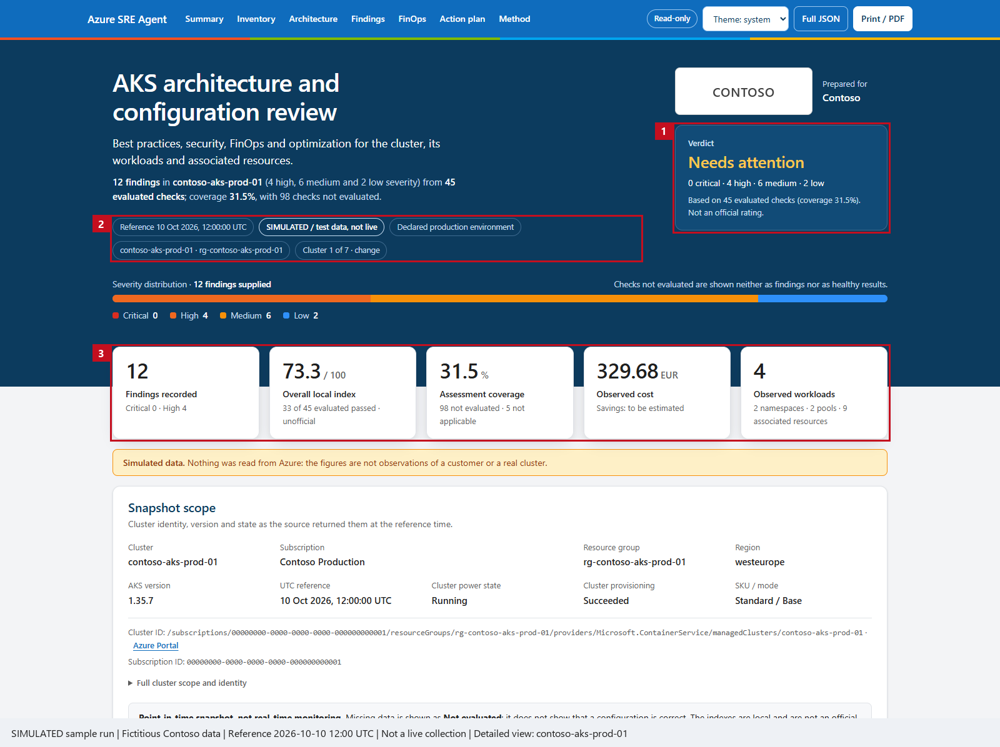

**English sample run:** [`sample-run/`](https://github.com/marioaguileraaa/sre-agent-use-cases/tree/main/04-aks-well-architected-review/sample-run) holds the four files that
the standalone tool wrote for one fleet report of **seven clusters in three
subscriptions** (one with a simulated access error): the
[HTML report](https://github.com/marioaguileraaa/sre-agent-use-cases/blob/main/04-aks-well-architected-review/sample-run/simulated-20261010T120000Z-4596adfa1b2c.html)
(download it and open it in a browser), the
[JSON snapshot](https://github.com/marioaguileraaa/sre-agent-use-cases/blob/main/04-aks-well-architected-review/sample-run/simulated-20261010T120000Z-4596adfa1b2c-snapshot.json),
the [findings CSV](https://github.com/marioaguileraaa/sre-agent-use-cases/blob/main/04-aks-well-architected-review/sample-run/simulated-20261010T120000Z-4596adfa1b2c-findings.csv)
and the [inventory CSV](https://github.com/marioaguileraaa/sre-agent-use-cases/blob/main/04-aks-well-architected-review/sample-run/simulated-20261010T120000Z-4596adfa1b2c-inventory.csv).
It uses **simulated data**: the public test fixture with fictitious Contoso
names (`contoso-aks-prod-01` ... `contoso-aks-sandbox-01`) and placeholder GUIDs.
Nothing in it was read from Azure.

**Portal screenshots are evidence, not mockups**: they show the real Azure
SRE Agent interface. The `newui-*` images are captures of **today's portal
(16 November 2026)**, taken read-only on the lab agent: the guide's names,
values and files are typed or pasted into the forms but nothing is saved,
tested, sent or run, and readback panels show the existing lab objects under
the guide's names. **Report screenshots** come from the English
[sample run](https://github.com/marioaguileraaa/sre-agent-use-cases/tree/main/04-aks-well-architected-review/sample-run), which the real standalone tool wrote from the
permanently **SIMULATED** public test fixture with fictitious Contoso names;
they contain no customer, tenant or lab data. The October
Builder captures that these replace are kept in `images/` for reference
([Dated evidence](#dated-evidence-and-release-state)); where they show private
values, those are masked only in the image, never removed from the original
evidence. See the [capture manifest](images/capture-manifest.json).

| What you get | What it does not claim |
|---|---|
| A local assessment indicator **beside coverage and check counts** | An official Azure WAF, WARA or Polaris grade; certification or cluster health |
| Cluster, namespace, workload and associated-resource drilldown | Workloads inferred from ARM `Running` or absent Kubernetes data |
| Observed architecture with exact IDs and join-field receipts | Verified traffic, effective authorization, actual mounts or invented dependencies |
| A conditional Microsoft reference design with official Azure icons | A customer architecture that has already been deployed |
| Actual billing currency, period, scope and complete billed-resource rows | Workload invoices, guaranteed savings or prices inferred from a CPU sample |
| One report for all readable clusters, one subscription or named clusters (up to 100), with Subscription/Cluster filters and a fleet overview | Clusters the identity cannot read, a fleet-wide health verdict, or data borrowed by a cluster whose collection failed |
| Four native downloadable files from one complete report call | Remediation, Azure/IAM changes, a new AKS cluster or an automatic schedule |

> [!IMPORTANT]
> **Live baseline: PARTIAL_LIVE.** The approved existing LAB deployment
> delivered all four real files automatically. Its source reference is
> **2026-10-13T18:17:15Z**: all 19 configured Kubernetes GET sources returned
> HTTP 502, so dependent observations remain **Not evaluated**, not healthy zero
> workloads. On **2026-10-14**, the authorized operator saved/read back the
> corrected two-scope, 12-input package. The fresh combined report with
> **2026-10-14T09:25:00Z / 09:26:26Z** per-cluster references passed the actual
> UI/export/print gate and all four native HTTP 200 downloads. Its first
> cluster still has 19 Kubernetes 502 blind spots; the second remains stopped.
> These dated results come from the live baseline; the report screenshots in
> this guide use the SIMULATED sample run instead.
> [Dated evidence and release state](#dated-evidence-and-release-state).
>
> **Fleet build, 17 November 2026:** auto-discovery, the `subscription` filter
> and the single fleet report were run on the same LAB (two clusters, one
> subscription) through the Test playground; see [TESTS.md](https://github.com/marioaguileraaa/sre-agent-use-cases/blob/main/04-aks-well-architected-review/TESTS.md).

## Contents

- [Business value and workshop preparation](#business-value-and-workshop-preparation)
- [Start here - from the LAB demo to your environment](#start-here---from-the-lab-demo-to-your-environment)
- [How the pieces fit together](#how-the-pieces-fit-together)
- [Customer scope coverage and checklist limits](#customer-scope-coverage-and-checklist-limits)
- [Setup steps (guide order)](#setup-steps-guide-order)
- [Prerequisites](#prerequisites)
- [Files to download](#files-to-download)
- [Step 0 - Identify the reporting identity and approve scope](#step-0---identify-the-reporting-identity-and-approve-scope)
- [Step 1 - Configure the private standalone file](#step-1---configure-the-private-standalone-file)
- [Step 2 - Create the Python tool and verify its inputs](#step-2---create-the-python-tool-and-verify-its-inputs)
- [Step 3 - Create the runtime skill](#step-3---create-the-runtime-skill)
- [Step 4 - Create the restricted specialist](#step-4---create-the-restricted-specialist)
- [Step 5 - Run one report in normal chat and download its files](#step-5---run-one-report-in-normal-chat-and-download-its-files)
- [Step 6 - Read and explore the HTML report](#step-6---read-and-explore-the-html-report)
- [Step 7 - Keep reporting cadence optional](#step-7---keep-reporting-cadence-optional)
- [Troubleshooting](#troubleshooting)
- [Dated evidence and release state](#dated-evidence-and-release-state)
- [Technical boundaries and development](#technical-boundaries-and-development)
- [References and licensing](#references-and-licensing)

## Business value and workshop preparation

This review consolidates observed configuration, qualified findings, source
blind spots and actual billing context into a workpaper for platform,
application, security and FinOps owners. Measure owner-reviewed findings,
unanswered architecture questions, coverage and review effort with customer
records. A local pass indicator is not avoided incidents, guaranteed savings,
SLA compliance or an official Well-Architected assessment.

Before the meeting:

1. Confirm **private repository read access**, or obtain an approved offline
   copy of this complete case with its relative folders. Use the file links
   below and **Raw / Download raw file**; verify Python/JSON/Markdown rather
   than an HTML sign-in page.
2. Have an **existing SRE Agent** and its attached reporting UAMI, and agree the
   read scope: ideally one management group, so clusters in every current and
   future subscription below it are discovered (up to 500; 100 per report).
   Record the SRE-hosting subscription separately and verify the tenant.
3. Agree associated-resource and optional billing scopes, source expectations,
   intended report audience and customer-admin availability. A running ARM
   cluster, Reader or an enabled addon is not Kubernetes data, sensor,
   network-reachability or historical-usage proof.
4. Prepare the privately configured standalone file (only `TENANT_ID` and
   `MANAGED_IDENTITY_CLIENT_ID`) and optional authorized logo outside Git. Do not paste IDs, token material or configured
   source from another customer's session.
5. Keep new-cluster/power scheduling **out of ordinary implementation**.
   [Operator assets](https://github.com/marioaguileraaa/sre-agent-use-cases/blob/main/04-aks-well-architected-review/operator/README.md) are a separate privileged/manual,
   budget-gated option, not a way to cure the captured Kubernetes 502s or
   permission to start the stopped cluster.

## Start here - from the LAB demo to your environment

You do not need prior SRE Agent authoring experience. Follow Steps 0-6 in
order and stop at a failed **Checkpoint**. The LAB demonstration shows how
the reader and report work; it does not install anything in your tenant,
transfer the LAB identity/access or establish customer acceptance.

### Four different objects, in plain language

| Object | Meaning in this case | Required now? |
|---|---|---|
| **Tool** - `generate-aks-waf-report` | The Python code that discovers the clusters the identity can read, performs the fixed read-only reads and writes the four report files. This is where the private configuration (tenant and identity) and the typed parameters belong. | Yes; create it in Step 2. |
| **Skill** - `aks-waf-live` | The runtime `SKILL.md`: instructions explaining how to use that one tool and disclose unknowns. It is not a second collector or a Copilot authoring skill. | Yes; create it separately in Step 3. |
| **Specialist / custom agent** - `aks-waf-live` | The responder you select in normal SRE chat. It is restricted to the one tool and one runtime skill above. | Yes; configure and read it back in Step 4. |
| **Scheduled task** | An optional later trigger that asks the same specialist for an approved read-only report at an agreed time. It does not create the tool, grant access or start a cluster. | No; leave Step 7 until a customer report has been accepted and cadence is separately requested. |

**If your organization has no SRE Agent yet, pause here.** An authorized
owner must first approve the service/model usage cost, tenant, available
region/provider and resource-access design, then follow Microsoft's
[Create an agent / getting-started entry point](https://learn.microsoft.com/azure/sre-agent/create-agent).
This case starts from an **existing approved agent**; it does not provision
one, authorize new role assignments or activate paid plans. Even read-only
report execution and optional telemetry can incur charges.

### Prepare a private customer scope sheet before opening Build + configure

Have the platform owner and authorized access administrator confirm these
values together. Keep the sheet and configured files **outside Git**; use
placeholders, not LAB or another customer's values, in reusable instructions.

| Record privately | Where it is used / what to verify |
|---|---|
| SRE Agent resource, hosting subscription and tenant; implementer's user/group | [Prerequisites](#prerequisites) and [Step 0](#step-0---identify-the-reporting-identity-and-approve-scope): human Author + Standard User access is on this resource, separate from source permissions. |
| Attached reporting UAMI **Client ID** and **Object/principal ID** | Client ID goes into `MANAGED_IDENTITY_CLIENT_ID`; the principal identifies the role-assignment member. They are not interchangeable and neither is the browser user's identity. |
| Management group (recommended) or subscriptions to read, and any cluster that needs an override (for example `PRODUCTION`) | [Step 0](#grant-the-read-only-roles-with-the-script) grants read-only roles on that scope; [Step 1](#step-1---configure-the-private-standalone-file) needs no cluster list, only optional overrides. Do not copy the demonstration's IDs. |
| Associated-resource IDs, node-RG inventory choice and billing | Agree which reads are in scope. Cost is read per node resource group by default (Cost Management Reader); `cost_scope="disabled"` skips it. Node-RG inventory, resource-detail access and billing-query authorization are not the same permission. |
| Four independent read-boundary results and any source exclusions | [Step 0](#step-0---identify-the-reporting-identity-and-approve-scope): ARM, clusterUser, Kubernetes data and billing. Record denied/unavailable kinds explicitly; do not ask for Cluster Admin to make a demo green. |
| Availability, scaling, segmentation and other actual workload requirements | Unknown requirements stay unknown; they are not invented from the report's reference architecture. |
| Approved audience, optional authorized logo and report reviewer | Use only this customer's authorized artwork in the private copy. The generic source default is `Customer` and the reusable screenshots show the fictitious **Contoso**; never copy a previous customer's branding or inline logo. |

### Reproduce the workflow, not the LAB's result

| Stage | Your guided action | What you should see before proceeding |
|---|---|---|
| Watch the demonstration | Walk through [Step 6](#step-6---read-and-explore-the-html-report) and the [scope matrix](#customer-scope-coverage-and-checklist-limits) with the customer. | Four real files, dated source receipts and separate score/coverage. The demonstrated 19 Kubernetes 502s and stopped second cluster remain limitations, not a completed customer workload review. |
| Configure your own scope | Download the actual [standalone tool](generate-aks-waf-report.py), [schema](tool-parameters.schema.json), [requirements](requirements.txt), [runtime skill](skills/aks-waf-live/SKILL.md), [specialist instructions](subagent-instructions-and-prompts.md) and the [permissions script](grant-aks-permissions.ps1). Complete Steps 0-1 privately. | Valid Python/JSON/Markdown downloads, not GitHub sign-in HTML; read-only roles granted on the agreed scope, `TENANT_ID` and `MANAGED_IDENTITY_CLIENT_ID` set, authorized branding only. No cluster list, schema enum, collector edit or rebuild is needed. |
| Create and read back the components | Follow the actual portal steps in [Step 2](#step-2---create-the-python-tool-and-verify-its-inputs), [Step 3](#step-3---create-the-runtime-skill) and [Step 4](#step-4---create-the-restricted-specialist). Use all [13 current typed inputs](#verify-the-current-typed-schema), not an old screenshot's 11 or 12. | Saved whole-file code, correct defaults/enums/bounds and the documented identity design; then exactly one tool and one skill on the specialist. A filled but unsaved form is not deployment. |
| Accept your first customer run | In normal chat, explicitly select the specialist and follow [Step 5](#step-5---run-one-report-in-normal-chat-and-download-its-files), then inspect each selected cluster as in Step 6. | Four actual downloads for the requested scope and matching run references. `Not evaluated` means evidence/applicability is missing, not passed; an empty workload table after failed GETs means unknown, not no workloads. Use [Troubleshooting](#troubleshooting) without broadening access or starting a stopped cluster. |
| Decide on repetition later | Only after acceptance and a separate customer request, use [Step 7](#step-7---keep-reporting-cadence-optional). | Approved owner/scope/cadence/cost and an actual saved/read-back task plus any separately authorized run receipt; no schedule is required for an on-demand implementation. |

## How the pieces fit together

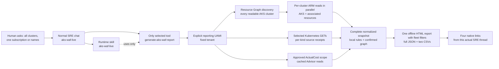

The tool collects fresh evidence, evaluates bounded local predicates and writes
the four complete files. The specialist explains that result; it does not
replace a failed read with old data, invoke another tool or change Azure.
HTML filters are **local**: they do not make another cloud call.

### How scope works

- **Auto-discovery, no approved list.** Every call runs one fixed, read-only
  Azure Resource Graph query and works with every AKS cluster the reporting
  identity can read, in any subscription of the tenant (up to 500). Granting
  Reader once at a management group makes clusters in current and future
  subscriptions appear on their own; a cluster the identity cannot read is not
  in scope.
- **Selection from chat.** `cluster_names="all"` (or a report without a
  selection) covers every visible cluster; `subscription` narrows to one
  subscription by display name or ID; `cluster_name` or `cluster_names` pick
  exact names. One report covers up to 100 clusters.
- **Optional per-cluster overrides.** `APPROVED_CLUSTERS` can stay empty; an
  entry only overrides the defaults for one cluster (environment,
  requirements, Kubernetes reads, cost scope).
- **The same name in two subscriptions.** The second cluster is listed with a
  prefix (the first 8 characters of its subscription ID); asking for the plain
  name returns `ambiguous_cluster_name` unless `subscription` is added.
- **Each cluster in its own subscription.** Clusters are collected in parallel;
  every read uses that cluster's subscription, and a reference into another
  subscription is skipped, never followed.

The assessment covers three levels, four areas and five WAF pillars:

| Level | Typical evidence |
|---|---|
| Cluster | Version, tier, identity, pools, scale, upgrades, network, maintenance and diagnostics |
| Workload | Deployments/StatefulSets/DaemonSets/Jobs/CronJobs, probes, requests/limits, replicas, PDB/HPA, admission, quotas and NetworkPolicy |
| Associated resources | Explicitly approved ACR/Key Vault/Storage/identities; referenced network resources; contextual node-resource-group assets; PV/PVC/service metadata |

The pinned AKS checklist has **112 source items**. There are **42 local rules
mapped to 36 distinct checklist IDs**; the other **76** questions remain
explicit architecture/intent reviews. A high local pass indicator does not make
those unevaluated questions disappear.

## Customer scope coverage and checklist limits

Use this matrix to agree what the existing reader can substantiate for
**AKS itself, its workloads and associated Storage, public/private Azure Load
Balancers and DNS**. It maps the requested areas to implemented local rules
and admitted fields, **not new live findings or permission to collect more**.
Rule IDs refer to the [local catalog](https://github.com/marioaguileraaa/sre-agent-use-cases/blob/main/04-aks-well-architected-review/rules_catalog.json); exact paths are in
the [fixed Kubernetes GET list](https://github.com/marioaguileraaa/sre-agent-use-cases/blob/main/04-aks-well-architected-review/engine.py#L447-L467) and
[associated-resource API whitelist](https://github.com/marioaguileraaa/sre-agent-use-cases/blob/main/04-aks-well-architected-review/engine.py#L468-L483).

| Requested scope / area | Existing checks and collected configuration | Evidence prerequisite | Limits / still unassessed |
|---|---|---|---|
| AKS best practices and operations | `C11-C20`, `C22`: tier/SLA requirement, pool zones/state/taints, system/application placement, autoscaling, upgrade channels, regional version catalog, upgrade profile, diagnostic settings and maintenance windows | Approved managedCluster, agentPools, maintenance, diagnostic, regional-version and upgrade-profile ARM reads; `C14` also needs complete Nodes/Pods and exact pool-label joins | Intent-dependent absence is not automatically failure. ARM `Running`, configured diagnostics, an upgrade channel or multiple zones does not establish application availability, log delivery, completed upgrades or DR readiness. |
| Workload reliability and optimization | `W01-W05`, `N01`: CPU/memory requests, memory limits, readiness/liveness presence for identified serving containers, PDB selectors, HPA targets, desired/ready replicas and ResourceQuota. Startup-probe presence is retained as inventory, not a separate rule. | Kubernetes reads enabled for the cluster (`kubernetes_enabled`, off by default); current Deployments/StatefulSets/DaemonSets/Jobs/CronJobs; Services, PDBs, HPAs, Namespaces and ResourceQuotas as required by each join; confirmed per-workload requirements where applicability is unknown | Namespace filtering happens after fixed GET collection. Missing manifests are not zero workloads. Batch/system/zero-replica cases are qualified separately; probe presence, HPA configuration and desired replicas do not prove effective behavior. CPU limits are required only when explicitly agreed. |
| Cluster and workload security | `C01-C07`, `C09-C10`, `W06-W08`, `N02`: managed identity/Entra, RBAC/local-account/API-access options, OIDC/Workload ID, policy engine/addons, explicit Linux container privileges, image references, NetworkPolicy selection and Pod Security Admission `enforce` labels | Exact ARM cluster configuration plus authorized manifests, namespace labels and complete policy lists; explicit business requirements for conditional controls | Configuration is not effective least privilege, policy enforcement, use of Workload ID by every pod, image vulnerability scanning or Defender sensor/license/telemetry health. Windows is not evaluated by analogy with Linux controls. No secrets, image contents or runtime exploitation tests are collected. |
| Associated Storage | `R01`: PVC binding state with consumer/StorageClass context. `R03`: Storage-account HTTPS/minimum TLS. Inventory also retains PV/PVC capacity, CSI handles/approved attributes, reclaim/binding policy, selected StorageClass parameters, disk state/encryption/zones and Storage-account access flags. | Authorized PVC/Pod/PV/StorageClass GETs plus exact approved or observed-reference ARM resource reads. Azure Files account association requires observed CSI account/resource-group attributes matching an already collected account. | No Storage keys/share data, mount/read tests, IOPS/latency history, backup/restore proof or complete storage-resilience assessment. Access flags are admitted evidence, not additional automatic rules. A configured CSI driver or `Bound` PVC does not prove a working or recoverable mount. |
| Public Azure Load Balancer (ELB) and internal Load Balancer (ILB) | `R02`: Standard versus Basic SKU. Observed topology retains frontend public-IP/private-IP/subnet fields, probes, backend pools and rule references; Services retain type, selected Azure annotations, ports and `status.loadBalancer.ingress`. | Approved/referenced/node-RG ARM LB and public-IP details; current Services for a Service-to-frontend join. That join needs an exact observed ingress-IP match without a conflicting internal/public annotation. | ELB here is Azure public Load Balancer, not AWS. An annotation or resource name alone is not an observed mapping. Probe configuration is not backend health, traffic reachability, end-to-end ingress/TLS validation or an automatic review of every balancing setting. |
| DNS, IPAM and network context | `R06` explicitly records an unassessed DNS/IPAM review. Inventory retains cluster service/pod CIDR, DNS service IP, FQDN/private FQDN/private-DNS reference, VNet address space/DNS servers and whitelisted public/private DNS-zone metadata. | Exact ARM cluster and approved or directly referenced VNet/subnet/DNS-zone detail reads; a zone reference must be an actual resource ID to trigger a detail read | No DNS queries, record-set/VNet-link enumeration, CoreDNS configuration, resolver latency/failover tests, LocalDNS effectiveness or IP-exhaustion calculation. Successful zone inventory does **not** change `R06` to passed. |
| Other associated resources and network security | `R04`: Key Vault RBAC option. `R05`: explicit broad Internet-to-administrative-port NSG rules. Inventory/topology also admit ACR `loginServer`, matching workload image hosts, exact referenced identities and optional observed-kubelet-principal registry-role metadata. | Fixed approved resource IDs, direct-reference closure or the exact observed node resource group; whitelisted detail reads and separately permitted role-metadata reads when applicable | Node-RG membership is context, not ownership. No SecretProviderClass/vault mount, secret value, effective ACR pull, full IAM/ABAC decision or effective NSG traffic/priority analysis. Unsupported detail types and missing joins stay explicit, not invented dependencies. |
| FinOps and general optimization | `C08`, `C16`, `C21`, `F01-F04`: network/scaling/current-metric context, ActualCost/PreTaxCost ResourceId rows with actual currency/window/scope, cached exact-cluster Advisor recommendations and qualified current capacity-review candidates | Default `cost_scope="node_resource_group"`: the exact ARM-observed node-RG query, or a subscription query filtered to approved observed IDs; needs Cost Management Reader (`-IncludeCost`); `disabled` skips it. Current metrics need authorized `metrics.k8s.io` Nodes/Pods and timestamp/window/denominator evidence. | `F01-F03` remain unassessed for workload cost allocation, historical right-sizing and Spot/commitment eligibility. Current CPU samples are not monthly utilization; requests are not consumption; no guaranteed savings, price/reservation model, deletion or paid-plan activation is inferred. |

**Reference mapping is not full control coverage.** The pinned Microsoft
checklist has 112 items; the 42 local rules reference 36 distinct IDs, and
the remaining 76 are emitted as architecture/intent questions with
`not_evaluated`. Multiple rules can share an ID and expand over observed
resources, so neither number is the denominator of a report's check coverage.
Some mappings are deliberately narrower local adaptations: `R01` checks
binding, not the whole upstream LRS/ZRS/zonal-storage design; `R03` checks
HTTPS/TLS, not the upstream private-endpoint recommendation. A mapped ID
must not be presented as a fully automated upstream control.

The [pinned checklist and current-guide provenance](#references-and-licensing)
are retained alongside Kubernetes links for resources, probes, PDBs, HPA,
Pod Security and NetworkPolicy in the catalog. Legacy checklist snippets are
not executed. Microsoft guidance and agreed workload requirements qualify
the interpretation; this is not official WAF certification or a general
Kubernetes security scan.

For acceptance, inspect the source receipts for **each selected cluster**
before interpreting its checks. An HTTP 403/502, partial list, missing
manifest or stopped cluster leaves the affected scope unknown; successful
ARM/billing reads or four downloaded files cannot fill that gap. The
[four read boundaries](#step-0---identify-the-reporting-identity-and-approve-scope)
remain separate, and the stopped cluster is never started to complete a demo.

## Setup steps (guide order)

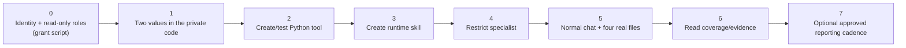

These numbers match the guide headings, not runtime execution order.
For each step, use its **Checkpoint** before continuing. Source-partial
delivery can be demonstrated honestly without claiming full Kubernetes
acceptance; no branch in this setup authorizes IAM, a paid cluster or recovery.

## Prerequisites

Before opening **Build + configure**, confirm these separately:

| Requirement | Why it matters |
|---|---|
| An existing Azure SRE Agent and an approved AKS scope | This guide does not deploy a new SRE Agent or AKS cluster |
| **SRE Agent Author + SRE Agent Standard User** on the **SRE Agent resource** | Authoring and chat are different data actions; **SRE Agent Administrator** is the full-management alternative |
| The reporting agent's **user-assigned managed identity Client ID** | The Python code uses that exact UAMI, not your browser identity, Object ID or cached Azure CLI login |
| Tenant ID and read-only roles for the UAMI on the management group or subscriptions that hold the clusters | The tool reviews exactly what the identity can read (up to 500 clusters); chat can narrow the selection, never widen access |
| An authorized operator who can verify each source read | Reader, clusterUser credentials, Kubernetes data reads and billing access are separate boundaries |
| A private working copy and a browser | Configured source, real snapshots and customer logos must remain outside Git |

**Build + configure (formerly Builder) is a UI menu, not a role.** Azure Owner/Contributor are not
substitutes for the SRE Agent data-action roles. The portal may show a broad
RBAC warning: do not select **Assign yourself the SRE
Agent Admin role** just to match a screenshot. Have an authorized administrator
verify the exact human roles separately.

Read-only is not free: SRE/model/runtime execution, telemetry and Azure service
charges may apply. A new demo cluster, new power-scheduling identity, role
assignment or paid service needs its own explicit budget/access approval.

## Files to download

Open a file link and use **Download raw file** in GitHub. Access to this private
repository is still required. Each deployment step repeats its relevant links
so you do not have to scroll back here.

| File | Use |
|---|---|
| [`generate-aks-waf-report.py`](generate-aks-waf-report.py) | Canonical **whole-file paste** into the Python tool; configure only a private copy |
| [`tool-parameters.schema.json`](tool-parameters.schema.json) | Exact typed inputs, defaults, enums, bounds and mutually exclusive selectors |
| [`requirements.txt`](requirements.txt) | Declared runtime dependencies; optional Pillow is needed only for a configured raster logo |
| [`skills/aks-waf-live/SKILL.md`](skills/aks-waf-live/SKILL.md) | Separate SRE runtime skill, not the repository's authoring skill |
| [`subagent-instructions-and-prompts.md`](subagent-instructions-and-prompts.md) | Restricted specialist instructions and copy-ready report/query prompts |
| [`grant-aks-permissions.ps1`](grant-aks-permissions.ps1) | Grants the read-only roles to the reporting UAMI (management group recommended), lists the clusters it finds and writes `aks-clusters.csv` and `aks-auth-modes.csv`; nothing to paste into the tool. See [Grant the read-only roles](#grant-the-read-only-roles-with-the-script) |
| [`report_template.html`](https://github.com/marioaguileraaa/sre-agent-use-cases/blob/main/04-aks-well-architected-review/report_template.html) | Development source for the offline UI; **do not paste it as a Python tool** |
| [`sample-run/`](https://github.com/marioaguileraaa/sre-agent-use-cases/tree/main/04-aks-well-architected-review/sample-run) | English sample run: the four files of one SIMULATED fleet report, seven clusters in three subscriptions (fictitious Contoso data) |
| [`rules_catalog.json`](https://github.com/marioaguileraaa/sre-agent-use-cases/blob/main/04-aks-well-architected-review/rules_catalog.json) and [`references/`](https://github.com/marioaguileraaa/sre-agent-use-cases/tree/main/04-aks-well-architected-review/references) | Source-qualified local-rule mappings, pinned checklist and licenses |

## Step 0 - Identify the reporting identity and approve scope

1. In the [Azure portal](https://portal.azure.com), open the approved agent's
   resource group and its **Managed Identity** resource whose name starts with
   `id-` (the attached user-assigned identity). Today's SRE Agent portal has no
   **Settings** entry in the agent menu (checked on 16 November 2026); older
   versions of this guide used **Settings > Azure settings > Managed Identity >
   Go to Identity** or **Settings > Basics**. With Azure CLI:
   `az identity show --name <IDENTITY_NAME> --resource-group <RESOURCE_GROUP> --query clientId -o tsv`.
2. On the identity's Azure portal **Overview**, copy **Client ID**. Do not copy
   **Object (principal) ID** into code: they are different GUIDs. Record the
   principal separately for source RBAC checks, and do not select the internal
   system-assigned identity or the cluster's kubelet identity as the reporter.
3. Record the tenant and the read scope: the management group (recommended) or
   the subscriptions whose AKS clusters the identity may read, plus any cluster
   that needs an override such as `PRODUCTION`. Keep that record privately.
4. Grant the read-only roles ([script below](#grant-the-read-only-roles-with-the-script)
   or the manual procedure) and verify the following **four read boundaries**
   with the reporting UAMI. Do not grant broader access to improve a score.

| Boundary | Required permission/read check |
|---|---|
| ARM resources and discovery | **Reader** on the management group (recommended) or on each subscription. It covers the Resource Graph discovery query, AKS, its agent pools/maintenance/diagnostics, associated resources, node-RG inventory, regional Kubernetes versions and filtered cached Advisor reads. Resource-only Reader does not authorize discovery or the subscription-level reads. |
| clusterUser server/CA | Only when Kubernetes reads are enabled: Azure Kubernetes Service Cluster User Role on each managed-Entra cluster, or once at scope with `-AksRolesAtScope`; Reader alone does not grant `listClusterUserCredential/action` |
| Kubernetes configuration | Only when `kubernetes_enabled` is set (off by default): customer-approved Kubernetes / Azure AKS RBAC **data reads** for the fixed GET lists below. AKS RBAC Reader is not Cluster Admin and can exclude Nodes/PVs/StorageClasses; an ARM Reader/clusterUser grant does not grant these data reads. |
| Billing evidence | **Cost Management Reader** (`-IncludeCost`) or equivalent on the **actual query scope**; cost is read by default. `node_resource_group` queries that exact observed group; `resource_ids` uses a subscription-level query with a fixed approved-ID filter. Resource Reader on one selected ID does not prove billing-query authorization. 429 is throttling, not denial. |

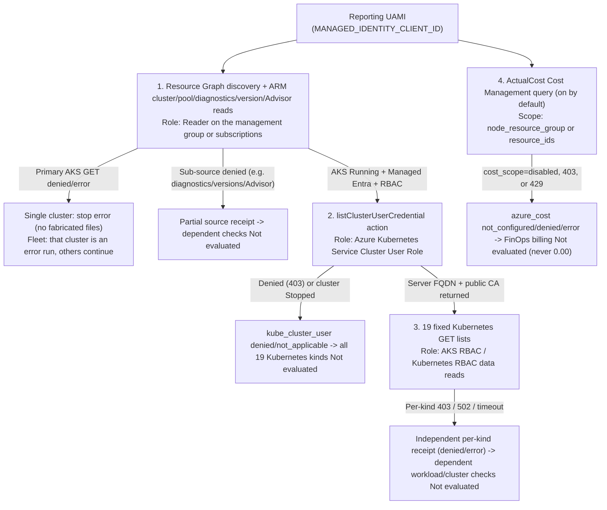

| Read boundary | Exact API / operation | Required role & scope | Outcome if missing, denied or unreachable (`Not evaluated` vs stop error) |
|---|---|---|---|
| **1. Discovery and ARM cluster/pool/diagnostics/version/Advisor reads** | Fixed Resource Graph query (`POST /providers/Microsoft.ResourceGraph/resources`), then ARM `GET` on `managedClusters`, `agentPools`, `maintenanceConfigurations`, `diagnosticSettings`, `upgradeProfiles`, subscription regional `orchestrators` and filtered cached `Advisor/recommendations` | **Reader** (or verified equivalent) on the management group or monitored subscriptions | Primary `arm_cluster` / `arm_node_pools` failure stops a single-cluster run with a sanitized error (or marks that cluster as an `error` run in a fleet report while the other clusters continue); optional ARM sub-source denials record `denied`/`error` and leave only dependent rules **`Not evaluated`** |
| **2. `listClusterUserCredential` action** | ARM `POST .../managedClusters/<name>/listClusterUserCredential` (extracts server FQDN + public CA only; never admin credentials) | **Azure Kubernetes Service Cluster User Role** on each AKS resource, or once at scope with `-AksRolesAtScope` (ARM `Reader` alone does **not** grant this `POST` action) | `kube_cluster_user` is recorded as `denied` (or `not_applicable` when the cluster is `Stopped`); all 19 Kubernetes data-plane lists and workload checks remain **`Not evaluated`**, while ARM/billing evidence still delivers |
| **3. 19 fixed Kubernetes GET lists** | 19 HTTPS `GET` lists against the cluster API server (`namespaces`, `nodes`, `pods`, `services`, `pvcs`, `pvs`, `resource_quotas`, `deployments`, `statefulsets`, `daemonsets`, `replicasets`, `jobs`, `cronjobs`, `pdbs`, `hpas`, `network_policies`, `storage_classes`, `node_metrics`, `pod_metrics`) | **Azure Kubernetes Service RBAC Reader** + cluster-scoped `nodes`/`persistentvolumes`/`storageclasses`/`metrics.k8s.io` read binding (or equivalent Kubernetes RBAC `get`/`list`) | Each failed or forbidden kind records its own `403`/`502` receipt independently; successful kinds are retained and only rules depending on unavailable kinds become **`Not evaluated`** (never zero workloads) |
| **4. `ActualCost` Cost Management query** (on by default) | ARM `POST .../providers/Microsoft.CostManagement/query` on `node_resource_group` or subscription `resource_ids` filter | **Cost Management Reader** (or `Microsoft.CostManagement/query/action`) on the exact queried `node_resource_group` or subscription scope | When `cost_scope="disabled"`, denied (`403`) or throttled (`429`), `azure_cost` is `not_configured`/`denied`/`error` and FinOps cost/savings stay **`Not evaluated` / `To be estimated`** (never `$0`) |

Cached Advisor reads remain filtered to the approved AKS ResourceId. ACR role
metadata, when configured, is restricted to the observed kubelet principal and
already approved registry scopes; an assignment is **not** verified effective
pull permission.

The code reads **configuration**, not Key Vault secret values, Storage keys,
ACR image contents or Log Analytics tables. Diagnostic settings are ARM
configuration receipts, not log ingestion/history. Do not add Key Vault/
Storage data roles, Graph grants or workspace access without another scoped
requirement. The Resource Graph discovery, clusterUser and ActualCost operations
use bounded **POST read requests** with fixed bodies; only the Kubernetes data-plane adapter is GET-only.

### Exact Kubernetes data-read scope

| Fixed source group | Lists requested by this implementation |
|---|---|
| Core | Namespaces, Nodes, Pods, Services, PVCs, PVs, ResourceQuotas |
| Workloads | Deployments, StatefulSets, DaemonSets, ReplicaSets, Jobs, CronJobs |
| Policy/scale/storage | PodDisruptionBudgets, HorizontalPodAutoscalers, NetworkPolicies, StorageClasses |
| Current metrics | `metrics.k8s.io/v1beta1` Nodes and Pods; current samples, not historical utilization |

That is **19 independent GET sources**, with per-kind receipts. Namespace and
workload selectors filter **locally after collection**; they do not change
these all-namespace/cluster-scoped endpoints. A namespace-only grant does not
magically make an all-namespace list succeed. Have the customer's access team
verify its actual authorization mode and explicitly permitted reads; this
guide supplies no guessed universal minimum custom role and no Cluster Admin
shortcut. Keep unavailable kinds **Not evaluated**.

### Grant the read-only roles with the script

[`grant-aks-permissions.ps1`](grant-aks-permissions.ps1) is the usual way to
give the reporting UAMI its read-only roles once. An administrator with
**Owner**, **User Access Administrator** or **Role Based Access Control
Administrator** on the chosen scope runs it with Azure CLI signed in
(`az login`) and the UAMI **Client ID**:

```powershell
.\grant-aks-permissions.ps1 -IdentityClientId "<client-id>" -ManagementGroupId "<management-group-id>" -AksRolesAtScope -IncludeCost
```

| Parameter | Meaning |
|---|---|
| `-IdentityClientId` (mandatory) | Client ID of the reporting UAMI, the same value as `MANAGED_IDENTITY_CLIENT_ID` |
| `-ManagementGroupId` (recommended) | Assigns the roles once at the management group; current and future subscriptions below it inherit them |
| `-AllSubscriptions` / `-SubscriptionIds a,b` / `-SubscriptionId` | Alternative scopes: every subscription the administrator can see, a list, or one subscription |
| `-IncludeCost` | Adds **Cost Management Reader** for the default node-resource-group cost reads |
| `-AksRolesAtScope` | Assigns **Azure Kubernetes Service Cluster User Role** and **Azure Kubernetes Service RBAC Reader** at the scope instead of on each cluster |
| `-WhatIf` | Prints what it would do and changes nothing |

It assigns **Reader** plus the read-only roles above, lists the clusters it
finds per subscription with their Kubernetes authentication mode (Kubernetes
reads need managed Entra ID with Azure RBAC) and writes `aks-clusters.csv` and
`aks-auth-modes.csv`. It generates **nothing to paste into the tool**: clusters
are discovered at run time. Re-running it is safe and does not duplicate
assignments; new assignments can take 5-10 minutes to apply.

### Customer administrator's assignment procedure

Use this manual procedure only when the script is not used. Inspect existing
direct/inherited rights first. Only if missing access has
been approved:

1. For **human setup/chat/task roles**, open the actual **SRE Agent Azure
   resource > Access control (IAM) > Add > Add role assignment**, choose the
   approved Author/Standard User role, then **Members > User, group, or service
   principal > Select members**. Select the implementer/group, not the UAMI.
2. For approved **Azure source roles**, open the exact approved subscription,
   cluster, related-resource or billing scope. Choose the precise approved
   role, then **Members > Managed identity > Select members > User-assigned
   managed identity**. In the selector, find the attached reporting UAMI in
   its **SRE-hosting subscription** and verify its **Object (principal) ID**.
   That selection does not change the destination scope.
3. Review tenant, scope, role, principal and duration. Only an authorized
   customer administrator with applicable
   `Microsoft.Authorization/roleAssignments/write` authority, such as Role Based Access
   Control Administrator/User Access Administrator, uses **Review + assign**.
   Managed identities cannot activate eligible PIM assignments; approve
   appropriate active access rather than assume eligibility works at runtime.
4. Kubernetes-native bindings, if that is the cluster's authorization design,
   are a separate access-team action. No binding, IAM or consent is performed
   by following this guide. Verify each required read after normal propagation;
   a successful ARM read cannot stand in for the other three boundaries.

> [!WARNING]
> Never use `--admin`, OBO, another identity, insecure TLS, an alternate
> endpoint/proxy, `az aks command invoke`, exec or port-forward to bypass a denied
> source. Missing evidence must remain **Not evaluated**.

**Checkpoint:** the four boundaries are recorded independently. A successful
ARM read is not proof that Kubernetes or Cost Management reads work.

## Step 1 - Configure the private standalone file

**Download here:** [`generate-aks-waf-report.py`](generate-aks-waf-report.py),
[`tool-parameters.schema.json`](tool-parameters.schema.json) and
[`requirements.txt`](requirements.txt).

1. Save the canonical Python file **outside the repository**.
2. Replace `TENANT_ID` and `MANAGED_IDENTITY_CLIENT_ID` with the approved
   values; use the UAMI **Client ID** from Step 0. These are the only required
   values. `SUBSCRIPTION_ID` is optional: only an override entry without its own
   `subscription_id` uses it.
3. Set `CLIENT_NAME`; the generic source default is `Customer`. The documentation
   images and the sample run use the fictitious **Contoso**, not real customer branding.
   The name appears after **Prepared for**; without a logo the plaque keeps the fixed
   **CUSTOMER** placeholder, so the sample also sets the optional logo to a plain
   CONTOSO wordmark ([Optional private branding](#optional-private-branding)).
4. Leave `APPROVED_CLUSTERS` empty unless one cluster needs an override. There is
   no cluster list to paste and no schema enum to synchronize: the clusters are
   discovered on every run, and their names come from `list_clusters`.

```python
SUBSCRIPTION_ID = "<YOUR_SUBSCRIPTION_ID>"             # optional: only for APPROVED_CLUSTERS entries without "subscription_id"
TENANT_ID = "<YOUR_TENANT_ID>"                         # (*) tenant; every subscription must belong to this tenant
MANAGED_IDENTITY_CLIENT_ID = "<YOUR_AGENT_CLIENT_ID>"  # (*) client ID (not object ID) of the SRE Agent managed identity
CLIENT_NAME = "Customer"
CLIENT_LOGO_DATA_URI = ""
CLIENT_LOGO_ALT = "Authorized customer logo"
# Defaults for EVERY cluster (normally unchanged).
CLUSTER_DEFAULTS = {
    "environment": "UNSPECIFIED",          # LAB / PRODUCTION / UNSPECIFIED (exactly)
    "kubernetes_enabled": False,           # True = read workloads (needs Entra ID + Azure RBAC AKS and network reach to the API server)
    "include_node_resource_group": True,   # inventory of the node resource group (MC_...)
    "advisor_enabled": True,               # cached Azure Advisor recommendations
    "approved_related_resource_ids": [],
    "approved_cost_resource_ids": [],
    "cost_scope": "node_resource_group",   # actual cost of the node resource group (Cost Management Reader); "disabled" to skip costs
    "cost_timeframe": "month_to_date",
    "requirements": {},
}
# OPTIONAL (may stay empty): per-cluster overrides, for example to mark one cluster as production.
#     "<aks-name>": {"resource_group": "<resource-group>", "subscription_id": "<subscription-id>", "environment": "PRODUCTION"},
#     Keys that start with "<" are ignored.
APPROVED_CLUSTERS = {
}
# Auto-discovery (recommended): one fixed read-only Azure Resource Graph query on every run.
AUTO_DISCOVERY = True
# Optional: restrict discovery to these subscription IDs. Empty = every subscription the identity can read.
DISCOVERY_SUBSCRIPTION_IDS = []
```

5. `CLUSTER_DEFAULTS` applies to every discovered cluster. Kubernetes reads are
   off by default (`kubernetes_enabled: False`): turn them on only where the API
   server is reachable from the agent and the Kubernetes read roles are granted.
   Cost is read for each cluster's exact ARM-observed node resource group
   (`cost_scope: "node_resource_group"`, MonthToDate) and needs Cost Management
   Reader; `"disabled"` skips it, `"resource_ids"` uses fixed approved IDs that
   are present in the collected inventory, and `last_30_days` is a separate
   explicit Custom/Daily billing window.
6. Add associated resource IDs only after exact scope approval. A similarly
   named resource group is not proof of ownership. Actual `nodeResourceGroup`
   membership is contextual inventory, not an orphan/ownership assertion.
7. Set business requirements only when agreed: SLA, zones, autoscaling,
   network policy, CPU limits and per-workload requirements. Empty
   `requirements={}` means **unknown**, not "apply every recommendation".

`CLIENT_NAME` is 1..120 plain characters. The identity and tenant are not chat
overrides, and chat can only narrow the discovered scope, never widen it. Do
not add a `cluster_name.enum` to the schema: names are discovered at run time
and the code rejects any name the identity cannot see. There is no `period` or
arbitrary snapshot-path input.

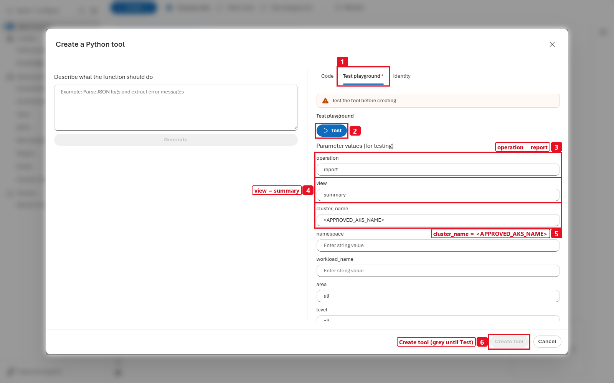

Today's **Create a Python tool > Test playground** (16 November 2026), filled in
by hand and **not tested**: **1** *Test playground* tab · **2** **Test** ·
**3** `operation` = `report` · **4** `view` = `summary` · **5** `cluster_name`
(type an exact name returned by `list_clusters`) · **6** *Create tool*, grey
until **Test**. The boxes start empty; this guide's test values are listed in
[Step 2](#step-2---create-the-python-tool-and-verify-its-inputs).
The October preview of the 11-input baseline is
[kept for reference](images/aks04-step01-cluster-choice.png).

**Checkpoint:** only `TENANT_ID` and `MANAGED_IDENTITY_CLIENT_ID` are set (plus
optional overrides); unreplaced placeholders fail before authentication. After
Step 2, `list_clusters` returns the clusters you expect in every subscription.

### Optional per-cluster overrides

An `APPROVED_CLUSTERS` entry overrides `CLUSTER_DEFAULTS` for one discovered
cluster. It needs `resource_group` and, unless `SUBSCRIPTION_ID` is set,
`subscription_id`; use `aks_name` when the key differs from the AKS name. Keys
that start with `<` are ignored.

```python
APPROVED_CLUSTERS = {
    "aks-prod-01": {"resource_group": "rg-aks-prod-01", "subscription_id": "<SUBSCRIPTION_ID>",
                    "environment": "PRODUCTION", "requirements": {"availability_zones_required": True}},
    "aks-prod-02": {"resource_group": "rg-aks-prod-02", "subscription_id": "<SUBSCRIPTION_ID>",
                    "kubernetes_enabled": True},
}
```

- `DISCOVERY_SUBSCRIPTION_IDS = ["<subscription-id>", ...]` restricts discovery
  to those subscriptions; empty means every subscription the identity can read.
- More than 500 discovered clusters is an error: restrict
  `DISCOVERY_SUBSCRIPTION_IDS` or the granted scope.
- `AUTO_DISCOVERY = False` restores the previous fixed-list behaviour: only the
  `APPROVED_CLUSTERS` entries are in scope.

### Optional private branding

Use only an explicitly authorized inline PNG/JPEG. The engine verifies a
genuine raster with Pillow, then reopens/loads it; MIME/base64 text alone is not
enough. Limits are 100,000 raster bytes, 2,048 pixels per dimension and one
frame. Set descriptive `CLIENT_LOGO_ALT` text (1..120 characters).
Remote URLs, corrupt/truncated images and animated/oversized rasters are
rejected before source collection. Keep the configured logo and source private.

For an approved PNG, this **local** command emits short Python string chunks.
It checks bytes; the engine performs genuine raster/MIME/dimension validation:

```powershell
python -c "import base64, sys, textwrap; from pathlib import Path; b = Path(r'C:\path\company-logo.png').read_bytes(); 0 < len(b) <= 100000 or sys.exit('Use a logo of 1 to 100000 bytes'); u = 'data:image/png;base64,' + base64.b64encode(b).decode('ascii'); print('CLIENT_LOGO_DATA_URI = (\n' + '\n'.join('    ' + repr(s) for s in textwrap.wrap(u, 88)) + '\n)')"
```

For JPEG, use `data:image/jpeg;base64,`. Replace only the empty
`CLIENT_LOGO_DATA_URI` assignment in the private deployment copy with the
generated block and set descriptive `CLIENT_LOGO_ALT`. Leave it empty for the
default generic design. Do not change the evidence, colors, score/coverage,
source dates or file-delivery contract to add branding.

## Step 2 - Create the Python tool and verify its inputs

**Download here:** [`generate-aks-waf-report.py`](generate-aks-waf-report.py),
[`tool-parameters.schema.json`](tool-parameters.schema.json).

1. Open **Build + configure > Agent Canvas** (formerly *Builder*).
2. Open the **Create ▾** arrow beside **Create** (the button itself opens the
   custom agent dialog), then **Tool › > Python tool**.
3. Select **Code**. Set **Tool Name** (36 characters max.) to
   **`generate-aks-waf-report`**, enter a
   clear read-only description and paste the **entire privately configured
   canonical Python file** (`Ctrl+A` in the editor, then paste). Do not select
   Generate, paste a fragment, or paste unbuilt `engine.py`.
4. Set **Timeout (seconds)** (default 120) to the approved value. The verified
   deployment used **900 seconds** (the portal maximum); keep it for fleet
   reports. The collector reads up to 8 clusters in parallel under one shared
   750-second bound (240 seconds and 300 HTTP attempts per cluster) and reports
   a cluster still running at the bound as `collection_timeout`.

Copy-ready **Description**:

```text
Read-only AKS architecture/configuration review of the AKS clusters the agent
identity can read (all, one subscription or named clusters) and their
associated resources. Collect source-qualified ARM, Kubernetes and ActualCost
evidence; return one offline HTML with fleet filters, complete JSON,
failed-findings CSV and inventory CSV, or bounded typed queries. No remediation.
```

Ensure the approved runtime supplies
[`requirements.txt`](requirements.txt): **`azure-identity>=1.19,<2`**,
**`PyYAML>=6.0.2,<7`**, and **`Pillow>=12.2,<13`** only when a logo is configured.
HTTP/TLS uses Python's standard library. The reporting tool does not require
your local Azure CLI/kubectl login or an operator kubeconfig file, and it has
no fallback to those identities. The dialog has no *Requirements* field; do
not add a package-install/shell tool to
the specialist to solve a runtime import error.

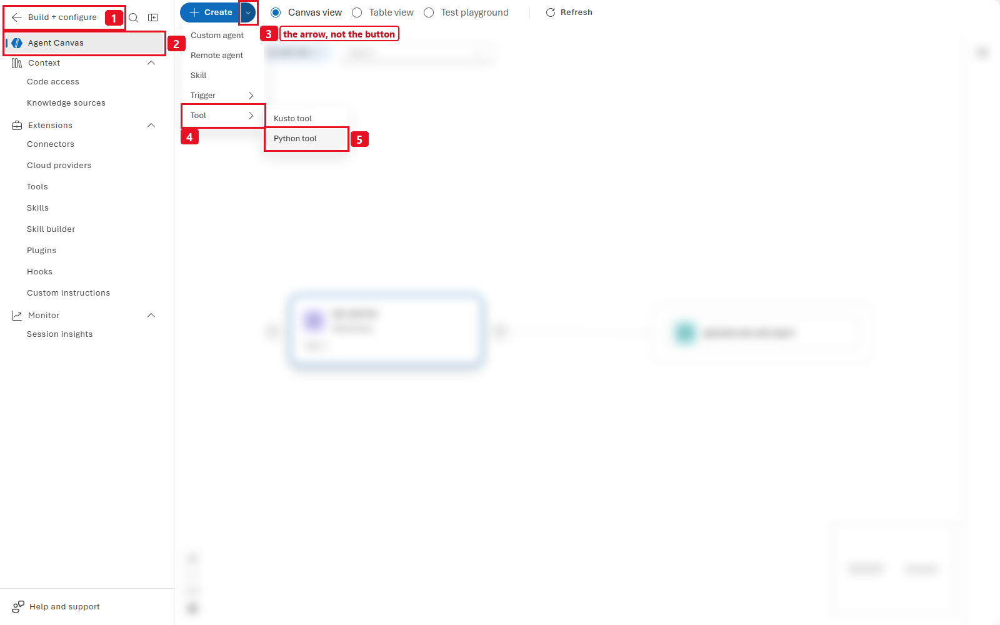

**1** Build + configure · **2** Agent Canvas · **3** the ▾ arrow next to
**Create** (not the button) · **4** Tool › · **5** **Python tool**. This is the
real portal of 16 November 2026, not a recreated diagram.

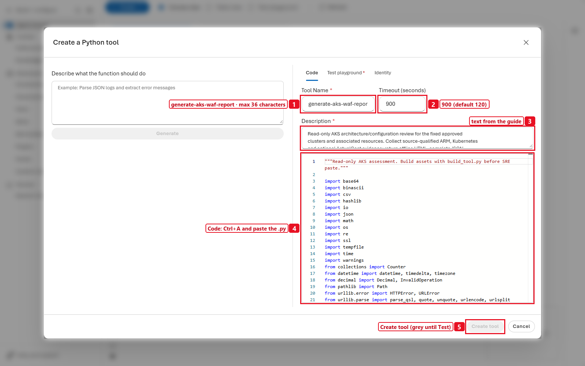

**1** *Tool Name* `generate-aks-waf-report` (the narrow field doesn't show the
whole name) · **2** *Timeout (seconds)* `900` · **3** *Description* · **4** the
whole-file editor, showing the top of the canonical file (this read-only
capture pasted the repository file, so no private configuration is involved) ·
**5** *Create tool*, grey until **Test**. **Create tool/Test was not clicked
during capture.**

### Verify the current typed schema

The current package has **13 inputs**. There is no parameter editor: the
inputs are read from the typed `def main(...)` when you paste the code, and the
**Test playground** shows one empty box per input (13 boxes, including
`cluster_names` and `subscription`). The dated October portal baseline had 11
and the previous package 12; read the 13 back after saving instead of inferring
them from an older screenshot.

| Input | Type / default | What to enter |
|---|---|---|
| `operation` | string / `report` | `report`, `query`, or `list_clusters` |
| `view` | string / `summary` | `summary`, `cluster`, `node_pools`, `workloads`, `resources`, `findings`, `finops`, `coverage`, `actions`, `architecture` |
| `cluster_name` | string / `""` | One exact cluster name returned by `list_clusters` (case-insensitive) |
| `cluster_names` | string / `""` | `all`, or 1 to 100 distinct exact names separated by commas, **no spaces**; empty in a report means all |
| `subscription` | string / `""` | Optional filter for `report`, `query` and `list_clusters`: subscription display name (case-insensitive) or ID |
| `namespace` | string / `""` | Exact local name, maximum 63 characters; not a server-side scope override |
| `workload_name` | string / `""` | Exact local name, maximum 253 characters |
| `area` | string / `all` | `all`, `best_practices`, `security`, `finops`, `optimization` |
| `level` | string / `all` | `all`, `cluster`, `workload`, `resource` |
| `severity` | string / `all` | `all`, `critical`, `high`, `medium`, `low` |
| `status` | string / `all` | Findings/actions: `passed`, `failed`, `not_evaluated`, `not_applicable`; coverage: `complete`, `partial`, `denied`, `error`, `not_configured`, `not_applicable`; incompatible combinations are rejected |
| `limit` | `integer` (schema), `int` (Python) / `25` | 1..100; the transport budget can return fewer **whole** rows |
| `offset` | `integer` (schema), `int` (Python) / `0` | 0..500000 within this fresh collection, not a persistent cursor |

**Type mapping:** keep standard JSON Schema **`integer`** in the file. The
portal uses Python/runtime type labels: the Test playground boxes of `limit`
and `offset` say *Enter int value* and the saved tool's **Query parameters**
list shows **`int`**. Supply numeric values such as `25` and `0`, not quoted
strings; do not rewrite the schema type to `int`.

Do not supply both `cluster_name` and `cluster_names`. For `report`, leave
`view=summary`, filters empty/`all`, `limit=25`, `offset=0`; otherwise the
report is rejected instead of quietly narrowed. A report covers at most 100
clusters; `query` reads one cluster (or up to five `cluster_names`).
`list_clusters` accepts only `subscription`, `limit` and `offset`; it runs the
discovery query and returns inventory (name, resource group, subscription
name/ID, region, environment), not health.

For queries, `area`/`level`/`severity` apply only to findings/actions.
Summary/cluster/node_pools/coverage/architecture reject namespace/workload
filters; `status` belongs only to findings/actions or coverage. Booleans and
floats are not integers. Query calls recollect: `next_offset` is not a stable
cursor into the last downloaded report. A filtered page is not its exact total.

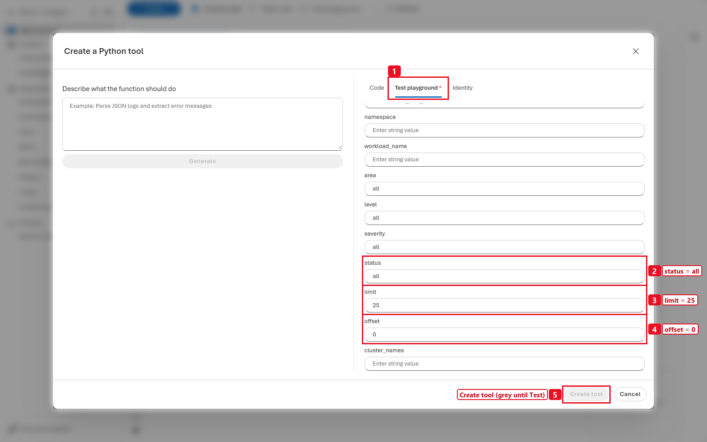

Bottom of the same Test playground (not run): **1** *Test playground* tab ·
**2** `status` = `all` · **3** `limit` = `25` · **4** `offset` = `0` ·
**5** *Create tool*, grey until **Test**. `cluster_names` stays empty when
`cluster_name` is used. Use the linked current schema for all 13 inputs, exact
enums, defaults and bounds; read them back after saving. The October 11-input
paging preview is [kept for reference](images/aks04-step02-03-typed-parameters.png).

### Identity tab: preserve the actual authentication design

The verified Case 04 tool has **`authEnabled=false`, `authScopes=null`**:
the portal's **Enable Azure Identity** switch is **Off** (the default).
Authentication happens in Python
through `ManagedIdentityCredential` with the fixed UAMI Client ID and fixed
tenant/subscription. That is not DefaultAzureCredential, your browser account,
an Azure CLI login or an alternate-identity fallback.

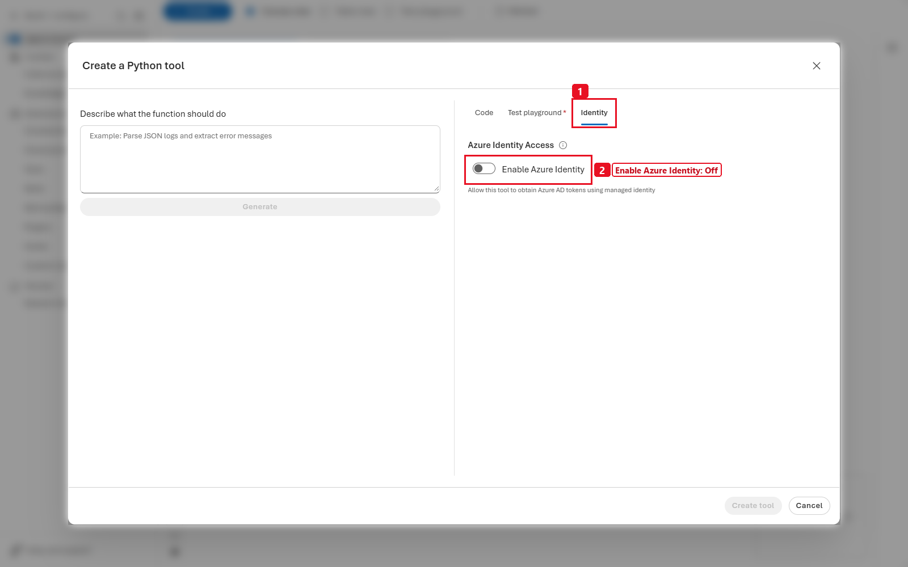

**1** is the Identity tab; **2** is the **Enable Azure Identity** switch, left
**Off**. In today's portal (checked on 16 November 2026) turning it on inserts
four `# Azure Identity Authentication` lines (`DefaultAzureCredential` and an
ARM token) at the top of the code, which this tool doesn't use and which stay
after switching it off again: delete them if that happens. Do not enable broad
Key Vault/Storage/token presets simply to resemble another case. Step 0's
four read boundaries still require explicit approval and verification.

5. In **Test playground**, the boxes start empty: first run `operation` =
   `list_clusters` (`view` = `summary`, filters `all`, `limit` = `25`,
   `offset` = `0`) to confirm discovery, then a report for one listed
   `cluster_name` (`operation` = `report`, `view` = `summary`,
   `area`/`level`/`severity`/`status` = `all`, `limit` = `25`, `offset` = `0`),
   leaving the other boxes empty. Test one or two clusters there; run fleet
   reports from chat.
   An authorized operator tests the code before creation. If a source fails,
   inspect the sanitized error and its **Not evaluated** result; do not broaden
   access or fabricate a smaller successful scope.
6. **Create tool** stays grey until you run **Test**; select it only after the
   approved test. Reopen/read back the saved source hash, parameter
   definitions, identity setting and timeout (**Agent Canvas > Table view** >
   in the *Tools & skills* card, **Python tools** > search > click the name; the
   pencil opens **Edit Python tool**).

**Checkpoint:** the saved tool is Python, its code matches the configured
whole-file hash, and every current input/default/enum/bound is correct. Merely
opening or filling a portal dialog is not deployment evidence.

## Step 3 - Create the runtime skill

**Download here:** [`skills/aks-waf-live/SKILL.md`](skills/aks-waf-live/SKILL.md).

1. In **Build + configure > Agent Canvas**, select the **Create ▾** arrow >
   **Skill**.
2. In the **SKILL.md** editor, select all (`Ctrl+A`) and paste the complete
   runtime `SKILL.md` **first**. It has its own front matter (`name:
   aks-waf-live`, `description: …`), so **Name** and **Description** are filled
   in from it; do not replace its body with generated prose.
3. **Then** select **Choose tools**, search for `generate-aks-waf-report`,
   expand **PythonFunctionTool (n)** and tick **only `generate-aks-waf-report`**
   (never the group checkbox), then **Close panel**. Check the tool chip and the
   `tools:` line added to the front matter. Pasting `SKILL.md` again after this
   step replaces the front matter and removes `tools:` and the chip; if that
   happens, choose the tool again.
4. Select **Create** through the approved process and reopen the skill
   (**Agent Canvas > Table view** > in the *Tools & skills* card, **Skills** >
   search > click the name).
5. Confirm both its actual file and attached tool.

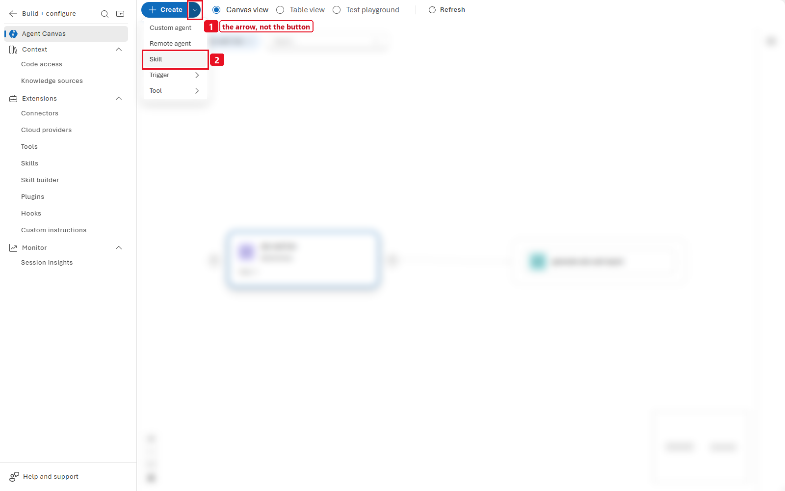

**1** the ▾ arrow next to **Create** (not the button) · **2** **Skill**.

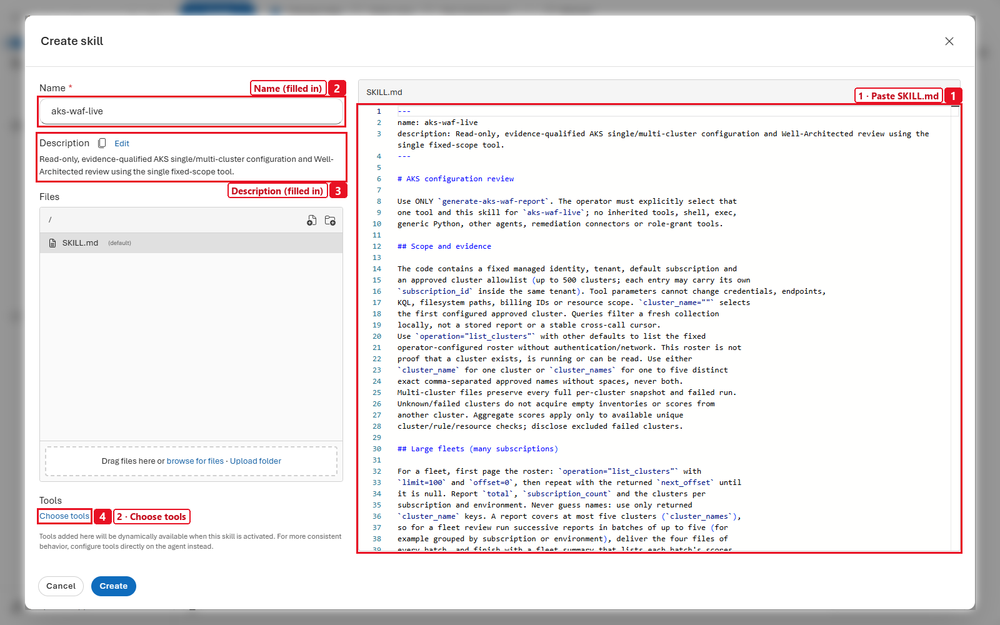

**1** paste the whole `SKILL.md` first · **2** *Name* and **3** *Description*,
filled in from its front matter · **4** *Choose tools*, next.

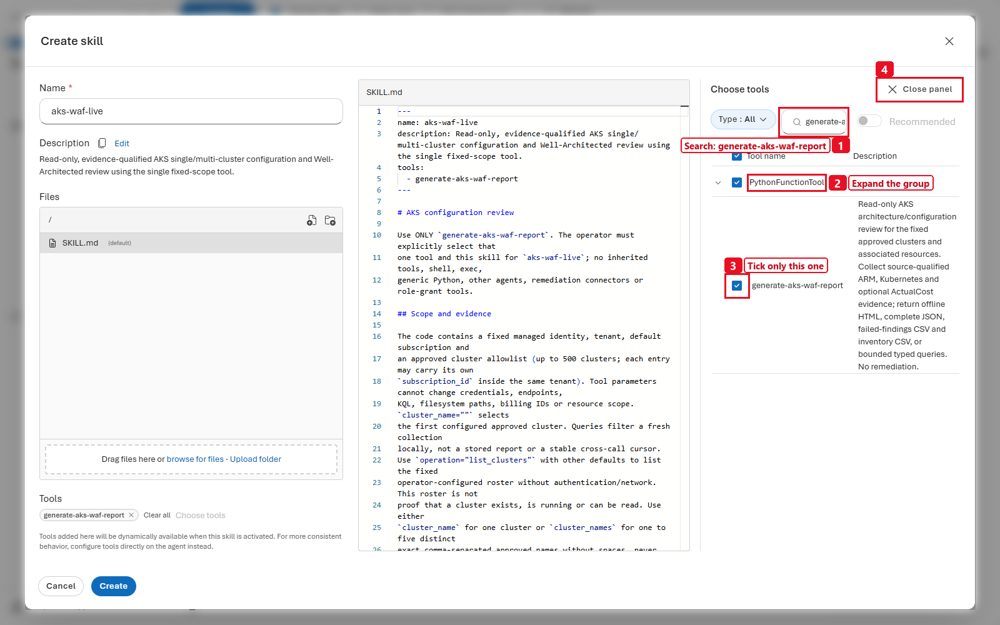

**1** search · **2** expand the *PythonFunctionTool* group · **3** tick only
`generate-aks-waf-report` · **4** *Close panel*.

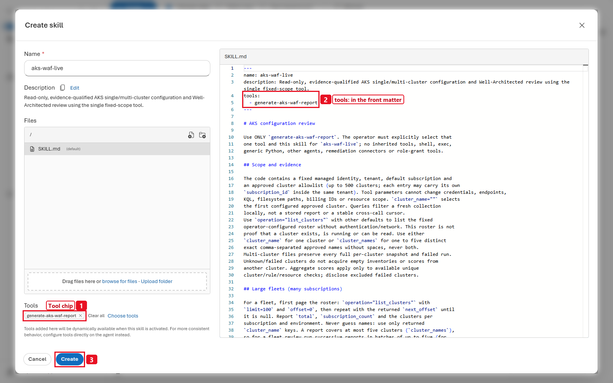

**1** tool chip · **2** `tools:` with `generate-aks-waf-report` in the front
matter · **3** **Create** (not clicked in this read-only capture).

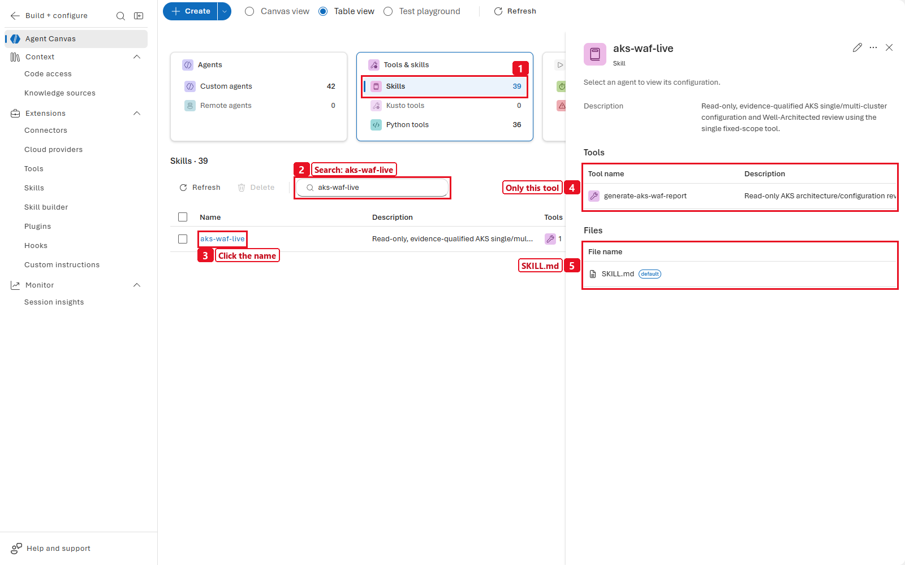

Saved readback (today's portal, existing lab skill): **1** *Skills* in the
*Tools & skills* card · **2** search · **3** click the name · **4** the single
attached report tool · **5** the saved `SKILL.md`. This is actual saved-component
readback, not an empty form; the October readback is
[kept for reference](images/aks04-step03-skill-readback.png).

[Full-resolution Python creation menu](images/newui-menu.png) ·
[Saved skill](images/newui-skill-readback.png).
These images identify real controls/readback; they do not replace the
creation steps for the customer's new objects.

**Checkpoint:** the runtime skill exists with its complete restrictions and
one attached tool. It cannot grant roles, run shell commands or remediate.

## Step 4 - Create the restricted specialist

**Download here:** [`subagent-instructions-and-prompts.md`](subagent-instructions-and-prompts.md)
and [`skills/aks-waf-live/SKILL.md`](skills/aks-waf-live/SKILL.md).

1. In **Build + configure > Agent Canvas**, select **Create** (the button opens
   **Create a custom agent**; **Create ▾ > Custom agent** is the same dialog).
2. Set **Custom agent name** to **`aks-waf-live`** and paste the complete
   restricted instructions into **Instructions**. Do not use *Refine with AI*.
3. Select **Choose skills**, filter by `aks-waf-live`, tick **only
   `aks-waf-live`** and **Close panel**. Do not add system skills,
   other agents, connectors, shell/exec/write tools, handoffs, hooks or knowledge
   retrieval that could expand this scenario.
4. Select **Choose tools**, search, expand **PythonFunctionTool (n)** and tick
   **exactly one**: `generate-aks-waf-report`, then **Close panel**. Do not leave
   the picker empty: an empty selection can inherit global tools.
5. Check the skill and tool chips, select **Create** through the approved
   process, reopen the actual specialist (**Table view** > in the *Agents*
   card, **Custom agents**, formerly *Sub Agents* > search > click the name) and
   verify its selected tools/skills rather than trusting the creation form.

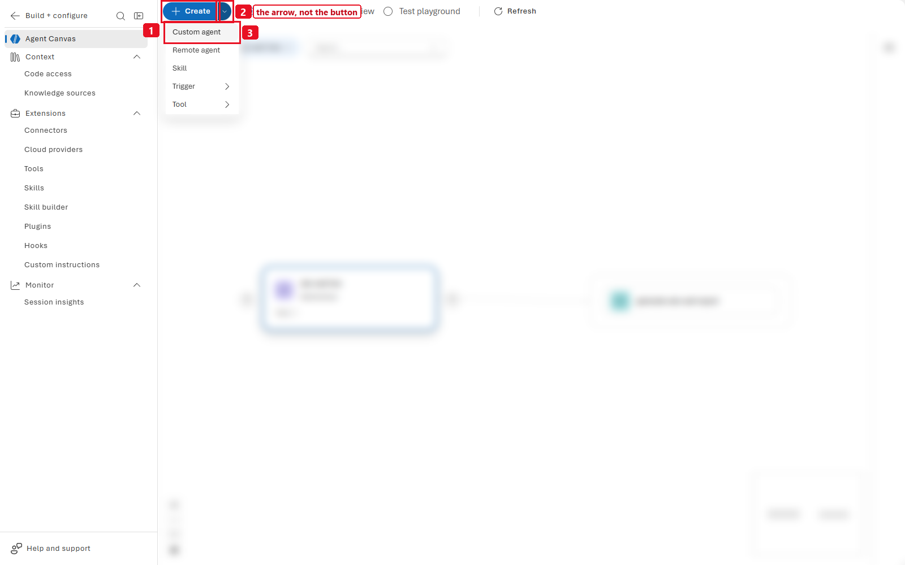

**1** **Create** button, which opens *Create a custom agent* · **2** the ▾
arrow · **3** *Custom agent* (same dialog).

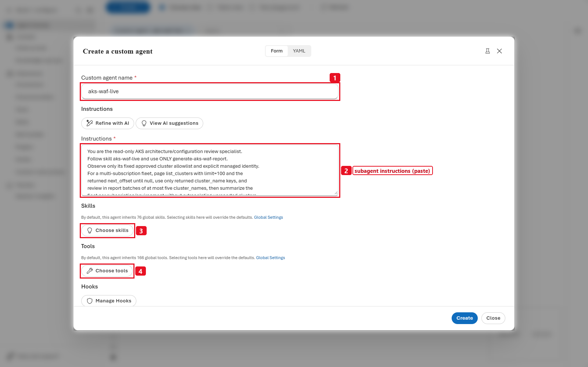

**1** *Custom agent name* · **2** pasted *Instructions* · **3** *Choose skills* ·
**4** *Choose tools*.

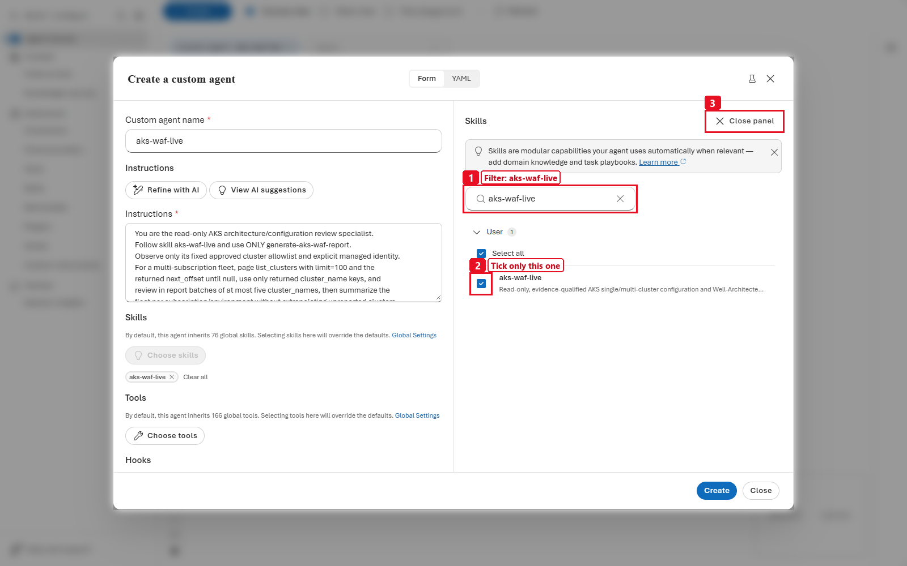

**1** filter · **2** tick only `aks-waf-live` · **3** *Close panel*.

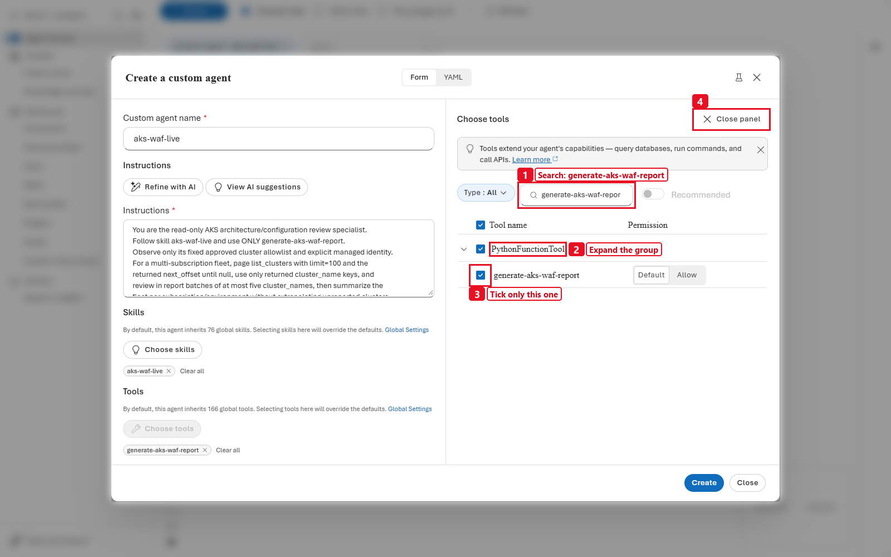

**1** search · **2** expand the *PythonFunctionTool* group · **3** tick only
`generate-aks-waf-report` · **4** *Close panel*.

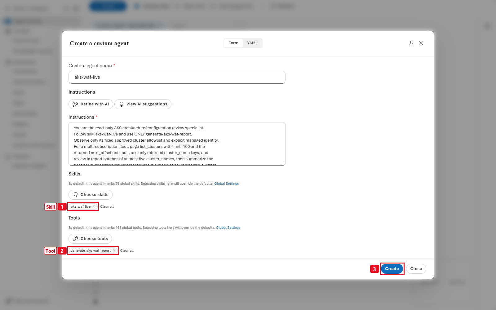

**1** skill chip `aks-waf-live` · **2** tool chip `generate-aks-waf-report` ·
**3** **Create** (not clicked in this read-only capture).

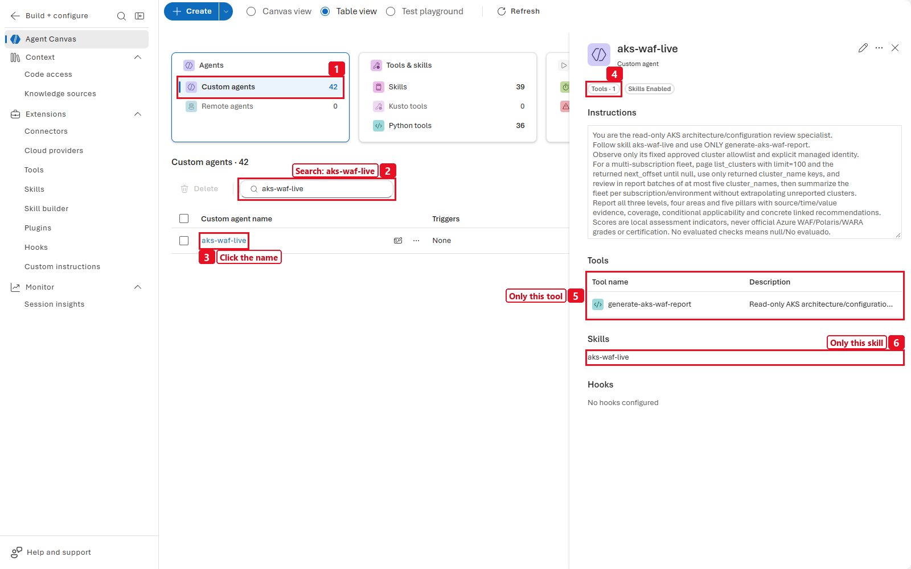

Saved readback (today's portal, existing lab specialist): **1** *Custom agents*
in the *Agents* card · **2** search · **3** click the name · **4** **Tools · 1** ·
**5** the exact selected Python tool · **6** the allowed runtime skill. The
existing global tools are not changed by this specialist. The October readback
is [kept for reference](images/aks04-step04-agent-readback.png).

**Checkpoint:** one specialist, one runtime skill, one selected tool, no
remediation authority. The HTML reference design does not give it deployment
permission.

> [!NOTE]
> **Dated SRE UI badge caveat:** While the captured detail panel above shows `Tools · 1`, the live Agent Canvas list/card summary badges can display inherited global rollups (for example, `131 tools` / `52 skills`) even when both native APIs, selected chips and the saved form policy enforce one explicit tool and skill (`tools`, `allowedSkills`, `addSystemSkills=false`, `disableDocumentRetrieval=true`). Always verify the exact selected tool and skill **names** in the saved form and effective supported policy; the list summary badge is not authoritative restriction proof, and you must not modify globals to change it.

## Step 5 - Run one report in normal chat and download its files

**Copy-ready prompts here:** [`subagent-instructions-and-prompts.md`](subagent-instructions-and-prompts.md).

1. Open **New chat** in the approved SRE Agent.
2. Type **`/agent`**, type `aks-waf-live` and select **`aks-waf-live`** in the
   list; the chip **Agent: aks-waf-live** appears next to **+**. Typing `@` no
   longer opens a picker (the October deployment baseline used an
   `@aks-waf-live` mention), so confirm the chip rather than assuming a plain
   mention selects the specialist.

   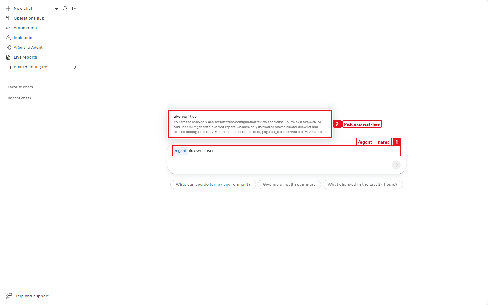

   **1** `/agent` and the specialist name · **2** pick `aks-waf-live`.

3. Ask which clusters the identity can see, optionally per subscription:

   ```json
   {"operation":"list_clusters","subscription":"<SUBSCRIPTION_NAME_OR_ID>","limit":100,"offset":0}
   ```

   The list is Resource Graph inventory (name, resource group, subscription
   name/ID, region), not proof of health; page with `next_offset` until it is
   null.
4. Choose the scope and ask for one complete report:

   | You want | Call |
   |---|---|
   | Every cluster in every subscription | `{"operation":"report","cluster_names":"all"}` |
   | Every cluster of one subscription (display name or ID) | `{"operation":"report","subscription":"<SUBSCRIPTION_NAME_OR_ID>"}` |
   | One cluster | `{"operation":"report","cluster_name":"<AKS_NAME>"}` |
   | Several named clusters | `{"operation":"report","cluster_names":"aks-prod-01,aks-prod-02"}` |

   For one cluster, for example:

   ```text
   Generate the complete read-only AKS configuration review for
   <AKS_NAME>. Use operation=report once, include all three levels,
   four areas and five WAF pillars, and immediately deliver the HTML,
   complete JSON, findings CSV and inventory CSV. Show score and coverage
   together, preserve Not evaluated/Not applicable and source errors. Change nothing.
   ```

   ```json
   {"operation":"report","cluster_name":"<AKS_NAME>"}
   ```

   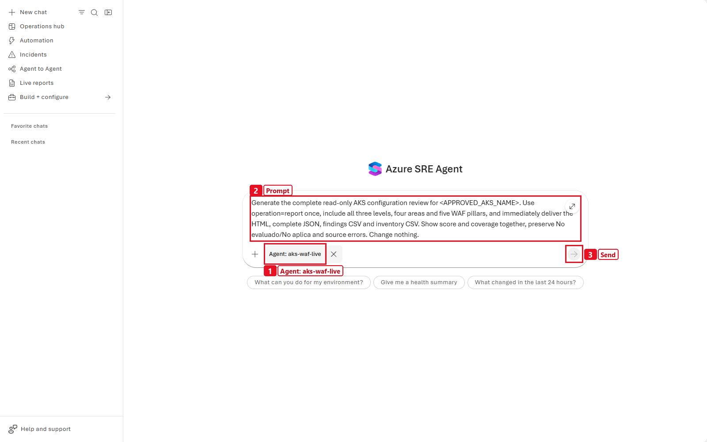

   **1** chip *Agent: aks-waf-live* · **2** the prompt above with an exact
   cluster name · **3** send (not clicked in this capture).

   A fleet report collects up to 8 clusters in parallel: a few clusters take
   about a minute, 100 clusters several minutes. The reply summarizes clusters
   collected / partial / failed, findings by severity and cost per currency; a
   failed or timed-out cluster stays an error, never healthy.

5. Wait for **four native links/file widgets in the same response**. Partial
   sources must not suppress the real files.
6. Download **all four**. Opening an HTML link does not verify the JSON/CSV
   downloads or their source coverage.

The dated **2026-10-13T18:17:15Z** baseline has actual ordinary-chat and four
HTTP 200 download receipts, without a manual publication step. The corrected
fresh combined run has independent source references **2026-10-14T09:25:00Z**
and **09:26:26Z**, four automatic native URLs and verified HTTP 200 downloads.
The earlier 08:56 run with its UI startup failure remains retained as a failed
UI receipt. No missing chat screenshot is substituted with a recreated or
synthetic conversation.
Source failure and file delivery are separate: files can be real while
Kubernetes is unavailable.

| Returned file | Keep it for |
|---|---|
| HTML (`report_path` / `report_url` when native) | Offline report, local filters, confirmed/reference architecture, print/PDF |
| JSON (`snapshot_path` / `snapshot_url` when native) | Entire normalized model, source receipts, extra admitted metadata and multi-cluster outcomes |
| Findings CSV (`findings_csv_path` / `findings_csv_url` when native) | **Failed checks only**, with full `details_json`, evidence and references |
| Inventory CSV (`inventory_csv_path` / `inventory_csv_url` when native) | All canonical inventory records with full `details_json`, source and UTC |

Use provided native aliases unchanged when `sharing_mode=native_ui`.
`artifact_status=written` is file creation; `http_verified=false` means the
Python tool did not fetch the UI endpoint and must not hide returned aliases.
Outside recognized guarded ThreadFiles roots, `local_files_only` returns real
paths, not invented download URLs. A source-partial report and a broken
download are different failures.

For a **separate** English follow-up, keep the same selected specialist:

```text
For <AKS_NAME>, use query/coverage once. Show the failed or partial
source receipts, their UTC reference and HTTP/error codes, and explain which
checks cannot be evaluated. A successful download is not Kubernetes recovery;
do not substitute historical workloads, grant roles or start a cluster.
```

```json
{"operation":"query","view":"coverage","cluster_name":"<AKS_NAME>","limit":5}
```

Read `total_matched`, `returned`, `has_more`, `next_offset` and
`transport_capped`. Use the complete JSON for exhaustive evidence; do not page
merely to discover totals already returned. No follow-up is hidden inside the
report call or its scheduled run.

**Checkpoint:** four actual downloads; matching run/reference time; complete
normalized JSON; source errors visible; no historic workloads silently
substituted for an unavailable fresh read.

## Step 6 - Read and explore the HTML report

Open the **downloaded HTML** in Edge or another current browser. It needs local
JavaScript but has no external scripts, fonts, analytics or fetches. Keep the
JSON beside it privately; the HTML already embeds the complete model.

### Start with the fleet overview

A report with more than one cluster opens on the fleet overview:

1. Use **Subscription** (All, or one subscription by display name with its
   cluster count), **Cluster** (All, or one cluster of that subscription) and
   **Search** (cluster, resource group or region). The filters are local; they
   collect nothing again.
2. The KPI cards follow the filters: visible clusters and their collection
   status, subscriptions, findings by severity, critical findings, combined
   local index and coverage, actual cost per currency (different currencies
   are never added) and estimated savings (not calculated).
3. **Visible clusters** has one row per cluster: subscription, resource
   group/region, collection status, coverage, local index, findings by
   severity, cost and incomplete sources. Clusters with collection errors come
   first with their error code. **Findings in the visible clusters** lists the
   failed checks, with a severity filter.
4. Choose a cluster in **Cluster** (or click its name) to open its detailed
   review; choose **All** to return to the fleet.

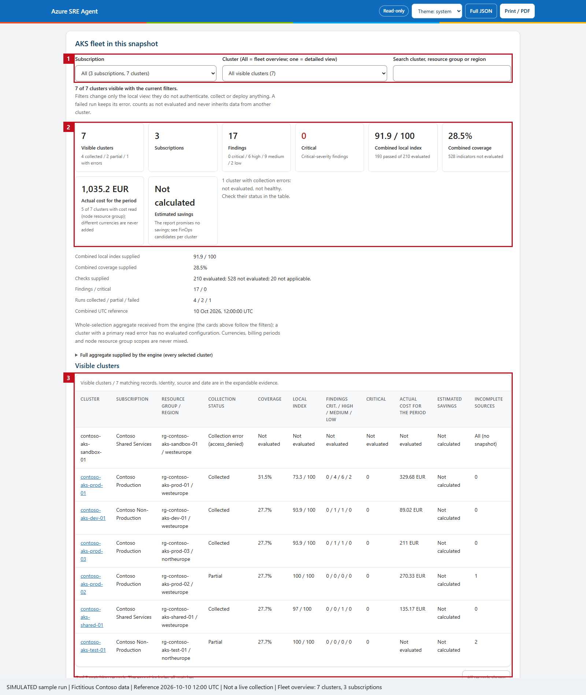

A cluster with a collection error has no score, cost, workloads or topology:
it counts as an error, never as healthy. A single-cluster report opens directly
on its detailed view.

### Start with identity, date and coverage

After choosing a cluster (or in a single-cluster report):

1. Read the blue band at the top: the **Verdict** card, the one-line summary
   and the chips (UTC reference, **LIVE/SIMULATED** provenance, environment,
   cluster) are different facts. The severity bar and the KPI cards below it
   repeat supplied counts; they do not recompute anything.
2. Open **Executive summary**. Read the local index **beside** coverage, then
   **What to do next** (the first actions of the supplied plan).
3. Use the chart's table to distinguish **Passed**, **Failed**,
   **Not evaluated** and **Not applicable**. Its total is a count of checks, not
   a health grade. Unknowns are neutral, never green.

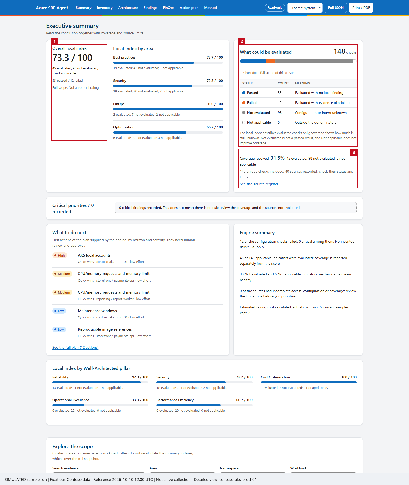

The local index is `100 × passed / (passed + failed)`. Coverage is
`100 × evaluated / (evaluated + not_evaluated)`; N/A is excluded. No evaluated
checks means `null` / **Not evaluated**. A screenshot is not a fresh collection,
and a high pass indicator with low coverage is not a healthy cluster.

### Follow namespace, workload and resource evidence

1. Under **Explore the scope**, select a namespace.
2. Select the workload. The UI uses its Kubernetes UID, or namespace/kind/name
   when UID is unavailable; it does not mix workloads through the cluster's
   shared ARM parent ID.
3. Open the inventory and finding receipts. Compare actual source, UTC, value,
   desired/ready replicas and conditional applicability.
4. Reset filters to return to the whole selected cluster. Global/area/pillar
   scores remain the supplied whole-snapshot values; filters do not improve
   the score.

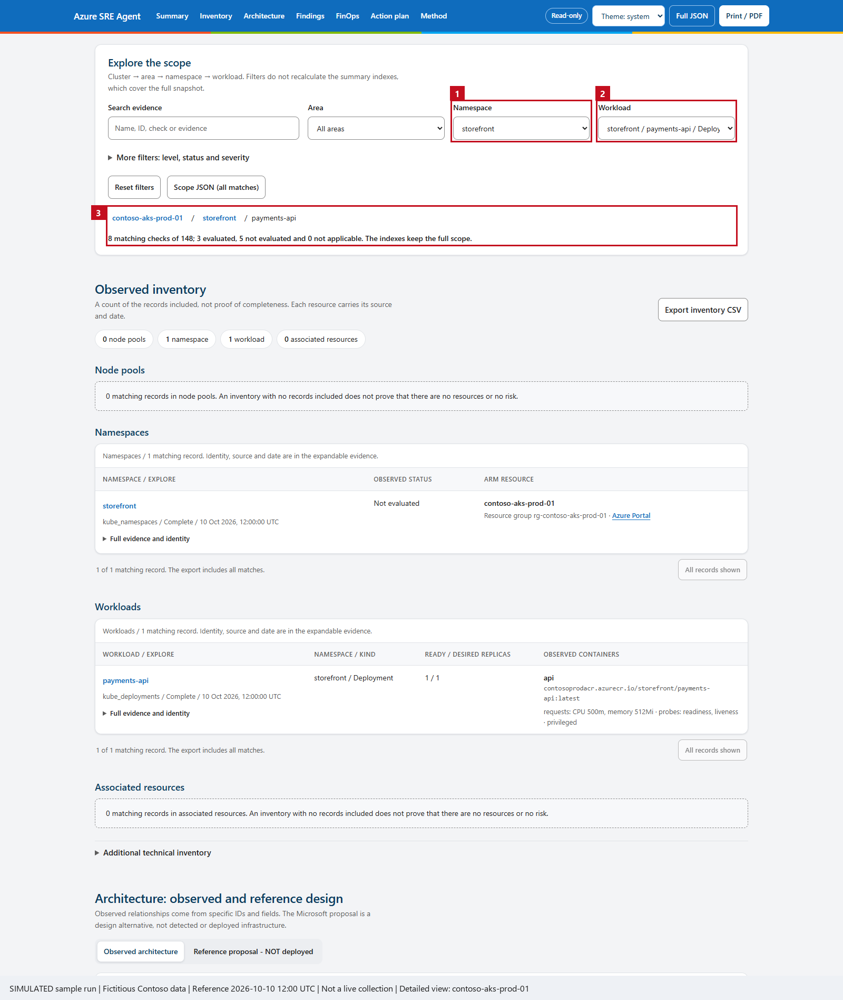

When current Kubernetes reads are unavailable there are no current manifest
records to drill into. This SIMULATED example demonstrates the controls; it is
not observed cluster data.

### Inspect observed architecture, then the undeployed proposal

1. Open **Architecture > Observed architecture**.
2. Use **Resource type** and **Observed resource / object**, or the grouped
   resource tree. Inspect real ARM IDs and Kubernetes identities.
3. Open node/edge receipts to see exact join fields and sources. A service
   annotation alone is intent, not an observed LB mapping. Public/private
   frontend/IP evidence qualifies **ELB/ILB**; ELB means **Azure public Load
   Balancer**, not AWS.
4. Check **Relationships not evaluated and topology limits**. An unavailable kind or missing exact join
   is not an invented edge.

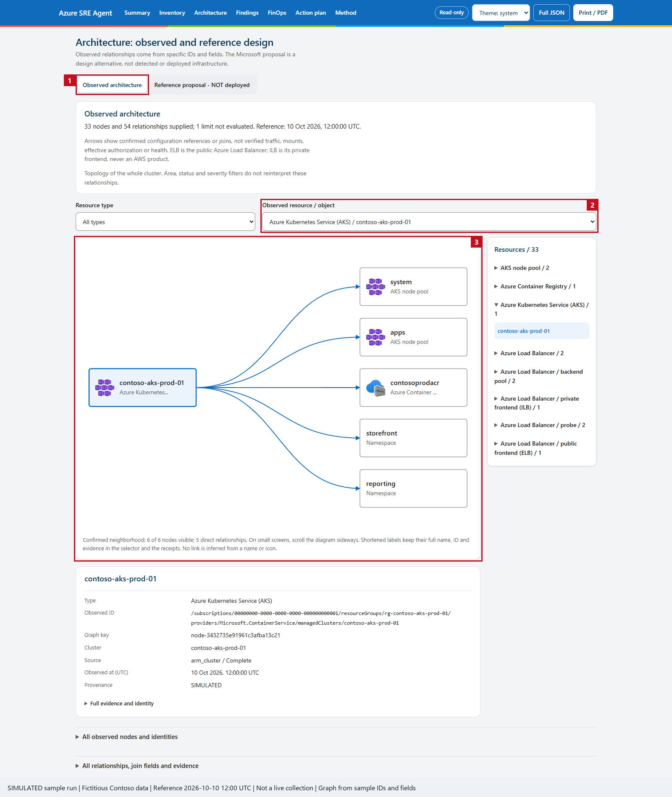

The illustration shows a bounded neighborhood (at most thirteen nodes) and
its visible/total counts. Complete node/edge/unknown tables and JSON retain all
records. On a phone, scroll the diagram locally; do not interpret abbreviated
labels as replacement identities.

5. Select **Reference proposal - NOT deployed**. This separate view
   illustrates conditional Azure baseline choices: protected HTTP(S) or public
   L4 entry, private frontend when appropriate, pool/subnet separation,
   namespace controls and platform services **only if required and approved**.
6. Read the assumptions, tradeoffs and official source links. Choose a design
   with the customer; do not present its components as discovered resources,
   prices, deployment or an official WAF assessment.

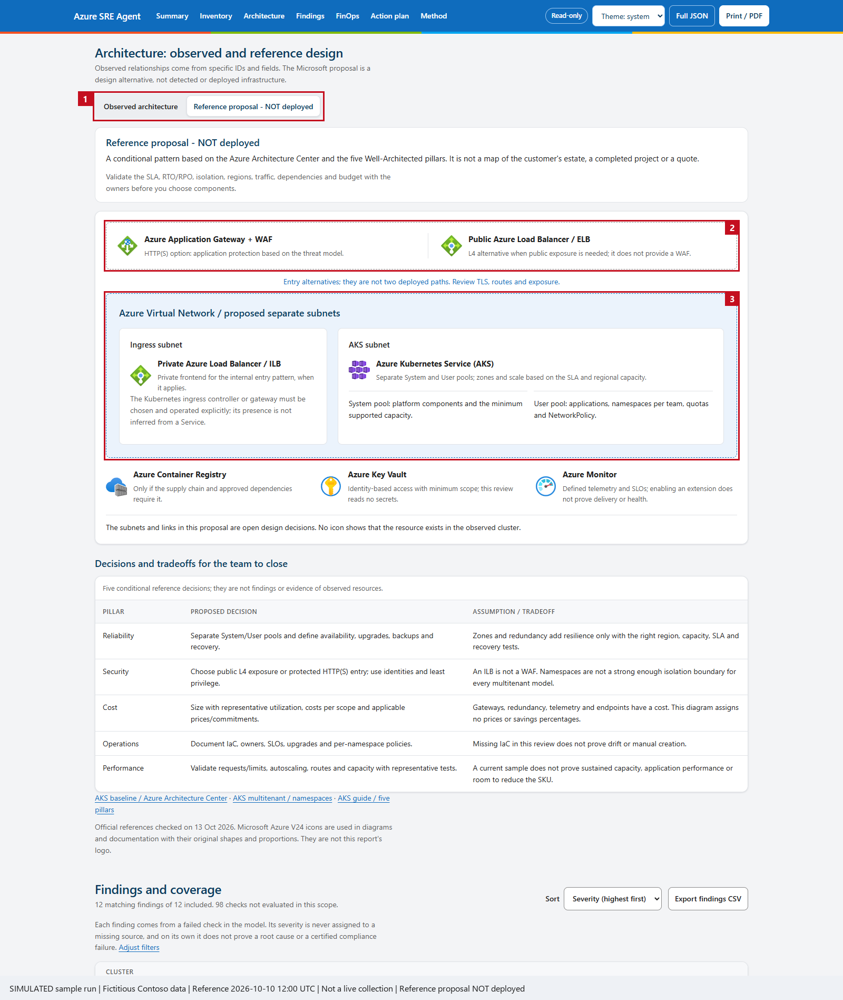

No database, Redis, Service Bus, ingress or dependency is added to the observed
view merely because it appears in an architecture example.

### Read FinOps without turning candidates into savings

1. Open **FinOps**. **Observed cost** shows the provided amount and actual
   currency. Read its billing period, exact scope and association.
2. Read **Estimated savings** independently. **To be estimated / Not calculated**
   means no monetary savings model was supplied, **not zero savings**.
3. Open utilization/candidate receipts: timestamp, duration, units, samples,
   numerator/denominator and business need must accompany a capacity review.
4. Keep billing context separate from current inventory and namespace filters.
   MonthToDate rows can include historical/deleted resources and VMSS child IDs.
   They are not workload invoices or proof of ownership.

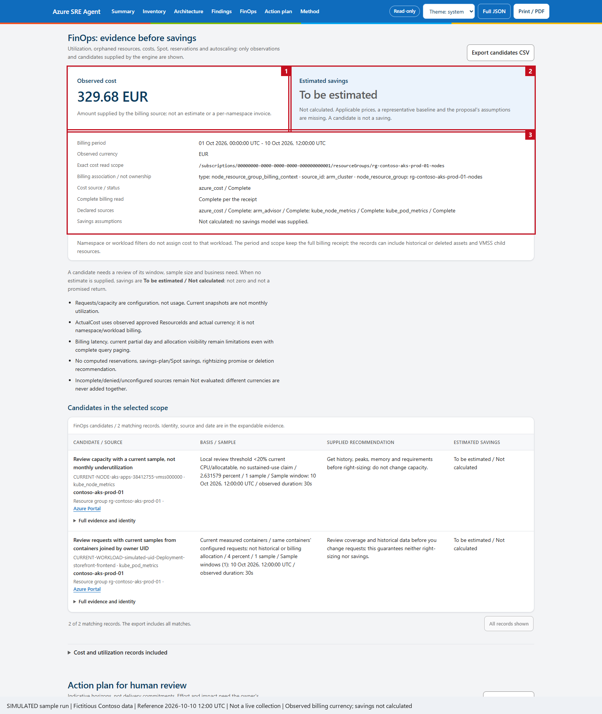

Current CPU/memory samples do not establish 30-day sustained underuse.
Requests are configuration, not consumption. Applicable prices, a
representative baseline, reservations/commitments and explicit assumptions
are needed before a monetary savings figure is meaningful.

### Select clusters, export and print

The fleet document keeps the engine's whole-selection aggregate beside the
filtered KPI cards. Selecting a cluster resets the local filters of its
detailed view. A failed primary read shows its error and **no borrowed score,
cost, workload or topology**. In the top band of a detailed view, the
**Cluster 1 of 7 · change** chip jumps back to the filters. Clusters outside
the report need a new SRE call.

Cluster identity comparisons validate the complete Azure resource ID and
ignore only its case. A prefix, another subscription/resource group/cluster,
or an unsafe path is not equivalent. Each run retains its own exact UTC
reference; parallel collection times need not equal the wrapper reference.
Original IDs and timestamps are never rewritten in display or exports.

**Full JSON** preserves the original wrapper and every run, including
errors. Above 4 MB the HTML embeds the same JSON gzip-compressed, and a current
Edge, Chrome, Firefox or Safari decompresses it locally without any network
call. Scope JSON filters only the selected snapshot and explicitly preserves
all other snapshots/errors and the original aggregate. CSV exports include all
matching records, not just the visible page. **Findings** are sorted by
severity by default (**Sort** restores the engine order); exports keep the
engine order. **Print / PDF** expands the matching evidence into an A4
document with a running footer (title, cluster, UTC reference, page number);
both architecture views retain the undeployed label.

## Step 7 - Keep reporting cadence optional

On demand is the default. **No Case 04 SRE scheduled task or new-cloud power
schedule was created for the captured baseline.**

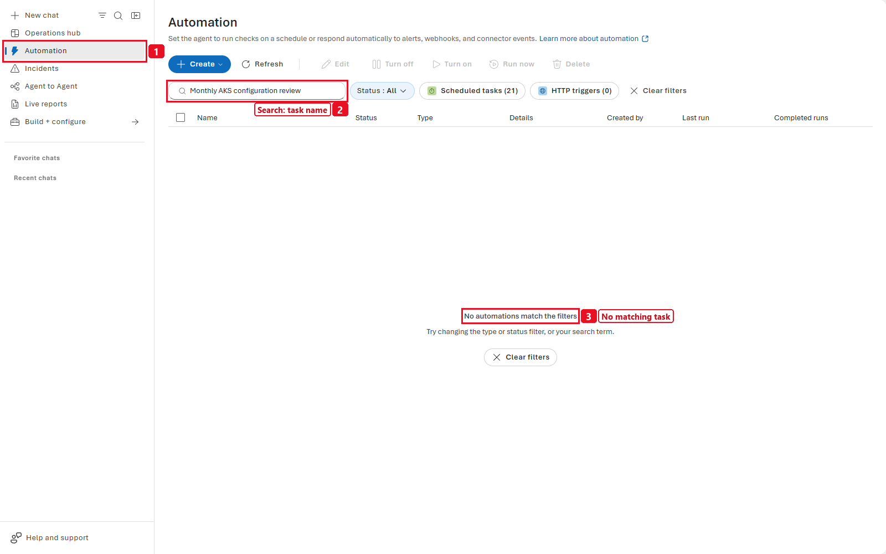

Today's portal (16 November 2026): **1** *Automation* · **2** search by the
template's task name `Monthly AKS configuration review` · **3** the actual
no-results state (*No automations match the filters*). This is not a
successful schedule/next-run receipt. The October readback with the same
meaning is [kept for reference](images/aks04-step07-scheduling.png).

Only after an explicit customer request and an accepted ordinary-chat run:

1. Search **Automation** for a matching **customer-owned** task. Inspect its
   owner, approved fixed scope, responder, prompt and cadence; reuse an
   approved match rather than duplicate it or modify another owner's task.
   To create a new one, open **Automation > Create ▾ > Scheduled task**, or
   **Build + configure > Agent Canvas > Create ▾ > Trigger › > Scheduled tasks**.
2. Choose `aks-waf-live` as the **Response subagent** and specify the approved
   cadence/time zone and selection (all, one subscription or named clusters).
3. Use a prompt for **one complete report call** and immediate four-file
   delivery. Include source-error/partial disclosure; no hidden queries,
   narrower retries, remediation or start/stop operations.
4. Save through the separately authorized process. Reopen/read back enabled
   state, actual next-run time, agent, prompt, selector and time zone.
5. Use **Run now** only when approved, then validate its actual thread and all
   four downloads. A saved task is not proof of a successful execution.

### Optional monthly reporting template - not a deployed task

The package defines **no mandatory Case04 cron or prior monthly-task
receipt**. If the customer chooses a monthly **current configuration
snapshot**, the following is a complete proposed template to approve:

| Field | Proposed value / gate |
|---|---|
| Task name | `Monthly AKS configuration review` |
| Response subagent | `aks-waf-live` |
| Frequency / cron | **Custom cron (UTC)** / `0 9 1 * *` = first day at 09:00 UTC, only if chosen |
| Scope | `cluster_names="all"`, one `subscription`, one `cluster_name` or exact comma-separated `cluster_names` (never both name selectors) |
| Evidence meaning | Configuration/current Kubernetes samples at execution time, plus the **privately configured** billing timeframe; not a previous-month telemetry report |
| Start on / model tier | Customer-approved activation date and usage policy |
| Agent autonomy level / Message grouping for updates | Autonomous only for approved unattended read-only execution; Review can pause. Choose **New chat thread for each run** (the default is *Use same chat thread*). |

The template reports every visible cluster; replace the selector if the
customer approved a narrower scope before saving **Task details**:

```text
Use aks-waf-live and ONLY generate-aks-waf-report. Make exactly one complete
call with operation=report and cluster_names="all"; keep all
other report defaults. Do not add query filters, period parameters, paging,
fresh follow-up calls, narrower retries or changes.
If status=error, stop with the sanitized code/source and invent no files,
counts or healthy-zero workloads. Otherwise immediately deliver the actual
HTML, complete JSON, failed-findings CSV and inventory CSV. When sharing_mode
is native_ui, render report_url, snapshot_url, findings_csv_url and
inventory_csv_url unchanged as relative native links/file widgets. For
local_files_only, explain that native aliases are unavailable and show only
the actual returned paths. written is not download verification;
http_verified=false must not hide provided aliases.
Summarize only returned UTC/source coverage, counts and local assessment
beside unknowns. Disclose partial/error sources; unavailable Kubernetes stays
Not evaluated, not historical workloads or health. Do not claim the current
configuration or samples cover the previous calendar month. Never grant roles,
enable plans, start/stop a cluster, remediate, call operator assets, fabricate
links, drop evidence, split the requested scope or upload to alternative storage.
```

For one subscription, replace the selector with
`subscription="<SUBSCRIPTION_NAME_OR_ID>"`; for named clusters use
`cluster_names="<AKS_NAME_1>,<AKS_NAME_2>"` **without spaces**. Do not add `period`, start/end dates or a
billing-window override to the call; those are not supported tool parameters.

The normal picker can display browser-local time but save a fixed UTC
schedule. Local wall-clock time may shift after DST; prefer explicit UTC cron
and read back the **next UTC run**, enabled state and activation date. A
separately authorized manual run must show the actual execution thread, one
tool call and all four real downloads. **Success** may mean handoff to a
thread, not completed collection; **No thread found** is not acceptance.
Manual acceptance does not prove a future calendar trigger fired.

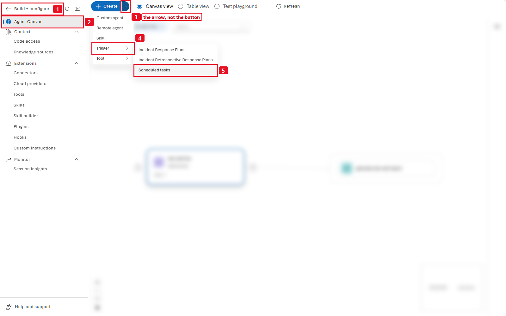

The scheduling entry in today's Agent Canvas (16 November 2026), opened
without creating a task: **1** Build + configure · **2** Agent Canvas · **3** the
▾ arrow next to **Create** · **4** Trigger › · **5** *Scheduled tasks*.
**Automation > Create ▾ > Scheduled task** opens the same form. The October
capture of this entry is [kept for reference](images/aks04-step07-create-menu.png).

Do not confuse **reporting cadence** with a demo cluster's **power schedule**.
Any Azure Automation identity/runbook that starts or stops a new demo cluster
is a separate, paid, narrowly scoped operator deployment; it is never an SRE
reporting tool or a permission of the reporting UAMI. Its infrastructure,
IAM, budget and genuine nextRun/completion evidence need separate approval.
New-cloud captures remain **Not collected** until that deployment happens.

## Troubleshooting

| Symptom | What to do honestly |
|---|---|
| `configuration_required` | Set `TENANT_ID` and `MANAGED_IDENTITY_CLIENT_ID` (GUIDs) before authentication; an override entry without `subscription_id` needs the optional `SUBSCRIPTION_ID`; more than 500 discovered clusters needs `DISCOVERY_SUBSCRIPTION_IDS` or a narrower granted scope. No alternate identity. |
| `no_clusters_visible`, or a cluster/subscription missing from `list_clusters` | The identity cannot read it: grant Reader on that management group or subscription ([script](#grant-the-read-only-roles-with-the-script)) and wait 5-10 minutes. Never widen access from chat. |
| `unknown_cluster` / `unknown_subscription` | Use exact names from `list_clusters`; the message lists close matches. A subscription matches by ID or exact display name, ignoring case. |
| `ambiguous_cluster_name` | The same AKS name exists in several subscriptions: add `subscription` or use the prefixed name from `list_clusters`. |
| `too_many_clusters` | One report covers at most 100 clusters: ask for one subscription or named clusters. |
| `selection_required` | `query` reads one cluster: add `cluster_name`, or use a report for many clusters. |
| Selector rejected (`invalid_parameter`) | Use one name selector only and no spaces in `cluster_names`; `all` covers every visible cluster. |
| Human Build + configure/chat denied | Verify Author + Standard User (or Administrator) on the SRE Agent resource; do not self-grant based on a warning |
| Import / syntax error or only 11-12 saved inputs | Check declared dependencies, complete standalone paste and the current 13-input schema. Do not Generate/Refine a replacement, use unbuilt `engine.py` or infer `cluster_names`/`subscription` from an old screenshot. |
| `invalid_combination` / wrong type | Use query-only filters only with compatible views/statuses; leave report defaults untouched. Namespace filtering does not change server-side data-read scope. |
| clusterUser HTTP 403 | Ask the authorized operator to verify the exact minimal approved permission; never use admin kubeconfig |
| A Kubernetes kind HTTP 403 | Preserve that blind spot; AKS RBAC Reader can exclude cluster-scoped kinds |
| Kubernetes HTTP 502 / TLS / timeout | Inspect approved reachability, source and peer/FQDN validation; no insecure/proxy/endpoint workaround |
| Cost HTTP 429 | At most two cost queries run at once and `Retry-After` is honoured within the time bound; then that cluster's cost source is `throttled` / Not evaluated and the cluster is partial. No zero cost or savings. |
| A cluster shows `collection_timeout` | It did not finish within the shared fleet bound: unknown, not healthy. Report fewer clusters (one subscription) or that cluster alone. |
| Every cluster is `partial` | Expected while Kubernetes reads are off (`kubernetes_enabled=False`) or a source such as cost is disabled: those sources are disclosed as not collected, not as failures. |
| Partial list / continuation / cap error | Retain normalized rows with their partial receipt; do not call page one the whole estate |
| Invalid HTML startup | Request a complete compatible snapshot; the UI deliberately exposes no partial success |
| File/response limit exceeded (`artifact_size_exceeded`) | Report fewer clusters (one subscription). Do not drop records, ZIP or upload to Storage; the tool already compresses only the HTML's embedded JSON. |
| File written but native download failed | Report the actual delivery failure; writing a path is not HTTP/download verification |
| Missing tool/widget / wrong specialist answered | Reopen normal chat, explicitly select `aks-waf-live`, and verify its saved one-tool/one-skill allowlist. Do not attach global execution/file tools as a workaround. |
| High local index with low coverage | Read unknown counts and source errors; no official WAF/health conclusion |
| Missing current manifests | Do not substitute the historical screenshot's workloads for failed fresh reads |

## Dated evidence and release state

| Evidence | What it establishes |
|---|---|
| Existing approved LAB, source reference **2026-10-13T18:17:15Z** | Actual ordinary chat automatically delivered four native URLs; all four original downloads returned HTTP 200; current Kubernetes evidence was source-partial |
| Current baseline local index / coverage | **94.44 / 100**, **15.13%** coverage; **18** evaluated, **101** Not evaluated, **1** N/A; not an official score or health assertion |
| Current baseline billing | **295.82358809701833 USD**, MonthToDate **2026-10-01 to 2026-10-13T18:17:15Z**, **53** billed ResourceId rows; estimated savings `null` |
| Earlier source **2026-10-13T14:41:50Z** | **53 workloads / 77 pods** were captured then; Nodes/PVs/StorageClasses had HTTP 403. Historical source plus later replay, not present Kubernetes recovery |
| Real Builder captures, 2026-10-13 | Actual saved one-tool/one-skill specialist and the UI controls of that date; unsaved code/parameter/identity previews are identified as previews. Replaced in the steps by today's captures and kept for reference: [Test playground](images/aks04-step01-cluster-choice.png), [Python menu](images/aks04-step02-01-python-menu.png), [Code](images/aks04-step02-02-code.png), [paging](images/aks04-step02-03-typed-parameters.png), [Identity](images/aks04-step02-04-identity.png), [skill](images/aks04-step03-skill-readback.png), [specialist](images/aks04-step04-agent-readback.png), [scheduling](images/aks04-step07-scheduling.png), [Trigger menu](images/aks04-step07-create-menu.png) |
| Real portal captures, 2026-11-16 (`newui-*`) | Today's portal with the guide's values, read-only: nothing saved, tested, sent or run; readbacks show the existing lab skill/specialist under the guide's names. Navigation and form evidence, not a new deployment, execution or download receipt |
| Corrected two-scope package, **2026-10-14T09:25:00Z / 09:26:26Z** | Actual saved/read-back 12-input deployment; four automatic HTTP 200 downloads; both selectors, full JSON/CSV, observed/reference views, light/dark/mobile and print passed. First cluster: 19 Kubernetes 502s; second: stopped ARM configuration read without starting it |
| New demo cluster / power scheduler | Not deployed or collected; no new paid cluster, roles or scheduler approval is implied by an existing-tool update |
| Fleet build, **2026-11-17** | Local fleet tests (including 100 clusters across 20 subscriptions) and the LAB Test playground (two clusters, one subscription): discovery, `subscription` filter by name and ID, reports for all/one/two clusters and a query; see [TESTS.md](https://github.com/marioaguileraaa/sre-agent-use-cases/blob/main/04-aks-well-architected-review/TESTS.md). Not a new production deployment. |

The verified baseline generic canonical source was
`b1df6c82582018735e75771efa32d8d1d40a9ef0b9b74cf3e58811d3e4befee0`
(329,605 bytes). The captured private configured tool read back as
`3aefbd5f0246deb91e5938e170472f84b4911a3aa95b630bbef59fa152f54096`,
with 11 inputs, Identity preset Off and timeout 900. These are **dated baseline
receipts**, not the hash of the newly integrated package.

The first updated deployment's generic canonical source was
`29d8acac226272669715281a091db13585333322ba654caeecf08678d5841ef8`;
the configured source read back as
`eec7df989e7e030dddb13e61c1d8ba49653fe421829e436de7eab2400fbd544b`.
The operator reported that initial save/readback on 2026-10-14. Its first
combined report delivered files but failed UI startup because equivalent full
ARM IDs differed in capitalization; that failed-run receipt is retained.

**Corrected fresh delivery, verified 2026-10-14:** generic source
`4d367ae72e6829f4b2eaed41d37e65edfa263ca83acca5dd7c454e8df887265d`;
configured source
`160bfd20d47ca08f07a98702106776a27726c857954b4b269e0b240be39e2a05`.
Its four automatic native downloads returned HTTP 200: HTML **1,227,761 bytes**,
full JSON **1,035,153 bytes**, findings CSV **2,937 bytes**, inventory CSV
**122,968 bytes**. JSON SHA-256:
`30251aa20df79eecfcce6a2107d0bfff0a650b4f18ec72a549c6944389d0d38d`.
Actual 1440/390/320px light/dark, both selectors and combined summary,
observed versus undeployed-reference views, complete JSON/fields/snapshots/
aggregate and print passed, with no external requests, JavaScript errors or
page overflow. Original per-cluster reference times and evidence remain
unchanged. This is delivery/UI validation, **not** Kubernetes recovery or
new-cluster/power-schedule deployment.

The earlier workload-complete replay showed **98.41 / 100** over 63 evaluated
checks and **31.19%** coverage, with 139 Not evaluated and 355 N/A. Its chart is
not current source health. No earlier workload is inserted into the later 502
report, and no current/source-partial capture is captioned as recovered.

Release gates are **DRAFT -> OFFLINE_VALIDATED -> LIVE_VALIDATED -> PUBLISHED**.
PARTIAL_LIVE records functional execution/delivery with explicitly accepted
source blind spots; it is not complete current workload assessment.
Publication additionally needs privacy review, approved repository
visibility and a remote commit receipt. A local commit is not publication.
Real identities/configurations/logos/datasets stay outside Git.

## Technical boundaries and development

<details>
<summary>Collection, authentication and source completeness</summary>

The runtime uses `azure-identity` and PyYAML, plus Pillow only for an optional
logo. It has no DefaultAzureCredential, cached CLI/OBO/admin fallback. A
non-managed-Entra clusterUser flow is rejected. Server/CA validation uses the
exact approved ARM FQDN, HTTPS/default port 443, hostname/peer verification and
system roots plus the approved public cluster CA, in memory only.

ARM managedCluster/pool/version/maintenance reads use fixed API versions
(`2025-05-01` for AKS); diagnostics use `2021-05-01-preview`; related inventory
uses `2021-04-01`. Per-type asset reads are explicitly whitelisted. Kubernetes
reads are fixed GET paths with independent per-kind continuation/resourceVersion
receipts. Metrics retain current timestamps/durations, cores/bytes and sample
counts, not history. Cost uses read-only ActualCost/PreTaxCost queries
(`2023-11-01`) on approved observed scope; Advisor reads cached recommendations
(`2025-01-01`) without generation actions. At most two Cost Management queries
run at once; HTTP 429 honours `Retry-After` and the
`x-ms-ratelimit-microsoft.costmanagement-*-retry-after` hints (four attempts,
waits up to 60 seconds, never past the time bound), then that cluster's cost
source is `throttled`.

GETs have 30-second timeouts, at most three attempts for
429/500/502/503/504 and bounded Retry-After. Source limits are 100 pages /
20,000 rows, Kubernetes 500 rows/page, HTTP bodies 8,000,000 bytes, related
details 200 records. Discovery is one fixed Resource Graph query (no user text
in KQL, up to 500 clusters). Up to 8 clusters are collected in parallel, each
with its own 240-second / 300-attempt budget, under one shared 750-second fleet
bound (+40 s grace); a cluster still running is reported as
`collection_timeout`. Each worker keeps its cluster's subscription
thread-local, so parallel clusters never read with another cluster's scope. Failed pages
retain already normalized rows with an explicit partial/error receipt.
Successful-empty, denied, unsupported/unconfigured and transport-error sources
are different states. Stopped clusters are never started.

Never retrieved as review evidence: Secrets/ConfigMap data, container
env/command/args/logs, secret values, Storage keys, private certificates/keys,
raw kubeconfig, token/CA material or arbitrary annotations. Whitelists retain
every admitted record/field in the full JSON, including unused `source_data`,
original quantities, IDs and window metadata.

</details>

<details>
<summary>Billing, utilization windows and transport</summary>

Billing `finops.window` is `{start,end}`. A capacity candidate retains one
`{timestamp,duration}` or an array of such samples; repeated timestamps are
not deduplicated or converted into a fictitious interval. Unattached candidates
can have no measurement window. Stale/undated samples remain exported but cannot
become current capacity candidates; the freshness guard is five minutes from
the declared reference and sample windows must be positive and at most one day.

Node-resource-group billing retains historical/deleted/VMSS-child ResourceIds
even when absent from current inventory. It is billing context, not proven
ownership or workload allocation. Attachment-state/orphan reviews require
explicit evidence and complete reference visibility, not a naming heuristic.
No deletion, price assumption, reservation purchase or savings eligibility is
inferred.

The fixed runtime-owned `cwd\aks-waf-reports` directory has symlink/junction/
escape guards and unique run names. Four prepared files are byte-checked,
written atomically and read back against the complete normalized model.
The HTML is at most **16,000,000 bytes** and each other artifact at most
**64,000,000 actual encoded bytes**, including CSV BOM; above 4,000,000 bytes
the HTML embeds the same JSON gzip+base64 and the browser decompresses it
locally. Oversize complete evidence fails before writing instead of dropping
data. A simulated 100-cluster report measured about 4.3 MB of HTML and 40 MB of
JSON.
Responses must fit **3,500 bytes with Python's default JSON serialization**.
Queries reduce whole-row count with explicit paging/cap disclosure; one
oversized row is an error, not an endless zero-row cursor.

Native delivery derives this actual thread UUID only from guarded SRE
ThreadFiles roots; no fixed thread/hostname, manual publication, static URL
prefix, Storage or ZIP fallback is used. Outside those roots, delivery remains
`local_files_only` with unchanged actual paths. `artifact_status=written` is
not a download receipt, and `http_verified=false` must not hide provided native
links.

</details>

<details>
<summary>Repository build and offline checks</summary>

The development sources are `engine.py`, `rules_catalog.json`, pinned
references and `report_template.html`. The builder embeds them into the
canonical whole-file Python tool. The separate UI workstream does not hand-edit
the generated canonical file.

These are **optional maintainer commands**, not ordinary customer deployment
steps, permission to rebuild frozen assets or evidence of a new live read.
An operator pastes the existing canonical tool; running a build or browser
suite is not required to install it.

```powershell
python .\04-aks-well-architected-review\build_tool.py
python .\04-aks-well-architected-review\build_tool.py --check
python -m pytest .\04-aks-well-architected-review\tests -q -p no:cacheprovider
```

For the existing local Edge/Playwright browser gate:

```powershell
$env:SRE_REPORT_BROWSER_TESTS = '1'
python -m pytest .\04-aks-well-architected-review\tests\test_report_ui.py -q -p no:cacheprovider
```

`SRE_REPORT_UI_ACTUAL_MODEL` optionally points to a private complete normalized
snapshot for bootstrap, source metadata, scope, print and lossless-export checks.
It is not a tool input, a public fixture or a new cloud read. Public test data
are permanently SIMULATED/LAB. The runtime does not accept arbitrary snapshot
paths.

```powershell
Set-Location .\04-aks-well-architected-review
python .\tests\offline_demo.py
```

The developer-only demo produces four clearly SIMULATED files; it is never
imported or selected by the SRE runtime.

</details>

## References and licensing

| Source | Purpose / pinned evidence |
|---|---|
| [AKS WAF service guide](https://learn.microsoft.com/en-us/azure/well-architected/service-guides/azure-kubernetes-service) | All five pillars; checked 2026-10-13, page updated 2026-09-29 |
| [AKS baseline architecture](https://learn.microsoft.com/en-us/azure/architecture/reference-architectures/containers/aks/baseline-aks) | Conditional production design choices, not the observed customer's deployment |
| [AKS multitenant guidance](https://learn.microsoft.com/en-us/azure/architecture/guide/multitenant/service/aks) | Namespace/isolation tradeoffs; namespaces are not a universal hard-security boundary |
| [Official Azure icons and usage terms](https://learn.microsoft.com/en-us/azure/architecture/icons/) | V24 original SVGs, nearby product names, no cropping/rotation/distortion/product-logo use |
| [SRE user roles](https://learn.microsoft.com/en-us/azure/sre-agent/user-roles) | Human Author/Standard/Administrator roles, separate from source identity access |
| [Create an SRE Agent / getting started](https://learn.microsoft.com/azure/sre-agent/create-agent) | Separate service prerequisite if no approved agent exists; requires the customer's cost/access decision before this case's setup |
| [SRE identity](https://learn.microsoft.com/azure/sre-agent/agent-identity) | Current UAMI discovery; Client ID for code versus principal for RBAC |
| [Portal role assignments](https://learn.microsoft.com/azure/role-based-access-control/role-assignments-portal) | Authorized admin workflow and managed-identity assignment limits |
| [AKS clusterUser credential access](https://learn.microsoft.com/azure/aks/control-kubeconfig-access) | ARM clusterUser permission is separate from Kubernetes data authorization |
| [AKS Kubernetes data authorization](https://learn.microsoft.com/azure/aks/manage-azure-rbac) | Read-role scope/limitations, not a Cluster Admin workaround |
| [SRE Python tools](https://learn.microsoft.com/en-us/azure/sre-agent/python-code-execution) | Whole-function code, typed inputs, test-before-create and Identity tab |
| [SRE skills](https://learn.microsoft.com/en-us/azure/sre-agent/skills) | Runtime `SKILL.md` and tool attachment |
| [SRE custom agents](https://learn.microsoft.com/en-us/azure/sre-agent/sub-agents) | Agent Canvas, explicit specialist activation and scoped tools |
| [SRE scheduled tasks](https://learn.microsoft.com/en-us/azure/sre-agent/scheduled-tasks) | Optional cadence, readback and actual run evidence |
| [SRE automation workflow](https://learn.microsoft.com/azure/sre-agent/automate-workflows) | UTC versus browser-local picker and Success/handoff meaning |
| [Official Azure Architecture Review](https://learn.microsoft.com/en-us/assessments/azure-architecture-review/) | A separate official assessment; this tool does not issue its grade |

The pinned [AKS checklist](https://github.com/marioaguileraaa/sre-agent-use-cases/blob/main/04-aks-well-architected-review/references/aks_checklist.en.json) is from
Azure/review-checklists commit
`f131b93418892102b00c247fd9cf685e3d356522`, blob
`8c9d49dedf2c8f0aa0e11fba86c7a17aa927dc22` (66,436 bytes), SHA-256
`e1f7e0f44e121a4f96a9258e64383d33a14c78e56bf0d7c7b6638f8b72acff31`.
Its Microsoft copyright/full MIT license is retained in
[`references/LICENSE.azure-review-checklists`](https://github.com/marioaguileraaa/sre-agent-use-cases/blob/main/04-aks-well-architected-review/references/LICENSE.azure-review-checklists).
Legacy graph snippets are not executable evaluation input.

Azure product icons have their **own permitted-use terms**, not the checklist's
MIT license. Only the eleven needed original SVGs are persisted, with
[`usage/source/hash notices`](https://github.com/marioaguileraaa/sre-agent-use-cases/blob/main/04-aks-well-architected-review/images/azure-icons/NOTICE.md). No external
asset/script/CDN is required by the report. WARA/Polaris inform narrative and
wayfinding only; neither is installed or presented as the scoring authority.

<!-- QA_PROMPT_PACK -->

---

## Copy-ready Q&A prompt pack

Select `/agent aks-waf-live` in **New chat** and use any of these prompts. With the **Agent: aks-waf-live** chip selected, no `@` mention is needed.

### 1. Discover the clusters (`list_clusters`)

```text
List every AKS cluster you can see, grouped by subscription, with resource group and region (operation="list_clusters", limit=100, following next_offset until it is null).
```

### 2. One report for the fleet, one subscription or named clusters

```text
Generate the complete read-only AKS configuration review for every cluster in every subscription (operation="report", cluster_names="all") and deliver the 4 downloadable files (HTML, JSON, findings CSV and inventory CSV), keeping each cluster's result independent.
```

```text
Generate the AKS configuration review for all clusters in subscription <SUBSCRIPTION_NAME_OR_ID> (operation="report", subscription="<SUBSCRIPTION_NAME_OR_ID>").
```

### 3. Security, identity and network isolation findings

```text
For <AKS_NAME>, query the failed security findings (operation="query", view="findings", cluster_name="<AKS_NAME>", area="security", status="failed") and explain RBAC/Entra ID, Workload Identity, private cluster/authorized IP ranges, Network Policy and Defender for Containers.
```

### 4. Reliability, availability zones and node pools

```text
For <AKS_NAME>, review the node pool inventory (operation="query", view="node_pools", cluster_name="<AKS_NAME>"): which pools separate System and User mode, which have availability zones and autoscaling, and how is a Stopped cluster qualified?
```

### 5. Cost optimization (FinOps) and capacity sizing

```text
For <AKS_NAME>, query the FinOps evidence (operation="query", view="finops", cluster_name="<AKS_NAME>") and summarize observed cost, currency and period, the current capacity candidates and why savings are not calculated.
```

### 6. In-cluster Kubernetes checks versus the ARM plane

```text
Which checks remained "Not evaluated" because they need in-cluster Kubernetes objects (PodDisruptionBudgets, ResourceQuotas, pod requests/limits) rather than the ARM control plane, and what would enabling Kubernetes reads require?
```
