> [!NOTE]
> **Kit en español.** Esta es la guía técnica completa en inglés del caso 08 del repositorio público
> (`08-databricks-dependency-configuration-review`); el paso a paso en español está en el `README.md` de la raíz del
> kit. La herramienta de esta carpeta es la misma que la del caso público (el informe sale en inglés). Los prompts en
> español están en `subagent-instructions-and-prompts.md`, adaptado del original (por eso su SHA-256 no es el de esta guía).

# Case 08 - Azure Databricks dependency mapping, configuration and FinOps review

> **Azure SRE Agent** · Read-only Python tool · Runtime skill · Restricted specialist · Offline HTML, full JSON and two CSVs

Turn every Azure Databricks workspace the agent can read (auto-discovered
across subscriptions, with no list to maintain) into one dated review of
**deep dependency mapping (`OBSERVED`, `INFERRED`, `UNKNOWN`), best practices,
security, FinOps and general optimization**. Ask from chat for all workspaces,
one subscription or a few named workspaces and get one report with
**Subscription** and **Workspace** filters. Trace how the ARM workspace, VNet
injection, Private Link, Access Connector, clusters, pools, policies, jobs and
task DAGs, Lakeflow Declarative Pipelines (DLT), SQL Warehouses, Unity Catalog
objects (metastore, catalogs, schemas, storage credentials, external locations,
connections), Secret Scopes and associated Azure resources connect—and compare
them with a clearly **undeployed Azure Databricks Well-Architected Lakehouse
reference proposal**.

| What you get | What it does not claim |
|---|---|
| **Fleet scope without a list**: every workspace the agent identity can read, auto-discovered with one fixed Azure Resource Graph query across subscriptions, selected from chat (all, one subscription or named workspaces, up to 50 per report) into one report with Subscription / Workspace filters, a fleet overview and each workspace's in-workspace access status | Workspaces the identity cannot read, or Databricks-side results for a workspace without in-workspace access: those checks stay `Not evaluated` and the workspace is flagged, never shown as empty or healthy |
| A deep dependency graph classifying **OBSERVED** native ID/key joins, explicit **INFERRED** URI/hostname references and **UNKNOWN** blind spots, plus referential-integrity detection (`G05`) | Runtime SQL table/column lineage fabricated from job or notebook names, or untested data-plane network reachability |
| A local assessment indicator **beside coverage and check counts** across 36 rules, 3 levels, 4 areas and 5 WAF pillars | An official Microsoft Well-Architected Review, Databricks certification or production SLA guarantee |
| First-party-grounded **cross-tenant authentication modes** separating Azure Resource Manager (ARM) from Databricks Workspace and Unity Catalog REST APIs | That a Tenant-A SRE User-Assigned Managed Identity (UAMI) automatically acquires Tenant-B tokens or workspace permissions without administrator setup |
| Control-plane and metadata-only REST reads that **never start clusters or SQL Warehouses**; a billable SQL statement runs only if you opt in to system tables | Runtime table lineage (`system.access.table_lineage`), or per-run and per-user DBU detail unless you opt in to `system.billing.usage` on an existing SQL warehouse |
| **Databricks costs: where they come from and how to optimize them** (report section 6): Cost Management grouped by the tags Databricks puts on clusters, jobs, SQL warehouses and pools, DBU vs infrastructure, the cost no tag explains, and optimization signals with documented savings estimates | Exact savings: each estimate is labelled lower bound, upper bound or estimate and shows its formula; no estimate is shown where cost data is missing |
| Four native downloadable files (`HTML`, `snapshot.json`, `findings.csv`, `dependencies.csv`) from one complete report call | Remediation, RBAC/Unity Catalog grants, secret rotation or unattended compute changes by the tool (the separate grant script is run once by an administrator) |

> [!IMPORTANT]
> **Validation state: Code `OFFLINE_VALIDATED` · Native SRE bootstrap saved & readiness-validated (`2026-10-16`) · Connected Cross-Tenant Plane 2 Live Run Verified (`2026-10-19`, `cross_tenant_multitenant_fic`).**
> In accordance with repository governance, no fake or simulated demo report is
> substituted for an unconfigured live workspace. On **2026-10-16**, the parent
> operator saved and independently read back the native tool
> (`generate-databricks-dependency-report`), runtime skill
> (`databricks-dependency-live`) and restricted specialist
> (`databricks-dependency-live`), executed two native Python tests (API and UI)
> and completed a real selected-specialist readiness chat that stopped before
> authentication with `status="error"` and `error.code="configuration_required"`
> (`artifact_status="not_written"`). On **2026-10-19**, following the
> [Colleague session handoff checklist](#colleague-session-handoff-checklist-cross-tenant-connection),
> the specialist executed a real cross-tenant (`cross_tenant_multitenant_fic`)
> report run against the colleague's Tenant-B Azure Databricks workspace,
> delivering all four native files (`HTML`, `snapshot.json`, `findings.csv`,
> `dependencies.csv`, all verified with HTTP 200) with 14 `complete` Plane 2
> sources, 9 `OBSERVED` edges, 2 `INFERRED` ADLS Gen2 URI edges and 12 `UNKNOWN`
> blind spots while Plane 1 ARM remained `denied` (`HTTP 403`) pending target
> resource-group `Reader` assignment ([`native-readiness-validation.json`](https://github.com/marioaguileraaa/sre-agent-use-cases/blob/main/08-databricks-dependency-configuration-review/native-readiness-validation.json),
> [`visual-evidence.json`](https://github.com/marioaguileraaa/sre-agent-use-cases/blob/main/08-databricks-dependency-configuration-review/visual-evidence.json)).

> [!NOTE]
> **Databricks costs (November 2026).** Report section 6 now answers *where does
> our Databricks cost come from and how do we optimize it?*
> ([details](#databricks-costs-where-they-come-from-and-how-to-optimize-them)).
> The Cost Management query shapes were validated read-only against a lab
> subscription on **2026-11-12**. That lab has no Databricks workspace, so the
> cost screenshots and the `self_test` demo use a built-in workspace labelled
> `SIMULATED` everywhere (provenance chip, banner and `simulated-*` file names).
> `self_test` is an explicit demo operation; it is never substituted for an
> unconfigured or failed live run.

> [!NOTE]
> **Update 16 November 2026 — tool name, today's portal and English report.** Today's portal
> limits **Tool Name** to 36 characters, so this guide's tool is now named
> `databricks-dependency-report`; the file you paste keeps its name,
> `generate-databricks-dependency-report.py`. The portal screenshots of
> Steps 2 to 5 were recaptured on 2026-11-16 in today's portal (**Build +
> configure → Agent Canvas**, **Custom agents**, `/agent` in chat) and show the
> new name. The October test result, readiness chat and evidence (receipt,
> connected-run card) keep the previous name
> `generate-databricks-dependency-report`, created through the API. If you
> already created the tool with a cut name, use exactly the saved name in the
> skill, the subagent instructions and **Choose tools**. Since 16 November 2026
> the report, its CSV files and its JSON snapshot are in English; paste the
> current tool, skill and subagent instructions to update a saved agent, and see
> the [English sample run](#step-6---read-and-explore-the-html-dependency-and-configuration-dossier).

> [!NOTE]
> **Update 17 November 2026 — fleet review.** The tool no longer needs an
> approved workspace list. In the same tenant it discovers every Azure
> Databricks workspace the agent identity can read, with one fixed, read-only
> Azure Resource Graph query, in every subscription where it has Reader
> (granted once at the management group with
> [`grant-databricks-permissions.ps1`](grant-databricks-permissions.ps1)). From
> chat you ask for all workspaces, one subscription or named workspaces; one
> report covers up to 50 workspaces, collected in parallel, and opens on a fleet
> overview with **Subscription** and **Workspace** filters. A workspace where
> the agent has no in-workspace access keeps its Azure-side review and says why.
> The new `subscription` parameter is the 13th input and `APPROVED_WORKSPACES`
> is now optional (per-workspace overrides, and the list for cross-tenant
> workspaces). Paste the current tool, skill and subagent instructions to update
> a saved agent. Validated with 67 offline tests, a simulated fleet
> ([sample run](#step-6---read-and-explore-the-html-dependency-and-configuration-dossier))
> and live runs in a same-tenant lab agent through the Python tool **Test
> playground**: `list_workspaces`, and reports of all workspaces and of one
> workspace with the detailed cost analysis off, because the playground cuts
> calls at about 100 seconds (see [Limits and timings](#limits-and-timings)).
> The case without in-workspace access is covered by the offline tests and the
> simulated sample run.

## Contents

- [Brief and validation state](#brief-and-validation-state)
- [How scope works: every readable workspace, selected from chat](#how-scope-works-every-readable-workspace-selected-from-chat)
- [Cross-tenant feasibility: Tenant-A SRE Agent to Tenant-B Azure Databricks](#cross-tenant-feasibility-tenant-a-sre-agent-to-tenant-b-azure-databricks)
- [Colleague session handoff checklist (cross-tenant connection)](#colleague-session-handoff-checklist-cross-tenant-connection)
- [How the pieces fit together](#how-the-pieces-fit-together)
- [Source, dependency and coverage contract](#source-dependency-and-coverage-contract)
- [Customer scope coverage and rule catalog](#customer-scope-coverage-and-rule-catalog)
- [Databricks costs: where they come from and how to optimize them](#databricks-costs-where-they-come-from-and-how-to-optimize-them)
- [Prerequisites](#prerequisites)
- [Files to download](#files-to-download)
- [Step 0 - Identify the reporting identity and grant read access](#step-0---identify-the-reporting-identity-and-grant-read-access)
- [Step 1 - Configure the private standalone file](#step-1---configure-the-private-standalone-file)
- [Step 2 - Create the Python tool and verify its 13 typed inputs](#step-2---create-the-python-tool-and-verify-its-13-typed-inputs)
- [Step 3 - Create the runtime skill](#step-3---create-the-runtime-skill)
- [Step 4 - Create the restricted specialist](#step-4---create-the-restricted-specialist)
- [Step 5 - Ask from chat and download the four files](#step-5---ask-from-chat-and-download-the-four-files)
- [Step 6 - Read and explore the HTML dependency and configuration dossier](#step-6---read-and-explore-the-html-dependency-and-configuration-dossier)
- [Step 7 - Keep reporting cadence optional](#step-7---keep-reporting-cadence-optional)
- [Limits and timings](#limits-and-timings)
- [Troubleshooting](#troubleshooting)
- [Evidence, screenshot plan and release gates](#evidence-screenshot-plan-and-release-gates)
- [Technical boundaries and maintainer checks](#technical-boundaries-and-maintainer-checks)

## Brief and validation state

| Field | Value |
|---|---|
| Title / folder | Azure Databricks dependency mapping, configuration and FinOps review / `08-databricks-dependency-configuration-review` |
| Customer problem | Platform, data engineering, security and FinOps teams need an evidence-backed assessment of Azure Databricks workspace configuration, workloads, associated Azure resources (Storage/ADLS Gen2, VNet, NSG, NAT Gateway, Private Endpoints, DNS, Key Vault, Access Connector) and internal/external dependencies without starting clusters or running billable queries. |
| Business value | Consolidates control-plane ARM, Databricks Workspace REST and Unity Catalog metadata into one dependency graph (`OBSERVED`, `INFERRED`, `UNKNOWN`) and 36-rule review workpaper so owners can identify broken task/compute references, interactive cluster waste and governance gaps before production incidents occur. Report section 6 explains the month's Databricks cost by cluster, job, SQL warehouse, pool and allocation tag and lists optimization signals; savings are estimated only where Cost Management data allows, with the formula shown, and are never fabricated. |
| Workload and exact scope | Every `Microsoft.Databricks/workspaces` instance the agent identity can read in its tenant, auto-discovered with one fixed Azure Resource Graph query (up to 500 listed, up to 50 per report), or the configured `APPROVED_WORKSPACES` list for cross-tenant workspaces; their Workspace/Unity Catalog REST metadata and whitelisted associated Azure resources. |
| Exclusions | No cluster or SQL Warehouse start/stop, no `/api/2.0/sql/statements` execution (except the fixed read-only `system.billing.usage` statement when `system_tables_warehouse_id` is set; off by default), no `system.access.table_lineage` SQL queries, no `/api/2.0/secrets/get` secret-value reads, no `spark_env_vars` / `spark_conf` / init-script bodies / notebook source / job parameter values, and no RBAC or Unity Catalog grants. |
| Provenance | Live collector outputs carry collector-path label `LIVE` (`provenance="LIVE"` in `configuration_required` readiness responses identifies the live code path, not a connected source); isolated unit/UI test fixtures are permanently labeled `SIMULATED` and `LAB` inside `tests/`, and the English sample run in `sample-run/` (a fleet of four simulated workspaces) is labeled `SIMULATED`. |
| Validation state | Code `OFFLINE_VALIDATED` (67 unit, browser UI, media and privacy tests passing on `2026-11-17`); native SRE tool/skill/specialist saved, read back and readiness-validated on `2026-10-16` ([`native-readiness-validation.json`](https://github.com/marioaguileraaa/sre-agent-use-cases/blob/main/08-databricks-dependency-configuration-review/native-readiness-validation.json)); fleet discovery (`list_workspaces`) and reports of all workspaces and of one workspace (detailed cost analysis off) run live in a same-tenant lab agent through the Python tool **Test playground** on `2026-11-17`; colleague Tenant-B Databricks source remains `UNKNOWN_NOT_CONFIGURED` / `NOT_RUN`. |
| Runtime specialist model | Platform-supported Azure SRE Agent default (`llmModelName=null`). *(Authoring note: repository authoring subagents ran on `Gemini 4 Argon` with `high` reasoning and `1M` context, which is a Copilot coding-agent setting and not an Azure SRE Agent runtime field.)* |

## How scope works: every readable workspace, selected from chat

| Setup | Workspaces the tool works with | What you maintain |
|---|---|---|
| **Same tenant** (`SRE_TENANT_ID == TARGET_TENANT_ID`, `AUTO_DISCOVERY = True`, the default) | Every workspace the agent identity can read, from one fixed read-only Azure Resource Graph query on each call (`POST /providers/Microsoft.ResourceGraph/resources`), with subscription display names, across every readable subscription (or only `DISCOVERY_SUBSCRIPTION_IDS`) | Nothing: Reader (plus Cost Management Reader) once at the management group; new subscriptions and workspaces appear on their own |
| **Optional overrides** | An `APPROVED_WORKSPACES` entry wins over the discovered workspace with the same resource ID (for example `environment`, `cost_scope`, `system_tables_warehouse_id` or `requirements`); keys that start with `<` are ignored, so the committed placeholder does nothing | Only the workspaces you want to tune; the rest use `WORKSPACE_DEFAULTS` |
| **Cross-tenant** (`SRE_TENANT_ID != TARGET_TENANT_ID`) or `AUTO_DISCOVERY = False` | Only the `APPROVED_WORKSPACES` entries, each with its `auth_mode`; discovery stays off (`discovery.reason` is `cross_tenant_configuration` or `auto_discovery_disabled`) | The configured list, as before |

- **Selection happens in chat, never in code:** `workspace_names="all"` (or no
  selection) for every visible workspace, `subscription` (display name or ID)
  for one subscription, `workspace_name` for one workspace and
  `workspace_names` for up to 50 exact names. A name that exists in two
  subscriptions is listed as `<first 8 characters of the subscription ID>-<name>`.
- Rows from another tenant or with invalid names are skipped. A workspace whose
  URL is not available in Azure (not provisioned or being deleted) gets the
  Azure-side review only.
- **Two access planes per workspace.** The Azure side (Plane 1) needs Reader.
  The in-workspace side (Plane 2: clusters, jobs, pipelines, SQL warehouses,
  Unity Catalog) needs the identity added inside the workspace and a network
  route to it. Where Plane 2 is missing, the report still delivers the
  Azure-side review and flags the workspace **without in-workspace access**,
  with the reason: `denied` (HTTP 401/403), `unreachable` (private network),
  `token_failed`, `disabled` or `not_collected`.

## Cross-tenant feasibility: Tenant-A SRE Agent to Tenant-B Azure Databricks

### Question: Can an Azure SRE Agent in Tenant A integrate with a colleague's Azure Databricks workspace in Tenant B?

**Short answer:** **Not automatically with the default single-tenant UAMI alone,
because Azure Databricks spans two separate authentication planes.** However,
**cross-tenant read-only integration IS supported using first-party Microsoft
Entra and Azure Databricks mechanisms** once administrators in Tenant A and
Tenant B configure one of the supported cross-tenant trust patterns below.

### Why the default Tenant-A UAMI does not work out of the box across tenants

1. **Single-tenant Managed Identity boundary:** The SRE Agent's attached
   User-Assigned Managed Identity (`MANAGED_IDENTITY_CLIENT_ID`) is a
   single-tenant service principal anchored to **Tenant A**
   (`https://login.microsoftonline.com/<SRE_TENANT_ID>`). Every token it
   requests directly from IMDS carries `tid == <SRE_TENANT_ID>`.
2. **Two distinct planes in Azure Databricks:**
   - **Plane 1 — Azure Resource Manager (`https://management.azure.com`):**
     Governs the `Microsoft.Databricks/workspaces` resource,
     `outboundNetworkDependenciesEndpoints`, `privateEndpointConnections`,
     `Microsoft.Databricks/accessConnectors`, managed resource group inventory,
     VNet/subnets/NSGs, Storage accounts, Key Vaults, Advisor and Cost
     Management in **Tenant B's subscription**.
   - **Plane 2 — Azure Databricks Workspace & Unity Catalog REST API
     (`https://adb-<workspace-id>.<shard>.azuredatabricks.net`):** Governs
     clusters, instance pools, cluster policies, jobs, pipelines, SQL
     warehouses, secret scopes, global init scripts and Unity Catalog
     (metastore, catalogs, schemas, storage credentials, external locations,
     connections).
3. **Why Azure Lighthouse alone is not enough:** Delegating Tenant B's
   subscription or resource group to Tenant A's UAMI via **Azure Lighthouse**
   (`Microsoft.ManagedServices`) allows the Tenant-A UAMI to read **Plane 1
   (ARM)** in Tenant B. However, **Azure Lighthouse does not project identities
   into the Azure Databricks Workspace or Unity Catalog data plane (Plane 2)**,
   and Tenant B's Databricks workspace rejects Microsoft Entra tokens whose
   `tid` claim is Tenant A.

### Supported authentication modes implemented in `generate-databricks-dependency-report.py`

The collector enforces explicit tenant and token verification and supports four
fixed `auth_mode` values (`WORKSPACE_DEFAULTS` gives discovered same-tenant
workspaces `same_tenant_uami`; cross-tenant workspaces set theirs in their
`APPROVED_WORKSPACES` entry):

| `auth_mode` | When to use | Plane 1 (ARM `management.azure.com`) | Plane 2 (Databricks Workspace & Unity Catalog `adb-*.azuredatabricks.net`) | Secrets required? |
|---|---|---|---|---|
| **`cross_tenant_multitenant_fic`** *(Recommended for cross-tenant)* | SRE Agent is in Tenant A; Databricks workspace is in Tenant B; both tenants can approve a multi-tenant Entra App Registration. | Multi-tenant App Registration in Tenant A (`FEDERATED_APP_CLIENT_ID`) trusts the Tenant-A UAMI as a **Federated Identity Credential (FIC)** (`issuer: https://login.microsoftonline.com/<SRE_TENANT_ID>/v2.0`, `subject: <SRE_UAMI_OBJECT_PRINCIPAL_ID>`, `audience: api://AzureADTokenExchange`). After admin consent in Tenant B and Azure RBAC `Reader` assignment on the Tenant-B scope, the tool exchanges the UAMI assertion at `https://login.microsoftonline.com/<TARGET_TENANT_ID>/oauth2/v2.0/token` for a Tenant-B ARM token (`tid == TARGET_TENANT_ID`). | The same multi-tenant App's service principal (`FEDERATED_APP_CLIENT_ID`) is added as a **Microsoft Entra ID-managed Service Principal** in Tenant B's Azure Databricks Account/Workspace with read-only permissions. The tool exchanges the UAMI assertion at Tenant B's token endpoint for scope `2ff814a6-3304-4ab8-85cb-cd0e6f879c1d/.default` (`tid == TARGET_TENANT_ID`). | **None (100% secretless)** |
| **`cross_tenant_lighthouse_plus_databricks_oidc`** | Tenant B delegates ARM via Azure Lighthouse and the colleague's Databricks Account Admin configures a Databricks OIDC Service Principal Federation Policy. | Tenant-A UAMI acquires a normal ARM token in Tenant A; **Azure Lighthouse** delegation on Tenant B's resource group/subscription authorizes the cross-tenant ARM GET reads. | Colleague's Databricks Account Admin creates a Databricks Service Principal (`FEDERATED_APP_CLIENT_ID`) in `https://accounts.azuredatabricks.net` with a **Federation Policy** (`oidc_policy`) trusting the Tenant-A UAMI token (`issuer`, `subject: <SRE_UAMI_OBJECT_PRINCIPAL_ID>`, `audiences: ["api://AzureADTokenExchange"]`). The tool exchanges the UAMI token via RFC 8693 at `https://<workspace_host>/oidc/v1/token` (`client_id=<FEDERATED_APP_CLIENT_ID>`, `subject_token=<uami_jwt>`, `subject_token_type=urn:ietf:params:oauth:token-type:jwt`, `grant_type=urn:ietf:params:oauth:grant-type:token-exchange`, `scope=all-apis`). | **None (100% secretless)** |
| **`cross_tenant_lighthouse_plus_keyvault_oauth_m2m`** | Tenant B delegates ARM via Azure Lighthouse (or `workspace_api_enabled=False` initially), and for Plane 2 the colleague provides a scoped Databricks Service Principal OAuth M2M secret stored in an approved Tenant-A Key Vault. | Same as above (Tenant-A UAMI via Azure Lighthouse delegation). | The tool uses the Tenant-A UAMI (`https://vault.azure.net/.default`) to read `GET {KEYVAULT_OAUTH_SECRET_URI}?api-version=7.4` in memory from an existing approved Tenant-A Key Vault, then exchanges `FEDERATED_APP_CLIENT_ID` + secret via HTTP Basic `client_credentials` at `https://<workspace_host>/oidc/v1/token` (`scope=all-apis`). Secret is never written to code, chat, disk or exports. | Scoped Databricks OAuth M2M secret stored **only** in an approved Tenant-A Key Vault (never in code/Git) |
| **`same_tenant_uami`** *(Same-tenant baseline)* | SRE Agent and Azure Databricks workspace are in the **same** Microsoft Entra tenant (`SRE_TENANT_ID == TARGET_TENANT_ID`). | Tenant-A UAMI directly acquires `https://management.azure.com/.default` with Azure RBAC `Reader`. | Tenant-A UAMI (`MANAGED_IDENTITY_CLIENT_ID`) is added directly to the Databricks workspace as an Entra-managed service principal and acquires `2ff814a6-3304-4ab8-85cb-cd0e6f879c1d/.default`. | **None (100% secretless)** |

Official Microsoft Learn references:
- [Configure an application to trust a managed identity (Federated Identity Credentials across tenants)](https://learn.microsoft.com/en-us/entra/workload-id/workload-identity-federation-config-app-trust-managed-identity)
- [Use Azure managed identities with Azure Databricks](https://learn.microsoft.com/en-us/azure/databricks/dev-tools/auth/azure-mi-auth)
- [Authenticate with Microsoft Entra service principals (`2ff814a6-3304-4ab8-85cb-cd0e6f879c1d`)](https://learn.microsoft.com/en-us/azure/databricks/dev-tools/auth/azure-sp)
- [Configure a Databricks OAuth federation policy (`oidc_policy`)](https://learn.microsoft.com/en-us/azure/databricks/dev-tools/auth/oauth-federation-policy)
- [Exchange a federated JWT for a Databricks OAuth token (RFC 8693 `/oidc/v1/token`)](https://learn.microsoft.com/en-us/azure/databricks/dev-tools/auth/oauth-federation-exchange#manually-exchange-a-token)
- [Authorize service principal access to Azure Databricks with OAuth M2M](https://learn.microsoft.com/en-us/azure/databricks/dev-tools/auth/oauth-m2m)
- [Azure Lighthouse cross-tenant management experiences](https://learn.microsoft.com/en-us/azure/lighthouse/concepts/cross-tenant-management-experience)

## Colleague session handoff checklist (cross-tenant connection)

When you meet with your colleague to connect their Tenant-B Azure Databricks
workspace to your Tenant-A SRE Agent, follow this exact checklist. Nothing in
the repository needs to be redesigned—only the private deployment copy of the
tool and schema is updated once the colleague's values and permissions are in
place.

### Phase A — Values to collect during the session (keep private, outside Git)

| Constant / Field | Who provides it | How to find it |
|---|---|---|
| `SRE_TENANT_ID` | You (Tenant A) | Azure Portal (Tenant A) > **Microsoft Entra ID > Overview > Tenant ID** |
| `MANAGED_IDENTITY_CLIENT_ID` | You (Tenant A) | Azure Portal (Tenant A) > **Managed Identities** > the user-assigned identity attached to the SRE Agent (`id-…`) > **Overview > Client ID** (also record **Object (principal) ID** for FIC `subject` / Lighthouse RBAC). Today's SRE Agent menu has no **Settings** page. |
| `TARGET_TENANT_ID` | Colleague (Tenant B) | Azure Portal (Tenant B) > **Microsoft Entra ID > Overview > Tenant ID** |
| `SUBSCRIPTION_ID` | Colleague (Tenant B) | Azure Portal (Tenant B) > **Azure Databricks workspace > Overview > Subscription ID** (or set it as the entry's own `subscription_id`) |
| `<COLLEAGUE_DATABRICKS_WORKSPACE_NAME>` | Colleague (Tenant B) | Exact ARM resource name of `Microsoft.Databricks/workspaces` (the key of its `APPROVED_WORKSPACES` entry) |
| `resource_group` | Colleague (Tenant B) | Exact Resource Group name containing the Databricks workspace in Tenant B |
| `workspace_host` | Colleague (Tenant B) | Per-workspace URL hostname from **Azure Databricks workspace > Overview > URL**, without `https://` or trailing slash (for example `adb-1234567890123456.7.azuredatabricks.net`) |
| `FEDERATED_APP_CLIENT_ID` | You / Colleague | Application (client) ID of the multi-tenant Entra App Registration (for `cross_tenant_multitenant_fic`) or Databricks Service Principal Application ID (for `cross_tenant_lighthouse_plus_keyvault_oauth_m2m`) |

### Phase B — Choose and complete ONE cross-tenant permission path

#### Option 1 (Recommended): `cross_tenant_multitenant_fic`

> ℹ️ **Platform change (November 2026): add a certificate in Key Vault.** Python tools in the Azure SRE Agent sandbox now receive a placeholder managed identity token issued by the platform identity sidecar (`iss` = `adc-msi-sidecar`); the platform proxy swaps it for the real token only when it leaves in an `Authorization` header. The federated (FIC) exchange sends that token inside the request body, so Entra rejects it with **`AADSTS5002723`**. Keep the app and the FIC below, and also give the app a **certificate stored in a Key Vault of Tenant A** that only the SRE Agent managed identity can read; set `CROSS_TENANT_CERT_KEYVAULT_URL` and `CROSS_TENANT_CERT_NAME` (Phase C). With both empty the tool still tries the FIC. The setup script of case 11 does all of it in one idempotent run (public network access must be enabled on the vault):
>
> ```powershell
> ../11-fabric-finops-chargeback/setup-cross-tenant-app.ps1 -SreTenantId <SRE_TENANT_ID> -UamiPrincipalId <SRE_UAMI_OBJECT_PRINCIPAL_ID> `
>     -AppName <YOUR_MULTITENANT_APP_NAME> -KeyVaultName <VAULT> -ResourceGroup <RESOURCE_GROUP> -SubscriptionId <SRE_SUBSCRIPTION_ID>
> ```

1. **In Tenant A (your SRE tenant — Application Administrator / Developer):**
   - Create an App Registration in **Microsoft Entra ID > App registrations > New registration** with **Accounts in any organizational directory (Any Microsoft Entra ID tenant - Multitenant)**. Copy its **Application (client) ID** for `FEDERATED_APP_CLIENT_ID`.
   - Note: Microsoft Entra requires the App Registration and the User-Assigned Managed Identity to belong to the **same home tenant (Tenant A)** when configuring a Managed Identity Federated Credential.
   - In that App Registration, open **Certificates & secrets > Federated credentials > Add credential**:
     - **Federated credential scenario:** `Managed Identity`
     - **Issuer:** `https://login.microsoftonline.com/<SRE_TENANT_ID>/v2.0`
     - **Subject:** `<SRE_UAMI_OBJECT_PRINCIPAL_ID>` (the UAMI's **Object/Principal ID**, case-sensitive)
     - **Audience:** `api://AzureADTokenExchange`
2. **In Tenant B (colleague's Databricks tenant — Entra Admin + Azure RBAC Admin + Databricks Workspace/Account Admin):**
   - Provision the multi-tenant service principal in Tenant B (for example via `az ad sp create --id <FEDERATED_APP_CLIENT_ID>` or tenant admin consent).
   - **Plane 1 (ARM RBAC):** In Azure Portal (Tenant B), assign **Reader** to that service principal on the Databricks workspace resource group (and, if `include_managed_resource_group=True`, on the Databricks managed resource group `databricks-rg-...`).
   - **Plane 2 (Databricks Workspace & Unity Catalog):** In the colleague's Azure Databricks workspace **Settings > Identity and access > Service principals > Manage > Add service principal > Add new**, select **Microsoft Entra ID managed**, paste `<FEDERATED_APP_CLIENT_ID>` as the Microsoft Entra Application ID, and use the object-specific permission matrix below (see official [Workspace access control lists](https://learn.microsoft.com/en-us/azure/databricks/security/auth/access-control) and [Compute policy permissions](https://learn.microsoft.com/en-us/azure/databricks/admin/clusters/policies#policy-permissions)). **Do not grant blanket attachment/use or admin permissions merely to make every rule evaluate:**

     | Plane 2 object / endpoint | Official Databricks ACL levels | Recommended least-privilege grant for this collector | Capabilities & boundary when omitted |
     |---|---|---|---|
     | **Jobs** (`/api/2.1/jobs/list`, `/api/2.1/jobs/get`) | `NO PERMISSIONS`, `CAN VIEW`, `CAN MANAGE RUN`, `IS OWNER`, `CAN MANAGE` | **`CAN VIEW`** on in-scope jobs | `CAN VIEW` reads job settings and task DAGs without `Run now` or `Cancel run`. Jobs without `CAN VIEW` are omitted by the list API and remain `UNKNOWN` if referenced via `run_job_task`. |
     | **Lakeflow Declarative Pipelines** (`/api/2.0/pipelines`, `/api/2.0/pipelines/{id}`) | `NO PERMISSIONS`, `CAN VIEW`, `CAN RUN`, `CAN MANAGE`, `IS OWNER` | **`CAN VIEW`** on in-scope pipelines | `CAN VIEW` lists pipelines and reads `spec` (`catalog`, `schema`/`target`, `storage`, `clusters`) without starting/stopping updates. Denied detail reads stay `detail_collected=False` (`W10` `Not evaluated`). |
     | **SQL Warehouses** (`/api/2.0/sql/warehouses`) | `NO PERMISSIONS`, `CAN VIEW`, `CAN MONITOR`, `CAN USE`, `IS OWNER`, `CAN MANAGE` | **`CAN VIEW`** on in-scope warehouses (**never** `CAN MONITOR` or `CAN USE` as a read-only substitute) | Per the official SQL warehouse ACL table, **`CAN MONITOR` and `CAN USE` can start the warehouse and run queries**. `CAN VIEW` is the narrower visibility level that views warehouse details without starting compute. |
     | **Compute / Clusters** (`/api/2.0/clusters/list`) | `NO PERMISSIONS`, `CAN VIEW` *(Beta preview)*, `CAN ATTACH TO`, `CAN RESTART`, `CAN MANAGE` | **`CAN VIEW`** *(when the workspace preview **Can view compute permission** is enabled)* | On legacy **No isolation shared** clusters, `CAN VIEW` or `CAN ATTACH TO` can expose driver/log4j output unless restricted (`spark.databricks.acl.needAdminPermissionToViewLogs=true`). If the **Can view compute permission** preview is disabled, `CAN ATTACH TO` confers notebook-attachment capability beyond metadata reading—do **not** grant `CAN ATTACH TO` without the owner's separate informed approval; unreturned clusters stay `UNKNOWN` (`unverified_references`). |
     | **Instance Pools** (`/api/2.0/instance-pools/list`) | `NO PERMISSIONS`, `CAN ATTACH TO`, `CAN MANAGE` *(no `CAN VIEW` level exists)* | **None by default** (`NO PERMISSIONS`) unless the owner separately approves `CAN ATTACH TO` | Because `CAN ATTACH TO` permits attaching clusters to the pool (beyond metadata reading), do **not** grant it solely to complete this report. When ungranted, pool references stay `UNKNOWN` (`unverified_references`) and `G05` remains `Not evaluated` (`not_evaluated`). |
     | **Cluster Policies** (`/api/2.0/policies/clusters/list`) | `NO PERMISSIONS`, `CAN USE` (`CAN_USE`), `CAN MANAGE` *(no `CAN VIEW` level exists)* | **None by default** (`NO PERMISSIONS`) unless the owner separately approves `CAN USE` | `CAN USE` allows creating compute under that policy (when cluster creation is permitted). Do **not** grant `CAN USE` solely to complete this report without owner approval; unreturned policies stay `UNKNOWN` (`unverified_references`) and `Not evaluated`. |
     | **Secret Scopes** (`/api/2.0/secrets/scopes/list`) | `READ`, `WRITE`, `MANAGE` | **Do not grant Secret Scope `READ`** | `/api/2.0/secrets/scopes/list` enumerates scope names and `keyvault_metadata` (`resource_id`, `dns_name`). Secret Scope `READ` allows reading secret values (`/api/2.0/secrets/get`), which this collector explicitly blocks. |
     | **Workspace settings & Global Init Scripts** (`/api/2.0/workspace-conf`, `/api/2.0/global-init-scripts`) | Workspace Admin | **Do not grant Workspace Admin or Account Admin** | When a non-admin reporting principal receives HTTP `403`, the collector records `status="denied"` and keeps `C09` / `C11` as `Not evaluated` (`not_evaluated`). |
     | **Unity Catalog** (`/api/2.1/unity-catalog/...`) | Unity Catalog privileges | `BROWSE` / `USE CATALOG` / `USE SCHEMA` on in-scope catalogs/schemas; metastore read visibility for storage credentials, external locations and connections | Do **not** grant `READ FILES`, `WRITE FILES`, `CREATE EXTERNAL LOCATION` or table `SELECT` for this control-plane review. |

#### Option 2 (ARM only first, if Workspace auth is deferred): `workspace_api_enabled = False`

- If during the first half of the session your colleague has only delegated ARM `Reader` (via Azure Lighthouse or `cross_tenant_multitenant_fic`) and has not yet added the service principal inside the Databricks Workspace UI:
  - Set `"workspace_api_enabled": False` and `"unity_catalog_enabled": False` in `APPROVED_WORKSPACES`.
  - The tool will collect and evaluate all ARM workspace, VNet, NSG, Private Endpoint, Access Connector, Storage, Key Vault and outbound dependency controls, while honestly marking Workspace/Unity Catalog sources as `not_configured` (`Not evaluated`) instead of failing or faking data.

### Phase C — What to edit in your private deployment copy during the session

Edit **only** the configuration block at the top of your private copy of
`generate-databricks-dependency-report.py` (never commit customer GUIDs, hosts,
names or logos to Git). Cross-tenant workspaces are not auto-discovered
(discovery runs only when both tenant IDs are equal), so list each one; missing
fields come from `WORKSPACE_DEFAULTS`:

```python
SUBSCRIPTION_ID = "<COLLEAGUE_SUBSCRIPTION_ID>"   # used by entries without their own "subscription_id"
SRE_TENANT_ID = "<YOUR_SRE_TENANT_ID>"
TARGET_TENANT_ID = "<COLLEAGUE_DATABRICKS_TENANT_ID>"
MANAGED_IDENTITY_CLIENT_ID = "<YOUR_SRE_UAMI_CLIENT_ID>"
FEDERATED_APP_CLIENT_ID = "<MULTITENANT_APP_CLIENT_ID>"
KEYVAULT_OAUTH_SECRET_URI = ""
CROSS_TENANT_CERT_KEYVAULT_URL = "https://<VAULT>.vault.azure.net"   # certificate of the multi-tenant app (see Option 1)
CROSS_TENANT_CERT_NAME = "<CERTIFICATE_NAME>"
CLIENT_NAME = "Customer"
CLIENT_LOGO_DATA_URI = ""
CLIENT_LOGO_ALT = "Authorized customer logo"
APPROVED_WORKSPACES = {
    "<COLLEAGUE_DATABRICKS_WORKSPACE_NAME>": {
        "resource_group": "<COLLEAGUE_DATABRICKS_RESOURCE_GROUP>",
        "subscription_id": "<COLLEAGUE_SUBSCRIPTION_ID>",
        "workspace_host": "<adb-XXXXXXXXXXXXXXXX.X.azuredatabricks.net>",
        "environment": "LAB",
        "auth_mode": "cross_tenant_multitenant_fic",
        "workspace_api_enabled": True,
        "unity_catalog_enabled": True,
        "include_managed_resource_group": True,
        "advisor_enabled": True,
        "approved_related_resource_ids": [],
        "approved_cost_resource_ids": [],
        "cost_scope": "disabled",
        "cost_timeframe": "month_to_date",
        "requirements": {},
    }
}
```

Keep `tool-parameters.schema.json` unchanged: workspace names are no longer an
enum, and the specialist uses the names that `list_workspaces` returns.

## How the pieces fit together

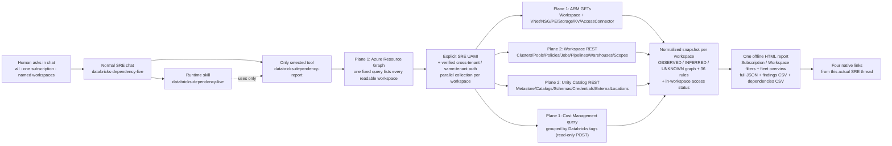

## Source, dependency and coverage contract

| Source ID | Endpoint / API version | Plane & identity | Paging & bounds | Valid empty / unavailable / error behavior | Exclusions |
|---|---|---|---|---|---|
| `arm_discovery` | `POST /providers/Microsoft.ResourceGraph/resources?api-version=2022-10-01` with one fixed KQL (`microsoft.databricks/workspaces` joined to subscription display names) | Plane 1 (ARM), Reader at the management group or subscriptions; same tenant only | `$skipToken`, 1,000 rows per page, up to 5 pages; at most 500 workspaces (else narrow `DISCOVERY_SUBSCRIPTION_IDS`) | No readable workspace returns `no_workspaces_visible`; a failed query falls back to the `APPROVED_WORKSPACES` entries (with `discovery.error`) or stops with its error; rows from another tenant or with invalid names are skipped | The only POST besides Cost Management; no user input in the query or URL; workspace metadata only |
| `arm_workspace` | `GET /subscriptions/{sub}/resourceGroups/{rg}/providers/Microsoft.Databricks/workspaces/{name}?api-version=2024-05-01` | Plane 1 (ARM) | Single resource GET; 30s timeout, 3 attempts | Primary source: failure stops that workspace's run with structured error (`access_denied` / `http_error`), never an empty workspace; the other workspaces of a fleet report continue | Excludes authorization principal display names and internal tokens |
| `arm_outbound_endpoints` | `GET .../workspaces/{name}/outboundNetworkDependenciesEndpoints?api-version=2024-05-01` | Plane 1 (ARM) | Top-level array GET | Recorded in `sources`; `404` on a workspace without VNet injection is `not_applicable`; 403/5xx becomes `denied`/`error` and adds an explicit `UNKNOWN` blind spot | Read-only control-plane endpoint list only |
| `arm_diagnostics` | `GET .../workspaces/{name}/providers/Microsoft.Insights/diagnosticSettings?api-version=2021-05-01-preview` | Plane 1 (ARM) | `nextLink` paged up to 50 pages | Empty list means `C08` fails (`failed`); 403/error makes `C08` `not_evaluated` | No log query execution |
| `arm_managed_rg_inventory` & `arm_resource_*` | `GET /subscriptions/{sub}/resourceGroups/{managed_rg}/resources?api-version=2021-04-01` + whitelisted `RESOURCE_APIS` GETs | Plane 1 (ARM) | `nextLink` paged; max 200 related resources | Uncollected external targets referenced by URI become `INFERRED` nodes, never `OBSERVED` | Never reads Storage keys, blob data or Key Vault secret/key material |
| `dbx_workspace_conf` | `GET /api/2.0/workspace-conf?keys=enableTokensConfig,maxTokenLifetimeDays,...` | Plane 2 (Databricks Workspace) | Single GET | 403 (non-admin SP) records `status="denied"` and keeps `C09` `not_evaluated` | Reads only the 5 whitelisted governance keys |
| `dbx_clusters`, `dbx_instance_pools`, `dbx_cluster_policies` | `GET /api/2.0/clusters/list`, `/api/2.0/instance-pools/list`, `/api/2.0/policies/clusters/list` | Plane 2 (Databricks Workspace) | `page_token` / `next_page_token` up to 50 pages | Preserves terminated and running clusters; never starts a cluster | Excludes `spark_env_vars`, `spark_conf`, `aws_attributes`, `ssh_public_keys`, init script contents |
| `dbx_jobs` & `dbx_job_detail_*` | `GET /api/2.1/jobs/list?expand_tasks=true&limit=25` + `GET /api/2.1/jobs/get?job_id={id}` when truncated | Plane 2 (Databricks Workspace) | `page_token` / `next_page_token` + `has_more` check; up to 100 detail GETs | Maps `tasks`, `depends_on`, `existing_cluster_id`, `job_cluster_key`, `pipeline_id`, `warehouse_id`, `run_job_id`; truncated jobs that cannot be resolved via `jobs/get` keep `tasks_incomplete=True` (`UNKNOWN`) instead of false DAG breaks | Excludes `base_parameters`, `jar_params`, `python_params`, `notebook_params`, `sql_params` and notebook source code |
| `dbx_pipelines`, `dbx_pipeline_detail_*` & `dbx_sql_warehouses` | `GET /api/2.0/pipelines?max_results=50`, `GET /api/2.0/pipelines/{id}`, `GET /api/2.0/sql/warehouses` | Plane 2 (Databricks Workspace) | `page_token` / `next_page_token`; up to 100 pipeline detail GETs | Reads `spec.catalog`, `spec.schema` (and legacy `spec.target`), `spec.storage` and `spec.clusters` from `/api/2.0/pipelines/{id}`; denied detail GETs keep `detail_collected=False` (`UNKNOWN` / `W10` `not_evaluated`); never starts a warehouse | No query history or SQL statement execution |
| `dbx_secret_scopes` & `dbx_init_scripts` | `GET /api/2.0/secrets/scopes/list`, `GET /api/2.0/global-init-scripts` | Plane 2 (Databricks Workspace) | `page_token` / `next_page_token` | Maps `AZURE_KEYVAULT` `resource_id`/`dns_name` to Key Vault nodes | `/api/2.0/secrets/get` is explicitly blocked; script bodies excluded |
| `uc_metastore_summary`, `uc_catalogs`, `uc_schemas`, `uc_storage_credentials`, `uc_external_locations`, `uc_connections` | `GET /api/2.1/unity-catalog/...` | Plane 2 (Unity Catalog) | `page_token` / `next_page_token` | Joins External Locations -> Storage Credentials -> Access Connector -> ADLS Storage Accounts (`OBSERVED` vs `INFERRED`) | Never reads table data, volumes or files |
| `uc_system_lineage` | `system.access.table_lineage`, `system.access.column_lineage` | Not queried in control-plane mode | N/A (`status="not_configured"`) | Permanently disclosed as `UNKNOWN` (`not_evaluated` on `G06`) so no SQL Warehouse is started or billed | No SQL Warehouse startup or DBU spend |
| `arm_advisor` & `azure_cost` | `GET .../Microsoft.Advisor/recommendations`, `POST .../Microsoft.CostManagement/query?api-version=2023-11-01` | Plane 1 (ARM) | `nextLink` paged | Discovered workspaces use `cost_scope="workspace_and_managed_resource_group"` (one query: workspace DBUs plus managed resource group infrastructure, the period cost of the fleet table); an entry can set `disabled`; preserves exact currency and ARM `ResourceId` rows without fabricating savings | No workload-level DBU split inferred from ARM resource totals |
| `azure_cost_databricks` | `POST /subscriptions/{sub}/providers/Microsoft.CostManagement/query?api-version=2025-03-01` (about 12 queries, `AmortizedCost` by default) | Plane 1 (ARM), Cost Management Reader | Filter: workspace `ResourceId` (+ `approved_cost_resource_ids`) **or** its managed resource group; previous month to today, monthly and daily; `nextLink` paged; patient retry on `429` honouring the `*retry-after` headers; at most 2 Cost Management queries at a time across a fleet; only in reports of up to 5 workspaces; after a throttled query the rest of that workspace's plan is skipped; skipped when the collection budget is short | One receipt with per-query status; `403` makes the whole section `denied` (never zero); a failed, throttled or skipped query stays missing, not zero | No resources outside the workspace and its managed resource group unless approved; no write |
| `dbx_spark_versions` & `dbx_node_types` | `GET /api/2.0/clusters/spark-versions`, `GET /api/2.0/clusters/list-node-types` | Plane 2 (Databricks Workspace) | Single GETs | Feed the runtime and VM-family signals; when denied those signals are omitted | Catalog metadata only |
| `dbx_system_billing` (opt-in) | `POST /api/2.0/sql/statements` with one fixed read-only `SELECT` over `system.billing.usage` and `system.billing.list_prices` | Plane 2 (Databricks SQL), only when `system_tables_warehouse_id` is set | `INLINE` JSON, 50 s wait then `CANCEL`, up to 600 rows | `not_configured` by default; any other statement text is rejected before sending | **Consumes DBUs** on your existing SQL warehouse; list prices only |

**In-workspace access status.** Each workspace gets `workspace_access`
(`granted`, `partial`, `denied`, `unreachable`, `token_failed`, `disabled` or
`not_collected`) from its Plane 2 receipts. The first `401`, token failure or
network failure inside a workspace skips its remaining in-workspace calls (each
recorded with that error), so a workspace without access costs seconds, and its
Azure-side review is still delivered.

## Customer scope coverage and rule catalog

The pinned catalog ([`rules_catalog.json`](https://github.com/marioaguileraaa/sre-agent-use-cases/blob/main/08-databricks-dependency-configuration-review/rules_catalog.json)) defines **36
local rules** across three levels (`workspace`, `workload`, `resource`), four
customer-requested areas (`best_practices`, `security`, `finops`,
`optimization`) and the five Azure Well-Architected pillars (`reliability`,
`security`, `cost`, `operations`, `performance`):

| Area | Rules | What is evaluated |
|---|---|---|
| **Workspace & Control Plane** (`C01–C12`) | `C01` SKU Premium, `C02` Secure Cluster Connectivity (`enableNoPublicIp`), `C03` VNet Injection (`customVirtualNetworkId`), `C04` Public Network Access & Private Link, `C05` Access Connector & Storage Firewall, `C06` CMK encryption, `C07` Enhanced Security & Compliance, `C08` ARM Diagnostic Settings, `C09` PAT Governance (`workspace-conf`), `C10` Unity Catalog default catalog, `C11` Global Init Scripts hygiene, `C12` Azure Advisor cached read | Evaluates ARM workspace properties, diagnostic settings, Advisor and workspace-level token/init-script settings. Conditional controls (`C03`, `C04`, `C06`, `C07`) remain `not_evaluated` when operator requirements are unconfirmed and the setting is absent. |
| **Compute, Jobs, Pipelines & SQL Warehouses** (`W01–W10`) | `W01` All-Purpose autotermination (`<= 60m`), `W02` Cluster Policy binding (`policy_id`), `W03` Unity Catalog access mode (`USER_ISOLATION` / `SINGLE_USER` / `SHARED`), `W04` Runtime LTS version (`>= 13.x LTS`), `W05` Autoscaling or Instance Pool, `W06` Jobs using Job/Serverless compute instead of All-Purpose (`existing_cluster_id`), `W07` Job timeouts & failure notifications, `W08` Job `run_as` Service Principal ownership, `W09` SQL Warehouse `auto_stop_mins <= 30` & Serverless/Pro, `W10` Lakeflow Pipeline target in Unity Catalog | Evaluates every collected cluster, job, declarative pipeline and SQL warehouse individually. Missing workspace REST access keeps these checks `not_evaluated` rather than assuming zero workloads. |
| **Governance, Dependency Map & Unity Catalog** (`G01–G08`) | `G01` Unity Catalog Metastore attached, `G02` Storage Credentials using Managed Identity (`access_connector_id`), `G03` External Locations governed (`credential_name` + `abfss://`), `G04` Secret Scopes backed by `AZURE_KEYVAULT`, `G05` Referential integrity across the dependency graph (broken task/cluster/pool/policy/pipeline/warehouse/credential references), `G06` Runtime table/column lineage (`not_evaluated` without SQL compute), `G07` Lakehouse Federation connections inventory, `G08` Outbound control-plane endpoints visibility | Validates both governance posture and the structural integrity of the dependency graph (`G05`), while keeping dynamic SQL table lineage (`G06`) explicitly `not_evaluated`. |
| **Associated Azure Resources & FinOps** (`R01–R06`) | `R01` Storage HTTPS, TLS 1.2+ and `allowBlobPublicAccess=false`, `R02` Storage `allowSharedKeyAccess=false` and `publicNetworkAccess=Disabled`, `R03` Key Vault RBAC authorization and Purge Protection, `R04` NSG inbound administrative exposure from Internet, `R05` Private Endpoint `Approved` state, `R06` FinOps cost attribution by tags (evaluated from report section 6: passes when at most 10 % of the month's cost lacks the `Vendor` tag and the first allocation tag covers at least 80 %; `not_evaluated` without cost data) | Evaluates collected ARM Storage accounts, Key Vaults, NSGs, Private Endpoints, optional ARM `ActualCost` rows and the Databricks cost model. |

## Databricks costs: where they come from and how to optimize them

Customers who already tag Databricks often still cannot answer two questions:
*where does the cost come from?* and *what do we change to pay less?* Report
section 6 (and `view="costs"` in chat) answers both from Azure Cost Management
plus the configuration the collector already reads. No cluster, job or warehouse
is started and nothing is changed.

| Question | How the report answers it |
|---|---|
| How much did Databricks cost? | Last closed month vs the month before, and month to date, as `AmortizedCost` (`COST_METRIC`, or `ActualCost` for the invoice view) in the billing currency. |
| DBU or infrastructure? | DBU (`Azure Databricks` meter category, billed on the workspace resource) by compute type: all-purpose, jobs, SQL pro/classic, SQL serverless, serverless, DLT, AI. Infrastructure (VMs, disks, network in the managed resource group) by service and VM size. |
| Who consumes it? | Cost Management grouped by the tags Databricks puts on compute: `ClusterName` (clusters), `JobId` (job compute only), `SqlEndpointId` (SQL warehouses), `DatabricksInstancePoolId` (pools), joined to the collected inventory for creator and custom tags; plus your own allocation tags (`COST_ALLOCATION_TAGS`, default `team`, `project`, `cost_center`) and their coverage. Short-lived job-run clusters are grouped; their detail is on the Jobs tab. |
| What does no tag explain? | Cost without the `Vendor` tag that Databricks adds to all classic compute: shared workspace services (DBFS root storage, NAT, load balancer, egress) and **serverless DBUs**, which carry no Azure tags (use [serverless usage policies](https://learn.microsoft.com/azure/databricks/admin/account-settings/usage-detail-tags) or system tables to split them). |
| What changed? | Clusters, jobs, warehouses and pools with the largest increase or decrease vs the previous month. |
| How do we optimize it? | Signals from configuration + cost, each with evidence, the month's cost of the object, a savings estimate where the data allows it, the action and a Microsoft Learn link. |

**Attribution facts the model relies on** ([Learn: usage detail tags](https://learn.microsoft.com/azure/databricks/admin/account-settings/usage-detail-tags)):
`JobId` and `RunName` only propagate on job compute; when clusters are created
from a pool, only workspace and pool tags reach the VMs (cluster tags do not);
job tags propagate to the job clusters a run creates; serverless usage is not
tagged in Azure. The report states these limits instead of guessing.

**Optimization signals and savings rules.** Only one saving per object counts
towards the headline (the largest); the others are shown as *Not counted*.
Signals without a cost basis show *No estimate*.

| Signal | Detected from | Savings estimate (per month) |
|---|---|---|
| All-purpose cluster without autotermination / with a long one (`> COST_AUTOTERMINATION_MAX_MINUTES`, default 60) | `autotermination_minutes`, state, uptime, daily cost | Off: weekend cost of that cluster (lower bound) |
| Scheduled jobs on all-purpose compute | `existing_cluster_id` in scheduled, unpaused jobs | Cluster DBU × (1 − `COST_JOBS_TO_ALL_PURPOSE_DBU_RATIO`, default 0.55) (upper bound) |
| Workers without spot (all-purpose or job clusters) | `azure_attributes.availability`, workers, VM cost | VM cost × workers / (workers + 1) × `COST_SPOT_DISCOUNT` (default 0.6) |
| Pool with idle instances always on | `min_idle_instances`, daily pool cost | Daily cost floor × days in the month |
| SQL warehouse without auto-stop / long auto-stop (`> COST_WAREHOUSE_AUTOSTOP_MAX_MINUTES`, default 30); classic or pro warehouse to evaluate serverless | `auto_stop_mins`, type, size | No auto-stop: warehouse cost × weekend share of the month |
| Continuous jobs, Photon candidates, clusters without policy, policies that do not enforce allocation tags, missing allocation tags, unsupported runtimes, old VM families | Jobs, clusters, policies, `spark-versions`, `list-node-types` | Not estimated (no cost basis that would not be invented) |

**Configuration (private copy).** In `WORKSPACE_DEFAULTS` (every discovered
workspace) or per workspace in `APPROVED_WORKSPACES`:
`cost_analysis_enabled` (default `True`) and `system_tables_warehouse_id`
(default `""`, off). Globals: `COST_METRIC`, `COST_ALLOCATION_TAGS` (up to three
of your tag keys), `COST_AUTOTERMINATION_MAX_MINUTES`,
`COST_WAREHOUSE_AUTOSTOP_MAX_MINUTES`, `COST_JOBS_TO_ALL_PURPOSE_DBU_RATIO`,
`COST_SPOT_DISCOUNT`. Presentation hooks for a customer edition (validated
before any source call): `REPORT_FOCUS` (`configuration` or `costs`, which opens
the report with the cost verdict and KPIs), `BRAND_THEME` (documented CSS
variables, `#RRGGBB` or `rgba()` only), `BRAND_DISPLAY_FONT_DATA_URI` (inline
WOFF2 up to 80 KB for headings) and `BRAND_LOGO_PLACEMENT` (`hero` or `bar`).

**Permissions.** The reporting identity needs **Cost Management Reader** (or
Reader) on the subscriptions that hold the workspaces and their managed resource
groups, in addition to the existing ARM Reader and Databricks workspace access;
`grant-databricks-permissions.ps1 -IncludeCost` assigns it once at the
management group ([Step 0](#step-0---identify-the-reporting-identity-and-grant-read-access)).
In cross-tenant modes, grant it to the identity that reads ARM in the target
tenant. A `403` marks section 6 `denied`; it is never shown as zero.

**Cost Management limits.** About a dozen queries per workspace run
sequentially with patient retries on `429` (honouring the
`x-ms-ratelimit-*-retry-after` headers, at most 30 s per wait) inside the
420-second collection budget; a query that cannot run in time is `skipped` and
stays missing. Cost Management throttles per tenant, so a fleet report runs at
most two cost queries at a time, keeps the detailed section 6 for reports of up
to 5 workspaces (larger reports keep each workspace's period cost) and, after a
throttled query, skips the rest of that workspace's plan: its cost is `partial`,
never zero. Cost data for the last one or two days can still change.

**Optional system tables (off by default, costs DBUs).** Set
`system_tables_warehouse_id` to an existing SQL warehouse to add per-run and
per-user detail at list price from `system.billing.usage` and
`system.billing.list_prices`. The statement consumes DBUs and, if the warehouse
is stopped, starts it (it stops again after its own auto-stop). The identity
then needs `CAN USE` on that warehouse and `SELECT` on both tables; the tool
sends only one fixed, read-only statement and rejects any other text before
sending it.

**Demo without a workspace: `operation="self_test"`.** Writes the same four
files from a built-in workspace (`dbx-analytics-prod`) with no authentication or
network call. Everything is labelled `SIMULATED`, files start with
`simulated-`, and the specialist only runs it when the user explicitly asks for
a demo.

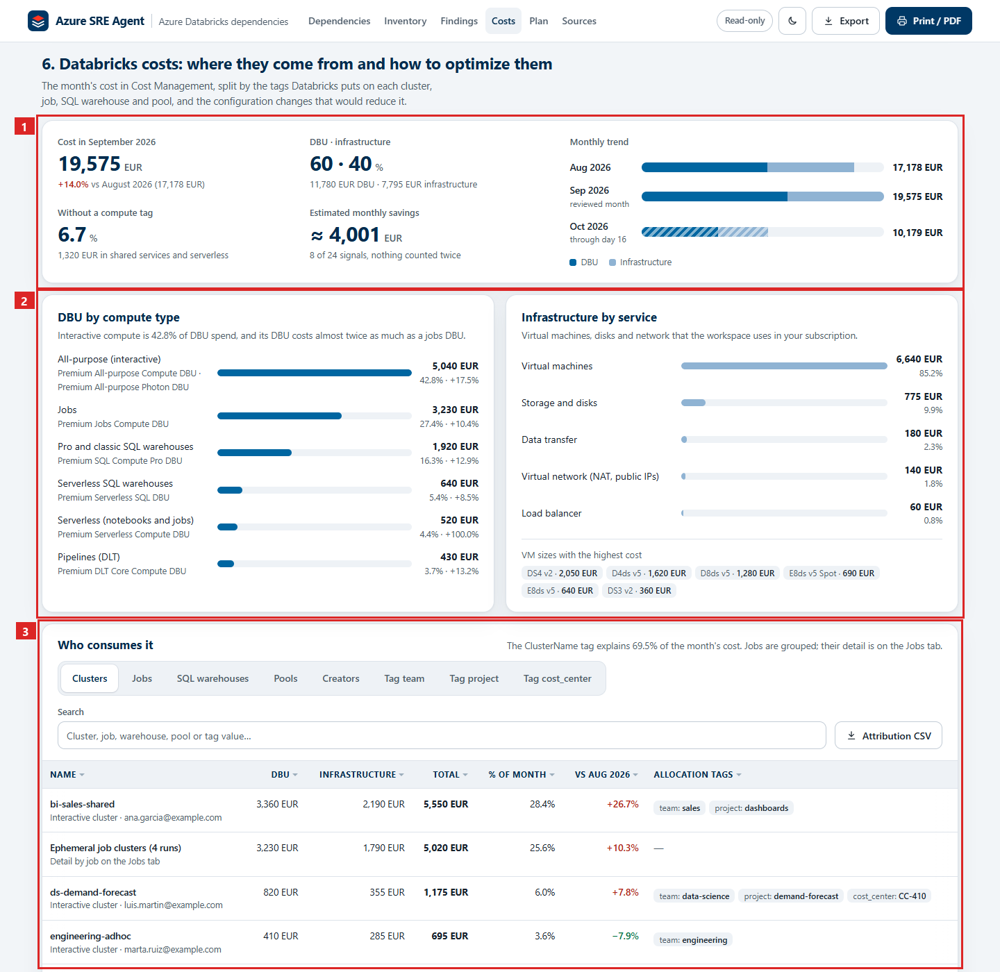

*Report section 6 of `dbx-analytics-prod` in the [simulated fleet sample run](https://github.com/marioaguileraaa/sre-agent-use-cases/tree/main/08-databricks-dependency-configuration-review/sample-run) (`17-report-databricks-costs.png`, `SIMULATED`): **(1)** month cost, DBU · infrastructure split, unattributed share and estimated savings with the three-month trend; **(2)** DBU by compute type and infrastructure by service; **(3)** who consumes it, by cluster, job, SQL warehouse, pool, creator and allocation tag.*

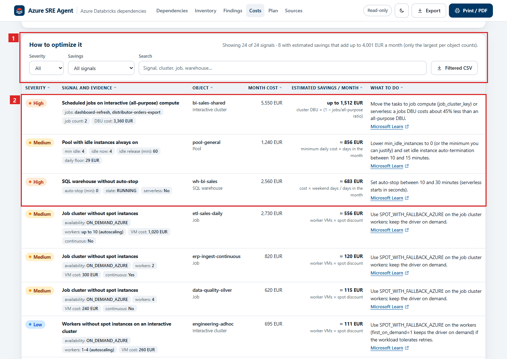

*Optimization signals of the same workspace (`18-report-databricks-cost-signals.png`, `SIMULATED`): **(1)** signal count and the counted savings (only the largest per object), with severity, savings and search filters and a filtered CSV; **(2)** each signal with its evidence, object, cost of the month, estimated saving and its basis, and what to do with a Microsoft Learn link.*

## Prerequisites

1. **Existing Azure SRE Agent** in your subscription/tenant (Tenant A).
2. **Human SRE Agent roles on the SRE Agent resource (`Access control (IAM)`):**
   **SRE Agent Author + SRE Agent Standard User** (or **SRE Agent
   Administrator**). Azure `Owner`/`Contributor` does not replace SRE Agent
   data-action roles.
3. **Reporting Managed Identity (`MANAGED_IDENTITY_CLIENT_ID`):** Attached
   User-Assigned Managed Identity on the SRE Agent, with read access granted
   once: in the same tenant with
   [`grant-databricks-permissions.ps1`](grant-databricks-permissions.ps1)
   ([Step 0](#step-0---identify-the-reporting-identity-and-grant-read-access)),
   or with one of the supported
   [cross-tenant setups](#cross-tenant-feasibility-tenant-a-sre-agent-to-tenant-b-azure-databricks)
   completed with the colleague's administrator.
4. **For the one-time grant:** Azure CLI signed in (`az login`) as someone with
   **Owner**, **User Access Administrator** or **Role Based Access Control
   Administrator** on the management group (or subscriptions) and **Workspace
   Admin** in the workspaces.

## Files to download

Use **Raw / Download raw file** in GitHub so you save plain Python, JSON and
Markdown files (never an HTML sign-in wrapper):

- Standalone Python tool: [`generate-databricks-dependency-report.py`](generate-databricks-dependency-report.py) (current LF SHA-256: `70a17a4cb862fa394a57764c5d0b14ac84d21ce643709bff9b1e31351326bfc0`; every change after the readiness receipt is listed in [`runtime-changes.json`](https://github.com/marioaguileraaa/sre-agent-use-cases/blob/main/08-databricks-dependency-configuration-review/runtime-changes.json))
- Typed parameter schema: [`tool-parameters.schema.json`](tool-parameters.schema.json) (current LF SHA-256: `a938a4522ac502f7066d951c28fb15e6192e1a4a28cbc3940af358d51b53a15a`)
- Runtime dependencies reference: [`requirements.txt`](requirements.txt)
- Runtime skill: [`skills/databricks-dependency-live/SKILL.md`](skills/databricks-dependency-live/SKILL.md) (current LF SHA-256: `f7950c44080f4c9f55d2c8b0c6e61c94e6fc2495df82f14a5ba33dd270c768d3`)
- Specialist instructions and chat prompts: [`subagent-instructions-and-prompts.md`](subagent-instructions-and-prompts.md) (current LF SHA-256: `b782ed04806a09db0011af23b5a2229753787181170bc1f3b72179dd1f88e145`; LF copy-ready instruction block SHA-256: `97f1e9f9e05e1f9a187ee6ca5528bd0145dfeef37b5858e469f1c27de2d3c5aa`)
- One-time grant of read-only access to every workspace (same tenant; run by an administrator): [`grant-databricks-permissions.ps1`](grant-databricks-permissions.ps1) (see [Step 0](#step-0---identify-the-reporting-identity-and-grant-read-access))
- Pinned rule catalog (already embedded in the standalone tool): [`rules_catalog.json`](https://github.com/marioaguileraaa/sre-agent-use-cases/blob/main/08-databricks-dependency-configuration-review/rules_catalog.json)
- Public native-readiness validation receipt: [`native-readiness-validation.json`](https://github.com/marioaguileraaa/sre-agent-use-cases/blob/main/08-databricks-dependency-configuration-review/native-readiness-validation.json)
- Public visual evidence manifest (33 annotated PNGs: the 19 images of the October and November 2026 evidence, report images regenerated on 2026-11-17, plus 14 portal screenshots recaptured on 2026-11-16): [`visual-evidence.json`](https://github.com/marioaguileraaa/sre-agent-use-cases/blob/main/08-databricks-dependency-configuration-review/visual-evidence.json)
- English sample run with simulated data (the four files of one fleet report: four workspaces in three subscriptions): [`sample-run/`](https://github.com/marioaguileraaa/sre-agent-use-cases/tree/main/08-databricks-dependency-configuration-review/sample-run)

## Step 0 - Identify the reporting identity and grant read access

1. Today's SRE Agent menu has no **Settings** page. In the Azure portal, open
   **Managed Identities** > the user-assigned identity attached to the SRE Agent
   (`id-…`) > **Overview** and record both **Client ID** (for
   `MANAGED_IDENTITY_CLIENT_ID`) and **Object (principal) ID** (for Entra FIC
   `subject` or Azure RBAC assignments), or run
   `az identity show --name <IDENTITY_NAME> --resource-group <IDENTITY_RG> --query "{clientId:clientId, principalId:principalId}" -o table`.
2. Confirm your SRE Agent's tenant GUID (`SRE_TENANT_ID`). When the Databricks
   workspaces are in the same tenant, `TARGET_TENANT_ID` is the same value.
3. **Same tenant (recommended): run
   [`grant-databricks-permissions.ps1`](grant-databricks-permissions.ps1) once.**
   It gives the identity read-only access to every workspace in the scope you
   choose; nothing has to be pasted into the tool afterwards:

   ```powershell
   .\grant-databricks-permissions.ps1 -IdentityClientId "<client-id>" -ManagementGroupId "<management-group-id>" -IncludeCost
   ```

   | Parameter | Meaning |
   |---|---|
   | `-IdentityClientId` | **Mandatory.** Client ID of the agent's managed identity (item 1). |
   | `-ManagementGroupId` | **Recommended scope.** Reader (plus Cost Management Reader with `-IncludeCost`) assigned once at the management group and inherited by its current and future subscriptions. |
   | `-AllSubscriptions` · `-SubscriptionIds a,b` · `-SubscriptionId` | Other scopes: every enabled subscription of the tenant that you can see, a list, or one subscription (without any scope parameter, the current `az` subscription). |
   | `-Workspaces "<sub>/<rg>/<name>"` | Optional filter: only these workspaces. |
   | `-IncludeCost` | Also assigns Cost Management Reader (period cost and report section 6). |
   | `-SkipDatabricksGrants` | Azure roles only; nothing changes inside the workspaces. |
   | `-SkipUnityCatalog` | Skips the Unity Catalog grants. |
   | `-WhatIf` | Prints what it would do and changes nothing. |

   It discovers every workspace in the scope with Azure Resource Graph and,
   inside each one (the person running it must be **Workspace Admin** there),
   adds the identity as a Microsoft Entra ID managed service principal with the
   `workspace-access` and `databricks-sql-access` entitlements (never admin),
   `CAN_VIEW` on the existing jobs, pipelines and SQL warehouses, and Unity
   Catalog `BROWSE`, `USE_CATALOG` and `USE_SCHEMA` on the catalogs (metadata
   only). A workspace that fails (runner not admin, private network, workspace
   never opened) is recorded and the script continues; at the end it prints a
   summary and writes `databricks-access-summary.csv`. It generates nothing to
   paste. Re-running it is safe and gives `CAN_VIEW` on jobs, pipelines and
   warehouses created since. A workspace it could not reach still gets its
   Azure-side review and appears in the report without in-workspace access. To
   grant by hand instead, use the least-privilege matrix of
   [Phase B](#phase-b--choose-and-complete-one-cross-tenant-permission-path)
   (Plane 2) and Reader plus Cost Management Reader at the management group.
4. **Cross-tenant:** if a workspace is in another tenant, follow the
   [Colleague session handoff checklist](#colleague-session-handoff-checklist-cross-tenant-connection)
   with your colleague and the authorized Entra/Azure/Databricks administrators.
   Until the required values are filled in a private copy, the tool safely
   remains in `NOT_CONFIGURED` state (`error.code = "configuration_required"`).

## Step 1 - Configure the private standalone file

Keep the repository copy untouched with `<PLACEHOLDER>` values. In a **private
staging copy outside Git**, edit only the administrator constants at the top of
`generate-databricks-dependency-report.py`. In the same tenant, three values
are enough:

```python
SRE_TENANT_ID = "<YOUR_TENANT_ID>"
TARGET_TENANT_ID = "<YOUR_TENANT_ID>"            # same value: same tenant, auto-discovery on
MANAGED_IDENTITY_CLIENT_ID = "<YOUR_SRE_UAMI_CLIENT_ID>"
```

Everything else is optional and validated before any network call:
`SUBSCRIPTION_ID` (only for an `APPROVED_WORKSPACES` entry without its own
`subscription_id`), `DISCOVERY_SUBSCRIPTION_IDS` (limit discovery to some
subscriptions), `WORKSPACE_DEFAULTS` (settings of every discovered workspace:
environment `UNSPECIFIED`, `same_tenant_uami`, workspace and Unity Catalog
reads, managed resource group and Advisor on, `cost_scope`
`workspace_and_managed_resource_group`, `cost_timeframe` `month_to_date`, cost
analysis on), `APPROVED_WORKSPACES` (per-workspace overrides; the committed
placeholder entry is ignored), `CLIENT_NAME`, `CLIENT_LOGO_DATA_URI`,
`CLIENT_LOGO_ALT` and the cross-tenant constants (`FEDERATED_APP_CLIENT_ID`,
`KEYVAULT_OAUTH_SECRET_URI`, `CROSS_TENANT_CERT_KEYVAULT_URL`,
`CROSS_TENANT_CERT_NAME`; see Phase C). The Databricks cost section has its
own keys and defaults (`cost_analysis_enabled`, `system_tables_warehouse_id`,
`COST_*`, `REPORT_FOCUS`, `BRAND_*`), described in
[Databricks costs](#databricks-costs-where-they-come-from-and-how-to-optimize-them).

- **Visual styling and private logo boundary:** The HTML report uses the
  corporate industrial navy/steel (`#003865`, `#0066a1`) and Databricks
  lakehouse lava/teal (`#ff3621`, `#00875a`) palette by default. Generic
  repository files and documentation contain **no customer logo** and keep
  `CLIENT_NAME = "Customer"` and `CLIENT_LOGO_DATA_URI = ""`. If an authorized
  operator embeds an approved PNG/JPEG logo in a private deployment copy outside
  Git, Pillow validates that it is a single-frame PNG/JPEG (`<= 100,000` bytes,
  `<= 2048 x 2048` px) before any source call.

## Step 2 - Create the Python tool and verify its 13 typed inputs

1. In the SRE Agent portal, open **Build + configure → Agent Canvas**, click the
   drop-down arrow beside **Create** (**Create ▾**), and choose
   **Tool › Python tool** (clicking the **Create** button body opens **Create a
   custom agent** instead). Work in the **Code** tab (never **Generate** or
   **Refine with AI**).

   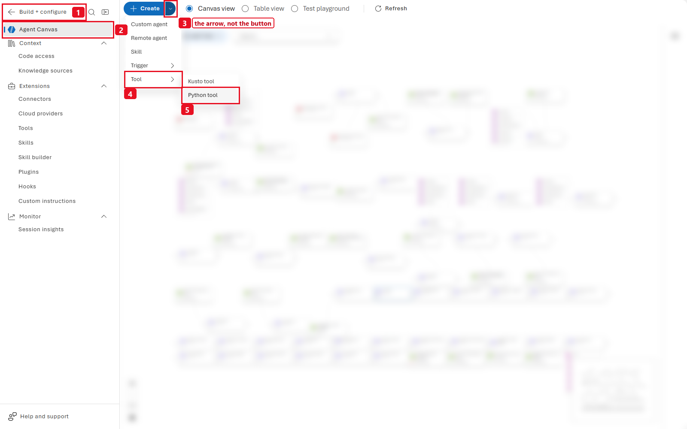

   *Agent Canvas in today's portal (`newui-menu.png`, captured 2026-11-16): **(1)** **Build + configure** (left menu, formerly Builder); **(2)** **Agent Canvas**, its first item; **(3)** the **Create ▾** arrow, not the **Create** button body; **(4)** **Tool ›**; **(5)** **Python tool**. The canvas behind the menu is blurred.*

2. Name the tool **`databricks-dependency-report`** (**Tool Name** accepts at
   most 36 characters), set **Timeout (seconds)** to **900** (the default is
   120; 900 is the maximum; saved as `timeoutSeconds=900`, `dependencies=[]`,
   `toolMode="Auto"`), paste this **Description**:

   ```text
   Read-only Azure Databricks dependency mapping, configuration, security, FinOps and optimization for every workspace the agent can read: all, one subscription or named workspaces. Four complete artifacts or bounded source-qualified queries. Fails closed before authentication when setup is missing. No SQL, compute starts, source writes, IAM or tasks.
   ```

   and paste the entire standalone file `generate-databricks-dependency-report.py`
   into the code editor (`Ctrl+A`, then paste). There is no *Requirements*
   field: the SRE Agent Python runtime already provides the packages in
   [`requirements.txt`](requirements.txt).

   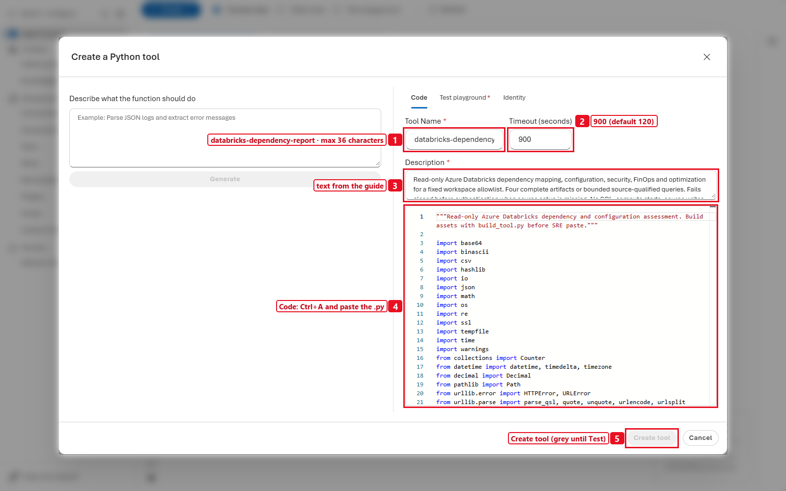

   *Create a Python tool, **Code** tab (`newui-code.png`): **(1)** **Tool Name** `databricks-dependency-report` (the narrow field cuts it on screen); **(2)** **Timeout (seconds)** `900`; **(3)** **Description**; **(4)** the complete repository file pasted, with its `<PLACEHOLDER>` constants (top of the file shown); **(5)** **Create tool** stays grey until a **Test** has run.*

3. Open the **Identity** tab and keep **Enable Azure Identity** `OFF`
   (`authEnabled=false`, `authScopes=null`), because the collector acquires and
   verifies its own tokens through the fixed `MANAGED_IDENTITY_CLIENT_ID` after
   valid configuration. This toggle does not grant cross-tenant access. Do not
   switch it on to look: it inserts four `azure.identity` lines at the top of
   the code, and they stay there.

   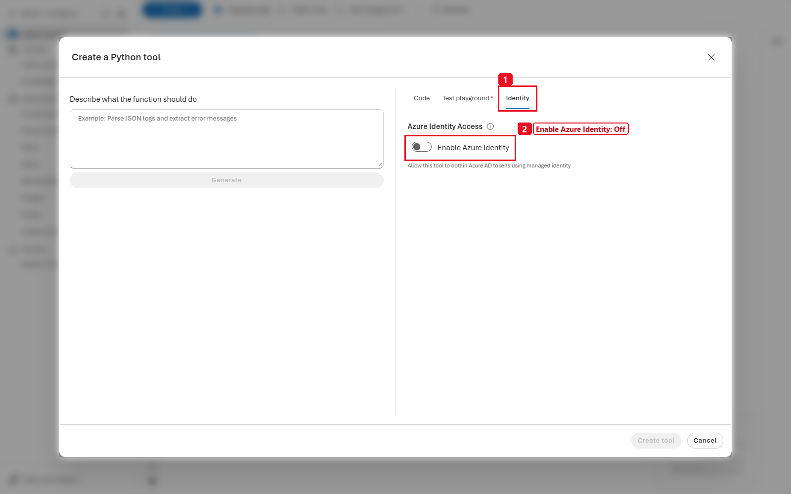

   ***Identity** tab (`newui-identity.png`): **(1)** open the **Identity** tab; **(2)** **Enable Azure Identity** stays `OFF` (`authEnabled=false`)—source authorization is separate.*

4. There is no parameter editor: the portal reads the **13** typed inputs from
   the `def main(...)` signature of the pasted file, matching
   [`tool-parameters.schema.json`](tool-parameters.schema.json) (`limit` and
   `offset` are `int`). The screenshots of this step were captured on
   2026-11-16, before `subscription` was added: today the last box is
   `subscription`.

| Parameter | Runtime type | Default | Allowed values / constraint |
|---|---|---|---|
| `operation` | `string` | `report` | `report` (one report for the selection; no selection = every visible workspace, up to 50), `query` (1–5 workspaces), `list_workspaces` (discovered inventory with subscription names, paged), `self_test` (demo: four files from a built-in `SIMULATED` workspace, no authentication or network) |
| `view` | `string` | `summary` | `summary`, `workspace`, `compute`, `jobs`, `pipelines`, `warehouses`, `unity_catalog`, `resources`, `findings`, `finops`, `costs`, `coverage`, `actions`, `dependencies` |
| `workspace_name` | `string` | `""` | `""`, `all` or one exact workspace name returned by `list_workspaces` (a name present in two subscriptions is listed as `<first 8 characters of the subscription ID>-<name>`) |
| `workspace_names` | `string` | `""` | `""`, `all` or 1–50 exact comma-separated names without spaces; mutually exclusive with `workspace_name` |
| `workload_name` | `string` | `""` | Exact local name filter (cluster, job, pipeline, warehouse, UC object or resource) |
| `classification` | `string` | `all` | `all`, `OBSERVED`, `INFERRED`, `UNKNOWN` (applies to `view="dependencies"`) |
| `area` | `string` | `all` | `all`, `best_practices`, `security`, `finops`, `optimization` |
| `level` | `string` | `all` | `all`, `workspace`, `workload`, `resource` |
| `severity` | `string` | `all` | `all`, `critical`, `high`, `medium`, `low` |
| `status` | `string` | `all` | `all`, `passed`, `failed`, `not_evaluated`, `not_applicable`, `complete`, `partial`, `denied`, `error`, `not_configured` |
| `limit` | `int` | `25` | `1..100` (`query` and `list_workspaces`) |
| `offset` | `int` | `0` | `0..500000` |
| `subscription` | `string` | `""` | `""` or a subscription ID or exact display name (case-insensitive) from `list_workspaces`; filters `list_workspaces`, `report` and `query` |

   Open the **Test playground** tab: every input has an empty box (no defaults
   and no drop-down lists). Type the *Default* column in every box (`report`,
   `summary`, `all` for the five filters, `25` and `0`) and leave
   `workspace_name`, `workspace_names`, `workload_name` and `subscription`
   empty: an empty enum box is rejected with `invalid_parameter`, and `limit` /
   `offset` take numbers. Once the file is configured, test with `operation` =
   `list_workspaces` (about 2 seconds): a report can outlast the playground's
   cut at about 100 seconds, so run reports from chat (Step 5).

   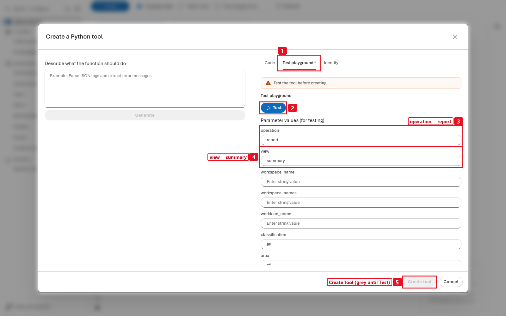

   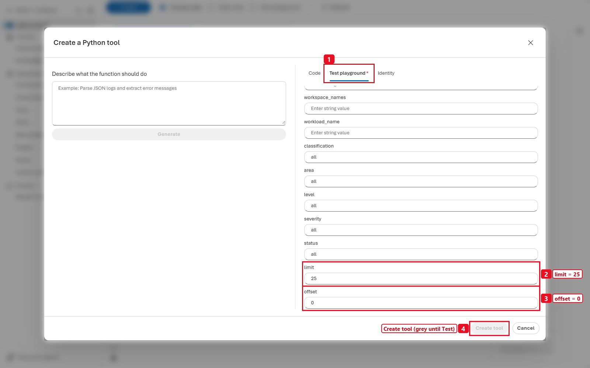

   ***Test playground** tab (`newui-playground.png`, `newui-playground-b.png`, captured before `subscription` was added): top **(1)** the tab; **(2)** **Test**; **(3)** `operation` = `report`; **(4)** `view` = `summary`; **(5)** **Create tool**, grey until a test has run. Bottom: **(2)** `limit` = `25` and **(3)** `offset` = `0` (number boxes); `classification`, `area`, `level`, `severity` and `status` = `all` are typed above them. Today an empty `subscription` box follows `offset`.*

5. **Native unconfigured test boundary (`Function test succeeded` vs
   `configuration_required`):** Click **Test**; **Create tool** (and **Save**
   when you edit the tool later) stays grey until a test has run. Before the
   tenant and identity constants are filled in a private copy, running **Test**
   in the native playground returns
   green **Function test succeeded** because the Python function returned a
   structured dictionary normally (`harness_returned_normally=true`,
   `stdout_empty=true`, `files_written=0`), while the domain payload is
   `status="error"`, `error.code="configuration_required"`,
   `artifact_status="not_written"`, and `provenance="LIVE"`. Here `LIVE`
   identifies the live collector code path (as opposed to an offline
   `SIMULATED` test fixture), **not** that a live Databricks source was
   connected or queried. With a configured file, a full `report` can stop the
   playground at about 100 seconds with HTTP 504 even with the 900-second
   timeout; that is not a tool failure: test there with `list_workspaces` and
   run reports from chat (Step 5).

   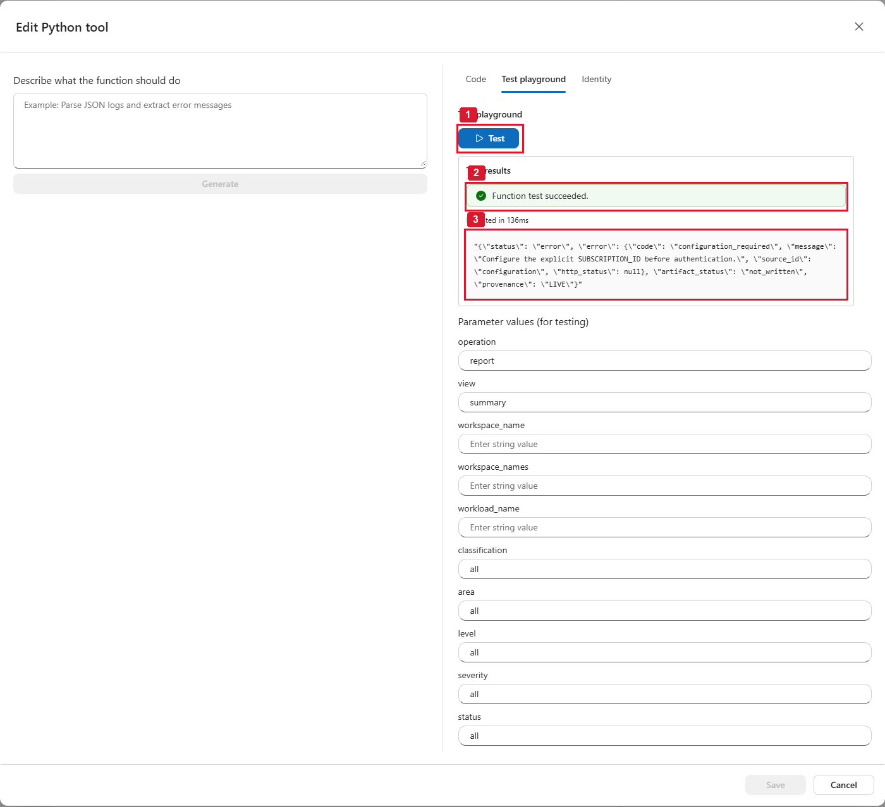

   *Actual native **Test** playground (`04-native-unconfigured-test.png`, 2026-10-16 run of the API-saved `generate-databricks-dependency-report`; today's portal labels may differ): **(1)** the actual native **Test** action; **(2)** harness execution success (**Function test succeeded**) is not source-access success; **(3)** read the real `configuration_required` / `artifact_status="not_written"` result—no Tenant-B authentication, source read, report or simulated graph occurred.*

6. Click **Create tool**, then verify the saved tool: **Agent Canvas → Table
   view →** card **Tools & skills → Python tools →** search
   `databricks-dependency-report` **→** click its name. The details panel lists
   the 13 **Query parameters** read from `main`, with `limit` and `offset`
   typed `int`; the pencil reopens **Edit Python tool**.

   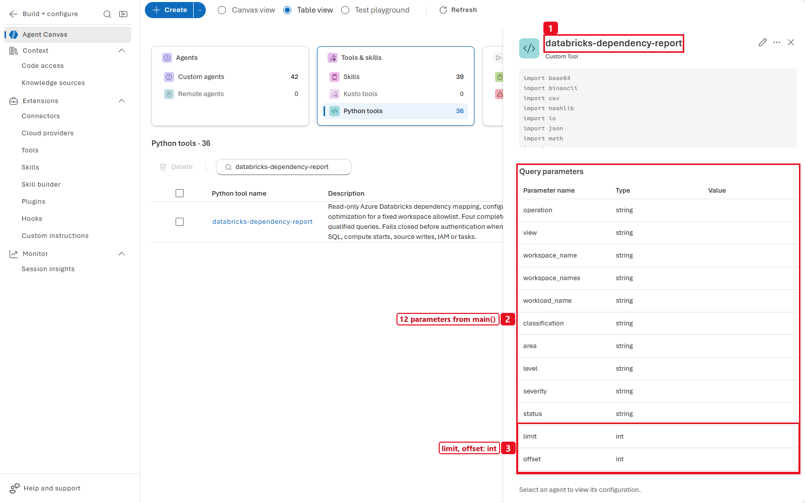

   *Saved tool details (`newui-edit-tool-params.png`, captured before `subscription` was added): **(1)** the saved tool `databricks-dependency-report`; **(2)** the parameters the portal read from `def main(...)` (12 then, 13 today); **(3)** `limit` and `offset` typed `int`.*

## Step 3 - Create the runtime skill

In **Build + configure → Agent Canvas → Create ▾ → Skill**, create
**`databricks-dependency-live`** from the exact content of
[`skills/databricks-dependency-live/SKILL.md`](skills/databricks-dependency-live/SKILL.md)
(current LF SHA-256:
`f7950c44080f4c9f55d2c8b0c6e61c94e6fc2495df82f14a5ba33dd270c768d3`) and bind
only `databricks-dependency-report`. The order matters:

1. Paste the whole `SKILL.md` into the editor **first**: **Name**
   `databricks-dependency-live` and **Description** are filled in from its
   front matter.

   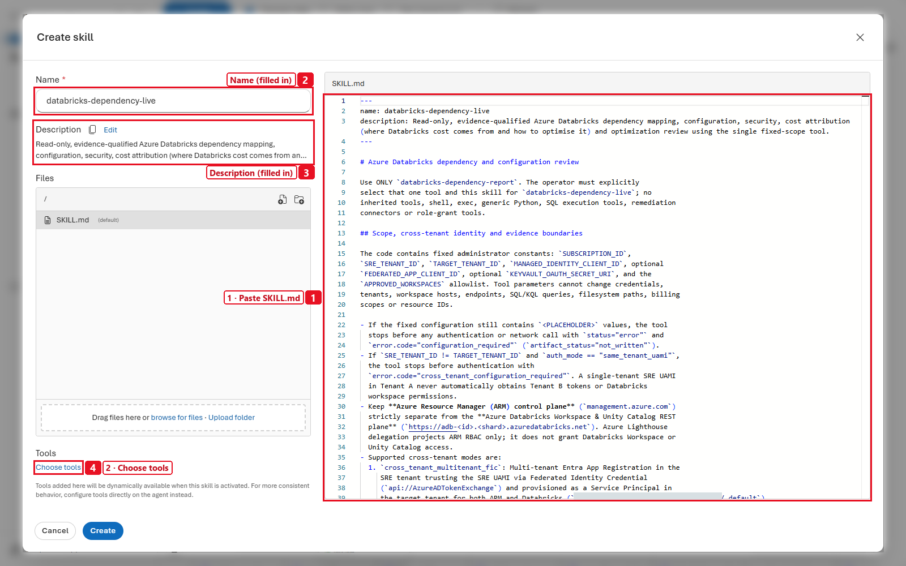

   ***Create skill** (`newui-skill.png`): **(1)** paste `SKILL.md` into the editor first; **(2)** **Name** and **(3)** **Description**, filled in from its front matter; **(4)** **Choose tools**, afterwards.*

2. **Then** click **Choose tools**, search `databricks-dependency-report`,
   expand the **PythonFunctionTool (n)** group, tick **only** that tool (never
   the group checkbox) and click **Close panel**.

   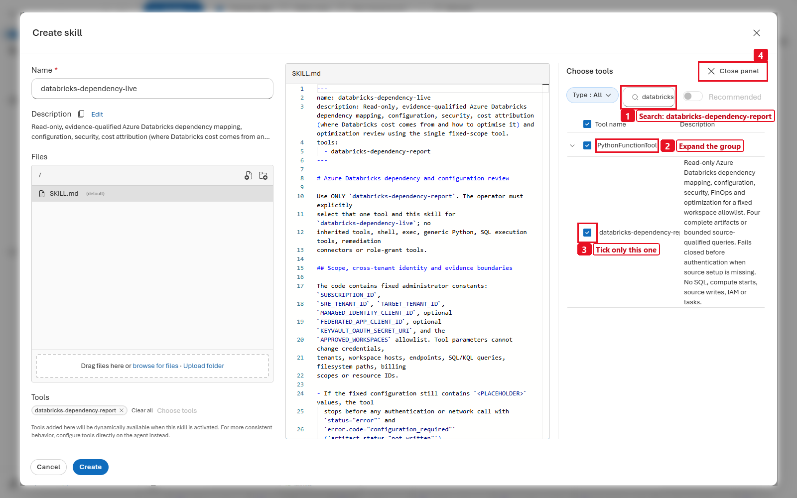

   ***Choose tools** (`newui-skill-tools.png`): **(1)** search box; **(2)** expand the **PythonFunctionTool** group; **(3)** tick only `databricks-dependency-report`; **(4)** **Close panel**.*

3. Check the tool chip and the `tools:` line the portal adds to the front
   matter, then **Create**. If you choose the tool before pasting, the paste
   replaces the front matter and the tool is lost.

   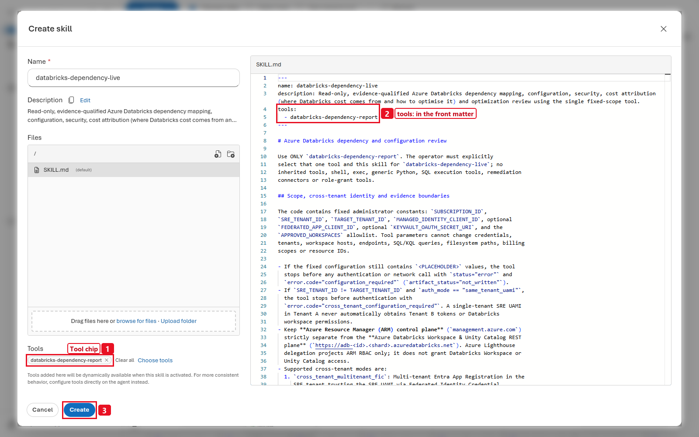

   *Ready to create (`newui-skill-chip.png`): **(1)** tool chip `databricks-dependency-report`; **(2)** `tools:` with `databricks-dependency-report` in the front matter; **(3)** **Create** (not clicked in the capture). The saved skill therefore contains the committed `SKILL.md` plus that `tools:` line.*

## Step 4 - Create the restricted specialist

In **Build + configure → Agent Canvas**, click the **Create** button (it opens
**Create a custom agent** directly; **Create ▾ → Custom agent** opens the same
form) and configure:

- **Custom agent name:** `databricks-dependency-live`
- **Model:** Platform-supported default (`llmModelName=null`; the form has no model field; do not invent custom model/reasoning/context fields in the SRE runtime configuration)
- **Choose skills:** Only `databricks-dependency-live`
- **Choose tools:** Only `databricks-dependency-report` (same panel as in Step 3: search, expand **PythonFunctionTool**, tick the tool, **Close panel**; never leave it empty)
- **Instructions:** Paste the copy-ready block from
  [`subagent-instructions-and-prompts.md`](subagent-instructions-and-prompts.md)
  (LF instruction block SHA-256:
  `97f1e9f9e05e1f9a187ee6ca5528bd0145dfeef37b5858e469f1c27de2d3c5aa`).
- Do not use *Refine with AI* or *View AI suggestions*. Then **Create**.

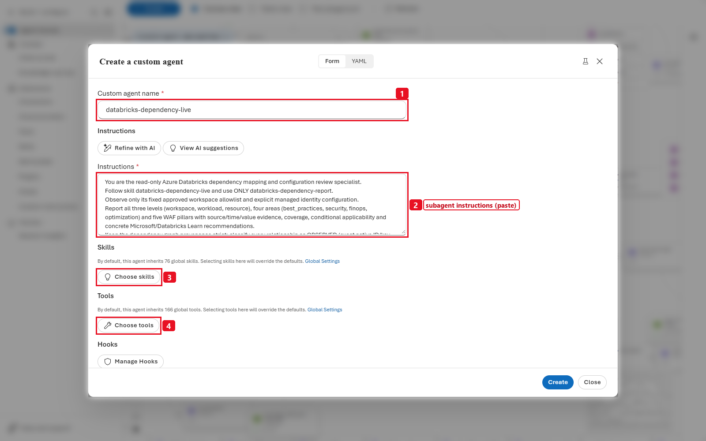

***Create a custom agent** (`newui-agent.png`): **(1)** **Custom agent name** `databricks-dependency-live`; **(2)** **Instructions** with the pasted copy-ready block; **(3)** **Choose skills**; **(4)** **Choose tools**.*

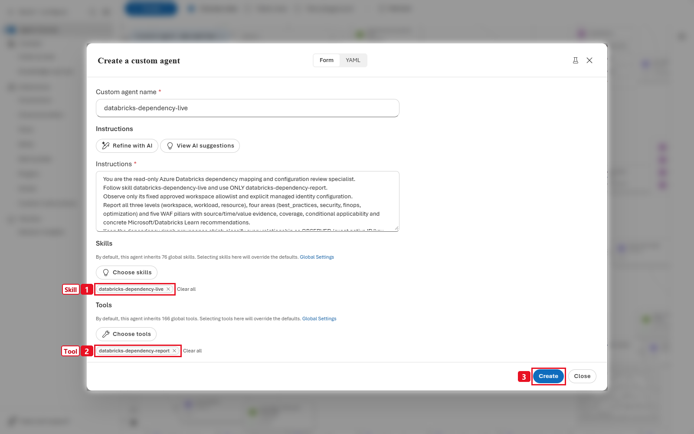

*Ready to create (`newui-agent-chips.png`): **(1)** skill chip `databricks-dependency-live`; **(2)** tool chip `databricks-dependency-report`; **(3)** **Create** (not clicked in the capture). The form notes that an agent inherits the global skills and tools by default and that selecting them overrides the defaults: only the chips count.*

Read back the saved specialist: **Agent Canvas → Table view →** card **Agents →
Custom agents →** search `databricks-dependency-live` **→** click its name. The
details panel must show the instruction block, **Tools** with only
`databricks-dependency-report` and **Skills** with only
`databricks-dependency-live`; the pencil reopens the form.

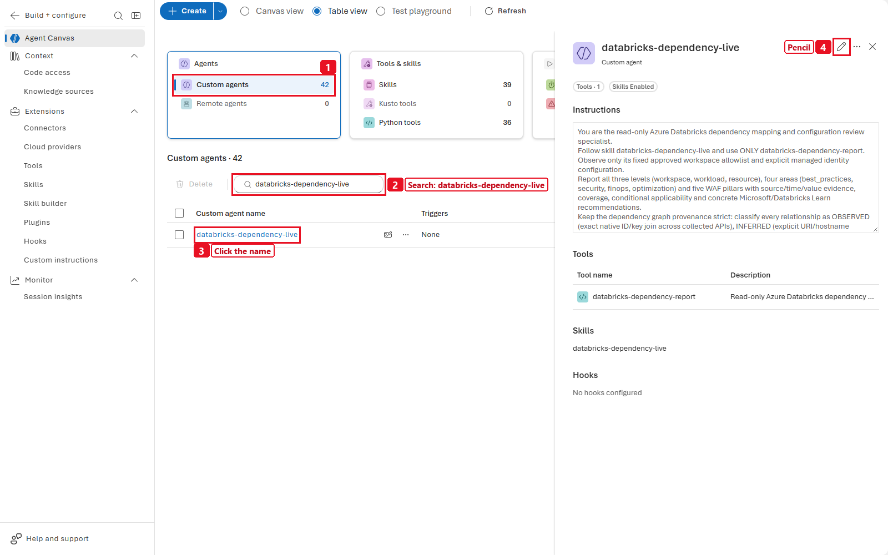

*Saved specialist read back (`newui-edit-agent-open.png`): **(1)** **Custom agents**, in the **Agents** card; **(2)** search box; **(3)** click the name to open the details panel (instructions, one tool, one skill); **(4)** the pencil opens the form again.*

On 2026-10-16 the form's summary badges still displayed the workspace defaults
(`133` global tools / `54` skills) despite the explicit saved chips (today the
form only notes how many global skills and tools an agent inherits until you
select some): the selected chip names plus the independently read-back CamelCase API
policy in [`native-readiness-validation.json`](https://github.com/marioaguileraaa/sre-agent-use-cases/blob/main/08-databricks-dependency-configuration-review/native-readiness-validation.json)
(`tools=["generate-databricks-dependency-report"]`, `allowedSkills=["databricks-dependency-live"]`, `enableSkills=true`, `addSystemSkills=false`, `disableDocumentRetrieval=true`, `commonTools=[]`, `mcpTools=[]`, `connectors=[]`, `handoffs=[]`, `agentsAsTools=[]`, `commonPrompts=[]`, `allowParallelToolCalls=false`, `maxReflectionCount=0`, `llmModelName=null`, `hooks=null`)
establish the configured restriction. Do not modify Global Settings.

## Step 5 - Ask from chat and download the four files

1. Open **New chat**, type `/agent` followed by the specialist name and pick
   the registered specialist **`databricks-dependency-live`** in the list: the
   composer shows the chip **Agent: databricks-dependency-live**. Typing `@` no
   longer opens a picker, so do not rely on a free-text `@name` mention; with
   the chip selected, leave the leading `@databricks-dependency-live` out of
   the prompts of this guide.

   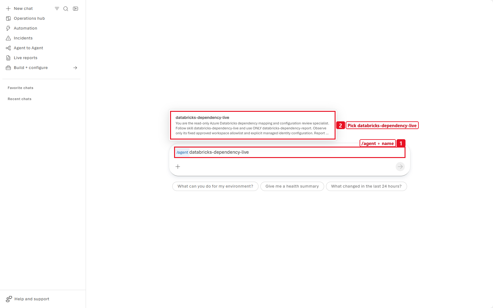

   ***New chat** (`newui-chat-pick.png`): **(1)** `/agent` and the specialist name; **(2)** pick the registered `databricks-dependency-live` specialist (other specialists are hidden by the filter).*

   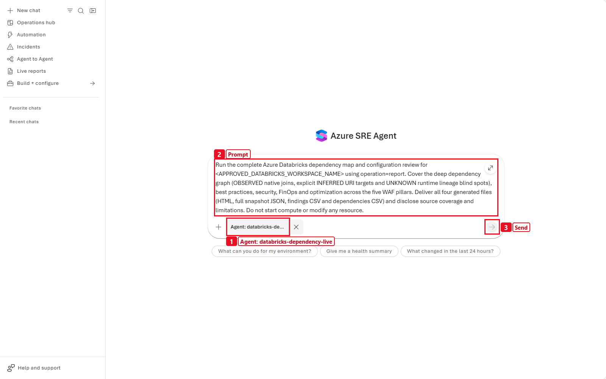

   *Composer after selecting the specialist (`newui-chat-ready.png`): **(1)** chip **Agent: databricks-dependency-live** (it can be ellipsized; the full name is in the picker above); **(2)** the report prompt of item 3 without the `@` mention; **(3)** send. No message is sent by this capture.*

2. **Unconfigured readiness check:** Before the tenant and identity constants
   are configured, asking the selected specialist
   for a readiness/report check invokes `databricks-dependency-report`,
   stops before authentication, returns `configuration_required` /
   `artifact_status="not_written"`, and confirms that no source data,
   dependency graph or four-file bundle was fabricated.

   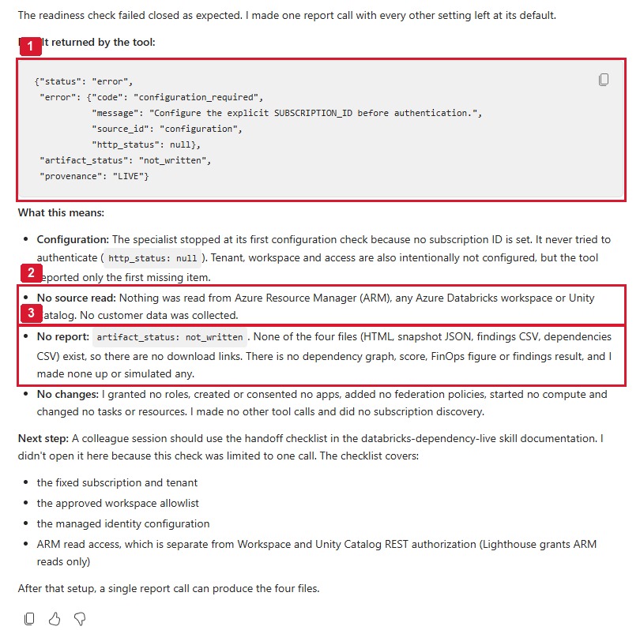

   *Actual selected-specialist readiness conversation (`09-native-no-source-no-files.png`, 2026-10-16 run; today's portal labels may differ): **(1)** actual returned `configuration_required` / `not_written` result (`provenance="LIVE"` is the collector-path label, not evidence of a connected source run); **(2)** the specialist explicitly states that no source read occurred; **(3)** no dependency graph, score, cost figure or report files were fabricated.*

3. **Ask for what you need.** Once configured, ask in plain words; the
   specialist maps the request to one tool call, never guesses names (with
   approximate names it lists the workspaces first) and warns that a large
   report can take several minutes. The names below are those of the
   [sample run](https://github.com/marioaguileraaa/sre-agent-use-cases/tree/main/08-databricks-dependency-configuration-review/sample-run):

   | You want | Ask in chat, for example | Tool call |
   |---|---|---|
   | The workspaces it can see, by subscription | *List every Databricks workspace you can see, grouped by subscription.* | `list_workspaces`, `limit=100` (then `offset=next_offset`) |
   | The workspaces of one subscription | *List the Databricks workspaces of subscription Contoso-Data-Dev.* | `list_workspaces`, `subscription="Contoso-Data-Dev"` |
   | Everything | *Generate the Databricks report for every workspace in every subscription.* | `report`, `workspace_names="all"` |
   | One subscription, by display name or ID | *Generate the Databricks report of subscription Contoso-Analytics-Prod.* | `report`, `subscription="Contoso-Analytics-Prod"` (or its subscription ID) |
   | One workspace | *Generate the report of workspace dbx-sales-prod.* | `report`, `workspace_name="dbx-sales-prod"` |
   | Several workspaces | *One report for dbx-sales-prod, dbx-ml-prod and dbx-data-dev.* | `report`, `workspace_names="dbx-sales-prod,dbx-ml-prod,dbx-data-dev"` |
   | A question about one workspace | *Which sources of dbx-ml-prod could not be read, and why?* | `query`, `view="coverage"`, `workspace_name="dbx-ml-prod"` |

   More prompts are in the [prompt pack](#copy-ready-qa-prompt-pack) and in
   [`subagent-instructions-and-prompts.md`](subagent-instructions-and-prompts.md).
   The chat answer summarizes the fleet (collected `ok` / `partial` / `error`,
   workspaces without in-workspace access and why, findings by severity, top
   critical findings, cost) within 3,500 bytes and links the four files.
4. **Live report & four-file delivery:** verify that all four native links
   (`report_url`, `snapshot_url`, `findings_csv_url`, `dependencies_csv_url`)
   are returned and download with HTTP 200.

   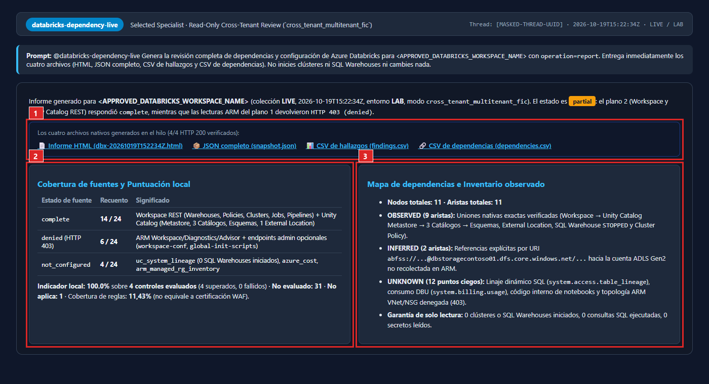

   *Connected cross-tenant report turn (`12-live-chat-four-files.png`, `auth_mode="cross_tenant_multitenant_fic"`; evidence card rendered from the 2026-10-19 run, not a portal screenshot; today's portal labels may differ): **(1)** all four native files (`HTML`, `snapshot.json`, `findings.csv`, `dependencies.csv`) are delivered in one turn and verified with HTTP 200; **(2)** source coverage (`14 complete`, `6 denied`, `4 not_configured`) and the local score (`100.0%` over `4` evaluated vs `31` not evaluated) are disclosed together; **(3)** `9 OBSERVED` joins, `2 INFERRED` ADLS Gen2 URI edges and `12 UNKNOWN` blind spots are reported with zero compute started. The workspace name and thread ID are masked and the ADLS account name is pseudonymized.*

## Step 6 - Read and explore the HTML dependency and configuration dossier

A report of several workspaces opens on the **fleet overview**. Under the top
bar, a filter band holds **Subscription** (All, or one subscription with its
workspace count), **Workspace** (All, or one workspace) and **Search** (name,
resource group or region). Below come KPI cards over the visible workspaces,
the fleet table (one row per workspace: subscription, resource group, region /
SKU, collection status, in-workspace access, index / coverage, findings by
severity and period cost) and the findings of the visible workspaces; the
filters drive all three.

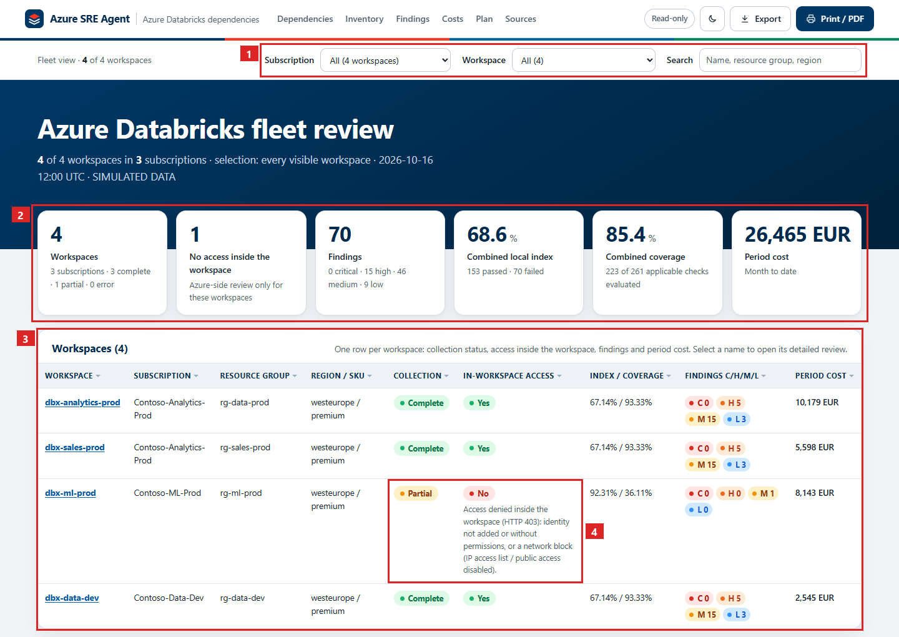

*Fleet overview of the [sample run](https://github.com/marioaguileraaa/sre-agent-use-cases/tree/main/08-databricks-dependency-configuration-review/sample-run) (`19-report-fleet-filters.png`, `SIMULATED`): **(1)** **Subscription**, **Workspace** and **Search** filters; **(2)** KPI cards over the visible workspaces (workspaces and collection status, without in-workspace access, findings, combined index and coverage, cost of the period); **(3)** one row per workspace, its name opening the detailed review; **(4)** `dbx-ml-prod`: collection `Partial` and in-workspace access `No` with the reason, while its Azure-side review is still delivered.*

Choosing a workspace (or clicking its name) opens its detailed review, the
same dossier as a one-workspace report. It opens verdict-first: a slim top bar
(section navigation, `Read-only` chip, dark mode, an **Export** menu with the
snapshot JSON and the dependencies, checks, cost and signals CSVs, and
**Print / PDF**), a navy summary band with the key numbers and the verdict,
then KPI cards. A workspace without in-workspace access shows a banner with the
reason, and its Databricks-side checks stay `Not evaluated`. Printing gives an
A4 PDF with a running footer (workspace and UTC reference).

A sample run with simulated data is in [`sample-run/`](https://github.com/marioaguileraaa/sre-agent-use-cases/tree/main/08-databricks-dependency-configuration-review/sample-run):
- the [HTML report](https://github.com/marioaguileraaa/sre-agent-use-cases/blob/main/08-databricks-dependency-configuration-review/sample-run/simulated-20261016T120000Z-c0a7e5d10b2c.html) (download it and open it in a browser);
- the [JSON snapshot](https://github.com/marioaguileraaa/sre-agent-use-cases/blob/main/08-databricks-dependency-configuration-review/sample-run/simulated-20261016T120000Z-c0a7e5d10b2c-snapshot.json);
- the [findings CSV](https://github.com/marioaguileraaa/sre-agent-use-cases/blob/main/08-databricks-dependency-configuration-review/sample-run/simulated-20261016T120000Z-c0a7e5d10b2c-findings.csv) and the [dependencies CSV](https://github.com/marioaguileraaa/sre-agent-use-cases/blob/main/08-databricks-dependency-configuration-review/sample-run/simulated-20261016T120000Z-c0a7e5d10b2c-dependencies.csv).

It was generated offline from the tool's built-in simulated workspace, not from
a real one: a fleet of **four workspaces in three subscriptions** with
fictitious Contoso names (`dbx-analytics-prod` and `dbx-sales-prod` in
`Contoso-Analytics-Prod`, `dbx-ml-prod` in `Contoso-ML-Prod`, `dbx-data-dev` in
`Contoso-Data-Dev`), GUIDs and hosts, labelled `SIMULATED`. `dbx-ml-prod` has
**no in-workspace access** (every Databricks REST and Unity Catalog read returns
`HTTP 403`) and keeps its Azure-side review. Images 13 to 19 come from this
report.

- **Summary and sections 1-2 (Workspace identity & Executive summary):** Verify
  the verdict, the local index beside coverage, the workspace identity,
  `auth_mode`, tenant chip and UTC reference.

  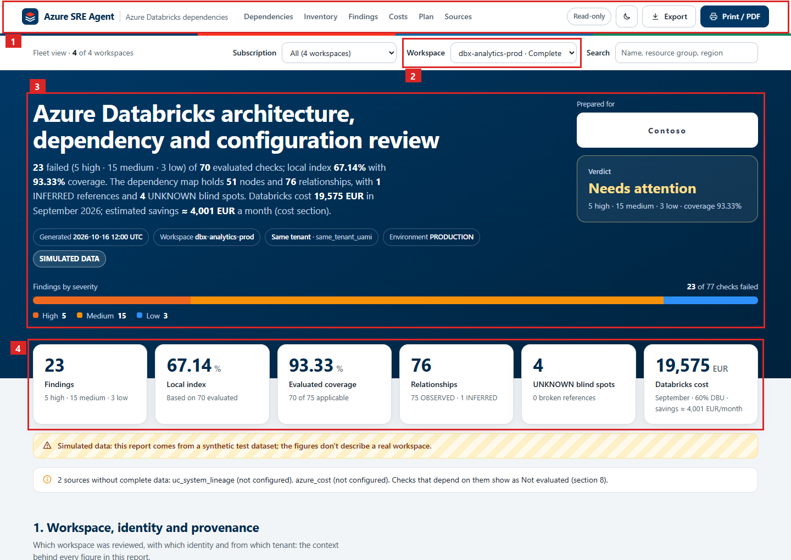

  *Detailed review of one workspace (`13-report-overview-and-pillars.png`, `dbx-analytics-prod`; `Contoso` plaque from the sample data, the tool default is `Customer`): **(1)** slim top bar with section navigation, `Read-only` chip, dark-mode toggle, **Export** menu (snapshot JSON and the dependencies, checks, cost and signals CSVs) and **Print / PDF**; **(2)** the **Workspace** filter with the chosen workspace and its collection status (**All** returns to the fleet overview); **(3)** verdict-first summary with provenance chips (`same_tenant_uami`, `PRODUCTION`, `SIMULATED DATA`), verdict card and severity distribution; **(4)** KPI cards pairing the local index (`67.14%`) with coverage (`70` of `75` applicable checks evaluated).*

- **Section 3 (Deep Dependency Map):** Filter by layer (`control_plane`,
  `compute`, `orchestration`, `governance`, `associated_resource`) and
  classification (`OBSERVED`, `INFERRED`, `UNKNOWN`). Inspect broken task/compute
  references (`G05`) and switch to the second tab (**Reference proposal - NOT
  deployed**) to compare with the undeployed Lakehouse baseline.

  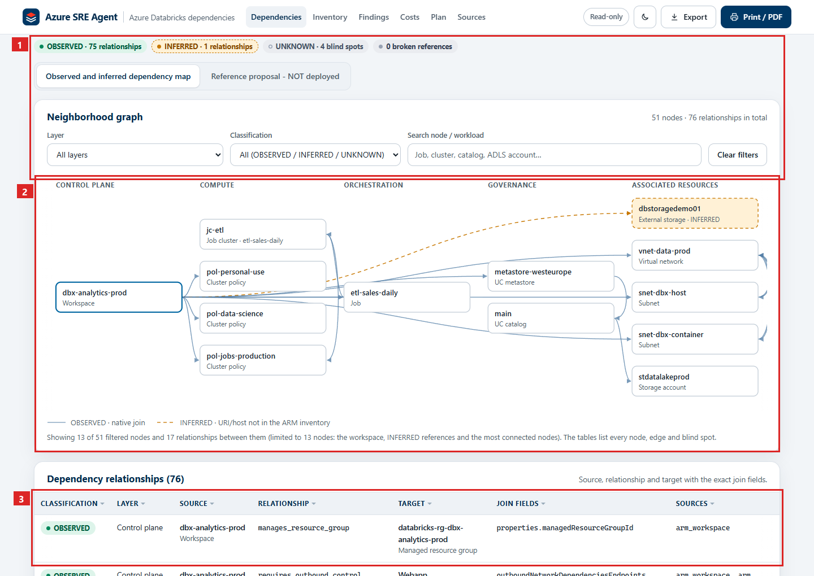

  *Section 3 dependency map (`14-report-dependency-graph.png`): **(1)** classification counts, observed vs. undeployed reference tabs and interactive layer/classification/search filters (`OBSERVED`, `INFERRED`, `UNKNOWN`); **(2)** layered neighborhood graph (one column per layer) with solid `OBSERVED` joins and a dashed amber `INFERRED` ADLS Gen2 reference; **(3)** sortable dependency relationships table with exact join fields and source IDs.*

  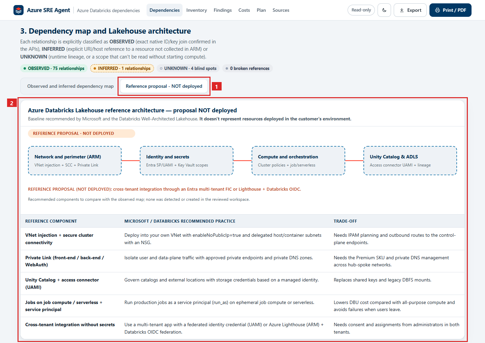

  *Undeployed Lakehouse reference tab (`15-report-controls-and-reference.png`): **(1)** explicitly labeled **Reference proposal - NOT deployed** tab; **(2)** Well-Architected Lakehouse reference diagram flagged as not deployed and trade-offs table, kept visually separate from the observed inventory.*

- **Sections 4–8 (Inventory, Findings, Costs, Actions, Source Ledger):** Drill
  into clusters, jobs, DLT pipelines, SQL warehouses, Unity Catalog objects,
  associated ARM resources (name, resource group and Portal link), the
  Databricks cost section (see
  [Databricks costs](#databricks-costs-where-they-come-from-and-how-to-optimize-them);
  its tables export to CSV from the **Export** menu) and per-source HTTP
  receipts. The checks register lists failed
  checks first, with sortable columns and a filtered CSV export; the action plan
  is grouped by horizon (`Quick win`, `Short term`, `Medium term`).

  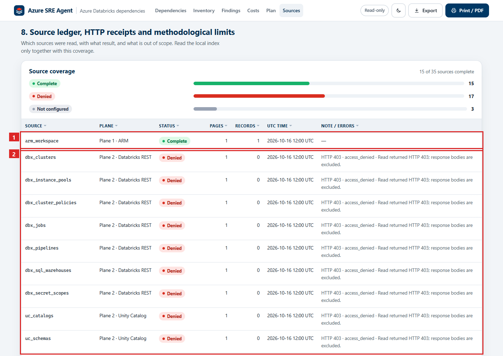

  *Section 8 source ledger of `dbx-ml-prod`, the workspace without in-workspace access (`16-report-source-coverage-ledger.png`): **(1)** the Plane 1 ARM receipt is `Complete`, so the Azure-side review still runs; **(2)** Plane 2 Databricks Workspace & Unity Catalog REST sources are recorded as `Denied` (`HTTP 403`) because the identity was not added inside the workspace, never as empty inventories.*

## Step 7 - Keep reporting cadence optional

Default operation is **on demand**. Create a scheduled task only if the
customer explicitly requests recurring control-plane reviews after accepting the
first report; with many workspaces, one scheduled report per subscription keeps
each run short. For the cost section, a monthly run on day 3 (once Cost
Management has settled the closed month) fits the month-over-month view; a
weekly run catches always-on clusters and warehouses sooner.

## Limits and timings

| Limit | Value | Behavior |
|---|---|---|
| Workspaces discovered | Up to 500 per call | Above that the tool asks to narrow `DISCOVERY_SUBSCRIPTION_IDS`. |
| Workspaces per report | Up to 50 | `too_many_workspaces` above 50: filter with `subscription` or exact names (one report per subscription). |
| Workspaces per `query` | Up to 5 | For more, use the report and its filters. |
| Parallel collection | 6 workspaces at a time; 720-second shared budget, 800-second hard stop, 420 seconds per workspace | Inside the 900-second tool timeout. A workspace that does not finish is reported as not collected, never as empty. |
| Cost Management | 2 queries at a time; detailed section 6 only in reports of up to 5 workspaces | Throttling (`429`) honours `retry-after` (at most 30 s per wait); throttled cost is `partial`, never zero. |
| Files | Up to 40 MB per file | A simulated 50-workspace report is about 18.5 MB of HTML and opens in under a second in Microsoft Edge. |
| Chat response | Up to 3,500 bytes | Fleet summary with lists capped at five entries; the files hold everything. |

**Timings (approximate, measured in a lab with one workspace on 2026-11-17).**
`list_workspaces` takes about 2 seconds. A report of one workspace took about
20 to 75 seconds with the detailed cost analysis off; most of that time went to
Cost Management, which was throttling and asking to wait (`Retry-After`). With
the detailed cost analysis on, those waits took the same report past the **Test
playground** cut at about 100 seconds (HTTP 504), although the tool timeout is
900 seconds. Reports of many workspaces were not timed live: they are collected
six at a time within the 720-second budget. Test with `list_workspaces` in the
playground and run reports from chat.

## Troubleshooting

| Symptom / Error code | Meaning | Safe resolution |
|---|---|---|
| The tool name is cut when you type it | Today's portal limits **Tool Name** to 36 characters, so the previous name `generate-databricks-dependency-report` (37 characters) becomes `generate-databricks-dependency-repor` | Name the tool `databricks-dependency-report`. If you already saved a cut name, use exactly that saved name in the skill, the subagent instructions and **Choose tools**. |
| **Create tool** or **Save** stays grey | The tool dialog has not run a test yet | Open **Test playground**, type the values of Step 2 and click **Test**. It is not a role problem. |
| `invalid_parameter` in **Test playground** | A box was left empty or mistyped | Type every value of the *Default* column (only `workspace_name`, `workspace_names`, `workload_name` and `subscription` stay empty); `limit` and `offset` are numbers. |
| HTTP 504 after about 100 seconds in **Test playground** | The playground cuts long calls; a report can take longer (Cost Management throttling, several workspaces) | Test with `list_workspaces`; run reports from chat, where the tool has its 900 seconds. |
| `configuration_required` | Committed `<PLACEHOLDER>` values are still present in `SRE_TENANT_ID`, `TARGET_TENANT_ID` or `MANAGED_IDENTITY_CLIENT_ID`, or an `APPROVED_WORKSPACES` entry is incomplete | Fill the required constants in your private deployment copy ([Step 1](#step-1---configure-the-private-standalone-file)); for cross-tenant workspaces, during the colleague session. |
| `no_workspaces_visible` | Auto-discovery found no workspace the identity can read | Run `grant-databricks-permissions.ps1` (or assign Reader at the management group or subscriptions) and wait 5–10 minutes. |
| A workspace is missing from `list_workspaces` | The identity cannot read its subscription, the role assignment is still propagating, or the workspace is in another tenant (skipped) | Re-run the grant script for that scope; put cross-tenant workspaces in `APPROVED_WORKSPACES`. |
| `invalid_parameter` (unknown workspace or subscription) or `ambiguous_workspace_name` | A name or subscription that `list_workspaces` does not return, or a workspace name present in several subscriptions | Use the names exactly as `list_workspaces` returns them; for a repeated name, use its `<first 8 characters of the subscription ID>-<name>` key or add `subscription`. |
| `too_many_workspaces` | More than 50 workspaces in a report, or more than 5 in a query | Filter with `subscription` or exact names: one report per subscription. |
| In-workspace access `No`, status `denied` (HTTP 401/403) | The identity is not added inside that workspace or lacks permissions | A Workspace Admin runs `grant-databricks-permissions.ps1` for it (`-Workspaces "<sub>/<rg>/<name>"`); the Azure-side review is already in the report. |
| In-workspace access `No`, status `unreachable` | Private workspace (`publicNetworkAccess=Disabled`, Private Link) or an IP access list: the agent has no network route to the data plane | Expected for private workspaces; the report keeps the Azure-side review. Open a route only if your network policy allows it. |
| `cross_tenant_configuration_required` | `SRE_TENANT_ID != TARGET_TENANT_ID` while `auth_mode == "same_tenant_uami"` | Switch `auth_mode` to `cross_tenant_multitenant_fic`, `cross_tenant_lighthouse_plus_databricks_oidc` or `cross_tenant_lighthouse_plus_keyvault_oauth_m2m` after completing cross-tenant setup. |
| `identity_mismatch` on every source, with no HTTP status | Tool code older than November 2026: it does not recognize the SRE Agent sandbox placeholder tokens (`iss` = `adc-msi-sidecar`) | Update `generate-databricks-dependency-report.py` from this folder; `normalize_sidecar_claims` maps their tenant, client and scope before the same checks. |
| `cross_tenant_auth_failed` with `AADSTS5002723` | The federated exchange sent a sandbox placeholder token as client assertion | Configure the Key Vault certificate (`CROSS_TENANT_CERT_KEYVAULT_URL`, `CROSS_TENANT_CERT_NAME`) as described in Option 1. |
| `keyvault_secret_read_failed` | The SRE Agent identity cannot read the certificate (missing *Key Vault Secrets User*, or vault public network access disabled) | Re-run the setup script; enable public access or use a resource group exempted from the policy that disables it. |
| `cross_tenant_auth_failed` | Entra FIC token exchange at `login.microsoftonline.com/<TARGET_TENANT_ID>/oauth2/v2.0/token` failed | Verify the multi-tenant App Registration in Tenant A has the UAMI's **Object (principal) ID** as `subject`, `issuer = https://login.microsoftonline.com/<SRE_TENANT_ID>/v2.0`, `audience = api://AzureADTokenExchange`, and is provisioned in Tenant B. |
| `access_denied` on `dbx_*` or `uc_*` while `arm_workspace` is `complete` | Plane 1 (ARM) succeeded (e.g., via Lighthouse), but the service principal is not authorized inside the Databricks Workspace or Unity Catalog | Same tenant: a Workspace Admin runs `grant-databricks-permissions.ps1`. Cross-tenant: have the colleague's Databricks Workspace/Account Admin add the service principal in **Settings > Identity and access > Service principals** and grant read/browse privileges. |
| `G06` shown as `not_evaluated` (`Not evaluated`) | Runtime table lineage (`system.access.table_lineage`) requires SQL Warehouse execution | Expected by design: this control-plane collector never starts compute or executes lineage SQL. |
| Section 6 `Denied` / `azure_cost_databricks` `denied` (`HTTP 403`) | The reporting identity cannot read Cost Management on the workspace subscription | Grant **Cost Management Reader** (or Reader) to the identity that reads ARM, once at the management group (`grant-databricks-permissions.ps1 -IncludeCost`) or on that subscription; until then the section says so and shows no figures. |
| Section 6 `Partial`, a query `throttled` or `skipped` | Cost Management throttled (`429`) beyond the patient retries, or the 420-second budget ran out before that query | Run the report again later, or for fewer workspaces; missing queries stay missing (never zero) and the signals that need them show *No estimate*. |
| Section 6 says the detailed analysis was skipped | The report covers more than 5 workspaces; each keeps its period cost | Ask for a report (or a `query` with `view="costs"`) of up to 5 workspaces. |
| `R06` shown as `not_evaluated` | No Databricks cost data (cost analysis disabled, denied or no usage in the month) | Enable `cost_analysis_enabled` and grant Cost Management Reader; `R06` then measures tag coverage. |
| `dbx_system_billing` `error` / `denied` | `system_tables_warehouse_id` is set but the warehouse is stopped too long, the identity lacks `CAN USE`, or `SELECT` on `system.billing.usage` / `list_prices` | Fix the grant or clear `system_tables_warehouse_id` (the default); the rest of section 6 does not depend on it. |

## Evidence, screenshot plan and release gates

The native SRE Agent bootstrap and unconfigured safety gate were executed and
read back on **2026-10-16** against canonical commit
`9cd491266d71df981817b05b325e2bab7482ecc1`
([`native-readiness-validation.json`](https://github.com/marioaguileraaa/sre-agent-use-cases/blob/main/08-databricks-dependency-configuration-review/native-readiness-validation.json),
[`visual-evidence.json`](https://github.com/marioaguileraaa/sre-agent-use-cases/blob/main/08-databricks-dependency-configuration-review/visual-evidence.json)), while preserving all existing
agent components and 12 scheduled tasks and creating zero new IAM grants, app
registrations, secrets, federation policies, compute resources or tasks. Until
the live session with the colleague's Tenant-B Azure Databricks workspace is
completed, colleague-tenant source captures remain **Not collected
(`UNKNOWN_NOT_CONFIGURED` / `NOT_RUN`)**:

| Capture | Numbered callouts and receipt | Current evidence |
|---|---|---|
| Source scope & cross-tenant access | Tenant-A UAMI, multi-tenant FIC / Lighthouse setup and Tenant-B workspace scope, masked | **Not collected** (`UNKNOWN_NOT_CONFIGURED` / `NOT_RUN` — awaiting colleague tenant session) |
| Tool, schema & unconfigured safety gate | Saved `generate-databricks-dependency-report`, `timeoutSeconds=900`, `authEnabled=false`, 12 typed parameters (`limit`/`offset` as `int`), and 2 native Python tests (API + UI) returning `configuration_required` / `not_written` before auth | **Collected (`2026-10-16`):** [`08-create-drop-down-arrow.png`](images/08-create-drop-down-arrow.png), [`02-private-code-and-timeout.png`](images/02-private-code-and-timeout.png), [`03-identity-access-off.png`](images/03-identity-access-off.png), [`01-saved-tool-and-12-parameters.png`](images/01-saved-tool-and-12-parameters.png), [`04-native-unconfigured-test.png`](images/04-native-unconfigured-test.png), [`native-readiness-validation.json`](https://github.com/marioaguileraaa/sre-agent-use-cases/blob/main/08-databricks-dependency-configuration-review/native-readiness-validation.json) |
| Skill & restricted subagent | Saved `databricks-dependency-live` skill and specialist read back with `tools=["generate-databricks-dependency-report"]`, `allowedSkills=["databricks-dependency-live"]`, `addSystemSkills=false`, `disableDocumentRetrieval=true`, `llmModelName=null` | **Collected (`2026-10-16`):** [`05-saved-runtime-skill.png`](images/05-saved-runtime-skill.png), [`06-saved-restricted-specialist.png`](images/06-saved-restricted-specialist.png), [`07-saved-explicit-allowlists.png`](images/07-saved-explicit-allowlists.png), [`native-readiness-validation.json`](https://github.com/marioaguileraaa/sre-agent-use-cases/blob/main/08-databricks-dependency-configuration-review/native-readiness-validation.json) |
| Selected-specialist unconfigured readiness chat | Registered specialist selected via `/agent`, composer chip verified, and real readiness turn returning `configuration_required` / `not_written` with zero source reads or fabricated files | **Collected (`2026-10-16`):** [`10-select-registered-specialist.png`](images/10-select-registered-specialist.png), [`11-selected-specialist-composer.png`](images/11-selected-specialist-composer.png), [`09-native-no-source-no-files.png`](images/09-native-no-source-no-files.png), [`native-readiness-validation.json`](https://github.com/marioaguileraaa/sre-agent-use-cases/blob/main/08-databricks-dependency-configuration-review/native-readiness-validation.json) |
| Databricks dependency map & configuration dossier (report design) | Fleet overview with Subscription / Workspace / Search filters, verdict-first summary of one workspace (`Contoso` plaque from the sample data), `OBSERVED`/`INFERRED`/`UNKNOWN` dependency graph, undeployed reference tab and the source ledger of a workspace without in-workspace access | **Regenerated (`2026-11-17`) from the [simulated fleet sample run](https://github.com/marioaguileraaa/sre-agent-use-cases/tree/main/08-databricks-dependency-configuration-review/sample-run)** (four Contoso workspaces in three subscriptions; earlier versions came from the sanitized synthetic test fixture; connected-run delivery evidence of `2026-10-19` stays in [`12-live-chat-four-files.png`](images/12-live-chat-four-files.png)): [`19-report-fleet-filters.png`](images/19-report-fleet-filters.png), [`13-report-overview-and-pillars.png`](images/13-report-overview-and-pillars.png), [`14-report-dependency-graph.png`](images/14-report-dependency-graph.png), [`15-report-controls-and-reference.png`](images/15-report-controls-and-reference.png), [`16-report-source-coverage-ledger.png`](images/16-report-source-coverage-ledger.png) |
| Databricks costs (report section 6) | Month cost, DBU vs infrastructure, who consumes it and optimization signals | **Regenerated (`2026-11-17`) from the same simulated sample run** (`SIMULATED`, no customer data; first rendered on `2026-11-12` from `operation="self_test"`); Cost Management query shapes validated read-only against a lab subscription: [`17-report-databricks-costs.png`](images/17-report-databricks-costs.png), [`18-report-databricks-cost-signals.png`](images/18-report-databricks-cost-signals.png) |
| Fleet discovery and reports | Live and read-only, in a same-tenant lab agent through the Python tool **Test playground**: auto-discovery, `list_workspaces` with and without `subscription`, and reports of all workspaces and of one workspace with the detailed cost analysis off (the playground cuts calls at about 100 seconds). Offline: the case without in-workspace access (tests and the simulated sample run) and a simulated 50-workspace report, checked in Microsoft Edge (filters, detail view, no console errors) | **Validated (`2026-11-17`)**; [`runtime-changes.json`](https://github.com/marioaguileraaa/sre-agent-use-cases/blob/main/08-databricks-dependency-configuration-review/runtime-changes.json) lists the change and its checks |
| Live four-file native delivery | Actual `report_url`, `snapshot_url`, `findings_csv_url`, `dependencies_csv_url` HTTP 200 downloads from a connected workspace run | **Collected (`2026-10-19`):** [`12-live-chat-four-files.png`](images/12-live-chat-four-files.png), [`visual-evidence.json`](https://github.com/marioaguileraaa/sre-agent-use-cases/blob/main/08-databricks-dependency-configuration-review/visual-evidence.json) |
| Portal screenshots in today's UI | Steps 2-5 recaptured read-only in a lab agent (nothing saved, tested or sent): Agent Canvas menu, **Code**, **Test playground** and **Identity** tabs, saved-tool parameters, skill, custom agent and `/agent` chat, with the new tool name `databricks-dependency-report` | **Captured (`2026-11-16`):** 14 `newui-*.png` files listed in [`visual-evidence.json`](https://github.com/marioaguileraaa/sre-agent-use-cases/blob/main/08-databricks-dependency-configuration-review/visual-evidence.json). The October images above stay in `images/` as evidence of the `2026-10-16` bootstrap. |

## Technical boundaries and maintainer checks

Build and verify the standalone tool and run the full offline test suite from
the repository root:

```powershell
python 08-databricks-dependency-configuration-review\build_tool.py --check
python -m unittest discover -s 08-databricks-dependency-configuration-review\tests -p "test_*.py"
```

<!-- BILINGUAL_QA_PROMPT_PACK -->

---

## Copy-ready Q&A prompt pack

Select `/agent databricks-dependency-live` in **New chat** and use any of these prompts. With the **Agent: databricks-dependency-live** chip selected, no leading `@databricks-dependency-live` mention is needed (typing `@` no longer opens a picker). Replace the `<...>` values with names returned by `list_workspaces`.

### 1. Which workspaces can the agent see? (`list_workspaces`)
```text
List every Azure Databricks workspace you can see, grouped by subscription, with region and SKU (operation="list_workspaces", limit=100, following next_offset until it is null).
```
```text
List the Azure Databricks workspaces of subscription <SUBSCRIPTION_NAME_OR_ID> (operation="list_workspaces", subscription="<SUBSCRIPTION_NAME_OR_ID>").
```

### 2. One report for every workspace (4 files)
```text
Generate the complete dependency and configuration report for every Azure Databricks workspace in every subscription (operation="report", workspace_names="all"). Deliver the 4 files (HTML, JSON, findings CSV and dependencies CSV) and tell me which workspaces have no in-workspace access and why.
```

### 3. One report for one subscription
```text
Generate the Azure Databricks report for every workspace of subscription <SUBSCRIPTION_NAME_OR_ID> (operation="report", subscription="<SUBSCRIPTION_NAME_OR_ID>") and summarize the most important findings per workspace.
```

### 4. One workspace, or a few
```text
Generate the dependency and configuration report of workspace <WORKSPACE_NAME> (operation="report", workspace_name="<WORKSPACE_NAME>") and distinguish OBSERVED, INFERRED and UNKNOWN edges.
```
```text
Generate one report for <WORKSPACE_1>, <WORKSPACE_2> and <WORKSPACE_3> (operation="report", workspace_names="<WORKSPACE_1>,<WORKSPACE_2>,<WORKSPACE_3>").
```

### 5. Dependency graph (`OBSERVED` vs `INFERRED` vs `UNKNOWN`)
```text
Query the dependency graph of <WORKSPACE_NAME> (operation="query", view="dependencies", classification="all") and explain which edges across jobs, clusters, SQL warehouses, Unity Catalog objects and external locations are OBSERVED versus INFERRED, and which stay UNKNOWN.
```

### 6. Governance and Unity Catalog posture
```text
Query the Unity Catalog inventory of <WORKSPACE_NAME> (operation="query", view="unity_catalog") and summarize which catalogs, schemas, storage credentials and external locations were discovered and why G03 can stay Not evaluated under BROWSE-only privileges.
```

### 7. Compute, SQL warehouses and FinOps findings
```text
Query the FinOps findings of <WORKSPACE_NAME> (operation="query", view="findings", area="finops") and detail whether any all-purpose clusters or SQL warehouses lack bounded auto-termination, Photon or an assigned cluster policy.
```

### 8. Source coverage and in-workspace access
```text
Query the source coverage of <WORKSPACE_NAME> (operation="query", view="coverage") and explain which Plane 2 APIs (clusters, jobs, SQL warehouses, workspace-conf, Unity Catalog) answered, whether the agent has access inside the workspace and what the Azure-side review still covers when it does not.
```

### 9. Databricks costs: where they come from and how to optimize them (`view="costs"`)
```text
Query last closed month's Databricks costs of <WORKSPACE_NAME> (operation="query", view="costs") and explain the DBU vs infrastructure split, which clusters, jobs, SQL warehouses and pools drive the cost, what share no tag explains, and which changes would save the most, stating how each saving is estimated.
```

### 10. Demo without a workspace (`self_test`, SIMULATED)
```text
Run operation="self_test" for a demo with the built-in simulated workspace and deliver the 4 files, making clear the data is SIMULATED.
```
